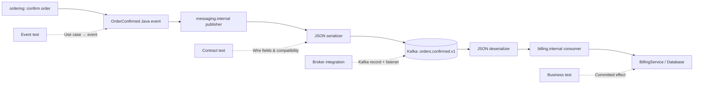
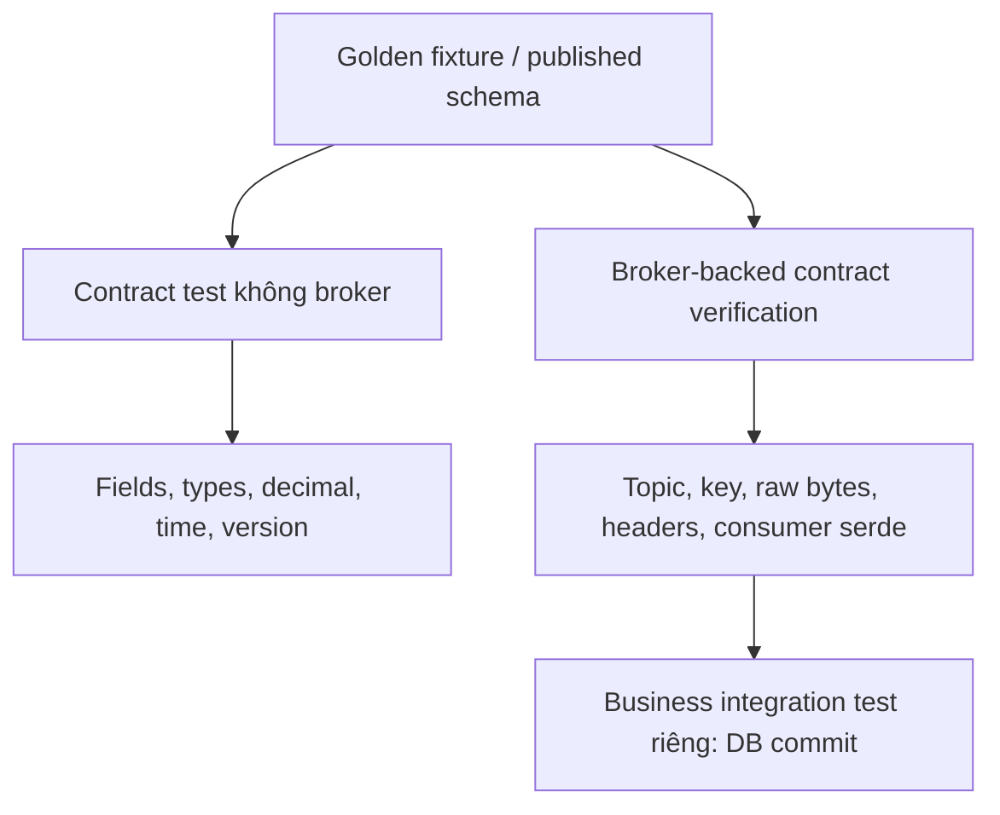
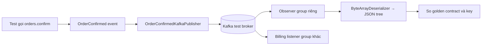
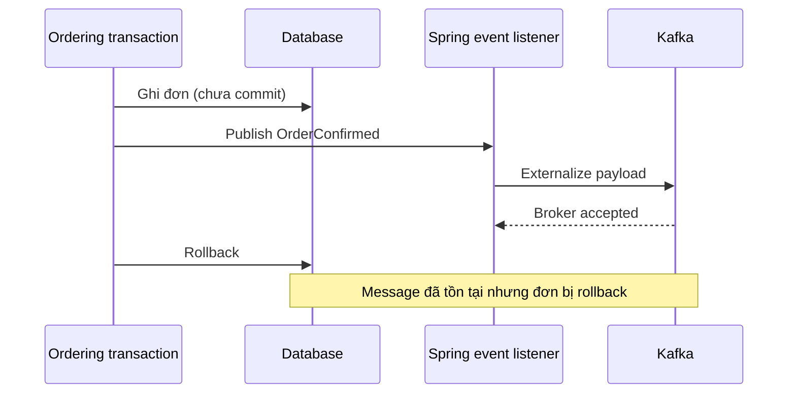
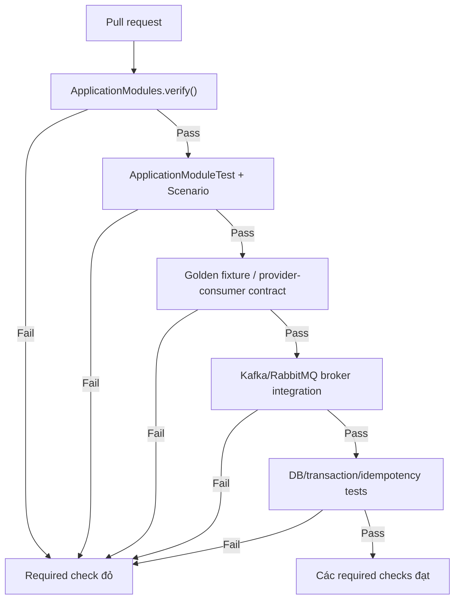

# Phân biệt event test với contract test của broker trong Spring Modulith

## 1. Đặt đúng câu hỏi trước khi viết test

Trong một ứng dụng Spring Modulith, module `ordering` có thể công bố `OrderConfirmed`. Một adapter của module `messaging` chuyển sự kiện đó thành JSON trên Kafka, còn module `billing` nhận message để khởi tạo yêu cầu thanh toán.

Có ba nhận định rất dễ bị nhầm:

1. “`@ApplicationModuleTest` thấy `OrderConfirmed`, vậy consumer Kafka chắc đọc được JSON.”
2. “JSON có thể serialize/deserialize, vậy nghiệp vụ chắc đã phát đúng event.”
3. “Kafka broker đã nhận record, vậy yêu cầu thanh toán chắc đã commit.”

Cả ba đều **không phải suy luận hợp lệ** nếu thiếu kiểm chứng bổ sung. Chúng nói về ba ranh giới khác nhau: **hành vi của application event**, **hợp đồng dữ liệu truyền tải**, và **đường tích hợp thực tế qua broker**.

Bài **“Phân biệt event test với contract test của broker”** thuộc chương **Messaging testing** của học phần `SPRING_MODULITH_VERIFICATION_TESTING`. Mục tiêu học phần là rèn kỹ năng kiểm chứng ranh giới kiến trúc bằng `ApplicationModules`, `ApplicationModules.verify()`, luật phụ thuộc module, `@ApplicationModuleTest`, kiểm thử sự kiện, database, tích hợp và quality gate CI để chặn phụ thuộc sai cũng như hồi quy.

Kết thúc bài, bạn có thể:

- Trả lời **event test chứng minh điều gì**, và điều gì nằm ngoài phạm vi của nó.
- Phân biệt **contract test không cần broker** với **contract verification chạy trên broker thật**.
- Viết test với `Scenario.stimulate(...)`, `Scenario.publish(...)`, fixture JSON cố định, Jackson và Kafka Testcontainers.
- Kiểm tra payload, version, key, topic, headers và serialization theo đúng boundary.
- Phân biệt provider-side contract, consumer-driven contract và end-to-end business test.
- Thiết kế ma trận quality gate kết hợp kiểm chứng cấu trúc `verify()` và kiểm thử runtime.

## 2. Bốn tầng kiểm chứng: đừng gom chung vào một “event test”

| Tầng | Câu hỏi kiểm chứng | Công cụ thường dùng | Điều **chưa** được chứng minh |
| --- | --- | --- | --- |
| **Application event test** | Use case có phát event đúng? Listener trong Spring context có phản ứng đúng? | JUnit, `@ApplicationModuleTest`, `Scenario`, Mockito | Bytes, schema, routing, Kafka consumer group |
| **Wire/message contract test** | Payload được serialize có đúng hợp đồng mà consumer đã cam kết? | Golden fixture, Jackson, JSON Schema, Avro/Protobuf, contract framework | Broker có chạy, listener có subscribe, DB có commit |
| **Broker integration test** | Producer/consumer thực sự đi qua topic, key, headers, serialization/deserialization không? | Spring Kafka, Testcontainers, test consumer/probe | Business transaction cuối cùng chắc chắn thành công |
| **Business integration/end-to-end test** | Luồng có tạo business effect chính xác và bền vững? | Broker + DB + service thật, Awaitility | Kiến trúc package/module không vi phạm |

Ngoài bốn tầng runtime còn có **architecture test**: `ApplicationModules.verify()` xác nhận phụ thuộc được nhận diện theo code/package, không tự kiểm tra message schema hoặc broker.

**Quy tắc chọn test:** bắt đầu từ câu hỏi cần bảo vệ, rồi đặt điểm kích hoạt và điểm quan sát **ở hai phía của ranh giới liên quan**. Không cần khởi động Kafka để kiểm tra một phép mapping thuần Java; cũng không thể dùng mock `KafkaTemplate` để chứng minh Kafka thật deserialize được payload.

## 3. Luồng mẫu gồm domain event, transport message và consumer

Ví dụ ứng dụng:

```text
com.example.shop
├── ShopApplication.java
├── ordering
│   ├── OrderConfirmed.java
│   └── OrderApplicationService.java
├── messaging
│   ├── OrderConfirmedV1.java
│   └── internal
│       └── OrderConfirmedKafkaPublisher.java
└── billing
    └── internal
        ├── OrderConfirmedKafkaConsumer.java
        └── BillingService.java
```

Ba application module theo quy ước package mặc định: `ordering`, `messaging` và `billing`. `OrderConfirmed` là API sự kiện của ordering; `OrderConfirmedV1` là API hợp đồng truyền tải của messaging; các adapter/use case implementation nằm trong package `internal`.



Một **Spring application event** có thể được dispatch trực tiếp dưới dạng object Java trong cùng context. Kafka thì truyền **record bytes** cùng topic, partition, key và headers.

Ngay cả khi lớp Java của domain event và payload có cùng các field, **hai đường này không có cùng hợp đồng**. Việc đổi tên package hoặc một trường nội bộ có thể không ảnh hưởng Spring event test nhưng làm hỏng consumer ở process khác.

## 4. Event test: kiểm tra hành vi phát sự kiện từ use case

Domain event công khai của `ordering`:

```java
// src/main/java/com/example/shop/ordering/OrderConfirmed.java
package com.example.shop.ordering;

import java.math.BigDecimal;
import java.time.Instant;
import java.util.UUID;

public record OrderConfirmed(
        UUID eventId,
        UUID orderId,
        BigDecimal total,
        String currency,
        Instant occurredAt
) {
}
```

Use case minh họa:

```java
// src/main/java/com/example/shop/ordering/OrderApplicationService.java
package com.example.shop.ordering;

import java.math.BigDecimal;
import java.time.Instant;
import java.util.UUID;
import org.springframework.context.ApplicationEventPublisher;
import org.springframework.stereotype.Service;

@Service
public class OrderApplicationService {

    private final ApplicationEventPublisher events;

    public OrderApplicationService(ApplicationEventPublisher events) {
        this.events = events;
    }

    public void confirm(UUID orderId, BigDecimal total, String currency) {
        if (orderId == null || total == null
                || total.signum() <= 0 || currency == null
                || currency.isBlank()) {
            throw new IllegalArgumentException("Invalid order");
        }

        // Demo: hệ thống thật còn kiểm tra và lưu trạng thái order.
        events.publishEvent(new OrderConfirmed(
                UUID.randomUUID(),
                orderId,
                total,
                currency,
                Instant.now()
        ));
    }
}
```

Một **event test** cần chứng minh **hành vi xác nhận đơn tạo ra domain event phù hợp**, không nên tự publish event rồi chỉ nhìn thấy chính event đầu vào.

Ví dụ đặt test dưới package `com.example.shop.ordering`:

```java
// src/test/java/com/example/shop/ordering/OrderEventTests.java
package com.example.shop.ordering;

import static org.assertj.core.api.Assertions.assertThat;

import java.math.BigDecimal;
import java.util.UUID;
import org.junit.jupiter.api.Test;
import org.springframework.beans.factory.annotation.Autowired;
import org.springframework.modulith.test.ApplicationModuleTest;
import org.springframework.modulith.test.Scenario;

@ApplicationModuleTest
class OrderEventTests {

    @Autowired
    OrderApplicationService orders;

    @Test
    void confirmingOrderEmitsDomainEvent(Scenario scenario) {
        UUID orderId = UUID.randomUUID();
        var total = new BigDecimal("125000.00");

        scenario.stimulate(
                    () -> orders.confirm(orderId, total, "VND")
                )
                .andWaitForEventOfType(OrderConfirmed.class)
                .matching(event -> event.orderId().equals(orderId))
                .toArrive();
    }
}
```

**Test khẳng định:** Spring Modulith bootstrap module `ordering`, hành vi thật `confirm(...)` kích hoạt và event loại `OrderConfirmed` mang `orderId` mong đợi xuất hiện.

**Test chưa khẳng định:** có record Kafka, topic/key đúng, JSON đúng, consumer bên ngoài đọc được hoặc payment transaction đã commit. Event được phát qua `ApplicationEventPublisher`, không qua Kafka serializer.

Với nghiệp vụ production, nên bổ sung kiểm tra các thuộc tính event khác (eventId, total, currency) khi API của kịch bản và test fixture cho phép. Muốn kiểm soát timestamp chính xác, nên inject `Clock` vào service thay vì hardcode `Instant.now()`.

## 5. Event test cho listener: kích hoạt event đầu vào, kiểm tra **phản ứng**

Khi module tiêu thụ **Spring application event nội bộ**, `Scenario.publish(...)` phù hợp để cô lập phía consumer. Giả sử một listener khác nhận `OrderConfirmed` và **phát event kết quả** `ShipmentScheduled`:

```java
// Ví dụ riêng cho một listener nhận application event trong context.
@EventListener
void on(OrderConfirmed event) {
    // Thực hiện nghiệp vụ shipping, rồi phát kết quả.
    events.publishEvent(new ShipmentScheduled(event.orderId()));
}
```

Test ý tưởng:

```java
scenario.publish(
            new OrderConfirmed(
                    eventId, orderId, total, "VND", occurredAt
            )
        )
        .andWaitForEventOfType(ShipmentScheduled.class)
        .matching(result -> result.orderId().equals(orderId))
        .toArrive();
```

Ở đây `ShipmentScheduled` và listener thuộc **một biến thể minh họa riêng**, cần được định nghĩa trong ứng dụng nếu muốn chạy snippet. Chúng **không** tồn tại trong cấu trúc package tối giản của mục 3.

Điều cần kiểm tra là **event đầu ra hoặc business state** do listener tạo ra. Đây là một event test đúng nghĩa ở phía consumer.

Một test yếu:

```java
scenario.publish(orderConfirmed)
        .andWaitForEventOfType(OrderConfirmed.class)
        .toArrive();
```

Nó có thể chỉ quan sát **`OrderConfirmed` do chính test publish**, chưa chứng minh bất kỳ listener nào thực hiện nghiệp vụ.

**Không nên cài thêm application-event listener để thanh toán rồi đồng thời bật Kafka consumer xử lý cùng nghiệp vụ mà không có idempotency**: khi cả hai đường đều active, một ý định có thể tạo hai yêu cầu thanh toán. Chọn rõ topology và test đúng đường triển khai.

## 6. Contract test: kiểm chứng điều gì được công bố ra ngoài?

Giữa producer và consumer broker có một **hợp đồng message** gồm nhiều phần hơn field Java:

- **Payload format:** JSON, Avro, Protobuf hoặc format khác.
- **Schema:** tên field, kiểu dữ liệu, trường bắt buộc, default, version, encoding.
- **Semantics:** `eventId` là một event, `orderId` là đơn hàng, `total` là số tiền theo đơn vị nào, `currency` nghĩa gì.
- **Destination:** topic/exchange/queue và chính sách version/routing.
- **Key:** partitioning/order key, ví dụ `orderId`.
- **Headers:** schema ID, content type, correlation/trace ID, tenant nếu hợp đồng yêu cầu.
- **Error policy:** dữ liệu sai schema/version được reject, quarantine hay DLT.
- **Compatibility:** các phiên bản producer/consumer đang chạy cùng lúc có đọc được message của nhau không?

**Contract test** kiểm tra một **cam kết có thể dùng chung** giữa các phía. Bài test có thể chạy hoàn toàn trong bộ nhớ bằng một serializer/decoder và golden fixture, **không bắt buộc phải khởi động broker**.

Ngược lại, một bài Testcontainers chỉ kiểm tra “đã có record trong topic” nhưng không so payload/headers/schema với hợp đồng cũng **chưa phải contract test đủ mạnh**.

### “Contract test của broker” có nghĩa chính xác là gì?

Trong thực hành, cụm này đôi khi được dùng để chỉ:

1. **Message contract test:** định dạng và semantics của message mà producer/consumer cùng cam kết — thường **không cần broker**.
2. **Broker-backed contract verification:** chạy hợp đồng ấy qua Kafka/RabbitMQ thật để xác nhận cấu hình serializer, routing, key và listener.

Nên ghi rõ loại test trong tên lớp hoặc báo cáo CI để tránh nhầm với unit event test hay một full end-to-end test.

## 7. Tạo transport DTO độc lập với domain model

Transport contract `OrderConfirmedV1` của module `messaging`:

```java
// src/main/java/com/example/shop/messaging/OrderConfirmedV1.java
package com.example.shop.messaging;

import java.math.BigDecimal;
import java.time.Instant;
import java.util.Objects;
import java.util.UUID;

public record OrderConfirmedV1(
        int schemaVersion,
        UUID eventId,
        UUID orderId,
        BigDecimal total,
        String currency,
        Instant occurredAt
) {
    public OrderConfirmedV1 {
        if (schemaVersion != 1) {
            throw new IllegalArgumentException("Only schema V1 is supported");
        }
        Objects.requireNonNull(eventId, "eventId");
        Objects.requireNonNull(orderId, "orderId");
        Objects.requireNonNull(total, "total");
        Objects.requireNonNull(occurredAt, "occurredAt");
        if (total.signum() <= 0
                || currency == null || currency.isBlank()) {
            throw new IllegalArgumentException("Invalid order payload");
        }
    }
}
```

Điểm khác giữa hai loại sự kiện:

| Domain event `OrderConfirmed` | Wire DTO `OrderConfirmedV1` |
| --- | --- |
| Phục vụ diễn đạt sự thật nghiệp vụ trong module | Phục vụ giao tiếp giữa producer/consumer ở boundary |
| Có thể tiến hóa cùng mô hình domain | Cần quản lý phiên bản và khả năng tương thích |
| Dispatch dạng object Java qua Spring event bus | Serialize thành bytes, rồi deserialize |
| Có thể chứa kiểu Java thuận tiện cho domain | Chỉ nên dùng kiểu được hợp đồng wire hỗ trợ |
| Không nhất thiết biết Kafka topic/headers | Liên quan topic, key, format, version/schema |
| Kiểm tra bằng `Scenario` | Kiểm tra bằng fixture/schema/codec và broker verification |

Không serialize trực tiếp JPA entity, lazy-loading proxy, hoặc các kiểu trong `ordering.internal` sang broker nếu consumer không cần chúng. Cách đó làm rò rỉ schema nội bộ và tăng coupling, có thể vi phạm định hướng module dù một test serialization riêng lẻ đang xanh.

## 8. Adapter chuyển domain event thành wire message

Ví dụ outbound adapter nằm trong module `messaging`:

```java
// src/main/java/com/example/shop/messaging/internal/
// OrderConfirmedKafkaPublisher.java
package com.example.shop.messaging.internal;

import com.example.shop.messaging.OrderConfirmedV1;
import com.example.shop.ordering.OrderConfirmed;
import org.springframework.beans.factory.annotation.Value;
import org.springframework.context.event.EventListener;
import org.springframework.kafka.core.KafkaTemplate;
import org.springframework.stereotype.Component;

@Component
class OrderConfirmedKafkaPublisher {

    private final KafkaTemplate<String, OrderConfirmedV1> kafka;
    private final String topic;

    OrderConfirmedKafkaPublisher(
            KafkaTemplate<String, OrderConfirmedV1> kafka,
            @Value("${app.messaging.orders-topic}") String topic) {
        this.kafka = kafka;
        this.topic = topic;
    }

    @EventListener
    void on(OrderConfirmed event) {
        var wire = new OrderConfirmedV1(
                1,
                event.eventId(),
                event.orderId(),
                event.total(),
                event.currency(),
                event.occurredAt()
        );

        kafka.send(topic, event.orderId().toString(), wire);
    }
}
```

Trong cấu hình này:

- `messaging → ordering` là cạnh dependency tĩnh do publisher dùng `OrderConfirmed` từ API của ordering.
- Adapter chuyển dữ liệu thành `OrderConfirmedV1`, chọn topic và key.
- `KafkaTemplate.send(...)` trả một kết quả bất đồng bộ; gọi xong **chưa phải broker đã nhận thành công**.
- Lỗi gửi, retry, publication registry hoặc outbox cần chính sách production riêng.

**Một test mapping** có thể chứng minh adapter tạo DTO đúng, nhưng vẫn chưa kiểm tra JSON bytes và các consumer đã triển khai.

## 9. Unit test publisher mapping: cần nhưng chưa đủ

Một bài test Mockito trong cùng package `messaging.internal`:

```java
// src/test/java/com/example/shop/messaging/internal/
// OrderConfirmedKafkaPublisherTests.java
package com.example.shop.messaging.internal;

import static org.mockito.ArgumentMatchers.argThat;
import static org.mockito.ArgumentMatchers.eq;
import static org.mockito.Mockito.mock;
import static org.mockito.Mockito.verify;

import com.example.shop.messaging.OrderConfirmedV1;
import com.example.shop.ordering.OrderConfirmed;
import java.math.BigDecimal;
import java.time.Instant;
import java.util.UUID;
import org.junit.jupiter.api.Test;
import org.springframework.kafka.core.KafkaTemplate;

class OrderConfirmedKafkaPublisherTests {

    @Test
    void mapsEventToTransportMessageAndRoutingKey() {
        @SuppressWarnings("unchecked")
        KafkaTemplate<String, OrderConfirmedV1> kafka =
                mock(KafkaTemplate.class);

        var adapter = new OrderConfirmedKafkaPublisher(
                kafka, "orders.confirmed.v1"
        );
        UUID eventId = UUID.randomUUID();
        UUID orderId = UUID.randomUUID();
        var total = new BigDecimal("125000.00");
        Instant time = Instant.parse("2026-01-15T08:30:00Z");

        adapter.on(new OrderConfirmed(
                eventId, orderId, total, "VND", time
        ));

        verify(kafka).send(
                eq("orders.confirmed.v1"),
                eq(orderId.toString()),
                argThat(wire ->
                        wire.schemaVersion() == 1
                                && wire.eventId().equals(eventId)
                                && wire.orderId().equals(orderId)
                                && wire.total().compareTo(total) == 0
                                && wire.currency().equals("VND")
                                && wire.occurredAt().equals(time))
        );
    }
}
```

**Kết luận hợp lệ:** Java adapter map đúng field, gọi đúng topic/key, đưa đúng DTO vào mock KafkaTemplate.

**Kết luận không hợp lệ:** Kafka JsonSerializer đã tạo đúng JSON, DLT đã cấu hình, Kafka đã nhận record, consumer có thể deserialize hoặc DB đã commit.

Nếu tester gọi trực tiếp `adapter.on(...)`, bài này cũng không chứng minh `@EventListener` đã được Spring đăng ký. Có thể thêm module/context test riêng để xác minh wiring nếu thay đổi cấu hình có rủi ro.

## 10. Golden fixture: tiêu chuẩn độc lập với code hiện tại

Với wire V1, nhóm producer và consumer thống nhất JSON mẫu cố định:

```json
{
  "schemaVersion": 1,
  "eventId": "11111111-1111-1111-1111-111111111111",
  "orderId": "22222222-2222-2222-2222-222222222222",
  "total": 125000.00,
  "currency": "VND",
  "occurredAt": "2026-01-15T08:30:00Z"
}
```

Đây là **golden fixture** phục vụ contract verification. Các quyết định được thể hiện rõ:

- `schemaVersion` là số nguyên, không phải chuỗi.
- `eventId`/`orderId` là UUID ở dạng chuẩn.
- `total` dùng JSON number thập phân; consumer phải đọc với precision phù hợp.
- `currency` là chuỗi, cần validation theo hợp đồng.
- `occurredAt` là chuỗi ISO-8601 UTC, không phải local date string hoặc epoch milliseconds.

Fixture phải được quản lý **độc lập với producer serializer đang chạy**. Nếu mỗi lần test lại sinh golden JSON từ class mới nhất, một breaking change có thể thay đổi cả output và “expected”, khiến test xanh giả.

Để bảo vệ wire contract, so sánh **ý nghĩa JSON và kiểu dữ liệu**; không cần ép thứ tự field/whitespace giống hệt nếu hợp đồng không quy định. Khi text formatting, canonicalization hoặc chữ ký số là một phần hợp đồng, cách so sánh có thể chặt hơn.

## 11. Provider-side contract test bằng Jackson

Trong một dự án dùng Jackson 2, có thể xây dựng mapper tham chiếu:

```java
import com.fasterxml.jackson.databind.ObjectMapper;
import com.fasterxml.jackson.databind.SerializationFeature;
import com.fasterxml.jackson.datatype.jsr310.JavaTimeModule;

ObjectMapper mapper = new ObjectMapper()
        .registerModule(new JavaTimeModule())
        .disable(SerializationFeature.WRITE_DATES_AS_TIMESTAMPS);
```

Ví dụ contract test độc lập broker:

```java
// src/test/java/com/example/shop/messaging/OrderWireContractTests.java
package com.example.shop.messaging;

import static org.assertj.core.api.Assertions.assertThat;

import com.fasterxml.jackson.databind.ObjectMapper;
import com.fasterxml.jackson.databind.SerializationFeature;
import com.fasterxml.jackson.datatype.jsr310.JavaTimeModule;
import java.math.BigDecimal;
import java.time.Instant;
import java.util.UUID;
import org.junit.jupiter.api.Test;

class OrderWireContractTests {

    private final ObjectMapper mapper = new ObjectMapper()
            .registerModule(new JavaTimeModule())
            .disable(SerializationFeature.WRITE_DATES_AS_TIMESTAMPS);

    private static final String GOLDEN_V1 = """
        {
          "schemaVersion": 1,
          "eventId": "11111111-1111-1111-1111-111111111111",
          "orderId": "22222222-2222-2222-2222-222222222222",
          "total": 125000.00,
          "currency": "VND",
          "occurredAt": "2026-01-15T08:30:00Z"
        }
        """;

    @Test
    void producerOutputMatchesPublishedContract() throws Exception {
        var wire = new OrderConfirmedV1(
                1,
                UUID.fromString("11111111-1111-1111-1111-111111111111"),
                UUID.fromString("22222222-2222-2222-2222-222222222222"),
                new BigDecimal("125000.00"),
                "VND",
                Instant.parse("2026-01-15T08:30:00Z")
        );

        var actual = mapper.readTree(mapper.writeValueAsBytes(wire));
        var expected = mapper.readTree(GOLDEN_V1);

        assertThat(actual).isEqualTo(expected);
    }

    @Test
    void consumerCanReadPublishedV1Fixture() throws Exception {
        var parsed = mapper.readValue(
                GOLDEN_V1, OrderConfirmedV1.class
        );

        assertThat(parsed.schemaVersion()).isEqualTo(1);
        assertThat(parsed.total())
                .isEqualByComparingTo("125000.00");
        assertThat(parsed.orderId())
                .isEqualTo(UUID.fromString(
                        "22222222-2222-2222-2222-222222222222"));
        assertThat(parsed.occurredAt())
                .isEqualTo(Instant.parse("2026-01-15T08:30:00Z"));
    }
}
```

**Phạm vi của test:** một codec tham chiếu có thể tạo và đọc payload V1 theo fixture cố định, kiểm tra field/giá trị độc lập với Kafka.

**Giới hạn:** `new ObjectMapper()` trong test chưa chắc giống mapper được Spring Kafka JsonSerializer/JsonDeserializer sử dụng ở runtime. Nếu ứng dụng có custom Jackson module/naming strategy hoặc đổi phiên bản thư viện, cần test **codec được cấu hình thực tế** và broker integration bên dưới.

## 12. Vì sao round-trip cùng codec dễ gây xanh giả?

Test sau có ích nhưng yếu nếu đứng một mình:

```java
byte[] bytes = mapper.writeValueAsBytes(wire);
var restored = mapper.readValue(bytes, OrderConfirmedV1.class);

assertThat(restored).isEqualTo(wire);
```

Giả sử producer/consumer hiện tại cùng đổi `occurredAt` từ ISO-8601 string thành epoch milliseconds. Hai phía trong test vẫn hiểu nhau, nên round-trip có thể đạt, nhưng **consumer phiên bản cũ** đang chạy production có thể không đọc được.

Hoặc producer đổi `total` thành `amount`, consumer cùng version đổi theo, test vẫn xanh. Một service bên ngoài chưa nâng cấp sẽ thất bại.

**Golden fixture hoặc consumer contract được công bố** bảo vệ sự ổn định xuyên phiên bản tốt hơn round-trip thuần. Một hệ thống có nhiều team nên coi fixture/schema như một **API có review**, không phải file test có thể sửa tùy tiện khi code thay đổi.

## 13. Consumer-driven contract: người tiêu thụ xác định nhu cầu

Ở góc nhìn **consumer-driven contract testing**, consumer mô tả message tối thiểu mà nó cần để xử lý nghiệp vụ. Ví dụ module `billing` cần:

```text
Khi topic orders.confirmed.v1 nhận một OrderConfirmedV1:
  - schemaVersion thuộc tập phiên bản hỗ trợ;
  - eventId, orderId là UUID hợp lệ;
  - total là decimal > 0;
  - currency phù hợp;
  - occurredAt có format xác định;
  - key là orderId;
  - không được đánh mất eventId khi retry/replay.
```

Nhóm producer phải chứng minh **payload được phát** đáp ứng contract đó. Cách tổ chức có thể là:

- **Shared schema/fixture:** consumer và provider cùng tham chiếu một contract được version-control.
- **Contract broker/service:** consumer xuất bản expectation, provider verify trước khi phát hành; ví dụ các quy trình dùng Pact message contracts hoặc Spring Cloud Contract nếu hệ sinh thái phù hợp.
- **Schema Registry:** producer/consumer kiểm tra compatibility của Avro/Protobuf/JSON Schema theo quy tắc đã định.

Tên **contract broker** trong các framework như Pact Broker là **nơi quản lý hợp đồng kiểm thử**, không đồng nghĩa với **message broker Kafka/RabbitMQ**. Đừng nhầm hai hạ tầng chỉ vì cùng có chữ *broker*.

**Lợi ích:** consumer không phải chạy toàn bộ end-to-end stack để phát hiện một breaking schema change. **Giới hạn:** contract được kiểm tra vẫn có thể bỏ sót network, ACL, topic provisioning hoặc listener runtime; broker integration test bổ sung phần này.

## 14. Compatibility không chỉ là “đọc được JSON”

Một số thay đổi phổ biến:

| Thay đổi | Event test có thể vẫn đạt? | Contract test cần làm gì? |
| --- | --- | --- |
| Đổi `total` → `amount` trong wire payload | Có | Golden V1 hoặc consumer expectation phải phát hiện |
| Đổi `Instant` ISO string → epoch | Có | Kiểm tra format và semantic time |
| Đổi `BigDecimal` thành `double` | Có | Kiểm tra precision, scale/unit và giá trị lớn |
| Thêm field optional | Có | Kiểm tra consumer cũ có chấp nhận unknown field/default không |
| Xóa field bắt buộc | Có | Fixture/schema compatibility phải fail |
| Đổi topic `orders.confirmed.v1` | Có | Routing contract/broker test phải fail nếu chưa migration |
| Đổi Kafka key từ `orderId` sang UUID ngẫu nhiên | Có | Producer mapping/broker key test phải phát hiện |
| Đổi schema version không cập nhật consumer | Có | Consumer fixture/version test phải fail |
| Thay đổi business meaning của `total` | Có | Kiểm tra semantic contract, không chỉ field type |

Trong ví dụ, `OrderConfirmedV1` **chỉ hỗ trợ `schemaVersion=1`**. Nếu cần hỗ trợ V2, hãy thiết kế decoder/DTO theo version và test cả các fixture đã công bố, thay vì âm thầm thay semantics V1.

**Backward compatibility** và **forward compatibility** có ý nghĩa khác nhau; phải xét thứ tự deploy của producer/consumer. Ví dụ, consumer mới đọc được V1 chưa đồng nghĩa consumer cũ đọc được V2.

## 15. Contract âm tính: dữ liệu hợp lệ về cú pháp chưa đủ

JSON có thể parse được nhưng sai nghiệp vụ:

```json
{
  "schemaVersion": 1,
  "eventId": "11111111-1111-1111-1111-111111111111",
  "orderId": "22222222-2222-2222-2222-222222222222",
  "total": -100,
  "currency": "",
  "occurredAt": "2026-01-15T08:30:00Z"
}
```

Do compact constructor trong `OrderConfirmedV1` có validation, đối tượng này không được tạo thành công theo hợp đồng của ví dụ.

```java
import static org.assertj.core.api.Assertions.assertThatThrownBy;

@Test
void rejectsInvalidV1BusinessPayload() {
    String invalid = """
        {
          "schemaVersion": 1,
          "eventId": "11111111-1111-1111-1111-111111111111",
          "orderId": "22222222-2222-2222-2222-222222222222",
          "total": -100,
          "currency": "",
          "occurredAt": "2026-01-15T08:30:00Z"
        }
        """;

    assertThatThrownBy(() ->
            mapper.readValue(invalid, OrderConfirmedV1.class))
            .isInstanceOf(
                    com.fasterxml.jackson.databind.JsonMappingException.class
            );
}
```

Các trường hợp nên test thêm:

- UUID không hợp lệ, `null` hoặc thiếu `orderId`.
- Version lạ, ví dụ `schemaVersion=99`.
- Time string không thể parse thành `Instant`.
- Total vượt độ chính xác/range nghiệp vụ, số 0 hoặc giá trị âm.
- Currency không hỗ trợ.
- Unknown enum value, unknown field hoặc field đổi kiểu.
- Payload quá lớn, malformed JSON hoặc content-type sai.

**Chú ý:** compact constructor chỉ bảo vệ các ràng buộc đã viết. Nếu muốn giới hạn scale của tiền, mã tiền tệ hay độ dài trường, cần thêm validation hợp đồng; test không tự tạo ra quy tắc chưa được triển khai.

## 16. Khi nào contract test cần Kafka/RabbitMQ thật?

Không phải contract test nào cũng cần broker. Tuy nhiên, một **broker-backed contract verification** rất hữu ích khi contract bao gồm **đường vận chuyển và metadata**:

- Topic thực sự là `orders.confirmed.v1` hay destination versioned tương đương.
- Kafka key thực tế là `orderId`.
- Serializer gửi **đúng bytes** và JSON shape.
- Type headers, schema ID, content type hoặc correlation ID đúng policy.
- Consumer trong process thật subscribe và decode đúng DTO.
- Record được route tới đúng queue/exchange nếu dùng RabbitMQ.
- Security/ACL, partitioning hoặc tên group không lệch do config.

Trong loại test này, broker **là một phần fixture** chứ không phải mục đích tự thân. Assertions vẫn phải dựa vào contract, không chỉ kiểm tra “send không lỗi”.



Một bài broker test có thể dùng Testcontainers để tạo môi trường gần production; nó không tự kiểm chứng tất cả field nếu assertion chỉ đếm record.

## 17. Cấu hình Spring Kafka cho một wire contract rõ ràng

Ví dụ ứng dụng sử dụng JSON payload và tắt Java class type headers để consumer không phải biết tên class của provider:

```yaml
app:
  messaging:
    orders-topic: orders.confirmed.v1
    billing-group: billing-orders
spring:
  kafka:
    producer:
      key-serializer: org.apache.kafka.common.serialization.StringSerializer
      value-serializer: org.springframework.kafka.support.serializer.JsonSerializer
      properties:
        spring.json.add.type.headers: false
    consumer:
      key-deserializer: org.apache.kafka.common.serialization.StringDeserializer
      value-deserializer: org.springframework.kafka.support.serializer.JsonDeserializer
      auto-offset-reset: earliest
      properties:
        spring.json.use.type.headers: false
        spring.json.value.default.type: com.example.shop.messaging.OrderConfirmedV1
        spring.json.trusted.packages: com.example.shop.messaging
```

Ý nghĩa:

1. Producer JSON serializer ghi payload, không chèn metadata Java type name theo policy.
2. Consumer dùng **đúng wire DTO** được cấu hình thay vì dựa vào package tên lớp do producer gửi.
3. Trusted packages giới hạn kiểu được phép deserialize.
4. Topic/group được parameterize để test có thể dùng namespace riêng.
5. `auto-offset-reset: earliest` **không reset một group đã có committed offset**; integration test cần group ID mới/cô lập.

**Điều kiện phiên bản:** ví dụ sử dụng Spring Kafka/Jackson phổ biến trong hệ Spring Boot hiện đại. Một số phiên bản Spring Boot/Spring Modulith/serializer có API và cấu hình khác; đồng bộ theo BOM và xác nhận đúng consumer factory đang dùng. Nếu sử dụng Spring Cloud Stream hoặc Spring Modulith externalization extension, serializer/routing có thể do adapter/binder khác quản lý.

**Security:** không đặt `spring.json.trusted.packages: "*"` một cách tùy tiện, đặc biệt khi nguồn message không hoàn toàn đáng tin.

## 18. Consumer adapter: test nhận DTO khác test giải mã bytes

Consumer ở module `billing`:

```java
// src/main/java/com/example/shop/billing/internal/
// OrderConfirmedKafkaConsumer.java
package com.example.shop.billing.internal;

import com.example.shop.messaging.OrderConfirmedV1;
import org.springframework.kafka.annotation.KafkaListener;
import org.springframework.stereotype.Component;

@Component
class OrderConfirmedKafkaConsumer {

    private final BillingService billing;

    OrderConfirmedKafkaConsumer(BillingService billing) {
        this.billing = billing;
    }

    @KafkaListener(
        topics = "${app.messaging.orders-topic}",
        groupId = "${app.messaging.billing-group}"
    )
    void on(OrderConfirmedV1 wire) {
        billing.requestPayment(
                wire.eventId(),
                wire.orderId(),
                wire.total(),
                wire.currency()
        );
    }
}
```

Use case minh họa:

```java
// src/main/java/com/example/shop/billing/internal/BillingService.java
package com.example.shop.billing.internal;

import java.math.BigDecimal;
import java.util.UUID;
import org.springframework.stereotype.Service;

@Service
class BillingService {

    void requestPayment(
            UUID eventId, UUID orderId,
            BigDecimal total, String currency) {
        // Production: validation, idempotency, transaction, persistence.
    }
}
```

Unit test gọi trực tiếp `new OrderConfirmedKafkaConsumer(mockBilling).on(wire)` chỉ kiểm tra **DTO → use case mapping**. Nó không chạm Kafka listener container hoặc JSON decoder.

Contract test dùng `ObjectMapper.readValue(...)` kiểm tra decoder theo fixture, nhưng không chứng minh listener `@KafkaListener` đã subscribe.

Broker integration test có thể gửi **fixture JSON độc lập** vào topic rồi quan sát `billing.requestPayment(...)`. Các tầng bổ sung nhau; không nên gộp tên của chúng thành “test event” rồi tuyên bố đầy đủ.

## 19. Kafka broker test: dùng observer riêng để thấy raw bytes

Một producer-side broker test nên:

1. Khởi động Kafka test broker và topic riêng.
2. Tạo test consumer thuộc **group riêng** với consumer nghiệp vụ.
3. Dùng `ByteArrayDeserializer` cho value để đọc **bytes thật**.
4. Đợi consumer được assign partition.
5. Gọi `orders.confirm(...)` để kích hoạt domain event và adapter thật.
6. Poll record khớp `orderId`/`eventId` với deadline.
7. Assert topic, key, schemaVersion, decimal, Instant, headers nếu hợp đồng có.
8. Đóng consumer sau test.



**Không để observer dùng cùng consumer group với billing**, vì Kafka phân chia partition giữa member trong một group. Hai group khác nhau có tiến độ riêng; cả hai có thể quan sát cùng topic.

Dùng topic riêng theo class/run giúp tránh nhầm record cũ, nhưng vẫn nên lọc theo `orderId`/`eventId` của test để chứng minh đúng stimulus.

## 20. Khung broker integration với Kafka Testcontainers

Ví dụ đặt test ở `billing.internal` để có thể mock service package-private. Khung sau khởi động Kafka, cấu hình topic/group mới và tạo topic:

```java
// src/test/java/com/example/shop/billing/internal/
// WireContractKafkaIT.java
package com.example.shop.billing.internal;

import com.example.shop.ordering.OrderApplicationService;
import org.apache.kafka.clients.admin.NewTopic;
import org.springframework.beans.factory.annotation.Autowired;
import org.springframework.boot.test.context.SpringBootTest;
import org.springframework.context.annotation.Bean;
import org.springframework.boot.test.context.TestConfiguration;
import org.springframework.context.annotation.Import;
import org.springframework.kafka.config.TopicBuilder;
import org.springframework.test.context.DynamicPropertyRegistry;
import org.springframework.test.context.DynamicPropertySource;
import org.springframework.test.context.bean.override.mockito.MockitoBean;
import org.testcontainers.junit.jupiter.Container;
import org.testcontainers.junit.jupiter.Testcontainers;
import org.testcontainers.kafka.KafkaContainer;
import org.testcontainers.utility.DockerImageName;
import java.util.UUID;

@SpringBootTest
@Testcontainers
@Import(WireContractKafkaIT.TestTopics.class)
class WireContractKafkaIT {

    static final String TOPIC =
            "orders.confirmed.it." + UUID.randomUUID();
    static final String GROUP =
            "billing-it-" + UUID.randomUUID();

    @Container
    static final KafkaContainer KAFKA = new KafkaContainer(
            DockerImageName.parse("apache/kafka:3.8.0")
    );

    @DynamicPropertySource
    static void configure(DynamicPropertyRegistry registry) {
        registry.add("spring.kafka.bootstrap-servers",
                KAFKA::getBootstrapServers);
        registry.add("app.messaging.orders-topic", () -> TOPIC);
        registry.add("app.messaging.billing-group", () -> GROUP);
    }

    @TestConfiguration
    static class TestTopics {
        @Bean
        NewTopic ordersTopic() {
            return TopicBuilder.name(TOPIC)
                    .partitions(1).replicas(1).build();
        }
    }

    @Autowired
    OrderApplicationService orders;

    @MockitoBean
    BillingService billing;

    // Các test có broker observer và fixture ở phần tiếp theo.
}
```

**Điều kiện chạy:** Spring Boot + Spring Kafka, JUnit Jupiter, Testcontainers Kafka/JUnit và Docker, JSON serde cấu hình như mục 17, Spring Modulith nếu muốn chạy module test, dependency database nếu đường Spring context khác cần. `@MockitoBean` phù hợp Spring Framework 6.2+; nếu dự án dùng thế hệ trước thì thay bằng cách mock bean tương ứng.

`KafkaContainer` và image phải dùng phiên bản phù hợp Testcontainers/Kafka BOM. `@SpringBootTest` có thể bootstrap thêm nhiều listener khác trong ứng dụng thật; phải kiểm soát topic/group của chúng để test không ảnh hưởng môi trường khác.

`TestTopics` tạo topic trong Kafka được kết nối qua bootstrap servers khi Spring Kafka admin được cấu hình phù hợp. Đây là khung integration, không thay các phần serializer/observer/timeout phía dưới.

## 21. Quan sát raw JSON và topic/key trong broker test

Ví dụ **thân test** dùng Kafka consumer riêng đọc bytes (giả định đang ở class `WireContractKafkaIT` và được inject `ObjectMapper mapper`):

```java
@Test
void actualProducerHonorsWireContract() throws Exception {
    UUID orderId = UUID.randomUUID();
    BigDecimal amount = new BigDecimal("125000.00");

    Properties props = new Properties();
    props.put(ConsumerConfig.BOOTSTRAP_SERVERS_CONFIG,
            KAFKA.getBootstrapServers());
    props.put(ConsumerConfig.GROUP_ID_CONFIG,
            "probe-" + UUID.randomUUID());
    props.put(ConsumerConfig.AUTO_OFFSET_RESET_CONFIG, "earliest");
    props.put(ConsumerConfig.KEY_DESERIALIZER_CLASS_CONFIG,
            StringDeserializer.class);
    props.put(ConsumerConfig.VALUE_DESERIALIZER_CLASS_CONFIG,
            ByteArrayDeserializer.class);

    try (var probe = new KafkaConsumer<String, byte[]>(props)) {
        probe.subscribe(List.of(TOPIC));

        // poll và đợi được partition assignment trước stimulus.
        long readyUntil = System.nanoTime()
                + TimeUnit.SECONDS.toNanos(10);
        while (probe.assignment().isEmpty()
                && System.nanoTime() < readyUntil) {
            probe.poll(Duration.ofMillis(100));
        }
        assertThat(probe.assignment()).isNotEmpty();

        orders.confirm(orderId, amount, "VND");

        ConsumerRecord<String, byte[]> found = null;
        long until = System.nanoTime()
                + TimeUnit.SECONDS.toNanos(15);

        while (found == null && System.nanoTime() < until) {
            for (var rec : probe.poll(Duration.ofMillis(200))) {
                var json = mapper.readTree(rec.value());
                if (orderId.toString().equals(
                        json.path("orderId").asText())) {
                    found = rec;
                    break;
                }
            }
        }

        assertThat(found).isNotNull();
        assertThat(found.topic()).isEqualTo(TOPIC);
        assertThat(found.key()).isEqualTo(orderId.toString());

        var json = mapper.readTree(found.value());
        assertThat(json.path("schemaVersion").asInt()).isEqualTo(1);
        assertThat(json.path("currency").asText()).isEqualTo("VND");
        assertThat(json.path("total").decimalValue())
                .isEqualByComparingTo(amount);
        assertThat(json.path("occurredAt").asText()).endsWith("Z");
    }
}
```

Các import bổ sung cho đoạn thân test:

```java
import static org.assertj.core.api.Assertions.assertThat;
import com.fasterxml.jackson.databind.ObjectMapper;
import java.math.BigDecimal;
import java.time.Duration;
import java.util.List;
import java.util.Properties;
import java.util.concurrent.TimeUnit;
import org.apache.kafka.clients.consumer.ConsumerConfig;
import org.apache.kafka.clients.consumer.ConsumerRecord;
import org.apache.kafka.clients.consumer.KafkaConsumer;
import org.apache.kafka.common.serialization.StringDeserializer;
import org.apache.kafka.common.serialization.ByteArrayDeserializer;
import org.junit.jupiter.api.Test;
```

**Phạm vi chứng minh:** app producer thực sự đưa message lên Kafka theo đúng topic/key, raw bytes chứa những field JSON quan sát được.

**Điểm cần làm chặt hơn ở production:** thay assertion timestamp `endsWith("Z")` bằng parse/format assertion cụ thể, kiểm tra đủ schema/headers và so với golden contract. Bài ví dụ dùng UUID mới từ use case nên fixture giá trị eventId/timestamp không cố định; có thể inject `Clock` và event ID provider trong test để dùng golden fixture đầy đủ.

Một điểm quan trọng: `KafkaConsumer` không thread-safe. Ví dụ poll readiness và poll record **đều trên thread test**, thay vì chuyển cùng một consumer qua nhiều thread polling không kiểm soát.

## 22. Kiểm tra consumer bằng fixture đi qua broker thật

Producer-side test có thể đọc JSON đúng, nhưng consumer-side config vẫn có thể sai. Để kiểm chứng phía nhận, **không cần dùng domain producer**: gửi raw fixture JSON đã công bố, rồi chờ listener gọi use case.

Ví dụ thân test:

```java
@Test
void publishedV1JsonCanReachBillingConsumer() throws Exception {
    UUID eventId = UUID.randomUUID();
    UUID orderId = UUID.randomUUID();

    String fixture = """
        {
          "schemaVersion": 1,
          "eventId": "%s",
          "orderId": "%s",
          "total": 125000.00,
          "currency": "VND",
          "occurredAt": "2026-01-15T08:30:00Z"
        }
        """.formatted(eventId, orderId);

    // rawProducer phải dùng StringSerializer cho cả key/value.
    rawProducer.send(
            TOPIC, orderId.toString(), fixture
    ).get(10, TimeUnit.SECONDS);

    verify(billing, timeout(15000)).requestPayment(
            eq(eventId),
            eq(orderId),
            argThat(total ->
                    total.compareTo(new BigDecimal("125000.00")) == 0),
            eq("VND")
    );
}
```

Đây là **thân test minh họa**: `rawProducer` là một `KafkaTemplate<String,String>` hoặc Kafka producer test với `StringSerializer` được cấu hình **riêng**; không phải bean `KafkaTemplate<String,OrderConfirmedV1>` trong publisher. Các imports Mockito cần có `verify`, `timeout`, `eq`, `argThat`. Listener, topic, broker, JSON deserializer và `@MockitoBean BillingService` phải được bootstrap như mục trước.

**Test đã chứng minh:** một message JSON theo hợp đồng, do test tạo **độc lập với mapper của provider**, được broker chuyển tới listener và map đúng vào use case.

**Test chưa chứng minh:** billing database đã commit vì `BillingService` đang là mock. Muốn kiểm tra side effect bền vững phải dùng service/repository thật và DB integration.

## 23. Message contract không chỉ nằm trong JSON body

Kafka record bao gồm **topic, partition, key, value, headers và timestamp**. Khi thiết kế contract, phải chỉ rõ thành phần nào là cam kết và test từng phần đúng mức.

Ví dụ nếu consumer yêu cầu header `schema-version`:

```java
import java.nio.charset.StandardCharsets;
import org.apache.kafka.clients.producer.ProducerRecord;

var record = new ProducerRecord<String, OrderConfirmedV1>(
        topic,
        orderId.toString(),
        wire
);
record.headers().add(
        "schema-version",
        "1".getBytes(StandardCharsets.UTF_8)
);
kafka.send(record);
```

Đây là **biến thể của publisher**, không phải header đã tồn tại trong implementation `OrderConfirmedKafkaPublisher` ở mục 8. Chỉ assert header khi hệ thống thật **có viết** header theo hợp đồng.

Trong broker contract test có thể:

- Kiểm tra `record.key().equals(orderId.toString())`.
- Kiểm tra header `schema-version` và decoding byte[] theo encoding đã định.
- Kiểm tra topic/versioned destination.
- Kiểm tra record cùng `orderId` được phân partition theo kỳ vọng khi ordering là một phần hợp đồng.
- Kiểm tra producer **không phụ thuộc** Java class type header nếu đã chọn schema độc lập.
- Kiểm tra message không chứa token, thông tin thẻ hoặc internal entity.

**Không mặc định consumer có thể tự nhận ra schema từ JSON payload nếu phiên bản/schema ID được đặt trong header riêng**. Mọi thành phần của hợp đồng phải được mô tả và kiểm tra nhất quán.

## 24. Serialization failure khác business failure

Một message Kafka có thể là JSON sai cú pháp:

```text
{"schemaVersion":1,"eventId":
```

Lỗi có thể xuất hiện **trước** khi `OrderConfirmedKafkaConsumer.on(...)` nhận được object. Nếu chỉ gọi listener thủ công trong unit test, bạn không kiểm tra lỗi deserializer này.

Với Spring Kafka có thể dùng `ErrorHandlingDeserializer`:

```yaml
spring:
  kafka:
    consumer:
      key-deserializer: org.apache.kafka.common.serialization.StringDeserializer
      value-deserializer: org.springframework.kafka.support.serializer.ErrorHandlingDeserializer
      properties:
        spring.deserializer.value.delegate.class: org.springframework.kafka.support.serializer.JsonDeserializer
        spring.json.use.type.headers: false
        spring.json.value.default.type: com.example.shop.messaging.OrderConfirmedV1
        spring.json.trusted.packages: com.example.shop.messaging
```

Để kiểm chứng error path:

1. **Contract/codec negative test:** `readValue(...)` từ chối malformed bytes hoặc unsupported version.
2. **Broker error-handling test:** gửi raw malformed bytes, xem error handler, retry/quarantine/DLT.
3. **Business negative test:** JSON đúng schema nhưng vi phạm nghiệp vụ; listener/use case hoặc DTO validation từ chối.
4. **Recovery test:** khi DLT được dùng, assert record thực ở DLT, original topic/partition, error metadata và payload nếu được bảo toàn.

**Không tự suy ra ErrorHandlingDeserializer tự tạo DLT.** Cần `CommonErrorHandler`, recoverer, producer serializer dành cho raw bytes lỗi deserialization, topic và chính sách commit/ack thích hợp. Những cơ chế này thuộc **runtime integration**, không được bảo đảm chỉ nhờ golden fixture test.

## 25. Event publication transaction không thuộc phạm vi của wire contract

Nếu `ordering` phát `OrderConfirmed` trước khi transaction lưu đơn commit, adapter có thể gửi message trước khi transaction rollback.



Bài JSON contract test **vẫn xanh**: payload có thể hoàn toàn đúng schema dù được gửi sai thời điểm. Bài event test `Scenario.stimulate(...)` cũng có thể xanh vì event đã được phát.

Để kiểm tra tính nhất quán nghiệp vụ, cần test transaction:

- Khi commit đơn thành công, publication được tạo hoặc gửi đúng theo thiết kế.
- Khi rollback, không externalize một sự thật nghiệp vụ đã bị hủy, nếu đó là policy.
- Khi broker lỗi sau DB commit, có cơ chế ghi nhận/retry/publication recovery phù hợp.
- Khi cùng event được phát lại, consumer có idempotency theo `eventId`.

`@TransactionalEventListener(AFTER_COMMIT)` có thể thay đổi thời điểm listener nhưng **không atomically commit DB và Kafka**. Các lựa chọn như outbox hoặc event publication registry/recovery của Spring Modulith cần được xác nhận theo version/cấu hình và fault tests riêng.

**Không dùng “contract test đạt” để suy ra transactional correctness.** Contract chỉ nói **message nào được hiểu**, không nói **khi nào có quyền phát message**.

## 26. Kiểm chứng module boundary vẫn là một bài riêng

Từ code của ví dụ:

- `messaging.internal.OrderConfirmedKafkaPublisher` tham chiếu `ordering.OrderConfirmed` → cạnh Java **`messaging → ordering`**.
- `billing.internal.OrderConfirmedKafkaConsumer` tham chiếu `messaging.OrderConfirmedV1` → cạnh Java **`billing → messaging`**.
- Không có lý do để billing trực tiếp import `ordering.internal.OrderRepository`.
- Kafka topic/group là giá trị runtime, **không tự tạo** dependency Java trực tiếp giữa ordering và billing.

Bài test cấu trúc:

```java
// src/test/java/com/example/shop/ModuleArchitectureTests.java
package com.example.shop;

import org.junit.jupiter.api.Test;
import org.springframework.modulith.core.ApplicationModules;

class ModuleArchitectureTests {

    @Test
    void verifiesModuleDependencies() {
        ApplicationModules.of(ShopApplication.class).verify();
    }
}
```

`ApplicationModules.verify()` kiểm tra các luật tĩnh mà Spring Modulith nhận diện: vòng phụ thuộc, truy cập API không xuất bản, và `allowedDependencies` khi được cấu hình.

**Nó không serialize message**, không xác nhận schema V1, topic, partition hoặc offset. Ngược lại, một consumer nhận JSON đúng vẫn có thể thuộc module đang truy cập package nội bộ của module khác trái kiến trúc.

Vì vậy, architecture verification là **một gate song song**, không phải phiên bản “mạnh hơn” của event test hoặc contract test.

## 27. Ma trận quyết định: khi nào dùng loại test nào?

| Yêu cầu thay đổi | Event test | Contract test | Broker integration | Business/architecture |
| --- | --- | --- | --- | --- |
| Use case có phát `OrderConfirmed`? | **Chính** | Không bắt buộc | Không cần cho câu hỏi này | `@ApplicationModuleTest` |
| Mapping `OrderConfirmed` → DTO đúng? | Có thể hỗ trợ | Unit adapter + payload | Khi có rủi ro serde runtime | Không thay DB |
| Đổi tên field `total` | Có thể vẫn xanh | **Golden fixture/schema** | Verify bytes thực khi cần | Regression compatibility |
| Đổi `Instant` ISO → epoch | Có thể vẫn xanh | **Time contract test** | Verify JSON bytes | Không thuộc `verify()` |
| Đổi Kafka topic/key | Không đủ | Routing contract | **Bắt buộc nếu phụ thuộc runtime config** | Ordering/partition tests |
| Consumer deserialize được JSON? | Không đủ | Fixture decoder | **Broker → consumer** | Use case riêng |
| Listener business logic đúng? | Nếu app event nội bộ | Không chứng minh | Có thể mock service để cô lập | DB test khi cần persistence |
| Producer gửi sau commit? | Event test không đủ | JSON vẫn đúng | Publication/fault integration | **Transaction test** |
| Retry, DLT, duplicate, ack? | Không đủ | Codec errors có ích | **Error/recovery integration** | DB idempotency |
| Thay package/allowedDependencies | Không phải mục tiêu | Không phải mục tiêu | Có thể vẫn qua | **`ApplicationModules.verify()`** |
| Dữ liệu cũ còn tương thích? | Không | **Versioned consumer contract** | Broker compatibility nếu có integration | Deployment strategy |
| Cấu hình CI có chạy test? | Cần report | Cần report | Cần report | Required checks |

Đọc ma trận theo **điều cần bảo vệ**, không phải “mọi thay đổi đều chạy một bài end-to-end duy nhất”. Nếu chỉ có một test dài từ REST đến database, khi thất bại rất khó xác định lỗi đến từ use case, schema, producer, broker hay consumer.

## 28. Các ca kiểm thử dễ gây xanh giả

| Test yếu | Vì sao kết luận không hợp lệ | Thay bằng |
| --- | --- | --- |
| Publish `OrderConfirmed` rồi chờ lại `OrderConfirmed` | Có thể chỉ thấy input tự phát | `Scenario.stimulate` gọi use case hoặc chờ event **kết quả** |
| Mockito verify `kafka.send(...)` | Không có serialization/network | Mapping unit + broker raw-byte observer |
| Round-trip cùng mapper | Producer và consumer có thể cùng đổi format | Golden fixture/consumer-driven contract |
| Assert broker có bất kỳ record nào | Record cũ hoặc test khác có thể làm xanh | Topic/group riêng + eventId/orderId |
| Chỉ check JSON parse được | Chưa kiểm tra field/version/meaning | Schema, validation và business semantics |
| Broker consumer dùng cùng group với app | Tranh partition, test timeout ngẫu nhiên | Observer group riêng |
| Gửi fixture nhưng dùng chính provider serializer tạo fixture | Không thật sự độc lập | Raw JSON bytes fixture cố định |
| Consumer mock được gọi | Chưa xác nhận DB commit | DB integration với service thật |
| `Thread.sleep(500)` rồi assert | Không có completion signal | Awaitility/Scenario có deadline |
| Test schema V2 nhưng xóa fixture V1 | Bỏ mất regression compatibility | Giữ fixture các version còn hỗ trợ |
| Chỉ chạy `verify()` | Không kiểm tra payload | Architecture + contract + integration |
| Broker test `*IT` không được runner discover | Pipeline xanh dù test không chạy | Cấu hình Maven Failsafe/Gradle task và inspect report |

Một phép kiểm tra hữu ích khi review: **nếu cố tình đổi tên field `total` hoặc dùng Kafka key sai, bài test nào phải đỏ?** Nếu không có bài test nào, ranh giới đó chưa được bảo vệ thực chất.

## 29. Tổ chức CI quality gate theo chi phí và rủi ro



Ví dụ lệnh build tùy project:

```bash
# Maven unit, module, contract tests theo cấu hình Surefire
./mvnw test

# Maven verify nếu Failsafe/integration đã được khai báo
./mvnw verify

# Gradle verification tasks được khai báo
./gradlew test
./gradlew check
```

**Đừng mặc định** các class `*IT` được `mvn test` chạy: Maven Surefire và Failsafe có pattern/lifecycle khác nhau. Tương tự, `./gradlew check` chỉ chạy những verification task mà project đã liên kết.

Một quality gate đáng tin cần:

- Golden fixture/schema được version-control và review cùng consumer khi thay đổi.
- Event/module tests chạy nhanh để phản hồi sớm.
- Broker tests chạy với Docker/Testcontainers, topic và group riêng, readiness theo điều kiện.
- Database tests chạy với schema/transaction và dữ liệu cô lập.
- Failure/timeout phải làm job đỏ, không `@Disabled` hoặc `continue-on-error: true`.
- Required checks trong branch protection/ruleset phải chặn merge khi thất bại.
- Logs và JUnit reports xác nhận **bài test đã chạy**, không chỉ pipeline có tên đẹp.

Nếu contract được phân phối qua một hệ thống quản lý hợp đồng, CI provider cần verify hợp đồng **của các consumer đang được hỗ trợ**, thay vì chỉ kiểm tra bản schema mới nhất.

## 30. Bài tập tự kiểm tra

**Câu 1.** `@ApplicationModuleTest` thấy `OrderConfirmed` do use case phát. Có đủ để chứng minh Kafka payload đúng định dạng không?

**Đáp án:** Không. Event test chủ yếu kiểm tra hành vi Spring application event. Cần contract/codec test và broker verification nếu muốn xác nhận serializer/runtime.

**Câu 2.** Producer và consumer cùng dùng class `OrderConfirmedV1` mới nhất; JSON round-trip đạt. Consumer phiên bản cũ có chắc đọc được không?

**Đáp án:** Không. Cần fixture/schema compatibility độc lập theo các phiên bản được hỗ trợ.

**Câu 3.** Golden JSON test đạt nhưng `@KafkaListener` subscribe nhầm topic. Tầng test nào phải phát hiện?

**Đáp án:** Broker integration hoặc test cấu hình routing/listener; contract JSON thuần không kiểm tra subscription thực.

**Câu 4.** KafkaTemplate mock nhận đúng DTO nhưng runtime gửi JSON time thành số thay vì ISO string. Test nào nên đỏ?

**Đáp án:** Golden serialization contract hoặc broker raw-byte test dùng serializer thực tế.

**Câu 5.** Broker trả producer acknowledgment. Có đủ chứng minh consumer đã tạo bản ghi thanh toán?

**Đáp án:** Không. Cần chờ consumer business effect và database commit qua integration test với service thật.

**Câu 6.** Consumer-driven contract khác producer unit test ở điểm nào?

**Đáp án:** Consumer-driven contract phát biểu nhu cầu mà **consumer** yêu cầu đối với message; provider phải verify nó. Unit test producer chỉ kiểm tra logic của provider trong isolation, không tự bảo vệ expectation bên nhận.

**Câu 7.** Đổi Kafka key từ orderId sang UUID ngẫu nhiên. JSON body vẫn đúng. Hợp đồng có thể bị phá không?

**Đáp án:** Có, nếu key dùng để bảo đảm partitioning/ordering hoặc correlation. Phải kiểm tra key trong broker/routing contract.

**Câu 8.** JSON bị hỏng trước khi listener được gọi; một unit test gọi thẳng `listener.on(wire)` có bắt được không?

**Đáp án:** Không. Cần codec negative test hoặc broker test cho deserializer/error handler/DLT.

**Câu 9.** Vì sao không nên sửa golden fixture ngay khi test đổi field bị đỏ, rồi coi đó là refactor vô hại?

**Đáp án:** Fixture là hợp đồng với consumer đã triển khai; thay đổi nó có thể là breaking change. Cần review compatibility/migration và xác định các consumer được hỗ trợ.

**Câu 10.** `ApplicationModules.verify()` đạt nhưng một module vẫn gửi message không tương thích. Có mâu thuẫn không?

**Đáp án:** Không. `verify()` kiểm tra dependency tĩnh, không kiểm tra bytes hoặc schema runtime.

**Câu 11.** Event test và contract test đều đạt. Vì sao vẫn cần broker integration khi có Kafka?

**Đáp án:** Runtime serializer, topic, key, headers, consumer group, subscription và deserializer có thể cấu hình sai dù event behavior và schema tham chiếu đều đúng.

**Câu 12.** Broker contract test đọc raw record đúng nhưng `BillingService` là mock. Đã chứng minh DB transaction chưa?

**Đáp án:** Chưa. Nó chỉ chứng minh transport/dispatch. Cần database integration với service thật.

**Câu 13.** Trong Pact, “contract broker” là Kafka broker phải không?

**Đáp án:** Không. Contract broker quản lý và chia sẻ contract verification; Kafka/RabbitMQ là message broker truyền thông điệp thực.

**Câu 14.** Test chờ event đầu ra nhưng dùng `Thread.sleep(200)`. Cải thiện thế nào?

**Đáp án:** Dùng `Scenario.andWaitForEventOfType(...)` hoặc Awaitility với deadline và correlation ID; không đoán thời gian xử lý.

## 31. Checklist trước khi merge

- **Event behavior:** use case thật phát event theo đúng tình huống nghiệp vụ; listener được test bằng phản ứng/output riêng.
- **Contract ownership:** xác định ai sở hữu schema, consumer nào phụ thuộc và các version còn hỗ trợ.
- **Wire format:** field, type, amount precision, timestamp, currency, nullability và version được kiểm tra.
- **Golden fixtures:** lưu fixture độc lập với serializer hiện tại; không tự tạo expected từ code mới.
- **Provider mapping:** unit test đảm bảo eventId/orderId/total/currency/time không bị mất hoặc thay đổi.
- **Routing:** topic/exchange, Kafka key và headers đúng khi đó là phần hợp đồng.
- **Runtime serde:** broker test dùng producer/consumer factory thật; có raw-byte observer nếu cần kiểm tra độc lập.
- **Consumer compatibility:** fixture V1/V2 được đọc theo policy; unknown field và unsupported version có test.
- **Error path:** malformed bytes, deserialization, retry/quarantine/DLT theo error handler thực tế.
- **Business effect:** DB commit, ack, transaction và idempotency được kiểm tra riêng nếu cần.
- **Module boundary:** `ApplicationModules.verify()` và `allowedDependencies` bảo vệ package/API.
- **Module behavior:** `@ApplicationModuleTest`/`Scenario` bảo vệ application event, không bị nhầm là Kafka test.
- **Isolation:** topic/group/DB/correlation ID riêng; observer không tranh group với app.
- **CI:** test được discover và chạy thật; failure/timeout làm required checks đỏ.

**Ghi nhớ:** **Event test** trả lời “hành vi của module có phát và xử lý event đúng không?”, **contract test** trả lời “message được công bố có đúng hình dạng, ngữ nghĩa và khả năng tương thích không?”, còn **broker integration test** trả lời “đường truyền Kafka/RabbitMQ và cấu hình serializer/listener thực sự có tuân thủ hợp đồng không?”. Thực hiện từng test đúng ranh giới, dùng golden fixtures và consumer expectations độc lập, rồi kết hợp `ApplicationModules.verify()`, `@ApplicationModuleTest`, kiểm thử database/tích hợp và quality gate CI để tránh cả lỗi kiến trúc lẫn lỗi messaging giữa các phiên bản.
