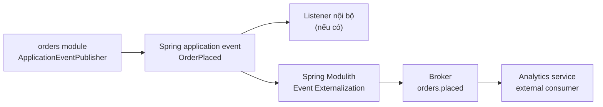
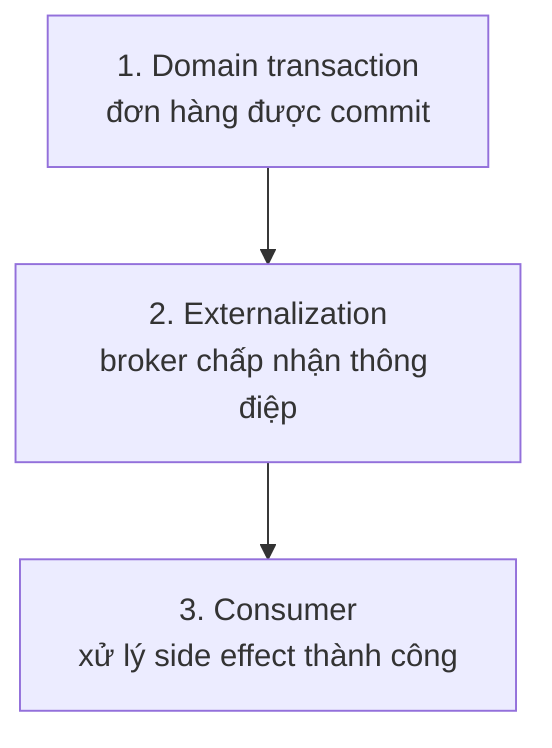

# Event externalization trong Spring Modulith

**Event externalization** là việc đưa một sự kiện được phát **bên trong ứng dụng** ra một hạ tầng truyền thông **bên ngoài tiến trình**, chẳng hạn Kafka, RabbitMQ/AMQP hoặc một hệ thống messaging phù hợp. Trong Spring Modulith, ứng dụng có thể phát Spring application event như một phần nghiệp vụ, rồi để cơ chế externalization chọn những sự kiện cần xuất ra ngoài. Module phát sự kiện không nhất thiết phải tự gọi Kafka producer hoặc tự biết mọi hệ thống sẽ nhận thông điệp.

Ví dụ, sau khi `orders` ghi nhận một đơn hàng, nó phát `OrderPlaced`. Bên trong ứng dụng, những module khác có thể lắng nghe sự kiện này; đồng thời một adapter externalization có thể chuyển nó tới topic `orders.placed` để dịch vụ phân tích dữ liệu nhận. Điều quan trọng là **phân biệt sự kiện đã được publish trong JVM, thông điệp đã được broker xác nhận, và dữ liệu đã được consumer xử lý thành công** — đây là ba mốc khác nhau.

Bài thuộc chương **Externalization** trong học phần `SPRING_MODULITH_VERIFICATION_TESTING`. Học phần hướng đến kiểm chứng ranh giới kiến trúc bằng `ApplicationModules` và quy tắc phụ thuộc, thực hành `@ApplicationModuleTest`, kiểm thử sự kiện, cơ sở dữ liệu và tích hợp, rồi dùng quality gate CI để ngăn phụ thuộc sai và hồi quy. Trong bài này, ta học cả **thiết kế**, **cấu hình**, **kiểm thử** và **vận hành** event externalization, không chỉ thêm một annotation.

## 1. Internal event và externalized event khác nhau thế nào?

Một **internal application event** thường được phát bằng `ApplicationEventPublisher`:

```java
events.publishEvent(new OrderPlaced(...));
```

Nó có thể được các Spring listener trong cùng ứng dụng xử lý. Việc gọi `publishEvent(...)` **không tự đồng nghĩa** với gửi một message vào Kafka hoặc RabbitMQ. Để xuất sự kiện ra broker, phải có **cơ chế chọn sự kiện, adapter externalization, cấu hình transport và hạ tầng nhận tương ứng**.

| Khía cạnh | Internal application event | Externalized event |
| --- | --- | --- |
| Phạm vi chính | Trong ứng dụng/Spring context | Vượt ranh giới tiến trình tới broker/hệ thống ngoài |
| Bên phát biết consumer cụ thể? | Không nhất thiết | Không nhất thiết |
| Kiểu dữ liệu | Java object/event class | Payload đã được ánh xạ/serialize cho transport |
| Ràng buộc giao tiếp | Spring event listener và transaction của ứng dụng | Thêm destination, serializer, schema, ack/retry, consumer contract |
| Mốc thành công cần phân biệt | Listener đã/đang xử lý trong JVM | Broker đã nhận; consumer đã xử lý là mốc khác |
| Kiểm thử phù hợp | `PublishedEvents`, `@ApplicationModuleTest` | Integration test với adapter, broker, payload, retry và consumer |

Không phải mọi domain event đều cần externalize. Một event nội bộ phục vụ cache, validation hoặc cập nhật trạng thái cục bộ có thể không mang ý nghĩa với các hệ thống bên ngoài; xuất nó ra broker vô tình khiến một chi tiết nội bộ trở thành hợp đồng công khai khó thay đổi.

## 2. Bối cảnh: từ module `orders` đến hệ thống analytics

Giả sử một modular monolith có:

- `orders` sở hữu việc đặt hàng và phát `OrderPlaced`.
- `inventory` quản lý tồn kho.
- `payments` xử lý thanh toán.
- Một **dịch vụ analytics bên ngoài** muốn ghi nhận các đơn thành công qua broker.

Mô hình khái niệm:



Đường đi từ `orders` đến broker không cần đặt trực tiếp `KafkaTemplate` hay `RabbitTemplate` vào `OrderPlacementService`. Thay vào đó, sự kiện được chọn để externalize tại ranh giới tích hợp. Việc tách lớp cho phép thay transport hoặc destination mà không biến business service thành nơi quản lý chi tiết broker.

**Nhưng lưu ý:** adapter và thư viện serializer vẫn là các thành phần kỹ thuật được cấu hình trong ứng dụng. “Không gọi trực tiếp Kafka” **không có nghĩa hệ thống không còn phụ thuộc Kafka ở cấp triển khai**.

## 3. Thiết kế sự kiện dành cho tích hợp

Một event có thể được externalize nên thể hiện **sự thật nghiệp vụ đã xảy ra** và có nội dung đủ ổn định cho consumer. Ví dụ:

```java
// com/example/shop/orders/OrderPlaced.java
package com.example.shop.orders;

import java.math.BigDecimal;
import java.time.Instant;
import java.util.UUID;
import org.springframework.modulith.events.Externalized;

@Externalized("orders.placed")
public record OrderPlaced(
        UUID eventId,
        UUID orderId,
        String customerId,
        BigDecimal totalAmount,
        Instant occurredAt
) {}
```

Các trường có vai trò khác nhau:

| Trường | Ý nghĩa |
| --- | --- |
| `eventId` | Định danh duy nhất cho một sự kiện nghiệp vụ, giúp consumer nhận diện lần gửi trùng |
| `orderId` | Định danh aggregate phát sinh sự kiện |
| `customerId` | Tham chiếu nghiệp vụ; không nhất thiết lộ toàn bộ dữ liệu khách hàng |
| `totalAmount` | Giá trị cần dùng theo hợp đồng tích hợp; nghiệp vụ thật nên ghi rõ đơn vị tiền |
| `occurredAt` | Thời điểm sự kiện xảy ra theo hệ thống phát |

`@Externalized` là dấu hiệu Spring Modulith dùng để **chọn loại sự kiện cần được xuất ra ngoài** khi cơ chế externalization tương ứng được cấu hình. Giá trị `"orders.placed"` ở đây diễn đạt **đích định tuyến** cho ví dụ; mapping cuối cùng sang topic, exchange, queue hoặc route còn phụ thuộc adapter và cấu hình.

**Annotation không tự tạo broker, topic, consumer hoặc bảo đảm giao nhận.** Nó cũng không tự phát sự kiện: mã nghiệp vụ vẫn phải gọi `ApplicationEventPublisher.publishEvent(...)` hoặc một cơ chế phát Spring event phù hợp.

### Vì sao không đưa entity JPA vào event?

Không nên xuất:

```java
// Ví dụ không phù hợp khi public integration contract:
// public record OrderPlaced(OrderEntity order) {}
```

`OrderEntity` có thể chứa proxy JPA, quan hệ lazy, trường nhạy cảm hoặc chi tiết schema. Consumer ngoài ứng dụng không nên buộc phải hiểu implementation nội bộ của `orders`. Một DTO/record chuyên biệt với các giá trị ổn định sẽ rõ hơn và dễ version hơn.

Nếu tên sự kiện được chia sẻ với nhiều consumer ngoài JVM, hãy coi payload của nó là **public integration contract**: thay đổi tùy tiện có thể gây lỗi ngay cả khi unit test Java vẫn xanh.

## 4. Phát sự kiện tại đúng điểm nghiệp vụ

Sự kiện `OrderPlaced` chỉ nên xuất hiện sau khi đơn hàng đạt trạng thái mà tên sự kiện cam kết. Ví dụ minh họa:

```java
// com/example/shop/orders/internal/PlaceOrderService.java
package com.example.shop.orders.internal;

import com.example.shop.orders.OrderPlaced;
import java.math.BigDecimal;
import java.time.Instant;
import java.util.UUID;
import org.springframework.context.ApplicationEventPublisher;
import org.springframework.stereotype.Service;
import org.springframework.transaction.annotation.Transactional;

@Service
class PlaceOrderService {

    private final OrderRepository orders;
    private final ApplicationEventPublisher events;

    PlaceOrderService(
            OrderRepository orders,
            ApplicationEventPublisher events) {
        this.orders = orders;
        this.events = events;
    }

    @Transactional
    public UUID place(String customerId, BigDecimal amount) {
        UUID orderId = UUID.randomUUID();

        // Repository/aggregate nội bộ phải ghi đơn thành công,
        // thực thi đúng validation và quy tắc nghiệp vụ.
        orders.save(new Order(orderId, customerId, amount));

        events.publishEvent(new OrderPlaced(
                UUID.randomUUID(),
                orderId,
                customerId,
                amount,
                Instant.now()
        ));
        return orderId;
    }
}
```

Đoạn code giả định có `OrderRepository` và `Order` nội bộ do `orders` sở hữu; đây là một mảnh minh họa để tập trung vào **thời điểm phát event**, không phải project đầy đủ với entity/repository có thể chạy độc lập.

`@Transactional` tạo biên giao dịch cho thao tác lưu đơn. Tuy nhiên, **thứ tự hai câu lệnh trong method không tự chứng minh broker chỉ nhận event sau khi database commit thành công**. Điều đó phụ thuộc cơ chế externalization/transaction-bound publication và cách quản lý transaction được cấu hình. Nếu publish trực tiếp lên broker trong transaction mà không có phối hợp đúng, có thể xảy ra “broker có event nhưng database rollback”.

Một thiết kế cần phát biểu rõ: **event phản ánh trạng thái đã commit**, hay biểu thị “đã yêu cầu” khi công việc vẫn đang được xử lý? Đặt tên `OrderPlaced`, `OrderSubmitted`, `OrderPaymentAuthorized` nhất quán với sự thật nghiệp vụ thật.

## 5. Những thành phần cần có để externalization hoạt động

Một ví dụ dùng Kafka thường cần các nhóm thành phần:

1. **Spring Modulith core** để nhận diện module, event và hỗ trợ kiến trúc.
2. **Thư viện externalization phù hợp với transport**, chẳng hạn integration Kafka của Spring Modulith; những transport khác dùng adapter tương ứng.
3. **Hệ thống messaging** được provision và có thể truy cập.
4. **Cấu hình kết nối, destination, serializer** và các lựa chọn vận hành.
5. **Cơ chế lưu trạng thái event publication** nếu ứng dụng yêu cầu khả năng khôi phục sau sự cố.

Ví dụ về tên artifact adapter thường gặp:

| Transport | Module tích hợp Spring Modulith | Điều cần kiểm tra khi triển khai |
| --- | --- | --- |
| Apache Kafka | `spring-modulith-events-kafka` | Topic, key/partition, serializer, broker ack, security |
| RabbitMQ/AMQP | `spring-modulith-events-amqp` | Exchange, routing key, binding, publisher confirm, retry |
| JMS | `spring-modulith-events-jms` | Destination, JMS provider, chuyển đổi message và transaction |
| Spring Messaging | `spring-modulith-events-messaging` | Kênh/adapter được cấu hình và ý nghĩa delivery của transport phía sau |

Các artifact và lựa chọn adapter phải được đối chiếu với **phiên bản Spring Modulith mà dự án sử dụng**. Không nên sao chép một dependency từ bản phát hành khác mà không đồng bộ BOM/starter và Spring Boot tương thích.

Trong ví dụ Kafka, thuộc tính Spring Boot có thể là:

```yaml
spring:
  kafka:
    bootstrap-servers: localhost:9092
```

Đây chỉ là **cấu hình kết nối minh họa**, không đủ để chứng minh externalization hoạt động. Broker phải tồn tại, topic `orders.placed` phải có theo chính sách provision, và adapter/serializer cần được cấu hình đúng. Ở môi trường production, thông tin kết nối, TLS, SASL/credentials, quota và cơ chế tạo topic phải được quản trị độc lập.

> **Không nhầm hai nhiệm vụ:** `@Externalized` quyết định **loại event sẽ được externalize**, còn adapter cùng cấu hình transport quyết định **gửi đi đâu và như thế nào**.

## 6. Chọn sự kiện được externalize: mặc định có chủ đích

Không phải event nội bộ nào cũng nên đi ra ngoài:

```java
// Event chỉ dành cho xử lý trong ứng dụng:
public record InventoryCacheInvalidated(String sku) {}

// Event nghiệp vụ có hợp đồng bên ngoài:
@Externalized("orders.placed")
public record OrderPlaced(
        UUID eventId,
        UUID orderId,
        String customerId,
        BigDecimal totalAmount,
        Instant occurredAt
) {}
```

Trong ví dụ, `InventoryCacheInvalidated` **không được đánh dấu `@Externalized`**. Điều đó giúp phân biệt phạm vi công bố theo cách dùng annotation. Nếu ứng dụng đồng thời cấu hình lựa chọn externalization **theo chương trình**, phải xét toàn bộ quy tắc lựa chọn thực tế, không thể chỉ tìm annotation trong source.

Spring Modulith còn có khả năng cấu hình externalization theo chương trình để chọn loại event và điều chỉnh route/mapping tùy phiên bản. Khi nhu cầu chỉ là một vài event tích hợp, annotation trên event thường dễ review. Khi muốn tách chính sách externalization khỏi domain type, cấu hình tập trung có thể phù hợp hơn.

Điều cần giữ: **quyết định sự kiện nào được công bố là một thay đổi của hợp đồng**, phải có review và kiểm thử. Không để một package scan rộng hoặc cấu hình lựa chọn không kiểm soát làm lộ toàn bộ sự kiện nội bộ.

## 7. Routing: một sự kiện đi tới destination nào?

`@Externalized("orders.placed")` cho thấy ý định gửi `OrderPlaced` đến một đích tích hợp tên `orders.placed`. Tuy nhiên, các transport diễn giải *destination* khác nhau:

| Transport | Khái niệm thường dùng | Điểm cần hiểu |
| --- | --- | --- |
| Kafka | Topic và message key | Topic quyết định nơi lưu stream; key có thể ảnh hưởng partition và thứ tự theo key |
| AMQP/RabbitMQ | Exchange và routing key | Exchange dùng binding/routing để chuyển tới queue; không đồng nhất exchange với queue |
| JMS | Queue hoặc topic | Giao thức/provider quyết định semantics, ack và transaction |

Với Kafka, nếu consumer cần giữ thứ tự các event của **cùng một đơn hàng**, có thể thiết kế key dựa trên `orderId`. Điều đó giúp chọn partition nhất quán trong điều kiện topology phù hợp, nhưng **không bảo đảm thứ tự toàn cục của mọi đơn hàng** hay việc consumer chỉ xử lý đúng một lần.

Các phiên bản Spring Modulith có cơ chế cấu hình route và routing key, có thể qua giá trị annotation hoặc cấu hình externalization tập trung. Cú pháp chi tiết và cách map vào message header/key phụ thuộc adapter, nên phải kiểm tra tài liệu của phiên bản đang dùng và xác nhận bằng integration test. **Không đoán rằng chuỗi route đã tự trở thành Kafka message key** chỉ vì chứa ID.

Nếu sau này đổi từ Kafka sang AMQP, việc giữ tên `orders.placed` trong domain code **không đủ** bảo đảm topology tương đương: phải thiết kế exchange, routing, bindings, consumer và semantics delivery cho transport mới.

## 8. Serialize event và thiết kế hợp đồng payload

Một Java record trong JVM cần được chuyển thành representation mà consumer bên ngoài hiểu, thường là JSON hoặc một định dạng có schema (Avro/Protobuf...). Dù serializer do adapter hỗ trợ hay được cấu hình riêng, người thiết kế phải trả lời:

- **Field nào bắt buộc?** Có thể thêm field mới không?
- **Định dạng thời gian:** `occurredAt` ở UTC/ISO-8601 hay epoch?
- **Đơn vị tiền:** `totalAmount` đi kèm `currency` chưa? Có nên dùng minor units?
- **ID:** `UUID` xuất thành chuỗi ra sao, consumer parse thế nào?
- **Version:** event type và payload thay đổi thế nào để consumer cũ không lỗi?
- **Bảo mật:** event có chứa PII, token hoặc dữ liệu vượt nhu cầu của consumer không?

Ví dụ JSON minh họa cho event đã serialize:

```json
{
  "eventId": "84bf7b6d-301d-4a6a-a2ef-9d8f2040e223",
  "orderId": "332efb42-e356-4bb4-b5e0-d6a2e5fd0aa9",
  "customerId": "C-001",
  "totalAmount": 250.00,
  "occurredAt": "2026-11-26T02:00:00Z"
}
```

Đây là **mẫu representation**, không phải cam kết rằng mọi adapter mặc định đều gửi chính xác cấu trúc JSON này hoặc tự thêm tất cả headers/schema/version. Serialization cuối cùng phải được kiểm thử với adapter thật.

### Versioning

Nếu thay `totalAmount` thành `amountMinorUnits` hoặc bỏ `customerId`, consumer cũ có thể không đọc được. Các cách quản lý thay đổi thường gồm **thêm field có tính tương thích**, **định nghĩa schema có version**, hoặc **xuất event type mới** cho thay đổi không tương thích.

Khi event đi ra khỏi ứng dụng, class Java `OrderPlaced` trở thành nguồn cho một **hợp đồng liên hệ thống**; đổi tên field không còn là refactor thuần nội bộ. Hãy có schema/contract test và chính sách deprecation đủ thời gian cho consumer.

## 9. Ba mốc giao nhận phải tách biệt

Trong một đường đi event externalization, có ít nhất ba thời điểm:



Các mốc không tự đồng nhất:

1. **DB commit thành công** không chứng minh Kafka đã nhận message; broker có thể mất kết nối.
2. **Broker xác nhận publish** không chứng minh analytics đã lưu dữ liệu; consumer có thể chưa chạy hoặc xử lý lỗi.
3. **Consumer xử lý thành công** không chứng minh nó sẽ không nhận lại cùng event; retry và redelivery vẫn có thể xảy ra.

Khi lập SLO và cảnh báo, đừng dùng metric “event được publish trong JVM” để kết luận toàn bộ hệ thống đã xử lý. Cần phân biệt **số event nghiệp vụ đã phát sinh**, **số publication đang chờ/không hoàn tất**, **số message broker nhận** và **lag/error ở consumer**.

## 10. Event Publication Registry và khả năng khôi phục

Spring Modulith cung cấp cơ chế **Event Publication Registry** để theo dõi việc phát hành event tới các listener/đích publication liên quan. Khi có **adapter lưu trạng thái phù hợp** (chẳng hạn một giải pháp lưu trên cơ sở dữ liệu được tích hợp đúng), ứng dụng có thể ghi nhận publication chưa hoàn tất và hỗ trợ xử lý lại sau lỗi.

Một luồng cần hiểu về mặt khái niệm:

```text
Trong transaction nghiệp vụ:
  lưu đơn hàng
  ghi nhận ý định publication cho đích liên quan
  commit transaction

Sau đó, theo cơ chế publication đã cấu hình:
  chuyển event sang broker
  nhận kết quả gửi
  ghi nhận publication hoàn tất nếu thành công

Nếu gửi/đánh dấu hoàn tất lỗi:
  publication có thể còn ở trạng thái incomplete
  vận hành có thể retry/resubmit theo cơ chế được bật
```

**Điều kiện và giới hạn quan trọng:**

- Không mặc định rằng chỉ cần thêm `@Externalized` là hệ thống đã có **registry bền vững**. Cần chọn và cấu hình cơ chế lưu publication, transaction và phục hồi theo stack thực tế.
- Việc một publication được đánh dấu complete phụ thuộc điểm xác nhận của adapter; nó **không đồng nghĩa consumer đã xử lý nghiệp vụ xong**.
- Nếu broker nhận message, nhưng ứng dụng chết **trước khi đánh dấu complete**, khi khôi phục có thể gửi lại **cùng event**.
- Nếu không có chiến lược resubmission/recovery phù hợp, publication lỗi có thể tồn đọng lâu. Cần theo dõi và vận hành, không dựa vào “sẽ tự retry mãi mãi” nếu chưa cấu hình.

Đây là lý do thực tế để thiết kế **at-least-once-tolerant consumer**, dù publisher có registry. Không khẳng định **exactly-once end-to-end** chỉ vì có database, broker hoặc Spring Modulith.

### Registry và transactional outbox

Event Publication Registry có thể giải quyết một phần bài toán **ghi nhận ý định gửi event liên quan tới transaction và xử lý lại**. Nó gần với một số mục tiêu của transactional outbox, nhưng **không nên xem hai mô hình là đồng nhất trong mọi chi tiết**. Nếu hạ tầng yêu cầu outbox table chuyên biệt, CDC, thứ tự theo aggregate, retention hoặc quy tắc audit riêng, cần đánh giá kiến trúc cụ thể.

Điều phải xác minh bằng test là: **khi transaction rollback thì không được phát một event thành công sai sự thật**, và **khi broker tạm ngừng, thông tin cần gửi có được giữ/khôi phục theo thiết kế không**.

## 11. Idempotency ở consumer là bắt buộc khi có khả năng gửi lại

Giả sử dịch vụ analytics nhận hai lần cùng một `OrderPlaced` do retry:

```text
Message 1:
  eventId = 84bf...
  orderId = 332e...

Message 2:
  eventId = 84bf...
  orderId = 332e...
```

Nếu consumer chỉ `INSERT` mỗi lần nhận, analytics có thể đếm doanh thu gấp đôi. Một biện pháp phổ biến là dùng **`eventId` ổn định** làm deduplication key.

Ví dụ pseudocode theo transaction của consumer:

```text
BEGIN TRANSACTION
  IF processed_events EXISTS(eventId):
      COMMIT; ACK
  ELSE:
      INSERT analytics_order(...)
      INSERT processed_events(eventId)
      COMMIT; ACK
```

Trong hệ thống thật, thao tác kiểm tra và ghi `processed_events` phải **an toàn trước xử lý đồng thời**, thường dựa trên unique constraint và transaction phù hợp. Không đủ nếu chỉ kiểm tra `if (!exists)` rồi ghi riêng lẻ không có bảo vệ cạnh tranh.

**Event ID nên giữ nguyên qua các lần retry cùng một sự kiện.** Nếu retry sinh `eventId` mới mỗi lần, consumer không còn cách đơn giản để nhận ra đó là cùng publication. Trường `orderId` đôi khi có thể dùng làm business idempotency key, nhưng một đơn có thể phát nhiều event hợp lệ; chọn key phải phản ánh đúng *đơn vị xử lý* mà consumer muốn dedupe.

## 12. Transaction và thứ tự sự kiện

Event externalization có thể diễn ra sau commit của transaction phát event. Điều này hữu ích để tránh consumer hành động trên trạng thái chưa được commit, nhưng đổi lại **không phải một cuộc gọi đồng bộ chắc chắn hoàn tất cùng database transaction**.

Các câu hỏi cần trả lời:

| Câu hỏi | Rủi ro nếu bỏ qua |
| --- | --- |
| Event phát trước hay sau commit? | Consumer nhận một sự kiện cho transaction đã rollback |
| Ai chịu trách nhiệm retry khi broker tạm ngừng? | Mất publication hoặc tồn đọng không được xử lý |
| Cùng aggregate có nhiều event liên tiếp? | Consumer nhận sai thứ tự nếu routing/partition/concurrency không phù hợp |
| Một event được gửi hai lần? | Ghi dữ liệu/side effect trùng |
| Producer thành công nhưng consumer chết? | Độ trễ xử lý; cần lag metrics và consumer recovery |

Với Kafka, nếu muốn duy trì thứ tự **trong từng `orderId`**, thông thường các event của cùng đơn cần được gửi với key nhất quán để đi vào cùng partition, đồng thời consumer phải xử lý theo semantics tương ứng. Điều đó **không đảm bảo thứ tự xuyên nhiều topic hoặc nhiều aggregate**.

Với RabbitMQ/JMS, routing, queue, số consumer, prefetch, requeue và transaction cũng ảnh hưởng thứ tự. Không được suy rằng một chuỗi `"orders.placed"` áp đặt cùng một thứ tự xử lý cho mọi transport.

## 13. Ranh giới Spring Modulith: externalization không thay thế kiểm chứng module

Khi `orders` gọi `ApplicationEventPublisher.publishEvent(new OrderPlaced(...))`, Java code ở `orders` tham chiếu `ApplicationEventPublisher` của Spring Framework và `OrderPlaced` do chính `orders` sở hữu. Nó **không cần import** class Kafka producer hoặc consumer analytics.

Tuy nhiên, nếu `inventory` trong cùng ứng dụng có:

```java
// com/example/shop/inventory/internal/OrderPlacedListener.java
package com.example.shop.inventory.internal;

import com.example.shop.orders.OrderPlaced;
import org.springframework.context.event.EventListener;
import org.springframework.stereotype.Component;

@Component
class OrderPlacedListener {

    @EventListener
    void on(OrderPlaced event) {
        // Xử lý một phản ứng nội bộ với đơn hàng mới.
    }
}
```

thì listener tạo một cạnh **`inventory → orders`** vì tham số kiểu `OrderPlaced` thuộc `orders`. Event externalization đến broker **không làm cạnh này biến mất**.

Ví dụ kiểm chứng:

```java
// src/test/java/com/example/shop/ModularityTests.java
package com.example.shop;

import org.junit.jupiter.api.Test;
import org.springframework.modulith.core.ApplicationModules;

class ModularityTests {

    @Test
    void moduleBoundariesAreValid() {
        ApplicationModules.of(ShopApplication.class).verify();
    }
}
```

`verify()` giúp kiểm tra các quy tắc kiến trúc giữa application module được nhận diện, gồm **chu trình phụ thuộc, API nội bộ và `allowedDependencies` nếu được khai báo**. Nó **không phải** bài kiểm broker, JSON schema, routing key, TLS hay retry.

Nếu `orders` cũng import `inventory.StockLookup` và `inventory` import `orders.OrderPlaced`, có thể xuất hiện vòng `orders → inventory → orders`. Chỉ đổi event thành `@Externalized` không tự xử lý vòng đó; cần sửa cách các module nội bộ tham chiếu nhau.

## 14. Kiểm thử sự kiện bên trong module

Trước khi kiểm thử adapter broker, hãy kiểm tra nghiệp vụ có phát đúng `OrderPlaced` không. Spring Modulith Test hỗ trợ `@ApplicationModuleTest` và thu thập sự kiện phát trong test.

Ví dụ định hướng (đặt test cùng package với service nội bộ):

```java
// src/test/java/com/example/shop/orders/internal/PlaceOrderTests.java
package com.example.shop.orders.internal;

import static org.assertj.core.api.Assertions.assertThat;

import com.example.shop.orders.OrderPlaced;
import java.math.BigDecimal;
import org.junit.jupiter.api.Test;
import org.springframework.beans.factory.annotation.Autowired;
import org.springframework.modulith.test.ApplicationModuleTest;
import org.springframework.modulith.test.PublishedEvents;

@ApplicationModuleTest
class PlaceOrderTests {

    @Autowired
    PlaceOrderService service;

    @Test
    void emitsAnOrderPlacedEvent(PublishedEvents events) {
        service.place("C-001", new BigDecimal("250.00"));

        assertThat(events.ofType(OrderPlaced.class)).hasSize(1);
    }
}
```

Test này cần **repository/fixture có thể lưu đơn thực tế** trong context test. Đoạn `OrderRepository`/`Order` trong ví dụ trước chỉ là mô tả phụ thuộc cần được cài đặt; một project hoàn chỉnh phải có bean và entity hợp lệ. Nếu có trigger đặc biệt, transaction rollback ở test hoặc policy phát event theo phase, test cần được thiết kế đúng điều kiện.

Kết quả **“đã publish đúng `OrderPlaced` trong Spring context”** là điều kiện cần, nhưng **chưa chứng minh**:

- `@Externalized` đã được chọn bởi cấu hình thực tế;
- payload đã được serialize đúng;
- message tới đúng topic/exchange;
- broker đã xác nhận;
- consumer bên ngoài xử lý thành công.

Những khâu này cần **integration test** ở phần tiếp theo.

## 15. Integration test với broker thật hoặc broker kiểm thử

Một bài test externalization có giá trị phải quan sát kết quả **ở phía transport**, không chỉ đếm Spring events. Với Kafka, có thể dùng Testcontainers Kafka (hoặc hạ tầng test tương đương); với RabbitMQ dùng một broker test phù hợp. Quy trình:

1. Khởi động broker test và cấu hình adapter Spring Modulith trỏ tới broker đó.
2. Provision topic/exchange/queue/binding đúng hợp đồng.
3. Khởi động ứng dụng hoặc một phạm vi test có **externalization adapter hoạt động**.
4. Tạo đơn thành công trong transaction phù hợp.
5. Dùng consumer test đọc message từ destination `orders.placed` với timeout hữu hạn.
6. Kiểm tra `eventId`, `orderId`, `totalAmount`, định dạng thời gian, headers/key và schema phù hợp.
7. Kiểm tra một event **không được externalize** không xuất hiện trên destination theo chính sách.
8. Kiểm tra lỗi/tình huống retry nếu cơ chế publication registry được cấu hình.

Một phác thảo logic test:

```text
given:
  broker test khả dụng
  adapter externalization đã kích hoạt
  topic "orders.placed" tồn tại

when:
  tạo đơn mới và commit giao dịch

then:
  consumer đọc được một thông điệp phù hợp trong timeout
  payload.orderId == orderId vừa tạo
  payload.eventId != null
  payload.totalAmount == số tiền của đơn

and:
  event nội bộ không được chọn không bị xuất ra ngoài
```

Vì hạ tầng phụ thuộc Kafka/AMQP/JMS và phiên bản framework, bài này không áp đặt một test class giả định có thể chạy trên mọi adapter. **Tập lệnh test thật phải dùng đúng thư viện, listener, serializer và API của project**; đây cũng là phần nên kiểm chứng trong vòng content/code QA sau khi triển khai.

### Kiểm thử các trường hợp lỗi

| Ca test | Kết quả cần đánh giá |
| --- | --- |
| Broker không khả dụng ngay sau commit | Publication được ghi nhận/khôi phục đúng theo cơ chế đã cấu hình |
| Adapter gửi thành công nhưng app chết trước khi mark complete | Có khả năng gửi lại; consumer phải idempotent |
| Payload không serialize được | Lỗi rõ ràng, không âm thầm đánh dấu thành công |
| Destination/ACL sai | Producer lỗi, cảnh báo, publication chưa hoàn tất hoặc được xử lý theo policy |
| Consumer xử lý rồi nhận lại cùng `eventId` | Không tạo tác dụng nghiệp vụ trùng |
| Thay đổi schema event | Contract test phát hiện consumer không còn tương thích |
| Rollback tạo đơn | Không được có sự kiện “đơn đã đặt thành công” không đúng sự thật theo cơ chế transaction mong muốn |

Test lỗi broker và cơ chế khôi phục không nên chỉ chờ một khoảng thời gian cố định rồi đoán kết quả. Hãy dựa vào timeout, quan sát event/registry/consumer và điều kiện hoàn thành cụ thể; nếu test cần resubmission, kích hoạt đúng cơ chế được cung cấp bởi cấu hình/phiên bản sử dụng.

## 16. Observability và vận hành

Event externalization biến một hành vi nội bộ thành đường tích hợp phân tán. Cần có dữ liệu vận hành đủ để trả lời **“đơn hàng đã đặt nhưng hệ thống ngoài chưa nhận, bị kẹt ở bước nào?”**

Các tín hiệu nên theo dõi:

- **Số event nghiệp vụ được tạo** theo loại event.
- **Số publication incomplete và tuổi của publication lâu nhất** trong registry nếu có.
- **Tỷ lệ gửi thành công/thất bại của adapter**, độ trễ publish, số lần retry.
- **Broker health**, producer error, topic/exchange không tồn tại hoặc thiếu quyền.
- **Consumer lag**, số message trong DLQ/retry queue và số lần dedupe.
- **Correlation ID/event ID/order ID** trong log có cấu trúc để lần theo một giao dịch từ database qua broker.

Những số liệu này cần tách theo **loại event, destination và môi trường triển khai**. Một event đã gửi tới broker nhưng còn trong consumer backlog khác với event chưa ra khỏi ứng dụng; cả hai đều có thể khiến analytics chậm nhưng cần cách xử lý khác nhau.

Về bảo mật, áp dụng quyền publish chỉ tới các destination được phép, TLS/auth, hạn chế thông tin nhạy cảm trong payload và chính sách retention phù hợp. Không phát toàn bộ entity hoặc bí mật nội bộ chỉ vì serializer có thể chuyển object đó thành JSON.

## 17. Event externalization và hợp đồng nhất quán nghiệp vụ

Một luồng đặt hàng có thể cần thông báo `OrderPlaced` cho analytics **sau khi đơn thực sự được tạo**. Nhưng nếu analytics lỗi, hệ thống đặt hàng có nên từ chối đơn không?

Hai lựa chọn dẫn đến kiến trúc khác nhau:

| Yêu cầu | Cách xem xét |
| --- | --- |
| Tạo đơn phải nhận kết quả đồng bộ từ hệ thống khác trước khi thành công | Facade/API đồng bộ hoặc một giao thức yêu cầu–phản hồi rõ ràng; có timeout/failure policy |
| Analytics có thể nhận chậm nhưng không được mất sự kiện theo mức bảo đảm đã cam kết | Externalization với cơ chế durable publication/recovery được cấu hình, consumer idempotent và monitoring |
| Gửi email thông báo sau khi đơn tạo | Event externalization có thể phù hợp; cần retry/idempotency và không để lỗi email tạo đơn trùng |
| Báo cáo doanh thu cho kế toán | Cần hợp đồng amount/currency, schema version, đối soát và yêu cầu audit |

**Event externalization không tự tạo một distributed transaction giữa database orders và consumer analytics.** Nếu cần exactly-once business effect, cần thiết kế end-to-end với idempotency, constraint và quy tắc xử lý dữ liệu; không thể có bảo đảm này chỉ bằng annotation.

Khi consumer ở bên ngoài, Spring Modulith không thể dùng `ApplicationModules.verify()` để kiểm tra mã của dịch vụ đó. Ranh giới lúc này là **hợp đồng tích hợp**, cần kiểm thử schema, hướng topic, vận hành và versioning.

## 18. Những sai lầm thường gặp

### Sai lầm 1: chỉ thêm `@Externalized` rồi xem như đã gửi Kafka

Nếu thiếu adapter, broker, serializer, topic hoặc credentials đúng, việc có annotation trong mã chưa đủ. Phải xác nhận **message thật tới destination**.

### Sai lầm 2: coi publish JVM thành công là broker ack

`ApplicationEventPublisher.publishEvent(...)` chỉ cho biết lời gọi publish trong ứng dụng đã chạy theo semantics của Spring context; **không chứng minh** broker hoặc consumer đã hoàn tất.

### Sai lầm 3: gửi entity nội bộ trực tiếp ra ngoài

Điều này tạo coupling với JPA, schema và dữ liệu nhạy cảm, khiến consumer phụ thuộc implementation. Hãy tạo event contract nhỏ, ổn định.

### Sai lầm 4: sinh `eventId` mới mỗi lần retry

Consumer không thể dedupe cùng publication nếu định danh luôn đổi. Retry cần giữ định danh của **cùng sự kiện nghiệp vụ**.

### Sai lầm 5: khẳng định exactly-once vì có publication registry

Registry giúp theo dõi và khôi phục publication khi được cấu hình đúng, nhưng crash giữa broker ack và cập nhật trạng thái có thể dẫn đến gửi lại. Hãy thiết kế consumer idempotent.

### Sai lầm 6: đồng nhất sự kiện với bất đồng bộ

Spring `@EventListener` thường có thể xử lý đồng bộ; externalization phụ thuộc cơ chế/listener được cấu hình. Không suy luận về latency, transaction hoặc thread chỉ từ tên “event”.

### Sai lầm 7: bỏ qua quy tắc phụ thuộc Spring Modulith

Event listener nội bộ vẫn dùng kiểu event do module khác sở hữu. Nếu đồng thời có cạnh ngược, `ApplicationModules.verify()` có thể báo cycle. Externalization ra broker không xóa cạnh Java đó.

### Sai lầm 8: để destination và schema trở thành chi tiết không được kiểm thử

Đổi một topic, routing key hoặc field JSON có thể làm hệ thống ngoài ngừng nhận, dù code compile và `verify()` PASS. Cần contract và integration test.

## 19. Checklist triển khai

Trước khi đánh dấu một luồng event externalization sẵn sàng đưa vào vận hành, hãy xác nhận:

| Hạng mục | Câu hỏi xác nhận |
| --- | --- |
| **Ý nghĩa event** | Event nói về sự thật đã xảy ra hay chỉ yêu cầu cần xử lý? |
| **Chủ sở hữu** | Module nào định nghĩa event và được quyền thay đổi hợp đồng? |
| **Lựa chọn externalization** | Có `@Externalized` hoặc quy tắc selection tập trung phù hợp? |
| **Adapter** | Có module tích hợp đúng phiên bản và transport đã cấu hình? |
| **Destination** | Topic/exchange/queue, key/routing, security và provisioning rõ ràng? |
| **Schema** | Payload tối thiểu, có versioning/compatibility policy? |
| **Giao dịch** | Khi database rollback, event còn được externalize sai hay không? |
| **Recovery** | Có persistence, incomplete publications, resubmission policy và monitoring nếu cần? |
| **Duplicates** | `eventId` và consumer idempotency đã được kiểm thử? |
| **Ordering** | Có yêu cầu thứ tự theo aggregate, partition key hoặc sequence không? |
| **Kiến trúc** | `ApplicationModules.verify()` có PASS cho các module và rule hiện hành? |
| **Test** | Có producer event test, broker integration test, contract test và test failure path? |
| **CI** | Các test bắt buộc chạy thật và chặn merge khi fail? |

Checklist này không thay thế đánh giá theo mức rủi ro. Một event để cập nhật dashboard có thể chấp nhận độ trễ lớn hơn một event phục vụ thanh toán/đối soát.

## 20. Quality gate CI cho event externalization

Kết hợp kiểm chứng tĩnh, test module và test broker:

```text
Pull request
    |
    v
Compile + JUnit unit tests
    |
    v
ApplicationModules.verify()
    |-- Không có dependency cycle?
    |-- Không truy cập implementation nội bộ?
    '-- Tuân thủ allowedDependencies?
    |
    v
@ApplicationModuleTest
    '-- OrderPlaced được phát với payload đúng?
    |
    v
Serialization/schema contract test
    '-- Event có tương thích với consumer contract?
    |
    v
Broker integration test
    |-- Adapter externalization hoạt động?
    |-- Đúng topic/routing/key/payload?
    '-- Giao nhận/recovery trong ca lỗi quan trọng?
    |
    v
Merge khi các quality gate bắt buộc PASS
```

Không chỉ chạy `@ApplicationModuleTest` rồi khẳng định transport đã được bảo vệ. Ngược lại, một broker integration test PASS cũng không chứng minh không có vòng phụ thuộc giữa các module Java. Hai lớp test phục vụ **hai rủi ro khác nhau**.

CI cần cung cấp môi trường broker test cô lập, thông tin đăng nhập thử nghiệm, schema phù hợp và timeout hữu hạn. Khi lỗi test đến từ hạ tầng test không ổn định, nên phân biệt rõ với lỗi hợp đồng; không được bỏ luôn bài test externalization mà không thay thế bằng một gate có giá trị tương đương.

## 21. Bài tập và đáp án

### Bài 1 — Annotation có đủ?

`orders` đã định nghĩa `@Externalized("orders.placed") OrderPlaced` và gọi `events.publishEvent(...)`. Chưa có adapter Kafka/AMQP/JMS được cấu hình.

**Hỏi:** Có thể kết luận message đã được gửi ra broker không?

**Đáp án:** **Không.** `@Externalized` chỉ diễn đạt lựa chọn externalization. Cần adapter, transport, destination và cấu hình hợp lệ; integration test phía broker mới chứng minh hành vi gửi thực tế.

### Bài 2 — Ba mốc thành công

Database đã commit đơn, broker đã nhận `OrderPlaced`, nhưng analytics chưa có bản ghi.

**Hỏi:** Điều này có nhất thiết là lỗi publisher không?

**Đáp án:** **Không.** Có thể consumer chưa chạy, bị backlog, lỗi deserialize hoặc xử lý thất bại. Phải kiểm tra consumer lag, retry/DLQ và trạng thái xử lý bên nhận; broker ack không chứng minh consumer đã hoàn tất.

### Bài 3 — Gửi trùng sau sự cố

Broker đã nhận message, nhưng ứng dụng phát bị crash trước khi ghi publication complete. Sau restart, publication được gửi lại.

**Hỏi:** Thiết kế nào giúp tránh doanh thu bị ghi hai lần?

**Đáp án:** Dùng `eventId` ổn định qua retry và consumer idempotent với unique constraint/transaction phù hợp. Không thể dựa vào `@Externalized` hoặc publication registry để tuyên bố exactly-once end-to-end.

### Bài 4 — Kiểm chứng module

`inventory` lắng nghe `orders.OrderPlaced` và `orders` inject `inventory.StockLookup`. Sau đó `OrderPlaced` được đánh dấu `@Externalized`.

**Hỏi:** Annotation đó có tự phá cycle `orders ↔ inventory` không?

**Đáp án:** **Không.** Listener tạo `inventory → orders`; injection tạo `orders → inventory`. Externalization đến broker không thay đổi hai tham chiếu kiểu Java này. Cần sửa hướng phụ thuộc/hợp đồng nội bộ rồi chạy `ApplicationModules.verify()`.

### Bài 5 — Kiểm thử đến đâu?

`@ApplicationModuleTest` xác nhận `PublishedEvents` chứa một `OrderPlaced`. CI không chạy broker integration test.

**Hỏi:** Phần nào còn chưa được kiểm chứng?

**Đáp án:** Chưa chứng minh adapter externalize event, serialization, destination, routing/key, broker ack, consumer contract và recovery khi lỗi. Cần bổ sung integration/contract test theo transport thật.

### Bài 6 — Đổi payload

Consumer bên ngoài đang đọc `totalAmount`. Team producer đổi thành `amountInCents`, bỏ field cũ và không cập nhật schema version.

**Hỏi:** Tại sao `verify()` có thể PASS mà hệ thống ngoài lỗi?

**Đáp án:** `verify()` kiểm tra kiến trúc Java giữa các application module được nhận diện, **không kiểm tra schema JSON của consumer độc lập**. Cần versioning, contract test và kế hoạch di chuyển consumer khi thay đổi payload không tương thích.

### Bài 7 — Rollback

`PlaceOrderService` lưu đơn rồi publish event trong method `@Transactional`. Sau đó method ném exception, transaction rollback, nhưng một integration test cho thấy broker đã nhận thông báo “đơn đã đặt”.

**Hỏi:** Cần điều tra gì?

**Đáp án:** Kiểm tra cơ chế externalization có gắn với transaction/after-commit và registry phù hợp không, có code nào publish broker trực tiếp trước commit không, cũng như phase listener và cấu hình transaction. Event “đã đặt thành công” không nên được công bố ra ngoài khi đơn chưa commit theo hợp đồng.

## 22. Tổng kết

**Event externalization** trong Spring Modulith là cách công bố có kiểm soát các sự kiện nội bộ ra hệ thống messaging bên ngoài mà không buộc business service gọi trực tiếp một producer theo từng broker. `@Externalized` giúp thể hiện loại event được chọn; adapter, định tuyến, serialization, cấu hình broker và cơ chế publication/khôi phục quyết định đường truyền thực tế.

Điểm quan trọng nhất là **đúng ranh giới và đúng bảo đảm**: sự kiện nghiệp vụ phải phản ánh trạng thái đã cam kết, payload là hợp đồng công khai có versioning, publisher không được giả định consumer đã xử lý khi broker ack, và consumer phải an toàn trước việc nhận trùng. Khi cần độ tin cậy cao, phải cấu hình và kiểm thử Event Publication Registry/recovery phù hợp, không mặc định exactly-once.

Trong học phần `SPRING_MODULITH_VERIFICATION_TESTING`, một luồng externalization được kiểm tra ở nhiều tầng: **`ApplicationModules.verify()`** cho ranh giới Java, **`@ApplicationModuleTest`** cho việc phát event, **broker integration và contract test** cho việc gửi/nhận message, **database/transaction test** cho tính nhất quán, và **quality gate CI** để ngăn hồi quy.

## Tài liệu tham khảo

- [Spring Modulith — Event Externalization](https://docs.spring.io/spring-modulith/reference/events.html)
- [Spring Modulith — Event Publication Registry](https://docs.spring.io/spring-modulith/reference/events.html)
- [Spring Modulith — Integration Testing Application Modules](https://docs.spring.io/spring-modulith/reference/testing.html)
- [Spring Modulith — Verifying Application Module Structure](https://docs.spring.io/spring-modulith/reference/verification.html)
- [Spring Framework — Application Events](https://docs.spring.io/spring-framework/reference/core/beans/context-introduction.html)
- [Spring Framework — Transaction-bound Events](https://docs.spring.io/spring-framework/reference/data-access/transaction/event.html)
- [Spring for Apache Kafka — Reference](https://docs.spring.io/spring-kafka/reference/)
- [Spring AMQP — Reference](https://docs.spring.io/spring-amqp/reference/)
