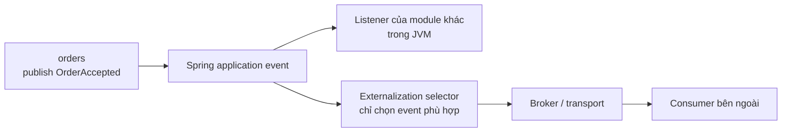
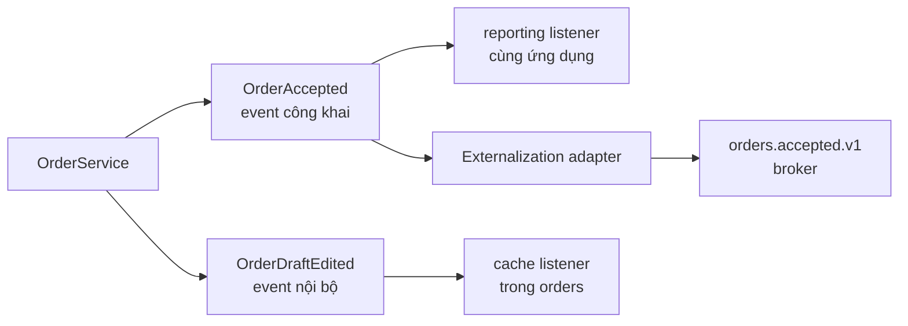
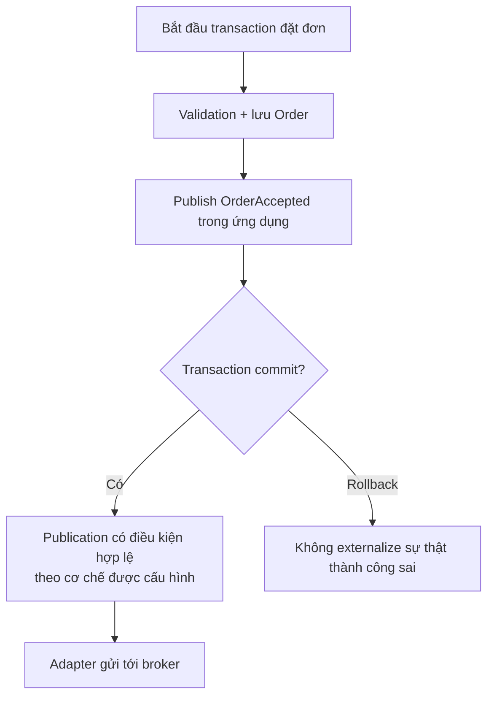

# Chọn event được gửi ra ngoài module

Không phải mọi sự kiện được phát trong một ứng dụng Spring Modulith đều cần xuất ra message broker. Ví dụ, khi đơn hàng được chấp nhận, `orders` có thể phát `OrderAccepted` để dịch vụ ngoài ứng dụng nhận và cập nhật báo cáo. Nhưng khi người dùng sửa một bản nháp, event `OrderDraftEdited` có thể chỉ phục vụ cập nhật cache hoặc giao diện nội bộ. Nếu externalize cả hai mà không có tiêu chí, các hệ thống ngoài sẽ phụ thuộc vào chi tiết triển khai không ổn định, nhận quá nhiều thông điệp và có nguy cơ tiếp cận dữ liệu không cần thiết.

**Chọn event được gửi ra ngoài module** là quyết định về **hợp đồng tích hợp và ranh giới công bố**, không chỉ là thêm một annotation. Trong chương **Externalization** của học phần `SPRING_MODULITH_VERIFICATION_TESTING`, ta phải biết phân biệt event nội bộ và event dành cho hệ thống ngoài, đặt quy tắc lựa chọn có thể kiểm chứng, rồi dùng `ApplicationModules.verify()`, `@ApplicationModuleTest`, kiểm thử giao dịch/cơ sở dữ liệu/broker và quality gate CI để phát hiện hồi quy.

## 1. “Ra ngoài module” có hai cấp độ khác nhau

Một application module trong Spring Modulith thường là một phần của **cùng ứng dụng Java**. Vì vậy phải tách rõ:

1. **Event đi từ module A sang module B trong cùng JVM:** A phát Spring application event; B có thể lắng nghe bằng `@EventListener`, `@TransactionalEventListener` hoặc cơ chế lắng nghe phù hợp. Đây là **giao tiếp liên module nội bộ**.
2. **Event được externalize ra khỏi ứng dụng:** Spring Modulith chọn một số event để chuyển tới Kafka, AMQP/RabbitMQ, JMS hoặc transport ngoài ứng dụng thông qua adapter và cấu hình thích hợp. Đây là **hợp đồng với hệ thống ngoài**.



Một event có thể được listener nội bộ tiêu thụ mà **không** được externalize. Một event được externalize cũng có thể đồng thời có listener nội bộ. Hai quyết định đó không loại trừ nhau.

**Điểm mấu chốt:** việc có `ApplicationEventPublisher.publishEvent(event)` chỉ xác nhận application event được phát trong ứng dụng theo cơ chế Spring; nó **không tự chứng minh** adapter đã chọn event, broker nhận message hoặc consumer xử lý thành công.

## 2. Mục tiêu khi chọn event externalization

Một tập sự kiện được công bố tốt cần thỏa ba nguyên tắc:

- **Có ý nghĩa với consumer bên ngoài:** biểu đạt một sự thật nghiệp vụ hoặc trạng thái công khai mà hệ thống khác cần.
- **Có hợp đồng đủ ổn định:** payload, tên sự kiện, version, định danh và ngữ nghĩa thay đổi theo quy trình kiểm soát.
- **Có khả năng vận hành an toàn:** quyền truy cập, dữ liệu tối thiểu, serialization, routing, độ tin cậy, duplicate handling và kiểm thử được định nghĩa.

Ngược lại, các event mô tả cache invalidation, vòng đời bean, thao tác tạm thời hoặc thay đổi trạng thái chưa commit thường **không nên được công bố trực tiếp** chỉ vì chúng tồn tại trong JVM.

| Câu hỏi lựa chọn | Nếu câu trả lời chưa rõ |
| --- | --- |
| Ai cần event ngoài ứng dụng? | Chưa nên externalize; xác định consumer hoặc yêu cầu tích hợp |
| Event nói về điều đã xảy ra hay chỉ yêu cầu sẽ làm? | Đặt tên/thiết kế lại contract cho đúng ngữ nghĩa |
| Có thể giải thích payload mà không cần biết entity nội bộ? | Tách integration payload khỏi internal model |
| Consumer có được phép nhận dữ liệu này? | Rà soát bảo mật, PII, quyền và retention |
| Nếu event đến trễ, trùng, sai thứ tự thì sao? | Thiết kế idempotency, thứ tự và failure policy |
| Có test broker/contract cho event này không? | Chưa đủ bằng chứng để coi luồng xuất bản đã hoàn tất |

Không nên dùng “cứ phát tất cả, consumer tự lọc” làm chính sách mặc định. Khi event đã ra ngoài, ngay cả một trường hoặc topic tưởng như nhỏ cũng có thể trở thành dependency lâu dài của hệ thống khác.

## 3. Phân loại event trước khi đánh dấu externalization

Trong một luồng đặt hàng, có thể có nhiều loại event:

| Event | Ý nghĩa | Consumer dự kiến | Quyết định minh họa |
| --- | --- | --- | --- |
| `OrderDraftEdited` | Bản nháp bị sửa khi chưa được chấp nhận | Cache/read model nội bộ | **Không externalize** |
| `OrderValidationFailed` | Một lần kiểm tra đầu vào thất bại | UI/log nội bộ | **Không externalize** |
| `OrderAccepted` | Đơn đã được hệ thống chấp nhận theo quy tắc nghiệp vụ | Analytics, fulfillment ngoài ứng dụng | **Có thể externalize** |
| `OrderEmailTemplateRebuilt` | Tái tạo template trong ứng dụng | Module thông báo nội bộ | **Không externalize** |
| `OrderCancelled` | Đơn bị hủy và đã ghi nhận trạng thái | Fulfillment, reporting ngoài ứng dụng | **Có thể externalize** |
| `PaymentCardTokenRefreshed` | Thông tin token/thẻ được cập nhật | Thành phần thanh toán có quyền riêng | **Không phát rộng**; cần review bảo mật đặc biệt |

Các quyết định trên chỉ là ví dụ; **ý nghĩa tên event và consumer thật của dự án** quyết định kết quả cuối cùng. `OrderAccepted` không đồng nghĩa `OrderPaid` hay `OrderShipped`: nếu consumer cần bằng chứng thanh toán hoàn tất, đừng dùng nhầm `OrderAccepted`.

Trong tài liệu thiết kế nên phân biệt:

**Domain event:** biểu đạt sự kiện nghiệp vụ bên trong bounded context, có thể phục vụ các module nội bộ.

**Integration event:** biểu đạt thông tin mà bên ngoài được phép biết, với schema và ngữ nghĩa được công bố. Đôi khi một record có thể đảm nhiệm cả hai vai trò, nhưng khi yêu cầu ổn định/bảo mật khác nhau, nên xây dựng integration payload riêng.

## 4. Ví dụ kiến trúc: chọn `OrderAccepted`, không chọn `OrderDraftEdited`

Cấu trúc minh họa:

```text
com.example.shop
├── ShopApplication.java
├── orders
│   ├── OrderAccepted.java
│   ├── OrderCancelled.java
│   ├── package-info.java
│   └── internal
│       ├── OrderDraftEdited.java
│       ├── OrderService.java
│       └── OrderRepository.java
└── reporting
    └── internal
        └── OrderAcceptedListener.java
```

`orders` và `reporting` là application module theo cấu trúc Spring Modulith thông dụng. `OrderAccepted` nằm ở package công khai của `orders` vì listener của `reporting` có thể dùng kiểu này; `OrderDraftEdited` nằm ở `orders.internal` vì nó không dành cho bên ngoài module.

Sơ đồ cho thấy một event được chia sẻ, một event không:



Chúng ta không cần tạo một `KafkaTemplate` trong `OrderService` để thể hiện khác biệt đó. Thay vào đó, **quy tắc selection** quyết định event nào được export.

## 5. Cách 1: đánh dấu loại event bằng `@Externalized`

Spring Modulith hỗ trợ annotation `org.springframework.modulith.events.Externalized` để đánh dấu event được chọn cho externalization khi cơ chế tương ứng được cấu hình.

Ví dụ record được công bố:

```java
// com/example/shop/orders/OrderAccepted.java
package com.example.shop.orders;

import java.time.Instant;
import java.util.UUID;
import org.springframework.modulith.events.Externalized;

@Externalized("orders.accepted.v1")
public record OrderAccepted(
        UUID eventId,
        UUID orderId,
        String customerReference,
        long amountMinorUnits,
        String currency,
        Instant occurredAt
) {}
```

**Giải thích lựa chọn:**

- `@Externalized` biểu đạt việc **event type này được đề cử externalize**.
- `"orders.accepted.v1"` biểu đạt destination/route mục tiêu của ví dụ; adapter cụ thể quyết định cách diễn giải thành topic, exchange hoặc destination.
- `eventId` là mã cố định của một sự kiện nghiệp vụ, hữu ích khi consumer phải chống xử lý trùng.
- `orderId` phục vụ liên hệ aggregate; `customerReference` cần được phân loại dữ liệu, không mặc định là vô hại vì có thể liên kết tới một cá nhân.
- `amountMinorUnits` và `currency` làm rõ đơn vị tiền; consumer không cần đoán `BigDecimal` là VND, USD hay số cent.
- `occurredAt` là thời điểm sự kiện nghiệp vụ, không nhất thiết trùng thời điểm broker nhận message.

**Không có bảo đảm tự động chỉ từ annotation.** Ứng dụng còn cần adapter externalization phù hợp, Spring event được phát thật, cấu hình transport, destination và serializer. Quy tắc lựa chọn tổng thể cũng có thể bị thay đổi bởi cấu hình externalization theo chương trình.

### Không đánh dấu event chỉ phục vụ nội bộ

```java
// com/example/shop/orders/internal/OrderDraftEdited.java
package com.example.shop.orders.internal;

import java.util.UUID;

public record OrderDraftEdited(UUID orderId) {}
```

Không dùng `@Externalized` cho `OrderDraftEdited` trong chính sách **opt-in bằng annotation**. Tuy nhiên, nếu dự án cấu hình một selector theo chương trình chọn mọi event trong package `orders`, cần kiểm tra selector đó; “không có annotation” **không luôn đủ** để chứng minh event không được export trong mọi cấu hình.

### Tại sao không dùng entity làm event payload?

```java
// Phản ví dụ: lộ implementation và dữ liệu dư thừa
// @Externalized("orders.accepted.v1")
// public record OrderAccepted(OrderEntity entity) {}
```

JPA entity có thể chứa lazy proxy, quan hệ tới những aggregate khác và trường nhạy cảm. Xuất entity làm integration payload buộc consumer hiểu schema nội bộ. Để có hợp đồng ổn định, chỉ công bố **các giá trị nghiệp vụ consumer thật sự cần**.

## 6. Phát event trong nghiệp vụ: được chọn và không được chọn

Việc chọn event để externalize **không thay thế thao tác phát event**. Một service có thể phát nhiều event:

```java
// com/example/shop/orders/internal/OrderService.java
package com.example.shop.orders.internal;

import com.example.shop.orders.OrderAccepted;
import java.time.Instant;
import java.util.UUID;
import org.springframework.context.ApplicationEventPublisher;
import org.springframework.stereotype.Service;
import org.springframework.transaction.annotation.Transactional;

@Service
class OrderService {

    private final OrderRepository repository;
    private final ApplicationEventPublisher events;

    OrderService(
            OrderRepository repository,
            ApplicationEventPublisher events) {
        this.repository = repository;
        this.events = events;
    }

    @Transactional
    UUID accept(String customerReference, long amountMinorUnits) {
        UUID orderId = UUID.randomUUID();
        repository.saveAccepted(orderId, customerReference, amountMinorUnits);

        // Event tích hợp có chủ đích:
        events.publishEvent(new OrderAccepted(
                UUID.randomUUID(),
                orderId,
                customerReference,
                amountMinorUnits,
                "USD",
                Instant.now()
        ));
        return orderId;
    }

    void editDraft(UUID orderId) {
        // Event này chỉ phục vụ xử lý nội bộ:
        events.publishEvent(new OrderDraftEdited(orderId));
    }
}
```

`OrderRepository` trong đoạn minh họa là một thành phần nội bộ giả định có thao tác `saveAccepted(...)`; cần implementation/repository thực để chạy một ứng dụng hoàn chỉnh. Phương thức `accept(...)` phải kiểm tra đầy đủ điều kiện nghiệp vụ trước khi tuyên bố đơn được chấp nhận.

Khi gọi `accept(...)`, một `OrderAccepted` được publish trong JVM; khi gọi `editDraft(...)`, một `OrderDraftEdited` cũng được publish trong JVM. **Cả hai là Spring events**, nhưng theo quy tắc opt-in annotation của ví dụ, chỉ `OrderAccepted` được đánh dấu dành cho externalization.

Với nghiệp vụ đang trong transaction, cần xác định cơ chế xử lý event/registry/adapter theo pha commit. **Thứ tự mã `repository.saveAccepted(...)` rồi `events.publishEvent(...)` không tự chứng minh broker chỉ nhận event sau khi transaction commit thành công.**

## 7. Cách 2: lựa chọn tập trung bằng cấu hình theo chương trình

Một số dự án không muốn domain event biết marker `@Externalized`, hoặc muốn policy selection tập trung ở module hạ tầng tích hợp. Spring Modulith có cơ chế cấu hình externalization bằng chương trình (chẳng hạn thông qua `EventExternalizationConfiguration` trong các phiên bản hỗ trợ) để **chọn event, ánh xạ payload và xác định routing**.

Chính sách mong muốn có thể được viết dưới dạng quy tắc:

```text
SELECT:
  OrderAccepted          -> externalize
  OrderCancelled         -> externalize
  OrderDraftEdited       -> do not externalize
  OrderValidationFailed  -> do not externalize

MAP:
  event được chọn -> integration payload theo schema đã công bố

ROUTE:
  OrderAccepted  -> orders.accepted.v1
  OrderCancelled -> orders.cancelled.v1
```

Đây là **pseudocode mô tả chính sách**, không phải cú pháp API của một phiên bản cụ thể. Khi triển khai thật, cần dùng builder/selector/mapping/routing được phiên bản Spring Modulith đang dùng hỗ trợ và kiểm tra cách adapter diễn giải destination.

Nếu dùng cấu hình selection tập trung:

- Ghi rõ **danh sách được phép**; tránh quy tắc quá rộng như “mọi event của `orders`”.
- Đặt policy ở một nơi dễ review thay vì phân tán tùy ý trong nhiều configuration class.
- Kiểm tra tác động khi thêm event type mới: mặc định **không tự xuất ra** nếu chưa có quyết định công bố.
- Kiểm tra schema, routing và authorization tương ứng sau mọi thay đổi policy.
- Có test xác nhận cả **event được chọn** và **event bị loại**, không chỉ test trường hợp thành công.

**Chọn một nguồn chính sách rõ ràng.** Nếu vừa đánh dấu `@Externalized` vừa thêm cấu hình lựa chọn theo chương trình, phải hiểu cơ chế kết hợp/ghi đè theo phiên bản. Không kết luận từ một annotation rằng tập externalized cuối cùng luôn giữ nguyên.

## 8. Khi nào nên dùng annotation, khi nào cấu hình tập trung?

| Tiêu chí | `@Externalized` trên event type | Selector theo chương trình |
| --- | --- | --- |
| Nơi biểu đạt quyết định | Ngay trên class/record event | Trong cấu hình tích hợp |
| Dễ hiểu khi đọc event | Cao: nhìn type biết ý định công bố | Cần xem policy tập trung |
| Tách domain khỏi công nghệ externalization | Marker nằm trong event type | Có thể giữ event type trung lập hơn |
| Chính sách chọn theo điều kiện phức tạp | Thường ít linh hoạt hơn | Có thể phù hợp khi cần filter/mapping/routing |
| Nguy cơ | Developer thêm annotation nhầm hoặc quên review | Rule quá rộng khiến event mới tự bị export |
| Kiểm thử cần thiết | Marker + broker selection/contract test | Policy test + broker selection/contract test |

Không có lựa chọn tối ưu cho mọi dự án. Với ít sự kiện công bố, annotation có thể minh bạch; khi nhiều loại event, các transport khác nhau và policy thay đổi thường xuyên, cấu hình tập trung có thể dễ quản trị hơn.

**Đừng thiết kế hai nguồn chính sách cạnh tranh** mà không có một quy tắc ưu tiên và test rõ ràng.

## 9. Có cần tách domain event và integration event không?

Một internal domain event đôi khi chứa chi tiết không nên phát ra ngoài:

```java
// com/example/shop/orders/internal/OrderAcceptedInternally.java
package com.example.shop.orders.internal;

import java.util.UUID;

record OrderAcceptedInternally(
        UUID orderId,
        String internalRiskCategory,
        String customerEmail
) {}
```

Các trường `internalRiskCategory` và `customerEmail` có thể chỉ phục vụ một số tác vụ nội bộ và chịu ràng buộc bảo mật. Không nên gắn `@Externalized` lên event này chỉ vì analytics cần biết có đơn hàng mới.

Thay vào đó, công bố một integration event riêng:

```java
// com/example/shop/orders/OrderAccepted.java
package com.example.shop.orders;

import java.time.Instant;
import java.util.UUID;
import org.springframework.modulith.events.Externalized;

@Externalized("orders.accepted.v1")
public record OrderAccepted(
        UUID eventId,
        UUID orderId,
        long amountMinorUnits,
        String currency,
        Instant occurredAt
) {}
```

Đây là **biến thể hợp đồng** so với `OrderAccepted` ở phần 5, nhằm minh họa data minimization; trong source thật chỉ nên chọn **một định nghĩa cuối cùng**, không tạo hai record cùng tên trong cùng package.

Module sở hữu đơn hàng chuyển dữ liệu **bên trong ranh giới của chính nó** trước khi externalize. Mapping có thể diễn ra lúc xử lý nghiệp vụ hoặc qua một lớp adapter được thiết kế rõ transaction/phase; không nên mặc định việc mapping sau commit có cùng bảo đảm nguyên tử với giao dịch lưu đơn.

### Tránh phát hai sự kiện mô tả cùng một sự thật mà không có phân biệt

Nếu ứng dụng phát `OrderAcceptedInternally` và `OrderAccepted`, cần ghi rõ:

- Cái nào là event nội bộ, cái nào là integration event?
- `eventId`/correlation được liên kết ra sao?
- Nếu retry, có sinh thêm một integration event mới hay giữ nguyên định danh?
- Ai sở hữu quy tắc mapping và phiên bản schema?
- Khi sửa domain object, có làm thay đổi integration contract không?

Việc tách payload là hữu ích khi yêu cầu khác nhau, nhưng cũng tạo thêm bước mapping cần kiểm thử.

## 10. Đặt tên event theo sự thật đã xảy ra

Consumer ngoài ứng dụng thường chỉ nhìn event name và payload. Vì vậy tên phải phản ánh đúng trạng thái được cam kết:

| Tên | Cách hiểu thường gặp | Điều cần cân nhắc |
| --- | --- | --- |
| `OrderSubmitted` | Yêu cầu đặt đơn đã được gửi | Chưa đồng nghĩa được chấp nhận/thanh toán |
| `OrderAccepted` | Đơn đã được chấp nhận | Không mặc định hàng đã giao |
| `OrderPaymentAuthorized` | Bước ủy quyền thanh toán đã thành công | Không mặc định đã capture hoặc settle |
| `OrderCancelled` | Đơn đã được hủy theo quy tắc | Cần định nghĩa thời điểm có hiệu lực |
| `ReserveStockRequested` | Yêu cầu giữ hàng | Là command/intention, không phải kết quả giữ thành công |
| `StockReserved` | Giữ hàng đã được xác nhận | Cần transaction/reservation thực tế hỗ trợ |

Một “request event” có thể dùng trong hệ thống message-driven, nhưng nên đặt tên khác với **event kết quả**. Nếu consumer phải ra quyết định dựa vào một trạng thái đã hoàn tất, đừng externalize một event được publish trước khi kết quả thật được xác nhận.

Quyết định **không externalize** cũng nên được ghi nhận: không phải chỉ vì event thiếu annotation mà không ai cần; có thể nó cố ý thuộc vòng đời UI, bảo mật hoặc transaction nội bộ.

## 11. Quyền riêng tư và data minimization là cổng bắt buộc

Một event đã xuất ra broker có thể được nhiều consumer đọc, lưu lâu hơn, sao chép giữa vùng dữ liệu và xuất hiện trong log. Do đó, kiểm tra bảo mật cần xảy ra **trước khi** thêm event vào danh sách externalized:

- **PII:** email, tên, địa chỉ, số điện thoại, mã khách hàng có thể liên kết đến người thật.
- **Bí mật:** token truy cập, thông tin thanh toán nhạy cảm, secret, khóa API tuyệt đối không nên đưa vào event công bố rộng.
- **Phân quyền:** producer được publish tới topic nào, consumer nào được subscribe, dữ liệu nào họ thực sự cần?
- **Retention:** broker giữ event bao lâu, có yêu cầu xóa hoặc giới hạn vùng lưu trữ không?
- **Schema và log:** serializer hoặc logging framework có vô tình ghi đầy đủ payload không?

Một event `OrderAccepted` dành cho analytics có thể chỉ cần `orderId`, `amountMinorUnits`, `currency`, `occurredAt`. Một consumer fulfillment có thể cần địa chỉ giao hàng, nhưng thường nên nhận thông qua **contract/permission riêng** thay vì thêm địa chỉ vào event đọc được bởi mọi subscriber.

Vì vậy, **quyết định lựa chọn event và quyết định lựa chọn field payload phải được review cùng nhau**.

## 12. Routing và adapter: chọn event chưa đủ

Sau khi một event type được chọn, adapter phải định tuyến đến đúng destination:

```text
OrderAccepted
  -> externalization selection: YES
  -> route: orders.accepted.v1
  -> serialize
  -> Kafka topic / AMQP route / JMS destination
  -> broker acknowledgement
  -> consumer handling (separate milestone)
```

`@Externalized("orders.accepted.v1")` diễn đạt đích của ví dụ, nhưng **Kafka topic**, **AMQP exchange/routing key** và **JMS destination** không cùng một khái niệm. Tên route trong annotation hoặc cấu hình phải được giải thích theo adapter/phiên bản đang dùng.

Ví dụ dependency adapter có thể bao gồm `spring-modulith-events-kafka` hoặc `spring-modulith-events-amqp`, nhưng cần kiểm tra phiên bản/bộ starter thực tế và cấu hình broker/serializer của dự án. Việc thêm annotation **không** tự cài đặt transport, tạo topic, cấp quyền hoặc thiết lập consumer.

### Key và thứ tự

Nếu consumer cần giữ thứ tự của các event thuộc **cùng một đơn hàng** trên Kafka, có thể chọn routing/message key dựa trên `orderId`. Nhưng partition key chỉ hỗ trợ một phần của chiến lược thứ tự; còn phải xét số partition, producer, cấu hình retry và cách consumer xử lý. Không suy ra thứ tự toàn cục hoặc exactly-once chỉ từ tên route.

## 13. Chọn theo **loại event** hay theo **từng instance**?

Ví dụ `@Externalized` trên record `OrderAccepted` là một cách tuyên bố **loại event này có thể được externalize**. Một số chính sách theo chương trình có thể chọn event dựa vào điều kiện khác, tùy API và phiên bản. Nhưng đưa logic lọc theo giá trị dữ liệu cá thể vào đường externalization có thể tạo sự nhập nhằng:

```text
Ví dụ chính sách rủi ro:
  OrderAccepted (đơn thông thường)   -> gửi analytics
  OrderAccepted (đơn VIP)             -> không gửi analytics
```

Nếu người nhận mong mọi `OrderAccepted`, chính sách “chỉ gửi một số instance” sẽ khiến analytics thiếu dữ liệu mà không có dấu hiệu rõ ràng. Nếu cần hai hợp đồng khác nhau, nên cân nhắc **event type riêng**, phân quyền topic riêng hoặc hợp đồng dữ liệu được định nghĩa trước.

Nếu business thật sự yêu cầu filter theo điều kiện, cần:

1. Ghi rõ **tiêu chí lọc** và đơn vị sở hữu chính sách.
2. Đảm bảo tiêu chí không phụ thuộc một field bất ổn hoặc dữ liệu nhạy cảm không nên đọc ở tầng tích hợp.
3. Có test cho **cả hai nhánh** và số liệu quan sát để giải thích vì sao event bị loại.
4. Xem xét tính nhất quán khi rule thay đổi qua các phiên bản và môi trường.

Không dùng condition filtering để lặng lẽ bỏ những event thất bại của adapter. **“Không được chọn”** và **“được chọn nhưng gửi lỗi”** phải là hai trạng thái vận hành khác nhau.

## 14. Transaction: chọn đúng event nhưng gửi sai thời điểm vẫn nguy hiểm

Giả sử `OrderAccepted` được đánh dấu externalize, nhưng service phát nó **trước khi ghi database thành công**. Broker có thể nhận event về một đơn không tồn tại nếu transaction rollback.

Một luồng có yêu cầu nhất quán tốt thường được mô tả:



Sơ đồ này là **mục tiêu hành vi**, không phải lời bảo đảm cho mọi cấu hình. Với Spring Modulith, cơ chế event publication/registry và adapter được cấu hình đúng có thể hỗ trợ theo dõi publication và xử lý liên quan tới transaction; nhưng không thể mặc định mọi `@Externalized` đều đã có lưu trữ bền vững hoặc tự phục hồi.

Đặc biệt, cần phân biệt:

1. **Domain transaction commit**.
2. **Broker xác nhận publication**.
3. **Consumer hoàn tất xử lý**.

Ba mốc không tự trùng nhau. Nếu broker xác nhận nhưng ứng dụng chưa kịp đánh dấu publication complete, một lần phục hồi có thể **gửi lại** event. Vì vậy cần `eventId` ổn định và consumer idempotent.

## 15. Định nghĩa các event được phép như một hợp đồng có version

Khi event `OrderAccepted` được externalize, nó không còn là class Java chỉ dùng nội bộ. Những yếu tố sau trở thành hợp đồng:

| Phần hợp đồng | Ví dụ | Cần chính sách gì? |
| --- | --- | --- |
| Tên event | `OrderAccepted` | Ngữ nghĩa không mơ hồ |
| Destination | `orders.accepted.v1` | Route/version và quyền truy cập |
| Event ID | UUID `eventId` | Stable across retry |
| Aggregate ID | UUID `orderId` | Kiểu/format/semantics |
| Payload | `amountMinorUnits`, `currency` | Schema và data minimization |
| Time | `occurredAt` | Múi giờ, đơn vị và ý nghĩa thời điểm |
| Compatibility | v1, v2 | Mức thay đổi nào tương thích |
| Ownership | `orders` | Ai phê duyệt thay đổi |

Ví dụ payload JSON chỉ mang tính minh họa:

```json
{
  "eventId": "c61c8d20-a2a8-4f65-96f4-2e190b7e2cb7",
  "orderId": "cc3adb5f-e0eb-43a2-a6f4-a8e2a48d626d",
  "customerReference": "C-001",
  "amountMinorUnits": 2999,
  "currency": "USD",
  "occurredAt": "2026-11-26T02:00:00Z"
}
```

Đây **không phải cam kết serializer thực tế phát đúng JSON như trên**. Các adapter/serializer có thể dùng headers, type metadata hoặc schema khác. Test integration phải so khớp representation thực tế và consumer contract.

**Thêm một field tùy chọn** thường dễ duy trì tương thích hơn **đổi tên/xóa field bắt buộc**, nhưng cần kiểm tra policy schema và consumer thật. Với thay đổi không tương thích, cân nhắc xuất `OrderAcceptedV2` hoặc destination/schema version mới và có kế hoạch chuyển đổi.

## 16. Kiểm thử hai tầng: event được phát và event được chọn

### 16.1. Unit test cho ý định chọn bằng annotation

Với ví dụ policy opt-in:

```java
// src/test/java/com/example/shop/orders/ExternalizationSelectionTests.java
package com.example.shop.orders;

import static org.junit.jupiter.api.Assertions.assertFalse;
import static org.junit.jupiter.api.Assertions.assertTrue;

import com.example.shop.orders.internal.OrderDraftEdited;
import org.junit.jupiter.api.Test;
import org.springframework.modulith.events.Externalized;

class ExternalizationSelectionTests {

    @Test
    void onlyApprovedEventTypeHasExternalizedMarker() {
        assertTrue(OrderAccepted.class.isAnnotationPresent(Externalized.class));
        assertFalse(OrderDraftEdited.class.isAnnotationPresent(Externalized.class));
    }
}
```

Để ví dụ test biên dịch qua package, `OrderDraftEdited` phải có mức truy cập Java phù hợp hoặc test phải nằm trong cùng package `orders.internal`. **Trong cấu trúc minh họa trước, `OrderDraftEdited` đã được khai báo `public` nên có thể import từ test**; việc Java `public` không tự công bố nó thành API Spring Modulith ra module khác.

Test này chỉ kiểm tra **marker trên class**, không chứng minh cấu hình externalization theo chương trình, serializer hoặc broker đã hoạt động. Với policy tập trung, thay bằng test cho **selector thực tế** và các nhánh của quy tắc đó.

### 16.2. `@ApplicationModuleTest` và `PublishedEvents`

Kiểm thử rằng nghiệp vụ thực sự publish những event cần thiết:

```java
// src/test/java/com/example/shop/orders/internal/OrdersEventsTests.java
package com.example.shop.orders.internal;

import static org.assertj.core.api.Assertions.assertThat;

import com.example.shop.orders.OrderAccepted;
import org.junit.jupiter.api.Test;
import org.springframework.beans.factory.annotation.Autowired;
import org.springframework.modulith.test.ApplicationModuleTest;
import org.springframework.modulith.test.PublishedEvents;

@ApplicationModuleTest
class OrdersEventsTests {

    @Autowired
    OrderService service;

    @Test
    void acceptingOrderPublishesIntegrationCandidate(PublishedEvents events) {
        service.accept("C-001", 2999L);
        assertThat(events.ofType(OrderAccepted.class)).hasSize(1);
    }
}
```

Test này cần `OrderRepository`, entity/fixture và Spring context phù hợp. `PublishedEvents` giúp quan sát event đã được phát **bên trong ứng dụng**; nó **không phải bộ đếm message Kafka** và không đủ để kết luận event đã được externalize thành công.

## 17. Test **event không được chọn** cũng quan trọng như test event được chọn

Chỉ kiểm thử `OrderAccepted` có message ở `orders.accepted.v1` chưa đủ: một selector quá rộng có thể đồng thời export `OrderDraftEdited` và các event nội bộ khác.

Tập ca kiểm thử nên có:

| Case | Đầu vào | Kết quả mong đợi |
| --- | --- | --- |
| Event được phép | Publish `OrderAccepted` rồi commit theo chính sách | Adapter gửi payload tới destination đã quy định |
| Event không được phép | Publish `OrderDraftEdited` | Không tạo publication ngoại bộ từ event này |
| Event khác module nhưng chưa được duyệt | Publish event nội bộ của `inventory` | Không bị xuất ra do một selector quá rộng |
| Rollback | Phát `OrderAccepted` trong transaction rollback | Không có publication thành công sai theo contract đã chọn |
| Lỗi serialize | Event được chọn có payload không hợp lệ | Quan sát lỗi, không âm thầm mark complete |
| Retry | Broker nhận rồi publisher crash trước khi mark complete | Có thể gửi lại, `eventId` giữ nguyên |
| Event version mới | `OrderAcceptedV2` | Chỉ gửi nếu đã duyệt policy/schema/route v2 |

**Negative test cần thiết kế tránh flaky.** Chỉ đọc một topic trong vài mili-giây rồi kết luận “không có event” là chưa đủ chắc chắn, đặc biệt với luồng bất đồng bộ. Nên kết hợp test selector/registry để xác nhận event bị loại ngay tại nguồn với integration test quan sát transport trong cửa sổ thời gian đủ hợp lý và một broker test cô lập.

Nếu framework/adapter cung cấp điểm quan sát selection, hãy ưu tiên kiểm tra **không có publication record tương ứng** cho event bị loại, thay vì chỉ suy từ việc consumer chưa đọc được message. Cách quan sát thực tế phụ thuộc transport và bản Spring Modulith đang dùng.

## 18. Integration test xác nhận sự kiện thật sự ra broker

Để khẳng định một event được chọn có thể gửi ra ngoài, dùng broker thật hoặc broker thử nghiệm như Kafka/RabbitMQ Testcontainers, cùng adapter và serializer thực tế:

```text
given:
  Spring Modulith externalization adapter đã bật
  broker test và topic / destination được provision
  OrderAccepted nằm trong allowlist
  OrderDraftEdited bị loại khỏi allowlist

when:
  tạo đơn hợp lệ, transaction commit

then:
  consumer test đọc được message ở orders.accepted.v1
  eventId, orderId, amountMinorUnits, currency đúng
  schema/headers/key khớp hợp đồng

and:
  sau khi sửa bản nháp, không có publication ngoài app
  cho OrderDraftEdited theo selection policy
```

Không nên ghi một test giả định hoàn toàn độc lập với adapter. Với Kafka cần xác định key/partition, test consumer group và offset; với RabbitMQ cần exchange/binding/queue; với JMS cần destination và provider. **Chỉ thêm `@Externalized` trong source không cấu hình được tự động toàn bộ transport.**

Trong integration test còn cần thử broker tạm ngừng, destination thiếu quyền và failure/retry theo Event Publication Registry **nếu ứng dụng đã cấu hình lưu publication bền vững và cơ chế khôi phục phù hợp**.

## 19. Chọn event đúng vẫn phải giữ ranh giới Java module

Việc externalize `orders.OrderAccepted` đến analytics ngoài JVM không có nghĩa mọi module khác trong JVM được tự do sử dụng class nội bộ của `orders`.

Ví dụ listener trong `reporting`:

```java
// com/example/shop/reporting/internal/OrderAcceptedListener.java
package com.example.shop.reporting.internal;

import com.example.shop.orders.OrderAccepted;
import org.springframework.context.event.EventListener;
import org.springframework.stereotype.Component;

@Component
class OrderAcceptedListener {
    @EventListener
    void on(OrderAccepted event) {
        // Cập nhật báo cáo nội bộ theo hợp đồng event công khai.
    }
}
```

Listener có tham số kiểu `OrderAccepted` của `orders`, nên tạo cạnh phụ thuộc kiểu **`reporting → orders`**. Đây là quan hệ nội bộ có thể được kiểm chứng bằng Spring Modulith. Nó không phải cạnh từ analytics service ngoài JVM, vì dịch vụ ngoài không nằm trong cùng application-module graph.

Để kiểm chứng cấu trúc:

```java
// src/test/java/com/example/shop/ModularityTests.java
package com.example.shop;

import org.junit.jupiter.api.Test;
import org.springframework.modulith.core.ApplicationModules;

class ModularityTests {
    @Test
    void verifiesBoundaries() {
        ApplicationModules.of(ShopApplication.class).verify();
    }
}
```

`verify()` kiểm tra các quy tắc cấu trúc áp dụng, bao gồm chu trình phụ thuộc, quyền truy cập API/named interface và `allowedDependencies` nếu được khai báo. Nó **không tự đánh giá** consumer ngoài JVM có được đọc destination, event schema có tương thích hoặc routing có chính xác hay không.

**Cũng không được nhầm “event được externalize” với “dependency cycle đã biến mất”.** Nếu `orders` sử dụng kiểu `reporting` đồng thời `reporting` lắng nghe `orders.OrderAccepted`, hai module có thể tạo vòng dù event đang được gửi tới broker.

## 20. Quality gate CI cho chính sách lựa chọn event

Một pipeline có ý nghĩa cần bảo vệ cả **danh sách event được phép** lẫn **đường đi thực tế qua broker**:

```text
Pull request
  |
  v
Compile + unit tests
  |
  v
ModularityTests -> ApplicationModules.verify()
  |
  v
Selection policy tests
  |-- approved event types đúng?
  |-- internal event types bị loại?
  '-- không có rule auto-select quá rộng?
  |
  v
@ApplicationModuleTest + PublishedEvents
  '-- nghiệp vụ publish đúng event?
  |
  v
Schema/serialization contract tests
  '-- payload/version tương thích?
  |
  v
Broker integration tests
  |-- chọn đúng destination/key/payload?
  |-- không xuất event ngoài allowlist?
  '-- xử lý failure/retry/duplicate theo thiết kế?
  |
  v
Merge khi các gate bắt buộc PASS
```

**Đưa selection policy vào code review:** mỗi event mới được externalize cần có chủ sở hữu, lý do, consumer, destination, payload, phân loại dữ liệu, version và test. Một annotation bổ sung vào record có thể thay đổi quyền truy cập của hệ thống ngoài, vì vậy không nên xem là sửa đổi kỹ thuật nhỏ không cần review.

CI phải **thực sự chạy** những test này; một test `ApplicationModules.verify()` được viết nhưng bị `skipTests` hoặc filter loại khỏi job không tạo quality gate.

## 21. Quy trình quyết định trước khi cho một event ra ngoài

Giả sử team có yêu cầu: “Analytics cần biết khi nào đơn hàng được chấp nhận.”

1. **Xác định bên nhận và mục đích:** analytics cần trạng thái accepted, không cần sự kiện sửa draft.
2. **Chốt sự thật nghiệp vụ:** `OrderAccepted` chỉ phát sau các điều kiện validation và ghi nhận thích hợp; đừng nhầm với `OrderSubmitted`.
3. **Chọn người sở hữu:** module `orders` công bố integration event; adapter bên ngoài không tự đoán business state từ database.
4. **Thiết kế payload tối thiểu:** `eventId`, `orderId`, amount/currency, timestamp; rà soát `customerReference`/PII.
5. **Chọn cơ chế policy:** đánh dấu `@Externalized` hoặc selector trung tâm có allowlist chặt.
6. **Thiết kế routing/versioning:** `orders.accepted.v1`, schema và quyền subscribe rõ ràng.
7. **Bảo đảm transaction/delivery theo mức rủi ro:** publication registry/recovery nếu cần, consumer idempotent.
8. **Viết positive và negative tests:** selected event gửi được; event nội bộ không ra broker.
9. **Chạy kiểm chứng module, test tích hợp/contract và quality gate CI** trước khi deploy.
10. **Theo dõi production:** publication chưa hoàn tất, broker errors, consumer lag, schema mismatch và duplicate count.

Khi muốn ngừng externalize một event đã công bố, cũng cần **quy trình deprecation**. Xóa `@Externalized` hoặc đổi selector có thể làm consumer không còn dữ liệu mới mà không báo lỗi compile ở producer. Phải thông báo consumer, kiểm tra các subscriber và triển khai thay thế/version mới theo kế hoạch.

## 22. Bài tập tự kiểm tra

### Bài 1 — Internal module event có phải externalized event?

`orders` phát `OrderDraftEdited`. `reporting` trong cùng JVM có `@EventListener` cho kiểu này; không có `@Externalized` và selector chỉ chọn `OrderAccepted`.

**Hỏi:** `OrderDraftEdited` có bắt buộc đi Kafka không?

**Đáp án:** **Không.** Một event có thể được module khác trong cùng ứng dụng nhận mà không được chọn gửi ra broker. Cần phân biệt giao tiếp nội bộ JVM và externalization.

### Bài 2 — Marker trên event có đủ để khẳng định đã gửi?

`OrderAccepted` mang `@Externalized("orders.accepted.v1")`; ứng dụng thiếu adapter transport và topic chưa được provision.

**Hỏi:** Có thể khẳng định broker đã nhận event không?

**Đáp án:** **Không.** Marker thể hiện ý định selection; vẫn cần adapter, cấu hình, broker và kiểm thử transport thực tế.

### Bài 3 — Một selector quá rộng

Team dùng policy “externalize mọi event trong package `orders`” và sau đó thêm `OrderValidationFailed` chứa email khách.

**Hỏi:** Nguy cơ là gì và sửa thế nào?

**Đáp án:** Event mới có thể tự được xuất ra ngoài, rò rỉ dữ liệu và mở rộng hợp đồng không được duyệt. Nên dùng allowlist theo loại event, bổ sung negative tests và rà soát quyền riêng tư/payload.

### Bài 4 — Domain event và integration event

`OrderAcceptedInternally` chứa `internalRiskCategory` và `customerEmail`. Analytics chỉ cần tổng số tiền đơn hàng đã được chấp nhận.

**Hỏi:** Có nên externalize trực tiếp internal event?

**Đáp án:** Thường **không**. Nên công bố integration payload tối thiểu như `orderId`, amount/currency và `occurredAt`, loại bỏ trường không phục vụ consumer, đặt schema/version và test mapping.

### Bài 5 — Được chọn nhưng bị lỗi gửi

`OrderAccepted` được chọn externalize, nhưng broker tạm dừng. `OrderDraftEdited` không được chọn.

**Hỏi:** Hai tình huống có cùng trạng thái không?

**Đáp án:** **Không.** `OrderAccepted` có một publication cần xử lý theo failure/recovery policy; `OrderDraftEdited` bị loại ngay bởi selection policy và không nên tạo publication ngoại bộ. Monitoring và test phải phân biệt hai trạng thái.

### Bài 6 — Cùng một event gửi lại

Một `OrderAccepted` được broker nhận, nhưng ứng dụng crash trước khi cập nhật trạng thái publication. Lần khôi phục gửi lại cùng event.

**Hỏi:** Consumer nên dựa vào gì để không ghi nhận doanh thu hai lần?

**Đáp án:** Dựa vào `eventId` ổn định của cùng sự kiện, kết hợp unique constraint/transaction hoặc một cơ chế idempotency phù hợp. Không mặc định Event Publication Registry tạo exactly-once end-to-end.

### Bài 7 — Kiểm thử `PublishedEvents`

`@ApplicationModuleTest` xác nhận có một `OrderAccepted` trong `PublishedEvents`.

**Hỏi:** Đã chứng minh message ở `orders.accepted.v1` chưa?

**Đáp án:** **Chưa.** Nó xác nhận Spring event đã được publish trong phạm vi test. Cần selection policy test và broker integration test để chứng minh externalization, routing, schema và gửi/nhận thật.

### Bài 8 — Xóa annotation khi consumer còn dùng

Developer xóa `@Externalized` khỏi `OrderAccepted` vì không còn cần ở một màn hình nội bộ, trong khi dịch vụ đối soát ngoài ứng dụng vẫn subscribe `orders.accepted.v1`.

**Hỏi:** Đây có phải refactor nội bộ an toàn không?

**Đáp án:** **Không.** Thay đổi selection có thể làm đứt hợp đồng ngoài JVM. Cần xem event catalog, xác nhận consumer, có quy trình deprecation/thay thế và kiểm thử hợp đồng.

## 23. Tổng kết

**Chọn event được gửi ra ngoài module** là xây dựng một **allowlist hợp đồng tích hợp**: event phải có ý nghĩa với consumer, được module sở hữu công bố, có payload tối thiểu và ổn định, schema/version rõ ràng, cùng các yêu cầu bảo mật, transaction và vận hành tương xứng. `@Externalized` là cách biểu đạt selection ngay trên event type; cấu hình externalization theo chương trình là một hướng thay thế để quản lý policy tập trung.

Việc một Spring event được phát hoặc một listener trong module khác nhận event **không đồng nghĩa** event được externalize ra broker. Ngược lại, được chọn externalize không bảo đảm đã serialize, route, broker ack hay consumer xử lý. Vì vậy phải kiểm thử **cả event được chọn và event bị loại**, kết hợp kiểm thử giao dịch, broker và consumer contract.

Trong `SPRING_MODULITH_VERIFICATION_TESTING`, dùng **`ApplicationModules.verify()`** để giữ ranh giới Java, **`@ApplicationModuleTest`/`PublishedEvents`** để xác nhận event nghiệp vụ, **selection/contract/broker integration tests** để kiểm soát việc công bố ra ngoài và **quality gate CI** để ngăn một event nội bộ bị lộ hoặc một integration event bị ngắt mà không được phát hiện.

## Tài liệu tham khảo

- [Spring Modulith — Application Events & Event Externalization](https://docs.spring.io/spring-modulith/reference/events.html)
- [Spring Modulith — Integration Testing Application Modules](https://docs.spring.io/spring-modulith/reference/testing.html)
- [Spring Modulith — Verifying Application Module Structure](https://docs.spring.io/spring-modulith/reference/verification.html)
- [Spring Framework — Application Events](https://docs.spring.io/spring-framework/reference/core/beans/context-introduction.html)
- [Spring Framework — Transaction-bound Events](https://docs.spring.io/spring-framework/reference/data-access/transaction/event.html)
- [Spring for Apache Kafka — Reference](https://docs.spring.io/spring-kafka/reference/)
- [Spring AMQP — Reference](https://docs.spring.io/spring-amqp/reference/)
