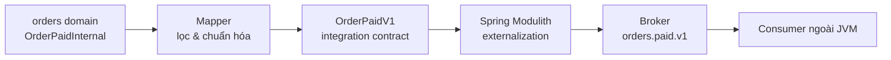
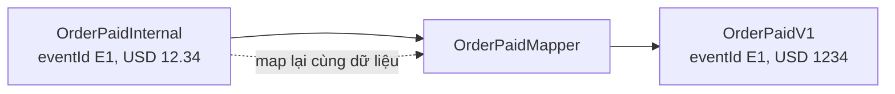
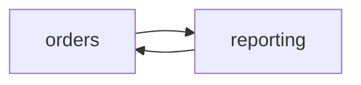
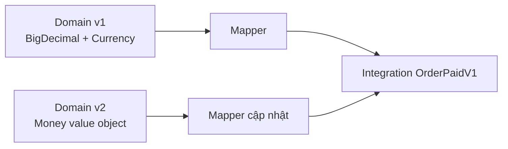

# Mapping event nội bộ thành integration event

Trong một ứng dụng Spring Modulith, sự kiện nghiệp vụ **bên trong module** thường được thiết kế để các thành phần trong cùng ứng dụng hiểu và xử lý. Khi sự kiện được gửi ra message broker để một hệ thống khác tiêu thụ, dữ liệu đó trở thành **hợp đồng tích hợp** với vòng đời, yêu cầu bảo mật và quy tắc tương thích riêng. Vì vậy, không nên mặc định rằng có thể serialize nguyên một domain event và công bố nó ra ngoài.

**Mapping event nội bộ thành integration event** là bước chuyển một biểu diễn phục vụ miền nghiệp vụ sang một biểu diễn được chủ động thiết kế cho consumer ngoài ứng dụng. Bước này có thể bao gồm **chọn trường, đổi tên, chuyển đơn vị tiền, chuẩn hóa thời gian, gắn version/định danh và loại bỏ thông tin nhạy cảm**.

Bài thuộc chương **Externalization** của học phần `SPRING_MODULITH_VERIFICATION_TESTING`. Học phần hướng tới kiểm chứng ranh giới kiến trúc bằng `ApplicationModules` và quy tắc phụ thuộc, kiểm thử `@ApplicationModuleTest`, sự kiện, cơ sở dữ liệu và tích hợp, rồi đặt quality gate trong CI để ngăn phụ thuộc sai và hồi quy. Ở đây, ta tập trung vào **ranh giới chuyển đổi event**, thiết kế API và test cho mapping; việc một event được chọn để gửi ra broker chỉ là một phần của quy trình.

## 1. Domain event và integration event khác nhau ở đâu?

Giả sử khi thanh toán thành công, module `orders` phát một domain event chứa số tiền, khách hàng và trạng thái kiểm tra rủi ro:

```text
OrderPaidInternal
  eventId
  orderId
  amount: BigDecimal
  currency: Currency
  occurredAt: Instant
  customerEmail
  internalRiskFlag
```

Analytics bên ngoài chỉ cần:

```text
OrderPaidV1
  eventId
  orderId
  amountMinorUnits: long
  currency: String
  occurredAt: Instant
```

Không có lý do nghiệp vụ nào buộc analytics biết email hoặc cờ kiểm soát rủi ro. Nếu dùng nguyên domain event, ta **mở rộng bề mặt dữ liệu công khai** và khiến consumer phụ thuộc vào một chi tiết nội bộ của module `orders`.

| Khía cạnh | Domain event nội bộ | Integration event |
| --- | --- | --- |
| Đối tượng phục vụ | Domain logic và listener trong ứng dụng | Consumer ngoài tiến trình hoặc một hợp đồng tích hợp đã được công bố |
| Chủ sở hữu | Module nghiệp vụ phát event | Module nghiệp vụ, phối hợp chính sách hợp đồng bên ngoài |
| Payload | Có thể phù hợp ngôn ngữ/model nội bộ | Tối thiểu, an toàn, ổn định, có quy ước serialization |
| Thay đổi | Theo nhu cầu refactor và logic nội bộ | Theo quy tắc tương thích, versioning và deprecation |
| Đơn vị tiền/thời gian | Có thể dùng Java `BigDecimal`, `Currency`, `Instant` | Cần thống nhất biểu diễn cross-language |
| Trách nhiệm kiểm thử | Đúng thời điểm nghiệp vụ, event được publish | Mapping, schema, routing, broker, consumer contract |

**Không phải mọi hệ thống đều phải có hai class event riêng.** Nếu một event nội bộ ngay từ đầu đã là hợp đồng công bố ổn định, có thể tái sử dụng nó. Nhưng khi yêu cầu nội bộ và bên ngoài khác nhau về dữ liệu, semantics hoặc tốc độ thay đổi, tách lớp mapping thường giúp giữ ranh giới tốt hơn.

## 2. “Mapping” không đồng nghĩa “externalization”

Hai quá trình liên quan nhưng khác trách nhiệm:

1. **Mapping:** từ `OrderPaidInternal` tạo `OrderPaidV1` (hoặc một wire DTO tương đương), kiểm soát **dữ liệu và ý nghĩa**.
2. **Externalization:** quyết định event/payload được chọn, định tuyến, serialize và gửi tới transport ngoài JVM qua adapter phù hợp.



Một mapper unit test PASS **không chứng minh** message đã tới broker. Ngược lại, một message được broker xác nhận **không chứng minh** mapping đã bỏ đúng trường nhạy cảm, giữ chính xác số tiền hoặc tương thích schema của consumer.

Luồng trong hình là mô hình khái niệm. **Điểm mapping nằm trước hay nằm trong externalization adapter** tùy phương án triển khai. Ta sẽ xem hai cách ở các phần sau và tuyệt đối không giả định tất cả chúng có bảo đảm giao dịch giống nhau.

## 3. Đặt ranh giới module cho ví dụ

Cấu trúc ví dụ:

```text
com.example.shop
├── ShopApplication.java
├── orders
│   ├── OrderPaidV1.java                 # contract có thể externalize
│   ├── package-info.java
│   └── internal
│       ├── OrderPaidInternal.java      # event chỉ dùng trong orders
│       ├── OrderPaidMapper.java        # mapping thuộc orders
│       ├── PaymentCaptureService.java  # nghiệp vụ phát sự kiện
│       └── PaymentLedger.java          # lưu trạng thái nội bộ
└── reporting
    └── internal
        └── OrderPaidListener.java      # listener JVM nếu có
```

Theo cách nhận diện mặc định của Spring Modulith, `orders` và `reporting` là application module. Kiểu trong package `orders.internal` không được module khác tùy tiện truy cập như API; kiểu `orders.OrderPaidV1` ở package gốc là một phần API mặc định của module đóng.

**Quy tắc sở hữu:** `orders` biết cách chuyển trạng thái thanh toán của chính nó thành hợp đồng `OrderPaidV1`. Module `reporting`, Kafka adapter và consumer analytics **không phải đọc entity nội bộ của `orders`** để dựng payload.

## 4. Định nghĩa domain event nội bộ

Ta dùng Java record để biểu đạt sự kiện đã xảy ra:

```java
// com/example/shop/orders/internal/OrderPaidInternal.java
package com.example.shop.orders.internal;

import java.math.BigDecimal;
import java.time.Instant;
import java.util.Currency;
import java.util.UUID;

record OrderPaidInternal(
        UUID eventId,
        UUID orderId,
        BigDecimal amount,
        Currency currency,
        Instant occurredAt,
        String customerEmail,
        String internalRiskFlag
) {}
```

Record này **package-private** để chỉ những class trong `orders.internal` sử dụng trực tiếp trong ví dụ. `customerEmail` và `internalRiskFlag` là thông tin nội bộ không cần đưa ra broker.

`eventId` xác định **một lần phát sinh sự kiện nghiệp vụ**. Nếu cần retry để externalize **cùng sự kiện**, phải giữ nguyên ID này, không tạo UUID mới ở mỗi lần gửi lại. Nếu toàn bộ command thanh toán được gọi lại do retry request HTTP, tầng nghiệp vụ cần thêm một khóa idempotency/persisted event identity phù hợp để tránh tạo **hai sự kiện nghiệp vụ khác nhau** cho cùng một khoản thanh toán.

Đừng dùng `OrderPaidInternal` để mô tả lệnh “thử thanh toán”: hậu tố `Paid` phải chỉ trạng thái thanh toán thực sự đã được ghi nhận theo nghĩa mà module định nghĩa. Nếu nghiệp vụ đang chờ capture hoặc settlement, hãy đặt tên khác phù hợp.

## 5. Định nghĩa integration event công khai

Để analytics ngoài JVM nhận dữ liệu có hợp đồng ổn định, định nghĩa một record khác:

```java
// com/example/shop/orders/OrderPaidV1.java
package com.example.shop.orders;

import java.time.Instant;
import java.util.UUID;
import org.springframework.modulith.events.Externalized;

@Externalized("orders.paid.v1")
public record OrderPaidV1(
        UUID eventId,
        UUID orderId,
        long amountMinorUnits,
        String currency,
        Instant occurredAt
) {}
```

`@Externalized("orders.paid.v1")` thể hiện ý định **cho phép loại event này được externalize** qua adapter đã được cấu hình. Chuỗi destination được diễn giải theo transport/version: Kafka topic, AMQP exchange/routing hoặc JMS destination không có semantics hoàn toàn giống nhau.

**Record không tự đi ra broker**. Phải có code publish Spring event, cơ chế externalization chọn sự kiện này, adapter transport, kết nối, destination và serialization đúng.

Tại sao chọn những trường trên?

| Trường integration | Nguồn domain | Quy tắc |
| --- | --- | --- |
| `eventId` | `OrderPaidInternal.eventId` | Giữ nguyên, dùng cho correlation/deduplication |
| `orderId` | `OrderPaidInternal.orderId` | Giữ định danh nghiệp vụ, không gửi toàn entity |
| `amountMinorUnits` | `amount: BigDecimal` | Chuyển sang đơn vị nhỏ nhất theo currency, không làm tròn âm thầm |
| `currency` | `java.util.Currency` | Chuyển thành ISO currency code, ví dụ `USD` |
| `occurredAt` | `Instant` | Giữ thời điểm sự kiện nghiệp vụ, không thay bằng thời điểm publish broker |
| Email và cờ rủi ro | Có trong domain event | **Loại khỏi integration event** |

Integration event nên nhỏ và dễ dùng từ nhiều ngôn ngữ, nhưng đừng đánh đổi độ chính xác chỉ để có ít trường: nếu việc xử lý cần refund/settlement ID, hãy đánh giá và công bố một trường có định nghĩa rõ.

## 6. Viết mapper thuần: một nơi quản lý chuyển đổi

Mapper chỉ cần nhận domain event và trả integration event. Nó không cần database, Spring context, message broker hay HTTP client.

```java
// com/example/shop/orders/internal/OrderPaidMapper.java
package com.example.shop.orders.internal;

import com.example.shop.orders.OrderPaidV1;
import java.math.BigDecimal;
import java.util.Currency;
import java.util.Objects;

final class OrderPaidMapper {

    OrderPaidV1 toIntegration(OrderPaidInternal source) {
        Objects.requireNonNull(source, "source");
        Objects.requireNonNull(source.eventId(), "eventId");
        Objects.requireNonNull(source.orderId(), "orderId");
        Objects.requireNonNull(source.occurredAt(), "occurredAt");

        BigDecimal amount = Objects.requireNonNull(
                source.amount(), "amount");
        Currency currency = Objects.requireNonNull(
                source.currency(), "currency");

        if (amount.signum() <= 0) {
            throw new IllegalArgumentException(
                    "Paid amount must be positive");
        }

        int digits = currency.getDefaultFractionDigits();
        if (digits < 0) {
            throw new IllegalArgumentException(
                    "Currency has no defined minor unit");
        }

        // Chuyển đổi CHÍNH XÁC: ví dụ USD 12.34 -> 1234.
        // Không làm tròn một giá trị không biểu diễn được.
        long minorUnits = amount.movePointRight(digits)
                .longValueExact();

        return new OrderPaidV1(
                source.eventId(),
                source.orderId(),
                minorUnits,
                currency.getCurrencyCode(),
                source.occurredAt()
        );
    }
}
```

Trong ví dụ:

- `USD 12.34` với hai chữ số thập phân → `1234` minor units.
- `VND 150000` với số chữ số thập phân mặc định bằng không → `150000`.
- `USD 12.345` **không được âm thầm làm tròn** thành `1235`; `longValueExact()` báo lỗi vì không thể biểu diễn chính xác theo minor unit đã chọn.
- Số tiền vượt phạm vi `long` cũng gây lỗi, thay vì tràn im lặng.

Quy tắc trên có tính **minh họa**, cần xác nhận currency được phép, cách xử lý amount âm/zero (refund có thể cần event riêng) và chính sách decimal thực tế của sản phẩm. `Currency.getDefaultFractionDigits()` không phải nguồn chân lý tuyệt đối cho mọi loại tài sản hoặc quy ước thanh toán; hãy kiểm tra hợp đồng tài chính với domain team.

### Không đưa dữ liệu nhạy cảm vào logic serialization

Mapper **không gọi** `source.customerEmail()` hoặc `source.internalRiskFlag()`. Thậm chí tốt hơn, record `OrderPaidV1` **không khai báo** hai trường đó, giúp serializer không vô tình xuất chúng qua JSON dựa trên getter/record component.

Điều này không tự chứng minh toàn bộ hệ thống an toàn: log, headers, message key, custom serializer hoặc metadata khác vẫn có thể làm rò dữ liệu. Vì vậy cần thêm kiểm thử payload và rà soát quyền truy cập.

## 7. Sai lầm khi mapping: đổi kiểu nhưng đổi luôn nghĩa

Một mapper không chỉ chuyển tên field; nó phải bảo toàn **semantic contract**.

| Sai lầm | Hệ quả | Cách kiểm soát |
| --- | --- | --- |
| Chuyển `BigDecimal` sang `double` rồi nhân 100 | Mất độ chính xác nhị phân, làm tròn sai | Dùng phép toán thập phân chính xác và test boundary |
| Dùng `Instant.now()` ở mapper | Thay thời điểm nghiệp vụ bằng thời điểm publish/retry | Giữ `source.occurredAt()` |
| Tạo `UUID.randomUUID()` cho integration event mỗi lần map | Retry trông như event mới | Giữ `source.eventId()` |
| Copy toàn bộ domain object sang DTO | Lộ field nội bộ, coupling schema | Tạo explicit allowlist field |
| Gộp `authorized` với `captured` | Consumer hiểu sai trạng thái thanh toán | Event name/type riêng, mô tả thời điểm |
| Chuyển null sang chuỗi `"null"` | Consumer khó phát hiện dữ liệu thiếu | Validate bắt buộc, test trường hợp lỗi |
| Thay event version nhưng tái sử dụng cùng schema route không kiểm soát | Consumer cũ không deserialize được | Versioning và contract test |

Nếu một trường chỉ tồn tại để hỗ trợ implementation, không nên đưa ra integration contract vì “consumer có thể cần sau này”. Mỗi field public sẽ tăng chi phí thay đổi lâu dài.

## 8. Cách A — mapping tường minh rồi publish integration event

Một cách triển khai dễ theo dõi là **chuyển đổi trong module sở hữu nghiệp vụ**, sau đó phát cả domain event nội bộ và integration event công khai:

```java
// com/example/shop/orders/internal/PaymentCaptureService.java
package com.example.shop.orders.internal;

import java.math.BigDecimal;
import java.time.Clock;
import java.time.Instant;
import java.util.Currency;
import java.util.UUID;
import org.springframework.context.ApplicationEventPublisher;
import org.springframework.stereotype.Service;
import org.springframework.transaction.annotation.Transactional;

@Service
class PaymentCaptureService {

    private final PaymentLedger ledger;
    private final ApplicationEventPublisher events;
    private final OrderPaidMapper mapper = new OrderPaidMapper();
    private final Clock clock = Clock.systemUTC();

    PaymentCaptureService(
            PaymentLedger ledger,
            ApplicationEventPublisher events) {
        this.ledger = ledger;
        this.events = events;
    }

    @Transactional
    UUID capture(
            UUID orderId,
            BigDecimal amount,
            Currency currency,
            String customerEmail) {

        // Thực tế: xác thực trạng thái payment, idempotency,
        // tính nhất quán và lưu sự kiện/định danh bền vững.
        ledger.recordPaid(orderId, amount, currency);

        var internal = new OrderPaidInternal(
                UUID.randomUUID(),
                orderId,
                amount,
                currency,
                Instant.now(clock),
                customerEmail,
                "internal-only"
        );

        events.publishEvent(internal); // listener nội bộ orders
        events.publishEvent(mapper.toIntegration(internal)); // outbound

        return internal.eventId();
    }
}
```

Để chỉ rõ dependency còn thiếu trong ví dụ, `PaymentLedger` có thể là interface nội bộ:

```java
// com/example/shop/orders/internal/PaymentLedger.java
package com.example.shop.orders.internal;

import java.math.BigDecimal;
import java.util.Currency;
import java.util.UUID;

interface PaymentLedger {
    void recordPaid(UUID orderId, BigDecimal amount, Currency currency);
}
```

Project thực phải cung cấp bean triển khai `PaymentLedger` bằng repository/adapter phù hợp và kiểm soát giao dịch. Đoạn trên minh họa **điểm mapping/publish** chứ chưa phải một quy trình payment có khả năng xử lý concurrency, duplicate HTTP request và đối soát production.

### Vì sao publish hai event không nhất thiết có nghĩa hai nghiệp vụ?

Ở phương án này, hai event diễn đạt **cùng một sự thật nghiệp vụ qua hai hợp đồng khác nhau**. Chúng chia sẻ `eventId`, `orderId` và `occurredAt`, nhưng không được sử dụng thay nhau:

- `OrderPaidInternal` chỉ dành cho listener nội bộ trong `orders`; không có `@Externalized`.
- `OrderPaidV1` là contract công khai được đánh dấu `@Externalized`.

**Không bật đồng thời một selector rộng cũng externalize `OrderPaidInternal`**, vì điều đó vừa lộ dữ liệu vừa có thể tạo hai message cho một sự kiện nghiệp vụ. Nên giữ một nguồn quyết định lựa chọn rõ ràng, kiểm tra positive/negative bằng test.

### Cảnh báo transaction

Cả hai lệnh `publishEvent(...)` ở ví dụ diễn ra trong method `@Transactional`, nhưng thứ tự mã **không tự bảo đảm Kafka chỉ nhận message sau khi database commit**. Cần cấu hình externalization, transaction-aware handling và Event Publication Registry khi yêu cầu độ bền phù hợp.

Nếu nghiệp vụ rollback, một integration event kiểu “đã thanh toán” không được công bố thành công trái với trạng thái database. Điều này phải được **kiểm thử**, không thể chứng minh chỉ bằng việc đặt `@Transactional` trên service.

## 9. Cách B — mapping trong cấu hình externalization

Một hướng khác là **publish domain event một lần** rồi cho tầng externalization:

1. Lựa chọn event nội bộ nào được xuất ra.
2. Chuyển event đó thành payload dành cho integration.
3. Định tuyến payload đến destination.

Các phiên bản Spring Modulith hỗ trợ cấu hình externalization theo chương trình, ví dụ qua các API liên quan đến `EventExternalizationConfiguration`. Khả năng chọn type, mapping và routing cần **đối chiếu API chính xác của phiên bản đang dùng**.

Mô hình bằng pseudocode, **không phải Java API có thể copy trực tiếp**:

```text
externalization policy:
    select event type == OrderPaidInternal
    mapping: OrderPaidMapper.toIntegration(event)
    destination: "orders.paid.v1"
    transport: configured Kafka/AMQP/JMS adapter

producer:
    persist payment
    publish OrderPaidInternal ONCE
```

Ưu điểm: domain service không cần biết `OrderPaidV1` nếu chính sách mapping nằm ở tầng tích hợp. Nhưng **điểm mapping ảnh hưởng transaction và lưu publication**:

- Registry có ghi lại **event nguồn**, **payload đã map**, hay dữ liệu khác? Phụ thuộc cách cấu hình/phiên bản; phải xác minh.
- Nếu event nguồn chứa email/cờ rủi ro, nó có thể đi vào storage/log của publication trước khi mapping. Rủi ro bảo mật không chỉ nằm ở broker.
- Mapper chạy trước hay sau commit, và lỗi mapper được xử lý như thế nào? Không được suy luận từ sơ đồ khái niệm.
- Cấu hình mapping có thể không tạo một event `OrderPaidV1` thứ hai trên internal Spring event bus; không nên viết test `PublishedEvents` kỳ vọng event mới nếu phương án thực tế chỉ biến đổi payload ngay trước externalization.

Vì vậy, **cách A và cách B là hai chiến lược thay thế**, không phải hai bước mặc định phải bật đồng thời. Với tiêu chí cô lập payload nhạy cảm mạnh, cách A (publish một integration event an toàn ngay trong transaction) thường dễ quan sát. Với hệ thống ưu tiên giữ domain type độc lập adapter, cách B có thể thuận lợi nếu hành vi mapping/persistence đã được kiểm chứng.

## 10. Đừng nhầm listener “after commit” với mapper thuần

Một cách thử nhanh thường thấy:

```java
// Ý tưởng cần xem xét kỹ, KHÔNG phải mặc định đúng cho durability:
@TransactionalEventListener(phase = TransactionPhase.AFTER_COMMIT)
void on(OrderPaidInternal event) {
    publisher.publishEvent(mapper.toIntegration(event));
}
```

Listener này có thể publish một Spring event mới **sau khi transaction gốc đã commit**. Nếu tiến trình chết sau commit nhưng trước khi chạy listener, liệu event mapped có được lưu bền vững để khôi phục? Điều đó **không tự được bảo đảm**.

Nếu `OrderPaidInternal` được lưu bền vững trong publication registry dành cho listener, cần hiểu cơ chế completion/resubmission và transaction riêng của listener. Nếu không, việc “để mapper sau commit” có thể mở ra một **khoảng mất event**.

**Không khuyên dùng cấu trúc này chỉ vì nó trông thuận tiện.** Với luồng quan trọng, hãy xác minh transaction boundary và publication storage hoặc áp dụng một thiết kế outbox/registry phù hợp. Một mapper thuần (như `OrderPaidMapper`) giúp dễ test, nhưng **nơi gọi mapper** mới quyết định bảo đảm vận hành.

## 11. Thiết kế mapper theo hướng deterministic

Một mapper tốt nên có các tính chất:

1. **Deterministic:** cùng một domain event tạo cùng integration payload nếu quy tắc/version không thay đổi.
2. **Không có side effect:** không gọi HTTP, database hay broker.
3. **Không phụ thuộc giờ hiện tại:** sử dụng `occurredAt` có sẵn.
4. **Không tự sinh ID mới:** dùng `eventId` nguồn.
5. **Validate dữ liệu bắt buộc:** không đổi thiếu dữ liệu thành giá trị giả.
6. **Chuyển đổi có ý nghĩa:** amount/currency/locale/time được diễn giải theo hợp đồng.
7. **Có version rõ:** khi contract đổi không tương thích, mapper cũ vẫn giữ được trong giai đoạn chuyển tiếp.



Mapping không phải một thao tác phải chạy đúng một lần. Trong các tình huống retry, nó có thể chạy nhiều lần. Nếu mapper tự lấy đồng hồ, sinh UUID hoặc gọi dịch vụ biến động, cùng một event có thể tạo payload khác nhau giữa các lần, làm khó đối soát và dedupe.

## 12. Test đơn vị mapper: số tiền, ID, thời gian

Vì `OrderPaidMapper` là Java thuần, có thể test không cần Spring:

```java
// src/test/java/com/example/shop/orders/internal/OrderPaidMapperTests.java
package com.example.shop.orders.internal;

import static org.junit.jupiter.api.Assertions.*;

import com.example.shop.orders.OrderPaidV1;
import java.math.BigDecimal;
import java.time.Instant;
import java.util.Currency;
import java.util.UUID;
import org.junit.jupiter.api.Test;

class OrderPaidMapperTests {
    private final OrderPaidMapper mapper = new OrderPaidMapper();

    @Test
    void mapsMoneyAndPreservesEventIdentity() {
        UUID eventId = UUID.randomUUID();
        UUID orderId = UUID.randomUUID();
        Instant when = Instant.parse("2026-11-26T01:00:00Z");

        var source = new OrderPaidInternal(
                eventId,
                orderId,
                new BigDecimal("12.34"),
                Currency.getInstance("USD"),
                when,
                "customer@example.test",
                "manual-review"
        );

        OrderPaidV1 actual = mapper.toIntegration(source);

        assertEquals(eventId, actual.eventId());
        assertEquals(orderId, actual.orderId());
        assertEquals(1234L, actual.amountMinorUnits());
        assertEquals("USD", actual.currency());
        assertEquals(when, actual.occurredAt());
        assertEquals(actual, mapper.toIntegration(source));
    }

    @Test
    void rejectsSubMinorUnitInsteadOfRoundingSilently() {
        var source = new OrderPaidInternal(
                UUID.randomUUID(),
                UUID.randomUUID(),
                new BigDecimal("12.345"),
                Currency.getInstance("USD"),
                Instant.parse("2026-11-26T01:00:00Z"),
                "customer@example.test",
                "internal"
        );

        assertThrows(ArithmeticException.class,
                () -> mapper.toIntegration(source));
    }
}
```

Các test này xác nhận **phép chuyển đổi của mapper**, không cần broker. Với tiền tệ khác USD, bổ sung test cho VND/JPY (minor unit bằng 0), số rất lớn, amount không hợp lệ và null field. Nếu nghiệp vụ cho phép refund âm, xây dựng contract refund/adjustment riêng và test chính sách đó.

## 13. Test cấu trúc: dữ liệu không được phép không xuất hiện trong contract

Đừng chỉ test trường cần có; hãy kiểm soát **trường không được phép**:

```java
// Một bài test bổ sung trong OrderPaidMapperTests:
@Test
void integrationRecordDoesNotDeclareSensitiveFields() {
    var fieldNames = java.util.Arrays.stream(
            com.example.shop.orders.OrderPaidV1.class.getRecordComponents())
            .map(java.lang.reflect.RecordComponent::getName)
            .toList();

    assertFalse(fieldNames.contains("customerEmail"));
    assertFalse(fieldNames.contains("internalRiskFlag"));
}
```

Test reflection này có giá trị như một **chốt bảo vệ contract** nhưng chưa thay thế kiểm thử serialized payload. Một custom serializer, message header hoặc mapping cấu hình khác vẫn có thể thêm dữ liệu vào message. Khi kiểm thử broker, phải xác nhận **bytes/JSON/schema và headers thật** không có trường nhạy cảm.

Đối với hệ thống có quy định dữ liệu cá nhân, cần thêm review về classification, retention, ACL và các dữ liệu có thể suy ra danh tính từ `orderId` hoặc metadata khác. Xóa `customerEmail` khỏi payload không có nghĩa toàn bộ dữ liệu đã ẩn danh.

## 14. Kiểm thử event được phát bằng `@ApplicationModuleTest`

Để xác nhận business service thực sự publish integration event sau bước mapping, có thể dùng Spring Modulith Test:

```java
// src/test/java/com/example/shop/orders/internal/PaymentEventsTests.java
package com.example.shop.orders.internal;

import static org.assertj.core.api.Assertions.assertThat;

import com.example.shop.orders.OrderPaidV1;
import java.math.BigDecimal;
import java.util.Currency;
import java.util.UUID;
import org.junit.jupiter.api.Test;
import org.springframework.beans.factory.annotation.Autowired;
import org.springframework.modulith.test.ApplicationModuleTest;
import org.springframework.modulith.test.PublishedEvents;

@ApplicationModuleTest
class PaymentEventsTests {

    @Autowired
    PaymentCaptureService service;

    @Test
    void publishesMappedIntegrationEvent(PublishedEvents publishedEvents) {
        service.capture(
                UUID.randomUUID(),
                new BigDecimal("12.34"),
                Currency.getInstance("USD"),
                "customer@example.test"
        );

        assertThat(publishedEvents.ofType(OrderPaidV1.class)).hasSize(1);
    }
}
```

Đây là test **minh họa theo cách A**. Để chạy, module test cần một bean `PaymentLedger` hoạt động và fixture giao dịch/dữ liệu; có thể cấu hình implementation test hoặc repository giả lập rõ ràng. Nếu chọn **cách B** (chỉ publish `OrderPaidInternal` rồi map trong adapter), test Spring event bus phải thay đổi tương ứng: nó không nhất thiết nhìn thấy `OrderPaidV1`.

`PublishedEvents` quan sát **Spring application events đã publish trong phạm vi test**, không xác nhận broker đã nhận message. Vì vậy muốn test externalization phải đi thêm bước integration ở phần sau.

### Phạm vi test module

`@ApplicationModuleTest` có các bootstrap mode như `STANDALONE`, `DIRECT_DEPENDENCIES` và `ALL_DEPENDENCIES` để kiểm soát module được khởi tạo. Chế độ phù hợp phụ thuộc vào mapping/bean wiring thực tế. Không nới scope tới mọi module chỉ để che một dependency cycle; trước tiên cần giữ ranh giới kiến trúc hợp lệ.

## 15. Bảo vệ dependency rules khi thêm mapper

Một lỗi thiết kế là để module `reporting` hoặc module hạ tầng import `orders.internal.OrderPaidInternal` rồi thực hiện mapping:

```java
// Phản ví dụ: trong reporting, truy cập domain event nội bộ của orders
import com.example.shop.orders.internal.OrderPaidInternal;
```

Với module đóng, package `orders.internal` không phải API công khai cho các module khác. Dù Java modifier có cho phép import hay không, thiết kế này làm lộ implementation và có nguy cơ vi phạm ranh giới Spring Modulith.

**Cách rõ hơn:** mapper đặt trong `orders.internal`, công bố `orders.OrderPaidV1` khi muốn có listener Java ở module khác. Trong trường hợp mapping hoàn toàn do hạ tầng ngoài module đảm nhiệm, cần thiết kế một API có quyền truy cập rõ ràng, thay vì cho một module bất kỳ “đọc xuyên” entity nội bộ.

Kiểm tra bằng JUnit:

```java
// src/test/java/com/example/shop/ModularityTests.java
package com.example.shop;

import org.junit.jupiter.api.Test;
import org.springframework.modulith.core.ApplicationModules;

class ModularityTests {
    @Test
    void verifiesArchitecture() {
        ApplicationModules.of(ShopApplication.class).verify();
    }
}
```

`verify()` kiểm tra các quy tắc kiến trúc được áp dụng, bao gồm **không có dependency cycle**, **không truy cập package nội bộ của module khác** ngoài API được công bố, và **tuân thủ `allowedDependencies` khi có khai báo**.

Nếu listener trong `reporting` nhận `orders.OrderPaidV1`, nó tạo cạnh Java **`reporting → orders`**; đó có thể là phụ thuộc được phép nếu không vi phạm policy hoặc tạo chu trình. Kafka consumer **bên ngoài JVM** không nằm trong đồ thị application module được `verify()` phân tích.

## 16. Mapping có thể làm phát sinh cycle không?

Có, nếu đặt mapper sai chiều phụ thuộc. Xét:



Ví dụ `orders` dùng `reporting.ReportFormatter` để dựng event integration, trong khi `reporting` lắng nghe `orders.OrderPaidV1`. Hai tham chiếu kiểu tạo **`orders → reporting → orders`**.

Phá vòng bằng cách đưa **trách nhiệm tạo integration payload** về `orders` hoặc một hợp đồng kiến trúc được thiết kế đúng chiều, không yêu cầu module sở hữu domain import consumer. Event externalization **không tự xóa các cạnh Java đã tồn tại**.

Giữ mapper ở module sở hữu nghiệp vụ giúp module đó quyết định nội dung được công bố; các consumer chỉ đọc hợp đồng, không yêu cầu producer biết implementation của từng consumer.

## 17. Kiểm thử schema/serialization của integration event

Mã Java ở mapper có thể đúng nhưng serializer lại tạo JSON sai field name, format timestamp hoặc metadata không mong muốn. Vì vậy cần một **schema contract test** cho representation thực:

```json
{
  "eventId": "4cf3409d-7a3c-4bd6-b3cc-7ea8cd4e65d1",
  "orderId": "130d6edf-9fd4-42ed-976d-2bfb22a2d7ac",
  "amountMinorUnits": 1234,
  "currency": "USD",
  "occurredAt": "2026-11-26T01:00:00Z"
}
```

Đây là **mẫu hợp đồng mong muốn**, không phải lời khẳng định adapter mặc định luôn phát JSON chính xác như trên. Có adapter dùng header/type metadata, các cấu hình ObjectMapper khác nhau hoặc schema registry riêng.

Contract test cần kiểm tra:

- Tên field và type: `amountMinorUnits` là số nguyên, không phải string hoặc floating point.
- `occurredAt` theo UTC/ISO-8601 hoặc quy ước đã công bố.
- Không có `customerEmail`, `internalRiskFlag` hay entity/proxy.
- `eventId`/`orderId` có format đúng; event ID không đổi khi resubmit.
- Tên sự kiện, schema version và destination nhất quán.
- Consumer cũ có deserialize được payload theo chính sách tương thích không.

Nếu dùng Avro/Protobuf/JSON Schema, nên có test so với schema chính thức thay vì chỉ assert vài substring trong JSON.

## 18. Versioning: thay đổi domain mà không buộc consumer thay theo

Giả sử nội bộ đổi `OrderPaidInternal.amount` từ `BigDecimal` sang một `Money` value object mới. Nếu mapper vẫn tạo `OrderPaidV1` với cùng `amountMinorUnits`/`currency`, **consumer bên ngoài không cần thay đổi**.



Đây là giá trị lớn của mapping: **độc lập tiến độ thay đổi của domain model và integration schema**.

Khi phải thay contract không tương thích, có thể:

1. Tạo `OrderPaidV2` với định nghĩa khác và version rõ.
2. Định tuyến tới destination/schema mới theo chính sách.
3. Trong giai đoạn chuyển đổi, duy trì adapter/mapping v1 và v2 nếu thật sự có consumer cần cả hai.
4. Theo dõi consumer chuyển đổi rồi deprecate v1 có kế hoạch.

Nếu đồng thời xuất cả v1 và v2 cho **cùng một nghiệp vụ**, các consumer cần biết đó là **hai representation**, không phải hai khoản thanh toán. Correlation và `eventId` phải có quy tắc rõ ràng; có thể giữ cùng định danh sự kiện cùng business fact theo hợp đồng, nhưng không được dùng chung khóa idempotency theo cách gây bỏ sót processing giữa hai phiên bản nếu chúng được xử lý vào cùng kho lưu.

**Không đổi âm thầm field `amountMinorUnits` thành giá trị tiền đơn vị lớn** trong event v1 chỉ vì tên cột nội bộ thay đổi. Đó là thay đổi nghĩa, nguy hiểm hơn cả đổi kiểu JSON.

## 19. Event Publication Registry và thời điểm mapping

Spring Modulith có cơ chế **Event Publication Registry** để theo dõi các publication liên quan đến listener/đích externalization, khi được cấu hình với thành phần lưu trữ/adapter phù hợp. Điều này giúp giải quyết một phần bài toán **khôi phục sự kiện chưa gửi hoàn tất** sau lỗi, nhưng không mặc định đảm bảo exactly-once.

Cần xét thời điểm mapping:

| Phương án | Dữ liệu có thể đi vào publication storage | Cần xác minh |
| --- | --- | --- |
| **A. Publish `OrderPaidV1` đã map** | Event integration đã loại trường nội bộ, tùy cách registry lưu/serialize | Được ghi trong transaction nào, gửi sau commit thế nào |
| **B. Publish `OrderPaidInternal`, adapter map** | Event nguồn có thể chứa email/cờ rủi ro trước khi mapping | Registry lưu source hay mapped payload, ai có quyền đọc, retry ra sao |
| **Mapper sau commit thủ công** | Có thể chưa có publication bền vững cho event mapped | Cửa sổ mất event nếu app chết trước publish |

Đừng khẳng định mọi adapter hoặc mọi phiên bản Spring Modulith dùng cùng hình thức lưu publication. **Phải kiểm tra implementation/configuration và integration test** của ứng dụng.

Một kịch bản quan trọng:

```text
DB transaction commit thành công
    ↓
Adapter gửi integration event tới broker
    ↓
Broker nhận được message
    ↓
Ứng dụng crash trước khi mark publication complete
    ↓
Recovery có thể gửi lại cùng event
```

Do đó, mapper phải giữ `eventId` ổn định, và consumer cần **idempotency**. Việc producer mark complete không có nghĩa consumer đã xử lý message thành công.

## 20. Độ tin cậy: mapping đúng chưa đủ

Một pipeline externalization cần ba loại correctness:

1. **Semantic correctness:** `OrderPaidV1` mô tả đúng sự thật đã xảy ra, amount/currency/time đúng.
2. **Architectural correctness:** không leak `orders.internal`, không tạo cycle, phụ thuộc được phép.
3. **Delivery correctness:** event được chọn, routing/serialization đúng, retry/recovery và consumer behavior phù hợp.

Ví dụ: mapper tính `USD 12.34 → 1234` chính xác nhưng broker topic sai là lỗi delivery; broker gửi đúng nhưng mapper làm tròn `12.345` thành `12.35` không được phép là lỗi semantic; cả hai đúng nhưng `reporting` import `orders.internal.PaymentLedger` là lỗi boundary.

Không có một test duy nhất bao phủ cả ba mặt. Nên phân lớp:

| Lớp kiểm thử | Điều cần chứng minh |
| --- | --- |
| Unit test mapper | Field mapping, validation, amount/currency, identity, deterministic |
| Contract/serialization test | Wire payload/schema, version, không lộ PII |
| `ApplicationModules.verify()` | Cycle, API nội bộ, `allowedDependencies` |
| `@ApplicationModuleTest` | Domain service publish event đúng trong phạm vi module |
| Broker integration test | Adapter, destination, key/header, message thực |
| Failure/recovery test | Rollback, broker outage, retry, duplicate delivery |
| Consumer integration test | Dedupe, xử lý side effect và database đúng |

## 21. Consumer idempotency với `eventId`

Khi analytics nhận `OrderPaidV1` nhiều lần, không được ghi doanh thu nhiều lần cho cùng business event. Một mô hình thường dùng là có bảng `processed_events` với unique key:

```sql
CREATE TABLE processed_events (
    event_id VARCHAR(36) PRIMARY KEY,
    processed_at TIMESTAMP NOT NULL
);
```

Tác vụ consumer (mô tả logic):

```text
BEGIN TRANSACTION
  INSERT INTO processed_events(event_id, processed_at)
  -- nếu unique violation vì event đã xử lý: bỏ qua một cách an toàn
  INSERT / UPDATE analytics_projection(...)
COMMIT
ACK MESSAGE
```

Thực tế cần **đảm bảo cả việc đánh dấu processed và side effect nằm trong cùng một transaction** hoặc một cơ chế idempotency tương đương. Nếu ghi processed trước nhưng lỗi ghi projection, rồi consumer bỏ qua khi retry, ta sẽ mất tác dụng nghiệp vụ. Ngược lại, nếu cập nhật projection trước mà chưa ghi marker, retry có thể tạo dữ liệu trùng.

`eventId` trong `OrderPaidV1` do **domain event gốc** cung cấp, không được tạo lại bởi mapper hoặc adapter mỗi lần retry. Đối với một đơn có nhiều khoản thanh toán hợp lệ, `orderId` **không đủ** làm dedupe key cho mọi event thanh toán.

## 22. Broker integration test: quan sát payload đã mapping

Với Kafka/RabbitMQ/JMS, test cần nhìn thấy **message thật** sau khi Spring Modulith externalization chạy:

```text
given:
  adapter externalization đúng phiên bản/config
  broker test đã có destination orders.paid.v1
  dữ liệu PaymentLedger test hợp lệ

when:
  payment capture thực sự thành công và transaction commit

then:
  broker consumer nhận message trong timeout hữu hạn
  eventId == eventId do nghiệp vụ tạo
  amountMinorUnits == 1234 khi amount nguồn là USD 12.34
  currency == "USD"
  occurredAt đúng source
  payload không có customerEmail/internalRiskFlag

and:
  internal event OrderPaidInternal không tự xuất ra ngoài
  trừ khi dự án chủ động có một policy khác được duyệt
```

Với Kafka, còn kiểm tra topic, message key/partition và serializer; với AMQP, kiểm tra exchange/routing/queue binding; với JMS, kiểm tra destination và converter. Không viết test chỉ dựa vào việc `PublishedEvents` chứa `OrderPaidV1` rồi kết luận broker đã nhận.

**Test rollback** phải chứng minh event kiểu “thanh toán thành công” không ra broker khi domain transaction thất bại theo chính sách. **Test recovery** phải chứng minh publication thất bại được giữ/khôi phục nếu đã cấu hình registry bền vững. Nếu chưa có registry, đừng tuyên bố đã có khả năng phục hồi nhờ Spring Modulith.

## 23. Observability cho pipeline mapping

Khi một consumer báo “số tiền bị sai”, cần biết lỗi nằm ở miền nghiệp vụ, mapper, serializer, broker hay consumer. Các thông tin vận hành hữu ích:

- `eventId`, `orderId` và `eventType/version` trong structured logs (không log email/thông tin nhạy cảm).
- Metric số event nội bộ, số integration event được chọn và số publication thành công/thất bại.
- Metric lỗi mapper phân loại theo nguyên nhân: currency unsupported, amount không hợp lệ, overflow, thiếu field.
- Tuổi publication incomplete lớn nhất và số lượng chờ retry nếu registry hỗ trợ.
- Broker publish latency, producer error, consumer lag và số message cần xử lý lại.
- Schema/serialization failure và số payload bị consumer từ chối.

Đừng chỉ log “published OrderPaid” khi sự kiện mới được đưa vào Spring event bus. Cần phân biệt **publish nội bộ, tạo integration payload, broker acknowledgement và consumer processing**.

Nếu mapping thất bại, xác định chính sách giao dịch: reject command, đánh dấu lỗi cần xử lý, hay ghi nhận một tình huống cần vận hành can thiệp. Không tự nuốt lỗi mapping rồi coi thanh toán và tích hợp đã hoàn tất.

## 24. Quality gate CI bảo vệ mapping và contract

Một pipeline có thể gồm:

```text
Pull request
  |
  v
Compile + unit test OrderPaidMapper
  |-- amount/currency chính xác?
  |-- eventId/occurredAt giữ nguyên?
  '-- trường nhạy cảm không lộ?
  |
  v
Schema/serialization contract test
  '-- OrderPaidV1 tương thích với consumer?
  |
  v
ModularityTests -> ApplicationModules.verify()
  '-- đúng API, allowedDependencies, không cycle?
  |
  v
@ApplicationModuleTest + PublishedEvents
  '-- business service publish đúng internal/integration event?
  |
  v
Broker integration test
  |-- correct route/key/headers/wire payload?
  |-- source internal event không bị externalize nhầm?
  '-- rollback/retry path được kiểm tra?
  |
  v
Merge nếu các gate bắt buộc PASS
```

Nếu project dùng hệ thống build khác nhau, pipeline phải chạy đúng các bài test đã khai báo, không bỏ qua bằng `skipTests` hoặc filter. Mỗi lần đổi field, đổi mapper, đổi serializer hoặc thay policy externalization đều là thay đổi có thể ảnh hưởng consumer; không nên chỉ chạy unit test service chính.

Khi một bản Spring Modulith mới thay API cấu hình mapping, cần kiểm lại cách selector, mapper và adapter tương tác. **Kiểm thử thực tế tốt hơn việc suy luận rằng tên API giống nhau sẽ có hành vi hoàn toàn giống nhau giữa các phiên bản.**

## 25. Checklist thiết kế và review

Trước khi externalize một mapped event, review theo thứ tự:

1. **Sự thật nghiệp vụ:** event thể hiện trạng thái thực sự đã xảy ra chưa?
2. **Ownership:** module nào sở hữu domain event và integration event?
3. **Mapping:** trường nào được chuyển, bỏ, đổi tên, chuẩn hóa?
4. **Currency/time:** đơn vị nhỏ nhất và thời điểm có định nghĩa rõ chưa?
5. **Identity:** `eventId` có giữ ổn định qua mapping/retry?
6. **Privacy:** đã bỏ field nhạy cảm và rà soát header/log/metadata?
7. **Versioning:** consumer có schema và chính sách tương thích?
8. **Selection:** chỉ integration payload đã được duyệt được externalize?
9. **Transaction:** khi rollback, có nguy cơ gửi event thành công giả?
10. **Registry:** có cơ chế lưu publication bền vững/recovery nếu cam kết cần?
11. **Architecture:** có module khác đang import `orders.internal`?
12. **Testing:** unit, module, contract, broker và failure tests đủ mức?
13. **Operations:** monitor incomplete publication, retry, lag và lỗi mapping?

Checklist cần đi kèm tài liệu hợp đồng cho consumer: tên destination, ví dụ payload hợp lệ, version, cách hiểu amount/time và chính sách deprecation.

## 26. Bài tập và đáp án

### Bài 1 — Copy toàn bộ domain event?

`OrderPaidInternal` chứa `customerEmail`, `internalRiskFlag` và `amount`. Analytics chỉ cần số tiền theo đơn.

**Hỏi:** Có nên serialize nguyên `OrderPaidInternal` ra broker?

**Đáp án:** **Không nên.** Tách một integration event tối thiểu, dùng mapper chủ động chọn các trường phù hợp. Nhờ vậy consumer không phụ thuộc mô hình nội bộ và tránh nhận dữ liệu nhạy cảm không cần thiết.

### Bài 2 — Số tiền USD có ba chữ số thập phân

Source có `amount = new BigDecimal("12.345")`, `currency = USD`. Hợp đồng yêu cầu integer minor units, không cho phép làm tròn.

**Hỏi:** Mapper trả bao nhiêu?

**Đáp án:** Theo mapper của bài, phép `movePointRight(2).longValueExact()` phát hiện `1234.5` không biểu diễn được bằng `long` nguyên, nên **ném `ArithmeticException`**. Không được tự chuyển thành `1235` nếu chưa có quy tắc làm tròn nghiệp vụ.

### Bài 3 — Retry sinh ID mới

Producer đã gửi `OrderPaidV1` tới broker rồi crash trước khi mark publication complete. Trong lần retry, mapper sinh UUID khác.

**Hỏi:** Điều gì có thể xảy ra?

**Đáp án:** Consumer có thể xem đây là một event mới và ghi doanh thu hai lần. Mapper cần giữ `eventId` gốc; consumer phải có idempotency/unique constraint phù hợp.

### Bài 4 — Mapping sau commit

Một listener `@TransactionalEventListener(AFTER_COMMIT)` nhận `OrderPaidInternal` rồi mới phát `OrderPaidV1`. Ứng dụng chết ngay sau commit và trước listener.

**Hỏi:** Có nguy cơ mất integration event không?

**Đáp án:** **Có thể**, nếu không có cơ chế lưu publication và khôi phục phù hợp. `AFTER_COMMIT` chỉ thể hiện thời điểm chạy listener, không tự biến toàn bộ pipeline thành outbox bền vững.

### Bài 5 — Event đã externalized thì đã đúng kiến trúc?

`reporting` import `orders.internal.OrderPaidInternal` để map sang payload riêng; meanwhile `orders` import `reporting.ReportFormatter`.

**Hỏi:** Có thể có vi phạm nào?

**Đáp án:** Có thể có **truy cập phần nội bộ** của module `orders` và **cycle `orders ↔ reporting`**. Spring Modulith `verify()` kiểm tra các ranh giới cấu trúc; mapping nên đặt theo đúng ownership thay vì để consumer đọc implementation của producer.

### Bài 6 — Test `PublishedEvents` là đủ?

`@ApplicationModuleTest` thấy một `OrderPaidV1` đã được publish. Không có test broker.

**Hỏi:** Đã chứng minh externalization thành công chưa?

**Đáp án:** **Chưa.** Test này chứng minh event tồn tại trong Spring context theo phương án A. Cần broker integration test xác nhận adapter, destination, serialization, routing, event selection và delivery thật.

### Bài 7 — Domain model thay đổi

Domain đổi `BigDecimal amount + Currency currency` thành `Money`, nhưng consumer vẫn cần `amountMinorUnits`/`currency` của v1.

**Hỏi:** Có bắt buộc ra `OrderPaidV2` không?

**Đáp án:** **Không nhất thiết.** Nếu mapper mới vẫn tạo đúng contract v1 về nghĩa và định dạng, consumer không cần thay đổi. Mapping giúp tách vòng đời domain khỏi integration contract.

### Bài 8 — Một event nhưng hai schema

Trong giai đoạn di chuyển, producer cần phát v1 và v2 của cùng khoản thanh toán.

**Hỏi:** Cần tránh nhầm lẫn nào?

**Đáp án:** Không được xem hai payload là hai lần thanh toán. Cần liên kết business fact, event identity, route và version minh bạch; consumer phải có logic idempotency phù hợp với phiên bản/contract đang xử lý.

### Bài 9 — Hidden leak qua headers

Mapper `OrderPaidV1` chỉ có các field an toàn, nhưng custom adapter thêm `customerEmail` vào Kafka header.

**Hỏi:** Contract có an toàn không?

**Đáp án:** **Chưa.** Phải kiểm tra cả payload, metadata, headers, message key, log và chính sách truy cập. Unit test kiểm tra record components không phát hiện trường nhạy cảm do adapter thêm bên ngoài.

## 27. Tổng kết

**Mapping event nội bộ thành integration event** không phải thao tác copy dữ liệu tự động. Nó là **ranh giới công bố** giúp module sở hữu nghiệp vụ giữ kín model, lựa chọn các field tối thiểu, chuẩn hóa đơn vị và thời gian, bảo toàn identity, version hợp đồng và bảo vệ consumer trước refactor nội bộ.

Trong Spring Modulith, có thể **map rõ ràng rồi publish một integration event được đánh dấu `@Externalized`**, hoặc cấu hình tầng externalization **chọn và map event nguồn** nếu API/phiên bản hỗ trợ. Hai chiến lược có ưu nhược điểm khác nhau về ownership, thời điểm mapping, dữ liệu có thể lưu trong publication registry và khả năng khôi phục; phải kiểm chứng thay vì giả định.

Để một luồng mapping đáng tin cậy, kết hợp **unit test mapper**, **schema/serialization contract test**, **`ApplicationModules.verify()`** cho ranh giới module, **`@ApplicationModuleTest`/`PublishedEvents`** cho producer và **broker/transaction/failure integration test** cho delivery. Giữ các kiểm tra này trong quality gate CI để ngăn lỗi số tiền, lộ dữ liệu, vòng phụ thuộc và hồi quy hợp đồng liên hệ thống.

## Tài liệu tham khảo

- [Spring Modulith — Application Events, Publication Registry và Externalization](https://docs.spring.io/spring-modulith/reference/events.html)
- [Spring Modulith — Integration Testing Application Modules](https://docs.spring.io/spring-modulith/reference/testing.html)
- [Spring Modulith — Verifying Application Module Structure](https://docs.spring.io/spring-modulith/reference/verification.html)
- [Spring Framework — Application Events](https://docs.spring.io/spring-framework/reference/core/beans/context-introduction.html)
- [Spring Framework — Transaction-bound Events](https://docs.spring.io/spring-framework/reference/data-access/transaction/event.html)
- [Spring for Apache Kafka — Reference Documentation](https://docs.spring.io/spring-kafka/reference/)
- [Spring AMQP — Reference Documentation](https://docs.spring.io/spring-amqp/reference/)
- [ArchUnit — User Guide](https://www.archunit.org/userguide/html/000_Index.html)
