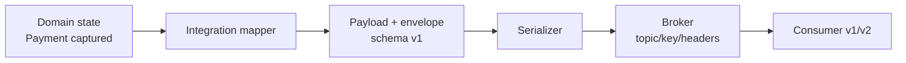
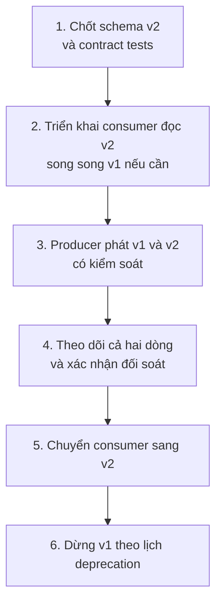

# Định dạng và version của external event

Một event được gửi từ Spring Modulith ra Kafka, RabbitMQ hoặc một hệ thống messaging khác không còn là một Java object chỉ tồn tại trong JVM. Với consumer bên ngoài, nó là **hợp đồng dữ liệu trên đường truyền (wire contract)**: event có tên gì, destination nào, có những trường nào, kiểu và ý nghĩa từng trường ra sao, và consumer cũ có tiếp tục đọc được khi producer nâng cấp hay không.

Ví dụ, module `orders` phát một sự kiện thanh toán thành công. Nếu producer đổi `amountMinorUnits` từ số nguyên `1234` thành chuỗi `"12.34"` mà không đổi hợp đồng, Java code của producer có thể vẫn biên dịch, `ApplicationModules.verify()` có thể vẫn PASS, nhưng báo cáo doanh thu của consumer có thể sai hoặc dừng hoạt động. Vì vậy **định dạng** và **version** phải được xem là một phần của kiến trúc, không phải chi tiết ngẫu nhiên của serializer.

Bài này thuộc chương **Externalization** trong học phần `SPRING_MODULITH_VERIFICATION_TESTING`. Mục tiêu của học phần là kiểm chứng ranh giới Spring Modulith qua `ApplicationModules` và quy tắc phụ thuộc, thực hành `@ApplicationModuleTest`, kiểm thử sự kiện/cơ sở dữ liệu/tích hợp và quality gate CI để ngăn phụ thuộc sai, hồi quy. Ta tập trung vào việc **thiết kế, nâng cấp, kiểm thử và vận hành hợp đồng external event** trong bối cảnh đó.

## 1. Ba lớp của một external event

Một message thường gồm ba lớp cần quản lý riêng:

1. **Payload (dữ liệu nghiệp vụ):** `orderId`, `paymentId`, `amountMinorUnits`, `currency`.
2. **Metadata/envelope:** `eventId`, `eventType`, `occurredAt`, `schemaVersion`, `source`, correlation/trace ID.
3. **Transport metadata:** destination/topic, message key, content type, headers, broker offset/ack và thiết lập bảo mật.



Không phải adapter nào cũng biểu diễn metadata theo cùng một cách. Một số hệ thống gửi payload kèm headers; hệ thống khác gói tất cả vào một JSON envelope. **Spring Modulith không mặc định áp đặt một JSON envelope chung cho mọi transport chỉ vì event mang `@Externalized`.** Hợp đồng cần nêu rõ dạng thực tế mà adapter được cấu hình tạo ra.

| Lớp | Ví dụ | Ai cần quan tâm? |
| --- | --- | --- |
| Business payload | `amountMinorUnits: 1234` | Domain owner và consumer |
| Envelope | `eventId`, `type`, `schemaVersion` | Producer, consumer, tracing, idempotency |
| Transport | `orders.payment-captured.v1`, key `orderId` | Integration adapter và vận hành broker |

## 2. Event phải mô tả một sự thật nghiệp vụ rõ ràng

Giả sử `orders` đã ghi nhận thanh toán được **capture** thành công. Event công bố là `PaymentCapturedV1`, không phải `PaymentRequested` hoặc `PaymentAuthorized`. Ba trạng thái này có ý nghĩa khác nhau:

- `PaymentRequested`: mới có yêu cầu thực hiện, chưa biết kết quả.
- `PaymentAuthorized`: phương thức thanh toán đã được chấp thuận cho bước ủy quyền, chưa nhất thiết tiền đã được capture hoặc settle.
- `PaymentCaptured`: hệ thống đã ghi nhận bước capture thành công theo hợp đồng nghiệp vụ.

Nếu analytics yêu cầu doanh thu đã thu, một event `PaymentAuthorized` có thể không đáp ứng yêu cầu đó. **Versioning không cứu được một event có ngữ nghĩa sai từ đầu.** Trước khi chọn JSON, Avro hay Protobuf, phải định nghĩa rõ **thời điểm xảy ra sự thật** và chính sách rollback/compensation.

Đặt tên event theo **past tense business fact** thường dễ đọc hơn một tên chung chung như `OrderEvent`, nhưng cần thống nhất thuật ngữ với domain team và consumer.

## 3. Hợp đồng minh họa: `PaymentCapturedV1`

Một hợp đồng tích hợp tối giản:

```text
Event type:    orders.payment-captured.v1
Owner:         orders
Meaning:       Thanh toán đã được capture và ghi nhận thành công
Destination:   orders.payment-captured.v1 (minh họa)
Schema:        payment-captured-v1
Idempotency:   eventId
Aggregate key: orderId

Payload:
  eventId
  paymentId
  orderId
  amountMinorUnits
  currency
  occurredAt
```

Một JSON minh họa:

```json
{
  "eventId": "88d0b99f-3491-4f47-a476-d98d1dd8b058",
  "paymentId": "2d0c6245-06aa-4d6e-b2c6-429c5af4a11e",
  "orderId": "bb9a3de9-c8bb-4701-bcf2-f55a9e5e37e8",
  "amountMinorUnits": 1234,
  "currency": "USD",
  "occurredAt": "2026-11-26T02:00:00Z"
}
```

Các trường `UUID` và `Instant` ở Java có thể được serialize thành chuỗi như trên **nếu serializer được cấu hình phù hợp**. Đây là **hình dạng contract mong muốn**, không phải khẳng định mọi adapter Spring Modulith tự động gửi đúng JSON này.

Một quyết định cần ghi rõ: `amountMinorUnits = 1234` với `USD` nghĩa là **12,34 USD**, không phải 1.234 USD. Consumer không được đoán scale từ tên `amount` chung chung.

## 4. Thiết kế Java record cho external event

Trong module `orders`, có thể định nghĩa một integration event công khai:

```java
// com/example/shop/orders/PaymentCapturedV1.java
package com.example.shop.orders;

import java.time.Instant;
import java.util.UUID;
import org.springframework.modulith.events.Externalized;

@Externalized("orders.payment-captured.v1")
public record PaymentCapturedV1(
        UUID eventId,
        UUID paymentId,
        UUID orderId,
        long amountMinorUnits,
        String currency,
        Instant occurredAt
) {}
```

`@Externalized` đánh dấu loại event được chọn để externalization khi adapter và selection policy tương ứng được bật. Giá trị `"orders.payment-captured.v1"` biểu đạt destination trong ví dụ; ý nghĩa routing/key cụ thể vẫn cần đối chiếu với transport và phiên bản Spring Modulith đang sử dụng.

Record có kiểu Java rõ ràng nhưng **kiểu Java không tự quyết định định dạng wire**: `Instant` có thể được serialize thành ISO-8601, epoch hay một representation khác tùy cấu hình. Consumer bên ngoài có thể viết bằng Python, JavaScript, Go hay một ngôn ngữ khác, vì vậy **schema được công bố mới là hợp đồng chung**.

Một event dành cho bên ngoài nên tránh chứa:

- JPA entity, Hibernate proxy, collection quan hệ lazy.
- Class thuộc `orders.internal` mà consumer không thể hoặc không nên biết.
- Java type có biểu diễn phụ thuộc implementation/locale.
- Password, access token, thông tin thẻ và trường dữ liệu nhạy cảm không cần thiết.

## 5. Có cần envelope riêng không?

Có thể đóng gói metadata ở một envelope và chỉ giữ dữ liệu nghiệp vụ trong `data`:

```json
{
  "eventId": "88d0b99f-3491-4f47-a476-d98d1dd8b058",
  "eventType": "orders.payment-captured",
  "schemaVersion": 1,
  "source": "shop.orders",
  "occurredAt": "2026-11-26T02:00:00Z",
  "data": {
    "paymentId": "2d0c6245-06aa-4d6e-b2c6-429c5af4a11e",
    "orderId": "bb9a3de9-c8bb-4701-bcf2-f55a9e5e37e8",
    "amountMinorUnits": 1234,
    "currency": "USD"
  }
}
```

Ưu điểm: consumer có thể đọc các metadata chung mà không cần biết nội dung từng loại event. Hạn chế: envelope làm tăng payload và cần governance cho cả metadata lẫn `data`. Đặc biệt, `schemaVersion = 1` chỉ có ý nghĩa nếu hệ thống đã quy ước rõ version này chỉ schema nào.

**Hai JSON trong phần 3 và phần 5 là hai thiết kế thay thế**, không phải mặc định cùng được gửi. Một adapter có thể chỉ serialize `PaymentCapturedV1` phẳng; nếu muốn envelope, cần map/wrap rõ ràng hoặc dùng hệ sinh thái format sự kiện phù hợp. Không tuyên bố Spring Modulith tự thêm `schemaVersion` hoặc `source` nếu chưa cấu hình.

## 6. CloudEvents là một lựa chọn chuẩn hóa envelope

<em>CloudEvents</em> là một đặc tả mở cho metadata của event. Nếu hệ thống dùng CloudEvents JSON Event Format, ví dụ có thể là:

```json
{
  "specversion": "1.0",
  "id": "88d0b99f-3491-4f47-a476-d98d1dd8b058",
  "source": "/shop/orders",
  "type": "orders.payment-captured.v1",
  "time": "2026-11-26T02:00:00Z",
  "datacontenttype": "application/json",
  "data": {
    "paymentId": "2d0c6245-06aa-4d6e-b2c6-429c5af4a11e",
    "orderId": "bb9a3de9-c8bb-4701-bcf2-f55a9e5e37e8",
    "amountMinorUnits": 1234,
    "currency": "USD"
  }
}
```

Phân biệt **`specversion = "1.0"`** (phiên bản của đặc tả CloudEvents) với **`type = "...v1"`** (phiên bản của **loại event nghiệp vụ**). Chúng **không phải cùng một version** và có thể thay đổi độc lập.

CloudEvents không tự thay thế hợp đồng JSON Schema/Avro/Protobuf cho `data`. Khi dùng CloudEvents, vẫn phải version payload, xác định `id`/`source`, và kiểm thử mapping/transport cụ thể. Không giả định adapter Spring Modulith nào cũng tự tạo CloudEvents envelope khi chỉ thấy `@Externalized`.

## 7. JSON: dễ dùng nhưng không được bỏ qua kiểu dữ liệu

JSON phổ biến vì đọc được bằng nhiều ngôn ngữ, song có các điểm cần quyết định sớm:

| Vấn đề | Ví dụ | Chính sách nên có |
| --- | --- | --- |
| Number | `1234` | Đơn vị, giới hạn miền giá trị, khả năng biểu diễn ở consumer |
| Decimal | `12.34` | Tránh floating point nếu yêu cầu tiền chính xác |
| Timestamp | `"2026-11-26T02:00:00Z"` | ISO-8601/RFC 3339 theo UTC, ý nghĩa thời điểm |
| Identifier | UUID dạng string | Pattern/format và tính ổn định qua retry |
| Null/missing | Không có `customerRef` | Phân biệt absent, null, chuỗi rỗng |
| Enum | `"CAPTURED"` | Consumer xử lý giá trị mới/chưa biết như thế nào |
| Unknown field | Producer thêm `channel` | Consumer có bỏ qua trường mới không? |
| Property name | `amountMinorUnits` | Quy ước case và chính sách rename |

### Tiền tệ và giới hạn của JSON number

Java `long` có thể biểu diễn số nguyên lớn hơn phạm vi biểu diễn **chính xác** của kiểu `Number` trong JavaScript (đối với integer lớn hơn `2^53 - 1`). Nếu hợp đồng có thể chứa giá trị lớn như vậy, cần định nghĩa rõ liệu wire format dùng **integer number**, **decimal string** hay kiểu 64-bit được bảo toàn qua schema/serializer. Không âm thầm thay number thành string trong v1 chỉ vì một consumer xuất hiện sau này.

Với tiền, lựa chọn `amountMinorUnits: 1234` và `currency: "USD"` thường dễ thống nhất; tuy nhiên một số đơn vị tiền/tài sản có scale hoặc quy tắc làm tròn riêng. Phải hỏi domain owner, không suy từ serializer hoặc locale.

## 8. Ví dụ JSON Schema cho payload v1

JSON Schema có thể diễn đạt những trường bắt buộc và giới hạn định dạng. Ví dụ contract cho **JSON phẳng** của phần 3:

```json
{
  "$schema": "https://json-schema.org/draft/2020-12/schema",
  "$id": "https://schemas.example.org/shop/payment-captured-v1.json",
  "title": "PaymentCapturedV1",
  "type": "object",
  "required": [
    "eventId",
    "paymentId",
    "orderId",
    "amountMinorUnits",
    "currency",
    "occurredAt"
  ],
  "properties": {
    "eventId": { "type": "string", "format": "uuid" },
    "paymentId": { "type": "string", "format": "uuid" },
    "orderId": { "type": "string", "format": "uuid" },
    "amountMinorUnits": { "type": "integer", "minimum": 1 },
    "currency": {
      "type": "string",
      "pattern": "^[A-Z]{3}$"
    },
    "occurredAt": {
      "type": "string",
      "format": "date-time"
    }
  },
  "additionalProperties": true
}
```

`additionalProperties: true` là một **chủ ý để cho consumer đọc v1 có thể chấp nhận trường bổ sung**; không đồng nghĩa producer được tự ý phát dữ liệu nhạy cảm. Producer vẫn phải có **allowlist trường** và schema/contract test riêng. Nếu chọn `additionalProperties: false` để strict, một consumer v1 có thể từ chối payload v1 mở rộng thêm field — điều đó ảnh hưởng khả năng nâng cấp.

Ngoài ra, việc validator thực sự kiểm `format: "uuid"` và `"date-time"` có thể phụ thuộc cấu hình thư viện; không được giả định mọi JSON Schema validator đều tự bật strict format assertion theo cùng cách.

## 9. Avro và Protobuf: versioning gắn với schema

JSON không phải lựa chọn duy nhất. Các hệ thống Kafka lớn có thể dùng Avro hoặc Protobuf và schema registry.

| Định dạng | Điểm mạnh | Lưu ý evolution |
| --- | --- | --- |
| JSON + JSON Schema | Dễ đọc/debug, nhiều consumer hỗ trợ | Khả năng tương thích còn tùy cách consumer đọc unknown/missing fields |
| Avro | Binary gọn, hỗ trợ writer/reader schema và schema registry | Thêm field cần xem default, schema resolution và quy tắc compatibility của registry |
| Protobuf | Binary, field tag ổn định, dùng tốt xuyên ngôn ngữ | Không đổi ý nghĩa field number; khi bỏ field, cân nhắc `reserved` cho number/name |

### Avro: không chỉ thêm field là đủ

Ví dụ ý định thêm trường `sourceChannel` với default:

```json
{
  "name": "sourceChannel",
  "type": ["null", "string"],
  "default": null
}
```

Đây là **một field fragment**, không phải Avro schema hoàn chỉnh. Default là yếu tố quan trọng khi reader mới gặp dữ liệu ghi bằng schema cũ. Phải kiểm tra quy tắc compatibility của schema registry thực tế, đặc biệt với chuỗi nhiều version và chính sách transitive.

### Protobuf: giữ ổn định field number

```proto
syntax = "proto3";

message PaymentCapturedV1 {
  string event_id = 1;
  string payment_id = 2;
  string order_id = 3;
  int64 amount_minor_units = 4;
  string currency = 5;
  string occurred_at = 6;
}
```

Nếu bỏ trường `currency` trong schema tương lai, không tái sử dụng **field number 5** cho một nghĩa khác. Cần quản lý trường đã bỏ và khả năng phân biệt mặc định với giá trị chưa được cung cấp theo semantics của phiên bản Protobuf.

**Spring Modulith không tự biến `@Externalized` thành bảo đảm compatibility của Avro/Protobuf.** Adapter, serializer, schema registry và consumer đều phải dùng hợp đồng đã được quản lý.

## 10. Version có thể xuất hiện ở nhiều vị trí

Trong thực tế, có ít nhất bốn trục version độc lập:

| Trục | Ví dụ | Ý nghĩa |
| --- | --- | --- |
| **Business event type** | `orders.payment-captured.v1` | Thế hệ ý nghĩa của sự kiện công bố |
| **Payload schema** | `payment-captured-v1.json` | Kiểu/field/constraints của dữ liệu |
| **Envelope format** | `CloudEvents specversion 1.0` | Quy cách metadata chung |
| **Producer/consumer software** | App release `2026.11` | Phiên bản triển khai chạy mã |

Không phải cứ producer lên release mới là event phải tăng version. Nếu code nội bộ được refactor nhưng vẫn tạo wire contract v1 tương thích, **giữ event v1** thường giúp consumer độc lập hơn.

Ngược lại, nếu thay ý nghĩa `amountMinorUnits` thành **số tiền sau phí** mà vẫn giữ tên/schema cũ, đó là thay đổi **ngữ nghĩa không tương thích** dù JSON type không đổi.

Ghi version trong **event type/destination**, **schema registry**, **header** hay **envelope** đều có ưu/nhược điểm. Chọn một nguồn xác thực thống nhất và document rõ cách consumer chọn deserializer. Tránh để cùng một message mang `v1` trong topic, `v2` trong header nhưng payload lại theo schema v3 mà không có quy tắc ưu tiên.

## 11. Backward, forward và full compatibility

Không nên dùng “backward compatible” như từ đồng nghĩa với “mọi consumer đều chạy được”. Các khái niệm thông dụng:

- **Backward compatibility:** consumer/reader **mới** đọc được dữ liệu do producer/writer **cũ** tạo ra.
- **Forward compatibility:** consumer/reader **cũ** đọc được dữ liệu do producer/writer **mới** tạo ra.
- **Full compatibility:** cả hai chiều đều thỏa trong phạm vi quy tắc kiểm tra.

```text
Backward:  Reader v2  <-  Writer v1
Forward:   Reader v1  <-  Writer v2
Full:      Cả hai chiều tương thích
```

Đối với message broker, consumer có thể đọc dữ liệu được lưu **trước khi triển khai producer mới**, nên backward compatibility quan trọng khi deploy consumer. Nhưng producer mới thường được triển khai khi vẫn còn **consumer cũ** trong hệ thống, nên forward compatibility cũng quan trọng.

Các schema registry có thể dùng thuật ngữ và phạm vi tương thích riêng, bao gồm **transitive** (so với nhiều version cũ, không chỉ version liền kề). Cần đọc policy thực tế của dự án; “schema registry cho qua” không tự chứng minh **tương thích ngữ nghĩa nghiệp vụ**.

## 12. Ma trận thay đổi thường gặp

Giả sử đang có JSON `PaymentCapturedV1`. Bảng dưới là hướng dẫn **có điều kiện**, không phải lời bảo đảm cho mọi JSON parser:

| Thay đổi | Consumer cũ đọc producer mới? | Consumer mới đọc dữ liệu cũ? | Nhận xét |
| --- | --- | --- | --- |
| Thêm field tùy chọn `sourceChannel` | **Có thể**, nếu reader cũ bỏ qua unknown | **Có thể**, nếu reader mới có fallback | Hướng nâng cấp thường thuận lợi |
| Thêm field bắt buộc `merchantId` không default | Có thể nếu reader cũ bỏ qua unknown | **Thường không** | Dữ liệu cũ thiếu trường mới |
| Xóa `currency` đang bắt buộc | **Thường không** | Có thể nếu reader mới không còn cần | Cần contract/version mới |
| Đổi tên `orderId` thành `purchaseId` | **Thường không** | **Thường không** | Cần alias/adapter/version rõ |
| Đổi `amountMinorUnits` number → string | **Không an toàn** | **Không an toàn** | Thay wire type |
| Đổi ý nghĩa `amountMinorUnits` nhưng giữ type | **Không an toàn** | **Không an toàn** | Schema validation có thể không bắt được |
| Thêm enum `REFUNDED` vào status | Tùy consumer có nhánh unknown không | Thường có thể | Exhaustive switch có thể lỗi |
| Bổ sung metadata tùy chọn trong envelope | Tùy parser/header contract | Tùy default | Không bỏ qua test serialization |

**Điều kiện quan trọng:** với JSON có `additionalProperties: false` hoặc Jackson mặc định báo unknown properties, thêm field **không** hiển nhiên an toàn. Với Avro/Protobuf, phân tích phải dựa trên quy tắc resolution và schema registry, không áp bảng JSON máy móc.

## 13. Luật thiết kế evolution: thêm thì dễ hơn thay nghĩa

Quy tắc thực hành thường hữu ích:

1. **Ưu tiên thêm field tùy chọn với default/semantics rõ ràng** khi cần mở rộng hợp đồng cũ.
2. **Không đổi nghĩa field hiện có** chỉ vì cùng kiểu dữ liệu.
3. **Không đổi đơn vị tiền/thời gian âm thầm**.
4. **Không tái sử dụng event type version cũ** cho hợp đồng không tương thích.
5. **Không xóa/đổi tên field bắt buộc** nếu còn consumer cũ phụ thuộc.
6. **Đối chiếu cả payload và consumer behavior**, không chỉ so sánh JSON Schema.

Ví dụ an toàn hơn khi bổ sung nguồn phát:

```json
{
  "eventId": "88d0b99f-3491-4f47-a476-d98d1dd8b058",
  "paymentId": "2d0c6245-06aa-4d6e-b2c6-429c5af4a11e",
  "orderId": "bb9a3de9-c8bb-4701-bcf2-f55a9e5e37e8",
  "amountMinorUnits": 1234,
  "currency": "USD",
  "occurredAt": "2026-11-26T02:00:00Z",
  "sourceChannel": "WEB"
}
```

Consumer v1 phải bỏ qua `sourceChannel` chưa biết; consumer v2 phải chấp nhận event cũ **không có `sourceChannel`**. Nếu hai giả định này không được kiểm thử, việc thêm field có thể gây lỗi rollout.

## 14. Khi nào cần `PaymentCapturedV2`?

Ví dụ business thay đổi hợp đồng từ `amountMinorUnits` + `currency` thành một nhóm tiền gồm **gross, fee, net**. Nếu consumer cũ chỉ biết `amountMinorUnits` và hiểu đó là gross, việc giữ tên mà đổi thành net có thể tạo sai báo cáo nghiêm trọng.

Một cách minh bạch là tạo sự kiện mới:

```java
// com/example/shop/orders/PaymentCapturedV2.java
package com.example.shop.orders;

import java.time.Instant;
import java.util.UUID;
import org.springframework.modulith.events.Externalized;

@Externalized("orders.payment-captured.v2")
public record PaymentCapturedV2(
        UUID eventId,
        UUID paymentId,
        UUID orderId,
        long grossMinorUnits,
        long feeMinorUnits,
        long netMinorUnits,
        String currency,
        Instant occurredAt
) {}
```

Hợp đồng v2 cần định nghĩa bất biến `grossMinorUnits = feeMinorUnits + netMinorUnits` theo chính sách nghiệp vụ cụ thể (còn phải xét refund/discount/rounding nếu áp dụng). **Tên field mới không tự bảo đảm số liệu đúng**; mapper và test phải kiểm tra.

Nếu producer duy trì v1 trong giai đoạn chuyển đổi, **v1 vẫn giữ nghĩa cũ**. Không được dùng một record Java mới làm thay đổi semantics của một topic v1 đã có consumer.

## 15. Lộ trình nâng cấp producer–consumer không gián đoạn

Một rollout thường an toàn hơn:



Thứ tự thực tế tùy chiến lược compatibility: có lúc producer có thể deploy trước nếu consumer cũ chắc chắn đọc được wire mới. Nhưng nếu thay đổi **không tương thích**, nên tránh thay đổi đột ngột cùng một topic mà không có phân luồng hoặc bước chuyển tiếp.

Một phương án khác là giữ **một topic** và gắn schema ID/subject qua schema registry; consumer đọc nhiều version theo chính sách của registry. **Đây là thiết kế thay thế**, không phải luôn phải tạo topic v2. Topic-per-major-version phù hợp khi cần cô lập rõ hợp đồng hoặc đảm bảo consumer cũ không bao giờ nhận message v2.

### Hai event v1/v2 cho cùng một business fact

Nếu producer phát cả v1 và v2 trong migration, đó là **hai representation của cùng một lần thanh toán**, không phải hai thanh toán độc lập. Cần document `eventId`, `paymentId`, `eventType` và cách analytics dedupe:

- Giữ một định danh business fact/correlation ổn định giúp đối soát.
- Consumer subscribe **cả v1 và v2** phải tránh tính doanh thu hai lần.
- Nếu dedupe bằng `eventId`, cần quyết định có dùng chung key giữa hai representation hay tách theo `(eventType, eventId)` phù hợp semantics.
- Khi replay hoặc resubmit, cùng một publication không được tự sinh ID mới.

Đừng chỉ triển khai dual-publish mà quên kiểm thử **trùng thông tin ở consumer**.

## 16. Metadata identity, correlation và thời gian

Một external event thường cần phân biệt:

| Trường/khái niệm | Mục đích | Không nên nhầm với |
| --- | --- | --- |
| `eventId` | Định danh một business event để đối soát/dedupe | `orderId`: một đơn có nhiều event |
| `orderId` | Aggregate/business reference | `paymentId`: một đơn có thể nhiều thanh toán |
| `correlationId` | Liên kết các bước trong một workflow/request | `eventId`: duy nhất theo event |
| `causationId` | Event/command trước đó dẫn đến event này | Thời gian hoặc message offset |
| `occurredAt` | Thời điểm nghiệp vụ xảy ra | `publishedAt`, `consumedAt` |
| `schemaVersion` | Phiên bản wire contract theo chính sách | Version của Spring Boot/CloudEvents |

Không cần đưa **tất cả** trường vào payload nếu không có consumer nào dùng. Một số metadata nên nằm ở header/envelope; nhưng **hợp đồng phải xác định rõ nơi lấy** để consumer không phải suy từ tên property tình cờ.

Lưu ý bảo mật: correlation/tracing ID giúp điều tra lỗi nhưng không nên chứa trực tiếp PII hoặc secrets. Headers cũng là bề mặt dữ liệu công bố, không chỉ body.

## 17. Kafka key, ordering và destination version

Nếu các event của cùng một đơn cần được xử lý theo thứ tự ở Kafka, một thiết kế có thể chọn **`orderId` làm message key**, giúp sự kiện cùng key đi tới cùng partition khi cấu hình/topic thích hợp.

```text
Topic: orders.payment-captured.v1
Key:   bb9a3de9-c8bb-4701-bcf2-f55a9e5e37e8
Value: JSON / Avro / Protobuf PaymentCapturedV1
Headers: content-type, schema-id, trace-id (nếu có)
```

Nhưng `@Externalized("orders.payment-captured.v1")` **không mặc định chứng minh `orderId` đã trở thành Kafka key**. Cần cấu hình routing/key theo API adapter/phiên bản thực tế, kiểm tra broker message trong integration test.

Kafka có thứ tự **trong một partition** theo điều kiện xử lý, không bảo đảm thứ tự toàn cục giữa nhiều partition/topic. Dual-publish v1/v2 vào hai topic có thể đến consumer **không cùng thứ tự**. Việc version topic không thay thế state machine hoặc sequence number khi consumer cần chống event out-of-order.

Với AMQP và JMS, semantics exchange/route/queue, redelivery và concurrency khác Kafka; không giả định một message key hoạt động giống nhau ở mọi transport.

## 18. Serializer là một phần của hợp đồng

Java record chứa `Instant` và `UUID` có thể chuyển thành JSON bằng Jackson khi module serialization và ObjectMapper được cấu hình phù hợp. Ví dụ kiểm thử serializer **được kiểm soát tường minh**:

```java
import com.fasterxml.jackson.databind.ObjectMapper;
import com.fasterxml.jackson.databind.SerializationFeature;
import com.fasterxml.jackson.datatype.jsr310.JavaTimeModule;

ObjectMapper mapper = new ObjectMapper()
        .registerModule(new JavaTimeModule())
        .disable(SerializationFeature.WRITE_DATES_AS_TIMESTAMPS);
```

Đây là **cấu hình minh họa cho test**; trong ứng dụng Spring Boot thực, nên kiểm thử **ObjectMapper/message converter mà adapter thật đang dùng**, không dựng một ObjectMapper thứ hai rồi cho rằng production giống hệt.

Những thay đổi có thể ảnh hưởng wire format:

- Tắt/bật ghi thời gian dưới dạng epoch hoặc array.
- Đổi naming strategy `camelCase` → `snake_case`.
- Đổi cách serialize enum hoặc UUID.
- Tự động loại bỏ field `null`.
- Thay serializer qua một version thư viện/adapter.
- Thêm type metadata hoặc custom headers.

Do đó, **bài test schema phải bám representation trên đường truyền**, không chỉ bám field trong Java record.

## 19. Unit test bảo vệ schema của Java record

Ví dụ JUnit test tạo `PaymentCapturedV1` và kiểm tra JSON:

```java
// src/test/java/com/example/shop/orders/PaymentCapturedV1JsonTests.java
package com.example.shop.orders;

import static org.junit.jupiter.api.Assertions.*;

import com.fasterxml.jackson.databind.JsonNode;
import com.fasterxml.jackson.databind.ObjectMapper;
import com.fasterxml.jackson.databind.SerializationFeature;
import com.fasterxml.jackson.datatype.jsr310.JavaTimeModule;
import java.time.Instant;
import java.util.UUID;
import org.junit.jupiter.api.Test;

class PaymentCapturedV1JsonTests {

    private final ObjectMapper mapper = new ObjectMapper()
            .registerModule(new JavaTimeModule())
            .disable(SerializationFeature.WRITE_DATES_AS_TIMESTAMPS);

    @Test
    void serializesStableWireFieldsWithoutSensitiveData() throws Exception {
        var event = new PaymentCapturedV1(
                UUID.fromString("88d0b99f-3491-4f47-a476-d98d1dd8b058"),
                UUID.fromString("2d0c6245-06aa-4d6e-b2c6-429c5af4a11e"),
                UUID.fromString("bb9a3de9-c8bb-4701-bcf2-f55a9e5e37e8"),
                1234L,
                "USD",
                Instant.parse("2026-11-26T02:00:00Z"));

        JsonNode json = mapper.readTree(mapper.writeValueAsBytes(event));

        assertEquals(1234L, json.get("amountMinorUnits").asLong());
        assertEquals("USD", json.get("currency").asText());
        assertEquals("2026-11-26T02:00:00Z",
                json.get("occurredAt").asText());
        assertFalse(json.has("customerEmail"));
        assertFalse(json.has("cardToken"));
    }
}
```

Test này giúp phát hiện một số sai lệch representation, nhưng không thay thế JSON Schema validator hoặc broker integration test. Nếu production dùng Avro/Protobuf, cần test với **serializer thực tế**, schema ID và consumer deserializer tương ứng.

### Golden contract sample

Có thể duy trì một **bộ event mẫu đã phê duyệt** làm dữ liệu contract test: v1 do producer cũ tạo, v1 do producer hiện tại tạo và v2 mới. Đây là artifact test trong một triển khai thật; riêng bài học này chỉ minh họa ý tưởng và không tạo thêm file dự án ngoài phạm vi được giao.

## 20. Test reader cũ và reader mới

Muốn kiểm chứng **thêm field tùy chọn là an toàn**, phải thử cả hai chiều.

Giả sử consumer v1 chỉ biết các trường cố định. Với Jackson, một cách để nó bỏ qua trường mới là:

```java
package com.example.analytics.contract;

import com.fasterxml.jackson.annotation.JsonIgnoreProperties;
import java.time.Instant;
import java.util.UUID;

@JsonIgnoreProperties(ignoreUnknown = true)
public record PaymentCapturedReaderV1(
        UUID eventId,
        UUID paymentId,
        UUID orderId,
        long amountMinorUnits,
        String currency,
        Instant occurredAt
) {}
```

Khi producer thêm `sourceChannel` vào event, consumer v1 với cấu hình reader phù hợp có thể bỏ qua trường lạ. **Không phải mọi consumer đều mặc định làm vậy**, nên bắt buộc test.

Với consumer v2, nếu muốn đọc dữ liệu v1 cũ không có `sourceChannel`, field mới nên được coi là **tùy chọn**, có fallback rõ ràng. Một test tối thiểu cần assert:

```text
readerV1.parse(writerV2Example) -> PASS nếu bỏ unknown field
readerV2.parse(writerV1Example) -> PASS nếu sourceChannel optional
readerV2.parse(writerV2Example) -> PASS
```

Kiểm chứng này liên quan **wire reader/writer**; một test compile Java không thể thay thế.

## 21. Mapping domain event sang version integration

Versioning hữu ích vì domain model có thể đổi mà integration v1 vẫn ổn định.

```java
// orders/internal/PaymentCapturedMapper.java
package com.example.shop.orders.internal;

import com.example.shop.orders.PaymentCapturedV1;
import java.math.BigDecimal;
import java.time.Instant;
import java.util.Currency;
import java.util.UUID;

final class PaymentCapturedMapper {

    PaymentCapturedV1 toV1(
            UUID eventId,
            UUID paymentId,
            UUID orderId,
            BigDecimal amount,
            Currency currency,
            Instant occurredAt) {

        if (amount == null || amount.signum() <= 0) {
            throw new IllegalArgumentException("amount must be positive");
        }
        int minorDigits = currency.getDefaultFractionDigits();
        if (minorDigits < 0) {
            throw new IllegalArgumentException("unsupported currency scale");
        }
        long minorUnits = amount.movePointRight(minorDigits)
                .longValueExact();

        return new PaymentCapturedV1(
                eventId,
                paymentId,
                orderId,
                minorUnits,
                currency.getCurrencyCode(),
                occurredAt);
    }
}
```

`USD 12.34` trở thành `amountMinorUnits = 1234`. Phép `longValueExact()` không tự làm tròn một amount không thể biểu diễn chính xác; nó giúp tránh thay đổi số tiền âm thầm. Cần thêm null validation cho toàn bộ trường bắt buộc và quy tắc currency của domain thật.

**Giữ `eventId` và `occurredAt` từ sự kiện nghiệp vụ nguồn.** Nếu mapper được gọi lại sau retry, không tự tạo UUID mới hoặc `Instant.now()` mới khiến hai publication của cùng event trông thành hai sự thật khác nhau.

Với v2 có gross/fee/net, có thể thêm `toV2(...)` song song trong giai đoạn migration nhưng test phải bảo đảm **v1 không đổi semantics**. Không cần đổi Java domain event type chỉ vì integration contract được version.

## 22. Spring Modulith: từ event đến broker không tự bảo đảm schema

Một producer có thể phát Spring event bằng `ApplicationEventPublisher`:

```java
events.publishEvent(paymentCapturedMapper.toV1(
        eventId, paymentId, orderId, amount, currency, occurredAt));
```

Nếu loại `PaymentCapturedV1` được chọn externalize và adapter transport đã cấu hình, Spring Modulith có thể chuyển event tới destination. Nhưng:

- `@Externalized` **không tự tạo Kafka topic hoặc schema registry subject**.
- `@Externalized` **không tự thêm envelope version** khi event record không có trường đó.
- `ApplicationEventPublisher.publishEvent(...)` **không đồng nghĩa** broker ack.
- `ApplicationModules.verify()` **không so sánh JSON v1/v2**.
- Event Publication Registry có thể hỗ trợ theo dõi/khôi phục publication khi được cấu hình phù hợp, nhưng **không mặc định bảo đảm exactly-once end-to-end**.

Để schema ổn định, phải kết hợp **adapter configuration, schema contract, serializer, consumer compatibility tests và quality gate CI**.

## 23. Kiểm thử sự kiện bằng `@ApplicationModuleTest`

Ví dụ một module test cho business service phát `PaymentCapturedV1`:

```java
// src/test/java/com/example/shop/orders/PaymentEventsTests.java
package com.example.shop.orders;

import static org.assertj.core.api.Assertions.assertThat;

import org.junit.jupiter.api.Test;
import org.springframework.beans.factory.annotation.Autowired;
import org.springframework.modulith.test.ApplicationModuleTest;
import org.springframework.modulith.test.PublishedEvents;

@ApplicationModuleTest
class PaymentEventsTests {

    @Autowired
    PaymentCaptureWorkflow workflow;

    @Test
    void publishesV1Contract(PublishedEvents events) {
        workflow.captureTestPayment();

        assertThat(events.ofType(PaymentCapturedV1.class))
                .hasSize(1);
    }
}
```

`PaymentCaptureWorkflow` và `captureTestPayment()` là **test-fixture/luồng nghiệp vụ cần được triển khai trong ứng dụng thực**; ví dụ trên chỉ minh họa cấu trúc test, không phải một project hoàn chỉnh có thể compile độc lập. Khi chạy thật, phải cung cấp workflow, repository và dữ liệu kiểm thử hợp lệ.

`PublishedEvents` quan sát những Spring event được phát trong phạm vi test; nó **không xác nhận topic, key, headers hoặc payload trên broker**. Nếu dùng mapping trực tiếp trong externalization adapter mà không publish một `PaymentCapturedV1` riêng lên event bus, test phải quan sát **event nguồn**, không giả định có thêm event v1 được publish.

## 24. Kiểm chứng ranh giới module vẫn là một lớp riêng

Java integration record nên thuộc module nghiệp vụ sở hữu contract, ví dụ `orders.PaymentCapturedV1`, thay vì lộ `orders.internal.PaymentEntity` trong event.

Một listener Java trong module `reporting` nhận `orders.PaymentCapturedV1` tạo cạnh **`reporting → orders`**. Nếu `orders` đồng thời import type nội bộ của `reporting`, có nguy cơ tạo cycle. Externalization tới broker không tự xóa những cạnh kiểu Java này.

Architecture test:

```java
// src/test/java/com/example/shop/ModularityTests.java
package com.example.shop;

import org.junit.jupiter.api.Test;
import org.springframework.modulith.core.ApplicationModules;

class ModularityTests {

    @Test
    void verifiesModuleBoundaries() {
        ApplicationModules.of(ShopApplication.class).verify();
    }
}
```

`verify()` kiểm các quy tắc kiến trúc áp dụng, như không có chu trình giữa application module, không truy cập implementation nội bộ ngoài API được công bố và `allowedDependencies` nếu được khai báo. Consumer **ngoài JVM** không nằm trong module graph này, nên phải kiểm bằng **contract/broker integration test**, không chỉ `verify()`.

## 25. Broker integration test phải nhìn thấy wire format thực

Một bài test Kafka Testcontainers hoặc RabbitMQ test tương đương nên kiểm:

```text
Given:
  broker test hoạt động
  Spring Modulith externalization adapter và serializer thật được bật
  destination orders.payment-captured.v1 đã được provision
  payment nghiệp vụ có fixture hợp lệ

When:
  capture thanh toán thành công và transaction commit

Then:
  message đi tới đúng destination trong timeout hữu hạn
  key/header/content-type đúng hợp đồng nếu có
  payload tuân JSON Schema hoặc Avro/Protobuf schema v1
  eventId, paymentId, orderId, amountMinorUnits, currency đúng
  occurredAt đúng nguồn, không bị thay bằng thời điểm gửi
  không có cardToken / customerEmail / entity nội bộ

And:
  listener/consumer test có thể parse message
  event bị từ chối/transaction rollback không tạo message thành công sai
```

Nếu test chỉ assert `PublishedEvents` có một `PaymentCapturedV1`, nó **chưa chứng minh externalization**. Nếu test chỉ thấy broker có một message nhưng không validate schema/đơn vị tiền, nó cũng chưa chứng minh hợp đồng đúng.

**Kiểm thử version migration:** consumer v1 đọc được message từ producer được nâng cấp khi chính sách forward compatibility yêu cầu; consumer v2 đọc được event v1 lưu cũ khi chính sách backward compatibility yêu cầu. Dùng các mẫu/serialization thật, không chỉ tạo object Java trong memory.

## 26. Transaction, publication registry và replay

External event có thể cần đi qua biên transaction database. Những mốc khác nhau:

```text
1. Domain transaction COMMIT
2. Externalization adapter gửi và broker xác nhận
3. Consumer đọc và xử lý side effect
4. Producer/registry ghi nhận publication hoàn tất (theo cơ chế)
```

Trình tự chi tiết của mốc 3 và 4 **không cố định như một thứ tự toàn cục**; consumer có thể xử lý rất nhanh trong khi producer chưa mark publication hoàn tất. Điều quan trọng là **mốc nào được dùng làm điều kiện thành công** và cách retry/khôi phục sau crash.

Khi Event Publication Registry và cơ chế lưu bền vững được cấu hình phù hợp, ứng dụng có thể theo dõi publication chưa hoàn tất để xử lý lại. Nhưng có thể xảy ra:

```text
broker nhận PaymentCapturedV1(eventId=E)
producer crash trước khi mark complete
resubmission gửi lại PaymentCapturedV1(eventId=E)
```

**Không tạo ID mới khi replay cùng event.** Consumer cần idempotency theo `eventId` hoặc một business key có semantics được xác định; unique constraint và transaction phải bảo vệ việc ghi marker xử lý và side effect. Không quảng bá “exactly-once” chỉ vì schema version hoặc registry tồn tại.

Nếu dữ liệu cũ được replay sau khi producer lên v2, phải có quy tắc rõ về việc **replay v1 như v1**, hay **chuyển đổi sang v2 bằng mapper đã được test**. Việc đọc dữ liệu lịch sử bằng schema không tương thích là một lý do quan trọng để giữ contract cũ trong thời gian phù hợp.

## 27. Bảo mật, quyền riêng tư và schema governance

Versioning dễ thất bại khi nhóm chỉ tập trung vào technical compatibility mà bỏ qua **quyền công bố**. Một trường `customerEmail` có thể được thêm vào payload mà schema registry chấp nhận, nhưng consumer không nhất thiết được quyền nhận nó.

Một review event phải xác nhận:

- **Data minimization:** chỉ đưa field consumer thật sự cần.
- **Phân loại dữ liệu:** PII, thông tin thanh toán, secrets và định danh có thể liên kết cá nhân.
- **Authorization:** producer publish/consumer subscribe destination nào?
- **Retention/replay:** dữ liệu được giữ bao lâu, có thể xuất hiện trong dead-letter topic hoặc log không?
- **Metadata:** PII có bị đưa vào Kafka key, AMQP header, trace baggage hay exception log không?
- **Schema ownership:** ai được phê duyệt thêm/bỏ field, ai điều phối v1/v2 và thông báo consumer?

**Schema compatibility PASS không đồng nghĩa privacy review PASS.** Một field được thêm hợp lệ về kỹ thuật vẫn có thể là thay đổi không được phép về bảo mật.

## 28. Quality gate CI cho format và version

Một pipeline phù hợp với `SPRING_MODULITH_VERIFICATION_TESTING` có thể là:

```text
Pull request
    |
    v
Compile + unit test mapper
    |-- amount/currency chính xác?
    '-- eventId/time ổn định?
    |
    v
JSON Schema / Avro / Protobuf validation
    '-- Writer current hợp đồng đã duyệt?
    |
    v
Compatibility tests
    |-- Reader v2 đọc writer v1?
    |-- Reader v1 đọc writer v2 theo policy?
    '-- Event semantically compatible?
    |
    v
ApplicationModules.verify()
    '-- Không vi phạm dependency rules?
    |
    v
@ApplicationModuleTest + PublishedEvents
    '-- Producer phát đúng type/version?
    |
    v
Broker integration test
    |-- Topic/key/headers/format thực tế?
    |-- Schema ID và payload?
    '-- Rollback/retry/replay nếu yêu cầu?
    |
    v
Merge khi các gate bắt buộc PASS
```

Với schema registry, nên kiểm compatibility theo **policy thực tế** trước khi cập nhật schema production. Nếu dùng compatibility transitive, không chỉ so v2 với v1 mới nhất mà cần xét những version lịch sử liên quan.

CI phải **thực sự chạy** `ModularityTests`, contract tests và integration tests đã chọn; job không được âm thầm bỏ qua bằng `skipTests` hoặc filter. Đồng thời, migration v1→v2 cần được review như **thay đổi liên hệ thống**, không chỉ refactor Java record.

## 29. Checklist khi thay đổi external event

| Câu hỏi | Kết quả mong đợi |
| --- | --- |
| Event có nghĩa rõ và đúng thời điểm? | Producer/consumer cùng hiểu một business fact |
| Có người sở hữu contract? | Module và team phê duyệt rõ ràng |
| Có schema chính thức? | JSON Schema, Avro hoặc Protobuf được quản lý |
| Có version convention? | Type/schema/destination/envelope không mâu thuẫn |
| Field tiền tệ/thời gian có đơn vị? | Consumer không phải đoán |
| Thay đổi có tương thích? | Có test writer/reader hai chiều theo policy |
| Bỏ/đổi field hoặc semantics? | Cần version mới/adapter/deprecation plan |
| Có dữ liệu nhạy cảm trong payload/header? | Đã review và loại nếu không cần |
| Event ID có giữ nguyên qua retry? | Có quy tắc idempotency rõ |
| Adapter/broker serialize đúng? | Test quan sát message thực tế |
| Có các tình huống rollback/replay? | Test nhất quán và recovery phù hợp |
| Có CI gate? | Vi phạm schema/compatibility chặn merge |

Đặc biệt, khi **dừng phát version cũ**, cần biết những consumer nào còn subscribe và bao lâu chúng có thể đọc lại dữ liệu lịch sử. Xóa `@Externalized` khỏi v1 ngay khi producer đã có v2 có thể làm đứt một consumer chưa chuyển đổi.

## 30. Bài tập và đáp án

### Bài 1 — Thêm field tùy chọn

Producer v2 thêm `sourceChannel` vào JSON; consumer v1 được cấu hình báo lỗi khi gặp trường chưa biết.

**Hỏi:** Có thể khẳng định thay đổi backward/forward compatible không?

**Đáp án:** **Không.** Consumer v1 có thể từ chối message của writer v2. Cần sửa policy reader hoặc version/route, và test thực tế trước rollout. “Thêm field” chỉ thường an toàn khi consumer cũ chấp nhận unknown fields.

### Bài 2 — Phân biệt hai chiều compatibility

Reader v2 đọc được dữ liệu writer v1. Reader v1 lại không đọc được dữ liệu writer v2.

**Hỏi:** Tương thích theo chiều nào?

**Đáp án:** Có **backward compatibility** theo định nghĩa reader mới đọc writer cũ; **chưa có forward compatibility**. Không thể gọi là full compatibility.

### Bài 3 — Bỏ trường currency

Event v1 có `amountMinorUnits` và `currency`. Producer bỏ `currency` nhưng vẫn gửi vào topic v1.

**Hỏi:** Rủi ro gì?

**Đáp án:** Consumer cũ có thể không xác định được đơn vị tiền và báo lỗi hoặc tính sai doanh thu. Đây là thay đổi contract không an toàn; cần đánh giá version mới hoặc giai đoạn chuyển đổi với schema phù hợp.

### Bài 4 — Đổi nghĩa mà không đổi kiểu

Field `amountMinorUnits` trước đây là tổng tiền capture, nay producer đổi thành số tiền sau phí nhưng vẫn là `long`.

**Hỏi:** JSON Schema validation có đủ bảo vệ không?

**Đáp án:** **Không.** Cùng kiểu integer vẫn có thể sai **semantic contract**. Cần event version/field mới như `grossMinorUnits`, `feeMinorUnits`, `netMinorUnits`, kèm business contract tests.

### Bài 5 — `specversion` và business version

Một message CloudEvents có `"specversion": "1.0"`, `"type": "orders.payment-captured.v2"`.

**Hỏi:** Có mâu thuẫn không?

**Đáp án:** **Không.** `specversion` mô tả phiên bản CloudEvents specification; hậu tố v2 mô tả phiên bản event nghiệp vụ. Hai trục version độc lập.

### Bài 6 — Kafka key

Java record có trường `orderId` và `@Externalized("orders.payment-captured.v1")`.

**Hỏi:** Đủ để khẳng định Kafka key bằng `orderId` chưa?

**Đáp án:** **Chưa.** Cần cấu hình routing/key theo adapter và kiểm tra message trên broker. Giá trị annotation destination không tự chứng minh key hay partition.

### Bài 7 — Dual-publish

Trong migration, producer phát `PaymentCapturedV1` và `PaymentCapturedV2` cho cùng một thanh toán, analytics subscribe cả hai topic.

**Hỏi:** Có thể phát sinh lỗi gì?

**Đáp án:** Consumer có thể đếm doanh thu hai lần. Phải nhận diện đây là hai representation của **cùng business fact**, xác định identity/correlation và chiến lược dedupe, rồi test before rollout.

### Bài 8 — Replay từ lịch sử

Sau khi deploy consumer v2, nó đọc lại các event `PaymentCapturedV1` lưu từ tháng trước.

**Hỏi:** Test gì quan trọng?

**Đáp án:** Kiểm tra **reader v2 đọc được writer v1** với dữ liệu/schema cũ, kể cả trường thiếu/default và format timestamp/amount. Chỉ test event mới do producer v2 tạo không đủ.

### Bài 9 — Registry và duplicate delivery

Broker đã nhận message v1, nhưng ứng dụng crash trước khi đánh dấu publication complete; quá trình recovery gửi lại message.

**Hỏi:** Schema version có ngăn trùng không?

**Đáp án:** **Không.** Version chỉ xác định hợp đồng; cần `eventId` ổn định, idempotent consumer và transaction/unique constraint phù hợp để tránh side effect trùng.

### Bài 10 — Thêm dữ liệu nhạy cảm

Developer thêm `customerEmail` vào event v1; JSON Schema vẫn cho phép additional properties và consumer đọc được.

**Hỏi:** Có thể merge vì tương thích kỹ thuật không?

**Đáp án:** **Không nên tự động.** Đây là mở rộng dữ liệu công bố, cần data minimization/privacy/ACL review và xác nhận consumer thật sự cần; compatibility kỹ thuật không thay thế quyền truy cập.

## 31. Tổng kết

**Định dạng của external event** bao gồm payload, metadata/envelope và thông tin transport. **Version của external event** không chỉ là hậu tố `v1`; nó là cam kết về **kiểu, ngữ nghĩa, schema và cách consumer cũ/mới đọc dữ liệu**. Với JSON, Avro hay Protobuf, phải có quy tắc tương thích phù hợp, versioning/deprecation được điều phối và contract test theo representation thực tế.

Trong Spring Modulith, `@Externalized` và adapter giúp đưa sự kiện từ JVM ra transport bên ngoài, nhưng **không tự bảo đảm schema compatibility, Kafka key, exactly-once hay quyền công bố dữ liệu**. Producer nên dùng integration event có field ổn định, ID/đơn vị/thời gian rõ ràng, tách khỏi entity nội bộ và giữ cùng event identity khi retry.

Để tránh hồi quy, dùng **`ApplicationModules.verify()`** cho ranh giới module, **`@ApplicationModuleTest`/`PublishedEvents`** cho sự kiện được publish, **schema/consumer compatibility tests** cho version và **broker/transaction/failure integration tests** cho message thực tế. Đặt toàn bộ kiểm tra bắt buộc vào **quality gate CI** để một thay đổi JSON “nhỏ” không làm gián đoạn các hệ thống phụ thuộc.

## Tài liệu tham khảo

- [Spring Modulith — Application Events & Event Externalization](https://docs.spring.io/spring-modulith/reference/events.html)
- [Spring Modulith — Integration Testing Application Modules](https://docs.spring.io/spring-modulith/reference/testing.html)
- [Spring Modulith — Verifying Application Module Structure](https://docs.spring.io/spring-modulith/reference/verification.html)
- [CloudEvents — Specification](https://github.com/cloudevents/spec/blob/main/cloudevents/spec.md)
- [JSON Schema — Specification](https://json-schema.org/specification)
- [Apache Avro — Specification](https://avro.apache.org/docs/current/specification/)
- [Protocol Buffers — Updating a Message Type](https://protobuf.dev/programming-guides/proto3/#updating)
- [Spring for Apache Kafka — Reference](https://docs.spring.io/spring-kafka/reference/)
- [Spring AMQP — Reference](https://docs.spring.io/spring-amqp/reference/)
