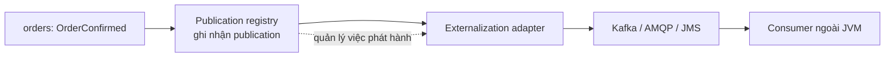
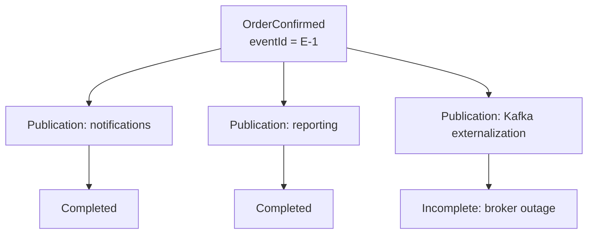
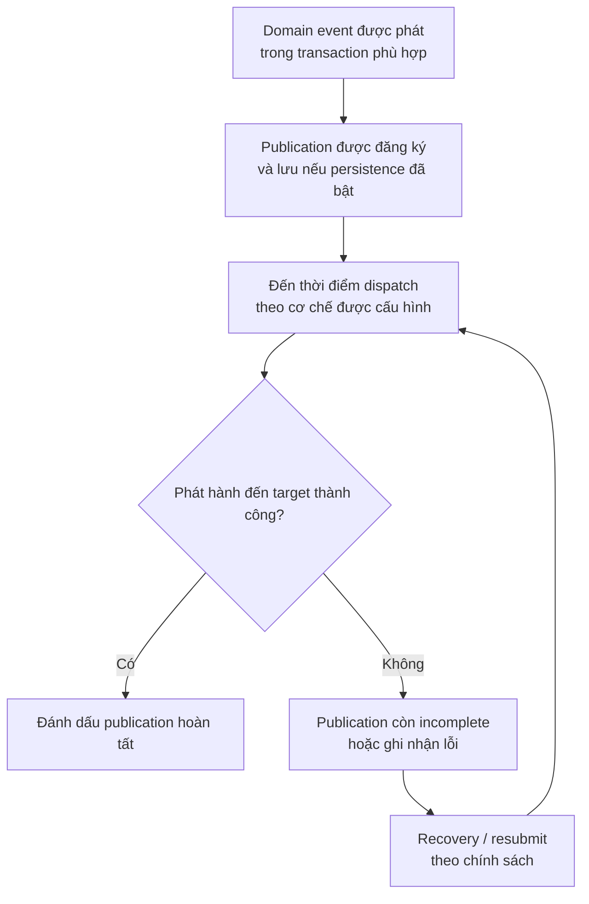
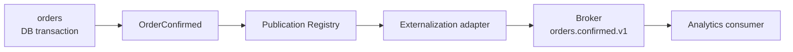
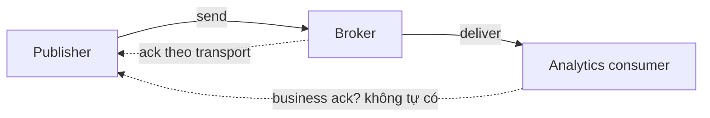

# Publication registry và trạng thái externalization

Khi một ứng dụng Spring Modulith gửi sự kiện ra Kafka, RabbitMQ hoặc một transport ngoài tiến trình, có một câu hỏi vận hành rất quan trọng: **nếu cơ sở dữ liệu đã ghi đơn hàng nhưng broker tạm thời không nhận được sự kiện, làm sao biết còn việc phải gửi và xử lý lại một cách có kiểm soát?**

**Event Publication Registry** của Spring Modulith hỗ trợ theo dõi các **publication** gắn với sự kiện và đích xử lý được đăng ký. Với cơ chế lưu trữ phù hợp, registry giúp phân biệt publication đã hoàn tất với publication còn chờ xử lý và tạo cơ sở cho phục hồi sau lỗi. Đối với **event externalization**, công dụng này đặc biệt quan trọng vì trạng thái nghiệp vụ ở database và trạng thái gửi thông điệp tới broker không tự động nằm trong cùng một giao dịch phân tán.

Bài thuộc chương **Externalization** của học phần `SPRING_MODULITH_VERIFICATION_TESTING`. Học phần rèn kiểm chứng ranh giới kiến trúc bằng `ApplicationModules` và quy tắc phụ thuộc, thực hành `@ApplicationModuleTest`, kiểm thử sự kiện, cơ sở dữ liệu và tích hợp, kết hợp quality gate trong CI để ngăn phụ thuộc sai và hồi quy. Trong bài này, chúng ta tìm hiểu **registry lưu và hoàn tất publication ra sao, các trạng thái cần theo dõi, điều gì xảy ra khi lỗi/crash, cách retry an toàn và cách kiểm thử hành vi thực tế**.

> **Phạm vi thuật ngữ:** “đã đăng ký”, “đang chờ”, “đang xử lý”, “hoàn tất” và “cần thử lại” trong sơ đồ dưới đây là **trạng thái khái niệm của vòng đời publication**. Tên enum, trường dữ liệu, trạng thái persisted hoặc API thao tác thực tế có thể thay đổi theo phiên bản và loại repository Spring Modulith. Không được coi sơ đồ này là đặc tả bảng hoặc enum cố định của thư viện.

## 1. Phân biệt event, publication và message

Giả sử module `orders` phát:

```java
events.publishEvent(new OrderConfirmed(...));
```

Từ lời gọi đó cần phân biệt ít nhất bốn thực thể:

1. **Domain/application event:** đối tượng `OrderConfirmed` biểu đạt một sự thật nghiệp vụ.
2. **Event publication:** một công việc phát hành event tới một **listener hoặc đích publication xác định** do hạ tầng nhận diện; registry quản lý vòng đời công việc này.
3. **Broker message:** representation đã được serialize và được gửi tới destination ngoài ứng dụng.
4. **Consumer processing:** nghiệp vụ phía nhận đọc và áp dụng thông điệp.



**Đừng đánh đồng các dấu mốc thành công:**

| Dấu mốc | Có thể chứng minh điều gì? | Chưa chứng minh điều gì? |
| --- | --- | --- |
| `publishEvent(...)` đã gọi | Event đã được đưa vào cơ chế publish trong Spring context | Event đã được ghi bền vững hoặc broker nhận |
| Publication được lưu bền vững | Có bản ghi công việc phát hành được cơ chế registry quản lý | Broker đã nhận message |
| Publication được đánh dấu hoàn tất | Đích publication đã được framework/adapter coi là xử lý thành công theo điều kiện cấu hình | Consumer ngoài ứng dụng đã xử lý nghiệp vụ |
| Broker xác nhận nhận message | Transport đã chấp nhận message theo semantics của producer/adapter | Consumer đã commit side effect |
| Consumer xử lý và commit | Consumer đã hoàn thành công việc trong phạm vi giao dịch của mình | Message sẽ không bao giờ xuất hiện lại |

Vì thế, **publication complete** thường là dấu mốc về **phát hành đến đích**, không phải xác nhận mọi hậu quả trên toàn hệ thống đã hoàn tất. Với externalization, cần xác minh adapter coi một lệnh gửi thành công ở thời điểm nào: callback, broker acknowledgement hoặc một điều kiện cụ thể khác.

## 2. Một event có thể có nhiều publication

Một `OrderConfirmed` có thể được:

- Listener `notifications` trong cùng ứng dụng dùng để gửi email;
- Listener `reporting` dùng để cập nhật read model nội bộ;
- Externalization adapter gửi ra Kafka topic `orders.confirmed.v1`.



Về mặt khái niệm, **một event nguồn có thể gắn với nhiều công việc publication**, và kết quả của các đích không nhất thiết giống nhau. Nếu notifications thành công nhưng Kafka thất bại, không nên đánh dấu “toàn bộ event đã xong” chỉ vì một listener hoàn tất.

Số publication thực tế được registry đăng ký phụ thuộc loại listener/externalization target mà Spring Modulith hỗ trợ theo cấu hình và phiên bản sử dụng. **Không mặc định mọi `@EventListener` hoặc mọi lệnh `publishEvent` đều có bản ghi persisted riêng**, đặc biệt nếu chỉ dùng cơ chế sự kiện Spring thông thường mà không bật thành phần registry phù hợp.

Khóa theo dõi nghiệp vụ tốt thường kết hợp **event identity**, **target identity** và **publication identity**. `eventId` của domain event không nhất thiết chính là ID bản ghi nội bộ mà registry dùng để quản lý publication.

## 3. Sơ đồ vòng đời publication ở mức khái niệm



Để đọc sơ đồ đúng, hãy tách hai lớp:

**Lớp nghiệp vụ:** `OrderConfirmed` thể hiện sự thật đơn đã được xác nhận.

**Lớp publication:** “bản ghi phát hành tới Kafka chưa hoàn tất” là trạng thái *vận chuyển công bố* sự thật đó; nó không có nghĩa đơn hàng quay về trạng thái chưa xác nhận.

### Các trạng thái cần quan sát

| Trạng thái khái niệm | Cách hiểu | Hành động quản trị phù hợp |
| --- | --- | --- |
| **Registered** | Publication đã được nhận diện/đăng ký | Đảm bảo dữ liệu có thể lưu bền vững nếu yêu cầu |
| **Pending / incomplete** | Chưa có xác nhận hoàn tất | Xem tuổi publication, nguyên nhân và khả năng gửi |
| **In progress** | Adapter/worker đang xử lý | Theo dõi timeout, concurrency, khóa xử lý |
| **Completed** | Target đã được coi là xử lý thành công | Không resubmit vô điều kiện |
| **Failed / retryable** | Lần xử lý trước thất bại, cần chính sách xử lý tiếp | Phân loại lỗi, backoff, dead-letter hoặc can thiệp |

Những nhãn trên **không cam kết tương ứng 1–1 với enum/tên cột thực tế**. Một implementation có thể biểu đạt việc completed chỉ qua `completion date`, còn publication lỗi vẫn được lưu dưới dạng incomplete. Khi viết query/metric hoặc dashboard, cần đối chiếu chính xác schema/API của module lưu trữ đang dùng.

## 4. Bối cảnh ví dụ: đơn hàng và analytics bên ngoài

Ứng dụng minh họa có hai application module:

```text
com.example.shop
├── ShopApplication.java
├── orders
│   ├── OrderConfirmed.java
│   └── internal
│       ├── ConfirmOrderService.java
│       └── OrderRepository.java
└── inventory
    ├── StockLookup.java
    └── internal
        └── StockRepository.java
```

Module `orders` chịu trách nhiệm ghi trạng thái đơn, không trực tiếp biết Kafka client hoặc service analytics. Sau khi xác nhận, nó phát `OrderConfirmed`. Một externalization adapter được cấu hình sẽ gửi integration event sang broker.



Ở kiến trúc này, **orders** vẫn sở hữu ý nghĩa của event và trạng thái đơn hàng; **registry** quản lý các publication đã đăng ký; **adapter** hiểu transport; **consumer** xử lý nghiệp vụ của nó. Đó là phân chia trách nhiệm cần bảo vệ bằng test.

## 5. Tạo event đủ thông tin để retry an toàn

Integration event cần một định danh ổn định, không sinh mới cho mỗi lần gửi broker:

```java
// com/example/shop/orders/OrderConfirmed.java
package com.example.shop.orders;

import java.time.Instant;
import java.util.UUID;
import org.springframework.modulith.events.Externalized;

@Externalized("orders.confirmed.v1")
public record OrderConfirmed(
        UUID eventId,
        UUID orderId,
        String customerReference,
        Instant occurredAt
) {}
```

`@Externalized` thể hiện ý định chọn sự kiện này để gửi ra ngoài khi adapter và selection policy phù hợp được bật. Tên destination ở ví dụ **không tự tạo broker topic**, cũng không tự đảm bảo `orderId` sẽ là Kafka message key.

**Vai trò của hai ID:**

- `orderId` xác định aggregate. Một đơn hàng có thể phát nhiều sự kiện hợp lệ qua vòng đời.
- `eventId` xác định một sự kiện nghiệp vụ cụ thể. Nếu gửi lại **cùng event** vì broker outage hoặc crash, `eventId` phải được giữ nguyên.

Nếu người dùng gửi lệnh “xác nhận đơn” hai lần do retry HTTP, tầng domain cần một quy tắc idempotency để không tạo hai `OrderConfirmed` khác nhau cho cùng một thay đổi trạng thái. Registry **không tự giải quyết idempotency của command nghiệp vụ**.

## 6. Phát sự kiện trong transaction nghiệp vụ

Ví dụ service:

```java
// com/example/shop/orders/internal/ConfirmOrderService.java
package com.example.shop.orders.internal;

import com.example.shop.orders.OrderConfirmed;
import java.time.Clock;
import java.time.Instant;
import java.util.UUID;
import org.springframework.context.ApplicationEventPublisher;
import org.springframework.stereotype.Service;
import org.springframework.transaction.annotation.Transactional;

@Service
class ConfirmOrderService {

    private final OrderRepository orders;
    private final ApplicationEventPublisher events;
    private final Clock clock;

    ConfirmOrderService(
            OrderRepository orders,
            ApplicationEventPublisher events,
            Clock clock) {
        this.orders = orders;
        this.events = events;
        this.clock = clock;
    }

    @Transactional
    UUID confirm(UUID orderId, String customerReference) {
        // Phải kiểm tra chuyển trạng thái, idempotency và ghi DB thật.
        orders.markConfirmed(orderId);

        UUID eventId = UUID.randomUUID();
        events.publishEvent(new OrderConfirmed(
                eventId, orderId, customerReference, Instant.now(clock)
        ));

        return eventId;
    }
}
```

Đoạn code chỉ minh họa **biên giao dịch và vị trí phát event**. `OrderRepository` và bean `Clock` cần implementation/configuration của dự án thật; `markConfirmed(...)` phải xử lý trạng thái hiện tại và chỉ phát event theo business fact đúng. Một ví dụ code có `@Transactional` **chưa đủ** để chứng minh publication record được lưu trong cùng transaction hoặc broker chỉ nhận event sau commit.

Trong hệ thống thực, cần kiểm tra cấu hình Spring transaction manager, loại listener, externalization adapter và repository cho registry. Phải trả lời chính xác: **publication được ghi ở transaction nào, có rollback cùng đơn không, và ai kích hoạt dispatch sau commit?**

## 7. Điều kiện để registry có giá trị bền vững

Không nên suy luận “Spring Modulith trên classpath” đồng nghĩa đã có outbox bền vững. Một hệ thống muốn có khả năng khôi phục cần xem xét:

1. **Event publication registry** được tích hợp vào cơ chế publish/listener mà dự án dùng.
2. **Persistence implementation** phù hợp với database hoặc store và phiên bản Spring Modulith.
3. **Schema/migration** cho nơi lưu publication và quyền truy cập.
4. **Transaction semantics** để dữ liệu nghiệp vụ và ý định phát hành không tạo khoảng mất không mong muốn.
5. **Recovery/resubmission** được bật và vận hành theo chính sách cụ thể.
6. **Metrics/logging** để thấy publication lỗi hoặc tồn đọng.

Các module persistence được Spring Modulith hỗ trợ có thể dựa trên JDBC, JPA hoặc các store khác tùy phiên bản. Việc chọn artifact, cấu hình auto-configuration và DDL phải đối chiếu với **phiên bản Spring Boot/Spring Modulith thực tế**. Không nên chép một cấu hình “bật registry” từ bản khác rồi mặc định tất cả publication đã được bảo vệ.

### Registry in-memory và registry persistent

Một registry lưu trong memory có thể giúp theo dõi trong vòng đời tiến trình nhưng **không đủ để khôi phục sau process crash**. Cơ chế persistent mới là ứng viên cho mục tiêu recovery sau restart, và ngay cả khi persistent, nó còn phải có **quy trình resubmit** hoạt động thật.

### Cùng transaction hay hai transaction?

Nếu đơn hàng và bản ghi publication nằm trong **cùng một database transaction**, một số kịch bản “DB commit nhưng không có intent gửi” có thể được kiểm soát tốt hơn. Nếu mỗi phần dùng store/transaction manager khác nhau, không được mặc định có atomic commit giữa chúng.

**Đừng đánh đồng** Event Publication Registry với một giải pháp transactional outbox/CDC bất kỳ: chúng có mục tiêu giao thoa về theo dõi và phục hồi, nhưng chi tiết thời điểm lưu, adapter, completion và replay phải được kiểm chứng cụ thể.

## 8. Dòng thời gian một publication thành công

Một luồng mong muốn có thể mô tả như sau:

```text
T0  Begin DB transaction
T1  Cập nhật Order -> CONFIRMED
T2  Publish OrderConfirmed vào Spring event infrastructure
T3  Registry ghi nhận publication cho externalization target
T4  Commit DB transaction thành công
T5  Externalization adapter dispatch event
T6  Broker xác nhận send theo semantics của adapter
T7  Registry coi publication hoàn tất và ghi nhận completion
T8  Consumer nhận, kiểm tra eventId và áp dụng side effect
```

Đây là **một timeline minh họa về thiết kế cần đạt**, không phải lịch thực thi cứng của mọi adapter. Các bước T3, T5, T7 phụ thuộc Spring Modulith implementation/configuration; consumer có thể bắt đầu xử lý ngay sau broker ack, thậm chí trước khi producer cập nhật registry hoàn tất.

**Lợi ích lớn:** nếu publication còn incomplete sau lỗi, vận hành có một nơi để quan sát **công việc gửi chưa được xác nhận**, thay vì chỉ nhìn một dòng log `publishEvent(...)` đã chạy và đoán xem broker có nhận hay không.

## 9. Dòng thời gian khi transaction rollback

Giả sử `orders.markConfirmed(...)` cập nhật DB, service phát event, rồi transaction rollback vì một exception:

```text
T0  Begin transaction
T1  Update order
T2  Publish event
T3  Exception / rollback
T4  Không tồn tại Order CONFIRMED đã commit
```

Với thiết kế đúng cho sự kiện “đơn đã xác nhận”, **không nên có một message thành công trên broker** mô tả trạng thái đã rollback.

Điểm phải kiểm bằng integration test là:

- Publication intent có rollback tương ứng nếu cùng transaction và store không?
- Externalizer có gửi chỉ sau khi commit theo cơ chế đã cấu hình không?
- Có listener `@EventListener` thường hoặc một đoạn code gọi broker trực tiếp **trước commit** không?
- Có transaction manager nào không bao phủ thao tác ghi thực tế không?

**Chỉ thấy `@Transactional` trong source không đủ kết luận.** Ví dụ, publication gửi ngay bằng một producer trực tiếp trước commit có thể tạo message dù DB rollback.

## 10. Bảng phân tích các điểm lỗi

| Điểm xảy ra lỗi | DB business state | Broker | Trạng thái publication cần xem | Rủi ro |
| --- | --- | --- | --- | --- |
| Trước khi commit DB | Chưa commit/rollback | Không nên có event thành công | Intent phải tuân transaction | “Sự thật giả” trên broker |
| Sau commit, trước dispatch | Đã commit | Chưa nhận | Incomplete nếu intent được lưu bền | Mất event nếu không có recovery |
| Khi gọi broker, broker từ chối | Đã commit | Chưa nhận thành công | Incomplete/lỗi theo adapter | Publication tồn đọng |
| Broker đã nhận, producer mất kết nối trước ack | Đã commit | **Không chắc** đã nhận | Có thể vẫn incomplete | Gửi lại dẫn tới duplicate |
| Broker ack, app crash trước mark complete | Đã commit | Đã nhận | Có thể vẫn incomplete | Resubmit tạo message trùng |
| Publication complete, consumer chưa chạy | Đã commit | Đã nhận | Complete ở producer | Consumer backlog, không phải lỗi registry producer |
| Consumer áp dụng side effect rồi crash trước ack | Đã commit | Đã nhận | Có thể complete | Consumer nhận lại, cần idempotency |

Khi sự cố xảy ra, hãy xác định **đang ở hàng nào** thay vì gộp mọi lỗi thành “event bị mất”. Hệ thống có broker nhận message nhưng producer không biết chắc kết quả **khác** hệ thống mà broker chắc chắn từ chối và publication còn chưa gửi.

## 11. Completed có nghĩa gì với externalization?

Một trong những ngộ nhận nguy hiểm nhất là:

> “Registry ghi completed nên hệ thống analytics đã cập nhật dữ liệu.”

Điều này **không được suy ra**. Với externalization, completion thường liên quan đến **xử lý publication ở phía publisher/adapter**, không phải end-to-end business processing ở consumer ngoài JVM.



Một consumer có thể mất hàng phút hoặc hàng giờ để xử lý backlog sau khi broker nhận message. Registry producer vẫn có thể coi publication là complete trong khi consumer lag lớn.

**Nếu nghiệp vụ cần biết consumer đã xử lý thật**, phải thiết kế một **acknowledgement hoặc completion event liên hệ thống** riêng, kèm timeout, correlation ID và trạng thái workflow. Không dựa vào completion của Event Publication Registry như một business acknowledgement.

Tương tự, khi adapter dùng asynchronous send, cần xem chính xác **khi nào adapter đánh dấu hoàn tất**; không tự kết luận “gọi hàm send không ném exception” bằng “broker đã ack”.

## 12. Phân biệt incomplete, retryable và permanently failed

Trong thực tế, **incomplete** chỉ nói publication chưa được công nhận hoàn tất. Nguyên nhân có thể rất khác:

- Broker tạm ngừng hoặc timeout — có thể retry.
- Cấu hình credentials sai — retry ngay nhiều lần không có ích.
- Destination chưa tồn tại hoặc thiếu ACL — cần sửa hạ tầng.
- Serializer lỗi do dữ liệu không hợp lệ — có thể cần sửa code/payload.
- Schema registry không chấp nhận schema — cần điều phối contract/version.
- Tiến trình crash trước hoàn tất — cần recovery theo publication record.

Do vậy, monitoring nên phân biệt **lỗi tạm thời** và **lỗi cần can thiệp**. Không resubmit vô hạn với tần suất cao cho một payload chắc chắn không serialize được.

| Phân loại | Ví dụ | Hướng xử lý |
| --- | --- | --- |
| Transient | Broker unavailable, network timeout | Retry có backoff/jitter, giới hạn tần suất |
| Configuration | Sai destination, thiếu quyền | Cảnh báo và sửa cấu hình/ACL |
| Contract | Payload không serialize hoặc schema mismatch | Sửa mapper/schema, quản lý poison publication |
| Duplicate/unknown ack | Producer không biết broker nhận hay chưa | Retry chấp nhận duplicate, consumer idempotent |
| Operational backlog | Consumer chưa đọc dù broker nhận | Theo dõi consumer lag, không resubmit producer vô tội vạ |

Trong hệ thống có trạng thái lỗi riêng, tên và phương thức chuyển trạng thái thực tế phải đọc từ phiên bản framework đang dùng. Với các implementation chỉ lưu incomplete, **phân loại lỗi có thể nằm ở log/metric của ứng dụng** thay vì một cột status riêng.

## 13. Recovery và resubmission: có dữ liệu chưa đủ

Registry persistent giúp giữ dấu vết publication, nhưng không nên nhầm **“có bản ghi incomplete”** với **“tự động retry vô hạn cho đến khi thành công”**.

Một thiết kế phục hồi cần trả lời:

1. **Ai quét publication incomplete?** Một scheduled recovery job, cơ chế resubmission được framework hỗ trợ hay thao tác vận hành?
2. **Khi nào chạy?** Sau startup, theo lịch, sau sự cố hạ tầng hay khi operator chủ động?
3. **Dựa vào điều kiện nào để retry?** Publication chưa complete, lỗi có thể phục hồi, tuổi publication?
4. **Có tránh xử lý trùng bởi nhiều instance không?** Cơ chế claim/locking/concurrency phải phù hợp.
5. **Có giới hạn retry và backoff không?** Không dồn tải làm broker tiếp tục lỗi.
6. **Có cảnh báo khi publication quá cũ không?** Tránh backlog bị quên.
7. **Ai xử lý poison event?** Thay code, sửa dữ liệu nếu được phép, replay hay can thiệp bằng quy trình được phê duyệt.

Spring Modulith có API và khả năng resubmission/recovery của Event Publication Registry, nhưng **phương thức, module cấu hình và cơ chế tự động cụ thể phụ thuộc phiên bản**. Bài này không gán một tên method cố định hay một property “bật retry” giả định để copy vào production. Khi triển khai, phải đối chiếu tài liệu phiên bản và test restart.

## 14. Cảnh báo: retry không làm một giao dịch phân tán thành exactly-once

Kịch bản kinh điển:

```text
Publisher gửi OrderConfirmed(eventId = E)
Broker lưu message E và trả ack
Publisher crash trước khi registry mark complete
Restart: publication E còn incomplete
Recovery gửi lại E
Broker có thể chứa hai message với cùng eventId = E
```

Đây không nhất thiết là lỗi hệ thống; đó là tình huống thường phải chấp nhận khi thiết kế giao nhận theo hướng **at-least-once**. Điều cần có là:

- **ID sự kiện ổn định** qua lần gửi lại.
- **Consumer idempotent**: không nhân đôi tác động nghiệp vụ.
- **Giám sát retry và duplicate** để chẩn đoán.
- **Quy tắc retention/replay** phù hợp với yêu cầu nghiệp vụ.

Không tuyên bố end-to-end exactly-once chỉ vì dùng Event Publication Registry, broker Kafka hoặc annotation `@Externalized`. Những bảo đảm cụ thể chỉ xuất hiện khi xem **cả transaction producer, broker delivery, transaction consumer và cách xử lý duplicate**.

## 15. Consumer idempotent với event ID

Giả sử analytics lưu tổng số đơn xác nhận. Nếu nhận hai lần `OrderConfirmed(eventId=E)`, consumer phải áp dụng tác động **một lần**.

Một thiết kế thường dùng là lưu dấu sự kiện đã xử lý:

```sql
-- Schema minh họa thuộc dịch vụ CONSUMER, không phải
-- schema Event Publication Registry của Spring Modulith.
CREATE TABLE processed_event (
    event_id VARCHAR(36) PRIMARY KEY,
    processed_at TIMESTAMP NOT NULL
);
```

Pseudocode transaction của consumer:

```text
BEGIN TRANSACTION
    INSERT processed_event(eventId)
    IF eventId đã có (unique conflict):
        bỏ qua side effect đã áp dụng
    ELSE:
        cập nhật analytics projection
COMMIT
ACK MESSAGE
```

Trong thực tế, **đánh dấu processed và cập nhật projection phải thuộc cùng transaction**, hoặc có một chiến lược idempotency tương đương. Nếu đánh dấu processed trước rồi update thất bại, lần retry có thể bị bỏ qua sai. Nếu update thành công nhưng marker không được commit, lần retry có thể tính lại.

Một `orderId` không đủ làm dedupe key cho mọi event: một đơn có thể có `OrderConfirmed`, `OrderCancelled` và nhiều sự kiện hợp lệ khác. `eventId` hoặc khóa `(eventType, eventId)` được chọn theo hợp đồng sẽ chính xác hơn.

## 16. Publication identity và khóa xử lý

Một event có thể được gửi tới nhiều target, hoặc được phát ở nhiều version contract trong giai đoạn migration. Điều này đặt ra hai quy tắc:

**Quy tắc 1 — consumer dedupe theo business event:** bên nhận phải biết một thông điệp có đại diện cho một sự thật nghiệp vụ đã áp dụng hay chưa.

**Quy tắc 2 — registry theo dõi từng publication:** hệ thống phát cần phân biệt việc gửi event E đến target A đã complete với việc gửi E đến target B vẫn incomplete.

```text
Business event:
  eventId = E

Publications:
  (E, target = kafka.orders.confirmed.v1) -> completed
  (E, target = internal.notifications)    -> incomplete
```

Đây là representation minh họa, **không phải mô tả nguyên văn schema hoặc ID target mà Spring Modulith bắt buộc sử dụng**. Với event externalization qua nhiều transport/version, cần kiểm tra cách framework nhận diện target publication; **không được tự sửa cột/key persisted** nếu không dựa trên adapter chính thức.

Đặc biệt khi triển khai nhiều replica, recovery phải tránh để các replica đồng thời resubmit cùng một publication ngoài ý muốn. Dù dùng locking, lease hay cơ chế framework cung cấp, consumer vẫn cần idempotency vì duplicate có thể xảy ra từ network ambiguity.

## 17. Ordering: “đã hoàn tất” không nói gì về thứ tự business event

Ví dụ cùng một đơn có hai sự kiện:

```text
E1 = OrderConfirmed(orderId=O)
E2 = OrderCancelled(orderId=O)
```

Nếu `E1` bị kẹt ở registry và `E2` gửi thành công, consumer có thể thấy **cancel trước confirm**, sau đó retry E1. Chỉ dựa vào thời điểm publication complete có thể khiến read model sai.

Các lựa chọn tùy nghiệp vụ:

- Đặt Kafka message key theo `orderId` để sự kiện cùng đơn vào cùng partition **khi mọi event được gửi vào cùng topic/partitioning scheme phù hợp**.
- Thêm **sequence/version của aggregate** để consumer nhận diện event cũ/out-of-order.
- Thiết kế consumer state machine xử lý an toàn các trạng thái bị đảo thứ tự.
- Nếu yêu cầu thứ tự chặt, kiểm tra cơ chế dispatch/retry có duy trì thứ tự cần thiết hay không.

**Registry theo dõi hoàn tất publication không mặc định đảm bảo total ordering.** Một event gửi lại sau lỗi có thể xuất hiện sau các event mới đã được broker nhận. Chọn event key hoặc topic cũng không chứng minh được thứ tự giữa hai topic khác nhau.

## 18. Ví dụ đối chiếu với transactional outbox

Nhiều nhóm kỹ thuật gọi chung mọi giải pháp ghi thông điệp chờ gửi là “outbox”. Cần phân biệt ở cấp kiến trúc:

| Tiêu chí | Event Publication Registry | Transactional outbox truyền thống |
| --- | --- | --- |
| Đối tượng quản lý | Publication tới listener/target được hạ tầng event nhận diện | Bản ghi thông điệp/outbox do ứng dụng thiết kế |
| Nguồn sự kiện | Spring application events và integration tương ứng | Transaction nghiệp vụ ghi outbox record |
| Cách vận chuyển | Listener/externalization adapter theo cấu hình | Poller/CDC/adapter do thiết kế lựa chọn |
| Trạng thái hoàn tất | Theo semantics của publication target | Theo semantics của dispatcher/outbox implementation |
| Khả năng replay | Theo API/recovery của registry và storage | Theo outbox processor/CDC policy |
| Giới hạn | Không tự là consumer business acknowledgement | Không tự là consumer business acknowledgement |

Hai cách có thể đạt **một số mục tiêu giống nhau**: tránh mất ý định gửi sau commit và hỗ trợ xử lý lại. Nhưng không nên đồng nhất chúng trong mọi điều kiện. Nếu cần audit log, CDC, transaction cross-database hoặc throughput đặc biệt, phải đánh giá tính phù hợp của từng triển khai.

## 19. Một record registry không nhất thiết là sự kiện mới

Khi operator thấy nhiều publication incomplete, không nên kết luận domain liên tục phát sự kiện nghiệp vụ mới. Có thể đó là **cùng một publication** đang được gửi lại nhiều lần.

Ngược lại, khi một người dùng nhấn “đặt hàng” ba lần và service tạo ba event `OrderConfirmed` khác `eventId`, registry có thể lưu ba publication hoàn toàn hợp lệ theo input; registry không tự quyết định ba thao tác đó là duplicate business command.

Vì thế, quan sát hệ thống nên có hai nhóm metric riêng:

1. **Business event metrics:** số đơn được xác nhận, số `eventId` duy nhất, trạng thái order.
2. **Publication metrics:** số incomplete theo target, số lần dispatch/retry, tuổi publication, tỷ lệ completion và lỗi adapter.

Điều này tránh nhầm “retry đang gửi lại một sự kiện cũ” với “đơn hàng mới vừa được tạo”.

## 20. Thiết kế metric và dashboard cho trạng thái publication

Các tín hiệu đáng theo dõi:

| Metric/điểm quan sát | Câu hỏi trả lời | Lưu ý |
| --- | --- | --- |
| Incomplete publication count | Còn bao nhiêu công việc phát hành chưa complete? | Tách theo target/event type |
| Oldest incomplete age | Publication cũ nhất tồn bao lâu? | Thường nhạy hơn chỉ nhìn số lượng |
| Publication completion rate | Bao nhiêu publication hoàn tất trong cửa sổ quan sát? | Phân biệt phát sinh mới với xử lý backlog |
| Retry attempt count | Có xảy ra bão retry không? | Cần phân loại target/loại lỗi |
| Serialization failures | Payload/schema có lỗi cố định không? | Không retry mù |
| Broker publish latency/errors | Adapter gặp lỗi transport gì? | Theo dõi ack semantics |
| Consumer lag/DLQ | Message đã ở broker nhưng consumer có chậm/lỗi không? | Đây là metric bên nhận, không thay cho registry |

Ví dụ đặt một quality objective:

```text
Publication incomplete không quá ngưỡng vận hành được duyệt.
Oldest incomplete age vượt ngưỡng -> cảnh báo.
Retry failures tăng -> phân loại network/ACL/schema.
Consumer lag cao nhưng producer publication complete -> điều tra consumer.
```

Không đưa ra một ngưỡng cố định cho mọi dự án. Analytics có thể chấp nhận chậm vài phút, trong khi luồng bảo đảm thực hiện fulfillment có thể cần SLO chặt hơn. Ngưỡng phải dựa trên **hợp đồng nghiệp vụ và năng lực hạ tầng**.

## 21. Không dựa vào tên bảng hoặc SQL tự phỏng đoán

Một implementation registry có thể lưu các trường như event, target, thời điểm publication, completion hoặc trạng thái khác. Tuy nhiên **schema thực tế khác nhau theo module persistence và phiên bản**.

Ví dụ sau chỉ mô tả dữ liệu **cần quan sát về mặt khái niệm**, **không phải DDL hoặc SQL áp dụng cho Spring Modulith**:

```text
publication_id
business_event_id
target_identifier
published_at
completed_at / completion_state
last_error_context (nếu ứng dụng/hạ tầng có ghi nhận)
```

Không nên tạo query `SELECT * FROM event_publication WHERE status='FAILED'` khi chưa kiểm tra bảng thật có tồn tại và có cột `status` hay không. Dùng **API và schema persistence chính thức đúng phiên bản**, hoặc xây dashboard dựa trên telemetry được công bố.

Đặc biệt, **không chỉnh trực tiếp record registry để đánh dấu complete** chỉ nhằm làm dashboard xanh. Hành động đó có thể khiến publication chưa gửi bị coi là đã xử lý, mất đường recovery.

## 22. Kiểm chứng ranh giới module riêng với registry

Event externalization và registry là phần hạ tầng. Chúng **không thay thế** kiểm chứng dependency rules giữa các application module Java.

Ví dụ `orders` gọi `inventory.StockLookup` thì có cạnh kiểu `orders → inventory`. Nếu `inventory` nhận tham số `orders.OrderConfirmed` trong listener, nó tạo cạnh `inventory → orders`. Việc event đồng thời được externalize tới broker **không xóa vòng Java** đó.

Một architecture test:

```java
// src/test/java/com/example/shop/ModularityTests.java
package com.example.shop;

import org.junit.jupiter.api.Test;
import org.springframework.modulith.core.ApplicationModules;

class ModularityTests {

    @Test
    void boundariesAreValid() {
        ApplicationModules.of(ShopApplication.class).verify();
    }
}
```

`verify()` có thể kiểm tra quy tắc không có cycle, không truy cập internals của module khác và tuân thủ `allowedDependencies` khi đã khai báo. Nhưng nó **không chứng minh registry persistent, broker ack, completion hoặc consumer idempotent hoạt động**.

Ngược lại, việc broker integration test PASS cũng chưa chứng minh module graph không có cycle. Hai lớp kiểm chứng phải tồn tại song song.

## 23. Test event được phát bằng `@ApplicationModuleTest`

Trước hết kiểm chứng rằng nghiệp vụ thực sự phát `OrderConfirmed`:

```java
// src/test/java/com/example/shop/orders/internal/OrdersEventsTests.java
package com.example.shop.orders.internal;

import static org.assertj.core.api.Assertions.assertThat;
import com.example.shop.orders.OrderConfirmed;
import java.util.UUID;
import org.junit.jupiter.api.Test;
import org.springframework.beans.factory.annotation.Autowired;
import org.springframework.modulith.test.ApplicationModuleTest;
import org.springframework.modulith.test.PublishedEvents;

@ApplicationModuleTest
class OrdersEventsTests {

    @Autowired
    ConfirmOrderService service;

    @Test
    void confirmingOrderPublishesEvent(PublishedEvents events) {
        UUID orderId = UUID.randomUUID();

        service.confirm(orderId, "C-001");

        assertThat(events.ofType(OrderConfirmed.class)).hasSize(1);
    }
}
```

Đây là **mẫu test cần repository, dữ liệu fixture và bean `Clock` phù hợp**. Với dự án thật, phải có `OrderRepository` và trạng thái order cho phép xác nhận; không coi đoạn minh họa là project tự chạy độc lập.

`PublishedEvents` giúp xác nhận **Spring application event đã được phát**, không chứng minh:

- Registry đã lưu publication bền vững.
- Broker đã nhận message.
- Publication đã được đánh dấu complete.
- Consumer bên ngoài đã commit dữ liệu.

Nếu chỉ có bài test này mà không kiểm tra registry/broker, chức năng **khôi phục sau crash** vẫn là một giả định chưa được chứng minh.

## 24. Test tích hợp registry cần quan sát điều gì?

Khi dùng một persistence adapter cho registry trong application test, nên có các ca sau:

| Ca kiểm thử | Mục tiêu |
| --- | --- |
| Event trong transaction commit thành công | Publication được ghi theo semantics đã cấu hình |
| Transaction rollback | Không để publication của một business fact chưa commit bị gửi sai |
| Broker không khả dụng sau commit | Publication vẫn incomplete/quan sát được theo persistence được chọn |
| Broker khôi phục và có resubmission | Publication được dispatch lại, trạng thái hoàn tất theo adapter |
| Crash sau broker ack trước mark complete | Có thể duplicate; consumer xử lý an toàn |
| Target A thành công, target B thất bại | Registry không gộp sai trạng thái các target |
| Payload serialization lỗi | Publication không âm thầm complete |
| Restart toàn bộ ứng dụng | Bản ghi publication cần khôi phục vẫn tồn tại |

**Test cần chạy với implementation persistence thật được chọn**, không chỉ một fake in-memory, nếu mục tiêu là xác minh durability qua restart. Có thể dùng Testcontainers database/broker và dựng lại ApplicationContext ở bước kiểm thử phù hợp.

Để xác định trạng thái, dùng API đọc publication hoặc truy vấn persistence **được tài liệu của phiên bản và adapter cho phép**, không tự bịa một SQL schema cố định. Nếu test cần ép một lần gửi thất bại, có thể tạm ngừng broker hoặc cấu hình test adapter có kiểm soát để ném lỗi.

## 25. Kịch bản integration test có thể thực hiện theo bước

Ví dụ một ca “broker down rồi hồi phục”:

```text
Given:
  orders DB và registry persistence đang chạy
  Spring Modulith externalization adapter đã bật
  broker test được cấu hình với orders.confirmed.v1

When:
  1. Dừng/khóa broker.
  2. Xác nhận đơn và commit DB.

Then:
  3. Order có trạng thái CONFIRMED đã commit.
  4. Publication tới externalization target còn incomplete.
  5. Không có bằng chứng broker đã nhận message thành công.

When:
  6. Khôi phục broker.
  7. Kích hoạt recovery/resubmission theo cơ chế đã cấu hình.

Then:
  8. Broker nhận OrderConfirmed với eventId ban đầu.
  9. Publication được coi là complete theo semantics adapter.
 10. Consumer có thể xử lý một hoặc nhiều delivery an toàn.
```

**Không suy diễn rằng bước 7 tự xảy ra** khi broker bật lại. Kịch bản phải ghi rõ job/hook/API resubmission nào đang hoạt động và kiểm tra một lần gửi lại thực sự xảy ra. Không nên dùng sleep cố định như bằng chứng; nên chờ điều kiện với timeout hữu hạn.

### Cảnh báo về việc test “broker không nhận”

Chỉ thấy consumer test **chưa đọc được** không đồng nghĩa broker chắc chắn không nhận. Có thể consumer group/offset sai hoặc message vẫn đang chờ. Test nên quan sát publication outcome, producer errors và broker/consumer state phù hợp để tránh kết luận sai.

## 26. Test xử lý trùng và crash giữa các bước

Kịch bản quan trọng:

```text
1. Publisher gửi event E.
2. Broker ack event E.
3. Chặn mô phỏng bước mark complete hoặc crash publisher.
4. Khởi động lại publisher.
5. Recovery gửi lại event E.
6. Consumer nhận E lần thứ hai.
7. Projection chỉ được cập nhật một lần.
```

Một test end-to-end tốt phải kiểm cả **`eventId` giữ nguyên** và **business side effect không nhân đôi**.

Không dễ mô phỏng chính xác “crash ngay sau ack” trên mọi adapter. Nếu không có hook được hỗ trợ, có thể chia thành:

- Test producer/registry recovery với lỗi có thể điều khiển.
- Test consumer idempotency bằng cách cố ý gửi hai message cùng `eventId`.
- Test tích hợp quan sát DB và broker khi retry.

Quan trọng là **nêu giới hạn test một cách trung thực**; không viết “exactly-once verified” khi chỉ test một đường happy path không có crash.

## 27. Những lỗi cấu hình và vận hành thường bị bỏ sót

### 27.1. Có registry nhưng không có persistence bền vững

Ứng dụng nhìn thấy publication khi chạy nhưng mất trạng thái sau restart. Hãy kiểm tra module storage, migration và transaction, không chỉ bean registry tồn tại.

### 27.2. Có persistence nhưng không chạy recovery

Database tích lũy incomplete publications nhưng không có scheduled resubmit hoặc quy trình operator. Việc lưu record chỉ giúp **nhìn thấy công việc chưa hoàn tất**, không tự giải quyết backlog.

### 27.3. Resubmit tất cả cùng lúc

Khi broker khôi phục, hàng trăm nghìn publication bị đẩy đồng thời tạo **retry storm**. Thiết kế batching, concurrency limit, backoff và monitoring theo khả năng framework/adapter.

### 27.4. Mark complete quá sớm

Nếu integration adapter coi việc bắt đầu async send là thành công mà không theo semantics ack mong muốn, publication có thể complete trước khi biết broker chấp nhận. Cần kiểm tra cách adapter tích hợp callback/outcome.

### 27.5. Mark complete thủ công để xóa cảnh báo

Điều này có thể khiến publication chưa gửi không còn được retry. Chỉ thực hiện thao tác quản trị khi hiểu semantics, có log/audit và quy trình phục hồi.

### 27.6. Khẳng định consumer đã xử lý từ publisher registry

Registry producer không tự đọc database của analytics. Hãy kiểm tra consumer lag, dead-letter queue, consumer transaction và business acknowledgement nếu cần.

### 27.7. Để payload hoặc error log làm lộ PII

Persistent publication store có thể giữ thông tin của event hoặc representation phục vụ resubmit. Cần phân loại dữ liệu, quyền truy cập, mã hóa/retention và hạn chế log nguyên payload khi có thông tin nhạy cảm.

### 27.8. Bỏ qua event version khi replay

Sau khi nâng schema từ v1 lên v2, replay một publication cũ có thể đi qua mapper/serializer đã thay đổi. Cần test retention, schema compatibility và quy tắc version của payload được gửi lại.

## 28. Quy trình vận hành khi publication mắc kẹt

Khi alert báo oldest incomplete age vượt ngưỡng:

1. **Khoanh vùng target**: Kafka topic, AMQP route hay internal listener?
2. **Xem thời điểm phát sinh**: lỗi mới, backlog kéo dài hay tái diễn sau deploy?
3. **Phân loại lỗi**: network, credentials, destination, schema, serializer hay code listener?
4. **Kiểm tra business fact**: DB đã commit trạng thái phù hợp chưa? Có bù trừ/hủy sau đó không?
5. **Kiểm tra broker**: message có thể đã được nhận nhưng ack bị mất không?
6. **Kiểm tra consumer**: có idempotency để chịu được duplicate khi retry không?
7. **Chọn cách hồi phục**: sửa cấu hình rồi resubmit có kiểm soát, hoặc xử lý poison publication theo quy trình.
8. **Xác nhận hiệu quả**: publication completion tăng, backlog giảm, consumer nhận đúng dữ liệu, không nhân đôi side effect.
9. **Ghi lại sự cố**: nguyên nhân gốc, phạm vi event affected, hành động và biện pháp ngừa tái diễn.

Nếu event biểu thị một business state đã thay đổi trong quá khứ, không nên tự chỉnh lại payload để “khớp với dữ liệu hiện tại” khi retry mà không có policy. **Resubmit cùng event** khác với **phát một sự kiện điều chỉnh mới**.

## 29. Quality gate CI cho registry và externalization

Một pipeline nên kết hợp kiểm chứng cấu trúc với độ tin cậy phát hành:

```text
Pull request
    |
    v
Compile + unit tests
    |
    v
ApplicationModules.verify()
    |-- Không có cycle?
    |-- Không truy cập internal API sai?
    '-- allowedDependencies hợp lệ?
    |
    v
@ApplicationModuleTest + PublishedEvents
    '-- Event nghiệp vụ được publish đúng?
    |
    v
Persistence integration tests
    |-- Publication được ghi theo transaction?
    '-- Restart còn incomplete publication?
    |
    v
Broker integration tests
    |-- Correct destination/schema/ack?
    '-- Broker outage -> recovery/resubmit?
    |
    v
Consumer integration tests
    |-- Duplicate event không tạo duplicate effect?
    '-- Out-of-order/replay được xử lý?
    |
    v
Merge khi tất cả gate bắt buộc PASS
```

Một số test broker/restart tốn tài nguyên hơn unit test; có thể tổ chức suite riêng trong pipeline nhưng **phải có cơ chế chạy bắt buộc phù hợp trước khi phát hành**. Đừng bỏ test recovery chỉ vì “application context đã start”.

CI phải thực sự chạy `ModularityTests` và những integration test đã chọn; tránh `skipTests` hoặc test filter khiến một quality gate chỉ còn trên giấy.

## 30. Checklist review trước khi đưa registry vào production

| Hạng mục | Câu hỏi cần được trả lời |
| --- | --- |
| **Event identity** | Cùng event có giữ `eventId` khi retry/replay không? |
| **Publication granularity** | Có nhận diện từng target để không gộp kết quả khác nhau? |
| **Persistence** | Store nào lưu registry? DDL/migration/retention ra sao? |
| **Transaction** | Business state và intent publication có nhất quán khi rollback/crash không? |
| **Dispatch** | Adapter gửi sau điều kiện nào? Broker ack được diễn giải thế nào? |
| **Completion** | Completed nghĩa là target publication hay consumer business complete? |
| **Recovery** | Ai quét incomplete? Khi nào? Có batching/backoff/concurrency limit? |
| **Poison publication** | Ai can thiệp nếu schema/serializer lỗi lâu dài? |
| **Idempotency** | Consumer có unique key/transaction chống duplicate không? |
| **Ordering** | Replay muộn có phá projection nếu event sau đã được xử lý? |
| **Privacy** | Publication store/log giữ dữ liệu nhạy cảm bao lâu, ai truy cập? |
| **Monitoring** | Incomplete count, oldest age, retry, broker errors, consumer lag? |
| **Tests** | Có restart, rollback, broker outage, duplicate và schema tests? |
| **CI** | Architecture, module và integration gates thực sự chặn merge? |

Đây là checklist thiết kế/vận hành; tên property, API, table và cấu hình persistence phải lấy từ **phiên bản Spring Modulith được dự án sử dụng**, không suy từ checklist.

## 31. Bài tập và đáp án

### Bài 1 — Publish trong JVM có phải registry đã lưu?

Service gọi `ApplicationEventPublisher.publishEvent(new OrderConfirmed(...))` và unit test PASS, nhưng dự án chưa cấu hình persistent Event Publication Registry.

**Hỏi:** Có thể khẳng định event sẽ được khôi phục sau process crash không?

**Đáp án:** **Không.** Publish application event không tự đồng nghĩa có publication được ghi bền vững. Cần registry persistence và recovery được cấu hình/kiểm thử đúng.

### Bài 2 — Một event, hai target

`OrderConfirmed(eventId=E)` được gửi đến internal notifications và external Kafka. Notifications thành công nhưng Kafka lỗi.

**Hỏi:** Có thể gọi cả event “complete” vì notifications đã hoàn tất không?

**Đáp án:** **Không.** Publication cần được theo dõi theo target. Có thể target notifications hoàn tất trong khi publication tới Kafka vẫn incomplete.

### Bài 3 — Broker ack rồi crash

Kafka đã nhận event E, publisher crash ngay trước khi registry ghi complete; sau restart, E được resubmit.

**Hỏi:** Đây có chứng minh framework bảo đảm exactly-once không?

**Đáp án:** **Không.** Có khả năng duplicate message. Giữ `eventId` ổn định và dùng consumer idempotent để tránh nhân đôi side effect.

### Bài 4 — Publication completed nhưng analytics trống

Registry producer có trạng thái completed, broker vẫn giữ message, nhưng báo cáo analytics không có đơn mới.

**Hỏi:** Nên điều tra đâu trước?

**Đáp án:** Kiểm tra consumer lag, consumer group/offset, deserialize errors, DLQ và transaction của analytics. Registry completion ở producer không phải business acknowledgement của consumer.

### Bài 5 — Database rollback

Method `@Transactional` publish `OrderConfirmed`, sau đó rollback. Integration test vẫn thấy message trên broker.

**Hỏi:** Sai ở điểm nào?

**Đáp án:** Luồng externalization có thể đã gửi trước commit, không gắn publication với transaction đúng hoặc có đường publish trực tiếp. Cần kiểm transaction manager, listener phase, registry storage và adapter; sửa để không công bố business fact chưa commit.

### Bài 6 — Incomplete record có tự retry?

Một bản ghi publication ở database tồn tại nhiều ngày sau khi broker khôi phục; không có job resubmission.

**Hỏi:** Có thể nói “registry đang tự bảo đảm delivery” không?

**Đáp án:** **Không.** Lưu record incomplete không tự đồng nghĩa có worker/job tự retry. Cần xác định recovery mechanism, lịch chạy và quan sát completion thực tế.

### Bài 7 — Schema lỗi cố định

Một event luôn gây exception khi serialize; operator cấu hình retry mỗi vài mili-giây.

**Hỏi:** Có hiệu quả không?

**Đáp án:** **Không.** Đây là poison publication hoặc lỗi contract cần can thiệp. Retry dồn dập chỉ làm tăng tải/log; cần phân loại lỗi, sửa schema/mapper và resubmit có kiểm soát.

### Bài 8 — Sai thứ tự

`OrderConfirmed(E1)` gửi thất bại, `OrderCancelled(E2)` được broker nhận trước; sau đó E1 được retry.

**Hỏi:** Registry complete có bảo đảm analytics xử lý theo thứ tự đúng không?

**Đáp án:** **Không.** Cần thiết kế thứ tự theo aggregate, sequence/version hoặc state machine chống out-of-order, cùng test replay.

### Bài 9 — Định danh cho retry

Mỗi lần retry E1, mapper tạo một `eventId` mới.

**Hỏi:** Tác động nào nguy hiểm?

**Đáp án:** Consumer có thể coi đây là event mới và áp dụng lại business effect. Retry **cùng event** phải giữ identity ổn định; idempotency key cần theo business semantics.

### Bài 10 — In-memory registry và production

Một test với registry in-memory thành công, QA tuyên bố app có thể khôi phục publication sau restart production.

**Hỏi:** Kết luận này đã được chứng minh chưa?

**Đáp án:** **Chưa.** Phải test với persistent storage thật, restart context/process, transaction rollback và cơ chế resubmission phù hợp.

### Bài 11 — Chỉnh trạng thái để xóa cảnh báo

Một publication đã tồn tại hai ngày do broker thiếu ACL. Operator muốn sửa trực tiếp database và đặt nó thành completed để dashboard xanh.

**Hỏi:** Có nên làm vậy?

**Đáp án:** **Không.** Điều đó có thể bỏ qua một publication chưa gửi. Cần sửa ACL, xác nhận an toàn retry và thực hiện phục hồi qua quy trình/API hỗ trợ; việc can thiệp thủ công phải được kiểm soát, ghi audit.

## 32. Tổng kết

**Event Publication Registry** giúp ứng dụng theo dõi những publication đã đăng ký và nhận diện công việc phát hành **chưa được xác nhận hoàn tất**. Khi kết hợp với persistence và cơ chế recovery phù hợp, registry hỗ trợ phục hồi một phần đường đi từ **business transaction đã commit** đến **externalization target** mà không buộc business service biết chi tiết transport.

Điều quan trọng nhất là phân biệt các mốc **event đã publish trong JVM**, **publication đã ghi nhận**, **broker đã chấp nhận**, **publication đã complete** và **consumer đã xử lý**. Một publication complete **không phải** acknowledgement nghiệp vụ của consumer; một publication incomplete **không nhất thiết** chứng minh broker chưa nhận; và resubmission có thể gây duplicate. Vì vậy cần **event ID ổn định, idempotent consumer, chính sách replay/ordering, recovery rõ ràng và observability**.

Trong `SPRING_MODULITH_VERIFICATION_TESTING`, hãy kết hợp **`ApplicationModules.verify()`** để bảo vệ module boundary, **`@ApplicationModuleTest`/`PublishedEvents`** để kiểm tra domain event, **persistence/transaction integration tests** cho trạng thái registry, **broker/restart/retry tests** cho externalization và **quality gate CI** để phát hiện hồi quy trước khi phát hành.

## Tài liệu tham khảo

- [Spring Modulith — Application Events, Event Publication Registry và Externalization](https://docs.spring.io/spring-modulith/reference/events.html)
- [Spring Modulith — Integration Testing Application Modules](https://docs.spring.io/spring-modulith/reference/testing.html)
- [Spring Modulith — Verifying Application Module Structure](https://docs.spring.io/spring-modulith/reference/verification.html)
- [Spring Framework — Transaction-bound Events](https://docs.spring.io/spring-framework/reference/data-access/transaction/event.html)
- [Spring Framework — Application Events](https://docs.spring.io/spring-framework/reference/core/beans/context-introduction.html)
- [Spring for Apache Kafka — Reference](https://docs.spring.io/spring-kafka/reference/)
- [Spring AMQP — Reference](https://docs.spring.io/spring-amqp/reference/)
- [Microservices.io — Transactional Outbox Pattern](https://microservices.io/patterns/data/transactional-outbox.html)
