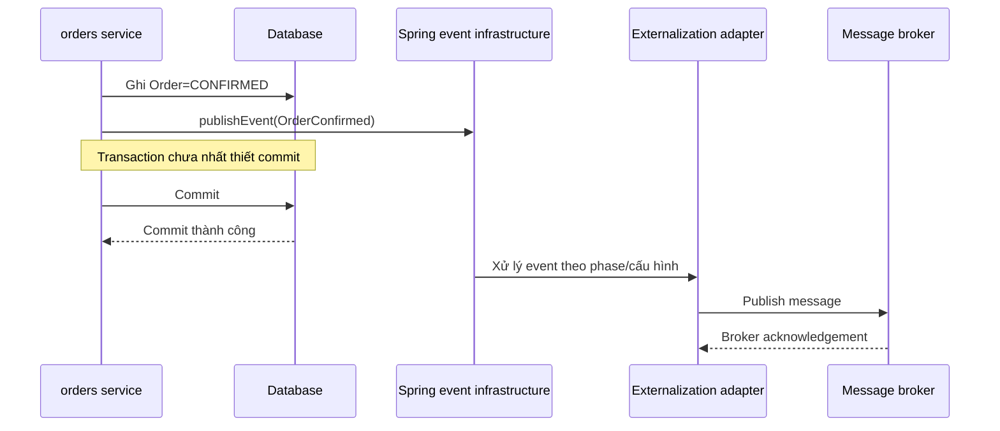

# Kiểm tra event được externalize sau commit

Một trong những lỗi nghiêm trọng nhất của hệ thống tích hợp bằng sự kiện là **consumer bên ngoài nhận thông báo một giao dịch đã thành công, trong khi transaction cơ sở dữ liệu của producer thực tế đã rollback**. Ví dụ, hệ thống bán hàng gửi `OrderConfirmed` lên Kafka, dịch vụ vận chuyển bắt đầu tạo vận đơn, nhưng đơn hàng trong database không hề được xác nhận. Đây không chỉ là lỗi test mà còn là **vi phạm hợp đồng nghiệp vụ giữa các hệ thống**.

Trong Spring Modulith, event externalization giúp công bố một số Spring application event ra Kafka, AMQP/RabbitMQ, JMS hoặc transport được cấu hình. Tuy nhiên, **thời điểm phát event trong Java, thời điểm transaction commit, thời điểm adapter gửi broker và thời điểm consumer xử lý không phải cùng một mốc**. Việc kiểm tra “đã externalize sau commit” đòi hỏi thiết kế test quan sát được những mốc đó, đặc biệt là cả nhánh **commit thành công** và **rollback**.

Bài thuộc chương **Externalization** của học phần `SPRING_MODULITH_VERIFICATION_TESTING`. Học phần rèn kiểm chứng ranh giới kiến trúc bằng `ApplicationModules` và quy tắc phụ thuộc, `@ApplicationModuleTest`, kiểm thử sự kiện/cơ sở dữ liệu/tích hợp và quality gate CI để ngăn phụ thuộc sai và hồi quy. Trọng tâm bài này là **phương pháp chứng minh external event chỉ phản ánh trạng thái đã commit theo hợp đồng cấu hình**, chứ không chỉ kiểm tra có gọi `publishEvent(...)` hay không.

## 1. Mục tiêu kiểm chứng: điều gì phải đúng?

Giả sử module `orders` phát `OrderConfirmed` sau khi ghi đơn hàng:

```text
orders DB transaction
  ├── ghi Order.status = CONFIRMED
  ├── publish OrderConfirmed trong JVM
  └── COMMIT hoặc ROLLBACK

externalization adapter
  └── gửi OrderConfirmed đến orders.confirmed.v1 trên broker
```

Hai bất biến quan trọng:

1. **Nhánh commit:** khi `CONFIRMED` đã được commit và externalization vận hành bình thường, message tương ứng phải được gửi đúng destination, payload và identity.
2. **Nhánh rollback:** nếu transaction tạo ra sự thật `CONFIRMED` bị rollback, không được công bố ra broker một message xác nhận sai sự thật theo hợp đồng đã chọn.

Ngoài ra còn các yêu cầu về **failure recovery**: nếu DB commit nhưng broker tạm lỗi, event phải được ghi nhận/khôi phục theo mức bảo đảm mà ứng dụng cam kết. Không có broker message ngay lập tức trong trường hợp này **không nhất thiết** là lỗi nếu cơ chế publication/retry chủ động được thiết kế và kiểm chứng.

**Đừng thay bất biến thứ hai bằng câu “method không ném exception”.** Một method hoàn tất trước khi transaction commit; một listener đồng bộ có thể đã chạy rồi, dù transaction bị đánh dấu rollback ở bước sau.

## 2. Phân biệt bốn thời điểm quan trọng



Sơ đồ thể hiện **đường đi mong muốn**. Nó không tuyên bố mọi cấu hình externalization đều chạy đúng thứ tự đó. Cụ thể:

| Mốc | Ý nghĩa | Cách kiểm chứng |
| --- | --- | --- |
| `publishEvent(...)` được gọi | Event đi vào Spring event infrastructure | Unit test / `PublishedEvents` |
| Database commit | Trạng thái nghiệp vụ bền vững, tùy transaction manager | Database integration test, transaction kết thúc thật |
| Adapter gửi và broker xác nhận | Message đến được transport theo semantics producer | Broker integration test, consumer test đọc message |
| Consumer áp dụng side effect | Hệ thống nhận hoàn thành việc của mình | Consumer integration/contract test |

Event có thể đã được **phát bên trong JVM** khi transaction còn mở. Do đó, câu “event được phát trước commit” không nhất thiết đồng nghĩa “event đã gửi ra broker trước commit”. Phải kiểm tra **listener phase và externalization configuration**.

Đồng thời, **broker acknowledgement** không đồng nghĩa consumer đã ghi dữ liệu thành công. Nếu cần chứng minh end-to-end processing, phải có test và/hoặc business acknowledgement phía consumer.

## 3. Vì sao `@EventListener` thông thường không đủ bảo đảm after-commit?

Một listener Spring tiêu chuẩn:

```java
@org.springframework.context.event.EventListener
void on(OrderConfirmed event) {
    // Một side effect có thể xảy ra khi transaction producer còn mở.
}
```

Với cấu hình mặc định thông thường, `@EventListener` có thể được gọi **đồng bộ** tại thời điểm `publishEvent(...)`. Nếu listener này gửi message trực tiếp lên broker, message có thể ra ngoài **trước khi transaction ghi đơn hàng commit**.

```text
BEGIN TRANSACTION
  INSERT/UPDATE order
  publishEvent(OrderConfirmed)
    -> @EventListener chạy ngay
    -> gọi broker producer
    -> broker nhận message
  ném exception
ROLLBACK
```

Hậu quả: consumer thấy `OrderConfirmed` dù database đã rollback. Một unit test chỉ kiểm tra số lần gọi `@EventListener` vẫn có thể PASS.

**Giải pháp không phải đơn giản thêm `@Async`.** Bất đồng bộ thay đổi luồng chạy, không tự gắn việc gửi với kết quả commit, và có thể tạo race condition nghiêm trọng hơn.

## 4. `@TransactionalEventListener` và các transaction phase

Spring Framework hỗ trợ lắng nghe event gắn với transaction:

```java
import org.springframework.transaction.event.TransactionPhase;
import org.springframework.transaction.event.TransactionalEventListener;

@TransactionalEventListener(phase = TransactionPhase.AFTER_COMMIT)
void afterCommit(OrderConfirmed event) {
    // Chỉ thực hiện theo nhánh commit của transaction liên quan.
}
```

Những phase cần hiểu:

| Phase | Thời điểm theo transaction | Có thích hợp làm “đã commit” chưa? |
| --- | --- | --- |
| `BEFORE_COMMIT` | Trước khi transaction hoàn tất commit | **Chưa**; vẫn có khả năng rollback |
| `AFTER_COMMIT` | Sau khi transaction commit thành công | Thích hợp cho side effect cần trạng thái đã commit |
| `AFTER_ROLLBACK` | Sau khi transaction rollback | Dùng để xử lý/quan sát nhánh thất bại |
| `AFTER_COMPLETION` | Sau khi transaction kết thúc theo bất kỳ kết quả nào | **Không** đồng nghĩa commit thành công |

`@TransactionalEventListener` mặc định gắn với phase `AFTER_COMMIT` nếu không chỉ định khác; việc ghi tường minh phase trong bài giúp rõ ý định.

**Điều kiện bắt buộc:** event phải được publish trong **transaction phù hợp** để listener transaction-bound được kích hoạt theo quy tắc mặc định. Khi không có transaction, listener thông thường sẽ bị bỏ qua trừ khi dùng tùy chọn fallback thích hợp. Bật `fallbackExecution = true` có thể làm listener chạy khi **không có commit nào để chờ**, nên không được dùng để tuyên bố đã bảo đảm after-commit.

### Một lưu ý về tài nguyên giao dịch sau commit

Theo semantics của Spring transaction synchronization, ở phase `AFTER_COMMIT` một số tài nguyên transaction có thể vẫn đang gắn với thread dù transaction đã commit. Nếu listener cần **ghi dữ liệu mới** sau commit, cần thiết kế một transaction riêng khi phù hợp, chẳng hạn `REQUIRES_NEW`, thay vì mặc định mọi thao tác database sẽ được commit cùng giao dịch cũ.

Đặc biệt, listener `AFTER_COMMIT` không cho phép “quay lại” giao dịch business đã hoàn tất để rollback đơn hàng nếu gửi broker thất bại. Đây là lý do cần cơ chế lưu ý định publication và phục hồi.

## 5. Spring Modulith có gì liên quan tới externalization sau commit?

Spring Modulith cung cấp:

- **Application events** để module phát thông báo nghiệp vụ mà không import consumer cụ thể.
- **Event externalization** để chọn các event phù hợp và gửi qua adapter Kafka/AMQP/JMS hoặc transport khác.
- **Event Publication Registry** để theo dõi publication tới các target, khi được cấu hình cùng thành phần lưu trữ phù hợp.
- **Testing support** như `@ApplicationModuleTest`, `PublishedEvents` để kiểm thử sự kiện trong phạm vi module.

Các thành phần này **bổ trợ nhau** nhưng không phải một bảo đảm duy nhất được tự bật chỉ vì thêm một annotation. Nhất là với yêu cầu **after-commit + durable recovery**, cần xác nhận đúng:

1. Phiên bản Spring Modulith và adapter externalization đang dùng.
2. Cách externalization tham gia vòng đời transaction.
3. Registry có persistent store hay chỉ là cơ chế in-memory.
4. Thời điểm publication được coi là complete.
5. Recovery/resubmission đã được cấu hình và kiểm thử chưa.

**Không nên coi `@Externalized` là đồng nghĩa với `@TransactionalEventListener(AFTER_COMMIT)` trong mọi ngữ cảnh hoặc phiên bản**. Hãy kiểm chứng hành vi của chính cấu hình ứng dụng và transport mà bạn triển khai.

## 6. Thiết kế mẫu: `orders` công bố `OrderConfirmed`

Một cấu trúc module minh họa:

```text
com.example.shop
├── ShopApplication.java
├── orders
│   ├── OrderConfirmed.java
│   └── internal
│       ├── OrderPlacementService.java
│       ├── OrderEntity.java
│       └── OrderJpaRepository.java
└── inventory
    ├── StockLookup.java
    └── internal
        └── InventoryRepository.java
```

Module `orders` sở hữu việc tạo và xác nhận đơn hàng; entity, repository ở `orders.internal` chỉ phục vụ module này. Việc gửi external event không đòi `OrderPlacementService` phải inject một Kafka producer trực tiếp.

```java
// com/example/shop/orders/OrderConfirmed.java
package com.example.shop.orders;

import java.time.Instant;
import java.util.UUID;
import org.springframework.modulith.events.Externalized;

@Externalized("orders.confirmed.v1")
public record OrderConfirmed(
        UUID eventId,
        UUID orderId,
        String customerReference,
        Instant occurredAt
) {}
```

`@Externalized` đánh dấu loại event dành cho externalization khi adapter và policy phù hợp được bật. `"orders.confirmed.v1"` mô tả route/destination của ví dụ; để trở thành Kafka topic hay AMQP route cụ thể còn phụ thuộc adapter/configuration.

### Một event ID riêng với order ID

`orderId` xác định đơn hàng, còn `eventId` xác định **một sự kiện cụ thể**. Cùng một đơn có thể có `OrderConfirmed`, `OrderCancelled` và các thay đổi khác; không dùng `orderId` làm định danh duy nhất của mọi sự kiện.

Nếu broker đã nhận event nhưng producer crash trước khi đánh dấu publication complete, resubmission có thể gửi lại **cùng eventId**. Đây là điều kiện cần cho consumer dedupe hiệu quả.

## 7. Repository và entity minh họa

```java
// com/example/shop/orders/internal/OrderEntity.java
package com.example.shop.orders.internal;

import jakarta.persistence.Column;
import jakarta.persistence.Entity;
import jakarta.persistence.Id;
import jakarta.persistence.Table;
import java.util.UUID;

@Entity
@Table(name = "customer_orders")
class OrderEntity {

    @Id
    private UUID id;

    @Column(nullable = false)
    private String status;

    protected OrderEntity() {}

    OrderEntity(UUID id, String status) {
        this.id = id;
        this.status = status;
    }
}
```

```java
// com/example/shop/orders/internal/OrderJpaRepository.java
package com.example.shop.orders.internal;

import java.util.UUID;
import org.springframework.data.jpa.repository.JpaRepository;

interface OrderJpaRepository extends JpaRepository<OrderEntity, UUID> {}
```

Đây là lớp persistence tối thiểu để diễn giải biên commit. Ứng dụng thật cần constraint, validation, transaction isolation, business state machine, idempotency và migration phù hợp. Bảng `customer_orders` **không phải bảng Event Publication Registry**; hai dữ liệu phục vụ mục đích khác nhau.

## 8. Service lưu đơn và publish event trong transaction

```java
// com/example/shop/orders/internal/OrderPlacementService.java
package com.example.shop.orders.internal;

import com.example.shop.orders.OrderConfirmed;
import java.time.Instant;
import java.util.UUID;
import org.springframework.context.ApplicationEventPublisher;
import org.springframework.stereotype.Service;
import org.springframework.transaction.annotation.Transactional;

@Service
public class OrderPlacementService {

    private final OrderJpaRepository orders;
    private final ApplicationEventPublisher events;

    public OrderPlacementService(
            OrderJpaRepository orders,
            ApplicationEventPublisher events) {
        this.orders = orders;
        this.events = events;
    }

    @Transactional
    public UUID place(String customerReference) {
        UUID orderId = UUID.randomUUID();
        orders.save(new OrderEntity(orderId, "CONFIRMED"));

        events.publishEvent(new OrderConfirmed(
                UUID.randomUUID(),
                orderId,
                customerReference,
                Instant.now()
        ));
        return orderId;
    }
}
```

Với Spring transaction proxy hoạt động đúng, `place(...)` chạy trong một transaction của database. **Khi gọi `publishEvent(...)`, transaction chưa nhất thiết commit**. Lệnh `return orderId` cũng không phải mốc chứng minh đã gửi broker: transaction thường hoàn tất khi lời gọi đi qua interceptor/proxy kết thúc.

Trong production, nên chỉ phát `OrderConfirmed` khi trạng thái đơn thật sự chuyển từ một trạng thái hợp lệ sang `CONFIRMED`, không mỗi lần một HTTP retry gọi `place(...)`. Đây là **idempotency nghiệp vụ** khác với deduplication của consumer.

### Một lỗi cấu hình thường gặp: gọi nội bộ bỏ qua proxy

Nếu một method trong cùng Spring bean gọi `this.place(...)`, lời gọi tự thân có thể bỏ qua transaction proxy, dẫn tới `@Transactional` không được áp dụng như kỳ vọng. Kiểm tra **transaction thực tế** bằng integration test và tránh dựa vào annotation như bằng chứng tuyệt đối.

## 9. Kiểm thử đầu tiên: event đã được publish trong JVM

Spring Modulith Test có thể thu thập event đã phát bằng `PublishedEvents`:

```java
// src/test/java/com/example/shop/orders/internal/OrdersEventsTests.java
package com.example.shop.orders.internal;

import static org.assertj.core.api.Assertions.assertThat;

import com.example.shop.orders.OrderConfirmed;
import org.junit.jupiter.api.Test;
import org.springframework.beans.factory.annotation.Autowired;
import org.springframework.modulith.test.ApplicationModuleTest;
import org.springframework.modulith.test.PublishedEvents;

@ApplicationModuleTest
class OrdersEventsTests {

    @Autowired
    OrderPlacementService service;

    @Test
    void publishesOrderConfirmed(PublishedEvents events) {
        service.place("C-001");

        assertThat(events.ofType(OrderConfirmed.class)).hasSize(1);
    }
}
```

Test trên đòi Spring Data JPA, database test và cấu hình module phù hợp. Nó hữu ích để xác nhận producer **tạo ra loại sự kiện đúng**, nhưng **không đủ** để chứng minh:

- Transaction database đã commit thành công.
- Externalization adapter xử lý sau commit.
- Message xuất hiện trên broker.
- Một transaction rollback không tạo message.
- Publication registry có thể khôi phục sau crash.

**Kết luận chính xác:** `PublishedEvents` là lớp kiểm chứng **sự kiện được phát trong ứng dụng**, không phải bằng chứng “event đã externalize sau commit”.

## 10. Tạo after-commit probe để test chính xác biên transaction

Trước khi kéo broker vào test, có thể thêm một **listener kiểm thử** được gọi sau commit. Nó giúp xác minh việc Spring transaction synchronization hoạt động đúng cho luồng business event.

```java
// Test helper, không phải production externalization adapter.
import com.example.shop.orders.OrderConfirmed;
import java.util.Set;
import java.util.UUID;
import java.util.concurrent.ConcurrentHashMap;
import org.springframework.transaction.event.TransactionPhase;
import org.springframework.transaction.event.TransactionalEventListener;

public class AfterCommitProbe {

    private final Set<UUID> observed =
            ConcurrentHashMap.newKeySet();

    @TransactionalEventListener(phase = TransactionPhase.AFTER_COMMIT)
    public void on(OrderConfirmed event) {
        observed.add(event.orderId());
    }

    public boolean hasObserved(UUID orderId) {
        return observed.contains(orderId);
    }
}
```

Đây là một **probe phục vụ test**, không phải một adapter Kafka giả. Nó chứng minh listener đã nhận event theo phase `AFTER_COMMIT`, nhưng **không chứng minh Spring Modulith externalization adapter sử dụng chính phase đó trong cấu hình hiện tại**. Bước đó cần broker integration test riêng.

Nếu listener thực tế bất đồng bộ, cần quan sát bằng điều kiện/timeout thay vì giả định probe đã cập nhật ngay trên cùng thread sau `TestTransaction.end()`.

## 11. Test commit thật bằng `TestTransaction`

Spring Test cung cấp `TestTransaction` để điều khiển transaction do test framework quản lý. Đây là cách tránh nhầm “method đã return” với “transaction đã commit”.

Ví dụ một bài test **đặt trong package `com.example.shop.orders.internal`**:

```java
package com.example.shop.orders.internal;

import static org.assertj.core.api.Assertions.assertThat;

import java.util.UUID;
import org.junit.jupiter.api.Test;
import org.springframework.beans.factory.annotation.Autowired;
import org.springframework.boot.test.context.SpringBootTest;
import org.springframework.boot.test.context.TestConfiguration;
import org.springframework.context.annotation.Bean;
import org.springframework.test.context.transaction.TestTransaction;
import org.springframework.transaction.annotation.Transactional;

@SpringBootTest
@Transactional
class OrderCommitBoundaryTests {

    @Autowired OrderPlacementService service;
    @Autowired AfterCommitProbe probe;

    @TestConfiguration
    static class ProbeConfig {
        @Bean AfterCommitProbe probe() {
            return new AfterCommitProbe();
        }
    }

    @Test
    void seesEventOnlyAfterRealCommit() {
        UUID orderId = service.place("C-001");

        assertThat(probe.hasObserved(orderId)).isFalse();

        TestTransaction.flagForCommit();
        TestTransaction.end(); // Kết thúc transaction test bằng COMMIT.

        assertThat(probe.hasObserved(orderId)).isTrue();
    }
}
```

Giả sử class `AfterCommitProbe` ở phần 10 được đặt trong test source và được khai báo import/đặt package phù hợp. Test cần có transaction manager thực, repository/JPA mapping hợp lệ và context có bean `ProbeConfig`. Để test production tương đương, hãy tạo dữ liệu không trùng và cô lập database.

**Ý nghĩa của ba bước assertion:**

1. Sau `service.place(...)` nhưng **trước `TestTransaction.end()`**, transaction test vẫn đang mở; listener `AFTER_COMMIT` chưa nên chạy.
2. `flagForCommit()` yêu cầu transaction test kết thúc bằng commit thay vì rollback mặc định.
3. `end()` thực sự kết thúc transaction do test framework quản lý; sau đó mới kiểm tra probe đã được gọi.

Điều này chứng minh **transaction-bound listener** chứ chưa phải broker externalization. Một test hoàn chỉnh còn phải đọc message ở transport.

### Cách trình bày code tránh nhầm lẫn

Phần 10 giới thiệu `AfterCommitProbe` như một test helper; phần 11 đăng ký nó bằng `@TestConfiguration`. Khi đặt vào project thật, dùng một class `AfterCommitProbe` duy nhất. Nếu cấu hình project quét test helper như component và đồng thời tạo `@Bean`, có thể vô tình đăng ký hai listener, làm test không còn phản ánh đúng kỳ vọng.

## 12. Test rollback: bằng chứng âm quan trọng hơn happy path

Tương tự, yêu cầu một transaction test rollback thật:

```java
@Test
void doesNotInvokeAfterCommitProbeOnRollback() {
    UUID orderId = service.place("C-ROLLBACK");

    assertThat(probe.hasObserved(orderId)).isFalse();

    TestTransaction.flagForRollback();
    TestTransaction.end();

    assertThat(probe.hasObserved(orderId)).isFalse();
}
```

Đây là method bổ sung trong `OrderCommitBoundaryTests` của phần 11. Nó xác nhận **probe after-commit không chạy ở nhánh rollback**; trong test externalization thực tế, cũng phải assert **không có message xác nhận đơn trên broker** và **không có publication thành công cho business fact đã rollback** theo mô hình lưu trữ được cấu hình.

**Test âm (negative test) không được suy diễn quá mức:** chỉ kiểm tra probe không thấy event chưa chứng minh broker không nhận, vì adapter có thể là một listener khác gửi trước commit. Muốn loại trừ lỗi đó phải bật adapter thật trong integration test và quan sát transport.

## 13. Cạm bẫy: `@Transactional` trên test thường rollback

Một bài test Spring được đánh dấu `@Transactional` thường chạy trong **test-managed transaction** và rollback khi kết thúc theo cấu hình mặc định.

```java
@SpringBootTest
@Transactional
class MisleadingExternalizationTest {

    @Test
    void expectsMessageButNeverCommits() {
        // gọi service phát event
        // rồi chờ @TransactionalEventListener(AFTER_COMMIT)
        // mà không commit transaction test
    }
}
```

Khi đó, test có thể **không kích hoạt listener sau commit dù ứng dụng production vẫn đúng**, hoặc ngược lại test `PublishedEvents` PASS nhưng chưa hề có commit. Các cách thiết kế phù hợp gồm:

- **Không đặt `@Transactional` trên toàn bộ integration test**, để lời gọi service `@Transactional` tự commit khi method trả về.
- **Dùng `TestTransaction.flagForCommit()/end()`** khi muốn điều khiển transaction test và quan sát before/after commit.
- Dùng `@Commit` hoặc `@Rollback(false)` khi đúng với mục tiêu test, nhưng cần hiểu **commit xảy ra ở cuối method/test**, nên assertion ngay trong test có thể vẫn được chạy trước commit.

### Chọn cách nào?

Nếu muốn assert “**trước commit chưa được gửi, sau commit mới được gửi**”, `TestTransaction` giúp tạo hai thời điểm quan sát ngay trong một ca. Nếu chỉ muốn kiểm thử cuối cùng rằng **service đã commit và broker nhận message**, một test **không được bọc bởi transaction test** thường trực tiếp hơn, với service tự quản lý transaction của nó.

## 14. Test có transaction ngoài khác với lời gọi service bình thường

Giả sử test có `@Transactional` và gọi `service.place(...)`. Với propagation mặc định `REQUIRED`, service thường **tham gia transaction đã mở bởi test**. Khi service trả về, transaction ngoài **vẫn chưa kết thúc**.

```text
Test @Transactional BEGIN
    service.place()   -- tham gia transaction test
    method returns    -- chưa commit
    PublishedEvents có thể đã thấy OrderConfirmed
    @TransactionalEventListener(AFTER_COMMIT) chưa chạy
Test framework ROLLBACK/COMMIT
```

Đây là lý do không được mô tả `service.place()` là “đã commit” khi nó được gọi **bên trong một transaction lớn hơn**. Trong hệ thống thật, cũng có thể có một orchestration service mở transaction rồi gọi `orders`; cần xác định **transaction boundary cuối cùng** chứ không chỉ nhìn annotation ở method con.

Đối với `REQUIRES_NEW`, transaction có thể được commit độc lập với transaction bao ngoài, làm thay đổi kết quả kỳ vọng. Test phải xác định propagation thật và liệu “event thành công” có đúng với business transaction đã cam kết hay không.

## 15. Testbroker: xác minh externalization thật sự sau commit

Một kiểm thử broker dùng Kafka/RabbitMQ Testcontainers hoặc môi trường tương đương cần **adapter Spring Modulith thực** và serializer/route tương ứng; không chỉ một mock `ApplicationEventPublisher`.

Thiết kế test:

```text
Given:
  database test sẵn sàng
  externalization adapter hoạt động
  broker test có destination orders.confirmed.v1
  consumer test đọc từ offset/queue được cô lập

When:
  1. Mở transaction tạo đơn nhưng chưa commit.
Then:
  2. Chưa có OrderConfirmed được externalize ra broker
     (theo contract after-commit cần kiểm).

When:
  3. COMMIT transaction.
Then:
  4. Broker nhận message OrderConfirmed trong timeout hữu hạn.
  5. Message có eventId/orderId phù hợp.
  6. Database có Order.status=CONFIRMED đã commit.

When:
  7. Tạo đơn khác và ROLLBACK transaction.
Then:
  8. Broker không có OrderConfirmed cho đơn rollback.
  9. Database không tồn tại trạng thái CONFIRMED của đơn đó.
```

Nếu kiểm thử cả **trước commit**, test nên điều khiển transaction bằng `TestTransaction` hoặc một transaction boundary được mở/commit thủ công. Nếu kiểm thử chỉ **sau commit**, hãy tránh test-managed rollback mặc định.

**Quan trọng:** test broker chỉ có giá trị nếu **adapter externalization được bật thực tế**. Một test dùng fake producer không chứng minh adapter Spring Modulith gửi sau commit, tương tự test probe ở phần 10 không tự chứng minh routing Kafka.

## 16. Kiểm thử không có message: làm sao tránh flaky?

Kiểm thử “**không có message trước commit**” là bài toán khó hơn “đọc được một message sau commit”. Với hệ thống bất đồng bộ, **không đọc được trong 10 ms** chưa phải bằng chứng vững rằng event không bao giờ được gửi.

Thiết kế đáng tin cậy hơn:

1. Dùng **broker test và consumer group/queue cô lập** cho từng test để không nhận nhầm message từ ca khác.
2. Gắn **`orderId`/`eventId` đặc thù cho test**, lọc chính xác chúng thay vì chỉ kiểm topic rỗng.
3. Kết hợp **kiểm thử phase** bằng `TestTransaction` với kiểm thử transport để hạn chế khoảng mù.
4. Dùng **bounded wait** đủ cho đường gửi bất đồng bộ và điều kiện quan sát rõ; không coi một lần poll tức thì là kết luận cuối cùng.
5. Với rollback, kết hợp assert database thật và trạng thái publication registry phù hợp nếu storage đã bật.
6. Không chạy song song các test dùng chung topic/consumer group nếu không cô lập offset và message.

Trong môi trường CI, test có thể dựa trên timeout, poll có điều kiện hoặc cơ chế assertion của test consumer. Không đặt `Thread.sleep(...)` dài và coi nó là “proof” đầy đủ.

**Giới hạn nhận thức:** một negative test trong khoảng thời gian hữu hạn không thể chứng minh tuyệt đối không có message được gửi ở mọi thời điểm tương lai. Ta cần thêm **đảm bảo cấu hình phase** và **regression tests** để có độ tin cậy thực tế.

## 17. Database assertion phải chạy ngoài transaction đã kết thúc

Trong test sau commit, nên đọc lại database **qua transaction/EntityManager mới** sau khi transaction gốc đã kết thúc hoặc qua một connection độc lập phù hợp. Nếu assert trạng thái từ persistence context cũ, JPA cache có thể cho thấy object đã thay đổi dù chưa commit.

Một kiểm tra có ý nghĩa:

```text
Đầu vào: orderId = O

Before commit:
  Transaction A thấy thay đổi do mình ghi (chưa chứng minh committed)

After commit:
  Transaction B / separate connection đọc lại Order(O).status
  -> CONFIRMED

After rollback:
  Transaction B / separate connection đọc Order(O)
  -> Không có thay đổi CONFIRMED mới
```

Điều này đặc biệt quan trọng khi muốn chứng minh broker event tương ứng với **trạng thái đã commit**, chứ không đơn thuần tương ứng với một object Java in-memory.

### Không nhầm flush với commit

`entityManager.flush()` có thể gửi SQL xuống database và phát hiện constraint violation sớm, nhưng **không kết thúc transaction**. Một test `flush()` rồi thấy JPA entity có trạng thái `CONFIRMED` vẫn chưa chứng minh có commit và chưa đủ điều kiện cho “externalized after commit”.

## 18. Transaction rollback do exception và do rollback-only

Hai tình huống cần test:

**A. Service ném exception trước khi transaction commit**

```text
BEGIN
  persist Order
  publish OrderConfirmed
  throw RuntimeException
ROLLBACK
```

**B. Transaction bị đánh dấu rollback-only ở lớp gọi**

```text
BEGIN orchestration transaction
  orders.place()
  otherStep() -> đánh dấu rollback-only
  method kết thúc
ROLLBACK/UnexpectedRollbackException
```

Ở B, method `orders.place()` có thể return thành công trong transaction ngoài, nhưng **transaction cuối cùng vẫn thất bại**. Đây là một regression case đặc biệt quan trọng vì dễ bị bỏ qua nếu test chỉ gọi service độc lập không có orchestration.

Sự kiện externalized theo contract “đã xác nhận đơn” phải phụ thuộc **kết quả commit của transaction sở hữu sự thật nghiệp vụ**, không phụ thuộc vào việc method con trả về bình thường.

## 19. Test listener `AFTER_COMMIT` và `AFTER_ROLLBACK` cùng lúc

Để xác định Spring transaction synchronization đang hoạt động, có thể tạo hai listener probe trong test:

```java
import org.springframework.transaction.event.TransactionPhase;
import org.springframework.transaction.event.TransactionalEventListener;

class TransactionPhaseProbe {
    private final java.util.Set<java.util.UUID> committed =
            java.util.concurrent.ConcurrentHashMap.newKeySet();
    private final java.util.Set<java.util.UUID> rolledBack =
            java.util.concurrent.ConcurrentHashMap.newKeySet();

    @TransactionalEventListener(phase = TransactionPhase.AFTER_COMMIT)
    public void afterCommit(OrderConfirmed event) {
        committed.add(event.orderId());
    }

    @TransactionalEventListener(phase = TransactionPhase.AFTER_ROLLBACK)
    public void afterRollback(OrderConfirmed event) {
        rolledBack.add(event.orderId());
    }

    boolean committed(java.util.UUID id) {
        return committed.contains(id);
    }

    boolean rolledBack(java.util.UUID id) {
        return rolledBack.contains(id);
    }
}
```

Kỳ vọng:

| Kịch bản | `afterCommit` | `afterRollback` |
| --- | --- | --- |
| Transaction commit thành công | Có | Không |
| Transaction rollback | Không | Có |
| Event phát ngoài transaction, `fallbackExecution` mặc định | Thường không chạy | Thường không chạy |

Đây vẫn chỉ là **test phase của Spring listener**, không phải chính externalization adapter. Hãy sử dụng nó để chứng minh hiểu đúng transaction boundary trước khi kiểm tra broker.

## 20. Event Publication Registry bảo vệ điểm nào?

Kịch bản khó:

```text
T0  Database commit Order CONFIRMED
T1  Broker không khả dụng
T2  Externalization adapter gửi thất bại
T3  Ứng dụng restart
T4  Broker khôi phục
T5  Publication được gửi lại nếu recovery được bật đúng
```

Nếu không có cơ chế lưu **ý định publication** đủ bền vững, sự cố giữa T0 và T5 có thể khiến event không còn được gửi lại. Spring Modulith cung cấp **Event Publication Registry** để theo dõi việc publication đến target, với persistence adapter và cấu hình recovery phù hợp.

**Không mặc định `@Externalized` tự kích hoạt persistent registry**. Việc một event type được chọn externalize, một publication được ghi nhận trong memory và một publication được ghi bền vững qua database là ba khẳng định khác nhau.

Một thiết kế cần xác định:

1. Registry persistence có bật trong ứng dụng không?
2. Publication intent có được lưu theo transaction phù hợp với đơn hàng không?
3. Có API/hook/job resubmission cho publication incomplete không?
4. Completion được adapter ghi sau điều kiện xác nhận nào?
5. Có monitoring số publication incomplete và tuổi lâu nhất không?

**Kết luận:** test “after commit” nên được kết hợp với test “DB commit nhưng broker lỗi” nếu hệ thống cam kết không làm mất sự kiện trong khoảng gián đoạn.

## 21. Phân biệt trạng thái publication với trạng thái nghiệp vụ

Một event đã ghi nhận trong registry và một order đã commit có thể có:

```text
Order state:
  orderId = O-123
  status  = CONFIRMED

Publication state for OrderConfirmed(eventId = E-999):
  destination = orders.confirmed.v1
  lifecycle  = INCOMPLETE (khái niệm)
```

Không có mâu thuẫn: đơn đã được xác nhận, **chỉ công việc externalization chưa hoàn tất**.

Và:

```text
Publication for E-999: COMPLETED
Analytics consumer: has not processed E-999 yet
```

Điều này cũng có thể xảy ra. Completion của registry producer không phải business acknowledgement của analytics consumer.

Tên `INCOMPLETE`/`COMPLETED` ở đây là **nhãn khái niệm**. Schema, enum và API lưu publication trong từng adapter/version không nhất thiết sử dụng chính những tên này. Đừng viết SQL dựa trên một cột `status` tự đoán mà không đối chiếu persistence implementation thực tế.

## 22. Kiểm thử persistence và commit của registry

Một test registry có giá trị cần dùng **storage thật được cấu hình** (JDBC/JPA hoặc lựa chọn khác theo phiên bản), không chỉ fake trong memory. Bộ test nên bao gồm:

| Test | Điều cần chứng minh |
| --- | --- |
| Transaction tạo đơn commit | Publication được ghi nhận theo cơ chế đã cấu hình |
| Transaction tạo đơn rollback | Không giữ publication hợp lệ để gửi một business fact đã rollback |
| Broker outage sau commit | Publication còn incomplete và có thể quan sát theo persistence |
| Restart app sau outage | Publication cần khôi phục còn tồn tại |
| Khôi phục broker và resubmit | Message đúng được gửi và publication hoàn tất theo adapter |
| Broker ack nhưng mark complete thất bại | Recovery có thể gây duplicate, consumer xử lý an toàn |
| Hai target nhận cùng event | Kết quả hoàn tất theo từng target, không gộp sai |

Test này nên sử dụng **một database test có schema/migration registry thật**. Đừng dựa vào test chỉ chạy H2 khi production dùng một DB với transaction isolation/DDL khác mà chưa có ca phù hợp.

Một điều quan trọng: nếu registry lưu publication trong **transaction khác** hoặc store khác với transaction đơn hàng, khả năng atomicity không giống nhau. Test commit/rollback phải phát hiện được sự khác biệt đó.

## 23. Broker outage không đồng nghĩa transaction business rollback

Nếu externalization xảy ra sau commit, broker không khả dụng tại thời điểm gửi **không thể tự làm transaction order đã commit quay ngược**. Do đó, yêu cầu nghiệp vụ cần xác định chính sách:

- Đơn hàng **vẫn CONFIRMED**; publication được giữ để retry.
- Một cảnh báo/metric cho phép operator thấy backlog.
- Không tự động tạo thêm một `OrderConfirmed` mới với eventId mới chỉ để khắc phục broker outage.
- Consumer phải chịu được việc nhận lại cùng message.

Nếu nghiệp vụ thật sự yêu cầu “không xác nhận đơn nếu không thể gửi broker ngay”, đây là một **yêu cầu đồng bộ khác**. Cần thiết kế giao thức, timeout và giới hạn tính nhất quán phù hợp, không dùng after-commit event như một lời hứa rằng broker và database commit nguyên tử.

## 24. Retry và at-least-once: hai lần gửi có thể cùng hợp lệ

Một kịch bản không thể bỏ qua:

```text
1. DB commit OrderConfirmed(eventId = E).
2. Adapter gửi E đến broker.
3. Broker nhận và ack E.
4. Ứng dụng crash trước khi registry ghi publication complete.
5. Restart, registry vẫn thấy publication incomplete.
6. Recovery gửi lại E.
```

Broker có thể có **hai delivery của cùng event E**. Một publisher registry được thiết kế tốt cho khả năng phục hồi vẫn có thể gặp duplicate vì điểm lỗi giữa ack và cập nhật completion.

**Đừng khẳng định exactly-once end-to-end** chỉ vì đã kiểm thử event sau commit. After-commit đảm bảo một **điều kiện thời điểm**, không tự đảm bảo chỉ có một message hoặc consumer side effect đúng một lần.

Các biện pháp:

- Event ID ổn định qua retry/replay.
- Consumer idempotency với unique constraint/transaction.
- Recovery có backoff/batching/monitoring.
- Contract rõ về việc producer có thể gửi lại.

## 25. Consumer idempotent: kiểm thử phía nhận

Một consumer đơn giản có thể lưu ID đã xử lý:

```sql
-- Bảng minh họa của CONSUMER, không phải registry Spring Modulith.
CREATE TABLE processed_events (
    event_id VARCHAR(36) PRIMARY KEY,
    processed_at TIMESTAMP NOT NULL
);
```

Pseudocode:

```text
BEGIN TRANSACTION
  INSERT processed_events(eventId)
  IF duplicate-key:
      skip business effect
  ELSE:
      apply projection update
COMMIT
ACK broker message
```

**Cần đảm bảo insertion marker và business side effect cùng transaction**, hoặc có một cơ chế idempotency tương đương. Đánh dấu `eventId` là processed rồi fail trước khi cập nhật báo cáo khiến retry bị bỏ qua sai. Cập nhật báo cáo rồi fail trước khi ghi marker khiến retry nhân đôi side effect.

Trong integration test, cố ý gửi cùng một event hai lần và assert báo cáo/side effect **chỉ có một lần**. Bài test này **khác** bài kiểm tra after-commit phía producer; cả hai đều cần thiết để tin cậy end-to-end.

## 26. Ordering: commit đúng vẫn có thể nhận sai thứ tự

Ví dụ:

```text
E1: OrderConfirmed(orderId=O) -- publication bị kẹt, gửi muộn
E2: OrderCancelled(orderId=O) -- publication gửi sớm
```

Consumer có thể nhận `E2` trước `E1`, rồi `E1` xuất hiện sau retry. After-commit không đảm bảo ordering tổng thể. Các lựa chọn:

1. Dùng `orderId` làm Kafka key khi các event thuộc cùng aggregate được phát qua cùng topic/partitioning strategy phù hợp.
2. Có aggregate version/sequence trong payload nếu consumer cần phát hiện event cũ.
3. Dùng state machine ở consumer, xử lý an toàn event cũ hoặc đến sai thứ tự.
4. Có reconciliation khi các sự kiện trễ.

Không coi một topic name trong `@Externalized` là bằng chứng Kafka key đã được cấu hình. Không suy từ “sau commit” thành “theo đúng thứ tự commit trên mọi transport”.

## 27. Test container/adapter phải đúng với môi trường thật

Một test Kafka có thể dùng Kafka Testcontainers và producer/consumer thực, một test AMQP dùng RabbitMQ Testcontainers hoặc hạ tầng tương đương. Nhưng cần rà soát:

| Yếu tố | Điểm cần kiểm |
| --- | --- |
| Adapter | Module Spring Modulith externalization đúng phiên bản |
| Serializer | JSON/Avro/Protobuf thực tế, không chỉ Java record |
| Destination | Kafka topic hoặc AMQP routing/queue được provision |
| Message key | Có được cấu hình và kiểm tra nếu business cần ordering? |
| Transaction | Producer service và transaction manager đúng |
| Registry | Persistence, schema, recovery path đúng |
| Consumer test | Group/offset/queue cô lập, timeout hữu hạn |
| Test failure | Broker down/up, rollback, crash/retry ở mức khả thi |

**Không viết một test chỉ mock `KafkaTemplate` rồi gọi là externalization integration test.** Mock cho phép test một adapter tự viết, nhưng không chứng minh Spring Modulith adapter gửi broker thật, serialization đúng hoặc lệnh gửi chờ kết quả commit.

## 28. `@ApplicationModuleListener` có thay thế externalization test không?

Spring Modulith có `@ApplicationModuleListener`, một tiện ích cho việc xử lý application event giữa các module theo mẫu transaction-aware/asynchronous tương ứng với phiên bản sử dụng.

Ví dụ conceptual listener trong module `reporting`:

```java
// com/example/shop/reporting/internal/OrderProjectionListener.java
package com.example.shop.reporting.internal;

import com.example.shop.orders.OrderConfirmed;
import org.springframework.modulith.events.ApplicationModuleListener;
import org.springframework.stereotype.Component;

@Component
class OrderProjectionListener {

    @ApplicationModuleListener
    void on(OrderConfirmed event) {
        // Cập nhật projection thuộc reporting.
        // Cần idempotency và DB transaction thực tế.
    }
}
```

Đây là **consumer nội bộ JVM**. Nó không phải minh chứng broker nhận external event; externalization adapter là một luồng tích hợp khác. Muốn kiểm thử listener này, có thể dùng `@ApplicationModuleTest`/`Scenario` và kiểm tra projection/transaction, nhưng vẫn phải chạy **broker integration test** để xác minh event ra ngoài ứng dụng sau commit.

**Chiều phụ thuộc Java:** `reporting` dùng kiểu `orders.OrderConfirmed` nên có cạnh `reporting → orders`. Dòng event runtime từ `orders` sang `reporting` không đồng nghĩa có cạnh ngược `orders → reporting`.

## 29. `ApplicationModules.verify()` bảo vệ gì?

Trước khi test DB/broker, kiểm chứng kiến trúc:

```java
// src/test/java/com/example/shop/ModularityTests.java
package com.example.shop;

import org.junit.jupiter.api.Test;
import org.springframework.modulith.core.ApplicationModules;

class ModularityTests {

    @Test
    void moduleBoundariesAreValid() {
        ApplicationModules.of(ShopApplication.class).verify();
    }
}
```

`verify()` kiểm tra các quy tắc kiến trúc theo mô hình Spring Modulith, trong đó có **không tạo dependency cycle**, **không truy cập phần nội bộ của module khác trái quy tắc**, và **tuân thủ `allowedDependencies` nếu được khai báo**.

Nhưng `verify()` **không chứng minh**:

- Order transaction thật sự commit.
- Externalization adapter chỉ gửi sau commit.
- Broker ack thành công.
- Payload/schema đúng.
- Registry persistent/recovery hoạt động.
- Consumer xử lý idempotent.

Ngược lại, broker integration test PASS không chứng minh module không import `inventory.internal.StockRepository` trái phép. Hai nhóm test phục vụ **những bất biến khác nhau**, cần giữ cả hai.

## 30. Một ma trận kiểm thử đủ sức phát hiện hồi quy

| Ca | Transaction producer | Broker | Kỳ vọng chính |
| --- | --- | --- | --- |
| A — Happy path | Commit | Hoạt động | Một sự kiện hợp đồng đúng xuất hiện theo điều kiện bình thường |
| B — Rollback | Rollback | Hoạt động | Không có external event thành công giả |
| C — Before commit | Chưa commit | Hoạt động | Chưa gửi event theo contract after-commit |
| D — Broker outage | Commit | Không hoạt động | Business state commit; publication incomplete nếu registry persistence được cấu hình |
| E — Recovery | Đã commit | Hồi phục | Event cũ được gửi lại, identity giữ nguyên |
| F — Duplicate | Đã commit | Nhận lặp | Consumer side effect không nhân đôi |
| G — Rollback-only propagation | Rollback ngoài | Hoạt động | Không có message cho đơn không commit |
| H — Schema mismatch | Commit | Hoạt động | Lỗi serialize/contract được quan sát, không âm thầm báo complete |
| I — Missing destination/ACL | Commit | Từ chối | Publication/error được theo dõi và có quy trình hồi phục |
| J — Out of order | Commit nhiều event | Retry gây đảo thứ tự | Consumer/reconciliation xử lý đúng |

Một bộ test không nhất thiết nhồi tất cả vào một class; nên tách **unit/module tests**, **transaction tests**, **registry persistence tests**, **broker tests** và **consumer contract tests** để dễ chẩn đoán lỗi.

## 31. Chẩn đoán khi thấy event gửi trước commit

Khi test phát hiện broker đã nhận `OrderConfirmed` trước khi DB commit, kiểm tra:

1. Có code gọi Kafka/RabbitMQ producer trực tiếp trong `@EventListener` hoặc service không?
2. Listener dùng `@EventListener` thay vì một cơ chế after-commit phù hợp?
3. `@Transactional` có được proxy áp dụng không, hay bị self-invocation bỏ qua?
4. Event được phát trong transaction nào? Có một `REQUIRES_NEW` commit sớm hơn không?
5. Có bật `fallbackExecution` khiến listener chạy ngoài transaction không?
6. Adapter externalization có được cấu hình và sử dụng đúng version không?
7. Test đang kiểm tra database qua transaction khác hay chỉ object đã flush/chưa commit?
8. Có message tồn dư từ test khác do topic/group/queue không cô lập?

**Cách sửa** phải dựa vào nguyên nhân; không chỉ tăng `Thread.sleep` hay thêm retry. Đặc biệt, xóa test rollback vì “test flaky” có thể khiến một lỗi tính nhất quán nghiệp vụ nghiêm trọng lọt production.

## 32. Chẩn đoán khi event chỉ xuất hiện sau commit nhưng không đáng tin cậy

Một test happy path chứng minh message đến sau commit nhưng vẫn có thể có những lỗ hổng:

| Triệu chứng | Câu hỏi |
| --- | --- |
| Broker down làm mất event | Có publication persistence và recovery không? |
| Kafka có message trùng | Consumer có idempotency theo eventId không? |
| Registry complete nhưng analytics trống | Consumer có lag/DLQ/deserialize errors không? |
| DB rollback nhưng topic vẫn có message | Có đường publish trước commit/ngoài transaction không? |
| Event đến sau event mới | Có sequence/aggregate version và state machine không? |
| Test module PASS, test broker FAIL | Adapter/route/serializer/broker config có đúng không? |

**After-commit là một điều kiện cần cho loại sự kiện mô tả business fact đã commit, không phải lời hứa đầy đủ về giao nhận và xử lý end-to-end.**

## 33. Quan sát và metric khi vận hành

Một dashboard hữu ích nên tách:

- Số `OrderConfirmed` được tạo trong nghiệp vụ.
- Số publication được ghi nhận cho externalization target.
- Số publication incomplete và tuổi lớn nhất (nếu registry có persistence).
- Số lần send/retry và tỷ lệ adapter failure.
- Broker publish latency/ack errors.
- Consumer lag, DLQ, xử lý trùng, schema failures.
- Số đơn `CONFIRMED` chưa xuất hiện ở downstream theo thời hạn nghiệp vụ.

Không ghi log đầy đủ payload chứa dữ liệu nhạy cảm chỉ để debug transaction. Dùng `eventId`, `orderId` và correlation ID, đồng thời tuân thủ chính sách quyền truy cập và retention.

Khi broker đã nhận message nhưng consumer chưa xử lý, đó là vấn đề **sau broker**, không thể được chẩn đoán chỉ bằng registry producer. Một publication được mark complete không phải business acknowledgement của dịch vụ nhận.

## 34. Quality gate CI kiểm tra after-commit

Một pipeline đề xuất:

```text
Pull request
  |
  v
Compile + unit tests
  |
  v
ApplicationModules.verify()
  |-- Không cycle?
  |-- Đúng API/named interface?
  '-- allowedDependencies phù hợp?
  |
  v
@ApplicationModuleTest + PublishedEvents
  '-- Producer tạo OrderConfirmed đúng?
  |
  v
Transaction boundary tests (TestTransaction)
  |-- AFTER_COMMIT chỉ khi commit?
  '-- AFTER_ROLLBACK đúng nhánh?
  |
  v
Broker integration tests
  |-- Không message trước commit/rollback?
  '-- Có message đúng sau commit?
  |
  v
Registry persistence & failure tests
  '-- Broker outage/restart/recovery nếu có cam kết?
  |
  v
Consumer idempotency / contract tests
  '-- Duplicate/schema/ordering theo nghiệp vụ?
  |
  v
Merge khi các gate bắt buộc PASS
```

Với các test dùng container, cần cung cấp broker/database test ổn định, timeout hợp lý, isolation giữa các job và cleanup dữ liệu. Có thể tách slow integration tests vào một job CI riêng nhưng phải bảo đảm chúng **thực sự chạy ở thời điểm bắt buộc** và fail sẽ chặn merge/release theo quy trình.

Đừng chỉ kiểm `mvn test` hoặc `./gradlew test` trả exit code 0 nếu configuration đang bỏ qua `ModularityTests`, integration test hoặc test annotated `@Disabled`. Quality gate cần có bằng chứng test đã thực thi.

## 35. Quy trình kiểm chứng thực tế từ đơn giản đến đầy đủ

Để đưa một luồng `OrderConfirmed` vào vận hành:

1. **Viết hợp đồng business fact.** Chỉ phát `OrderConfirmed` khi thay đổi trạng thái đơn được cam kết.
2. **Thiết kế event ổn định.** Có `eventId`, `orderId`, thời điểm và payload tối thiểu; không xuất JPA entity.
3. **Chọn externalization policy.** `@Externalized` hoặc selection theo chương trình, cùng adapter/route rõ ràng.
4. **Chạy `ApplicationModules.verify()`.** Không có vòng phụ thuộc hoặc truy cập internal API.
5. **Test producer với `PublishedEvents`.** Nghiệp vụ phát đúng event.
6. **Test transaction-bound listener.** Dùng `TestTransaction` kiểm tra commit/rollback rõ ràng.
7. **Test database từ transaction mới.** Xác nhận business state thật sự đã commit hoặc rollback.
8. **Test transport thực.** Kiểm event trước/sau commit bằng broker có isolation.
9. **Test registry persistence/recovery.** Nếu cam kết không mất publication sau crash, kiểm broker outage, restart, resubmit.
10. **Test consumer idempotent.** Gửi trùng event ID và kiểm side effect chỉ một lần.
11. **Bật CI gates và monitoring.** Theo dõi incomplete publication, broker error, consumer lag và dữ liệu downstream.

Trong sản phẩm thật, việc đặt integration event trước hay sau một bước thanh toán hoặc giữ hàng còn phụ thuộc giao dịch nào sở hữu sự thật nghiệp vụ. Không xem “đã commit một bảng” là tương đương “toàn bộ checkout đã thành công” nếu luồng nghiệp vụ có nhiều trạng thái.

## 36. Checklist kiểm tra nhanh

| Hạng mục | Câu hỏi bắt buộc |
| --- | --- |
| **Transaction owner** | Transaction nào quyết định `OrderConfirmed` là sự thật? |
| **Publish location** | Event được phát trong transaction đó hay ngoài transaction? |
| **Listener phase** | Externalization thật được kích hoạt theo phase nào? |
| **Rollback behavior** | Rollback có ngăn event thành công sai không? |
| **Test semantics** | Test có thật sự commit, hay đang rollback mặc định? |
| **DB assertion** | Đã đọc lại từ transaction/connection mới chưa? |
| **Broker evidence** | Có đọc message thật và kiểm route/payload không? |
| **Registry** | Có persistent publication storage, đúng transaction, resubmission? |
| **Recovery** | Broker outage + restart có được test không? |
| **Duplicate** | Consumer có bảo vệ side effect khi nhận event hai lần? |
| **Ordering** | Replay muộn có làm sai trạng thái downstream không? |
| **Architecture** | `ApplicationModules.verify()` và `allowedDependencies` có PASS? |
| **CI** | Tests bắt buộc chạy thật và chặn merge khi lỗi? |

Đây là checklist logic; các annotation, API của event registry, tên bảng và property cấu hình cụ thể vẫn cần kiểm tra theo **phiên bản Spring Modulith/Spring Boot mà dự án sử dụng**.

## 37. Bài tập và đáp án

### Bài 1 — `PublishedEvents` có chứng minh sau commit?

Một bài `@ApplicationModuleTest` gọi `orders.place(...)`, `PublishedEvents` chứa một `OrderConfirmed`, nhưng test đang chạy trong transaction tự rollback.

**Hỏi:** Có thể khẳng định Kafka đã nhận event sau commit không?

**Đáp án:** **Không.** `PublishedEvents` chỉ chứng minh event được publish trong Spring context. Transaction test có thể chưa commit rồi rollback. Cần kiểm tra commit thật và broker integration test.

### Bài 2 — Dùng `@EventListener` để gọi Kafka

`@EventListener` nhận `OrderConfirmed` rồi gửi Kafka trước khi method tạo đơn kết thúc.

**Hỏi:** Rủi ro lớn nhất?

**Đáp án:** Broker có thể nhận message trước khi transaction commit; nếu transaction rollback, downstream nhận một sự thật nghiệp vụ sai. Cần thiết kế externalization gắn đúng phase/transaction, không chỉ thêm `@Async`.

### Bài 3 — Test mặc định rollback

Một test có `@Transactional` và listener `@TransactionalEventListener(AFTER_COMMIT)`, nhưng listener không chạy.

**Hỏi:** Đây có nhất thiết là bug không?

**Đáp án:** **Không.** Test-managed transaction thường rollback mặc định, nên `AFTER_COMMIT` không kích hoạt. Dùng `TestTransaction.flagForCommit()/end()` hoặc thiết kế test không bọc transaction ngoài để service tự commit.

### Bài 4 — `flush()` có đủ không?

Test gọi `entityManager.flush()` và thấy SQL `UPDATE order SET status='CONFIRMED'` đã chạy.

**Hỏi:** Đã chứng minh commit chưa?

**Đáp án:** **Chưa.** `flush()` đồng bộ persistence context xuống database nhưng transaction vẫn có thể rollback. Cần kết thúc transaction bằng commit và đọc lại bằng transaction/connection mới.

### Bài 5 — Broker không khả dụng sau commit

Đơn hàng đã commit, externalization gửi lỗi vì Kafka ngừng hoạt động.

**Hỏi:** Có nên rollback order bằng cách ném exception từ listener sau commit?

**Đáp án:** **Không thể giả định điều đó sẽ đảo ngược transaction đã commit.** Cần Event Publication Registry/outbox/recovery theo thiết kế; nếu business muốn đồng bộ với broker, phải thiết kế một hợp đồng khác.

### Bài 6 — Broker ack rồi publisher crash

Kafka nhận một `OrderConfirmed(E)`, publisher crash trước khi đánh dấu publication complete, recovery gửi lại E.

**Hỏi:** After-commit bảo vệ điều gì và không bảo vệ điều gì?

**Đáp án:** After-commit giúp gửi khi trạng thái nghiệp vụ đã commit theo cấu hình đúng; **không ngăn duplicate** giữa broker ack và completion. Cần `eventId` ổn định và consumer idempotent.

### Bài 7 — Hai transaction lồng nhau

Một orchestration service có transaction ngoài, gọi `orders.place(...)` với `REQUIRED` rồi bước sau đánh dấu rollback-only.

**Hỏi:** Lời gọi `orders.place(...)` return có phải đã commit không?

**Đáp án:** **Không.** Nó tham gia transaction ngoài; chỉ khi transaction ngoài commit thành công mới có trạng thái bền vững. Test cần bao phủ nhánh rollback-only, không suy từ method con return.

### Bài 8 — `@TransactionalEventListener(AFTER_COMMIT)` ngoài transaction

Một handler phát event ngoài mọi transaction, listener không bật `fallbackExecution`.

**Hỏi:** Listener có chắc chạy không?

**Đáp án:** **Không.** Transaction-bound listener thường không chạy khi không có transaction liên quan. Nếu bật fallback, listener có thể chạy mà **không có commit**; không dùng fallback để chứng minh after-commit.

### Bài 9 — Negative test chỉ poll 1 ms

Test rollback poll Kafka một lần trong 1 ms, không thấy message rồi PASS.

**Hỏi:** Bằng chứng có đủ mạnh?

**Đáp án:** **Không.** Message bất đồng bộ có thể đến muộn hoặc test consumer dùng sai offset. Cần test isolation, xác minh phase/transaction, bounded observation với điều kiện đúng và kiểm tra registry/DB khi phù hợp.

### Bài 10 — Event gửi sau commit nhưng consumer nhận sai thứ tự

`OrderConfirmed` kẹt trong registry; `OrderCancelled` được broker nhận trước. Khi retry, `OrderConfirmed` đến sau.

**Hỏi:** Có vi phạm after-commit không, và cần xử lý gì?

**Đáp án:** **Không nhất thiết vi phạm after-commit.** Hai transaction đều có thể commit đúng nhưng gửi/nhận bị đảo thứ tự do retry. Cần ordering/aggregate version/state machine ở consumer.

### Bài 11 — Completed khác consumer processed

Registry đánh dấu publication completed nhưng analytics chưa cập nhật báo cáo.

**Hỏi:** Có thể xem đây là bug registry không?

**Đáp án:** **Chưa thể kết luận.** Completion thường là thành công của publication target theo adapter, không phải business acknowledgement của consumer. Cần kiểm tra broker, consumer lag, deserialization và consumer transaction.

### Bài 12 — Cổng CI nào đang thiếu?

CI chạy `ApplicationModules.verify()` và test `PublishedEvents`, tất cả PASS. Không có test transaction rollback hoặc broker.

**Hỏi:** Hệ thống đã được bảo vệ khỏi sự kiện externalize trước commit chưa?

**Đáp án:** **Chưa.** Hai test hiện tại không chứng minh thời điểm gửi externalization. Cần thêm commit/rollback boundary test với transaction thực và broker integration test có adapter thật.

## 38. Tổng kết

**Kiểm tra event được externalize sau commit** nghĩa là chứng minh message ra ngoài chỉ phản ánh một business fact đã được transaction producer xác nhận, đồng thời không công bố một sự thật sai khi transaction rollback. Cần tách rõ **event publish trong JVM**, **database commit**, **externalization adapter gửi/broker ack** và **consumer processing**.

Trong Spring Modulith, `@Externalized` biểu thị lựa chọn event ra ngoài; `@TransactionalEventListener(AFTER_COMMIT)` giúp diễn đạt một phase của listener trong Spring; Event Publication Registry có thể giúp theo dõi publication và phục hồi khi được cấu hình phù hợp. **Không annotation nào đơn lẻ tự chứng minh mọi bảo đảm này**. Đặc biệt, một test `@Transactional` rollback mặc định có thể khiến `AFTER_COMMIT` không chạy, và một test `PublishedEvents` PASS chưa chứng minh broker đã nhận event sau commit.

Quy trình kiểm chứng đáng tin cậy kết hợp **`ApplicationModules.verify()`**, **`@ApplicationModuleTest`/`PublishedEvents`**, **`TestTransaction` với hai nhánh commit/rollback**, **database assertion từ transaction mới**, **broker integration test** với adapter thật, **registry recovery/retry test** và **consumer idempotency test**. Giữ các kiểm thử bắt buộc trong **quality gate CI** giúp ngăn lỗi nhất quán dữ liệu và hồi quy kiến trúc trước khi phát hành.

## Tài liệu tham khảo

- [Spring Modulith — Working with Application Events and Externalization](https://docs.spring.io/spring-modulith/reference/events.html)
- [Spring Modulith — Testing Application Modules](https://docs.spring.io/spring-modulith/reference/testing.html)
- [Spring Modulith — Verifying Application Module Structure](https://docs.spring.io/spring-modulith/reference/verification.html)
- [Spring Framework — Transaction-bound Events](https://docs.spring.io/spring-framework/reference/data-access/transaction/event.html)
- [Spring Framework — Declarative Transaction Management](https://docs.spring.io/spring-framework/reference/data-access/transaction/declarative.html)
- [Spring Framework — Testing Transactions / TestTransaction](https://docs.spring.io/spring-framework/reference/testing/testcontext-framework/tx.html)
- [Spring for Apache Kafka — Reference](https://docs.spring.io/spring-kafka/reference/)
- [Spring AMQP — Reference](https://docs.spring.io/spring-amqp/reference/)
