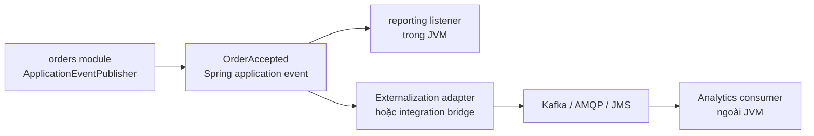
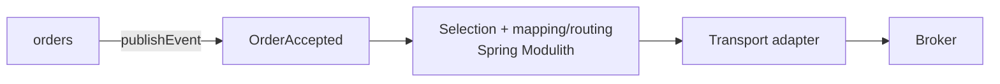
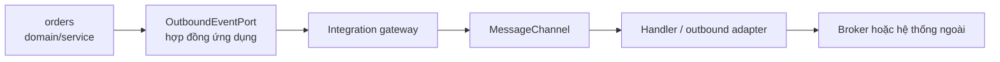
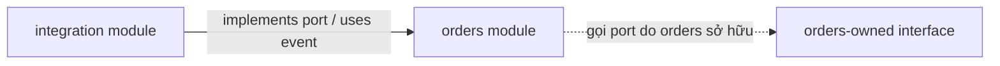
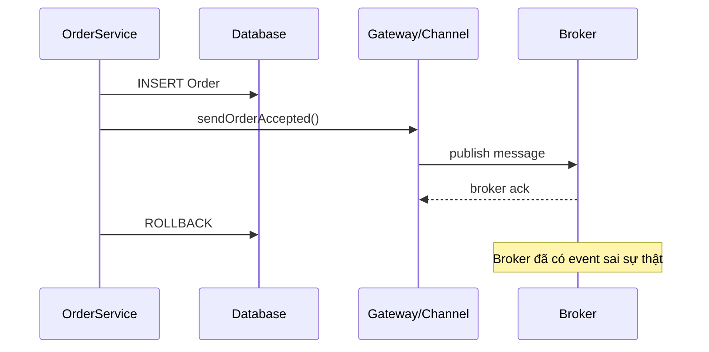
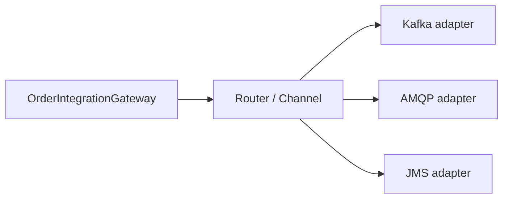
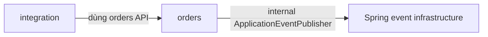

# Gateway hoặc channel gửi event

Trong một ứng dụng Spring Modulith, business service có thể phát sự kiện `OrderAccepted` khi đơn hàng được chấp nhận. Sau đó, ứng dụng cần chuyển một số sự kiện ra Kafka, RabbitMQ hoặc một hệ thống messaging khác. Câu hỏi thiết kế đặt ra là: **code nghiệp vụ nên gửi trực tiếp tới broker, gọi một gateway, hay đưa message qua một channel?**

*Gateway* và *channel* đều giúp tổ chức đường đi của thông điệp, nhưng chúng **không có cùng trách nhiệm**. Gateway trình bày một **cổng giao tiếp có ý nghĩa với phía gọi**; channel là một **đường chuyển giao message tới các handler/adapter**. Trong hệ sinh thái Spring, ta còn cần phân biệt Spring application event, Spring Messaging `MessageChannel`, Spring Integration `@MessagingGateway` và cơ chế **event externalization** của Spring Modulith.

Bài thuộc chương **Externalization** của học phần `SPRING_MODULITH_VERIFICATION_TESTING`. Mục tiêu học phần là kiểm chứng ranh giới bằng `ApplicationModules` và quy tắc phụ thuộc giữa module, thực hành `@ApplicationModuleTest`, kiểm thử sự kiện/cơ sở dữ liệu/tích hợp, rồi đặt quality gate vào CI để phát hiện phụ thuộc sai và hồi quy. Bài này tập trung vào **cách tổ chức gateway hoặc channel để gửi event ra ngoài**, các bảo đảm thật sự của từng lớp và chiến lược kiểm chứng chúng.

## 1. Bốn khái niệm cần tách bạch

| Khái niệm | Vai trò | Ví dụ |
| --- | --- | --- |
| **Spring application event** | Thông báo một sự thật nghiệp vụ trong ứng dụng | `events.publishEvent(new OrderAccepted(...))` |
| **Gateway** | Cổng API cho code gọi vào hệ thống messaging/integration | `OrderOutboundGateway.send(event)` |
| **MessageChannel** | Chuyển một `Message<?>` tới handler hoặc endpoint được nối vào channel | `channel.send(message)` |
| **Externalization adapter** | Chọn, chuyển đổi, định tuyến và gửi application event ra transport | Spring Modulith event externalization tới Kafka/AMQP/JMS/... |

**Gateway** là một mẫu thiết kế và, khi dùng Spring Integration, cũng có thể là một interface annotated `@MessagingGateway`. **Channel** là thành phần trong mô hình Spring Messaging/Spring Integration. **Event externalization** là khả năng của Spring Modulith và các module tích hợp tương ứng, không tự đồng nhất với một gateway hoặc channel do người học tự viết.

Một lời gọi `MessageChannel.send(...)` trả kết quả thành công có thể chỉ cho thấy message được channel chấp nhận hoặc chuyển cho handler theo semantics của channel. Nó **không mặc định** chứng minh broker đã persist message, consumer đã xử lý hoặc transaction database đã commit.

## 2. Bối cảnh thực tế: orders, broker và reporting

Giả sử có hai application module trong một modular monolith:

- **`orders`**: sở hữu trạng thái đơn và event `OrderAccepted`.
- **`reporting`**: có thể lắng nghe event nội bộ và cập nhật báo cáo cục bộ.

Ngoài JVM còn có một dịch vụ **analytics** nhận message từ broker:



Ba đường ranh giới cần giữ rõ:

1. **Ranh giới nghiệp vụ**: chỉ `orders` quyết định khi nào một đơn đủ điều kiện trở thành `ACCEPTED`.
2. **Ranh giới tích hợp**: chỉ một nhóm event được công bố; payload và route là hợp đồng với consumer.
3. **Ranh giới transport**: Kafka producer, RabbitMQ template hoặc connector nằm ở adapter/infrastructure, không bị rải vào từng business service.

Gateway và channel thường giúp tổ chức **ranh giới thứ ba**. Spring Modulith event externalization có thể giúp tách toàn bộ quá trình gửi transport khỏi business service nếu được cấu hình phù hợp.

## 3. Luồng A: sử dụng Spring Modulith event externalization

Với cách tiếp cận do framework hỗ trợ, code nghiệp vụ chỉ phát Spring application event:

```java
// orders/OrderAccepted.java
package com.example.shop.orders;

import java.time.Instant;
import java.util.UUID;
import org.springframework.modulith.events.Externalized;

@Externalized("orders.accepted.v1")
public record OrderAccepted(
        UUID eventId,
        UUID orderId,
        Instant occurredAt
) {}
```

```java
// Trong application service của module orders:
events.publishEvent(new OrderAccepted(
        eventId,
        orderId,
        occurredAt
));
```

`@Externalized` biểu đạt **event type được chọn để externalize** theo cơ chế áp dụng. Khi ứng dụng đã cài và cấu hình **adapter cho transport phù hợp**, Spring Modulith có thể đưa event ra đích ngoại bộ mà business service không cần gọi trực tiếp một `MessageChannel` hoặc producer cụ thể.



**Đừng suy rằng annotation tự tạo toàn bộ pipeline.** Vẫn cần module tích hợp đúng phiên bản, adapter được bật, kết nối broker, destination, serialization, các quyền cần thiết và test thực tế. Các API cấu hình routing/key và cách xử lý transaction có thể khác nhau theo adapter/phiên bản.

Nếu dự án đã dùng cách A, **không nên tự động thêm một listener khác gọi gateway gửi cùng event**; điều đó có thể làm externalize hai lần mà không chủ ý.

## 4. Luồng B: tự thiết kế gateway hoặc channel tích hợp

Một số hệ thống có lý do chính đáng để tạo một đường gửi do ứng dụng quản lý:

- Cần adapter nội bộ cho một gateway công ty chưa có tích hợp trực tiếp.
- Cần xử lý phức tạp trước khi chuyển tới nhiều endpoint.
- Đã có Spring Integration flow cần tái sử dụng.
- Cần phân tách interface dành cho code gọi với topology chuyển message bên dưới.

Một sơ đồ dạng này:



Đây là **kiến trúc thay thế** hoặc bổ sung cho một integration đặc thù. Nó **không mặc định là đường thực thi bên trong Spring Modulith externalization adapter**. Không được viết lại sơ đồ này như một tuyên bố rằng mọi `@Externalized` đều gọi chính interface `OutboundEventPort` hay channel tự tạo.

Trong cách B, ứng dụng chịu trách nhiệm minh bạch về **transaction after-commit, lưu ý định gửi bền vững, lỗi gửi, retry và đánh dấu hoàn tất**. Một channel đơn thuần không thay thế các cơ chế đó.

## 5. Gateway thực sự biểu đạt điều gì?

Một gateway tốt cho phía gọi một hợp đồng nhỏ, ví dụ:

```java
// Cổng ứng dụng, minh họa Java thuần:
public interface OutboundEventPort {
    void publishOrderAccepted(OrderAccepted event);
}
```

Phía gọi chỉ biết **“công bố event”**; không biết topic, Kafka key, JSON serializer, security, connection pool hoặc retry policy. Adapter có thể dùng Spring Messaging bên dưới.

Tuy nhiên cần hỏi:

**Phía gọi có thật sự cần yêu cầu gửi một command đồng bộ không?** Nếu đó là một domain event đã xảy ra, `ApplicationEventPublisher` cùng cơ chế externalization Spring Modulith thường làm giảm coupling hơn việc domain service tự gọi một gateway hạ tầng.

Gateway đặc biệt hữu ích khi:

- Một service cần gửi một **yêu cầu đến hệ thống tích hợp** với interface rõ.
- Có nhiều adapter triển khai khác nhau cho cùng một hợp đồng.
- Spring Integration xây dựng một flow và phía gọi muốn dùng method Java thay vì tạo `Message<?>` thủ công.

Đừng đặt tên `OrderGateway` rồi công bố những method như `getKafkaTemplate()` hoặc `getRabbitConnectionFactory()`. Làm vậy chỉ che giấu thư viện sau một lớp mỏng nhưng vẫn để implementation rò lên nghiệp vụ.

## 6. Channel là gì trong Spring Messaging?

Spring Messaging có abstraction `Message<?>` và `MessageChannel`:

```java
import org.springframework.messaging.Message;
import org.springframework.messaging.MessageChannel;
import org.springframework.messaging.support.MessageBuilder;

Message<String> message = MessageBuilder
        .withPayload("order-accepted")
        .setHeader("eventType", "orders.accepted.v1")
        .build();

boolean accepted = messageChannel.send(message);
```

Message mang **payload** và **headers**. Channel đưa nó tới consumer/handler hoặc nơi đệm theo implementation cụ thể.

`MessageChannel.send(Message<?>)` trả `boolean` theo giao thức của channel; còn có overload với timeout. Nhưng **`true` không phải một broker acknowledgement phổ quát**. Nó có thể có ý nghĩa khác nhau với channel dispatch trực tiếp, channel có queue hoặc endpoint xử lý bất đồng bộ.

**Phân biệt channel với broker destination:**

- `outboundOrderEvents` có thể là **tên Spring bean MessageChannel** trong JVM.
- `orders.accepted.v1` có thể là **Kafka topic** hoặc một route ngoài JVM.

Hai tên không tự đồng nhất; cần có handler/adapter chuyển từ channel sang transport.

## 7. Các loại channel thường gặp

Trong Spring Integration, một số implementation channel phục vụ nhu cầu khác nhau:

| Channel | Mô hình xử lý | Điều cần nhớ |
| --- | --- | --- |
| `DirectChannel` | Gửi trực tiếp đến subscriber trong call stack ở cấu hình thông thường | Handler có thể chạy đồng bộ; gửi vào channel chưa chắc là broker ack |
| `ExecutorChannel` | Dispatch qua executor, chuyển xử lý sang thread khác | Không còn chung transaction context theo giả định mặc định; cần cơ chế bảo đảm phù hợp |
| `QueueChannel` | Giữ message trong queue cho poller đọc | Queue trong memory không tự bền vững qua restart |
| `PublishSubscribeChannel` | Phân phối cho nhiều subscriber | Cần xét lỗi một subscriber, xử lý đồng bộ/bất đồng bộ |

Các class trên thuộc **Spring Integration**, không chỉ Spring Messaging core. Nếu dự án chưa thêm Spring Integration, `MessageChannel` có thể có trên classpath nhưng không tự có toàn bộ channel implementations hoặc `@MessagingGateway`.

### Lựa chọn theo ngữ nghĩa, không theo tên đẹp

- Cần handler đồng bộ trong cùng request? `DirectChannel` có thể phù hợp.
- Cần tách thread để giảm thời gian chờ? `ExecutorChannel` có thể hữu ích, nhưng **không tự tạo durability**.
- Cần buffering và retry bền vững? Phải xác định message store/transaction/ack đúng, không mặc định `QueueChannel` đủ.
- Cần phân phối cho nhiều module? Xem xét Spring application events hoặc publish-subscribe phù hợp thay vì trộn tất cả vào một channel khó quản trị.

## 8. Tạo một channel và handler minh họa

Để hiểu đường đi nội bộ của Spring Integration, giả sử có channel named `outboundOrderEvents`:

```java
// integration/OutboundChannelsConfiguration.java
package com.example.shop.integration;

import org.springframework.context.annotation.Bean;
import org.springframework.context.annotation.Configuration;
import org.springframework.integration.channel.DirectChannel;
import org.springframework.messaging.MessageChannel;

@Configuration
class OutboundChannelsConfiguration {

    @Bean("outboundOrderEvents")
    MessageChannel outboundOrderEvents() {
        return new DirectChannel();
    }
}
```

Một handler nhận message từ channel:

```java
// integration/OutboundOrderEventHandler.java
package com.example.shop.integration;

import com.example.shop.orders.OrderAccepted;
import org.springframework.integration.annotation.ServiceActivator;
import org.springframework.messaging.Message;
import org.springframework.stereotype.Component;

@Component
class OutboundOrderEventHandler {

    @ServiceActivator(inputChannel = "outboundOrderEvents")
    public void handle(Message<OrderAccepted> message) {
        OrderAccepted event = message.getPayload();

        // Điểm nối sang Kafka/RabbitMQ adapter THẬT sẽ nằm ở đây.
        // Đoạn minh họa KHÔNG gửi broker.
        System.out.println("Prepared event: " + event.eventId());
    }
}
```

Đoạn code này cho thấy **channel bean + subscriber** trong Spring Integration; cần Spring Integration dependency và cấu hình đăng ký endpoint tương ứng. Nó chỉ ghi một dòng log, **không phải ví dụ externalization hoàn chỉnh**. Nếu thay dòng log bằng một lệnh gọi producer, cần kiểm broker acknowledgement và lỗi gửi thực tế.

### Một bẫy quan trọng

Nếu handler gọi `kafkaTemplate.send(...)` và nhận về một future, việc handler return ngay **không có nghĩa** future đã hoàn tất thành công. Với channel/handler đồng bộ, `send(...)` có thể trả về trước khi broker ack.

Không để `MessageChannel.send(...)` trả `true` rồi ghi “published to Kafka successfully” nếu chưa quan sát kết quả của producer.

## 9. Spring Integration `@MessagingGateway`

Nếu không muốn application code tự tạo `MessageBuilder` và gọi `channel.send(...)`, có thể khai báo một interface gateway:

```java
// integration/OrderOutboundGateway.java
package com.example.shop.integration;

import com.example.shop.orders.OrderAccepted;
import org.springframework.integration.annotation.Gateway;
import org.springframework.integration.annotation.MessagingGateway;

@MessagingGateway
public interface OrderOutboundGateway {

    @Gateway(requestChannel = "outboundOrderEvents")
    void sendOrderAccepted(OrderAccepted event);
}
```

Gateway này đưa method call thành message gửi tới channel. Để hoạt động, project phải có **Spring Integration**, cấu hình scan/register gateway interface (chẳng hạn `@IntegrationComponentScan` khi phù hợp) và channel/handler tương ứng.

**`@MessagingGateway` khác `@Externalized`:**

- `@MessagingGateway` là khái niệm **Spring Integration**, giúp tạo implementation cho interface truyền message.
- `@Externalized` là marker của **Spring Modulith** để chọn loại application event đưa ra ngoài theo cơ chế externalization.

Chúng có thể xuất hiện trong cùng một ứng dụng nhưng **không tự kết nối với nhau**. Nếu business code chỉ publish `OrderAccepted` và ứng dụng muốn gọi `OrderOutboundGateway`, phải có adapter/listener hoặc cấu hình framework **chủ động nối** hai phần. Không được giả định annotation tự tích hợp.

## 10. Cách đặt gateway để không làm đảo chiều phụ thuộc

Khi tổ chức theo module, có thể định nghĩa một interface **port** do module nghiệp vụ sở hữu:

```text
orders
  ├── OrderAccepted
  ├── internal/OrderService
  └── internal/OutboundEventPort   (interface do orders sở hữu)

integration
  ├── OutboundEventPortAdapter     (implements orders port)
  ├── OrderOutboundGateway         (Spring Integration)
  └── OutboundChannelsConfiguration
```

Với cách này, module `orders` phụ thuộc một interface của **chính nó**. Module `integration` phụ thuộc `orders` để implement port và biết kiểu event:



Đây là cách mô tả **hướng phụ thuộc kiểu Java**, không phải hướng runtime message. Để triển khai, interface mà `integration` cần sử dụng phải được **công bố hợp lệ ở API/named interface của `orders`**, không đặt trong `orders.internal` rồi import trái ranh giới.

Vì vậy, khi muốn tách port được adapter ngoài module implement, hãy đưa port vào **package API của `orders`** hoặc named interface được công bố. Đừng sao chép đường dẫn minh họa `orders/internal/OutboundEventPort` ở trên rồi cho `integration` import `orders.internal`: điều đó có thể vi phạm `ApplicationModules.verify()`.

**Cách đơn giản hơn cho event:** `orders` chỉ publish Spring event, còn adapter Spring Modulith externalization xử lý. Không nhất thiết phải thêm một port và gateway thủ công khi framework đã giải quyết được nhu cầu.

## 11. Interface port trong module sở hữu nghiệp vụ

Nếu thật sự cần một cổng gateway do ứng dụng quản lý, interface ở API:

```java
// orders/OrderEventOutboundPort.java
package com.example.shop.orders;

public interface OrderEventOutboundPort {
    void publish(OrderAccepted event);
}
```

Implementation có thể thuộc module `integration`:

```java
// integration/ChannelOrderEventAdapter.java
package com.example.shop.integration;

import com.example.shop.orders.OrderAccepted;
import com.example.shop.orders.OrderEventOutboundPort;
import org.springframework.beans.factory.annotation.Qualifier;
import org.springframework.messaging.MessageChannel;
import org.springframework.messaging.support.MessageBuilder;
import org.springframework.stereotype.Component;

@Component
class ChannelOrderEventAdapter implements OrderEventOutboundPort {

    private final MessageChannel outbound;

    ChannelOrderEventAdapter(
            @Qualifier("outboundOrderEvents") MessageChannel outbound) {
        this.outbound = outbound;
    }

    @Override
    public void publish(OrderAccepted event) {
        boolean accepted = outbound.send(
                MessageBuilder.withPayload(event)
                        .setHeader("eventType", "orders.accepted.v1")
                        .build());

        if (!accepted) {
            throw new IllegalStateException(
                    "Outbound channel did not accept the message");
        }
    }
}
```

**Vấn đề kiến trúc:** nếu `orders` sử dụng `OrderEventOutboundPort`, `integration` import `orders` và chỉ có cạnh `integration → orders` ở mức kiểu Java. Trong cùng ứng dụng, Spring DI có thể inject implementation của `integration` qua interface của `orders`; cần kiểm wiring theo runtime và chấp nhận module assembly tương ứng.

**Vấn đề delivery:** `accepted = true` chỉ là kết quả `MessageChannel.send(...)`. Adapter này **không tự ghi durable publication**, không tự đợi broker ack và không đảm bảo `AFTER_COMMIT`. Nếu dùng cho business event quan trọng, phải bổ sung thiết kế transaction/outbox/recovery hoặc thay bằng cơ chế externalization của Spring Modulith được cấu hình đúng.

### Không kết hợp hai publisher mà không kiểm soát

Nếu `OrderService` vừa gọi `events.publishEvent(event)` cho `@Externalized` vừa gọi `OrderEventOutboundPort.publish(event)`, cùng một business fact có thể ra broker **hai lần** theo hai đường. Chỉ chấp nhận khi đó là quyết định có chủ đích (ví dụ hai destination/hợp đồng khác nhau), có kiểm thử và chính sách idempotency rõ.

## 12. Gateway là API, channel là topology

Một cách đọc kiến trúc:

```text
OrderEventOutboundPort:
  "orders cần công bố một event nghiệp vụ"

OrderOutboundGateway (Spring Integration):
  "biến lời gọi Java thành Spring message"

outboundOrderEvents MessageChannel:
  "chuyển message đến handler đã nối"

Outbound handler/adapter:
  "serialize, route và tương tác với broker"
```

**Gateway không nhất thiết là Spring Integration gateway**. Một interface Java thuần có adapter là đủ cho mục tiêu tách tầng. `@MessagingGateway` tiện khi đã dùng Spring Integration flow, muốn truyền payload/headers qua method signature và tận dụng gateway proxy.

**Channel cũng không nhất thiết là message broker.** DirectChannel có thể dispatch thuần trong JVM. Muốn ra ngoài JVM cần một endpoint/bridge xử lý transfer sang transport.

## 13. Spring Modulith và Spring Messaging adapter

Trong hệ sinh thái Spring Modulith có các module tích hợp event externalization dành cho những transport/abstraction tương ứng (ví dụ Kafka, AMQP hoặc Spring Messaging ở những phiên bản hỗ trợ). Một module tích hợp với **Spring Messaging** có thể kết nối externalized event tới các thành phần message-driven do ứng dụng cấu hình.

Để sử dụng cần xác minh theo **phiên bản dự án**:

1. Artifact externalization adapter nào được cung cấp và tương thích với Spring Boot đang chạy?
2. Adapter kỳ vọng **channel/bean/destination** nào, được cấu hình theo tên hoặc route ra sao?
3. Nó gửi `Message<?>` dạng gì: payload là event nguồn, mapped DTO hay representation khác?
4. Adapter có chờ xử lý đồng bộ, future broker ack hoặc chỉ handoff tới channel?
5. Registry có thể theo dõi target và completion trong điều kiện nào?

Không nên viết tên bean hoặc method cấu hình tùy đoán rồi giới thiệu là API chính thức của Spring Modulith. Các đoạn code `DirectChannel`/`@MessagingGateway` trong bài là **các ví dụ Spring Integration độc lập**; khi lắp vào Event Externalization Spring Modulith, phải làm theo contract của adapter cụ thể.

**Điểm bắt buộc phải hiểu:** thêm dependency Spring Messaging adapter không tự tạo consumer ngoài ứng dụng hoặc bảo đảm một channel trong JVM đã gửi message tới Kafka. Test transport phải quan sát message ở phía broker.

## 14. Định tuyến event: gateway/channel không thay schema

Một external event nên có hợp đồng rõ:

```text
Event type:     orders.accepted.v1
Owner:          orders module
Destination:    orders.accepted.v1 (minh họa)
Event identity: eventId
Aggregate key:  orderId
Wire payload:   eventId, orderId, occurredAt
```

Tại gateway/channel, có thể thêm headers:

```java
var message = MessageBuilder.withPayload(event)
        .setHeader("eventType", "orders.accepted.v1")
        .setHeader("correlationId", event.orderId().toString())
        .build();
```

Nhưng:

- Header `eventType` **không tự biến thành Kafka topic**.
- Header `correlationId` **không tự biến thành Kafka message key**.
- Tên Spring bean `outboundOrderEvents` **không tự đồng nhất với broker destination**.
- Nếu bridge bỏ qua header hoặc adapter có mapping khác, message thực tế có thể đi tới đích khác.

Chỉ khi cấu hình router/adapter có quy tắc ánh xạ tường minh thì headers mới có ý nghĩa đối với transport. Phải kiểm chứng **destination, key, headers và payload trên broker thật**.

## 15. Không để message header điều khiển destination tùy ý

Một antipattern:

```text
message.header("destination") = userInput
outboundAdapter.publish(destination = userInput)
```

Nếu producer dùng dữ liệu người dùng làm destination mà không kiểm soát, có thể gửi thông tin tới topic/queue không mong muốn, mở rộng quyền publish hoặc làm lộ dữ liệu.

An toàn hơn:

1. Dùng **allowlist event type → destination** do ứng dụng quản lý.
2. Map schema/version cố định cho từng loại event.
3. Cấp quyền broker chỉ đối với destination hợp lệ.
4. Kiểm tra và giới hạn headers/metadata nhạy cảm.
5. Test một message có destination không hợp lệ bị từ chối thay vì định tuyến tùy ý.

Hạ tầng gateway/channel phải phục vụ **chính sách công bố event**, không trở thành một “tổng đài gửi message tới bất kỳ nơi nào” không có ownership.

## 16. Serialization: channel nhận object, broker nhận wire format

`MessageChannel` trong JVM có thể vận chuyển một `OrderAccepted` Java record. Consumer ngoài JVM không bắt buộc dùng Java, nên adapter phải serialize theo hợp đồng JSON/Avro/Protobuf hoặc định dạng được lựa chọn.

Ví dụ representation JSON mong muốn:

```json
{
  "eventId": "6e475044-13ab-43eb-8a37-9e92ddc68c6c",
  "orderId": "b91a13a5-cfd5-40fa-9396-bc3bb183641d",
  "occurredAt": "2026-11-26T02:00:00Z"
}
```

Đây chỉ là **mẫu contract**, không phải bảo đảm serializer mặc định của adapter gửi đúng JSON như trên. Một số adapter gửi headers hoặc metadata riêng; một số dùng schema registry và binary payload.

Với external event, cần kiểm:

- ID có định dạng ổn định và `eventId` không đổi khi retry.
- Thời gian có đơn vị/UTC và semantics rõ.
- Payload không chứa JPA entity, credential, PII dư thừa.
- Event version và destination phù hợp consumer contract.
- Consumer cũ xử lý được các trường mới theo chính sách compatibility.

**Gateway/channel không thay thế schema governance**. Nếu Java code compile nhưng event JSON thay field, consumer ngoài JVM vẫn có thể lỗi.

## 17. Message send đồng bộ và bất đồng bộ

Điều rất dễ nhầm:

```java
boolean accepted = outboundChannel.send(message);
```

Đây là một **lời gọi tới abstraction channel**. Cách diễn giải kết quả phải dựa trên implementation:

| Loại đường đi | Điều xảy ra sau `send` | Không được kết luận |
| --- | --- | --- |
| `DirectChannel` với handler đồng bộ | Handler có thể được gọi trước khi `send` trả về | Broker chắc chắn ack nếu handler chỉ bắt đầu async send |
| `ExecutorChannel` | Có thể giao việc sang thread khác | Đã hoàn tất side effect của handler |
| `QueueChannel` trong memory | Message có thể đang nằm chờ poll | Message bền vững qua restart |
| Outbound adapter gửi Kafka async | Producer trả future trước khi broker ack | `send` true đồng nghĩa broker đã nhận |
| Adapter giao message tới external transport có publisher confirm | Có thể biết broker ack khi xử lý confirm | Consumer chắc chắn đã xử lý nghiệp vụ |

Nếu yêu cầu **publisher biết broker đã nhận**, phải kiểm tra future/callback/confirm của transport adapter và cách kết quả này kết nối với completion của publication. Không gộp “message đã handoff tới channel” thành “externalization thành công” khi thiết kế recovery.

## 18. Exception, error channel và lỗi bất đồng bộ

Trong Spring Integration, lỗi ở luồng message có thể:

- Ném exception trực tiếp về lời gọi phía gửi (một số đường xử lý đồng bộ).
- Xuất hiện ở handler chạy trong thread executor.
- Được chuyển qua **error channel** hoặc cơ chế error flow nếu hệ thống cấu hình.
- Trở thành kết quả lỗi của future từ transport adapter.

Ví dụ lỗi:

```text
Gateway.send(OrderAccepted)
  -> DirectChannel
  -> handler
  -> Kafka producer send()
  -> future completes exceptionally later
```

Nếu handler return trước khi future hoàn tất, caller có thể không thấy lỗi producer dù send tới channel đã thành công.

Một thiết kế tin cậy cần quyết định:

1. Lỗi nào phải truyền về caller?
2. Lỗi nào được lưu thành **incomplete publication**?
3. Lỗi nào retry được, lỗi nào là poison message/schema mismatch?
4. Ai tiêu thụ và giám sát error channel?
5. Có giới hạn retry, backoff/jitter và dead-letter strategy không?

**Error channel không mặc định là một outbox bền vững.** Nếu ứng dụng chết trước khi xử lý error message nằm trong memory, thông tin lỗi có thể mất.

## 19. Một lỗi thường gặp: channel không có subscriber

Ví dụ tạo `DirectChannel` nhưng quên đăng ký `@ServiceActivator` hoặc flow liên quan. Hậu quả có thể là `MessageDeliveryException` vì không có handler hoặc hành vi không chấp nhận message theo loại channel.

```text
Application code -> outboundOrderEvents (DirectChannel)
                   -> không có handler
                   -> gửi thất bại
```

Không phải Spring sẽ tự tìm Kafka producer và “nối” channel bằng cách trùng tên topic.

Khi test, cần xác minh:

- Bean channel tồn tại và đúng tên.
- Endpoint/handler được đăng ký theo profile đang chạy.
- Có đúng adapter để chuyển sang broker.
- Không có hai handler vô tình gửi **hai lần** cùng message.
- Khi channel không có subscriber hoặc endpoint bị disable, lỗi được quan sát rõ.

Đây là lý do unit test riêng của gateway **không đủ**; còn cần test Spring context và integration flow.

## 20. Giao dịch: gọi gateway trong transaction có thể gửi quá sớm

Xét:

```text
BEGIN transaction
  INSERT Order(status = ACCEPTED)
  orderOutboundGateway.sendOrderAccepted(event)
  broker nhận message
  lỗi xảy ra
ROLLBACK
```

Nếu gateway/channel gửi broker **trong cùng lời gọi** trước khi database commit, consumer có thể nhận event về một đơn không tồn tại.



**Không có annotation `@Transactional` trên service nào tự biến một gateway/channel thông thường thành after-commit sender.** Cần thiết kế thích hợp: publication lưu bền vững gắn với transaction, một listener sau commit được kiểm chứng, hoặc giải pháp outbox/registry tương đương theo yêu cầu.

Nếu dùng Spring Modulith Event Externalization, cần xác minh **chính cơ chế externalization/adapters/persistence của phiên bản đang chạy** đáp ứng hợp đồng after-commit và recovery mà nhóm cam kết; không thay test thực tế bằng suy đoán từ annotation.

## 21. `@TransactionalEventListener(AFTER_COMMIT)` giải quyết và chưa giải quyết gì?

Một listener có thể đợi transaction commit:

```java
// Biến thể conceptual cho ứng dụng tự quản lý gateway.
@org.springframework.transaction.event.TransactionalEventListener(
        phase = org.springframework.transaction.event.TransactionPhase.AFTER_COMMIT
)
void on(OrderAccepted event) {
    outboundGateway.sendOrderAccepted(event);
}
```

Điều này giúp tránh gửi khi transaction rollback, **nếu event được phát trong transaction phù hợp** và listener hoạt động theo đúng phase. Nhưng vẫn có một khoảng lỗi:

```text
T0  Database commit thành công
T1  Ứng dụng crash
T2  Listener AFTER_COMMIT chưa kịp gửi message
```

Nếu không có bản ghi publication/outbox bền vững, message có thể bị mất. `AFTER_COMMIT` giải quyết **thời điểm**, không tự giải quyết **durability/recovery**.

Khi phát event **ngoài transaction**, `@TransactionalEventListener` có thể không chạy với fallback mặc định. Không bật `fallbackExecution = true` rồi tuyên bố vẫn luôn “sau commit”: khi không có transaction, không có commit nào để chờ.

## 22. Event Publication Registry và channel: không tự đồng nhất

Spring Modulith cung cấp **Event Publication Registry** để theo dõi publication đến target tương ứng, khi có thành phần lưu trữ và cơ chế tích hợp phù hợp.

Đối với adapter externalization được framework hỗ trợ, registry có thể giúp ghi nhận publication chưa hoàn tất để phục hồi theo cấu hình. Nhưng **một `MessageChannel` tự viết không mặc định đăng ký từng lần `send(...)` với Event Publication Registry**.

Ba khẳng định khác nhau:

1. **Đã handoff vào channel:** `send(...)` đã xử lý theo semantics của channel.
2. **Đã gửi tới broker:** producer/adapter có xác nhận theo transport.
3. **Có publication bền vững để phục hồi:** registry/outbox đã ghi intent theo transaction cần thiết.

Không được suy từ 1 ra 2 hoặc 3.

Nếu chọn luồng B tự xây gateway/channel, muốn có recovery phải **thiết kế một cơ chế thực sự**, ví dụ integration với Event Publication Registry theo API được hỗ trợ hoặc transactional outbox riêng. Không tự tạo SQL “status = COMPLETE” với schema đoán mò của Spring Modulith.

## 23. Crash, retry và duplicate delivery

Ngay cả khi publisher dùng cơ chế durable publication:

```text
1. DB transaction ghi Order + intent publication được commit.
2. Outbound adapter gửi OrderAccepted(eventId = E).
3. Broker nhận và ack E.
4. Ứng dụng crash trước khi ghi publication completed.
5. Recovery gửi lại E.
```

Consumer có thể nhận **hai message cùng `eventId`**. Đó là rủi ro thường gặp trong mô hình at-least-once/retry, không phải bằng chứng rằng gateway “gửi sai” chỉ vì message bị lặp.

Để an toàn:

- `eventId` phải ổn định trong một business event.
- Retry **không tạo `UUID.randomUUID()` mới** cho cùng event.
- Consumer dùng unique constraint/idempotency key và transaction.
- Có logging/metric để phân biệt event mới với resubmission.
- Nếu cần ordering, phải xét cả broker partitioning và sequence của aggregate.

**Không quảng bá exactly-once end-to-end** chỉ từ việc dùng `@MessagingGateway`, `MessageChannel`, `@Externalized` hoặc publication registry.

## 24. Gateway với nhiều transport

Một gateway có thể đưa message đến các adapter khác nhau:



Nhưng câu hỏi nghiệp vụ là: **một sự kiện gửi tới một đích hay nhiều đích?**

Nếu một event gửi cả Kafka và AMQP, kết quả có thể:

```text
Kafka destination: thành công
AMQP destination: thất bại
```

Không nên chỉ có một biến `boolean published` để nói cả sự kiện đã hoàn tất. Nếu có yêu cầu recovery, cần theo dõi **publication/target riêng**, hoặc chính sách retry được mô hình hóa rõ.

Trong Spring Modulith Event Publication Registry, tính chất theo dõi publication đến target cần được kiểm theo framework/adapter cụ thể. Với channel/router tự xây, nhà phát triển phải chịu trách nhiệm ghi nhận trạng thái từng nhánh nếu hệ thống cam kết không mất một trong các đích.

## 25. Gateway và command/request khác event notification

Không phải mọi message đi qua gateway đều là event.

```text
Event:
  OrderAccepted -> "Đơn hàng đã được chấp nhận".

Command:
  ReserveStock -> "Hãy thử giữ tồn kho".

Query/request:
  CalculateShippingQuote -> "Trả lại báo giá ngay".
```

Với command/query cần kết quả tức thì, một gateway request–reply với timeout/failure contract có thể phù hợp. Với domain event thông báo sự thật đã xảy ra, cách publish–subscribe/externalization thường sát nghĩa hơn.

**Đừng dùng fire-and-forget channel để giả lập một synchronous RPC cần kết quả ngay.** Nếu checkout phải biết có đủ hàng trước khi chấp nhận đơn, hãy xác định giao thức trả kết quả rõ ràng (facade đồng bộ hoặc request–reply được thiết kế đúng), thay vì publish event rồi đoán rằng handler chạy kịp.

Ngược lại, không nên chặn transaction đơn hàng đến khi mọi consumer analytics xử lý xong chỉ vì bên dưới dùng gateway có method trả `void`.

## 26. Testing tầng một: kiểm tra domain event

Trước khi kiểm gateway/channel, xác nhận business service phát đúng event:

```java
// src/test/java/com/example/shop/orders/OrdersEventsTests.java
package com.example.shop.orders;

import static org.assertj.core.api.Assertions.assertThat;
import org.junit.jupiter.api.Test;
import org.springframework.beans.factory.annotation.Autowired;
import org.springframework.modulith.test.ApplicationModuleTest;
import org.springframework.modulith.test.PublishedEvents;

@ApplicationModuleTest
class OrdersEventsTests {

    @Autowired OrderService service;

    @Test
    void acceptedOrderPublishesBusinessEvent(PublishedEvents events) {
        service.acceptOrderForTest();

        assertThat(events.ofType(OrderAccepted.class)).hasSize(1);
    }
}
```

`OrderService.acceptOrderForTest()` là **test-fixture method minh họa**; project thật phải có service, repository, state transition và dữ liệu hợp lệ. Bài test chỉ minh họa cách sử dụng `@ApplicationModuleTest` và `PublishedEvents`; không tuyên bố đoạn code có thể chạy độc lập khi chưa cung cấp implementation.

**Phạm vi chứng minh:** event `OrderAccepted` được phát trong Spring application context. Test này chưa xác nhận:

- Gateway đã được gọi.
- Channel có subscriber.
- Broker nhận đúng message.
- Event được gửi sau commit.
- Registry persistence hoặc recovery hoạt động.

Những yêu cầu này cần các lớp test tiếp theo.

## 27. Testing tầng hai: gateway/channel unit test

Nếu dự án dùng `ChannelOrderEventAdapter` ở phần 11, có thể unit test message và header bằng mock `MessageChannel`:

```java
// Ví dụ JUnit + Mockito, đặt test cùng package integration:
package com.example.shop.integration;

import static org.junit.jupiter.api.Assertions.assertEquals;
import static org.junit.jupiter.api.Assertions.assertThrows;
import static org.mockito.ArgumentMatchers.any;
import static org.mockito.Mockito.when;

import com.example.shop.orders.OrderAccepted;
import java.time.Instant;
import java.util.UUID;
import org.junit.jupiter.api.Test;
import org.mockito.ArgumentCaptor;
import org.mockito.Mockito;
import org.springframework.messaging.Message;
import org.springframework.messaging.MessageChannel;

class ChannelOrderEventAdapterTests {

    private final MessageChannel channel =
            Mockito.mock(MessageChannel.class);
    private final ChannelOrderEventAdapter adapter =
            new ChannelOrderEventAdapter(channel);

    @Test
    void handsPayloadToChannelWithEventTypeHeader() {
        var event = new OrderAccepted(
                UUID.randomUUID(),
                UUID.randomUUID(),
                Instant.parse("2026-11-26T02:00:00Z"));

        when(channel.send(any(Message.class))).thenReturn(true);

        adapter.publish(event);

        ArgumentCaptor<Message> captor =
                ArgumentCaptor.forClass(Message.class);
        Mockito.verify(channel).send(captor.capture());

        assertEquals(event, captor.getValue().getPayload());
        assertEquals("orders.accepted.v1",
                captor.getValue().getHeaders().get("eventType"));
    }

    @Test
    void rejectsChannelHandoffFailure() {
        when(channel.send(any(Message.class))).thenReturn(false);

        assertThrows(IllegalStateException.class,
                () -> adapter.publish(new OrderAccepted(
                        UUID.randomUUID(),
                        UUID.randomUUID(),
                        Instant.parse("2026-11-26T02:00:00Z"))));
    }
}
```

Mẫu test này giả định `ChannelOrderEventAdapter` có constructor nhận `MessageChannel` như phần 11. Khi copy vào dự án, cần các dependency test JUnit/Mockito/Spring Messaging tương ứng.

**Giới hạn:** mock giúp kiểm mapping giữa Java object và `Message<?>`, cùng xử lý `false`. Nó **không chứng minh** channel dispatch tới handler, broker ack hoặc after-commit. Đó là các hợp đồng khác.

## 28. Testing tầng ba: Spring Integration flow test

Một integration test khởi động Spring context thật nên xác nhận:

1. Bean `outboundOrderEvents` tồn tại đúng tên/kiểu.
2. `@MessagingGateway` (nếu dùng) được đăng ký và inject được.
3. `@ServiceActivator` hoặc flow đúng đang subscribe channel.
4. Payload và headers đến đúng handler.
5. Khi endpoint bị disable/thiếu subscriber, lỗi được xử lý đúng.
6. Nếu handler chuyển sang executor, test chờ điều kiện phù hợp và bắt lỗi bất đồng bộ.

Với channel xử lý trực tiếp, có thể đăng ký **test sink handler** để thu message. Với executor/queue channel, test cần điều phối bất đồng bộ và timeout hữu hạn. Không dùng một lần `Thread.sleep(10)` rồi suy ra cả luồng đã hoàn tất.

**Quan trọng:** một test flow với sink trong memory vẫn chỉ chứng minh **đường đi trong Spring context**. Muốn chứng minh externalization ra broker, phải khởi động transport thật hoặc broker test.

## 29. Testing tầng bốn: broker integration

Với Kafka/RabbitMQ, dùng hạ tầng test cô lập như Testcontainers hoặc một broker kiểm thử tương đương:

```text
Given:
  Spring Modulith externalization hoặc gateway/channel path đã được bật
  broker test có destination orders.accepted.v1
  adapter và serializer thực tế đã cấu hình
  consumer test có group/offset/queue riêng

When:
  tạo đơn hợp lệ và commit transaction

Then:
  consumer test nhận OrderAccepted trong timeout hữu hạn
  eventId/orderId đúng nguồn
  payload/schema đúng hợp đồng
  topic/exchange/routing đúng
  message key/header đúng nếu policy yêu cầu

And:
  event nội bộ không được externalize không ra broker
  transaction rollback không tạo business fact thành công sai
```

Một test `@ApplicationModuleTest` xanh không thay thế được bước này. Tương tự, test mock `MessageChannel` không cho biết adapter Kafka có đúng topic, serializer hay security.

### Kiểm tra cả trước và sau commit

Nếu yêu cầu là **event chỉ gửi sau commit**, test cần điều khiển transaction thật và so sánh:

- **Trước commit**: chưa xuất external event thành công theo hợp đồng.
- **Sau commit**: message xuất hiện.
- **Rollback**: không có message tuyên bố thành công sai.

Spring Test `TestTransaction` có thể giúp điều khiển commit/rollback trong test-managed transaction. Nhưng nếu test `@Transactional` mặc định rollback, một listener `AFTER_COMMIT` có thể không chạy; không được xem đó là bằng chứng transport lỗi hoặc ngược lại.

## 30. Testing tầng năm: registry, outage và duplicate

Nếu ứng dụng cam kết khôi phục event khi broker tạm không hoạt động:

| Ca test | Kết quả cần xác nhận |
| --- | --- |
| Database commit, broker down | Publication/intent còn quan sát được và bền theo cấu hình |
| Restart tiến trình | Publication incomplete được khôi phục |
| Broker hồi phục, resubmit | Event cũ được gửi lại với **cùng `eventId`** |
| Broker ack rồi app crash trước completion | Duplicate có thể xảy ra; consumer xử lý an toàn |
| Kafka và AMQP cùng nhận một event | Kết quả từng target được theo dõi đúng |
| Payload serialize lỗi | Không âm thầm đánh dấu publish thành công |
| Consumer nhận trùng | Side effect không được thực hiện hai lần |

**Đặc biệt quan trọng cho cách B:** khi chỉ tự dùng `MessageChannel` và `@MessagingGateway`, không được viết test “registry recovery” với giả định Spring Modulith tự đăng ký publication cho mọi send. Trước tiên phải chứng minh **có cơ chế registry/outbox được tích hợp thật** với luồng đó.

Nếu dùng Spring Modulith adapter chính thức, kiểm thử đúng API/persistence/transaction của phiên bản. Đừng bịa tên bảng hoặc tên trạng thái publication để assertion.

## 31. Ranh giới module và dependency rule

Tầng messaging có thể khiến cấu trúc import bị rối nếu module nghiệp vụ gọi thẳng:

```java
// Phản ví dụ trong orders:
import com.example.shop.integration.internal.KafkaOrderProducer;
```

`orders` chạm vào implementation nội bộ của module tích hợp. Điều này làm tăng coupling với transport và có thể vi phạm Spring Modulith module boundary.

Cách thiết kế tốt hơn:

- `orders` chỉ publish Spring application event do chính nó sở hữu.
- Spring Modulith externalization adapter/`integration` sở hữu transport.
- Nếu cần một port tùy chỉnh, module nghiệp vụ công bố interface đúng ranh giới, adapter hạ tầng triển khai nó; kiểm tra chiều import và wiring.
- Không đưa Kafka `ProducerRecord` hay RabbitMQ `Message` thành kiểu trong API domain nếu không thực sự cần một hợp đồng tầng integration.



Một listener Java nằm ở `integration` và nhận `orders.OrderAccepted` tạo cạnh **`integration → orders`**. Runtime event đi từ `orders` sang integration không tạo cạnh Java ngược lại nếu `orders` không import implementation.

## 32. Architecture test với `ApplicationModules.verify()`

```java
// src/test/java/com/example/shop/ModularityTests.java
package com.example.shop;

import org.junit.jupiter.api.Test;
import org.springframework.modulith.core.ApplicationModules;

class ModularityTests {

    @Test
    void architectureIsValid() {
        ApplicationModules.of(ShopApplication.class).verify();
    }
}
```

`verify()` giúp kiểm tra các quy tắc cấu trúc áp dụng, gồm:

1. Không có **dependency cycle** giữa application module.
2. Không truy cập **package implementation nội bộ** của module khác ngoài API được công bố.
3. Tuân thủ **`allowedDependencies`** và named interface khi khai báo.

Nhưng nó **không** chứng minh channel có subscriber, broker đã nhận message, serializer đúng, transaction đã commit, registry persistent hay consumer xử lý idempotent.

Nếu `orders` import `integration.OrderOutboundGateway` còn `integration` import `orders.OrderAccepted`, có thể xuất hiện chu trình `orders → integration → orders`. Hãy chọn cách sở hữu port và hướng dependency rõ thay vì cố che import bằng bean lookup theo chuỗi hoặc reflection.

## 33. `allowedDependencies` và API công khai

Nếu `integration` được phép dùng API event của `orders`:

```java
// integration/package-info.java
@org.springframework.modulith.ApplicationModule(
        allowedDependencies = "orders"
)
package com.example.shop.integration;
```

Khai báo này ghi nhận **quyền phụ thuộc**; nó không tự tạo một cạnh trong đồ thị. Cạnh thực tế xuất hiện khi Java class ở `integration` tham chiếu `orders.OrderAccepted` hoặc `orders.OrderEventOutboundPort`.

Nếu muốn chỉ cho phép một named interface cụ thể, module `orders` có thể công bố package event API qua `@NamedInterface` và `integration` khai báo `orders::events` theo mô hình đã thiết kế.

`allowedDependencies` không hợp thức hóa việc import `orders.internal.OrderJpaRepository`; và dù cả hai module cùng cho phép nhau trong whitelist, một **dependency cycle** vẫn là vấn đề cần giải quyết riêng.

## 34. Error handling và observability

Để biết event bị kẹt ở đâu, cần quan sát riêng:

| Tín hiệu | Câu hỏi được trả lời |
| --- | --- |
| Domain event counter | Bao nhiêu `OrderAccepted` phát sinh thật? |
| Gateway invocation/failure | Phía gọi có handoff được không? |
| Channel dispatch error | Có handler/endpoint và nó có xử lý thành công? |
| Error channel backlog | Có lỗi bất đồng bộ chưa được xử lý? |
| Broker publish errors/acks | Message có tới được transport? |
| Incomplete publications | Có intent gửi tồn đọng được registry quản lý? |
| Consumer lag/DLQ | Broker có message nhưng downstream xử lý chậm/lỗi? |
| Duplicate detection | Retry có tạo nhiều delivery cùng event? |

Đừng ghi một log `"Event published"` duy nhất cho cả các mốc. Ví dụ:

```text
event_created       -> OrderAccepted được tạo trong orders
channel_accepted    -> MessageChannel tiếp nhận
broker_acknowledged -> Broker xác nhận publish
publication_complete -> Registry mark complete theo adapter
consumer_processed  -> Consumer áp dụng side effect
```

Các tên trên là **log/metric khái niệm**, không phải event name mặc định của Spring. Tên thực tế do dự án thiết kế và hệ thống telemetry hỗ trợ.

Không log payload chứa PII/credentials chỉ để debug; dùng `eventId`, `orderId`, correlation ID và thông tin target có phân quyền.

## 35. Lựa chọn thiết kế theo tình huống

| Nhu cầu | Hướng nên cân nhắc | Vì sao |
| --- | --- | --- |
| Domain event cần công bố ra Kafka với ít code hạ tầng | Spring Modulith `@Externalized` + adapter đúng | Business module không phải biết Kafka producer |
| Ứng dụng đã có Spring Integration flow phức tạp | `@MessagingGateway` + `MessageChannel` + outbound adapter | Tái sử dụng routing, transformation và handler |
| Muốn cổng Java độc lập transport | Interface port + adapter | Dễ thay implementation mà không lộ Kafka/RabbitMQ |
| Chỉ cần chuyển một thông điệp trong JVM | Spring application event hoặc channel | Không cần broker nếu không có consumer ngoài |
| Cần chắc chắn event sau commit và phục hồi khi broker lỗi | Transaction-aware durable publication/outbox + integration tests | Channel thuần và `AFTER_COMMIT` thuần không đủ durability |
| Cần kết quả đồng bộ để quyết định checkout | Facade / request–reply contract | Event fire-and-forget không trả bảo đảm kết quả ngay |
| Cần fan-out sang nhiều transport | Router/adapter có publication target riêng | Một đích thành công không chứng minh tất cả đã xong |

**Đừng chọn gateway hoặc channel chỉ vì tên pattern phổ biến.** Trước tiên cần biết business operation là command, query hay event; cần kết quả đồng bộ hay eventual consistency; có yêu cầu durable replay và ordering hay không.

## 36. Những antipattern hay gặp

### 36.1. Domain module gọi trực tiếp `KafkaTemplate`

Business service trộn transaction/order state với topic, key, serialization và security. Refactor transport buộc sửa domain code.

### 36.2. Dùng `DirectChannel` như một broker bền vững

Một channel trong memory không tự lưu message qua restart; handler chạy đồng bộ không đồng nghĩa database và broker cùng commit.

### 36.3. `send(...) == true` nên đánh dấu publication complete

Kết quả channel có thể chỉ xác nhận handoff. Với async Kafka send, broker có thể báo lỗi sau đó.

### 36.4. Lắp cả `@Externalized` và một listener gửi gateway

Cùng event có thể đi ra ngoài hai lần; nếu không chủ động fan-out, nên chỉ giữ một đường có owner rõ ràng.

### 36.5. Đưa DTO nội bộ hoặc JPA entity vào message

Consumer ngoài JVM sẽ phụ thuộc implementation và có thể nhận dữ liệu nhạy cảm không cần.

### 36.6. Tạo retry ngay trong gateway bằng cách sinh event ID mới

Consumer khó dedupe; retry cùng business event phải giữ định danh ổn định và chính sách xử lý trùng.

### 36.7. Dùng `@Async` như bảo đảm after-commit

Tách thread không xác nhận transaction đã commit, và có thể làm race condition tệ hơn.

### 36.8. Để channel name và Kafka topic giống nhau rồi mặc định routing đúng

Tên trùng không phải cơ chế route. Phải có adapter/router mapping được cấu hình và test.

### 36.9. Chỉ test mock channel

Kiểm tra message builder hữu ích, nhưng không chứng minh broker, registry, transaction hoặc consumer.

## 37. Quy trình xây dựng đường gửi event an toàn

1. **Xác định business fact:** `OrderAccepted` chỉ được phát sau khi trạng thái đơn thực sự được chấp nhận theo policy.
2. **Thiết kế integration contract:** event ID, aggregate ID, schema/version, dữ liệu tối thiểu và destination.
3. **Chọn mô hình:** Spring Modulith externalization adapter, hoặc gateway/channel do ứng dụng quản lý nếu có lý do rõ.
4. **Thiết kế hướng dependency Java:** domain không import implementation nội bộ của integration; kiểm tra port ownership.
5. **Thiết lập routing/serialization:** mapping event type → topic/route, key/header, quyền publish.
6. **Chốt transaction semantics:** thời điểm externalization, xử lý rollback, ý định gửi bền vững.
7. **Thiết kế delivery failure:** ack/error, publication incomplete, retry/backoff và resubmission.
8. **Thiết kế consumer:** idempotency, duplicate, ordering và contract compatibility.
9. **Kiểm thử từng lớp:** event, gateway/channel, flow, broker, registry và consumer.
10. **Chạy `ApplicationModules.verify()`** và đưa toàn bộ quality gates bắt buộc vào CI.

Đừng gộp mọi thứ trong một integration test duy nhất: khi thất bại sẽ khó biết do channel wiring, transaction, serialization hay broker. Tách lớp test giúp xác định lỗi nhanh và tăng độ tin cậy.

## 38. Quality gate CI cho gateway/channel và externalization

```text
Pull request
    |
    v
Compile + unit tests
    |-- Port/gateway tạo message đúng?
    '-- Message headers/payload đúng?
    |
    v
ApplicationModules.verify()
    |-- Không có cycle?
    |-- Không dùng internal API sai?
    '-- allowedDependencies đúng?
    |
    v
@ApplicationModuleTest + PublishedEvents
    '-- Business module publish đúng event?
    |
    v
Spring Integration wiring tests
    |-- Gateway/channel/handler đăng ký?
    '-- Error flow xử lý đúng?
    |
    v
Broker integration tests
    |-- Destination/key/payload thực tế?
    '-- Sau commit, không gửi sai khi rollback?
    |
    v
Registry/consumer failure tests
    |-- Broker outage/recovery nếu cần?
    '-- Duplicate handling/idempotency?
    |
    v
Merge khi các gate bắt buộc PASS
```

Nếu dự án chỉ dùng Spring Modulith adapter và **không có gateway/channel Spring Integration tự tạo**, job “Spring Integration wiring tests” không bắt buộc. Thay vào đó, phải kiểm tra **adapter externalization thật được cấu hình** và có test broker tương ứng.

Một CI quality gate chỉ có giá trị nếu bài test **thực sự được chạy**. Tránh test filter sai, `skipTests` hoặc đánh dấu `@Disabled` khiến `ApplicationModules.verify()` hay broker test không bao giờ được thực thi.

## 39. Bài tập và đáp án

### Bài 1 — Channel có phải broker?

Ứng dụng có bean `DirectChannel("outboundOrderEvents")` và một gateway gọi `channel.send(message)`.

**Hỏi:** Có thể khẳng định Kafka đã nhận event không?

**Đáp án:** **Không.** `DirectChannel` là thành phần Spring Integration trong JVM. Cần một outbound handler/adapter thật và broker integration test để chứng minh message đến Kafka.

### Bài 2 — Gateway và `@Externalized`

`OrderAccepted` có `@Externalized`; một Spring Integration interface dùng `@MessagingGateway` cũng tồn tại.

**Hỏi:** Hai annotation này tự nối với nhau không?

**Đáp án:** **Không mặc định.** Chúng thuộc hai khả năng khác nhau. Muốn dùng chung cần cấu hình adapter/bridge có chủ đích theo phiên bản, hoặc chọn một đường externalization rõ ràng.

### Bài 3 — Gửi channel thành công nhưng broker lỗi

`MessageChannel.send(...)` trả `true`, Kafka producer future sau đó complete exceptionally.

**Hỏi:** Có nên đánh dấu publication complete ngay tại `send` không?

**Đáp án:** **Không.** `true` có thể chỉ xác nhận channel handoff. Completion của external publication phải dựa trên điều kiện thành công thật của adapter/transport theo thiết kế.

### Bài 4 — Không có subscriber

Gateway gửi message tới `outboundOrderEvents` nhưng không có `@ServiceActivator` hoặc integration flow đang hoạt động.

**Hỏi:** Có phải message tự tới topic cùng tên không?

**Đáp án:** **Không.** Channel cần handler/endpoint được nối vào. Với `DirectChannel` không có handler, việc gửi có thể thất bại; phải kiểm Spring wiring và adapter.

### Bài 5 — Sau commit có nghĩa bền vững?

Ứng dụng dùng `@TransactionalEventListener(AFTER_COMMIT)` rồi gửi gateway; process crash ngay sau commit, trước khi listener chạy.

**Hỏi:** Có thể mất event không?

**Đáp án:** **Có thể**, nếu không có publication/outbox bền vững. `AFTER_COMMIT` điều khiển thời điểm, không tự tạo recovery store.

### Bài 6 — Sai hướng phụ thuộc module

`orders` import `integration.KafkaGateway`, còn `integration` import `orders.OrderAccepted`.

**Hỏi:** Nguy cơ kiến trúc gì?

**Đáp án:** Có thể tạo cycle `orders → integration → orders`. Đưa port về module nghiệp vụ hoặc dùng event externalization sao cho integration phụ thuộc orders API theo một chiều; chạy `ApplicationModules.verify()`.

### Bài 7 — Channel executor và transaction

Đổi `DirectChannel` thành `ExecutorChannel` để gửi bất đồng bộ ngay trong method `@Transactional`.

**Hỏi:** Đã bảo đảm event chỉ gửi sau DB commit chưa?

**Đáp án:** **Chưa.** Đổi thread không đồng nghĩa chờ commit; còn có nguy cơ handler chạy khi transaction chưa kết thúc. Cần cơ chế transaction-aware publication/outbox và test rollback.

### Bài 8 — Header và Kafka key

Gateway thêm header `"correlationId" = orderId` nhưng không cấu hình adapter map header này thành Kafka key.

**Hỏi:** Có thể khẳng định mọi event của một đơn đi cùng partition không?

**Đáp án:** **Không.** Header không tự thành Kafka key. Cần cấu hình adapter/producer key và broker integration test, đồng thời xét số partition và ordering.

### Bài 9 — Hai transport

Một router gửi `OrderAccepted` tới Kafka và RabbitMQ. Kafka thành công, RabbitMQ lỗi.

**Hỏi:** Có thể coi cả event đã externalize thành công không?

**Đáp án:** **Không**, nếu hợp đồng yêu cầu cả hai đích. Phải theo dõi kết quả publication từng target và có retry/recovery tương ứng.

### Bài 10 — Mức chứng minh của unit test

Mockito xác nhận `ChannelOrderEventAdapter` gọi `MessageChannel.send` với payload đúng.

**Hỏi:** Test đã bao phủ những gì và còn thiếu gì?

**Đáp án:** Test xác nhận **message construction/handoff call** ở adapter. Còn thiếu context wiring, handler, serializer, broker ack, transaction, registry persistence và consumer processing.

### Bài 11 — Retry tạo event ID mới

Broker đã nhận message nhưng app crash trước completion; recovery dựng lại `OrderAccepted` với UUID mới.

**Hỏi:** Vì sao nguy hiểm?

**Đáp án:** Consumer không dễ nhận ra hai message cùng một business event, có thể áp dụng side effect hai lần. Cần giữ `eventId` ổn định qua retry và consumer idempotent.

### Bài 12 — Chọn giải pháp đơn giản hơn

Ứng dụng chỉ cần externalize ba domain event qua Kafka; không có flow Spring Integration phức tạp.

**Hỏi:** Có bắt buộc tạo `@MessagingGateway`, `DirectChannel` và port riêng không?

**Đáp án:** **Không.** Nếu Spring Modulith adapter đáp ứng nhu cầu, dùng event externalization và cấu hình/kiểm thử đúng thường giảm code tích hợp. Chỉ thêm gateway/channel khi có yêu cầu tổ chức hoặc xử lý mà cách đơn giản hơn không đáp ứng.

## 40. Tổng kết

**Gateway** trình bày một cổng API có mục đích rõ; **MessageChannel** chuyển message tới endpoint/handler; **Spring Modulith event externalization** chọn và đưa Spring application event ra transport qua adapter được cấu hình. Ba khái niệm có thể phối hợp nhưng **không đồng nhất**. `@MessagingGateway` không phải `@Externalized`, và `MessageChannel.send(...)` thành công **không mặc định là broker ack**.

Trong ứng dụng Spring Modulith, hướng thiết kế nên bắt đầu từ **domain event và module ownership**: business service không cần hiểu Kafka producer, DTO nội bộ không bị lộ ra ngoài, integration layer phụ thuộc API nghiệp vụ theo một chiều. Nếu dùng gateway/channel tự quản lý, phải định nghĩa rõ transaction boundary, ack/error, persistence, retry và consumer idempotency; đừng kỳ vọng channel trong memory tự cung cấp độ bền vững.

Để kiểm chứng, kết hợp **`ApplicationModules.verify()`** cho ranh giới và dependency cycle, **`@ApplicationModuleTest`/`PublishedEvents`** cho domain event, **gateway/channel wiring tests** cho đường đi nội bộ, **broker integration tests** cho message thật, và **transaction/registry/consumer tests** cho after-commit, recovery và duplicate delivery. Giữ các lớp kiểm tra thích hợp trong **quality gate CI** giúp ngăn phụ thuộc sai và hồi quy tích hợp.

## Tài liệu tham khảo

- [Spring Modulith — Application Events & Event Externalization](https://docs.spring.io/spring-modulith/reference/events.html)
- [Spring Modulith — Testing Application Modules](https://docs.spring.io/spring-modulith/reference/testing.html)
- [Spring Modulith — Verifying Application Module Structure](https://docs.spring.io/spring-modulith/reference/verification.html)
- [Spring Integration — Messaging Gateways](https://docs.spring.io/spring-integration/reference/gateway.html)
- [Spring Integration — Message Channels](https://docs.spring.io/spring-integration/reference/channel.html)
- [Spring Integration — Service Activator](https://docs.spring.io/spring-integration/reference/service-activator.html)
- [Spring Framework — Integration Overview](https://docs.spring.io/spring-framework/reference/integration.html)
- [Spring Framework — Transaction-bound Events](https://docs.spring.io/spring-framework/reference/data-access/transaction/event.html)
- [Spring for Apache Kafka — Reference](https://docs.spring.io/spring-kafka/reference/)
- [Spring AMQP — Reference](https://docs.spring.io/spring-amqp/reference/)
