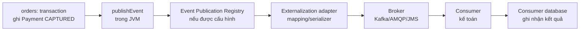
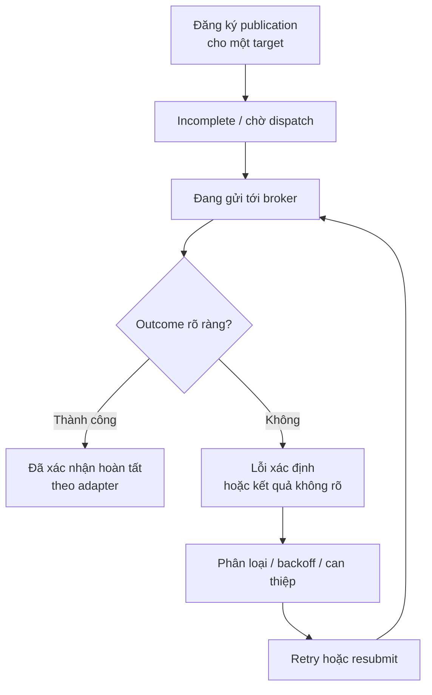
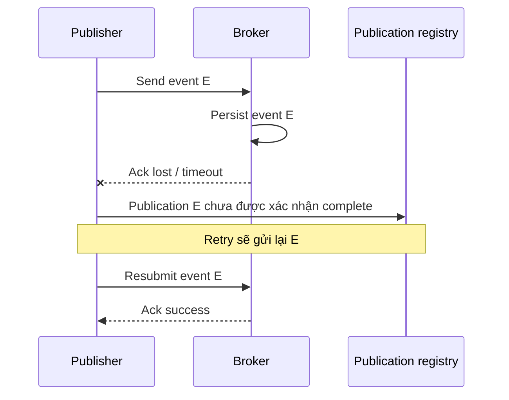
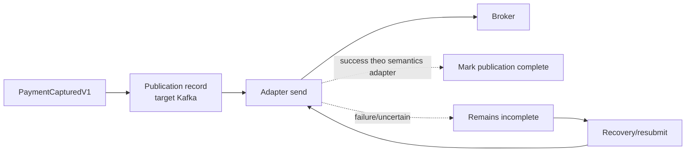
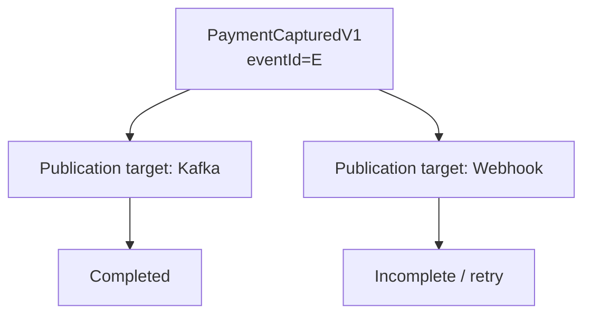
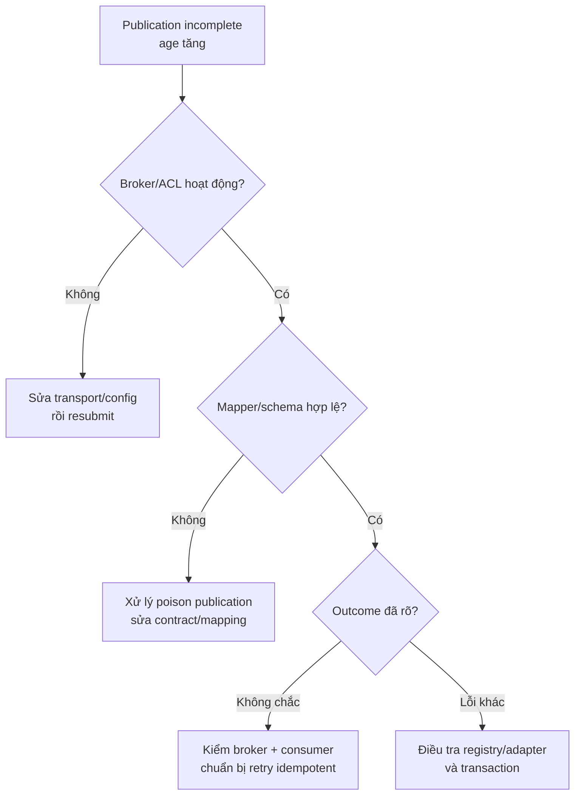
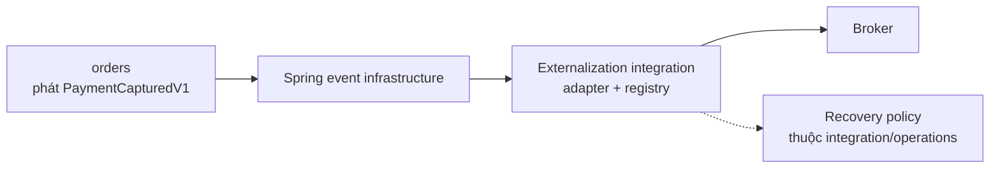
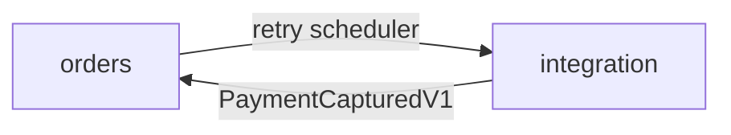

# Lỗi externalization và retry

Một ứng dụng Spring Modulith có thể ghi nhận thanh toán thành công vào database, phát event `PaymentCaptured` và externalize event đó sang Kafka để hệ thống kế toán xử lý. Nhưng điều gì xảy ra khi Kafka tạm ngừng, serializer không thể chuyển payload, kết nối bị timeout hoặc tiến trình producer chết ngay sau khi broker nhận message? Nếu chỉ thử gửi lại một cách mù quáng, hệ thống có thể **mất thông tin, gửi trùng hoặc tạo bão retry**.

**Lỗi externalization và retry** là bài toán thiết kế **trạng thái phát hành, phân loại lỗi, phục hồi và an toàn khi giao nhận nhiều lần**. Trong Spring Modulith, Event Publication Registry có thể hỗ trợ theo dõi publication chưa hoàn tất và làm cơ sở resubmit khi được cấu hình thích hợp. Tuy nhiên, **có registry không đồng nghĩa mọi lỗi tự được retry**, và **gửi thành công không đồng nghĩa consumer đã xử lý xong**.

Bài thuộc chương **Externalization** của học phần `SPRING_MODULITH_VERIFICATION_TESTING`. Học phần rèn khả năng kiểm chứng ranh giới kiến trúc bằng `ApplicationModules` và dependency rules, thực hành `@ApplicationModuleTest`, kiểm thử sự kiện/cơ sở dữ liệu/tích hợp và kết hợp quality gate trong CI để ngăn phụ thuộc sai, hồi quy. Bài này tập trung vào **điểm lỗi, quyết định retry, điều kiện khôi phục và cách chứng minh bằng test**, thay vì giả định hệ thống messaging luôn khả dụng.

## 1. Một sự kiện đi qua những điểm có thể thất bại nào?

Xét event `PaymentCapturedV1` do module `orders` phát:



Các điểm lỗi độc lập:

1. **Transaction producer rollback**: nghiệp vụ chưa thật sự hoàn tất, không nên công bố một event “đã thanh toán”.
2. **Không ghi được publication intent**: nếu yêu cầu publication bền vững nhưng dữ liệu không được lưu, không có cơ sở tin cậy cho recovery.
3. **Mapping/serialization lỗi**: event được chọn nhưng payload không hợp lệ hoặc schema không tương thích.
4. **Kết nối broker lỗi**: timeout, refused connection, DNS, quota, broker restart hoặc lỗi quyền.
5. **Broker nhận nhưng producer không biết chắc**: ack bị mất hoặc tiến trình crash trước khi ghi nhận hoàn tất.
6. **Consumer không xử lý được**: deserialize failure, lỗi nghiệp vụ hoặc consumer database rollback.

Để xử lý đúng, trước tiên phải xác định **lỗi ở đoạn nào**. Không dùng một câu chung chung “publish failed” cho mọi tình huống.

## 2. Bốn mốc thành công tuyệt đối không được gộp

| Mốc | Điều thực sự biết | Điều chưa biết |
| --- | --- | --- |
| `publishEvent(event)` hoàn tất | Spring application event đã được phát theo semantics trong JVM | Publication đã được lưu bền vững hay chưa |
| Publication được registry ghi nhận | Có công việc gửi đến target theo cấu hình registry | Broker đã nhận chưa |
| Broker acknowledgement | Transport đã chấp nhận message theo semantics của adapter | Consumer đã commit side effect chưa |
| Consumer commit business transaction | Side effect bên nhận đã được áp dụng | Message sẽ không bị redeliver trong tương lai |

**Completion của publication** thường phản ánh kết quả xử lý ở **target publication** theo integration adapter, **không phải acknowledgement nghiệp vụ của consumer ngoài JVM**. Một consumer có thể đang backlog dù producer đã đánh dấu publication complete.

Ngược lại, một publication còn incomplete **không chứng minh broker chắc chắn chưa nhận**. Có thể broker đã nhận rồi, nhưng producer chết trước khi ghi completion. Đây là cửa sổ lỗi cần đặc biệt chú ý.

## 3. Đọc trạng thái publication đúng mức khái niệm

Một publication có thể được mô tả ở mức thiết kế:



Những chữ **incomplete, processing, failed, completed** trong sơ đồ là **nhãn khái niệm**; không phải cam kết Spring Modulith có một enum hoặc cột `status` đúng bằng các tên này trong mọi persistence adapter. Một số implementation biểu đạt completion bằng thời điểm hoàn tất; cách lưu lỗi, target identity và trạng thái thay đổi theo phiên bản.

Khi viết dashboard hoặc integration test, hãy dùng **API và schema chính thức của phiên bản Spring Modulith cùng storage mà dự án lựa chọn**, không đoán tên bảng/cột rồi chỉnh dữ liệu thủ công.

## 4. Lỗi transient, lỗi cấu hình và lỗi payload

Phân loại lỗi quyết định **có retry hay cần sửa nguyên nhân**.

| Nhóm lỗi | Ví dụ | Retry tự động? | Hành động quan trọng |
| --- | --- | --- | --- |
| **Transient transport** | Broker restart, mất kết nối ngắn, timeout ngẫu nhiên | Thường có thể | Backoff, giới hạn concurrency và giám sát |
| **Rate limit / throttling** | Broker quota, producer bị giới hạn | Có điều kiện | Tôn trọng cửa sổ retry, giảm tốc độ và batch |
| **Authentication/authorization** | Sai credentials, không có quyền publish topic | Thường không hữu ích nếu chưa sửa | Cảnh báo, sửa cấu hình và ACL |
| **Destination/topology** | Topic/queue/exchange không tồn tại, binding sai | Tùy hạ tầng | Provision đúng và kiểm routing |
| **Serialization** | Field không thể serialize, schema sai, enum không hợp lệ | Không, khi payload không thay đổi | Sửa mapper/schema; xử lý poison publication |
| **Permanent business contract** | Event không còn được consumer hỗ trợ | Không nên retry vô hạn | Versioning, migration hoặc xử lý có duyệt |
| **Ambiguous outcome** | Broker đã nhận nhưng producer timeout trước ack | Có thể gửi lại, **có duplicate** | Giữ event ID và consumer idempotent |
| **Registry/persistence** | Không ghi được trạng thái publication | Phụ thuộc transaction và store | Kiểm tính nhất quán giữa DB nghiệp vụ và registry |
| **Consumer failure** | Consumer xử lý thất bại sau broker ack | Không sửa bằng producer resubmit tùy tiện | Consumer retry/DLQ và idempotency |

Vấn đề không phải “thử lại tất cả cho chắc”, mà là **xác định lỗi nào có thể biến mất nếu thử lại mà không thay đổi dữ liệu/cấu hình**.

## 5. Ví dụ event có identity ổn định

Trong module `orders`, một integration event có thể là:

```java
// com/example/shop/orders/PaymentCapturedV1.java
package com.example.shop.orders;

import java.time.Instant;
import java.util.UUID;
import org.springframework.modulith.events.Externalized;

@Externalized("orders.payment-captured.v1")
public record PaymentCapturedV1(
        UUID eventId,
        UUID paymentId,
        UUID orderId,
        long amountMinorUnits,
        String currency,
        Instant occurredAt
) {}
```

`@Externalized` biểu đạt việc **loại event này được chọn** cho externalization khi adapter và chính sách phù hợp được cấu hình. Giá trị route ở đây là ý định destination của ví dụ; cách ánh xạ sang topic, exchange, routing key hoặc JMS destination còn tùy transport/phiên bản.

Các giá trị quan trọng với retry:

- `eventId`: định danh **sự kiện nghiệp vụ cụ thể**, giữ nguyên khi gửi lại cùng event.
- `paymentId`: định danh nghiệp vụ của khoản thanh toán; một đơn có thể nhiều khoản thanh toán.
- `orderId`: aggregate reference; không thay cho `eventId` khi một đơn có nhiều event.
- `amountMinorUnits` và `currency`: giữ nguyên **ý nghĩa** khi replay; không tự tính lại theo tỷ giá hiện tại.
- `occurredAt`: thời điểm nghiệp vụ xảy ra, không thay bằng thời điểm retry.

Không dựng một `PaymentCapturedV1` mới với UUID/time mới mỗi lần broker lỗi. Làm vậy khiến downstream khó nhận ra các delivery thuộc cùng một sự thật.

## 6. Phát event trong transaction: bước đầu của tính nhất quán

```java
// com/example/shop/orders/internal/CapturePaymentService.java
package com.example.shop.orders.internal;

import com.example.shop.orders.PaymentCapturedV1;
import java.time.Instant;
import java.util.UUID;
import org.springframework.context.ApplicationEventPublisher;
import org.springframework.stereotype.Service;
import org.springframework.transaction.annotation.Transactional;

@Service
class CapturePaymentService {

    private final PaymentLedger payments;
    private final ApplicationEventPublisher events;

    CapturePaymentService(
            PaymentLedger payments,
            ApplicationEventPublisher events) {
        this.payments = payments;
        this.events = events;
    }

    @Transactional
    UUID capture(UUID paymentId, UUID orderId, long amountMinorUnits) {
        // Cần kiểm trạng thái/idempotency trước khi chuyển CAPTURED.
        payments.markCaptured(paymentId, amountMinorUnits);

        var event = new PaymentCapturedV1(
                UUID.randomUUID(),
                paymentId,
                orderId,
                amountMinorUnits,
                "USD",
                Instant.now());

        events.publishEvent(event);
        return event.eventId();
    }
}
```

`PaymentLedger` là abstraction repository/adapter nội bộ chưa được cài đặt trong mảnh code này; cần một implementation và transaction manager thật để chạy. Đây là ví dụ minh họa vị trí **persist rồi publish Spring event**, không phải nghiệp vụ thanh toán production hoàn chỉnh.

**Quan trọng:** `@Transactional` không tự chứng minh event tới broker chỉ sau commit, cũng không tự tạo persistent Event Publication Registry. Cần kiểm integration adapter, transaction-aware publication và storage/recovery thực tế.

### Retry command khác retry publication

Nếu HTTP request `capture(...)` bị gửi lại, code ví dụ tạo `UUID.randomUUID()` mới. Nghiệp vụ production cần một cơ chế **command idempotency và event identity được lưu bền** để không tạo hai business events cho cùng một lần capture.

**Retry publication** của cùng event đã ghi nhận phải **dùng lại payload/`eventId` ban đầu**, không gọi lại `capture(...)` để sinh event khác. Đây là ranh giới bắt buộc giữa retry nghiệp vụ và retry transport.

## 7. Đường lỗi A: transaction producer rollback

Giả sử transaction thanh toán cập nhật database rồi phát `PaymentCapturedV1`, sau đó ném exception khiến transaction rollback.

```text
BEGIN TRANSACTION
  UPDATE payment SET status = CAPTURED
  publishEvent(PaymentCapturedV1(eventId=E))
  throw RuntimeException
ROLLBACK
```

Theo hợp đồng “payment captured”, **không được có một external event thành công phản ánh trạng thái chưa commit**. Một listener thường hoặc một producer gọi trực tiếp trước commit có thể phá vỡ điều này.

Kiểm chứng cần:

1. Transaction thật sự rollback trong database.
2. Externalization adapter không gửi business fact chưa commit theo cơ chế được cấu hình.
3. Publication intent (nếu lưu chung transaction) không tồn tại ở trạng thái có thể resubmit sai.
4. Không có đường gửi song song khác bỏ qua ranh giới transaction.

**Không lấy `entityManager.flush()` làm bằng chứng đã commit**; flush SQL không chấm dứt transaction. Cần test commit/rollback với transaction boundary thực.

## 8. Đường lỗi B: DB commit rồi broker không khả dụng

Một timeline thực tế:

```text
T0  Payment status = CAPTURED được commit
T1  Event externalization được kích hoạt
T2  Kafka unavailable
T3  Adapter gửi thất bại
T4  Không có message được xác nhận
```

Nếu yêu cầu nghiệp vụ là **không làm mất thông tin thanh toán**, hệ thống cần một bản ghi publication/intent đủ bền vững để retry sau T3. Event Publication Registry của Spring Modulith có thể hỗ trợ việc này khi persistence, listener integration và recovery được cấu hình đúng.

Nhưng:

- DB payment commit thành công **không có nghĩa broker đã nhận**.
- Broker lỗi sau commit **không thể tự rollback** giao dịch payment đã hoàn tất.
- Có incomplete publication **không có nghĩa đã có worker tự resubmit**.
- Nếu persistence chỉ in-memory, restart có thể làm mất thông tin cần gửi.

Test phải phân biệt “broker down, pending publication sẽ được phục hồi” với “broker down, event thực sự bị mất”.

## 9. Đường lỗi C: outcome gửi broker không xác định

Đây là tình huống gây duplicate thường gặp:



**Timeout không chứng minh broker chưa nhận.** Nó có thể chỉ chứng minh producer không biết chắc kết quả. Nếu retry theo hướng đảm bảo cuối cùng message tới broker, cần **chấp nhận khả năng gửi trùng** và thiết kế consumer chịu được việc này.

Khác biệt hai chiến lược:

- **At-most-once-oriented:** không gửi lại khi outcome mơ hồ để tránh duplicate, nhưng có thể **mất sự kiện**.
- **At-least-once-oriented:** gửi lại publication chưa hoàn tất, nhưng có thể **duplicate delivery**.

Không thể đạt end-to-end exactly-once chỉ từ việc có một trường `eventId`, một Kafka producer hoặc một registry. Cần xét toàn bộ producer transaction, broker semantics và consumer business transaction.

## 10. Đường lỗi D: broker ack nhưng publisher crash trước completion

```text
1. Registry có publication E còn incomplete.
2. Adapter gửi E tới broker.
3. Broker xác nhận E đã được chấp nhận.
4. Tiến trình chết trước khi registry ghi complete.
5. Sau restart, E vẫn có vẻ cần gửi lại.
6. Recovery gửi E một lần nữa.
```

Đây là lý do **trạng thái incomplete không đồng nghĩa “chưa bao giờ gửi”**. Khi resubmit, phải dùng lại định danh event và payload tương ứng, không tự tạo lại một event “thanh toán mới”.

Nếu có nhiều target, completion cần được hiểu **theo từng publication/target**. Đích Kafka thành công không tự chứng minh đích RabbitMQ đã thành công, và ngược lại.

## 11. Đường lỗi E: serialize không được

Ví dụ event chứa một JPA proxy, một kiểu không hỗ trợ serializer hoặc dữ liệu không thỏa schema:

```text
PaymentCaptured event
  -> mapping fails
  -> serializer throws
  -> no valid broker payload
  -> retry same data fails again
```

Đây thường là **lỗi cố định (deterministic)**, không được chữa bằng vòng lặp retry nhanh. Biện pháp hợp lý:

1. Thu thập lỗi có kiểm soát, không log payload chứa thông tin nhạy cảm.
2. Phân loại **schema/serialization** thay vì network.
3. Sửa contract/mapper/serializer theo quy trình versioning.
4. Đảm bảo publication cần thiết vẫn được nhận diện nếu cơ chế durability hỗ trợ.
5. Resubmit có kiểm soát sau khi sửa, kiểm tra payload thực tế trên broker.

Nếu logic mapping được chạy **sau commit** và luôn throw, cần hiểu registry lưu **event nguồn** hay **payload đã map** theo adapter/version. Nếu sửa mapper về sau, một replay có thể tạo representation khác với lần đầu; việc đó phải nằm trong chính sách hợp đồng, không được giả định an toàn.

## 12. Đường lỗi F: broker nhận được, consumer lỗi

Giả sử Kafka có message hợp lệ nhưng consumer kế toán không thể ghi transaction:

```text
Publisher: publication complete
Kafka:     event persisted
Consumer:  database unavailable -> processing failed
```

**Không tự resubmit từ producer chỉ vì consumer chưa xử lý.** Đó là vấn đề của consumer offset/ack, retry, DLQ, schema hoặc database. Nếu producer gửi lại vô điều kiện, downstream có thể nhận nhiều message trùng không cần thiết.

Để biết consumer đã **thực sự xử lý**, cần quan sát consumer side effects hoặc một **business acknowledgement** được thiết kế riêng. Completion của Event Publication Registry phía producer không phải acknowledgement đó.

## 13. Event Publication Registry giúp retry ở đoạn nào?

Registry có vai trò theo dõi **event publication tới target**. Trong bối cảnh externalization, khi được cấu hình với persistence adapter phù hợp, nó có thể giữ trạng thái publication chưa hoàn tất để cơ chế recovery/resubmission xử lý.



### Những điều cần xác nhận theo phiên bản thực tế

- Loại listener/adapter nào được registry theo dõi?
- Có module persistence nào đã được thêm và cấu hình không?
- Publication record có gắn với **cùng transaction** ghi business data không?
- Thời điểm adapter đánh dấu complete là **sau điều kiện nào**?
- Cơ chế resubmission được kích hoạt tự động hay cần job/operator?
- Có giới hạn/batching/concurrency cho recovery không?
- Schema lưu publication và cách serialization event có đáp ứng versioning/replay không?

Không mặc định rằng chỉ thêm `@Externalized` sẽ tự tạo persistent outbox hoặc một job retry vô hạn. Các API và thuộc tính cấu hình có thể khác nhau giữa các bản Spring Modulith; cần kiểm tra tài liệu phiên bản đang dùng trước khi copy cấu hình.

## 14. Không nhầm registry với retry của Kafka client

Có ít nhất hai tầng có thể thử lại:

1. **Transport producer retry**: Kafka client/AMQP adapter cố gửi lại một operation theo semantics của thư viện.
2. **Application publication resubmission**: khi một publication vẫn incomplete trong store, ứng dụng quyết định dispatch lại sau sự cố hoặc restart.

```text
Application event E
  -> Registry publication P
      -> Adapter send attempt A
          -> Client retry A.1
          -> Client retry A.2
      -> P incomplete
  -> Registry resubmit P
      -> Adapter send attempt B
```

Hai tầng này có thể cùng tồn tại. Nếu cấu hình cả hai retry rất tích cực, tổng số lần thử và tải lên broker có thể lớn hơn tưởng tượng.

**Hành động thiết kế:** ghi rõ **ai sở hữu retry**, điều kiện dừng, số lần thử, backoff và metric ở từng tầng. Không chỉ đặt tên biến `retryCount` chung rồi suy ra nó đại diện cho toàn bộ hệ thống.

## 15. Retry tức thì, backoff và jitter

Một lỗi kết nối tạm thời thường nên được thử lại với khoảng cách tăng dần, thay vì vòng lặp liên tục.

Ví dụ chính sách khái niệm:

```text
Attempt 1: ngay sau lỗi
Attempt 2: khoảng 2 giây
Attempt 3: khoảng 4 giây
Attempt 4: khoảng 8 giây
Attempt 5: khoảng 16 giây
Sau ngưỡng: đánh dấu cần vận hành can thiệp hoặc chờ lịch recovery khác
```

Các khoảng trên chỉ là **ví dụ**, không phải default của Spring Modulith. Với broker quota, timeout dài hoặc nhiều instance, khoảng thực tế phải theo SLO và khả năng hạ tầng.

### Vì sao cần jitter?

Nếu hàng nghìn instance đều retry chính xác ở giây 2, 4, 8, chúng có thể cùng đánh thức tạo **thundering herd**, khiến broker vừa hồi phục lại bị quá tải.

Một công thức minh họa:

```text
baseDelay = 2 seconds
maxDelay  = 60 seconds

exponentialDelay(attempt) =
    min(maxDelay, baseDelay * 2^(attempt-1))

jitterDelay =
    random between 0 and exponentialDelay(attempt)
```

**Full jitter** là một lựa chọn. Cũng có các chiến lược equal/decorrelated jitter; quan trọng là phân tán retry để giảm xung tải. Khi cần bảo vệ broker, kết hợp **rate limiting và concurrency control**, không chỉ backoff từng request.

## 16. Ví dụ Java cho phép tính độ trễ — không phải job tự retry

```java
package com.example.shop.integration;

import java.time.Duration;
import java.util.concurrent.ThreadLocalRandom;

final class BackoffPolicy {

    private static final long BASE_MILLIS = 2_000L;
    private static final long MAX_MILLIS = 60_000L;

    Duration delayForAttempt(int attempt) {
        if (attempt < 1) {
            throw new IllegalArgumentException(
                    "attempt must be >= 1");
        }

        long cap = BASE_MILLIS;
        for (int i = 1; i < attempt && cap < MAX_MILLIS; i++) {
            cap = Math.min(MAX_MILLIS, cap * 2);
        }

        long millis = ThreadLocalRandom.current()
                .nextLong(cap + 1);
        return Duration.ofMillis(millis);
    }
}
```

Class trên chỉ minh họa **policy tính delay**, không gọi Spring Modulith registry và không khởi chạy worker. Trong triển khai thật, cần kết nối policy với cơ chế retry/resubmission được adapter/phiên bản hỗ trợ và xử lý shutdown/cancellation đúng.

Không được viết một vòng lặp `while(true)` bên trong transaction nghiệp vụ để chờ broker hồi phục. Điều đó giữ connection/lock lâu, tăng latency và có thể khiến transaction timeout. Công việc retry dài hạn nên được quản lý **ngoài transaction ban đầu**, theo một cơ chế phục hồi phù hợp.

## 17. Bounded retry hay retry vô hạn?

Không có một số lần thử phù hợp cho mọi event. Cần tách hai câu hỏi:

1. **Bao nhiêu lần thử tự động trước khi báo động/can thiệp?**
2. **Có được phép bỏ vĩnh viễn publication chưa hoàn tất không?**

Với event báo cáo không quan trọng, một policy có thể có giới hạn nhất định và đối soát định kỳ. Với sự kiện kế toán hoặc đối soát thanh toán, “bỏ message sau 5 lần” có thể không chấp nhận được nếu hợp đồng yêu cầu không mất dữ liệu.

Thiết kế tốt có thể:

- Giới hạn số lần thử **liên tục** trong một cửa sổ.
- Sau ngưỡng, giữ publication **incomplete**, đưa vào hàng chờ can thiệp hoặc trạng thái vận hành phù hợp.
- Cảnh báo đúng người sở hữu integration.
- Cho phép resubmit thủ công **có audit** sau khi sửa cấu hình/schema.
- Có reconciliation nếu sự kiện đã đến broker nhưng kết quả không chắc chắn.

**Giới hạn retry không đồng nghĩa được phép xóa intent nghiệp vụ.** Quy tắc bỏ/chuyển trạng thái cần quyết định dựa trên SLO và chính sách dữ liệu.

## 18. Retry và circuit breaker không giống nhau

Retry xử lý **một lần gửi thất bại** bằng cách thử lại. Circuit breaker có thể **tạm ngừng các lần gọi mới** khi một đích liên tục lỗi để giảm tải và cho hệ thống hồi phục.

```text
Broker healthy:
  circuit closed -> cho phép gửi

Broker liên tục lỗi:
  circuit opens -> từ chối/hạn chế gửi mới

Sau khoảng chờ:
  half-open -> thử một số request kiểm tra
```

Nếu có durable publication store, khi circuit mở ta có thể giữ công việc phát hành để xử lý sau theo policy. Nhưng **circuit breaker không tự lưu event** và không biến một lời gọi send bỏ qua thành một publication bền vững.

Kết hợp retry, breaker, rate limit, timeout và backpressure phải tránh **tầng nào cũng retry cùng lúc**. Đặc biệt với nhiều replica, cần giữ mức gửi phù hợp với quota broker.

## 19. Poison publication: khi thử lại không thể chữa lỗi

Một **poison publication** là một công việc gửi liên tục thất bại vì payload, schema hoặc điều kiện không thay đổi qua các lần thử.

Ví dụ:

```text
eventType = orders.payment-captured.v1
currency  = null
serializer yêu cầu currency hợp lệ
retry 1 -> lỗi
retry 2 -> lỗi
retry 3 -> lỗi
...
```

Đây là lỗi nên được **phân loại và dừng retry nhanh**, thay vì sử dụng toàn bộ tài nguyên của worker.

Một quy trình xử lý:

1. Ghi nhận ID publication, event type, target và loại lỗi (không log dữ liệu bí mật).
2. Xác định lỗi có cần sửa **mapper/schema** hay **dữ liệu nguồn** không.
3. Xem xét hợp đồng: có được phép phát một **event correction/version mới** thay vì sửa một event lịch sử?
4. Sửa nguyên nhân theo quy trình kiểm thử và review.
5. Resubmit có kiểm soát sau khi xác minh representation vẫn đúng business fact.
6. Đối soát downstream vì có thể đã nhận một phần dữ liệu qua đường khác.

Đừng trực tiếp chỉnh byte của publication record persisted khi chưa hiểu contract và cơ chế serialization/replay; như vậy có thể phá bằng chứng audit hoặc biến một event lịch sử thành một sự thật mới.

## 20. Dead-letter queue và publication registry giải quyết khác đoạn

**Dead-letter queue (DLQ)** thường là nơi đưa message **không được xử lý thành công trong một luồng transport/consumer** theo policy; định nghĩa cụ thể tùy Kafka/RabbitMQ/JMS và thư viện.

**Event Publication Registry** ở phía producer theo dõi **công việc phát hành** tới target. Hai cơ chế không đồng nhất:

| Hạng mục | Publication registry | Consumer-side DLQ |
| --- | --- | --- |
| Vị trí | Phía publisher / externalization target | Thường phía nhận hoặc broker routing |
| Câu hỏi | Đã gửi thành công theo target chưa? | Consumer có xử lý được message đã nhận không? |
| Lỗi điển hình | Broker outage, adapter send failure | Deserialize, domain validation, consumer DB lỗi |
| Recovery | Resubmit publication chưa complete | Reprocess/re-drive DLQ có kiểm soát |
| Nguy cơ gửi trùng | Gửi lại khi outcome không rõ | Re-drive sau khi side effect đã chạy một phần |

**Không chuyển mọi lỗi producer vào consumer DLQ** chỉ vì có chữ “message”. Nếu broker chưa nhận message, consumer-side DLQ có thể hoàn toàn không nhìn thấy nó.

Với RabbitMQ, dead-letter exchange và queue có semantics broker khác với Kafka retry topic/DLT. Cần cấu hình và test đúng transport thay vì gộp hai hệ thống vào một thuộc tính chung tưởng tượng.

## 21. Error channel, async send và điểm ghi completion

Khi dùng Spring Messaging/Spring Integration, một handler có thể gửi message bất đồng bộ tới broker:

```text
MessageChannel.send(message) -> accepted
  |
  v
Outbound handler calls Kafka producer
  |
  v
Producer future completes later
  |-- success
  '-- exception
```

`MessageChannel.send(...)` trả `true` có thể chỉ thể hiện việc channel **handoff** thành công. Nó không mặc định chứng minh broker đã ack.

Nếu externalization adapter hoặc một bridge tự viết đánh dấu publication complete **ngay khi channel accepted**, nhưng future broker thất bại sau đó, có thể mất cơ hội retry vì registry tin công việc đã hoàn tất.

Vì vậy phải xác minh:

- Adapter dùng **điểm nào làm thành công**: handoff, callback, future completion hay publisher confirm?
- Lỗi bất đồng bộ có được đưa về publication lifecycle hoặc telemetry không?
- Với error channel, có consumer/error handler và chính sách lưu bền khi cần không?
- Completion có được ghi **sau điều kiện xác nhận đúng hợp đồng** không?

**Một error channel trong memory không tự trở thành outbox bền vững**. Các tầng lỗi và recovery cần được tích hợp đúng theo stack sử dụng.

## 22. Một event, nhiều target: retry từng publication

Giả sử `PaymentCapturedV1` cần đi tới Kafka và một webhook tích hợp:



Nếu Kafka thành công còn webhook lỗi, **không nên resubmit Kafka vô điều kiện** chỉ vì “event E chưa hoàn tất toàn bộ”. Mức hạt (granularity) của publication phải theo **đích nhận**, đúng như framework/adapter cấu hình hỗ trợ.

Trong một hệ thống tự viết gateway/router, developer phải triển khai trạng thái từng target nếu có yêu cầu recovery độc lập. Spring Modulith registry không tự quản lý mọi đích tùy ý do ứng dụng tự xây ngoài cơ chế listener/target mà nó biết.

Khi event gửi nhiều version contract (v1/v2), cần tránh để consumer subscribe cả hai và tính hai lần cùng business fact. Versioning và idempotency không được bỏ qua trong retry.

## 23. Retry trong hệ thống nhiều instance

Một ứng dụng modular monolith có thể chạy trên **nhiều replica**. Khi broker hồi phục, nếu mọi replica đều quét cùng publication incomplete mà không điều phối:

```text
Replica A: claim publication E -> send E
Replica B: claim publication E -> send E
Replica C: claim publication E -> send E
```

Điều này có thể tạo duplicate và retry storm. Cần xem khả năng **claim/lock/lease/concurrency** của cơ chế resubmission mà phiên bản Spring Modulith/persistence hỗ trợ. Nếu tự tổ chức worker, phải xử lý cạnh tranh qua một cơ chế an toàn tương ứng với database/store.

Ngay cả có lock, duplicate vẫn có thể xảy ra khi ack bị mất. **Concurrency control giảm duplicate không cần thiết**, không thay thế idempotency ở consumer.

Đừng suy rằng một job `@Scheduled` trên mọi replica là an toàn chỉ vì các bản ghi publication dùng primary key khác nhau.

## 24. Message order và delayed retry

Giả sử cùng một đơn có hai business events:

```text
E1: PaymentCaptured(orderId=O, sequence=10)
E2: PaymentRefunded(orderId=O, sequence=11)
```

Nếu E1 bị kẹt, E2 gửi thành công, rồi E1 được retry, consumer có thể nhận **refund trước capture**.

Để kiểm soát:

1. Phân biệt **thứ tự commit business** với **thứ tự dispatch/recovery**.
2. Nếu cần ordering theo aggregate ở Kafka, chọn key/partitioning phù hợp **và kiểm tra adapter gửi đúng key**.
3. Đưa `aggregateVersion` hoặc sequence khi consumer phải nhận diện event cũ.
4. Dùng state machine/reconciliation ở consumer cho event out-of-order.
5. Không mặc định việc Kafka bảo toàn thứ tự trong partition giải quyết **event gửi lại muộn** hoặc thứ tự qua **hai topic**.

Một retry policy hợp lệ về độ tin cậy vẫn có thể làm thay đổi thứ tự consumer nhìn thấy. Hãy kiểm thử kịch bản này nếu trạng thái downstream phụ thuộc vào sequence.

## 25. Consumer idempotency: chống hai lần hạch toán

Consumer nhận `PaymentCapturedV1` có thể ghi doanh thu vào database. Nếu xử lý lại cùng event, dữ liệu không được nhân đôi.

Ví dụ schema minh họa của **consumer**, không phải Event Publication Registry Spring Modulith:

```sql
CREATE TABLE processed_events (
    event_id VARCHAR(36) PRIMARY KEY,
    processed_at TIMESTAMP NOT NULL
);

CREATE TABLE payment_projection (
    payment_id VARCHAR(36) PRIMARY KEY,
    amount_minor_units BIGINT NOT NULL,
    currency VARCHAR(3) NOT NULL
);
```

Logic xử lý cần atomicity:

```text
BEGIN CONSUMER TRANSACTION
  INSERT processed_events(eventId)
  IF unique conflict:
      bỏ qua side effect đã áp dụng của eventId
  ELSE:
      INSERT/UPDATE payment_projection theo business semantics
COMMIT
ACK MESSAGE
```

**Bản ghi processed và side effect phải nằm trong cùng transaction**, hoặc một cơ chế idempotency tương đương. Nếu ghi marker trước nhưng projection update thất bại, retry có thể bị bỏ qua sai. Nếu projection update thành công mà marker chưa commit, retry có thể ghi lại.

Với consumer đồng thời, cần **unique constraint** hoặc cơ chế database atomic tương ứng, không chỉ `if (!exists(eventId))` rồi ghi sau mà không kiểm soát race.

## 26. Định nghĩa retry budget theo SLA/SLO

Hệ thống cần rõ: event được phép chậm bao lâu? Có cần mọi publication cuối cùng đến được consumer không? Những quyết định này ảnh hưởng policy:

| Event | Yêu cầu minh họa | Chính sách cân nhắc |
| --- | --- | --- |
| Analytics clickstream | Có thể chấp nhận mất một phần theo thỏa thuận | Giới hạn retry, sampling, ghi nhận loss |
| Order confirmation cho fulfillment | Có thể nhận trễ, không nên mất | Durable publication, recovery và reconciliation |
| Payment captured cho kế toán | Cần audit và đối soát | Durable publication, idempotency, monitoring chặt |
| Cache invalidation | Có thể dựng lại cache | TTL/rebuild, không nhất thiết retry vô hạn |

Ngưỡng như “retry 5 lần” hoặc “alert sau 10 phút” **không phải default chung của Spring Modulith**. Nó phải được phê duyệt dựa trên risk assessment, SLA của integration và khả năng phục hồi vận hành.

Đặc biệt, **đã vượt retry budget** không nhất thiết có nghĩa được xóa publication chưa hoàn tất. Với những luồng có yêu cầu audit, cần giữ trạng thái để xử lý bằng quy trình được giám sát.

## 27. Metric nào cho biết retry đang nguy hiểm?

Theo dõi tối thiểu:

| Metric | Ý nghĩa | Cảnh báo điển hình |
| --- | --- | --- |
| `incomplete_publications` | Số publication chưa complete trong store | Backlog tăng liên tục |
| `oldest_incomplete_age` | Tuổi lớn nhất của publication chưa complete | Một event mắc kẹt lâu dù tổng số nhỏ |
| `externalization_attempts` | Số lần dispatch theo target/event type | Retry storm, tải tăng bất thường |
| `externalization_failures` | Tỷ lệ lỗi adapter, phân theo nguyên nhân | Kafka outage, ACL, schema |
| `serialization_errors` | Lỗi deterministic tại mapper/serializer | Poison event / contract regression |
| `broker_ack_latency` | Độ trễ broker xác nhận | Transport quá tải |
| `consumer_lag` | Độ trễ xử lý của consumer | Broker đã nhận, downstream vẫn chậm |
| `deduplicated_messages` | Số message lặp bị consumer bỏ qua | Recovery/network ambiguity tăng |

Các tên trên là **metric đề xuất**, không phải tên metric Spring Modulith bắt buộc cung cấp. Cần cấu hình instrumentation theo adapter/framework đang dùng.

**Phân biệt publish latency với end-to-end processing latency.** Broker có thể ack nhanh trong khi consumer lag nhiều giờ. Registry completed phía producer không trả lời câu hỏi consumer đã cập nhật kế toán chưa.

## 28. Structured logs, correlation và bảo mật

Một log hữu ích khi retry:

```text
eventType=orders.payment-captured.v1
eventId=E-123
publicationTarget=kafka.orders.payment-captured.v1
attempt=3
outcome=timeout
nextAction=resubmit-after-backoff
correlationId=ORDER-456
```

Đây là mẫu **cấu trúc log minh họa**, không phải định dạng mặc định của thư viện.

Không ghi nguyên payload chứa email, số thẻ, token hoặc thông tin cá nhân nhạy cảm để tiện debug. Thay vào đó, log các ID và **lỗi đã phân loại**. Nếu registry persistence có lưu event nguồn chứa PII, cần giới hạn quyền đọc và retention, mã hóa khi cần theo chính sách dữ liệu.

Khi theo dõi nhiều lần retry, sử dụng cùng `eventId` và một **publication identifier/target identifier** để phân biệt:

- Cùng event gửi lại tới cùng target.
- Cùng event gửi tới target khác.
- Một business event mới của cùng payment/order.

## 29. Runbook: broker ngừng, rồi hoạt động lại

Một quy trình vận hành cụ thể:

1. **Xác nhận sự cố transport:** producer errors, broker health, ACL/quota/destination.
2. **Kiểm tra DB nghiệp vụ:** payment/order nào đã commit và event nào được phát.
3. **Kiểm tra publication store:** số incomplete và tuổi cũ nhất nếu persistent registry đang dùng.
4. **Phân loại lỗi:** transient hay deterministic? Broker outage khác schema mismatch.
5. **Ngăn retry storm:** hạn chế concurrency, backoff/jitter hoặc tạm circuit khi cần.
6. **Khắc phục nguyên nhân:** khôi phục broker, sửa credentials/route hoặc sửa schema.
7. **Resubmit có kiểm soát** theo cơ chế của phiên bản Spring Modulith/adapter, có audit.
8. **Kiểm event identity:** cùng event phải giữ ID/payload hợp đồng đúng.
9. **Kiểm downstream:** consumer lag, DLQ, idempotency, số transaction hạch toán.
10. **Đối soát:** publication complete không thay thế đối chiếu trạng thái business.

Không tự đánh dấu các publication incomplete thành `completed` trong database để làm dashboard xanh. Thao tác đó có thể khiến công việc gửi chưa hoàn thành bị bỏ quên vĩnh viễn.

## 30. Runbook: một publication retry mãi không thành công

Khi chỉ một event mắc kẹt nhưng broker khỏe:



Không cứ thấy publication incomplete là khởi động thêm nhiều worker. Nếu adapter chưa được đăng ký target, selector không chọn event hoặc route sai, retry nhiều chỉ lặp lại lỗi. Cần tìm **nguyên nhân cấu hình** trước.

## 31. Đặt retry ở đâu để giữ boundary module?

Module `orders` không nên import `KafkaTemplate`, `RabbitTemplate` hoặc implementation `integration.internal.RetryScheduler` chỉ để tự xử lý sự cố broker.

Mô hình mong muốn:



**Business module sở hữu event**, tầng externalization sở hữu adapter/routing/retry policy, và consumer sở hữu side effect/idempotency. Nếu dùng custom gateway/channel, phải đặt port/adapter đúng chiều dependency, không để module nghiệp vụ phụ thuộc implementation nội bộ của integration.

Một event listener ở `integration` có tham số `orders.PaymentCapturedV1` tạo cạnh kiểu **`integration → orders`**. Đây là quan hệ có thể kiểm bằng `ApplicationModules.verify()`. Retry logic không nên lén tạo cạnh ngược `orders → integration`.

## 32. Kiểm chứng kiến trúc: `ApplicationModules.verify()`

Test JUnit:

```java
// src/test/java/com/example/shop/ModularityTests.java
package com.example.shop;

import org.junit.jupiter.api.Test;
import org.springframework.modulith.core.ApplicationModules;

class ModularityTests {

    @Test
    void verifiesModuleBoundaries() {
        ApplicationModules.of(ShopApplication.class).verify();
    }
}
```

`verify()` kiểm tra các quy tắc cấu trúc Spring Modulith được áp dụng: không có dependency cycle, không truy cập API/internal sai và tuân thủ `allowedDependencies` khi được khai báo.

**Những điều `verify()` không chứng minh:** broker có nhận event không, adapter dùng ack condition nào, registry có persistence hay không, retry chạy khi restart không, consumer có xử lý trùng an toàn không. Đó là trách nhiệm của integration tests.

Nếu thêm một class `RetrySupport` trong `orders` trực tiếp gọi implementation của `integration` và module `integration` cũng import event của `orders`, có thể xuất hiện cycle. Đừng “sửa test” bằng cách mở whitelist vô tội vạ; xem lại ownership và hướng phụ thuộc.

## 33. Test tầng một: sự kiện nghiệp vụ có được publish?

Spring Modulith Test có `@ApplicationModuleTest` và `PublishedEvents`:

```java
// src/test/java/com/example/shop/orders/internal/CapturePaymentTests.java
package com.example.shop.orders.internal;

import static org.assertj.core.api.Assertions.assertThat;

import com.example.shop.orders.PaymentCapturedV1;
import java.util.UUID;
import org.junit.jupiter.api.Test;
import org.springframework.beans.factory.annotation.Autowired;
import org.springframework.modulith.test.ApplicationModuleTest;
import org.springframework.modulith.test.PublishedEvents;

@ApplicationModuleTest
class CapturePaymentTests {

    @Autowired CapturePaymentService service;

    @Test
    void publishesCapturedEvent(PublishedEvents events) {
        service.capture(
                UUID.randomUUID(),
                UUID.randomUUID(),
                1234L);

        assertThat(events.ofType(PaymentCapturedV1.class))
                .hasSize(1);
    }
}
```

Test này cần implementation `PaymentLedger`, dữ liệu fixture và transaction manager phù hợp. Nó là một ví dụ cấu trúc **test nội bộ module**, không phải project tự chạy khi chưa có repository thật.

**Kết luận hợp lệ:** ứng dụng đã publish một Spring event đúng kiểu trong phạm vi test.

**Kết luận chưa hợp lệ:** đã ghi publication vào persistent registry, Kafka đã nhận message, hoặc recovery sẽ chạy sau crash. Phải có những lớp test tiếp theo.

## 34. Test tầng hai: broker outage và trạng thái incomplete

Với integration test dùng database/broker thật hoặc Testcontainers:

```text
Given:
  Spring Modulith externalization adapter đúng phiên bản đang chạy
  persistent publication repository và transaction manager hợp lệ
  Kafka/RabbitMQ broker test, destination đã provision

When:
  1. Tạm dừng broker hoặc chặn transport theo cách kiểm soát được.
  2. Capture payment và COMMIT transaction nghiệp vụ.

Then:
  3. Payment state đã commit trong database.
  4. Publication externalization target chưa complete,
     còn quan sát được qua API/store đúng phiên bản.
  5. Lỗi gửi được ghi nhận theo telemetry.

When:
  6. Khôi phục broker.
  7. Kích hoạt recovery/resubmit phù hợp với cấu hình.

Then:
  8. Broker nhận PaymentCapturedV1 có eventId ban đầu.
  9. Publication được đánh dấu complete theo adapter.
```

**Không tự khẳng định bước 7 sẽ chạy khi broker hoạt động lại.** Tùy Spring Modulith version và cách bật recovery, có thể cần startup hook, scheduled resubmission hoặc thao tác operator. Test phải **thực sự kích hoạt** cơ chế đã triển khai.

Trường hợp broker/producer trả kết quả không chắc chắn cần kiểm tra thêm dữ liệu ở broker; chỉ dựa vào “test consumer chưa poll được” không đủ để kết luận chưa gửi.

## 35. Test tầng ba: retry không tạo business event mới

Một ca test quan trọng là **giữ identity**:

```text
Given:
  PaymentCapturedV1(eventId=E, paymentId=P, amount=1234)
  publication E bị lỗi transport sau DB commit

When:
  retry/resubmit publication E

Then:
  broker nhận payload cho eventId=E
  không gọi lại CapturePaymentService.capture(...)
  không phát sinh eventId=E2 mới cho cùng publication
  PaymentLedger không ghi khoản capture lần hai
```

Việc retry một publication đã lưu phải được kiểm ở **đường phục hồi**, không bằng cách gọi lại API nghiệp vụ rồi so sánh tên event. Nếu API nghiệp vụ là idempotent, đó là một test khác thuộc command handling.

## 36. Test tầng bốn: consumer duplicate handling

Trong consumer integration test, cố tình đưa **hai message cùng eventId** đến consumer:

```text
Send event E -> consumer xử lý, COMMIT.
Send event E lần hai -> consumer nhận.

Assert:
  processed_events có đúng một marker cho E
  payment_projection ghi đúng một khoản thanh toán
  tổng doanh thu không nhân đôi
  consumer ack/offset xử lý theo policy của transport
```

Test cần transaction database thật/unique constraint, và nên có ca **lỗi giữa ghi marker và ghi side effect** để chắc chắn chúng cùng commit hoặc rollback. Nếu chỉ assert listener được gọi một lần trong memory, chưa chứng minh idempotency.

## 37. Test tầng năm: lỗi serializer, quyền và route

Ma trận test âm nên có:

| Tình huống | Điều cần quan sát |
| --- | --- |
| Payload không serialize được | Adapter báo lỗi, publication không âm thầm complete |
| Schema registry từ chối schema | Lỗi contract phân loại rõ; không retry nhanh mãi |
| Broker thiếu quyền publish | Lỗi ACL/auth được nhận diện; có alert/can thiệp |
| Topic/queue không tồn tại | Không silently success; kiểm provisioning/routing |
| Producer timeout sau broker có thể đã nhận | Recovery an toàn trước duplicate |
| Registry DB unavailable | Đảm bảo transaction/intent policy được thực thi đúng |
| Resubmission sau restart | Publication còn tồn tại khi dùng persistent storage |
| Nhiều replica cùng recovery | Concurrency/duplicate được kiểm theo cơ chế đã cấu hình |
| Consumer luôn ném exception | Consumer retry/DLQ xử lý riêng; publisher không spam resubmit tùy tiện |

Các trường hợp lỗi này có mức kiểm thử khác nhau. Không cần nhồi tất cả vào một test kéo dài; phân thành nhóm **unit/policy**, **registry persistence**, **broker integration** và **consumer** để tránh flaky và dễ chẩn đoán.

## 38. Test rollback: không retry một sự thật chưa commit

Một lỗi nghiêm trọng là event “payment captured” được externalize khi transaction producer rollback.

```text
Begin transaction
  update Payment -> CAPTURED
  publish PaymentCapturedV1(E)
  throw RuntimeException
Rollback

Expect:
  Payment không ở trạng thái CAPTURED đã commit
  broker không có publication thành công cho E
  registry không giữ intent hợp lệ để resubmit E như captured fact
```

Khi viết test:

- Nếu test class có `@Transactional`, Spring Test thường rollback mặc định. Test `PublishedEvents` có thể PASS dù không có commit.
- Dùng `TestTransaction.flagForCommit()/end()` khi cần quan sát một commit thật của test-managed transaction.
- Dùng `TestTransaction.flagForRollback()/end()` hoặc exception/rollback-only test để xác minh nhánh thất bại.
- Đọc trạng thái DB qua transaction/connection mới sau kết thúc, không chỉ JPA persistence context đang mở.
- Dùng broker test cô lập và bounded observation; không coi một lần poll 1 ms là bằng chứng hoàn toàn không có message.

**After-commit và durable retry giải quyết hai vấn đề khác nhau**: after-commit bảo vệ ý nghĩa business fact, registry/outbox + recovery bảo vệ khả năng gửi khi transport hỏng. Cả hai đều cần kiểm nếu hợp đồng tích hợp yêu cầu.

## 39. Negative test: “không có message” dễ gây flaky

Một bài test:

```java
// Phản ví dụ về assertion không đủ mạnh:
assertThat(consumer.poll(Duration.ofMillis(1)).isEmpty()).isTrue();
```

Không đọc thấy message sau 1 ms **không chứng minh** nó sẽ không xuất hiện sau đó. Test có thể dùng sai offset, consumer group chưa subscribe hoặc adapter chưa dispatch.

Thiết kế tốt hơn:

1. Broker/container và consumer group/queue riêng cho mỗi test khi có thể.
2. Event ID đặc thù, không suy từ topic rỗng chung.
3. Test **selection/transaction phase** riêng để kiểm nguyên nhân gốc.
4. Bounded wait đủ hợp lý và các điều kiện quan sát rõ.
5. Quan sát publication store đúng semantics khi cần.
6. Không chia sẻ message/offset không kiểm soát giữa các test chạy song song.

Không có negative integration test nào với timeout hữu hạn chứng minh “event sẽ không bao giờ xuất hiện trong mọi hoàn cảnh tương lai”; hãy kết hợp **bằng chứng cấu hình và các lớp test** để đạt mức tin cậy phù hợp.

## 40. Kiểm chứng allowed dependencies khi thêm cơ chế retry

Giả sử module `integration` có listener nhận `orders.PaymentCapturedV1`. Nó tạo cạnh **`integration → orders`** vì Java code import event type thuộc `orders`.

Nếu module `orders` đồng thời import `integration.internal.KafkaRetryScheduler`, có thể phát sinh:



Đây là **dependency cycle** có thể vi phạm Spring Modulith, chưa kể `integration.internal` là implementation không nên bị import từ module khác.

Thiết kế đúng hơn: `orders` chỉ phát business event/API của mình, `integration` và hạ tầng externalization phụ trách retry/recovery.

```java
// src/test/java/com/example/shop/ModularityTests.java
package com.example.shop;

import org.junit.jupiter.api.Test;
import org.springframework.modulith.core.ApplicationModules;

class ModularityTests {
    @Test
    void moduleBoundariesHold() {
        ApplicationModules.of(ShopApplication.class).verify();
    }
}
```

Test `verify()` có thể kiểm không có cycle, không truy cập internal API trái quy tắc và tuân thủ `allowedDependencies` nếu đã khai báo. Nó **không kiểm thời gian backoff, Kafka retries hay idempotency consumer**; cần integration tests chuyên trách.

## 41. Quality gate CI cho lỗi externalization

```text
Pull request
    |
    v
Compile + unit tests
    |-- Event identity và mapper chính xác?
    '-- Retry classifier/backoff policy đúng?
    |
    v
ApplicationModules.verify()
    |-- Không cycle và truy cập internal API sai?
    '-- allowedDependencies hợp lệ?
    |
    v
@ApplicationModuleTest + PublishedEvents
    '-- Domain service phát đúng event?
    |
    v
Schema/serialization contract tests
    '-- Payload/version hợp lệ, không lộ dữ liệu?
    |
    v
Persistence/transaction integration tests
    |-- Commit/rollback đúng?
    '-- Publication incomplete bền vững khi broker lỗi?
    |
    v
Broker outage/recovery tests
    |-- Resubmit sau broker restart?
    '-- Giữ eventId, không mất hoặc gửi sai sự thật?
    |
    v
Consumer integration tests
    |-- Duplicate delivery không nhân đôi side effect?
    '-- Out-of-order/DLQ theo policy?
    |
    v
Merge khi các gate bắt buộc PASS
```

Các integration test có broker/database thật thường tốn tài nguyên hơn unit test. Có thể tổ chức thành job riêng, nhưng nếu chúng bảo vệ cam kết quan trọng, phải chạy ở **thời điểm bắt buộc trước merge/release** và fail phải chặn bước tương ứng.

Đừng tuyên bố đã có retry quality gate khi test chỉ mock `KafkaTemplate` và assert method `send` được gọi một lần. Hành vi sau timeout, restart và duplicate cần môi trường phù hợp để kiểm.

## 42. Checklist trước khi đưa retry vào production

| Hạng mục | Câu hỏi cần xác nhận |
| --- | --- |
| **Business fact** | Event nói về trạng thái đã commit đúng chưa? |
| **Event identity** | Cùng publication có giữ `eventId` qua retry/replay? |
| **Error classification** | Phân biệt transient/config/schema/unknown outcome? |
| **Transport semantics** | Adapter coi broker ack thành công ở thời điểm nào? |
| **Persistent registry** | Storage có bền qua restart, cùng transaction phù hợp? |
| **Recovery trigger** | Ai resubmit? Theo lịch, startup hay operator? |
| **Backoff/jitter** | Có tránh bão retry, quota và thundering herd? |
| **Retry budget** | Có ngưỡng cảnh báo và xử lý publication mắc kẹt? |
| **Multi-replica** | Recovery có claim/lock hoặc cơ chế concurrency? |
| **Poison event** | Có đường xử lý lỗi deterministic và audit không? |
| **Target tracking** | Mỗi destination có trạng thái publication riêng? |
| **Ordering** | Retry muộn có làm đảo state downstream? |
| **Consumer idempotency** | Side effect và processed marker có atomic không? |
| **Monitoring** | Incomplete age, failures, broker ack, consumer lag? |
| **Privacy** | Registry/log/DLQ có lộ dữ liệu nhạy cảm? |
| **Tests** | Có rollback, outage, restart, duplicate, serializer và schema? |
| **CI** | Các kiểm thử bắt buộc được chạy thật, không bị skip? |

Không dùng checklist để suy tên API, property hoặc database table của framework. Hãy đối chiếu Spring Modulith version, storage adapter và broker adapter trong hệ thống thật.

## 43. Bài tập và đáp án

### Bài 1 — Timeout là thất bại chắc chắn?

Producer gửi event E tới Kafka, nhưng request timeout trước khi nhận acknowledgement.

**Hỏi:** Có thể khẳng định broker chưa nhận E không?

**Đáp án:** **Không.** Broker có thể đã nhận nhưng ack bị mất. Retry E có nguy cơ duplicate; phải giữ identity và consumer idempotent.

### Bài 2 — Lỗi schema và lỗi network

Một event liên tục không serialize được; event khác lỗi vì broker restart trong 30 giây.

**Hỏi:** Có nên retry cùng tần suất cho cả hai?

**Đáp án:** **Không.** Broker outage là transient, có thể retry với backoff/jitter. Serialization deterministic thường là poison event, cần sửa mapper/schema và resubmit có kiểm soát.

### Bài 3 — Có registry tức là tự retry?

Database có publication incomplete nhưng không có resubmission job hoặc trigger được bật.

**Hỏi:** Có thể kết luận message sẽ được tự gửi lại không?

**Đáp án:** **Không.** Persistence giữ công việc chưa hoàn tất; cần cơ chế recovery/resubmission thực sự vận hành theo phiên bản/cấu hình.

### Bài 4 — Retry bằng cách gọi lại business service

Kafka lỗi nên operator gọi lại `CapturePaymentService.capture(...)`, tạo eventId khác.

**Hỏi:** Rủi ro gì?

**Đáp án:** Có thể capture/ghi nhận nghiệp vụ hai lần và tạo một event mới thay vì gửi lại publication cũ. Retry transport phải dùng lại event đã ghi nhận; command nghiệp vụ phải có idempotency riêng.

### Bài 5 — Broker ack, registry incomplete

Kafka đã ack E, nhưng ứng dụng crash trước khi ghi completion, recovery gửi lại E.

**Hỏi:** Đây có chứng minh hệ thống đã exactly-once?

**Đáp án:** **Không.** Gửi lặp là khả năng có thật. Registry và retry hỗ trợ phục hồi, nhưng consumer cần chống side effect trùng.

### Bài 6 — Registry completed, consumer thất bại

Registry producer đánh dấu complete, nhưng analytics không ghi được dữ liệu vào DB.

**Hỏi:** Có nên bắt producer resubmit ngay mọi publication complete không?

**Đáp án:** **Không tự động.** Cần kiểm consumer offsets, retry/DLQ và consumer DB. Publication completion không phải business ack. Resubmit producer vô điều kiện có thể tăng duplicate.

### Bài 7 — Jitter để làm gì?

100 instance dùng exponential backoff giống hệt, tất cả retry sau 2, 4, 8 giây.

**Hỏi:** Điều gì có thể xảy ra?

**Đáp án:** Các instance đồng loạt dồn request vào broker, tạo thundering herd. Jitter phân tán retry và kết hợp concurrency/rate limiting giúp broker hồi phục ổn định hơn.

### Bài 8 — Poison publication

`PaymentCapturedV1.currency` là `null`, serializer/schema validation luôn lỗi.

**Hỏi:** Tăng số lần retry có giải quyết được không?

**Đáp án:** Thường **không**. Cần phân loại deterministic error, sửa dữ liệu hoặc contract theo quy trình và resubmit đúng event nếu hợp lệ, không retry nóng vô hạn.

### Bài 9 — Retry và thứ tự

`PaymentRefunded(sequence=11)` tới trước `PaymentCaptured(sequence=10)` vì capture bị retry muộn.

**Hỏi:** Consumer phải cân nhắc gì?

**Đáp án:** Không chỉ dựa vào thứ tự arrival. Cần aggregate sequence/version, state machine và reconciliation khi event đến sai thứ tự.

### Bài 10 — Multi-replica resubmission

Hai replica cùng quét và gửi publication E mà không có cơ chế claim.

**Hỏi:** Có bảo đảm chỉ một message không?

**Đáp án:** **Không.** Có thể gửi trùng. Cần coordination phù hợp với storage/adapter, nhưng vẫn phải có consumer idempotency vì duplicate còn xảy ra do ack ambiguity.

### Bài 11 — MessageChannel send true

Gateway gọi `MessageChannel.send(...)` trả `true`; Kafka producer future sau đó thất bại.

**Hỏi:** Có nên đánh dấu publication complete ngay khi channel nhận?

**Đáp án:** **Không**, nếu contract yêu cầu broker acknowledgement. Channel handoff và broker ack là hai mốc khác nhau; phải xác minh completion semantics của adapter.

### Bài 12 — Test `PublishedEvents`

`@ApplicationModuleTest` xác nhận `PublishedEvents` có `PaymentCapturedV1`. Không có broker integration test.

**Hỏi:** Đã chứng minh retry và recovery hoạt động chưa?

**Đáp án:** **Chưa.** Test chỉ chứng minh Spring event đã phát. Cần test persistence, broker outage, resubmit/restart và consumer idempotency.

### Bài 13 — Một target thành công

Event E được gửi sang Kafka và AMQP. Kafka thành công, AMQP chưa complete.

**Hỏi:** Có nên gửi lại cả hai đích?

**Đáp án:** Không nên **mặc định**. Theo dõi publication theo target; resubmit đích chưa complete theo framework/kiến trúc đã chọn, tránh gửi trùng đích đã hoàn tất.

### Bài 14 — Sau commit nhưng mất event

Ứng dụng gửi event bằng listener `AFTER_COMMIT` tự viết, không có persistent publication. App crash ngay sau commit, trước khi listener chạy.

**Hỏi:** Có nguy cơ mất event không?

**Đáp án:** **Có.** AFTER_COMMIT giúp chọn thời điểm, không tự lưu durable intent. Cần registry/outbox và recovery phù hợp nếu cam kết không mất.

### Bài 15 — QA đã đủ chưa?

CI chạy `ApplicationModules.verify()`, một unit test mapper và một test `PublishedEvents`; tất cả PASS.

**Hỏi:** Có thể tuyên bố hệ thống chống mất event khi Kafka tạm ngừng không?

**Đáp án:** **Chưa.** Cần kiểm transaction và publication persistence, broker outage/restart/resubmission, giữ `eventId` và duplicate handling. Architecture test không thay thế reliability integration test.

## 44. Tổng kết

**Lỗi externalization và retry** phải được nhìn như một chuỗi trách nhiệm qua **domain transaction → publication registry → externalization adapter → broker → consumer transaction**. Có lỗi transient đáng thử lại, lỗi deterministic phải sửa, và lỗi *kết quả không chắc chắn* khiến cùng một sự kiện có thể được gửi nhiều lần. **Incomplete publication không chứng minh broker chưa nhận; completed publication cũng không chứng minh consumer đã xử lý.**

Spring Modulith hỗ trợ **Event Publication Registry** và cơ chế externalization để tổ chức việc phát hành event, nhưng **persistence, recovery/resubmission và điều kiện hoàn tất phải được xác minh theo phiên bản/adapter đang dùng**. Retry an toàn cần **event ID ổn định, backoff/jitter, phân loại lỗi, giới hạn concurrency, runbook vận hành, idempotent consumer và monitoring**. Với event quan trọng, không loại bỏ publication chưa hoàn tất chỉ để hết cảnh báo.

Trong học phần `SPRING_MODULITH_VERIFICATION_TESTING`, cần kết hợp **`ApplicationModules.verify()`** để giữ ranh giới module, **`@ApplicationModuleTest`/`PublishedEvents`** để kiểm producer, **transaction/registry persistence tests** cho commit/rollback, **broker failure/recovery tests** cho resubmission và **consumer integration tests** cho duplicate/out-of-order. Đặt những kiểm thử bắt buộc này vào **quality gate CI** để lỗi tích hợp không trở thành sự cố dữ liệu ở production.

## Tài liệu tham khảo

- [Spring Modulith — Application Events, Publication Registry và Externalization](https://docs.spring.io/spring-modulith/reference/events.html)
- [Spring Modulith — Testing Application Modules](https://docs.spring.io/spring-modulith/reference/testing.html)
- [Spring Modulith — Verifying Application Module Structure](https://docs.spring.io/spring-modulith/reference/verification.html)
- [Spring Framework — Transaction-bound Events](https://docs.spring.io/spring-framework/reference/data-access/transaction/event.html)
- [Spring Framework — Declarative Transaction Management](https://docs.spring.io/spring-framework/reference/data-access/transaction/declarative.html)
- [Spring for Apache Kafka — Reference](https://docs.spring.io/spring-kafka/reference/)
- [Spring AMQP — Reference](https://docs.spring.io/spring-amqp/reference/)
- [Spring Integration — Error Handling](https://docs.spring.io/spring-integration/reference/error-handling.html)
- [Microservices.io — Transactional Outbox Pattern](https://microservices.io/patterns/data/transactional-outbox.html)
