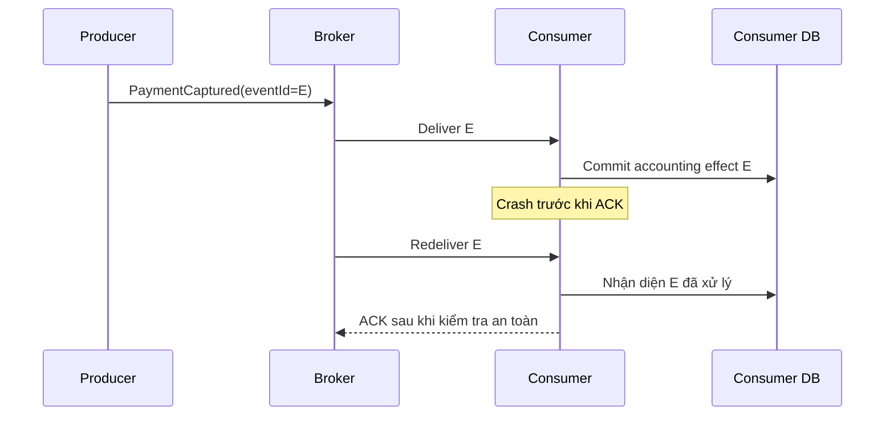
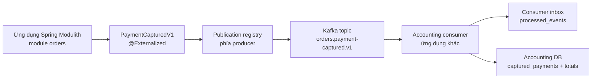
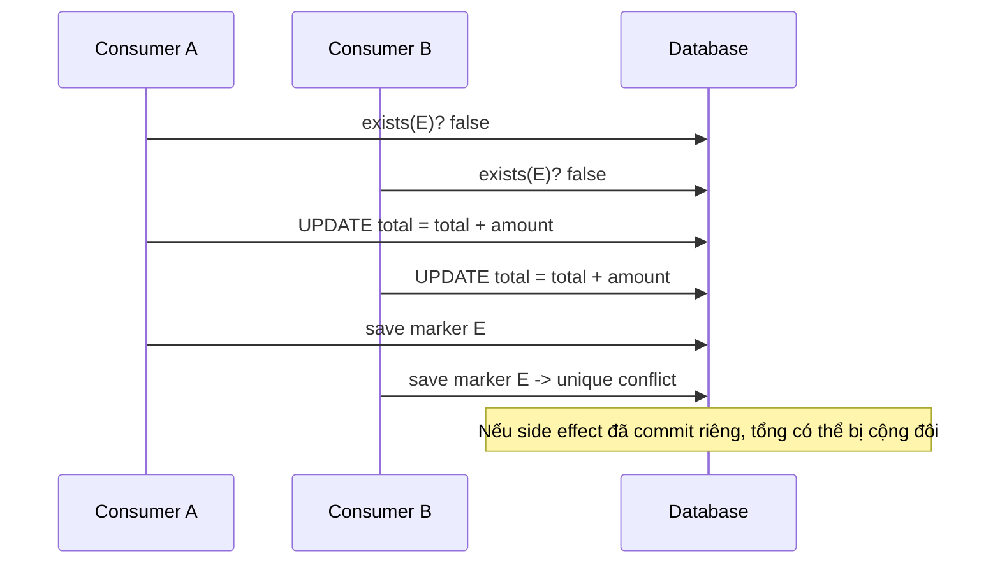
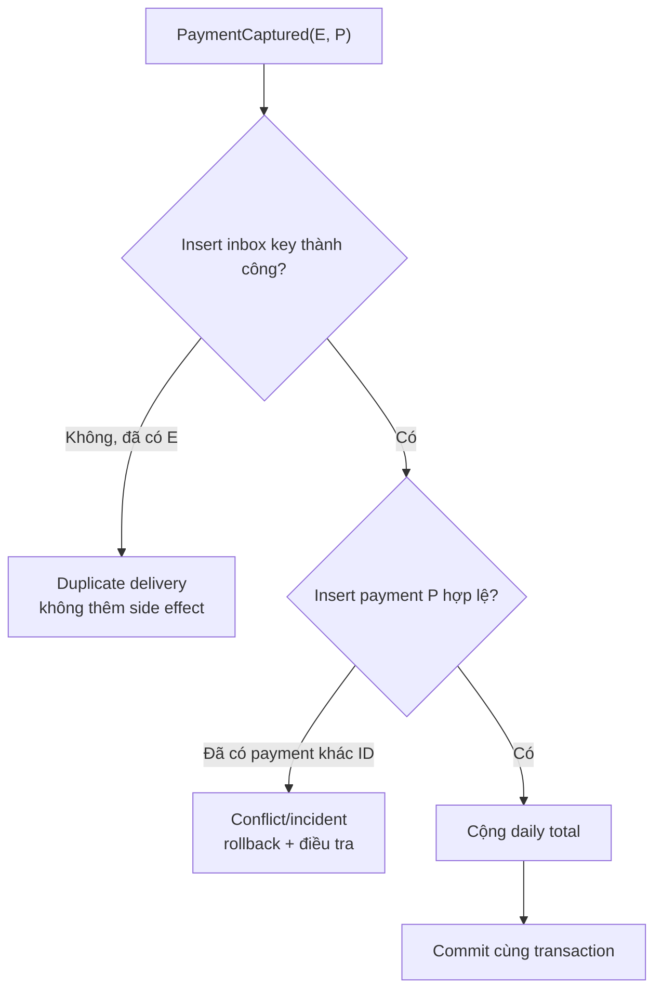
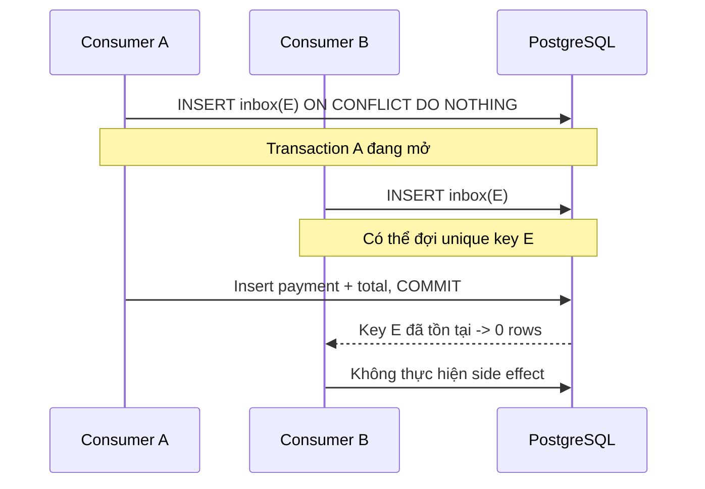
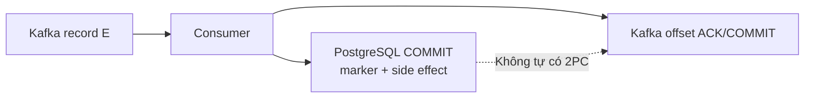
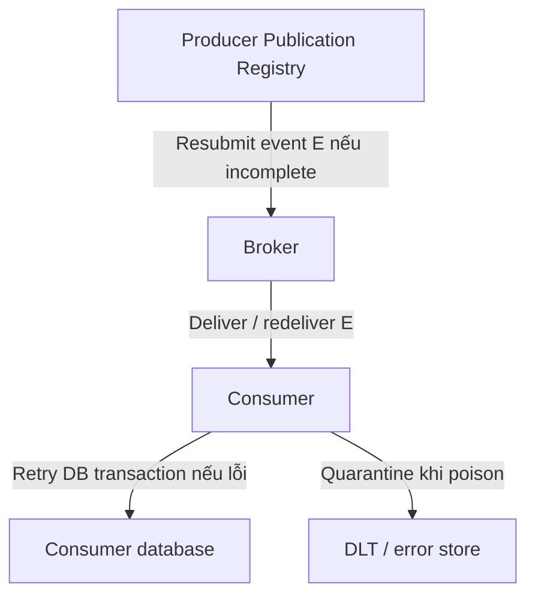
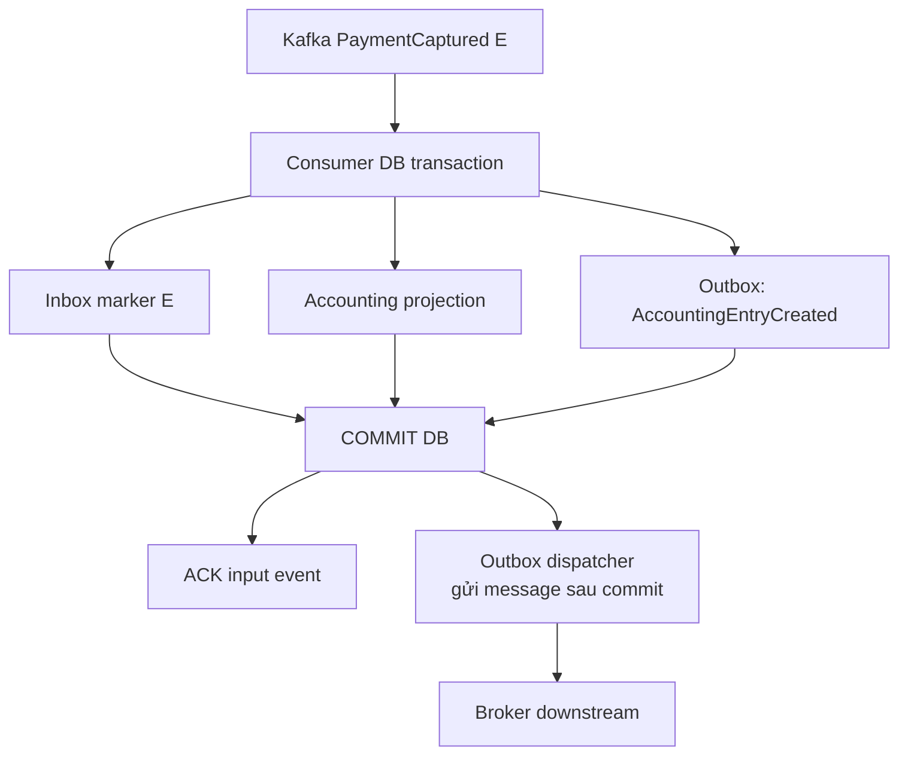

# Idempotency khi consumer nhận lại event

Hãy hình dung module `orders` của một ứng dụng Spring Modulith phát `PaymentCapturedV1` sau khi thanh toán được ghi nhận thành công. Event được externalize ra Kafka; dịch vụ kế toán nhận thông điệp rồi cộng `1.234` đơn vị tiền nhỏ nhất vào số liệu doanh thu. Ngay sau khi ghi database, consumer bị restart **trước khi xác nhận offset**. Broker có thể phát lại đúng thông điệp đó. Nếu xử lý lần hai bằng một lệnh cộng đơn giản, báo cáo sẽ ghi nhận một khoản thanh toán **hai lần**.

**Idempotency khi consumer nhận lại event** là thuộc tính giúp một thông điệp **có thể được xử lý lại mà không làm thay đổi kết quả nghiệp vụ quá một lần**. Nó không đòi broker không bao giờ gửi trùng; thay vào đó, consumer phải có **khóa nhận diện, trạng thái đã xử lý và transaction bảo vệ side effect**. Đây là nền tảng thiết kế an toàn khi producer có retry, Event Publication Registry resubmit publication hoặc consumer redeliver sau lỗi.

Bài thuộc chương **Externalization** của học phần `SPRING_MODULITH_VERIFICATION_TESTING`. Học phần rèn kiểm chứng ranh giới kiến trúc bằng `ApplicationModules` và dependency rules, thực hành `@ApplicationModuleTest`, kiểm thử sự kiện, cơ sở dữ liệu và tích hợp, rồi đưa quality gate vào CI để ngăn phụ thuộc sai và hồi quy. Bài này đi sâu vào **consumer idempotency**, chỉ ra chỗ dễ nhầm giữa producer publication và consumer acknowledgement, minh họa Java/Spring + PostgreSQL và đề xuất các kiểm thử đủ sức phát hiện lỗi hạch toán trùng.

## 1. Vì sao một external event có thể được nhận nhiều lần?

Có nhiều nguyên nhân hợp lệ khiến cùng một sự kiện xuất hiện lại:

1. **Producer retry** vì broker timeout nhưng không biết chắc message trước đã được nhận hay chưa.
2. **Event Publication Registry resubmission** vì publication chưa được đánh dấu complete trước khi producer crash.
3. **Consumer xử lý xong database nhưng crash trước ACK/offset commit**, khiến broker coi message chưa hoàn tất.
4. **Consumer xử lý lỗi và broker redelivery** theo retry/negative acknowledgement policy.
5. **Rebalance consumer group** khiến message chưa commit offset được consumer khác đọc lại.
6. **Replay lịch sử hoặc re-drive dead-letter topic/queue** do operator khởi chạy.
7. **Hai integration contract v1/v2 cùng đại diện một business fact**, nếu consumer subscribe đồng thời mà không có quy tắc dedupe.

Không phải tất cả trường hợp đều do “broker bị lỗi”. Trong hệ thống có mục tiêu giao nhận ít mất dữ liệu, **nhận lặp là một trạng thái cần được thiết kế trước**.



**Mục tiêu không phải chắc chắn có đúng một delivery**. Mục tiêu là, dù nhận `E` nhiều lần, kết quả business của consumer vẫn như khi `E` được xử lý thành công một lần.

## 2. Idempotency là thuộc tính của tác vụ, không phải số lần listener chạy

Với một thao tác `f` và message `m`, tính idempotent thường được diễn đạt:

\[
f(f(s,m),m)=f(s,m)
\]

Trong đó `s` là trạng thái dữ liệu trước khi xử lý. Nói đơn giản: **áp dụng lại cùng message không đổi kết quả sau lần áp dụng thành công đầu tiên**.

Ví dụ:

| Side effect | Nếu gọi hai lần | Có idempotent tự nhiên? |
| --- | --- | --- |
| `status = "CAPTURED"` | Vẫn là CAPTURED | Thường có, nếu không có side effect phụ |
| `total = total + 1234` | Tổng tiền bị cộng đôi | **Không** |
| `INSERT payment(paymentId)` với unique key | Lần hai bị từ chối/không thêm bản ghi | Có thể dùng làm chốt chống trùng |
| Gửi email hóa đơn | Người nhận có thể nhận hai email | Không mặc định |
| Gọi API chuyển tiền | Có thể tạo hai giao dịch tiền | **Rất nguy hiểm**, cần idempotency phía đích |
| Ghi audit log mỗi lần listener chạy | Có thể ghi hai dòng | Phải phân biệt audit delivery với business action |

**Idempotency không có nghĩa listener chỉ được gọi một lần.** Listener có thể chạy nhiều lần, nhưng business effect có thể được áp dụng nhiều nhất một lần theo khóa và policy đã định.

## 3. Phân biệt các danh tính trong sự kiện

Một event về thanh toán cần ít nhất ba khái niệm:

- **`eventId`:** định danh một **sự kiện nghiệp vụ** cụ thể. Retry/resubmit **cùng sự kiện** phải giữ nguyên.
- **`paymentId`:** định danh đối tượng thanh toán; một khoản thanh toán có thể phát nhiều event qua vòng đời.
- **`orderId`:** định danh đơn hàng; một đơn có thể chứa nhiều khoản thanh toán hợp lệ.

```text
Order O-1
  Payment P-1
    Event E-1 = PaymentAuthorized
    Event E-2 = PaymentCaptured
  Payment P-2
    Event E-3 = PaymentCaptured
```

Nếu consumer dùng duy nhất `orderId` làm khóa đã xử lý, nó có thể bỏ sót `E-3` dù đây là khoản thanh toán thứ hai hợp lệ. Nếu dùng `paymentId` để bỏ tất cả event, nó có thể bỏ lỡ thông tin refund hoặc điều chỉnh tương ứng.

**Khóa cho duplicate delivery** thường dựa trên `eventId` cùng namespace/source/consumer. **Khóa cho quy tắc nghiệp vụ** có thể là `paymentId`, `(paymentId, operation)` hoặc định danh khác. Hai lớp khóa phục vụ hai vấn đề khác nhau và thường cần tồn tại cùng nhau.

## 4. Bối cảnh kiến trúc: producer và consumer không cùng một tiến trình

Một thiết kế minh họa:



Đừng đồng nhất:

- **Producer Event Publication Registry**: theo dõi việc **công bố ra target**; completion không xác nhận kế toán đã xử lý.
- **Consumer inbox/processed-events table**: theo dõi business event nào **consumer cụ thể đã áp dụng thành công**.
- **Broker offset/ack**: trạng thái delivery/tiến độ của broker consumer, không tự đồng nghĩa business database đã commit.

Một bản ghi publication completed tại producer **không** thay thế bản ghi dedupe tại consumer. Consumer vẫn cần idempotency vì chính phía broker có thể redeliver sau khi publication producer hoàn tất.

## 5. Hợp đồng event tối thiểu để consumer chống trùng

Phía producer có thể công bố:

```java
// com/example/shop/orders/PaymentCapturedV1.java
package com.example.shop.orders;

import java.time.Instant;
import java.util.UUID;
import org.springframework.modulith.events.Externalized;

@Externalized("orders.payment-captured.v1")
public record PaymentCapturedV1(
        UUID eventId,
        UUID paymentId,
        UUID orderId,
        long amountMinorUnits,
        String currency,
        Instant occurredAt
) {}
```

Đây là **integration event** được phép ra ngoài ứng dụng, không phải JPA entity. Annotation `@Externalized` biểu đạt ý định externalization; adapter, serializer, routing, transaction/persistence và destination thực phải được cấu hình và kiểm chứng.

Ví dụ JSON contract:

```json
{
  "eventId": "12a3f357-8d23-48b2-8781-9d63ec9179f9",
  "paymentId": "61ac4ca0-58ad-492d-9ab5-a0383a097728",
  "orderId": "bdd49792-7ba0-42fd-a901-f82512934642",
  "amountMinorUnits": 1234,
  "currency": "USD",
  "occurredAt": "2026-11-26T02:00:00Z"
}
```

Đây là **mẫu representation mong muốn**, không phải khẳng định mọi Spring Modulith adapter tự động tạo chính xác JSON đó. Với Avro/Protobuf/CloudEvents hoặc custom message headers, consumer phải tuân theo schema/version thực tế.

**Bắt buộc giữ `eventId` bất biến khi gửi lại cùng event.** Nếu producer tạo UUID mới mỗi lần retry, consumer không thể phân biệt bằng `eventId` rằng đó là cùng một publication ban đầu.

## 6. Consumer nên có contract riêng thay vì import internals producer

Ví dụ consumer kế toán là **một ứng dụng Spring Boot khác**, có model payload tương ứng:

```java
// com/example/accounting/contracts/PaymentCapturedV1.java
package com.example.accounting.contracts;

import java.time.Instant;
import java.util.UUID;

public record PaymentCapturedV1(
        UUID eventId,
        UUID paymentId,
        UUID orderId,
        long amountMinorUnits,
        String currency,
        Instant occurredAt
) {}
```

Consumer đọc **hợp đồng wire**, không cần import `com.example.shop.orders.internal.PaymentEntity` hoặc phụ thuộc binary vào toàn bộ ứng dụng producer. Nếu dự án chủ động chia sẻ một contract library, nó cũng phải có governance/version rõ và không chứa implementation nội bộ.

Ở phía accounting, cần xác định:

1. Event nguồn có được xác thực/được phép publish vào destination không?
2. `eventId` có bắt buộc, được parse đúng format và được giữ ổn định?
3. `amountMinorUnits` có hợp lệ, không âm/tràn?
4. `currency` thuộc tập cho phép?
5. `occurredAt` được hiểu theo UTC hay business timezone nào?
6. Schema version hiện tại có được consumer hỗ trợ không?

Từ đây, ví dụ dùng PostgreSQL để tận dụng `ON CONFLICT DO NOTHING`. SQL này **không phải cú pháp portable cho mọi RDBMS**; nếu dùng MySQL/SQL Server/Oracle, cần thay bằng giải pháp atomic tương đương.

## 7. Phản ví dụ: chỉ kiểm tra `exists` trước rồi mới xử lý

Một consumer dễ viết nhưng **không đủ an toàn**:

```java
void handle(PaymentCapturedV1 event) {
    if (!processedEventRepository.existsById(event.eventId())) {
        revenueService.increase(event.amountMinorUnits());
        processedEventRepository.save(new ProcessedEvent(event.eventId()));
    }
}
```

Có ít nhất hai lỗ hổng:

**Race condition:** hai consumer/thread có thể cùng thấy `existsById(E) == false`, cùng cộng doanh thu, rồi một bên mới ghi marker bị conflict.

**Crash window:** sau khi cộng doanh thu nhưng trước khi ghi marker, tiến trình chết; redelivery lại cộng doanh thu.



Thêm một `synchronized` trong JVM cũng không đủ khi có nhiều pod/replica, restart hoặc nhiều consumer group. Chốt chống trùng nên dựa trên **atomic database operation hoặc external idempotency service đáng tin cậy**.

## 8. Thiết kế inbox table với unique constraint

Tại database **của consumer kế toán**, tạo bảng đánh dấu event đã xử lý:

```sql
-- PostgreSQL; thuộc accounting application, KHÔNG phải
-- bảng Event Publication Registry của Spring Modulith.
CREATE TABLE consumer_inbox (
    consumer_name VARCHAR(100) NOT NULL,
    event_source VARCHAR(160) NOT NULL,
    event_id UUID NOT NULL,
    event_type VARCHAR(160) NOT NULL,
    processed_at TIMESTAMPTZ NOT NULL DEFAULT CURRENT_TIMESTAMP,
    PRIMARY KEY (consumer_name, event_source, event_id)
);
```

**Vì sao khóa composite?**

- `consumer_name` phân biệt nhiều **subscription/processor nghiệp vụ** cùng đọc một event. Một event có thể phải cập nhật accounting **và** fraud reporting một lần ở mỗi processor.
- `event_source` phân biệt namespace producer đã được xác thực; có thể giúp tránh trùng event ID từ hai hệ thống độc lập.
- `event_id` xác định chính sự kiện cụ thể.

Nếu hệ thống chỉ có một producer namespace và một consumer duy nhất, khóa `event_id` có thể đủ. Nhưng hãy **chốt chính sách namespace trước**, đặc biệt khi event catalog có nhiều source hoặc tenant.

**Không lấy `consumer_name` bằng ngẫu nhiên mỗi lần restart.** Nó phải ổn định theo logical processor, không theo instance/pod; nếu đổi tên mỗi lần deploy, inbox không còn nhận ra các event đã xử lý.

## 9. Thiết kế side effect theo business key

Kế toán có thể có bảng projection:

```sql
CREATE TABLE captured_payments (
    payment_id UUID PRIMARY KEY,
    order_id UUID NOT NULL,
    amount_minor_units BIGINT NOT NULL CHECK (amount_minor_units > 0),
    currency VARCHAR(3) NOT NULL,
    captured_at TIMESTAMPTZ NOT NULL
);

CREATE TABLE daily_capture_totals (
    business_date DATE NOT NULL,
    currency VARCHAR(3) NOT NULL,
    total_minor_units BIGINT NOT NULL,
    capture_count BIGINT NOT NULL,
    PRIMARY KEY (business_date, currency)
);
```

`captured_payments.payment_id` là **ràng buộc nghiệp vụ**: một thanh toán không được ghi nhận capture hai lần trong projection này. Nó bảo vệ trường hợp producer phát **hai eventId khác nhau** cho cùng payment, điều mà inbox `event_id` đơn thuần không phát hiện được.

`daily_capture_totals` là bảng aggregate có phép cộng **không idempotent tự nhiên**. Chỉ được cộng khi event đã được xác định là lần áp dụng đầu tiên **và** business entity chưa từng được ghi nhận.

Sơ đồ:



## 10. Cần ghi inbox marker và side effect trong **cùng transaction**

Nguyên tắc:

```text
BEGIN consumer DB transaction
    Insert inbox marker với unique key
    Nếu marker đã tồn tại:
        Không áp dụng business side effect
    Nếu marker mới:
        Ghi projection theo business key
        Cập nhật aggregate total
COMMIT
ACK broker message sau khi transaction DB commit
```

Đặc biệt, **marker chỉ nên được commit khi business effect đã thành công**. Nếu marker được commit riêng rồi projection thất bại, message redelivery bị coi là duplicate mặc dù business effect chưa hề hoàn tất.

Ngược lại, nếu projection commit rồi marker mới được ghi ở transaction khác, crash giữa hai bước sẽ khiến lần nhận lại **lặp side effect**.

Do đó, công thức vận hành thường là:

> **One business effect transaction = one inbox decision + all local side effects.**

Lưu ý các side effect **ngoài database** như email, HTTP API hoặc một broker khác **không tự nằm trong cùng transaction**; chúng cần idempotency ở phía đích hoặc outbox riêng (xem phần sau).

## 11. PostgreSQL `ON CONFLICT` giải quyết cạnh tranh atomic

Thao tác ghi marker:

```sql
INSERT INTO consumer_inbox (
    consumer_name, event_source, event_id, event_type
)
VALUES (
    'accounting-payment-capture',
    'shop.orders',
    '12a3f357-8d23-48b2-8781-9d63ec9179f9',
    'orders.payment-captured.v1'
)
ON CONFLICT (consumer_name, event_source, event_id)
DO NOTHING;
```

Kết quả câu lệnh trong PostgreSQL:

- **1 row inserted:** khóa inbox chưa có, handler này có quyền thực hiện business effect trong **transaction hiện tại**.
- **0 rows inserted:** khóa đã tồn tại do một transaction được xác nhận; đây là lần nhận trùng cho logical processor/source/event key đó.

PostgreSQL unique constraint xử lý tranh chấp đồng thời ở mức database. Một transaction thứ hai có thể phải **chờ transaction thứ nhất commit/rollback** để quyết định kết quả, thay vì hai thread cùng đọc `exists=false` rồi làm việc.

Điều kiện quan trọng: marker và side effect vẫn phải cùng transaction; **chỉ thêm `ON CONFLICT` nhưng tách transaction không đủ**.

## 12. Java service xử lý event idempotent

Ví dụ handler dùng `JdbcTemplate` và một transaction manager bao phủ cùng PostgreSQL database:

```java
// com/example/accounting/AccountingEventProcessor.java
package com.example.accounting;

import com.example.accounting.contracts.PaymentCapturedV1;
import java.sql.Date;
import java.time.ZoneOffset;
import java.util.Objects;
import org.springframework.jdbc.core.JdbcTemplate;
import org.springframework.stereotype.Service;
import org.springframework.transaction.annotation.Transactional;

@Service
public class AccountingEventProcessor {

    private static final String CONSUMER = "accounting-payment-capture";
    private static final String SOURCE = "shop.orders";
    private static final String EVENT_TYPE =
            "orders.payment-captured.v1";

    private final JdbcTemplate jdbc;

    public AccountingEventProcessor(JdbcTemplate jdbc) {
        this.jdbc = jdbc;
    }

    public enum Outcome { APPLIED, DUPLICATE }

    @Transactional
    public Outcome apply(PaymentCapturedV1 event) {
        Objects.requireNonNull(event, "event");
        Objects.requireNonNull(event.eventId(), "eventId");
        Objects.requireNonNull(event.paymentId(), "paymentId");
        Objects.requireNonNull(event.orderId(), "orderId");
        Objects.requireNonNull(event.occurredAt(), "occurredAt");
        Objects.requireNonNull(event.currency(), "currency");

        if (event.amountMinorUnits() <= 0) {
            throw new IllegalArgumentException(
                    "Captured amount must be positive");
        }

        int markerInserted = jdbc.update("""
                INSERT INTO consumer_inbox
                    (consumer_name, event_source, event_id, event_type)
                VALUES (?, ?, ?, ?)
                ON CONFLICT (consumer_name, event_source, event_id)
                DO NOTHING
                """,
                CONSUMER, SOURCE, event.eventId(), EVENT_TYPE);

        if (markerInserted == 0) {
            return Outcome.DUPLICATE;
        }

        int paymentInserted = jdbc.update("""
                INSERT INTO captured_payments
                    (payment_id, order_id, amount_minor_units,
                     currency, captured_at)
                VALUES (?, ?, ?, ?, ?)
                ON CONFLICT (payment_id) DO NOTHING
                """,
                event.paymentId(),
                event.orderId(),
                event.amountMinorUnits(),
                event.currency(),
                java.sql.Timestamp.from(event.occurredAt()));

        if (paymentInserted != 1) {
            // Event ID mới nhưng payment đã được hạch toán:
            // KHÔNG cộng doanh thu, cũng KHÔNG im lặng bỏ qua
            // một bất thường về nguồn dữ liệu.
            throw new IllegalStateException(
                    "Payment already captured using another event ID");
        }

        var day = event.occurredAt()
                .atZone(ZoneOffset.UTC)
                .toLocalDate();

        jdbc.update("""
                INSERT INTO daily_capture_totals
                    (business_date, currency,
                     total_minor_units, capture_count)
                VALUES (?, ?, ?, 1)
                ON CONFLICT (business_date, currency)
                DO UPDATE SET
                    total_minor_units =
                        daily_capture_totals.total_minor_units
                        + EXCLUDED.total_minor_units,
                    capture_count =
                        daily_capture_totals.capture_count + 1
                """,
                Date.valueOf(day),
                event.currency(),
                event.amountMinorUnits());

        return Outcome.APPLIED;
    }
}
```

Đây là ví dụ **PostgreSQL + Spring JDBC**, cần database schema, datasource và transaction manager thực tế; không phải mẫu tự chạy chỉ với một class. `@Transactional` phải được áp dụng qua Spring proxy và bao phủ **mọi câu lệnh JDBC cùng một database**.

**Vì sao throw khi `payment_id` đã tồn tại với event ID khác?** Đây là chính sách **fail-and-investigate** nhằm làm lộ producer tạo hai sự kiện capture cho cùng payment. Những hệ thống có nghiệp vụ cho phép đồng bộ lại một event tương đương có thể so sánh payload đã lưu và xử lý riêng, nhưng không được âm thầm cộng doanh thu lần hai.

### Thêm các validation theo hợp đồng thật

Ví dụ trên mới kiểm null/positive. Production cần thêm validation currency ISO được hỗ trợ, time range/business date (UTC chỉ là lựa chọn minh họa), schema version, source authorization, giới hạn amount và các business invariants khác. Một message không hợp lệ không nên đánh dấu đã xử lý thành công.

## 13. Vì sao method `apply` phải được gọi qua Spring bean khác?

`@Transactional` trong Spring thường được thực hiện qua proxy. Nếu một method của chính `AccountingEventProcessor` gọi `this.apply(event)`, lời gọi tự thân có thể bỏ qua proxy và không mở transaction như dự kiến.

Thay vào đó, listener nên inject service:

```text
KafkaListener bean
    -> AccountingEventProcessor proxy
        -> BEGIN transaction
        -> inbox marker + business projection
        -> COMMIT
    <- return Outcome
    -> broker ACK
```

Một cách kiểm tra không phụ thuộc giả định proxy là chạy **integration test với PostgreSQL thật**, cố ý tạo lỗi giữa hai câu lệnh và chứng minh không còn marker hoặc projection nửa vời sau rollback.

Đặc biệt, đừng bắt mọi exception bên trong `apply` rồi trả về `DUPLICATE`; làm vậy biến lỗi database/schema thành “đã xử lý” và khiến listener ACK mất message chưa hoàn tất.

## 14. Consumer Kafka ACK **sau khi transaction xử lý commit**

Ở phía ứng dụng accounting, listener có thể tách thành một bean khác:

```java
// com/example/accounting/PaymentCapturedKafkaListener.java
package com.example.accounting;

import com.example.accounting.contracts.PaymentCapturedV1;
import org.springframework.kafka.annotation.KafkaListener;
import org.springframework.kafka.support.Acknowledgment;
import org.springframework.stereotype.Component;

@Component
public class PaymentCapturedKafkaListener {

    private final AccountingEventProcessor processor;

    public PaymentCapturedKafkaListener(AccountingEventProcessor processor) {
        this.processor = processor;
    }

    @KafkaListener(
            topics = "orders.payment-captured.v1",
            groupId = "accounting-payment-capture"
    )
    public void on(
            PaymentCapturedV1 event,
            Acknowledgment acknowledgment) {

        // Chỉ return khi consumer DB transaction
        // của processor đã commit thành công.
        var outcome = processor.apply(event);

        // Với APPLIED hoặc DUPLICATE hợp lệ:
        // ACK sau quyết định/commit đã được xác nhận.
        acknowledgment.acknowledge();
    }
}
```

Để code chạy, Spring Kafka listener container phải được cấu hình **manual acknowledgement mode** thích hợp (ví dụ `MANUAL_IMMEDIATE` khi được lựa chọn), **consumer auto-commit offset phải được tắt** và converter/deserializer phải tạo đúng `PaymentCapturedV1`. Khi gọi `acknowledge()`, cần hiểu semantics của container và broker/config thực tế; ack API không đồng nghĩa chắc chắn offset đã commit bền vững tại đúng thời điểm gọi.

**Luồng quan trọng:** `processor.apply(event)` là lời gọi qua bean/proxy khác. Khi method `@Transactional` đó **return bình thường**, transaction interceptor của nó có cơ hội commit; sau đó listener mới ACK.

Nếu `processor.apply(event)` ném exception, listener **không chạy tới `acknowledge()`**. Spring Kafka error handler/container policy cần được cấu hình để retry, redeliver, hoặc chuyển DLT; **không mặc định mọi exception sẽ được broker phát lại vô hạn**.

## 15. Tại sao ACK trước commit gây mất sự kiện?

Phản ví dụ:

```text
Kafka delivers E
  -> ACK/commit offset
  -> BEGIN consumer DB transaction
  -> INSERT processed marker
  -> update projection FAILS
  -> ROLLBACK
```

Broker có thể coi E đã được xử lý nhưng database không có side effect. Nếu không có đường recovery/replay khác, event bị **mất tác dụng nghiệp vụ**.

Thứ tự an toàn hơn theo mục tiêu *at-least-once processing*:

```text
Kafka delivers E
  -> BEGIN consumer DB transaction
  -> atomic dedupe + business side effect
  -> COMMIT consumer DB
  -> ACK/commit offset
```

Vẫn có một khoảng **DB commit → offset commit**: crash ở đây gây redelivery. Đó là lý do inbox marker tồn tại. **Không thể xóa khoảng này chỉ bằng cách đảo thứ tự**, bởi đảo ngược lại gây nguy cơ mất business effect.

## 16. Ma trận các điểm crash phía consumer

| Điểm crash/lỗi | Inbox marker | Business effect | Broker ACK | Khi redelivery phải làm gì? |
| --- | --- | --- | --- | --- |
| Trước transaction | Chưa có | Chưa có | Chưa | Xử lý bình thường |
| Sau insert marker, trước projection, **chưa commit** | Rollback | Rollback | Chưa | Xử lý lại bình thường |
| Sau projection, **chưa commit** | Rollback | Rollback | Chưa | Xử lý lại bình thường |
| Sau **DB commit**, trước ACK | Đã có | Đã áp dụng | Chưa chắc | Nhận ra duplicate, không lặp effect |
| Sau broker ACK/offset commit | Đã có | Đã áp dụng | Đã hoàn tất theo broker | Không nhất thiết redeliver, nhưng vẫn idempotent nếu replay |
| Message malformed trước listener | Chưa tạo | Chưa có | Theo error handler | Sửa schema/deserializer/DLT, không coi là processed |

Đây là ma trận theo thiết kế **một DB transaction** và **ACK sau commit**. Nếu side effect là API ngoài DB, hoặc listener có transaction propagation khác, các ô tương ứng có thể thay đổi và cần thiết kế/test riêng.

## 17. Duplicate cùng `eventId`: xử lý “thành công không làm gì”

Một consumer idempotent không cần ném lỗi khi nhận lại một event đã áp dụng thành công:

```text
Lần 1:
  inbox key (accounting, shop.orders, E) absent
  insert marker -> 1
  insert captured_payments(P) -> 1
  increment daily_total -> 1
  COMMIT
  ACK

Lần 2:
  inbox key (accounting, shop.orders, E) exists
  insert marker -> 0
  SKIP projection + totals
  COMMIT read/no-op
  ACK
```

**ACK duplicate hợp lệ** là đúng: consumer đã hoàn thành nghĩa vụ của mình **ở lần nhận trước**. Nếu cố tình ném exception mỗi lần thấy duplicate, broker có thể redeliver mãi và làm tắc consumer group.

Tuy nhiên `DUPLICATE` chỉ hợp lệ khi có bằng chứng marker đã được commit theo transaction đúng. Một marker được ghi nhưng side effect chưa commit vì thiết kế lỗi **không phải** bằng chứng đã xử lý thành công.

## 18. Cùng business fact nhưng **eventId khác nhau**

Một lỗi producer có thể tạo:

```text
E1 = PaymentCaptured(paymentId=P, amount=1234)
E2 = PaymentCaptured(paymentId=P, amount=1234)
E1.eventId != E2.eventId
```

Inbox chỉ dựa trên `eventId` **không coi E2 là duplicate của E1**, vì chúng là hai event IDs khác nhau. Nếu consumer cộng tổng lần hai, vẫn có lỗi hạch toán.

Vì vậy lớp thứ hai là **business idempotency** qua `captured_payments.payment_id PRIMARY KEY`. Trong service ở phần 12, lần E2:

1. Insert inbox marker E2 tạm thời thành công.
2. Insert payment P trả 0 vì P đã tồn tại.
3. Service ném exception; **transaction rollback cả marker E2**.
4. Tác vụ được phân loại là **bất thường dữ liệu nguồn**, không cộng doanh thu.

Một policy khác có thể xem E2 là một bản phát lại tương đương sau khi **so sánh toàn bộ dữ liệu đã lưu** rồi xử lý như duplicate business fact. Nhưng khi paymentId trùng mà amount/currency khác, cần **cảnh báo nhất quán dữ liệu**, không âm thầm bỏ qua.

Đừng cố “sửa” trường hợp này bằng cách thay `eventId` của E2 thành E1 trong consumer; việc đó làm mất bằng chứng về hai sự kiện khác nhau do producer tạo ra.

## 19. Same event ID, payload khác: an toàn không chỉ là “bỏ qua”

Giả sử producer hoặc hệ thống khác gửi:

```text
eventId = E, paymentId = P, amount = 1234
eventId = E, paymentId = P, amount = 9999
```

Nếu inbox chỉ kiểm khóa E, lần hai bị bỏ qua. Business effect không bị cộng đôi, nhưng hệ thống **không phát hiện event ID đã bị sử dụng lại với dữ liệu mâu thuẫn**. Đây có thể là lỗi producer, replay sai schema hoặc dấu hiệu dữ liệu không đáng tin.

Với luồng quan trọng, có thể lưu thêm:

- `payload_hash` của một **canonical business representation** đã được công bố, hoặc
- Các trường business bất biến cần đối chiếu, hoặc
- Tham chiếu tới bản ghi business thực tế để kiểm sự nhất quán.

Ví dụ mở rộng schema khái niệm:

```sql
ALTER TABLE consumer_inbox
ADD COLUMN payload_hash CHAR(64);
```

**Lưu ý:** muốn hash có ý nghĩa, phải định nghĩa canonicalization: thứ tự field, timezone, version, số học thập phân và metadata nào được/không được tính. Không hash tùy tiện chuỗi JSON do mỗi serializer sắp xếp property khác nhau rồi coi cùng business event là khác nhau.

Khi nhận duplicate E, có thể đọc hash/fields đã xử lý và **cảnh báo nếu khác nhau**, thay vì im lặng tin mọi message có ID đó là hợp lệ. Nếu hệ thống chuyển đổi v1→v2 trong replay, phải phân biệt thay đổi representation với thay đổi semantic data.

## 20. Concurrency: hai instance nhận cùng event

Một message có thể được xử lý cạnh tranh vì rebalance, retry flow, subscription khác hoặc re-drive. Hai instance cùng gọi `AccountingEventProcessor.apply(E)`:



Đây là ưu điểm của **unique constraint + atomic insert trong database**, không phải một lệnh `SELECT exists` rồi mới `INSERT`.

Nếu A rollback, B có thể tiếp tục và áp dụng event như lần đầu. Test cạnh tranh phải bao phủ cả **A commit** và **A rollback**, vì hai nhánh cho kết quả đúng khác nhau.

**Không dùng khóa JVM-local** như `synchronized` hoặc một `ConcurrentHashMap` làm cơ chế dedupe duy nhất khi triển khai nhiều pod; trạng thái đó không tồn tại chung giữa các instance và mất khi restart.

## 21. “Một lần” theo consumer logic, không phải theo consumer group ID tình cờ

Hãy xác định **logical consumer identity**. Ví dụ:

```text
Processor A: accounting.payment-capture
Processor B: fraud.payment-capture
Processor C: fulfillment.payment-capture
```

Ba processor có thể đều cần áp dụng **cùng event E** một lần cho chức năng riêng. Nếu dùng một inbox chung với key chỉ `eventId`, processor A có thể ghi marker trước khiến processor B bỏ qua, làm mất nghiệp vụ B.

Khóa `(consumer_name, event_source, event_id)` của bài cho phép **một lần mỗi logical processor**.

Kafka consumer group có mục đích phân phối/tiến độ; không tự đồng nghĩa với logical processor. Đổi group ID để replay có thể khiến tất cả event được đọc lại, nhưng inbox vẫn phải duy trì idempotency theo **chức năng nghiệp vụ**, không nhất thiết theo tên consumer group hiện tại.

Nếu có nhiều consumer trong cùng group, chúng cần chia sẻ **cùng inbox store hoặc một cơ chế dedupe chung** cho cùng logical processor. Tạo bảng inbox riêng theo pod sẽ mất tính an toàn khi rebalance.

## 22. Source, tenant và ranh giới tin cậy của dedupe key

Nhiều producer có thể phát event dạng `PaymentCaptured`. Một `eventId` kiểu UUID thường có xác suất trùng ngẫu nhiên thấp, nhưng điều đó không thay thế chính sách namespace.

Ví dụ:

```text
Source: shop.orders
Consumer: accounting-payment-capture
Event ID: E

Inbox key = (accounting-payment-capture, shop.orders, E)
```

Nếu hệ thống đa tenant, cần xác định sự kiện E là **duy nhất toàn cục** hay chỉ duy nhất trong một tenant. Khi scope là tenant, inbox key có thể cần thêm `tenant_id`, nhưng thay primary key khi đã production đòi hỏi migration/reconciliation.

**Không tin vô điều kiện một header `source` do bất kỳ publisher nào cũng có thể tự ghi.** Source identity nên gắn với broker ACL, credentials, topic đã được cấp quyền, chữ ký/metadata bảo đảm nguồn khi cần, hoặc quy trình trusted routing. Nếu attacker được phép gửi event giả cùng ID của event thật, một consumer chỉ nhìn inbox marker có thể bị đánh lừa.

Tương tự, đừng dùng payload hash hoặc nội dung PII như một danh tính mà không cân nhắc quyền riêng tư, sự ổn định và khả năng thay đổi format.

## 23. Kafka exactly-once semantics không tự bao phủ database ngoài Kafka

Kafka có các cơ chế hỗ trợ idempotent producer và transactional processing trong một số luồng **Kafka-to-Kafka**. Tuy nhiên, khi consumer:

1. Đọc message từ Kafka.
2. Ghi dữ liệu vào **PostgreSQL**.
3. Commit Kafka offset.

thì **PostgreSQL transaction và Kafka offset commit không mặc định là một giao dịch nguyên tử** chỉ vì có bật Kafka transactions.



Điểm lỗi `PostgreSQL commit thành công → Kafka offset chưa commit` vẫn có thể dẫn tới redelivery. Inbox table giải quyết bài toán này bằng **idempotent reprocessing**, thay vì yêu cầu broker và database cùng commit đúng một lần như một transaction phân tán tưởng tượng.

Các thư viện/framework có thể hỗ trợ phối hợp transaction ở những mức khác nhau; phải đọc semantics phiên bản và test crash. Không gọi một pipeline có Kafka transactions là **exactly-once end-to-end với external DB** nếu chưa có thiết kế/bằng chứng phù hợp.

## 24. RabbitMQ, JMS và các cơ chế redelivery khác

Idempotency không chỉ dành cho Kafka:

| Transport | Tình huống nhận lại | Điều consumer cần kiểm |
| --- | --- | --- |
| Kafka | Offset chưa commit, rebalance, retry topic, replay | Inbox key, transaction DB, offset policy |
| RabbitMQ/AMQP | Message được redeliver sau NACK/requeue hoặc channel/consumer mất kết nối | ACK sau side effect commit, redelivery/poison policy |
| JMS | Session recovery, transaction rollback, redelivery policy của provider | Transaction boundaries và idempotency key |
| Webhook | Provider retry HTTP vì timeout hoặc non-2xx | Request/event ID ổn định, dedupe và HTTP response semantics |

AMQP `basicAck`, JMS acknowledgement và Kafka offset commit là các cơ chế khác nhau. **Đừng copy chính xác cấu hình của Kafka sang RabbitMQ** rồi gọi chúng tương đương.

Điểm chung: consumer phải quyết định **đã áp dụng business effect hay chưa** dựa trên trạng thái bền vững thuộc quyền kiểm soát của consumer. Cờ redelivery từ transport có thể hữu ích để quan sát, nhưng **không phải chứng cứ duy nhất** cho tính trùng. Message có thể được gửi trùng bởi producer mà broker không đánh dấu là redelivery của cùng delivery trước đó.

## 25. Deserialize fail trước khi listener được gọi

Một message lỗi schema có thể thất bại **trước khi `@KafkaListener` nhận được `PaymentCapturedV1`**:

```text
Kafka bytes
   |
   v
Deserializer / converter
   |-- OK -> @KafkaListener -> @Transactional processor
   '-- ERROR -> listener chưa chạy
```

Nếu deserializer lỗi, service `AccountingEventProcessor.apply(...)` không được gọi, nên **không có inbox marker đã xử lý thành công**. Đây là điều đúng: business effect chưa hề xảy ra.

Spring Kafka có các lựa chọn error-handling deserializer, container error handler, retry/recoverer và DLT tùy phiên bản/cấu hình. Cần xác nhận:

- Lỗi deserialize có được đưa tới error handler không?
- Có ghi nguyên payload chứa dữ liệu nhạy cảm vào log/DLT không?
- Có xác định đúng event ID khi payload không parse được không?
- Sau khi sửa schema, re-drive lại thế nào?
- Khi policy đưa message lỗi sang DLT, offset được commit theo điều kiện nào?

**Đừng tạo inbox marker “processed” cho message chưa thể được xác thực và diễn giải.** Nếu cần theo dõi receipt của message malformed, nên có **quarantine/error store riêng**, không dùng chung ý nghĩa “business effect đã áp dụng”.

## 26. Retry, DLT và poison event: ai chịu trách nhiệm?

Một event đã được deserialize nhưng business validation thất bại (ví dụ amount âm) thường là **lỗi cố định**, trong khi database tạm unavailable là **lỗi có thể phục hồi**.

| Lỗi phía consumer | Chiến lược hợp lý | Không nên làm |
| --- | --- | --- |
| Database connection timeout | Retry có backoff và giới hạn | Mark processed trước khi ghi DB |
| Deadlock/serialization failure tạm thời | Retry transaction theo policy | Dùng memory flag chống trùng thay unique key |
| Event đã xử lý thành công | Return `DUPLICATE` và ACK an toàn | Ném exception để retry vô hạn |
| Payload không hợp lệ | Quarantine/DLT, báo lỗi contract | “Nuốt” lỗi rồi ACK như đã áp dụng |
| Payment ID trùng nhưng event ID khác | Điều tra nguồn; so business fields theo policy | Cộng revenue lần hai |
| Downstream HTTP API từ chối | Retry/idempotency của API đích | Giả định database rollback tự thu hồi request HTTP |

**DLT (dead-letter topic/queue)** không phải trạng thái xử lý thành công. Đưa một message sang DLT có thể cho phép consumer group tiếp tục đọc các message sau, nhưng business event đó **chưa được áp dụng thành công**. Cần có người sở hữu, alert, retention, quy trình sửa lỗi/re-drive và reconciliation.

Không thiết kế DLT thành “nơi event mất vĩnh viễn” chỉ để toàn bộ pipeline trông xanh.

## 27. Retry của consumer khác retry publication của producer

Có hai chuỗi retry độc lập:



Producer retry vì **không chắc publication ra broker hoàn tất**. Consumer retry vì **không chắc business effect của chính nó đã hoàn tất**. Cả hai có thể dẫn đến cùng event được nhìn thấy nhiều lần.

**Không yêu cầu producer resubmit tất cả publication đã completed chỉ vì consumer database bị gián đoạn**. Nếu broker đã nhận và producer publication complete, consumer nên dùng chính retry/DLT/offset của nó. Việc yêu cầu producer gửi lại chỉ là một hoạt động recovery đặc biệt có quy trình, không phải phản xạ mặc định.

Mọi policy retry cần:

- Backoff/jitter để tránh retry storm.
- Giới hạn số lần thử nhanh và cơ chế xử lý lâu dài.
- Phân loại lỗi deterministic/transient.
- Concurrency control để tránh cùng xử lý một event vô ích.
- Event identity ổn định và telemetry phân biệt các lần thử.

## 28. Thứ tự event và idempotency là hai bài toán riêng

Giả sử consumer nhận:

```text
E1 = PaymentCaptured(paymentId=P, sequence=10)
E2 = PaymentRefunded(paymentId=P, sequence=11)
```

Vì retry, consumer có thể nhận `E2` trước `E1`. Dù mỗi event được áp dụng **tối đa một lần**, trạng thái cuối vẫn có thể sai nếu logic phụ thuộc thứ tự.

Để bảo vệ:

1. Sử dụng aggregate version/sequence khi có yêu cầu thứ tự.
2. Xác định trạng thái chuyển tiếp hợp lệ: không được refund một payment chưa được xác nhận captured nếu domain yêu cầu.
3. Cho phép buffer/reconciliation với event đến muộn khi kiến trúc cần.
4. Với Kafka, key theo payment/order có thể giúp cùng key vào cùng partition **nếu topology/adapter đúng**, nhưng **không tự chữa việc producer gửi lại event cũ sau event mới**.
5. Kiểm thử out-of-order và late replay riêng với duplicate delivery.

**“Không áp dụng hai lần E1” khác với “E1 và E2 được áp dụng theo đúng thứ tự”.** Một inbox table không tự giải quyết ordering.

## 29. Refund và compensation là event mới, không phải duplicate

Nếu khoản thanh toán P được capture rồi hoàn tiền, hai business facts khác nhau:

```text
PaymentCaptured(eventId=E1, paymentId=P, amount=1234)
PaymentRefunded(eventId=E2, paymentId=P, amount=1234)
```

Refund **không phải lần nhận lại E1**. Consumer phải ghi nhận E2 theo hợp đồng refund, ví dụ hạch toán một khoản điều chỉnh/đối ứng, và không được gộp `E2` vào inbox marker của `E1` chỉ vì `paymentId` giống nhau.

Nếu refund có thể diễn ra nhiều lần, nghiệp vụ cần **refundId** riêng hoặc định danh transaction/refund event phù hợp. Một payment có thể có nhiều partial refunds hợp lệ; không dùng `paymentId` như khóa duy nhất của mọi lần refund.

Trong consumer code thật, nên có handler/contract riêng cho `PaymentRefundedV1`, một quy tắc state machine và test idempotency cho chính event đó.

## 30. Version migration: v1 và v2 của cùng một sự thật

Trong giai đoạn chuyển `PaymentCapturedV1` sang `PaymentCapturedV2`, producer có thể dual-publish hai representation cho **cùng một lần capture**.

```text
Topic v1: PaymentCapturedV1(eventId=E, paymentId=P)
Topic v2: PaymentCapturedV2(eventId=E, paymentId=P, fee=...)
```

Nếu accounting consumer subscribe cả hai topic và cả hai handler đều cập nhật doanh thu, nó có thể tính **hai lần**. Có hai lớp xử lý:

- **Dedupe business fact:** `paymentId`/capture identity phải đảm bảo một lần capture không bị hạch toán lại.
- **Dedupe theo event identity:** cần quyết định `eventId` có được dùng chung giữa v1/v2 hay key nên gồm thêm `eventType`. Điều này phụ thuộc hợp đồng và việc hai representation được coi là **một fact** hay hai event thực sự khác nhau.

**Không chọn khóa vội theo tên topic.** Nếu thêm topic version vào dedupe key một cách máy móc, consumer có thể xem v1 và v2 là hai sự kiện độc lập dù business fact là một. Nếu bỏ mọi version khỏi key, các loại event khác nhau nhưng tình cờ cùng ID có thể va chạm.

Trước rollout, cần chạy **dual-publish contract tests và duplicate-business-effect tests** trên consumer nhận cả hai phiên bản.

## 31. Inbox retention: xóa marker sớm có thể làm replay sai

Inbox table tăng theo số event đã xử lý. Dọn dữ liệu là nhu cầu thực, nhưng **TTL phải theo chính sách replay/redelivery**, không chỉ dựa trên dung lượng.

Giả sử:

```text
Ngày 1: consumer xử lý E và ghi marker E.
Ngày 7: job xóa marker cũ hơn 3 ngày.
Ngày 10: operator replay dữ liệu tháng này.
Ngày 10: E xuất hiện lại, marker đã bị xóa.
```

Consumer có thể xem E là mới. Nếu side effect là phép cộng doanh thu, việc replay có thể tạo trùng.

Những lựa chọn:

1. Giữ marker ít nhất bằng **cửa sổ redelivery/replay** mà hệ thống cam kết.
2. Giữ business-unique record `captured_payments(payment_id)` lâu hơn marker nếu cần audit.
3. Với replay lớn, dùng pipeline reconciliation hoặc rebuild projection **có cô lập**, không giả định inbox vẫn có mọi marker lịch sử.
4. Partition/archive inbox theo chính sách compliance và truy vấn.
5. Test thao tác xóa marker + replay với dữ liệu cũ.

Không có một TTL mặc định phù hợp mọi hệ thống. Luồng tài chính có thể cần retention/audit dài hơn luồng cache hoặc clickstream. Tránh giữ PII dư thừa chỉ vì “để chống trùng”; có thể lưu một identifier/hash đủ dùng theo chính sách.

## 32. Side effect ngoài database: email, HTTP, tiền và broker khác

Mẫu `@Transactional` + PostgreSQL inbox bảo vệ các side effect **nằm trong cùng DB transaction**. Nhưng nếu handler còn:

```java
paymentGateway.transferMoney(...);
emailService.sendInvoice(...);
webhookClient.post(...);
```

thì việc transaction PostgreSQL rollback **không tự thu hồi** lời gọi HTTP/email đã hoàn tất.

Ví dụ:

```text
Consumer E
  INSERT inbox(E) (chưa commit)
  gọi API chuyển tiền -> thành công
  database update lỗi -> ROLLBACK
Redelivery E
  gọi API chuyển tiền lần hai -> có thể chuyển hai lần
```

Các lựa chọn kiến trúc:

- **API đích hỗ trợ idempotency key:** truyền cùng một khóa cho mọi lần retry (ví dụ eventId hoặc business operation ID) và xác nhận semantics của provider.
- **Consumer outbox:** ghi một intent outbound cùng transaction inbox + projection rồi có worker gửi sau commit.
- **State machine/Saga:** theo dõi từng bước và có compensation khi nghiệp vụ thực sự yêu cầu.
- **Reconciliation:** kiểm trạng thái đích khi kết quả HTTP timeout không chắc chắn trước khi thử lại.

**Không xem inbox local là đủ để đảm bảo external side effect exactly-once** nếu phía đích không hỗ trợ dedupe hoặc không có cơ chế điều phối đúng.

## 33. Kết hợp consumer inbox và outbox

Một consumer có thể nhận `PaymentCapturedV1`, ghi kế toán, rồi phát `AccountingEntryCreated` sang một broker khác.

Thiết kế bền vững hơn:



Khi **inbox marker, projection và outbox record** được commit trong cùng database transaction, consumer có thể ngăn lỗi “đã ACK đầu vào nhưng chưa lưu intent đầu ra”. Outbox dispatcher có thể retry riêng nếu broker downstream lỗi.

Tuy nhiên, **outbox cũng có thể gửi trùng khi ack bị mất**. Consumer downstream tiếp tục cần idempotency. Không có thiết kế đơn lẻ tự biến mọi bước cross-system thành một transaction đúng một lần.

Nếu consumer chính là một ứng dụng Spring Modulith khác, có thể đánh giá Event Publication Registry cho event outbound của ứng dụng đó. Nhưng việc nó tiêu thụ một external event **không mặc định** khiến inbox từ Kafka được registry của consumer tạo và quản lý thay cho bảng dedupe.

## 34. Phân biệt duplicate hợp lệ và message không hợp lệ

Không nên viết:

```java
try {
    processor.apply(event);
} catch (Exception ex) {
    // Phản ví dụ: coi mọi lỗi đều đã xử lý!
    acknowledgment.acknowledge();
}
```

Đoạn này có thể ACK message khi database đang down, amount sai hoặc transaction rollback — tức **mất event nghiệp vụ**.

Thay vào đó, xác định ba kết quả:

| Kết quả | Ý nghĩa | ACK/handling |
| --- | --- | --- |
| `APPLIED` | Marker + side effect đã commit | ACK theo policy |
| `DUPLICATE` | Marker cho cùng logical consumer/source/event đã commit trước đó | ACK, không lặp side effect |
| **FAILED** | Không chứng minh đã áp dụng thành công | Không ACK như thành công; để error handler/retry/DLT quyết định |

Một **business conflict** do `paymentId` đã được ghi bằng event khác có thể là lỗi không retry được; nên chuyển sang luồng kiểm tra/quarantine. Nhưng điều đó **không đồng nghĩa** mặc định xóa event hay coi đã xử lý thành công.

Những lỗi có thể xảy ra ở deserialize/validation **trước khi marker được ghi** nên được quản lý tách biệt với duplicate detection.

## 35. Bộ kiểm thử nào chứng minh consumer thật sự idempotent?

Một bộ kiểm thử đáng tin cậy cần nhiều lớp:

| Lớp | Câu hỏi kiểm chứng |
| --- | --- |
| Unit test validation | Event ID, amount, currency, nguồn có hợp lệ? |
| Database integration | Inbox marker và side effect có commit/rollback cùng nhau? |
| Duplicate delivery test | Gửi E hai lần; business effect chỉ một lần? |
| Concurrency test | Hai instance/thread cạnh tranh E có tăng tổng đúng một lần? |
| Failure injection | Crash/lỗi giữa marker và projection có rollback toàn bộ? |
| Listener/ACK test | Offset/ACK chỉ đi sau DB commit thành công? |
| Kafka/RabbitMQ integration | Redelivery/retry có thực sự xảy ra và được xử lý an toàn? |
| Contract/schema | Consumer đọc đúng event v1/v2 và lỗi malformed đi đúng đường? |
| Replay/retention | Event cũ sau archive marker có gây nhân đôi? |
| Business duplication | Hai eventId khác nhau nhưng cùng paymentId có bị chặn? |

Một test mock repository `existsById` trả `true` rồi assert service không cộng tiền **không chứng minh race condition đã được giải quyết**. Cần database với unique constraint, transaction và concurrency thật.

## 36. Integration test PostgreSQL cho hai lần nhận cùng event

Ví dụ JUnit 5 + Testcontainers; giả định project đã có Spring JDBC, Flyway/Liquibase hoặc schema migration tạo các bảng phần 8–9:

```java
package com.example.accounting;

import static org.junit.jupiter.api.Assertions.assertEquals;

import com.example.accounting.contracts.PaymentCapturedV1;
import java.time.Instant;
import java.util.UUID;
import org.junit.jupiter.api.BeforeEach;
import org.junit.jupiter.api.Test;
import org.junit.jupiter.api.extension.ExtendWith;
import org.springframework.beans.factory.annotation.Autowired;
import org.springframework.boot.test.context.SpringBootTest;
import org.springframework.jdbc.core.JdbcTemplate;
import org.springframework.test.context.DynamicPropertyRegistry;
import org.springframework.test.context.DynamicPropertySource;
import org.testcontainers.containers.PostgreSQLContainer;
import org.testcontainers.junit.jupiter.Container;
import org.testcontainers.junit.jupiter.Testcontainers;

@Testcontainers
@SpringBootTest
class AccountingEventProcessorIT {

    @Container
    static final PostgreSQLContainer<?> POSTGRES =
            new PostgreSQLContainer<>("postgres:16-alpine")
                    .withDatabaseName("accounting");

    @DynamicPropertySource
    static void databaseProperties(DynamicPropertyRegistry registry) {
        registry.add("spring.datasource.url", POSTGRES::getJdbcUrl);
        registry.add("spring.datasource.username", POSTGRES::getUsername);
        registry.add("spring.datasource.password", POSTGRES::getPassword);
    }

    @Autowired AccountingEventProcessor processor;
    @Autowired JdbcTemplate jdbc;

    @BeforeEach
    void reset() {
        jdbc.execute("TRUNCATE TABLE daily_capture_totals, "
                + "captured_payments, consumer_inbox");
    }

    @Test
    void sameEventTwiceChangesBusinessStateOnlyOnce() {
        var event = new PaymentCapturedV1(
                UUID.randomUUID(),
                UUID.randomUUID(),
                UUID.randomUUID(),
                1234L,
                "USD",
                Instant.parse("2026-11-26T02:00:00Z"));

        assertEquals(AccountingEventProcessor.Outcome.APPLIED,
                processor.apply(event));

        assertEquals(AccountingEventProcessor.Outcome.DUPLICATE,
                processor.apply(event));

        Integer inboxCount = jdbc.queryForObject(
                "SELECT COUNT(*) FROM consumer_inbox",
                Integer.class);
        Integer paymentCount = jdbc.queryForObject(
                "SELECT COUNT(*) FROM captured_payments",
                Integer.class);
        Long total = jdbc.queryForObject(
                "SELECT total_minor_units "
                + "FROM daily_capture_totals WHERE currency = 'USD'",
                Long.class);

        assertEquals(1, inboxCount);
        assertEquals(1, paymentCount);
        assertEquals(1234L, total);
    }
}
```

**Đây là integration test minh họa:** cần test dependency Testcontainers, PostgreSQL driver, migrations, Spring context, bean scan và các cấu hình liên quan. Không đặt `@Transactional` trên test class này nếu muốn quan sát **commit thực** của từng lời gọi service; test-managed transaction rollback mặc định có thể che đi hành vi cần kiểm.

Test đã chứng minh **một event được áp dụng hai lần qua cùng processor/DB**, business total chỉ tăng một lần. Nó **chưa chứng minh** Kafka ACK/offset, broker redelivery hoặc externalization ở producer.

## 37. Failure-injection: marker đã insert nhưng projection lỗi

Một test quan trọng hơn happy path là ép lỗi **sau khi inbox marker được insert** nhưng trước khi transaction kết thúc. Ví dụ với schema `BIGINT` của PostgreSQL, tạo tổng ban đầu rồi đưa amount lớn gây overflow khi cộng.

```text
Given:
  daily_capture_totals.USD = 1234
  E2 là event mới, paymentId mới, amountMinorUnits = LONG_MAX

When:
  processor.apply(E2)
  -> insert inbox E2
  -> insert captured_payment E2
  -> daily total + LONG_MAX gây lỗi numeric overflow

Then:
  transaction phải ROLLBACK
  consumer_inbox không có E2
  captured_payments không có paymentId của E2
  daily_capture_totals.USD vẫn bằng 1234
  broker chưa được ACK thành công ở listener
```

Đây là **một cách tạo lỗi có chủ đích trong môi trường test**, không phải dữ liệu nghiệp vụ production. Có thể thay bằng một test adapter/failpoint gây exception trước commit, miễn không đổi business code production chỉ để test.

Nếu thấy E2 đã được lưu vào `consumer_inbox` dù total rollback, tức transaction boundary/propagation hoặc datasource wiring có vấn đề. Khi event được redeliver, inbox E2 sẽ khiến consumer bỏ qua sai: một hồi quy nghiêm trọng.

### Cảnh báo Spring transaction

Nếu service bắt lỗi `DataAccessException` và return bình thường mà transaction không được đánh dấu rollback như mong muốn, một số thao tác trước đó có thể bị commit khác kỳ vọng. Trong handler ở phần 12, lỗi được để **propagate** ra transaction interceptor để rollback; test phải xác nhận kết quả thật.

## 38. Concurrency test: hai xử lý song song cùng khóa

Test concurrency nên khởi chạy hai tác vụ **qua bean proxy thật** và dùng hai database transactions riêng, cùng `eventId`:

```text
Thread A -> processor.apply(E)
Thread B -> processor.apply(E)

Expected:
  Một thread trả APPLIED.
  Thread còn lại trả DUPLICATE,
    hoặc phải đợi commit rồi trả DUPLICATE.
  consumer_inbox có một marker E.
  captured_payments có một payment P.
  daily_capture_totals tăng đúng 1234.
```

Nên sử dụng `CountDownLatch`/`CyclicBarrier` có timeout để hai lời gọi thực sự cạnh tranh và tránh test deadlock. Không giả định đúng thread nào thắng. Nếu thread đầu rollback do lỗi có chủ đích, thread sau có thể trở thành người **APPLIED**; đây là hành vi đúng.

Test bằng H2 hoặc repository mock có thể không tái hiện semantics `ON CONFLICT`, locking hay isolation của PostgreSQL. Với nhiệm vụ kiểm chứng race condition, ưu tiên **đúng loại database production** qua Testcontainers hoặc hạ tầng kiểm thử tương ứng.

## 39. Broker integration test: ACK, redelivery và replay

Sau database tests, dùng Kafka/RabbitMQ integration để kiểm đường nhận thật:

```text
Given:
  Kafka topic orders.payment-captured.v1 tồn tại
  Accounting KafkaListener và manual ACK cấu hình đúng
  Consumer DB có inbox + projection schema
  eventId=E, paymentId=P duy nhất

When:
  Publish message E lần 1.

Then:
  Accounting DB có marker E, captured_payment P.
  Total tăng 1234.
  Listener ACK sau khi processor transaction commit.

When:
  Publish lại chính message E (hoặc redeliver sau crash).

Then:
  Marker E vẫn một bản ghi.
  Payment P vẫn một bản ghi.
  Total không tăng lần hai.
  Duplicate được xử lý rồi ACK an toàn.
```

Để chứng minh redelivery thật sau crash, cần kiểm restart/rebalance/offset theo broker và cấu hình container; **chỉ publish thủ công message E hai lần không chứng minh đầy đủ crash-recovery**, nhưng là test rất hữu ích cho business idempotency.

Kịch bản ACK phải được test theo đúng **ack mode, error handler, converter và transaction manager** của consumer. Nếu exception xảy ra, bảo đảm message không bị commit offset như xử lý thành công và đi đúng retry/DLT flow.

## 40. Kiểm chứng producer Spring Modulith và ranh giới module

Idempotency là trách nhiệm của consumer, nhưng producer phải **tạo event identity và hợp đồng ổn định**. Trong ứng dụng Spring Modulith producer, kiểm:

```java
// src/test/java/com/example/shop/ModularityTests.java
package com.example.shop;

import org.junit.jupiter.api.Test;
import org.springframework.modulith.core.ApplicationModules;

class ModularityTests {

    @Test
    void applicationModuleBoundariesAreValid() {
        ApplicationModules.of(ShopApplication.class).verify();
    }
}
```

`verify()` kiểm các quy tắc kiến trúc áp dụng, gồm không có dependency cycle, không truy cập implementation nội bộ module khác trái quy tắc và `allowedDependencies` nếu có khai báo.

Trong cùng ứng dụng, một module `reporting` có listener dùng kiểu `orders.PaymentCapturedV1` sẽ tạo cạnh Java **`reporting → orders`**. **Runtime event flow không phải cạnh Java ngược lại**. Nếu `orders` import `reporting.internal` để gọi phương thức xử lý hoặc retry, có nguy cơ vi phạm boundary/cycle.

Kiểm event phát trong JVM:

```java
// Ví dụ cấu trúc trong module orders producer.
@ApplicationModuleTest
class OrdersPaymentEventsTests {

    @Autowired OrderPaymentService service;

    @Test
    void capturePublishesEvent(PublishedEvents events) {
        service.capturePaymentForTest();
        assertThat(events.ofType(PaymentCapturedV1.class))
                .hasSize(1);
    }
}
```

Đoạn trên là **mẫu cấu trúc**; cần import JUnit, Spring Modulith Test, AssertJ, bean `OrderPaymentService`/test fixture và database phù hợp. `PublishedEvents` chứng minh Spring event đã được phát, **không chứng minh Kafka nhận message, registry resubmit hoạt động hoặc accounting consumer đã dedupe**.

Với consumer kế toán **ở tiến trình khác**, `ApplicationModules.verify()` trong ứng dụng producer không thể kiểm trực tiếp database, transaction hoặc Java module graph của consumer. Phải chạy **consumer integration tests độc lập** và consumer contract tests.

## 41. Observability: theo dõi cả duplicate lẫn lỗi xử lý

Đừng chỉ ghi “event processed” cho mọi delivery. Một consumer nên có telemetry tách biệt:

| Metric/log khái niệm | Ý nghĩa | Cảnh báo nên xem |
| --- | --- | --- |
| `events_received` | Số delivery đã tới consumer | Tăng bất thường do retry |
| `events_applied` | Số business facts đã áp dụng thành công | Đối soát với nguồn |
| `events_deduplicated` | Số lần nhận lại bị bỏ side effect | Spike do broker/producer retry |
| `events_invalid` | Schema/validation fail | Producer contract regression |
| `business_key_conflicts` | Event ID khác nhau cùng paymentId | Dữ liệu producer bất nhất |
| `consumer_db_rollbacks` | Transaction không hoàn thành | DB outage, deadlock, constraint |
| `consumer_processing_latency` | Độ trễ xử lý một record | Bottleneck/slow DB |
| `consumer_lag` | Backlog đọc broker | Tốc độ xử lý thấp |
| `dlt_pending_age` | Tuổi message chưa re-drive | Sự cố bị bỏ quên |

Đây là **tên telemetry đề xuất**, không phải tên metric mặc định của Spring Kafka/Spring Modulith. Nên gắn `eventType`/`source` và logical processor vào metric, nhưng **tránh dùng `eventId` làm metric label** có cardinality quá cao. Event ID phù hợp hơn cho structured log/tracing có kiểm soát.

Không log email, thẻ, token hay toàn bộ payload vào một error message/DLT không có quyền truy cập phù hợp. Log event ID, payment ID được phân loại, source, lỗi đã nhóm và correlation ID cần thiết.

## 42. Runbook khi thấy consumer nhận trùng hoặc hạch toán sai

Một quy trình điều tra:

1. **Xác định `eventId` và `paymentId`** đang gây tranh chấp.
2. **Kiểm inbox marker:** logical consumer/source/event key có tồn tại và được commit chưa?
3. **Kiểm business table:** payment P đã hạch toán? Amount/currency có khớp contract?
4. **Kiểm total/projection:** có ghi tăng nhiều lần không, hoặc marker có mà projection thiếu?
5. **Kiểm broker delivery:** có offset redelivery, replay, producer resubmit hay dual-publish?
6. **Kiểm transaction/ACK ordering:** processor có commit trước khi ack không, có self-invocation làm mất `@Transactional`?
7. **Kiểm business conflict:** cùng `paymentId` với event ID mới hay cùng ID với payload khác?
8. **Phân loại lỗi:** transient DB, deserialize, poison event hoặc lỗi nguồn?
9. **Khắc phục có kiểm soát:** sửa code/migration, re-drive/DLT, reconciliation và audit.
10. **Bổ sung regression test:** tái hiện chính xác crash window hoặc race vừa xảy ra.

**Không xóa inbox marker tùy tiện để “cho event chạy lại”** nếu side effect đã commit. Việc đó có thể cộng lại doanh thu. Nếu cần sửa số liệu, dùng **reconciliation/compensating business operation** có audit và điều kiện nghiệp vụ rõ.

## 43. Quality gate CI cho consumer idempotency

Một pipeline cho cả producer và consumer nên bảo vệ các bất biến khác nhau:

```text
Pull request
    |
    v
Compile + unit test validation/contract
    |-- eventId, amount, currency, version?
    '-- trường nhạy cảm không lộ?
    |
    v
Producer: ApplicationModules.verify()
    '-- Không cycle / sai API dependency?
    |
    v
Producer: @ApplicationModuleTest + PublishedEvents
    '-- Spring event được phát đúng business fact?
    |
    v
Consumer: PostgreSQL Testcontainers
    |-- Same E twice -> one effect?
    |-- Marker + projection rollback together?
    |-- Different E, same paymentId -> conflict?
    '-- Two concurrent E -> one effect?
    |
    v
Broker/consumer integration
    |-- ACK sau DB commit?
    |-- Redelivery, error handler, DLT?
    '-- Replay/dual-version không đếm trùng?
    |
    v
Failure/recovery tests
    '-- Crash giữa commit và ACK?
    |
    v
Merge/release khi các gate bắt buộc PASS
```

Không cần chạy mọi failure-injection test trong cùng job nhanh nhất, nhưng các kiểm thử bảo vệ giao dịch tiền và chống trùng nên **thực sự chạy ở giai đoạn bắt buộc**. Tránh `skipTests`, `@Disabled` hoặc test filters khiến CI xanh mà không thực thi database/broker tests.

**Một unit test dùng Mockito và một test `PublishedEvents` không đủ kết luận hệ thống idempotent.** Với race condition, cần database unique constraint/transaction thật; với ACK semantics, cần broker/container và cấu hình listener thực.

## 44. Checklist review trước production

| Câu hỏi | Bằng chứng mong muốn |
| --- | --- |
| Event có ID ổn định qua retry/resubmit? | Producer contract/recovery tests |
| Inbox key có đúng logical processor/source/scope? | Schema review và duplicate tests |
| Có unique constraint thật ở DB? | Migration và concurrency integration test |
| Marker và side effect có cùng transaction? | Failure-injection rollback test |
| Có business key chống event ID khác cho cùng fact? | Payment ID conflict test |
| Duplicate đã xử lý có ACK an toàn? | Listener + broker test |
| Exception business/database có bị ACK nhầm? | Negative listener/error-handler tests |
| Message malformed trước listener đi đâu? | Deserializer/DLT tests |
| Concurrent processors có chia sẻ dedupe state? | Multi-instance/concurrency test |
| Replay/v1-v2 có làm trùng nghiệp vụ? | Replay/contract migration test |
| TTL inbox bao phủ replay window? | Retention policy và test |
| Có external HTTP/email side effect? | Idempotency key/outbox/compensation |
| Broker ACK khác consumer DB commit được hiểu đúng? | Crash-window test |
| Metrics/alert phân biệt duplicate và business error? | Dashboard/runbook |
| Module boundaries có PASS? | `ApplicationModules.verify()` |
| CI thực thi integration tests? | Job logs, failure chặn merge |

Checklist cần đi kèm **schema SQL, transaction manager, ACK mode và error handler** thực tế. Không suy từ tên annotation rằng database với Kafka đã có atomic transaction.

## 45. Bài tập tự kiểm tra và đáp án

### Bài 1 — Sau commit DB nhưng trước ACK

Consumer nhận `PaymentCaptured(E)`, ghi payment P và inbox marker E, commit PostgreSQL thành công rồi process crash trước Kafka ACK.

**Hỏi:** Lần nhận lại phải làm gì?

**Đáp án:** Nhận ra inbox key E đã commit, **không cộng doanh thu lần hai**, sau đó ACK duplicate hợp lệ theo policy. Đây chính là crash window mà inbox giải quyết.

### Bài 2 — Ghi marker ở transaction riêng

Service commit `processed_events(E)` trước, sau đó projection update bị lỗi.

**Hỏi:** Hậu quả?

**Đáp án:** Redelivery thấy E đã processed và bỏ qua, trong khi business effect chưa hoàn tất. **Marker và side effect phải cùng transaction**.

### Bài 3 — Dùng `existsById`

Hai replica cùng gọi `existsById(E)` và đều thấy false.

**Hỏi:** `synchronized` ở một replica có đủ không?

**Đáp án:** **Không.** Replica khác không chia sẻ lock đó. Cần atomic insert với database unique constraint hoặc một cơ chế dedupe phân tán tương đương.

### Bài 4 — Cùng paymentId nhưng eventId khác

E1 và E2 có event ID khác, đều mô tả capture cho payment P.

**Hỏi:** Inbox theo eventId có đủ không?

**Đáp án:** **Chưa.** Cần thêm business-unique rule trên `paymentId` hoặc định danh capture tương ứng, và chính sách xử lý bất thường nguồn.

### Bài 5 — Retry producer và retry consumer

Producer resubmit E sau timeout; consumer cũng redeliver E vì offset chưa commit.

**Hỏi:** Consumer có thể thấy bao nhiêu message?

**Đáp án:** Có thể **nhiều hơn một**. Mục tiêu đúng là side effect chỉ một lần theo logical consumer và business fact, không kỳ vọng broker bảo đảm luôn đúng một delivery.

### Bài 6 — Kafka transactions

Consumer bật Kafka transaction nhưng ghi bảng accounting trong PostgreSQL thông thường.

**Hỏi:** Điều này tự bảo đảm PostgreSQL và Kafka offset commit nguyên tử không?

**Đáp án:** **Không mặc định.** Cần xem transaction coordination cụ thể; inbox/unique constraint và ACK sau DB commit vẫn là chiến lược quan trọng.

### Bài 7 — Kafka consumer group đổi tên

Team đổi group ID và replay từ đầu, nhưng dùng một inbox marker theo logical processor ổn định.

**Hỏi:** Có phải tất cả payment sẽ được cộng lại?

**Đáp án:** **Không**, nếu inbox marker và business constraints còn dữ liệu và consumer xử lý đúng. Đổi group ID không tự xóa dedupe state; ngược lại, nếu inbox đã bị truncate có thể gây trùng khi replay.

### Bài 8 — DLT có phải đã processed?

Một event không deserialize được, error handler chuyển sang DLT.

**Hỏi:** Có nên tạo processed marker như event đã hạch toán?

**Đáp án:** **Không.** Business effect chưa xảy ra. DLT/quarantine cần quy trình sửa/re-drive riêng, marker “đã áp dụng thành công” chỉ được ghi sau xử lý hợp lệ.

### Bài 9 — Event refund

`PaymentCaptured(E1,P)` đã xử lý; sau đó nhận `PaymentRefunded(E2,P)`.

**Hỏi:** Có bỏ E2 vì paymentId P đã có không?

**Đáp án:** **Không.** Refund là một business fact mới cần contract/handler riêng. Dùng refund ID hoặc event ID để dedupe event refund và áp dụng nghiệp vụ hoàn tiền đúng.

### Bài 10 — API HTTP ngoài database

Consumer ghi inbox marker trong PostgreSQL, gọi API chuyển tiền thành công, rồi transaction DB rollback.

**Hỏi:** Inbox đã đủ bảo đảm không chuyển tiền hai lần chưa?

**Đáp án:** **Chưa.** HTTP side effect không tự rollback theo PostgreSQL. Cần idempotency key ở API đích, outbox hoặc cơ chế điều phối/reconciliation.

### Bài 11 — Event ID trùng nhưng amount khác

Hai payload có `eventId=E`, nhưng amount lần đầu 1234, lần sau 9999.

**Hỏi:** Chỉ return `DUPLICATE` là đủ để phát hiện lỗi dữ liệu chưa?

**Đáp án:** **Chưa.** Cần policy so dữ liệu bất biến hoặc canonical payload hash để cảnh báo producer sử dụng lại ID sai, dù business effect không bị cộng trùng.

### Bài 12 — Inbox marker bị xóa

Marker E được xóa sau ba ngày, sau mười ngày operator replay cùng event E.

**Hỏi:** Điều gì có thể xảy ra?

**Đáp án:** Consumer xem E là mới và có thể lặp side effect nếu không còn business guard. Retention phải phù hợp replay window; với dữ liệu kế toán cần business uniqueness/reconciliation lâu dài.

### Bài 13 — Hai consumer logic khác nhau

Accounting và fraud reporting đều cần xử lý E. Cả hai dùng chung inbox primary key chỉ `eventId`.

**Hỏi:** Có rủi ro gì?

**Đáp án:** Consumer thứ hai có thể bị coi là duplicate do marker của consumer đầu tiên. Cần scope theo **logical consumer** hoặc tách inbox store theo trách nhiệm.

### Bài 14 — Bài test nào chứng minh atomicity?

Một unit test mock repository cho `existsById(E)=true`, rồi assert update method không được gọi.

**Hỏi:** Đủ chứng minh idempotency production chưa?

**Đáp án:** **Chưa.** Cần integration test với database thực, unique constraint, transaction, crash/failure injection và concurrency.

### Bài 15 — Một event đến sai thứ tự

`PaymentRefunded(sequence=11)` tới trước `PaymentCaptured(sequence=10)` vì event captured bị retry muộn.

**Hỏi:** Inbox ngăn duplicate có tự giải quyết không?

**Đáp án:** **Không.** Idempotency và ordering là hai bài toán khác nhau; cần sequence/state machine hoặc reconciliation phù hợp.

## 46. Tổng kết

**Idempotency khi consumer nhận lại event** không phải là ngăn broker gửi trùng, mà là bảo đảm **business effect chỉ được áp dụng đúng theo nghĩa nghiệp vụ khi cùng một event được delivery/replay nhiều lần**. Một thiết kế cơ bản nhưng mạnh là dùng **inbox table có unique constraint**, thực hiện **quyết định dedupe, ghi business record và cập nhật projection trong cùng một database transaction**, rồi **ACK broker sau khi transaction hoàn tất**. Khi crash sau DB commit nhưng trước ACK, redelivery sẽ trở thành một thao tác no-op hợp lệ thay vì một lần hạch toán mới.

Cần phân biệt **`eventId` duplicate delivery** với **`paymentId` duplicate business fact**, và cả hai với **refund/compensation event hợp lệ**. Các vấn đề **ordering, version migration, TTL inbox, consumer group replay, error handler/DLT và side effect HTTP bên ngoài DB** cần chính sách riêng; không suy rằng inbox đơn thuần mang lại exactly-once end-to-end.

Trong `SPRING_MODULITH_VERIFICATION_TESTING`, hãy kiểm chứng producer bằng **`ApplicationModules.verify()`** và **`@ApplicationModuleTest`/`PublishedEvents`**, nhưng kiểm chứng consumer bằng **PostgreSQL transaction/unique-key integration tests**, **duplicate/concurrency/failure-injection tests** và **broker ACK/redelivery tests**. Giữ những bất biến này trong **quality gate CI** giúp ngăn mất event, hạch toán hai lần và hồi quy kiến trúc trước khi phát hành.

## Tài liệu tham khảo

- [Spring Modulith — Working with Application Events and Externalization](https://docs.spring.io/spring-modulith/reference/events.html)
- [Spring Modulith — Integration Testing Application Modules](https://docs.spring.io/spring-modulith/reference/testing.html)
- [Spring Modulith — Verifying Application Module Structure](https://docs.spring.io/spring-modulith/reference/verification.html)
- [Spring for Apache Kafka — Listener Container, Error Handling and Transactions](https://docs.spring.io/spring-kafka/reference/)
- [Spring Framework — Declarative Transaction Management](https://docs.spring.io/spring-framework/reference/data-access/transaction/declarative.html)
- [PostgreSQL — INSERT and ON CONFLICT](https://www.postgresql.org/docs/current/sql-insert.html)
- [PostgreSQL — Transaction Isolation](https://www.postgresql.org/docs/current/transaction-iso.html)
- [Testcontainers — PostgreSQL Module](https://java.testcontainers.org/modules/databases/postgres/)
- [Microservices.io — Idempotent Consumer Pattern](https://microservices.io/patterns/communication-style/idempotent-consumer.html)
- [Microservices.io — Transactional Outbox Pattern](https://microservices.io/patterns/data/transactional-outbox.html)
