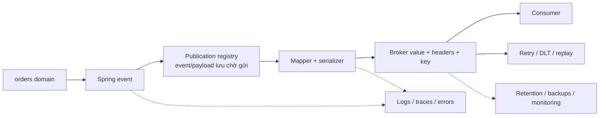
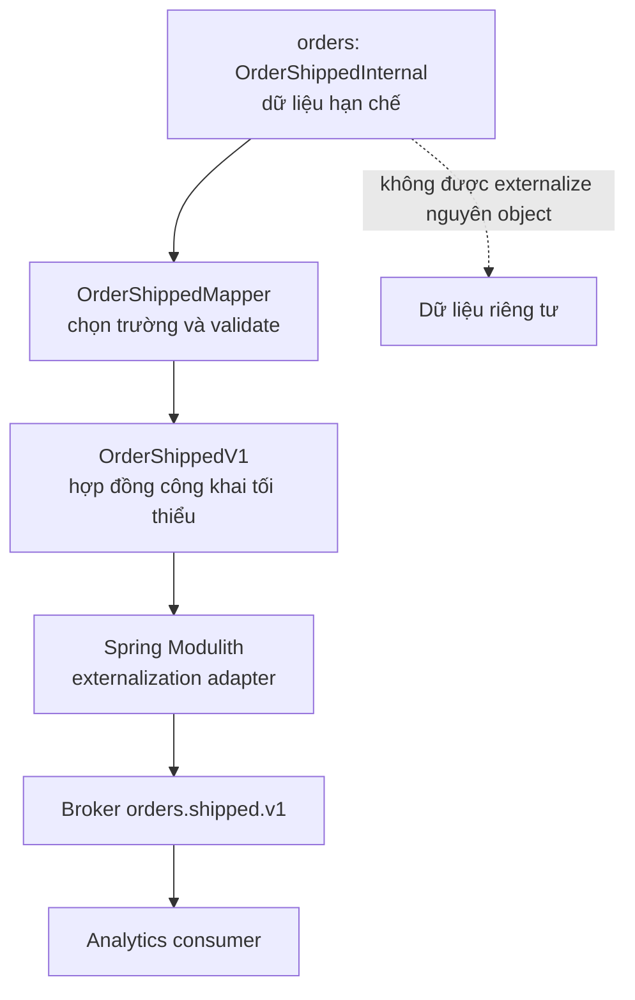

# Không để dữ liệu nội bộ lọt ra event công khai

Trong một ứng dụng Spring Modulith, một domain event có thể chứa nhiều dữ liệu hữu ích cho xử lý nội bộ: trạng thái đơn, email khách hàng, địa chỉ giao hàng, ghi chú nhân viên, mã đánh giá rủi ro hoặc liên kết đến JPA entity. Khi sự kiện được **externalize** sang Kafka, RabbitMQ hoặc hệ thống messaging khác, các trường đó có thể vượt qua ranh giới tin cậy của ứng dụng và trở thành dữ liệu mà consumer bên ngoài nhìn thấy, lưu lại hoặc chuyển tiếp.

Ví dụ, module `orders` chỉ muốn thông báo rằng một đơn đã được gửi đi, nhưng lại serialize nguyên `OrderShippedInternal`. Dịch vụ phân tích nhận được không chỉ `orderId` và `occurredAt`, mà còn cả `recipientEmail`, `streetAddress` và `fraudReviewFlag`. Consumer không cần các trường này; một khi dữ liệu đi vào broker, log, retry topic hay backup, việc thu hồi rất khó. Đây là **lỗi thiết kế hợp đồng công khai**, không chỉ là lỗi serializer.

**Không để dữ liệu nội bộ lọt ra event công khai** nghĩa là chủ động quản lý **event được phép gửi**, **trường được phép công bố**, **metadata/headers**, **dữ liệu được lưu tạm để retry** và **đích có quyền truy cập**. Định dạng JSON đúng hoặc code compile thành công chưa chứng minh hệ thống không rò rỉ thông tin.

Bài thuộc chương **Externalization** của học phần `SPRING_MODULITH_VERIFICATION_TESTING`. Học phần hướng tới kiểm chứng ranh giới kiến trúc bằng `ApplicationModules` và dependency rules, thực hành `@ApplicationModuleTest`, kiểm thử sự kiện, cơ sở dữ liệu và tích hợp, kết hợp quality gate trong CI để chặn phụ thuộc sai và hồi quy. Ở đây, trọng tâm là **biên giới dữ liệu và kiểm thử âm (negative tests) cho những gì tuyệt đối không được externalize**.

## 1. “Dữ liệu nội bộ” bao gồm những gì?

Không nên chỉ hiểu dữ liệu nội bộ là một field mang tên `password`. Phạm vi rộng hơn:

| Nhóm dữ liệu | Ví dụ trong `orders` | Vì sao không tự đưa vào event công khai? |
| --- | --- | --- |
| **PII / thông tin cá nhân** | Email, số điện thoại, địa chỉ, tên đầy đủ | Consumer không nhất thiết được phép nhận hoặc lưu |
| **Secrets / token** | API key, access token, payment token, credential | Có thể tạo khả năng truy cập trái phép |
| **Quyết định nội bộ** | `fraudReviewFlag`, risk score, internal rule ID | Lộ phương thức kiểm soát hoặc logic kinh doanh |
| **Ghi chú vận hành** | Nội dung chăm sóc khách hàng, ghi chú nhân viên | Có thể chứa dữ liệu nhạy cảm hoặc thông tin chưa kiểm chứng |
| **Mô hình lưu trữ** | JPA entity, repository key, Hibernate proxy | Gây coupling, có thể serialize cả object graph |
| **Hạ tầng nội bộ** | Hostname, IP private, trace baggage, exception stack | Không thuộc business contract, có thể lộ topology |
| **Định danh gián tiếp** | Internal user ID, tracking code, raw session ID | Có thể liên kết được về cá nhân hoặc phiên sử dụng |

**Nguyên tắc:** “Không phải secret” **không đồng nghĩa** “an toàn để công bố”. Một `orderId` hay `shipmentId` có thể ít nhạy cảm hơn địa chỉ đầy đủ, nhưng vẫn có thể trở thành dữ liệu nhận dạng khi kết hợp với các bộ dữ liệu khác. Mỗi trường phải có **mục đích sử dụng, consumer hợp lệ và chính sách lưu trữ**.

## 2. Bề mặt rò rỉ không dừng ở JSON payload

Một event có thể được tiếp xúc ở nhiều nơi:



Để đánh giá an toàn dữ liệu, phải nhìn **toàn đường đi**:

1. Event object được phát trong Spring context.
2. Event nào được selection policy chọn để externalize.
3. Event nguồn hoặc payload đã map có được lưu trong publication registry không.
4. Serializer có thêm field, type metadata hoặc nested object không.
5. Headers, broker key và destination có mang dữ liệu nhạy cảm không.
6. Error logging, traces, retries, DLT và backup có giữ bản sao không.
7. Consumer có quyền nhận và lưu trường nào theo hợp đồng?

Một test `assertFalse(json.has("customerEmail"))` trên payload hữu ích, **nhưng chưa đủ** nếu adapter lại đưa email vào Kafka header.

## 3. Phân biệt private domain event và integration event

Giả sử module `orders` có hai nhu cầu:

- Trong JVM, listener nghiệp vụ cần thông tin để hoàn tất xử lý vận hành đơn.
- Ngoài JVM, analytics chỉ cần biết **đơn nào đã gửi đi, mã đơn vị vận chuyển nào và thời điểm nào**.

Không nên bắt hai nhóm dùng chung một object đầy đủ.



**Domain event nội bộ** có vòng đời gắn với thay đổi logic trong module. **Integration event** có vòng đời của một hợp đồng với consumer khác; việc thay đổi field, kiểu dữ liệu và ngữ nghĩa có thể đòi versioning.

Không phải mọi domain event đều chứa PII; tốt nhất là **ngay cả event nội bộ cũng chỉ mang dữ liệu cần thiết**. Tuy nhiên, khi nguồn sự kiện có nhiều dữ liệu vì yêu cầu thực tế, việc **tách public DTO** và map allowlist vẫn là một ranh giới phòng vệ quan trọng.

## 4. Phản ví dụ: externalize nguyên JPA entity

Một cách viết nguy hiểm:

```java
// PHẢN VÍ DỤ: đừng dùng làm integration contract.
@Externalized("orders.shipped.v1")
public record OrderShippedBad(
        UUID eventId,
        OrderEntity order
) {}
```

`OrderEntity` có thể mang:

```text
OrderEntity
  id
  customer.email
  customer.phone
  shippingAddress.street
  shippingAddress.postalCode
  fraudReviewFlag
  internalOperatorNote
  paymentMethod.token
  orderLines[*]
```

Tùy serializer, JPA entity có thể làm lộ object graph, gây truy cập lazy relation ngoài transaction, serialize field mới ngoài ý muốn hoặc thất bại với proxy. Ngay cả khi serializer hiện tại bỏ qua một vài field, thêm getter mới ở entity trong lần refactor tiếp theo có thể mở rộng JSON mà không ai nhận ra.

**Đừng dựa vào may mắn của serializer hoặc `@JsonIgnore` rải rác trong entity** để bảo vệ hợp đồng external event. Entity là mô hình lưu trữ/miền nghiệp vụ; public event phải là kiểu dữ liệu được thiết kế riêng và có **danh sách trường cho phép**.

## 5. Đặt ranh giới module trước khi viết mapper

Với Spring Modulith, có thể tổ chức:

```text
com.example.shop
├── ShopApplication.java
├── orders
│   ├── OrderShippedV1.java                # public integration contract
│   ├── package-info.java
│   └── internal
│       ├── OrderShippedInternal.java      # internal event
│       ├── OrderShippedMapper.java        # allowlist mapper
│       ├── OrderShippingService.java      # business transaction
│       └── ShipmentRepository.java        # persistence port
└── reporting
    └── internal
        └── ShipmentReportListener.java
```

Theo mô hình module đóng mặc định, `orders` là application module, package gốc `orders` là API mặc định, còn `orders.internal` không phải API để module khác tùy tiện import.

**Quy tắc sở hữu:** module `orders` quyết định sự kiện nào về đơn hàng có thể công bố và thông tin nào được phép công bố. Module `reporting` hoặc adapter Kafka **không nên đọc `orders.internal.OrderEntity`** để tự xây event bên ngoài.

Nếu các module khác cần một API chuyên biệt, có thể thiết kế `@NamedInterface` phù hợp; đừng biến toàn bộ model nội bộ thành public chỉ vì “dễ import”.

## 6. Event nội bộ minh họa

Event sau chỉ tồn tại trong `orders.internal`:

```java
// orders/internal/OrderShippedInternal.java
package com.example.shop.orders.internal;

import java.time.Instant;
import java.util.UUID;

record OrderShippedInternal(
        UUID eventId,
        UUID orderId,
        UUID shipmentId,
        Instant occurredAt,
        String carrierCode,
        String recipientEmail,
        String streetAddress,
        String fraudReviewFlag,
        String internalOperatorNote
) {}
```

Record `package-private` không được module khác import như một API. Tuy nhiên, **Java visibility không phải bảo đảm bảo mật**: nếu một serializer hoặc listener có quyền truy cập event object và gửi ra ngoài, dữ liệu vẫn có thể rò rỉ. Spring events là cơ chế trong JVM, **không phải vùng lưu trữ bí mật**.

Ví dụ này cố ý có nhiều trường để minh họa tình huống cần mapping. Trong sản phẩm thực, nên hỏi lại liệu `recipientEmail` hoặc `streetAddress` **có cần nằm trong một event nội bộ** hay có thể chỉ giữ reference và để listener có quyền tra cứu từ một service/port có kiểm soát.

Đặc biệt, **không đưa payment token, API key hay password vào event dù nó chỉ dự định dùng nội bộ**, nếu có thể tránh; các cơ chế log, debug, registry hoặc listener khác có thể làm tăng phạm vi tiếp xúc.

## 7. Integration event theo nguyên tắc allowlist

Public DTO chỉ có các trường được duyệt:

```java
// orders/OrderShippedV1.java
package com.example.shop.orders;

import java.time.Instant;
import java.util.UUID;
import org.springframework.modulith.events.Externalized;

@Externalized("orders.shipped.v1")
public record OrderShippedV1(
        UUID eventId,
        UUID orderId,
        UUID shipmentId,
        String carrierCode,
        Instant occurredAt
) {}
```

Không có `recipientEmail`, `streetAddress`, `fraudReviewFlag` hoặc `internalOperatorNote`. Không có `OrderEntity`, `CustomerEntity`, `Map<String,Object> internalData` hay field `extra` mơ hồ.

`@Externalized` đánh dấu loại event được chọn cho externalization theo cấu hình. Giá trị `"orders.shipped.v1"` trong ví dụ là route/destination mong muốn; cách ánh xạ sang Kafka topic, AMQP exchange/routing hoặc JMS destination **phụ thuộc adapter và phiên bản**.

**Khi version v1 đã được công bố, record này là một hợp đồng.** Bất kỳ lần thêm field nào cũng phải đi qua review mục đích, quyền nhận dữ liệu, schema compatibility và kiểm thử payload; không được coi việc thêm một getter là thay đổi vô hại.

## 8. Mapper Java thuần: chỉ chép những gì được phép

```java
// orders/internal/OrderShippedMapper.java
package com.example.shop.orders.internal;

import com.example.shop.orders.OrderShippedV1;
import java.util.Locale;
import java.util.Objects;
import java.util.Set;

final class OrderShippedMapper {

    private static final Set<String> ALLOWED_CARRIERS =
            Set.of("POST", "EXPRESS");

    OrderShippedV1 toPublicEvent(OrderShippedInternal source) {
        Objects.requireNonNull(source, "source");

        var eventId = Objects.requireNonNull(
                source.eventId(), "eventId");
        var orderId = Objects.requireNonNull(
                source.orderId(), "orderId");
        var shipmentId = Objects.requireNonNull(
                source.shipmentId(), "shipmentId");
        var occurredAt = Objects.requireNonNull(
                source.occurredAt(), "occurredAt");

        String carrierCode = Objects.requireNonNull(
                source.carrierCode(), "carrierCode")
                .trim()
                .toUpperCase(Locale.ROOT);

        if (!ALLOWED_CARRIERS.contains(carrierCode)) {
            throw new IllegalArgumentException(
                    "Unsupported public carrier code");
        }

        return new OrderShippedV1(
                eventId,
                orderId,
                shipmentId,
                carrierCode,
                occurredAt
        );
    }
}
```

Những tính chất quan trọng:

1. **Chỉ đọc năm trường có hợp đồng**. Không có phép `BeanUtils.copyProperties(source, target)` hoặc biến toàn object thành `Map` rồi xóa vài key.
2. **Không tham chiếu** `source.recipientEmail()`, `source.streetAddress()`, `source.fraudReviewFlag()` hoặc `source.internalOperatorNote()`.
3. **Normalize carrier code** vào một tập công khai hợp lệ. Trong ví dụ, `POST` và `EXPRESS` chỉ là mã giả; sản phẩm thực cần bảng mã được consumer hiểu.
4. **Không tạo ID hoặc thời điểm mới** khi mapping. Cùng một event được retry phải giữ `eventId` và `occurredAt` ổn định.
5. **Validate fail closed** khi dữ liệu bắt buộc không hợp lệ. Không tự dùng `"UNKNOWN"` hoặc rơi lại toàn bộ source event vì mapper gặp lỗi.

Vì mapper không gọi database, HTTP, log hoặc broker, unit test có thể kiểm toàn bộ chuyển đổi **không cần Spring context**.

## 9. Allowlist thắng blacklist như thế nào?

Hai chiến lược:

```java
// Không nên: copy toàn bộ rồi loại một vài trường đã biết.
Map<String, Object> payload = objectMapper.convertValue(
        internalEvent, new TypeReference<>() {});
payload.remove("recipientEmail");
payload.remove("streetAddress");
// Còn fraudReviewFlag, internalOperatorNote hoặc field mới?
```

```java
// Nên: dựng public contract bằng field được duyệt rõ ràng.
return new OrderShippedV1(
        source.eventId(),
        source.orderId(),
        source.shipmentId(),
        publicCarrierCode,
        source.occurredAt()
);
```

**Blacklist** biết những field đã được phát hiện hôm nay. Khi domain model thêm `internalDiscountReason` ngày mai, nó có thể đi ra broker ngay nếu quy trình copy/serialize linh hoạt.

**Allowlist** chỉ có năm trường cố định; thêm field nội bộ không làm public payload tự mở rộng. Muốn công bố field mới, developer buộc phải **sửa công khai hợp đồng** và chạy review/test.

`@JsonIgnore` và `@JsonView` vẫn có chỗ dùng trong hệ thống JSON, nhưng không nên xem chúng là **ranh giới duy nhất** bảo vệ toàn bộ pipeline. Những serializer, mapper, header adapter hoặc alternate serialization path có thể bỏ qua annotation Jackson.

## 10. Cẩn trọng với `Map<String,Object>` và cấu trúc mở

Một contract kiểu:

```java
public record UnsafePublicEvent(
        UUID eventId,
        Map<String, Object> attributes
) {}
```

có thể khiến event ngoài JVM trở thành một “hộp chứa bất kỳ dữ liệu”:

```json
{
  "eventId": "a1b2c3d4-0000-4000-8000-000000000001",
  "attributes": {
    "carrierCode": "POST",
    "recipientEmail": "example@example.test",
    "fraudReviewFlag": "MANUAL_REVIEW"
  }
}
```

Đây là **ví dụ dữ liệu không được phép gửi**, không phải payload chuẩn. Dùng `Map` là hợp lệ khi hợp đồng thật sự định nghĩa một tập extension đã quản lý với validation/schema, nhưng nếu mọi feature team có thể tự đặt key thì cần cơ chế allowlist, classification và review tương ứng.

**Đừng dùng `Object`, `Map` hoặc `JsonNode` như đường tắt để tránh quản lý schema**. Với event đã public, một record/DTO tường minh thường dễ kiểm soát hơn.

## 11. Nested DTO cũng phải được duyệt theo từng trường

Ngay cả khi top-level event không chứa `customerEmail`, một nested DTO có thể làm lộ nó:

```java
// Phản ví dụ:
public record OrderShippedBad(
        UUID eventId,
        ShipmentDetails details
) {}

public record ShipmentDetails(
        UUID shipmentId,
        String carrierCode,
        Address recipientAddress,
        String recipientPhone
) {}
```

Nếu consumer chỉ cần trạng thái giao hàng, không nên gửi `Address` hoặc số điện thoại chỉ vì chúng nằm trong một value object sẵn có.

Với nested contract được phép, test phải kiểm **đệ quy** cả structure, không chỉ tên field top-level:

```text
OrderShippedV1
  eventId
  orderId
  shipmentId
  carrierCode
  occurredAt

Không được có:
  recipientAddress
  customer
  paymentDetails
  internalMetadata
  entityGraph
```

Tương tự, tránh nhét nguyên domain entity vào một field mang tên trung tính như `details` hoặc `context`.

## 12. Publish event đã map: rõ ràng hai lớp ý nghĩa

Ví dụ một service trong `orders.internal`:

```java
// orders/internal/OrderShippingService.java
package com.example.shop.orders.internal;

import java.time.Clock;
import java.util.UUID;
import org.springframework.context.ApplicationEventPublisher;
import org.springframework.stereotype.Service;
import org.springframework.transaction.annotation.Transactional;

@Service
class OrderShippingService {

    private final ShipmentRepository shipments;
    private final ApplicationEventPublisher events;
    private final Clock clock;
    private final OrderShippedMapper mapper = new OrderShippedMapper();

    OrderShippingService(
            ShipmentRepository shipments,
            ApplicationEventPublisher events,
            Clock clock) {
        this.shipments = shipments;
        this.events = events;
        this.clock = clock;
    }

    @Transactional
    UUID markShipped(
            UUID orderId,
            UUID shipmentId,
            String carrierCode,
            String recipientEmail,
            String streetAddress,
            String fraudReviewFlag,
            String internalOperatorNote) {

        // Production: validate transition/idempotency, kiểm trạng thái,
        // lưu shipment với đúng transaction manager.
        shipments.markShipped(orderId, shipmentId);

        var internal = new OrderShippedInternal(
                UUID.randomUUID(),
                orderId,
                shipmentId,
                clock.instant(),
                carrierCode,
                recipientEmail,
                streetAddress,
                fraudReviewFlag,
                internalOperatorNote
        );

        // Nếu thật sự có listener nội bộ cần event nhiều trường:
        events.publishEvent(internal);

        // Chỉ public DTO theo allowlist mới được externalize.
        events.publishEvent(mapper.toPublicEvent(internal));

        return internal.eventId();
    }
}
```

Port nội bộ tối thiểu để biểu diễn phụ thuộc:

```java
// orders/internal/ShipmentRepository.java
package com.example.shop.orders.internal;

import java.util.UUID;

interface ShipmentRepository {
    void markShipped(UUID orderId, UUID shipmentId);
}
```

Ứng dụng thực phải có bean implement repository, `Clock`, dữ liệu test và quy tắc chuyển trạng thái. Code trên **minh họa ranh giới mapping**, không phải một workflow shipment production có sẵn transaction/idempotency hoàn chỉnh.

**Cần đặc biệt chú ý hai event:** `OrderShippedInternal` chỉ phục vụ listener JVM nếu thật sự cần và **không được selection policy externalize**; `OrderShippedV1` có contract công khai và được chọn gửi. Nếu không có listener nội bộ nào cần email/địa chỉ, tốt hơn là **không phát `OrderShippedInternal` chứa những trường đó**; chỉ map từ dữ liệu nghiệp vụ trong phạm vi service rồi publish public event.

Không được dùng đồng thời selector rộng và `@Externalized` theo cách khiến **cả event nội bộ cũng bị gửi**, hoặc gửi hai representation không được định nghĩa là một thay đổi có chủ đích.

## 13. Một lỗi còn nghiêm trọng hơn: gửi trước khi transaction commit

`OrderShippingService.markShipped(...)` mang `@Transactional`, nhưng lời gọi `events.publishEvent(...)` diễn ra **trong transaction**; điều đó không tự chứng minh broker chỉ nhận message sau commit.

Nếu một `@EventListener` thường gọi Kafka producer ngay, rồi database rollback, consumer có thể thấy một đơn “đã gửi” không tồn tại trong trạng thái commit:

```text
BEGIN DB transaction
  mark order SHIPPED
  publish Spring event
  listener gọi broker ngay
  broker nhận OrderShippedV1
  exception -> ROLLBACK
```

Phải kiểm **transaction-aware externalization adapter**, Event Publication Registry và sự kiện rollback theo stack thực tế. `@TransactionalEventListener(AFTER_COMMIT)` là cơ chế Spring hữu ích cho xử lý sau commit, nhưng **tự dùng một listener sau commit không bảo đảm durable recovery nếu process chết trong khoảng commit → listener chạy**.

Với event public, **tính đúng dữ liệu và tính đúng thời điểm** là hai lớp kiểm tra riêng:

- Event chỉ chứa trường được duyệt.
- Event chỉ mô tả một business fact đã commit theo hợp đồng.

## 14. Phương án khác: mapping trong externalization configuration

Thay vì publish hai loại Spring event, có thể lựa chọn kiến trúc:

1. Module nghiệp vụ publish một domain event nội bộ.
2. Cấu hình externalization **select type** được phép.
3. Cấu hình mapping **domain event → integration payload**.
4. Adapter định tuyến và serialize mapped payload.

Các phiên bản Spring Modulith có API cấu hình externalization theo chương trình, liên quan đến `EventExternalizationConfiguration` và tùy chọn selection/mapping/routing; **cần tra cứu API đúng phiên bản** trước khi sử dụng.

Pseudocode sau **không phải Java API copy trực tiếp**:

```text
externalization selection:
  type = OrderShippedInternal ONLY

mapping:
  OrderShippedInternal -> OrderShippedV1
  allow fields: eventId, orderId, shipmentId, carrierCode, occurredAt

route:
  orders.shipped.v1

do not externalize:
  other internal events
```

**Rủi ro khác phương án publish DTO:** tùy implementation, publication registry có thể lưu **event nguồn có dữ liệu nhạy cảm trước khi mapping**. Ngoài ra, mapped payload có thể không xuất hiện như một Spring application event riêng trong `PublishedEvents`; test phải phản ánh đúng kiến trúc đang dùng.

Nếu domain event chứa PII/ghi chú bí mật, cần biết **mapper chạy ở thời điểm nào và source được lưu tại đâu**. Một event không lộ trên Kafka vẫn có thể lộ trong registry database, error logs hoặc snapshot/test artifacts.

## 15. Tránh selector “gửi mọi event trong package”

Một chính sách nguy hiểm:

```text
externalize every event under com.example.shop.orders
```

Hôm nay package chỉ có `OrderShippedV1`; ngày mai developer thêm:

```java
record FraudReviewCompletedInternal(
        UUID orderId,
        String riskReason,
        String reviewerNote
) {}
```

Nếu selector rộng không phân biệt intended public event, loại event mới có thể bị externalize ngoài ý muốn.

Nên dùng **selection theo loại/hợp đồng được phê duyệt** (ví dụ `@Externalized` cho public DTO và chính sách không mở rộng ngoài marker), hoặc một allowlist type được quản lý tập trung và có test âm.

**Test phải chứng minh cả hai mặt:**

- `OrderShippedV1` được gửi đúng.
- `OrderShippedInternal` và các event nhạy cảm khác **không được gửi**, kể cả khi được publish trong JVM.

Không chỉ kiểm “topic có một event”, vì event nhạy cảm có thể đã bị gửi tới topic khác hoặc một route phụ.

## 16. Event type và Java package không phải quyền truy cập

Một record `public` ở `orders` cho phép module Java khác tham chiếu theo API, nhưng **public Java visibility không có nghĩa mọi hệ thống ngoài doanh nghiệp được phép tiêu thụ nó**.

Ngược lại, một record `package-private` hoặc trong `orders.internal` **không tự được bảo vệ khỏi serialization** nếu infrastructure có quyền truy cập object, reflection hoặc một custom mapper.

Cần phân biệt ba kiểm soát:

| Lớp | Công cụ thường dùng | Bảo vệ điều gì? |
| --- | --- | --- |
| Java/module boundary | Spring Modulith, `ApplicationModules.verify()`, `@NamedInterface` | Module nào import API/implementation của module khác |
| Event externalization selection | `@Externalized` hoặc policy selector đã duyệt | Loại event nào được gửi ra khỏi JVM |
| Data security | Contract field allowlist, ACL, encryption, retention và tests | Ai nhận được trường gì, ở đâu và trong bao lâu |

**Không lớp nào thay thế hoàn toàn lớp còn lại.** Kiến trúc không có cycle vẫn có thể lộ PII; JSON payload sạch vẫn có thể bị gửi đến topic mà consumer không được phép truy cập.

## 17. Nguy cơ từ metadata, header và broker key

Ngay cả khi payload chỉ có field an toàn:

```json
{
  "eventId": "15312d2d-2f71-42fa-b8bf-1c07b4c0052c",
  "orderId": "1e1cbd25-0e58-4e7a-93aa-fd9a5450fa82",
  "shipmentId": "e23cd7eb-d8b3-49e8-8bed-c51bf0eb4654",
  "carrierCode": "POST",
  "occurredAt": "2026-11-26T02:00:00Z"
}
```

adapter có thể thêm những header không nên công bố:

```text
# Phản ví dụ về headers KHÔNG được phép đưa ra broker:
recipientEmail: customer@example.test
internalFraudFlag: MANUAL_REVIEW
internalOperatorNote: call-before-delivery
```

Message key, Kafka headers, AMQP properties, CloudEvents extensions, trace baggage hoặc routing labels đều là **dữ liệu đi theo message**. Consumer, broker tooling, log collector và DLT có thể lưu chúng.

**Chính sách:** cho phép một tập header tối thiểu như `eventType`, `schemaVersion`, `correlationId` nếu phù hợp; kiểm tính cần thiết và độ nhạy của từng giá trị. Dùng `orderId` làm key nếu có yêu cầu ordering không đồng nghĩa nó hoàn toàn không nhạy cảm; phải review quyền đọc topic và khả năng liên kết dữ liệu.

`@Externalized("orders.shipped.v1")` cũng **không mặc định cấu hình Kafka key bằng `orderId`**. Key và route phải được test với adapter/broker thực tế.

## 18. Destination, topic và phân quyền consumer

Nếu một event được gửi tới topic mà nhiều nhóm hệ thống có quyền subscribe, **mọi field trong payload hoặc headers phải được phép chia sẻ với tất cả consumer đó** theo chính sách thực tế.

Ví dụ:

| Destination | Consumer dự kiến | Dữ liệu phù hợp |
| --- | --- | --- |
| `orders.shipped.v1` | Analytics/fulfillment reporting | Event ID, order ID, shipment ID, carrier code, occurredAt |
| `delivery.label.requests` | Service giao vận được ủy quyền | Có thể cần địa chỉ, qua hợp đồng và ACL riêng |
| `risk.review.internal` | Dịch vụ nội bộ có quyền phù hợp | Chỉ thông tin rủi ro tối thiểu theo policy riêng |

**Không dùng một event analytics public làm đường tắt để gửi địa chỉ cho dịch vụ in nhãn.** Nếu một consumer cần PII chính đáng, tạo hợp đồng/destination **được phân quyền riêng** hoặc áp dụng API có authentication/authorization. Việc có quyền xử lý dữ liệu cần dựa trên mục đích, quy định và chính sách của tổ chức, không chỉ do một nhóm developer thấy “tiện”.

Mã hóa đường truyền và cơ chế broker ACL là bảo vệ cần thiết nhưng **không sửa lỗi công bố dữ liệu thừa**. Một consumer đã được cấp quyền vào topic vẫn có thể nhận mọi field thừa mà producer gửi.

## 19. “Ẩn danh” và “không gửi email” không hoàn toàn giống nhau

Giả sử producer bỏ `recipientEmail` nhưng giữ `orderId`. Một consumer có thể tham chiếu `orderId` đến database khác và xác định khách hàng. Khi đó event có thể vẫn là dữ liệu **có khả năng liên kết tới cá nhân**, tùy bối cảnh.

Những thuật ngữ cần dùng chính xác:

- **Data minimization:** chỉ gửi trường thật sự cần.
- **Pseudonymization:** thay danh tính trực tiếp bằng mã, nhưng có thể còn khóa liên kết để nhận dạng.
- **Anonymization:** không còn khả năng nhận dạng theo tiêu chí đánh giá phù hợp; **không suy ra** chỉ bằng cách bỏ một trường.
- **Encryption:** bảo vệ dữ liệu trong điều kiện cụ thể, không xóa mục đích sử dụng hoặc quyền nhận.

Không quảng bá `OrderShippedV1` là “anonymous” chỉ vì không có email/địa chỉ. Cần data classification và privacy/security review theo bối cảnh triển khai.

## 20. Publication Registry có thể là nơi lưu event trước khi map

Spring Modulith **Event Publication Registry** có thể theo dõi publication tới target và hỗ trợ resubmission khi được cấu hình với persistence thích hợp. Với event externalization, phải đặt câu hỏi:

```text
Event nội bộ chứa email/địa chỉ
    |
    v
Registry có lưu event nguồn?
    |
    v
Adapter mới map public DTO?
    |
    v
Broker payload không có email
```

**Broker payload sạch không chứng minh registry database sạch.** Hình thức lưu event nguồn, serialization, mapping và completion **phụ thuộc phiên bản/adapter/storage**; không tự giả định mọi implementation lưu payload đã map.

Nếu đã chủ động publish một `OrderShippedV1` không chứa PII để externalize, registry cho target public có thể giảm rủi ro dữ liệu nhạy cảm so với lưu `OrderShippedInternal`, **nhưng còn cần kiểm tra listener nội bộ, các publication khác và cơ chế logging**.

Điều nên kiểm:

1. Loại event nào được registry thực tế ghi nhận.
2. Publication record chứa dạng dữ liệu gì và có field nhạy cảm không.
3. Ai có quyền đọc table/store, backup và dumps?
4. Retention và cleanup bản ghi complete/incomplete ra sao?
5. Khi resubmit, event được map lại hay dùng payload đã lưu? Có thay đổi dữ liệu không?
6. Khi serialization thất bại, exception/log có đưa nguyên source event ra ngoài không?

Đừng tự viết SQL đoán cột `payload` hoặc `status` của registry; sử dụng schema/API chính thức **đúng phiên bản đang triển khai**.

## 21. Dead-letter queue, retry topic và backup cũng là bản công bố

Khi một consumer không xử lý được message, transport có thể chuyển nó sang **dead-letter topic/queue (DLT/DLQ)**. Nếu producer gửi PII thừa ở message ban đầu, dữ liệu đó có thể xuất hiện trong:

- Topic/queue gốc và các replica.
- Retry topic/queue hoặc DLT/DLQ.
- Broker retention và backups.
- Consumer error logs, tracing, alert payload.
- Message replay/export tool của operator.

Mục tiêu không chỉ là “consumer production không hiển thị email”, mà là **ngăn email đi vào hệ thống ngoài khi nó không cần thiết**.

Nếu một destination được phép mang dữ liệu nhạy cảm, cần ACL, encryption, retention và audit phù hợp **trên cả topic gốc lẫn retry/DLQ**. Không bỏ bảo mật ở DLT chỉ vì nơi đó “chỉ dùng khi lỗi”.

Đối với retry của producer, registry/outbox storage cũng cần quyền truy cập, hạn lưu và xử lý sự cố phù hợp với dữ liệu thực sự được lưu.

## 22. Log, trace và exception thường làm lộ event mà không cần broker

Java record tự tạo `toString()` hiển thị các record components:

```java
// Phản ví dụ trong orders:
logger.info("Shipping event: {}", internalEvent);
```

Với `OrderShippedInternal`, dòng log có thể in cả email, địa chỉ, risk flag và ghi chú. Các trường này có thể đi vào centralized logging, APM, trace export, error monitoring hoặc incident report.

Nên log **các giá trị tối thiểu đã được duyệt**:

```java
logger.info(
        "Order shipped eventId={} orderId={} shipmentId={}",
        publicEvent.eventId(),
        publicEvent.orderId(),
        publicEvent.shipmentId()
);
```

Ngay cả `orderId`/`shipmentId` cũng cần classification và quyền truy cập log phù hợp. Không log `recipientEmail` chỉ để giúp tra cứu nhanh khi hệ thống đã có công cụ hỗ trợ theo ID.

### Lỗi mapper cũng có thể gây leak

Không ném:

```java
throw new IllegalArgumentException(
        "Cannot map internal event: " + internalEvent
);
```

Vì message có thể chứa toàn bộ `toString()` của event nguồn. Dùng thông báo lỗi **tĩnh, phân loại được**, ví dụ `"Unsupported public carrier code"` và log có kiểm soát cùng `eventId`. Exception cause/stack được gửi đến telemetry cũng phải tuân theo chính sách data classification.

**Không dùng full event serialization trong log như một công cụ test duy nhất**; log vô tình có thể là nơi leak trước cả broker.

## 23. Kiểu dữ liệu public có thể không an toàn vì ý nghĩa

Không phải thêm field mới là rò rỉ chỉ khi tên field chứa chữ `internal`.

Ví dụ:

```json
{
  "orderId": "1e1cbd25-0e58-4e7a-93aa-fd9a5450fa82",
  "recipientRegion": "DISTRICT-7",
  "deliveryInstruction": "Leave at back entrance",
  "riskTier": "HIGH"
}
```

`recipientRegion` có thể cần cho báo cáo thống kê, nhưng `deliveryInstruction` là thông tin vận hành về nơi nhận; `riskTier` có thể là quyết định nhạy cảm. Cả hai có thể rò rỉ thông tin dù kiểu JSON chỉ là `string`.

**Schema validation bảo vệ hình dạng dữ liệu, không tự đánh giá mục đích sử dụng.** Một field hợp lệ về schema vẫn có thể vi phạm chính sách quyền riêng tư, bảo mật hoặc nguyên tắc tối thiểu dữ liệu.

Khi review một field, trả lời ít nhất:

1. Consumer nào dùng field?
2. Mục đích nghiệp vụ nào yêu cầu?
3. Field có thể được liên kết với cá nhân hoặc hoạt động riêng tư không?
4. Có cách biểu diễn ít chi tiết hơn không?
5. Cần giữ trong broker/log/backup bao lâu?
6. Ai phê duyệt và chịu trách nhiệm khi thay đổi?

## 24. Unit test mapper: kiểm nội dung và tính ổn định

Vì `OrderShippedMapper` là Java thuần, có thể test không cần Spring:

```java
// src/test/java/com/example/shop/orders/internal/OrderShippedMapperTests.java
package com.example.shop.orders.internal;

import static org.junit.jupiter.api.Assertions.*;

import com.example.shop.orders.OrderShippedV1;
import java.time.Instant;
import java.util.UUID;
import org.junit.jupiter.api.Test;

class OrderShippedMapperTests {

    private final OrderShippedMapper mapper =
            new OrderShippedMapper();

    @Test
    void mapsOnlyPublicFieldsAndKeepsIdentity() {
        UUID eventId = UUID.randomUUID();
        UUID orderId = UUID.randomUUID();
        UUID shipmentId = UUID.randomUUID();
        Instant occurredAt =
                Instant.parse("2026-11-26T02:00:00Z");

        var internal = new OrderShippedInternal(
                eventId,
                orderId,
                shipmentId,
                occurredAt,
                " post ",
                "private@example.test",
                "Private delivery street",
                "MANUAL_REVIEW",
                "Operator note: internal only"
        );

        OrderShippedV1 actual = mapper.toPublicEvent(internal);

        assertEquals(eventId, actual.eventId());
        assertEquals(orderId, actual.orderId());
        assertEquals(shipmentId, actual.shipmentId());
        assertEquals(occurredAt, actual.occurredAt());
        assertEquals("POST", actual.carrierCode());
        assertEquals(actual, mapper.toPublicEvent(internal));
    }

    @Test
    void rejectsUnknownCarrierWithoutEchoingInput() {
        var internal = new OrderShippedInternal(
                UUID.randomUUID(),
                UUID.randomUUID(),
                UUID.randomUUID(),
                Instant.parse("2026-11-26T02:00:00Z"),
                "secret-unapproved-carrier",
                "private@example.test",
                "Private delivery street",
                "MANUAL_REVIEW",
                "Internal note"
        );

        var error = assertThrows(IllegalArgumentException.class,
                () -> mapper.toPublicEvent(internal));

        assertFalse(error.getMessage().contains("private@example.test"));
        assertFalse(error.getMessage().contains("secret-unapproved"));
    }
}
```

Test này kiểm **nội dung đúng và tính deterministic**; dù mapper được gọi lại trong một lần retry, nó không tạo eventId mới hoặc thời điểm khác.

**Lưu ý:** kiểm riêng trường `carrierCode` không thể thay thế data classification. Một mã carrier hợp lệ vẫn phải được phép công bố theo chính sách.

## 25. Test cấu trúc: public DTO chỉ có đúng năm trường

Một kiểm thử quan trọng hơn việc chỉ assert một vài field nhạy cảm không tồn tại là **khóa allowlist ở mức cấu trúc**:

```java
// Thêm vào OrderShippedMapperTests:
@Test
void publicContractHasOnlyApprovedRecordComponents() {
    java.util.Set<String> actual =
            java.util.Arrays.stream(
                    com.example.shop.orders.OrderShippedV1.class
                            .getRecordComponents())
                    .map(java.lang.reflect.RecordComponent::getName)
                    .collect(java.util.stream.Collectors.toSet());

    assertEquals(
            java.util.Set.of(
                    "eventId",
                    "orderId",
                    "shipmentId",
                    "carrierCode",
                    "occurredAt"),
            actual);
}
```

Nếu developer thêm `recipientEmail` hoặc một field “vô hại” chưa được duyệt, test **fail ngay**, buộc nhóm xem lại contract.

Đây là **tripwire**, không phải quyền phê duyệt tự động. Developer có thể sửa test cùng field mới; vì vậy phải kết hợp code review, schema governance và kiểm thử representation thật trên broker.

Kiểm reflection chỉ bao phủ **record components**. Custom serializer, Jackson mixin, virtual property hoặc message headers vẫn có thể thêm dữ liệu ở nơi khác; các phần tiếp theo kiểm thêm đường đó.

## 26. Test JSON: kiểm danh sách field chính xác, không chỉ chuỗi cấm

Với Jackson, test serialization có thể khẳng định **JSON output chỉ có năm key đã duyệt**:

```java
// src/test/java/com/example/shop/orders/internal/OrderShippedJsonTests.java
package com.example.shop.orders.internal;

import static org.junit.jupiter.api.Assertions.*;

import com.example.shop.orders.OrderShippedV1;
import com.fasterxml.jackson.databind.JsonNode;
import com.fasterxml.jackson.databind.ObjectMapper;
import com.fasterxml.jackson.databind.SerializationFeature;
import com.fasterxml.jackson.datatype.jsr310.JavaTimeModule;
import java.time.Instant;
import java.util.HashSet;
import java.util.Set;
import java.util.UUID;
import org.junit.jupiter.api.Test;

class OrderShippedJsonTests {

    private final ObjectMapper jsonMapper = new ObjectMapper()
            .registerModule(new JavaTimeModule())
            .disable(SerializationFeature.WRITE_DATES_AS_TIMESTAMPS);

    @Test
    void serializedEventContainsOnlyApprovedFields() throws Exception {
        var internal = new OrderShippedInternal(
                UUID.randomUUID(),
                UUID.randomUUID(),
                UUID.randomUUID(),
                Instant.parse("2026-11-26T02:00:00Z"),
                "POST",
                "private@example.test",
                "Private delivery street",
                "MANUAL_REVIEW",
                "Operator-only note"
        );

        OrderShippedV1 publicEvent =
                new OrderShippedMapper().toPublicEvent(internal);

        String wireJson = jsonMapper.writeValueAsString(publicEvent);
        JsonNode node = jsonMapper.readTree(wireJson);

        Set<String> keys = new HashSet<>();
        node.fieldNames().forEachRemaining(keys::add);

        assertEquals(
                Set.of("eventId", "orderId", "shipmentId",
                       "carrierCode", "occurredAt"),
                keys);
        assertEquals("POST", node.get("carrierCode").asText());
        assertEquals("2026-11-26T02:00:00Z",
                node.get("occurredAt").asText());

        assertFalse(wireJson.contains("private@example.test"));
        assertFalse(wireJson.contains("Private delivery street"));
        assertFalse(wireJson.contains("MANUAL_REVIEW"));
        assertFalse(wireJson.contains("Operator-only note"));
    }
}
```

**Ưu điểm:** test có cả **allowlist chính xác** lẫn **sentinel values**. Nếu thêm một field ngoài dự kiến vào JSON, assertion về key sẽ fail; nếu rò dữ liệu qua một representation không mong đợi, một số sentinel cũng giúp phát hiện.

**Giới hạn:** `ObjectMapper` trong test là cấu hình minh họa. Spring Boot hoặc broker adapter có thể dùng **một ObjectMapper/message converter khác**, Avro/Protobuf hay custom serializer. Cần kiểm thử serialization bằng **cấu hình thực của production** và sau cùng bằng **message thật trên transport**.

## 27. JSON Schema: có thể khóa public payload theo allowlist

Một JSON Schema minh họa cho **payload phẳng**:

```json
{
  "$schema": "https://json-schema.org/draft/2020-12/schema",
  "$id": "https://schemas.example.org/shop/order-shipped-v1.json",
  "title": "OrderShippedV1",
  "type": "object",
  "required": [
    "eventId",
    "orderId",
    "shipmentId",
    "carrierCode",
    "occurredAt"
  ],
  "properties": {
    "eventId": { "type": "string", "format": "uuid" },
    "orderId": { "type": "string", "format": "uuid" },
    "shipmentId": { "type": "string", "format": "uuid" },
    "carrierCode": {
      "type": "string",
      "enum": ["POST", "EXPRESS"]
    },
    "occurredAt": {
      "type": "string",
      "format": "date-time"
    }
  },
  "additionalProperties": false
}
```

`additionalProperties: false` thể hiện **producer schema nghiêm ngặt**: không có field ngoài tập được duyệt. Một producer có `customerEmail`, `internalMetadata` hoặc nested key lạ sẽ không hợp lệ theo schema này.

**Lưu ý compatibility:** schema producer nghiêm ngặt không buộc mọi consumer phải từ chối unknown field. Một consumer v1 có chính sách bỏ qua trường mở rộng có thể dễ nâng cấp hơn, trong khi producer vẫn cần review field mới trước khi phát. Thay đổi `additionalProperties` hoặc thêm field vào schema phải theo versioning/approval, không được âm thầm nới quyền công bố.

Tùy JSON Schema validator, `format: "uuid"`/`date-time"` có thể cần bật chế độ kiểm format riêng; phải test validator thật. Một schema valid **không tự bảo đảm** event được gửi đến đúng topic hoặc headers không chứa PII.

## 28. Negative test: event nội bộ tuyệt đối không được externalize

Giả sử code publish **cả hai Spring events**:

```text
OrderShippedInternal     -> chỉ dùng trong JVM
OrderShippedV1           -> được gửi ra broker
```

Test âm cần xác định event nội bộ **không có đường outbound**. Một kiểm tra kiến trúc đơn giản:

```java
// Đặt test trong package orders.internal để truy cập type nội bộ.
@Test
void internalEventIsNotDirectlyMarkedForExternalization() {
    assertNull(
            OrderShippedInternal.class.getAnnotation(
                    org.springframework.modulith.events.Externalized.class)
    );
}
```

**Đây chỉ là chốt đơn giản**, không phải chứng minh đầy đủ: một **programmatic selector quá rộng** vẫn có thể externalize `OrderShippedInternal` dù nó không có `@Externalized`. Cần kiểm tra selection configuration theo phiên bản thật và **broker integration test**.

Test đầy đủ nên assert:

1. Khi service publish cả hai event, `OrderShippedV1` xuất hiện ở **destination đã duyệt**.
2. `OrderShippedInternal` **không xuất hiện** ở broker, kể cả route phụ mà externalization policy có thể tạo.
3. JSON/header/key **không có các trường hoặc sentinel values nhạy cảm**.
4. Một internal event khác mới thêm vào `orders.internal` cũng không được chọn nếu chưa có chính sách công bố.
5. Khi serializer lỗi, system **không fallback sang serialize nguyên event nguồn**.

**Không xem “không đọc thấy event trong 1 ms” là bằng chứng tuyệt đối.** Với pipeline bất đồng bộ, cần consumer test cô lập, timeout hữu hạn và kiểm selector/adapter configuration.

## 29. `@ApplicationModuleTest` kiểm phạm vi nào?

Một module test có thể chứng minh `orders` phát event công khai đúng, nhưng chưa chứng minh broker đã gửi:

```java
// src/test/java/com/example/shop/orders/internal/OrderShippingEventsTests.java
package com.example.shop.orders.internal;

import static org.assertj.core.api.Assertions.assertThat;

import com.example.shop.orders.OrderShippedV1;
import java.util.UUID;
import org.junit.jupiter.api.Test;
import org.springframework.beans.factory.annotation.Autowired;
import org.springframework.modulith.test.ApplicationModuleTest;
import org.springframework.modulith.test.PublishedEvents;

@ApplicationModuleTest
class OrderShippingEventsTests {

    @Autowired
    OrderShippingService service;

    @Test
    void publishesPublicContractWithoutDroppingIdentity(
            PublishedEvents events) {

        service.markShipped(
                UUID.randomUUID(),
                UUID.randomUUID(),
                "POST",
                "private@example.test",
                "Private delivery street",
                "MANUAL_REVIEW",
                "Operator note"
        );

        assertThat(events.ofType(OrderShippedV1.class)).hasSize(1);
        assertThat(events.ofType(OrderShippedInternal.class)).hasSize(1);
    }
}
```

Test cần bean `ShipmentRepository`, `Clock` và dữ liệu nghiệp vụ/transaction thật hoặc test fixture hợp lệ. Đoạn code chỉ mô tả cấu trúc một module test; không phải toàn bộ project biên dịch độc lập.

Đặt đúng kỳ vọng:

- `PublishedEvents` xác nhận Spring events **được publish trong application context**.
- Nó không xác nhận internal event **có bị selector chọn** hay không.
- Nó không chứng minh Kafka đã nhận payload gì, có header nào hoặc trạng thái publication registry ra sao.

Nếu chọn phương án **mapping trong adapter** và chỉ publish `OrderShippedInternal`, `OrderShippedV1` có thể **không tồn tại như Spring application event**; khi đó test `PublishedEvents` phải chuyển sang kiểm event nguồn, còn mapped outbound payload được kiểm ở test adapter/broker.

## 30. Broker integration test là hàng rào quan trọng nhất

Để xác minh public data thật sự đi qua boundary, dùng Kafka/RabbitMQ Testcontainers hoặc broker test tương đương, với **externalization adapter và serializer thật**:

```text
Given:
  module orders, externalization adapter được cấu hình đúng
  broker test có destination orders.shipped.v1
  test consumer/queue được cô lập, có timeout hữu hạn
  event nội bộ chứa sentinel values:
    recipientEmail = "private@example.test"
    streetAddress = "Private delivery street"
    fraudReviewFlag = "MANUAL_REVIEW"
    internalOperatorNote = "Operator-only note"

When:
  business transaction markShipped COMMIT

Then:
  broker có đúng OrderShippedV1 hợp lệ theo hợp đồng
  eventId/orderId/shipmentId/occurredAt giữ nguyên
  payload có đúng 5 field đã duyệt
  carrierCode được chuẩn hóa theo policy
  headers và message key không có sentinel values
  internal event không xuất hiện ở các route outbound khác
  serializer/type metadata không lộ tên class hoặc field nội bộ

And:
  transaction rollback không phát event "đã gửi" sai sự thật
```

**Kiểm cả body và metadata thật.** Nếu message dùng Avro/Protobuf, test phải deserialize bằng schema của hệ thống và kiểm field/headers thực tế; không chỉ giả định giá trị của record Java là những byte broker nhận được.

Với Kafka, xác nhận topic/key/header/serialized value. Với AMQP, xác nhận exchange/routing/queue/properties/body. Không suy rằng `@Externalized("orders.shipped.v1")` tự đặt message key, content-type hoặc ACL.

### Tránh false negative

Nếu test consumer không nhận event nhạy cảm, có thể do **đăng ký sai consumer group/offset**, không phải vì selector an toàn. Kết hợp:

- Assertion positive rằng public event đã tới đích.
- Assertion negative có timeout đủ hợp lý và cô lập test.
- Kiểm tra policy selector/route đã được nạp.
- Kiểm tra các destination mà adapter có quyền gửi.

Một test không thể chứng minh tuyệt đối mọi cấu hình production trong tương lai, nhưng có thể chặn được những đường leak đã được xác định.

## 31. Kiểm tra Event Publication Registry khi cần giữ bền vững

Nếu pipeline dùng **persistent Event Publication Registry**, cần thêm integration tests kiểm:

| Kịch bản | Mục tiêu bảo vệ dữ liệu |
| --- | --- |
| Public `OrderShippedV1` được đăng ký | Bản ghi publication phù hợp với contract và storage policy |
| Internal `OrderShippedInternal` không được chọn externalize | Không tạo publication đến broker từ type nhạy cảm |
| Broker outage | Retained publication/serialized form không chứa field cấm ngoài policy |
| Recovery/resubmission | Event được gửi lại với public payload đã duyệt |
| Serializer thất bại | Error record/log không dump nguyên internal event |
| Cleanup/retention | Publication không bị giữ vô hạn ngoài quy định |

**Không kết luận registry sạch chỉ vì message broker sạch.** Đặc biệt với mapping tại externalization, event nguồn có thể được lưu trước khi chuyển đổi. Nếu phải persist event nội bộ chứa PII, việc đó cần quyền truy cập, thời hạn lưu và mục đích sử dụng riêng.

Một phương án giảm rủi ro thường là **tạo và publish integration event tối thiểu ngay trong transaction**, để publication target outbound không cần giữ raw domain event nhạy cảm. Dù vậy, test vẫn phải xem cơ chế registry cụ thể thay vì suy từ sơ đồ.

## 32. Bảo mật phải phù hợp với rollback và retry

Kiểm thử dữ liệu không bị lộ không thể bỏ qua transaction:

```text
BEGIN transaction
  Order -> SHIPPED
  publish OrderShippedV1 (safe payload)
  exception -> ROLLBACK

Expected:
  DB không commit trạng thái SHIPPED
  broker không nhận "đã gửi" như một business fact thành công
  registry không giữ publication có thể retry sai sự thật
```

Với test-managed transaction của Spring, một test `@Transactional` thường rollback mặc định. Vì vậy, test chỉ dùng `PublishedEvents` có thể PASS nhưng `AFTER_COMMIT` listener/adapter không chạy. Có thể dùng `TestTransaction.flagForCommit()/end()` và `flagForRollback()/end()` để điều khiển transaction khi cần.

**Hai thuộc tính phải được test tách:**

1. Không phát event sai khi rollback.
2. Không leak dữ liệu nội bộ khi commit và externalize thật.

Một test payload clean nhưng gửi **trước commit** vẫn có lỗi nhất quán; một test after-commit đúng nhưng payload chứa email vẫn có lỗi bảo mật.

## 33. Quy tắc kiến trúc với `ApplicationModules.verify()`

Spring Modulith kiểm soát phụ thuộc kiểu giữa application modules. Ví dụ `reporting` không được import `orders.internal.OrderShippedInternal` chỉ để đọc địa chỉ, nếu đó không phải API công khai của `orders`.

```java
// src/test/java/com/example/shop/ModularityTests.java
package com.example.shop;

import org.junit.jupiter.api.Test;
import org.springframework.modulith.core.ApplicationModules;

class ModularityTests {

    @Test
    void architectureIsValid() {
        ApplicationModules.of(ShopApplication.class).verify();
    }
}
```

`verify()` kiểm các quy tắc kiến trúc áp dụng như **không có dependency cycle**, **không truy cập implementation nội bộ ngoài API được công bố**, và **tuân thủ `allowedDependencies` nếu được khai báo**.

Nó giúp bảo vệ **Java-level module boundary**, nhưng **không thay thế payload privacy test**:

- Java API chỉ có `OrderShippedV1` vẫn có thể bị custom serializer thêm header nhạy cảm.
- `ApplicationModules.verify()` PASS không chứng minh topic ACL đúng.
- Kafka broker test PASS không chứng minh `reporting` không import `orders.internal` trái phép.

Để tránh vòng phụ thuộc, nên để `orders` sở hữu integration contract, còn adapter/consumer trong JVM phụ thuộc `orders` API theo một chiều. Không cho `orders` import `reporting.internal` để tự tạo payload analytics theo nhu cầu consumer.

## 34. Named interface và `allowedDependencies`

Nếu một module consumer JVM chỉ được dùng event API, có thể thiết kế một named interface thay vì mở quá rộng:

```java
// orders/events/package-info.java
@org.springframework.modulith.NamedInterface("events")
package com.example.shop.orders.events;
```

Khi dùng bố cục này, đặt các **public event contracts** trong `orders.events` rồi khai báo module phụ thuộc:

```java
// reporting/package-info.java
@org.springframework.modulith.ApplicationModule(
        allowedDependencies = "orders::events"
)
package com.example.shop.reporting;
```

**Đây là một bố cục thay thế** cho ví dụ `orders.OrderShippedV1` ở package gốc; muốn sử dụng, cần **di chuyển package/import của DTO nhất quán trong project thật**. Không giả định một record vẫn nằm ở `orders` sẽ tự thuộc named interface `orders::events`.

Mục tiêu kiến trúc: module `reporting` có thể đọc contract `orders.events.OrderShippedV1` nhưng không tùy tiện dùng `orders.internal.ShipmentRepository` hoặc `OrderShippedInternal`.

**Giới hạn:** named interface là quy tắc module Java, không phải chính sách phân quyền broker hoặc phép xác định PII. Cần layer bảo mật và test dữ liệu riêng.

## 35. Kiểm soát schema evolution và thay đổi có nguy cơ leak

Giả sử developer muốn thêm trường `deliveryZone` vào `OrderShippedV1` để phân tích vùng giao hàng. Về kỹ thuật, đó có thể là một JSON field dạng string. Nhưng về quyền riêng tư, `deliveryZone` có thể chi tiết tới mức nhận diện một địa chỉ hoặc nhóm rất nhỏ.

**Trước khi merge**, yêu cầu:

1. Consumer owner giải thích mục đích dùng `deliveryZone`.
2. Data owner đánh giá độ chi tiết được phép (quận/khu vực thay vì địa chỉ).
3. Review API/schema version và compatibility với consumer cũ.
4. Cập nhật allowlist trong unit test và JSON Schema có phê duyệt.
5. Test broker payload thực, headers, DLT và registry khi cần.
6. Cập nhật data catalog, access rights và retention.

**Thêm field optional** có thể là thay đổi tương thích về wire schema nhưng vẫn **không tương thích về quyền công bố dữ liệu**. CI schema compatibility PASS không có nghĩa security/privacy review PASS.

Ngược lại, đổi `carrierCode` từ `POST` sang một mã nội bộ có chứa thông tin nhà cung cấp bí mật cũng là thay đổi ngữ nghĩa cần review, dù JSON field name không đổi.

## 36. Kiểm tra quyền truy cập và cấu hình hạ tầng

Giữ payload tối thiểu là lớp phòng vệ đầu tiên, nhưng transport vẫn cần cấu hình:

- **Authentication/authorization:** producer nào có quyền publish, consumer nào được subscribe topic/queue?
- **Least privilege:** không cấp quyền đọc mọi topic chỉ vì một service dùng Kafka.
- **Encryption in transit:** TLS/transport bảo vệ đường truyền phù hợp.
- **Encryption at rest:** broker store, registry DB, backup và DLT theo yêu cầu.
- **Retention:** thời gian lưu event/publication/log phù hợp mục đích và quy định.
- **Data catalog/ownership:** ai chịu trách nhiệm event schema và consumer list?
- **Audit:** có thể kiểm thay đổi ACL, schema và resubmit/replay theo quy trình?

Không dùng mã hóa như lý do để đưa toàn bộ `OrderEntity` vào event; consumer sau khi giải mã vẫn nhận dữ liệu không cần thiết.

Tránh đưa credential, token hoặc dữ liệu cá nhân trực tiếp vào **topic name, partition key, error message hoặc tracing baggage** vì metadata có thể được ghi ở nhiều nơi ngoài payload.

## 37. Kịch bản kiểm thử hồi quy có chủ đích

Để biết quality gate thật sự chặn leak, có thể thử thay đổi trong nhánh kiểm thử:

| Thay đổi giả lập | Test nào phải fail? |
| --- | --- |
| Thêm `recipientEmail` vào `OrderShippedV1` | Record component allowlist + JSON field allowlist |
| Dùng `OrderEntity` thay DTO | Schema/serialization + architecture review |
| Thêm email vào Kafka header | Broker metadata negative test |
| Selector chọn toàn bộ `orders.internal` | Broker/selector negative test |
| Log `internalEvent.toString()` | Log/data-leak policy test hoặc static analysis |
| Externalize trước DB commit | Rollback/broker integration test |
| Mapper fallback raw event khi exception | Mapping failure negative test |
| DLT không có ACL | Hạ tầng security configuration check |
| Thêm carrier code lạ | Mapper validation test |
| Replay event qua serializer mới làm lộ field | Registry/replay contract test |

Không phải tất cả bài test đều chạy bằng JUnit: quyền broker và retention có thể nằm ở IaC/policy-as-code, và log/PII scan có thể là automated review kết hợp con người. Điều quan trọng là **có chủ sở hữu và bằng chứng kiểm chứng**.

## 38. Quality gate CI: bảo vệ cả module và dữ liệu

Một pipeline phù hợp học phần:

```text
Pull request
    |
    v
Compile + mapper unit tests
    |-- Public DTO có đúng field allowlist?
    |-- ID/time giữ nguyên, carrier được validate?
    '-- Error message không lộ raw input?
    |
    v
Schema + serialization contract tests
    |-- JSON/Avro/Protobuf payload đúng?
    '-- Không có field/metadata cấm?
    |
    v
ApplicationModules.verify()
    |-- Không cycle?
    '-- Không import orders.internal trái phép?
    |
    v
@ApplicationModuleTest + PublishedEvents
    '-- Business service phát đúng event contract?
    |
    v
Broker integration (positive + negative)
    |-- Public event tới đúng route?
    |-- Internal event KHÔNG bị externalize?
    '-- Body/key/headers không chứa thông tin cấm?
    |
    v
Transaction + registry + replay tests
    |-- Rollback không phát sai?
    '-- Pending/retry data không leak theo policy?
    |
    v
Security/IaC + human review
    |-- Topic/queue/registry/DLT ACL và retention?
    '-- Field mới được data owner duyệt?
    |
    v
Merge khi các gate bắt buộc PASS
```

Nếu project chỉ dùng Spring Modulith adapter và không có event nội bộ chứa PII, một số test có thể đơn giản hơn. Tuy vậy, **không bỏ negative contract test**: nó giúp phát hiện khi một field nhạy cảm được thêm về sau.

CI chỉ có giá trị khi tests thực sự chạy. Không bỏ qua `ModularityTests`, JSON schema test hoặc broker tests bằng `skipTests`/filter mà không có cơ chế thay thế. Một “security gate” chỉ tồn tại trên checklist không ngăn được leak.

## 39. Checklist review sự kiện trước khi externalize

| Câu hỏi | Kết quả cần có |
| --- | --- |
| **Business purpose** | Event được gửi cho consumer nào, để làm gì? |
| **Public contract** | Tên, version, field, semantics được công bố rõ |
| **Data minimization** | Không có trường thừa so với mục đích |
| **Sensitive fields** | Không có email, địa chỉ, token, fraud notes nếu không cần/không được phép |
| **Nested references** | Không có JPA entity, proxy, object graph nội bộ |
| **Field allowlist** | Dựa vào public DTO và mapper tường minh |
| **Selection policy** | Chỉ event public được externalize |
| **Schema/serializer** | Payload thực chỉ có field được duyệt |
| **Headers/key** | Không chứa dữ liệu riêng tư không được phép |
| **Destination/ACL** | Chỉ consumer có quyền được subscribe |
| **Registry/retry** | Dữ liệu trước/sau mapping có được lưu bền vững không? |
| **DLT/log/backup** | Có retention và quyền truy cập phù hợp |
| **Transaction** | Event phản ánh business fact đã commit |
| **Versioning** | Thêm/đổi field đi qua compatibility + privacy review |
| **Test** | Có allowlist, negative broker và architecture tests |
| **CI** | Các gate quan trọng chạy và chặn merge khi fail |

Checklist này không thay thế luật/phân loại dữ liệu của tổ chức. Đặc biệt, trường có vẻ không nhạy cảm riêng lẻ vẫn có thể có rủi ro khi kết hợp với nguồn dữ liệu khác.

## 40. Bài tập và đáp án

### Bài 1 — Entity trong event công khai

Developer viết `@Externalized OrderShippedEvent(UUID eventId, OrderEntity order)`. Entity có `customer.email` và `payment.token`.

**Hỏi:** Có thể giữ nguyên vì Jackson đã bỏ một vài field nhờ `@JsonIgnore` không?

**Đáp án:** **Không nên.** Integration event phải có DTO tường minh với danh sách field được duyệt. Entity có thể thay đổi, serializer khác có thể bỏ qua Jackson annotations, và object graph có thể làm lộ dữ liệu ngoài ý muốn.

### Bài 2 — Mapper blacklist

Mapper convert nguyên `OrderShippedInternal` sang `Map`, sau đó xóa `recipientEmail` và `streetAddress`.

**Hỏi:** Khi domain thêm `internalOperatorNote`, liệu event ngoài có an toàn?

**Đáp án:** **Không bảo đảm.** Field mới có thể tự lọt vào Map. Nên dùng allowlist tạo `OrderShippedV1` chỉ từ những trường đã duyệt, khóa schema và test field chính xác.

### Bài 3 — Broker JSON sạch nhưng header bẩn

JSON chỉ có `eventId/orderId`, nhưng Kafka header chứa `recipientEmail`.

**Hỏi:** Có thể tuyên bố event không lộ PII không?

**Đáp án:** **Không.** Headers, keys, routing metadata, DLT và log cũng thuộc bề mặt công bố. Cần test message thật ở broker, không chỉ serialize record.

### Bài 4 — `@Externalized` trên public DTO, selector rộng

`OrderShippedV1` có `@Externalized`; đồng thời app cấu hình chọn mọi event trong `orders.internal`.

**Hỏi:** Internal event có thể bị gửi không?

**Đáp án:** **Có thể.** Selection policy programmatic có thể chọn các type không mang annotation, tùy cấu hình. Cần allowlist nhất quán và broker/selector negative tests.

### Bài 5 — Package-private có an toàn tuyệt đối?

`OrderShippedInternal` là Java record package-private, nhưng một listener hạ tầng nhận được object rồi serialize.

**Hỏi:** Package-private có ngăn data leak không?

**Đáp án:** **Không.** Java visibility hỗ trợ thiết kế API nhưng không phải cơ chế phân quyền serialization/transport. Phải kiểm selection và mapped payload thực.

### Bài 6 — Registry lưu event nguồn

Mapper tạo public JSON chỉ có năm field. Event nguồn chứa email và địa chỉ, được lưu trong persistent publication registry trước mapping.

**Hỏi:** Việc Kafka không có email đã đủ kết luận an toàn chưa?

**Đáp án:** **Chưa.** Registry database, backups, logs và replay có thể lưu raw event. Cần xác minh persistence path và áp dụng data classification, ACL/retention hoặc thiết kế chỉ lưu public DTO khi phù hợp.

### Bài 7 — Consumer thật sự cần địa chỉ

Một service giao vận cần nhận địa chỉ để in nhãn, trong khi topic `orders.shipped.v1` còn được analytics đọc.

**Hỏi:** Có nên thêm `streetAddress` vào topic chung?

**Đáp án:** **Không mặc định.** Tạo hợp đồng/destination riêng cho consumer có quyền cần thiết hoặc cơ chế truy xuất được ủy quyền, chỉ chia sẻ dữ liệu tối thiểu với ACL phù hợp.

### Bài 8 — New optional field

Producer thêm `deliveryInstruction` dạng string, schema vẫn backward-compatible.

**Hỏi:** Compatibility PASS có đủ cho merge?

**Đáp án:** **Không.** `deliveryInstruction` có thể chứa thông tin cá nhân/địa điểm. Cần review mục đích, consumer quyền nhận, retention và data minimization.

### Bài 9 — Event internal trong log

Developer log `logger.info("{}", internalEvent)`; broker payload public vẫn sạch.

**Hỏi:** Có leak không?

**Đáp án:** **Có thể**, vì record `toString()` có thể in tất cả components, bao gồm PII. Dùng structured logging với ID tối thiểu và kiểm log/telemetry.

### Bài 10 — Test `PublishedEvents`

`@ApplicationModuleTest` thấy `OrderShippedV1` đã được publish.

**Hỏi:** Đã chứng minh `OrderShippedInternal` không ra Kafka chưa?

**Đáp án:** **Chưa.** `PublishedEvents` quan sát Spring events, không chứng minh selection hoặc adapter/broker metadata. Cần negative broker integration test và kiểm policy thực tế.

### Bài 11 — `ApplicationModules.verify()` PASS

Module graph không có cycle và không import package nội bộ sai, nhưng event có `recipientPhone`.

**Hỏi:** `verify()` có bắt được rò rỉ PII không?

**Đáp án:** **Không phải mục đích của nó.** Cần contract field allowlist, schema/data classification và broker/log/registry tests riêng.

### Bài 12 — Rollback và dữ liệu công khai

Order transaction rollback sau khi một listener thường gửi `OrderShippedV1` ra broker.

**Hỏi:** Payload không có PII thì luồng đã đúng chưa?

**Đáp án:** **Chưa.** Event mô tả một business fact chưa commit, gây lỗi tính nhất quán. Cần kiểm after-commit/transaction-aware externalization và rollback tests.

### Bài 13 — ID có phải vô danh?

Event chỉ có `orderId`, không có email.

**Hỏi:** Có thể khẳng định event đã hoàn toàn anonymized không?

**Đáp án:** **Không.** `orderId` có thể liên kết tới cá nhân ở hệ thống khác. Data minimization/pseudonymization không tự đồng nghĩa anonymization.

### Bài 14 — Bảo mật DLT

Topic chính có ACL đúng, nhưng DLT chứa message đã lỗi được mọi developer đọc.

**Hỏi:** Hệ thống có được coi là kiểm soát tốt dữ liệu không?

**Đáp án:** **Không**, nếu DLT có dữ liệu bị hạn chế nhưng quyền truy cập quá rộng. Phải áp dụng classification, ACL và retention cho cả topic gốc, retry/DLT và backup.

### Bài 15 — Kiểm chứng hồi quy hiệu quả

Một test chỉ assert `!wireJson.contains("customerEmail")`.

**Hỏi:** Có đủ bảo vệ khi field bị đổi tên thành `recipientContact` không?

**Đáp án:** **Chưa.** Khóa **danh sách field cho phép** và kiểm giá trị sentinel/metadata, thay vì chỉ blacklist tên trường nhạy cảm đã biết.

## 41. Tổng kết

**Không để dữ liệu nội bộ lọt ra event công khai** là một vấn đề **thiết kế ranh giới dữ liệu**, không phải mẹo ẩn một vài JSON property. Module nghiệp vụ nên **sở hữu một integration event nhỏ và rõ hợp đồng**, dùng mapper **allowlist** thay vì serialize entity hoặc copy toàn object; selection policy chỉ externalize type đã được duyệt.

Ranh giới thật kéo dài qua **application event, publication registry, mapper/serializer, broker body/headers/key, logs/traces, retry/DLT, retention/backup và consumer access**. Một public JSON sạch chưa chứng minh toàn bộ đường đi không có dữ liệu nhạy cảm; một `ApplicationModules.verify()` PASS chưa chứng minh event không lộ PII.

Trong học phần `SPRING_MODULITH_VERIFICATION_TESTING`, hãy kết hợp **`ApplicationModules.verify()`** cho Java module boundary, **`@ApplicationModuleTest`/`PublishedEvents`** cho producer event, **unit/schema allowlist tests** cho payload, **broker positive/negative integration tests** cho event selection và metadata, cùng **registry/transaction/replay tests** khi có yêu cầu durability. Đặt chúng vào **quality gate CI** và review mục đích/ủy quyền cho mọi field mới trước khi merge.

## Tài liệu tham khảo

- [Spring Modulith — Application Events và Event Externalization](https://docs.spring.io/spring-modulith/reference/events.html)
- [Spring Modulith — Integration Testing Application Modules](https://docs.spring.io/spring-modulith/reference/testing.html)
- [Spring Modulith — Verifying Application Module Structure](https://docs.spring.io/spring-modulith/reference/verification.html)
- [Spring Framework — Transaction-bound Events](https://docs.spring.io/spring-framework/reference/data-access/transaction/event.html)
- [Spring for Apache Kafka — Reference](https://docs.spring.io/spring-kafka/reference/)
- [Spring AMQP — Reference](https://docs.spring.io/spring-amqp/reference/)
- [JSON Schema — Specification](https://json-schema.org/specification)
- [OWASP — Logging Cheat Sheet](https://cheatsheetseries.owasp.org/cheatsheets/Logging_Cheat_Sheet.html)
- [OWASP — REST Security Cheat Sheet](https://cheatsheetseries.owasp.org/cheatsheets/REST_Security_Cheat_Sheet.html)
- [Apache Kafka — Security](https://kafka.apache.org/documentation/#security)
