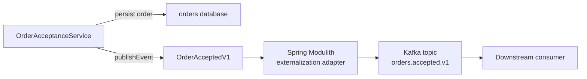

# Test producer với external event

Một bài test producer thành công không chỉ xác nhận `ApplicationEventPublisher.publishEvent(...)` đã được gọi. Với Spring Modulith, cần chứng minh **module phát đúng sự kiện nghiệp vụ**, **externalization adapter chọn và gửi đúng event sau giao dịch hợp lệ**, và **broker thực sự nhận đúng hợp đồng công khai**. Ba kết luận này khác nhau và cần những bài test quan sát khác nhau.

Bài thuộc chương **Externalization**, học phần `SPRING_MODULITH_VERIFICATION_TESTING`: rèn kỹ năng kiểm chứng ranh giới kiến trúc bằng `ApplicationModules` và dependency rules; thực hành `@ApplicationModuleTest`, kiểm thử sự kiện, database, tích hợp và quality gate CI. Trọng tâm ở đây là **thiết kế bộ test cho producer phát external event**; các vấn đề recovery, consumer idempotency và schema migration chỉ được đề cập khi ảnh hưởng trực tiếp đến kết quả producer test.

## 1. Xác định đúng đối tượng cần test

Giả sử ứng dụng shop có module `orders`. Khi đơn chuyển từ `DRAFT` sang `ACCEPTED`, service phát `OrderAcceptedV1`; Spring Modulith chọn event này để externalize tới Kafka.



Ba nhóm assertion cốt lõi:

| Lớp test | Bằng chứng phải có | Chưa thể kết luận |
| --- | --- | --- |
| **Producer module** | Đơn chuyển trạng thái đúng; phát đúng `OrderAcceptedV1`; không phát khi nghiệp vụ từ chối | Broker đã nhận message |
| **Transaction boundary** | Commit mới tạo external publication theo hợp đồng; rollback không phát business fact sai | Consumer đã xử lý |
| **Broker integration** | Đúng topic/route, wire payload, key/headers; event thực sự được nhận | End-to-end exactly-once |

Thêm **architecture test** để bảo vệ `orders` không phụ thuộc implementation Kafka hoặc module khác sai ranh giới. Nó không thay thế bất kỳ assertion về delivery nào trong bảng.

## 2. Project mẫu đủ nhỏ để theo dõi một luồng

```text
com.example.shop
├── ShopApplication.java
└── orders
    ├── OrderAcceptedV1.java
    └── internal
        └── OrderAcceptanceService.java

src/test/java/com/example/shop
├── ModularityTests.java
└── orders/internal
    ├── OrderProducerModuleTests.java
    └── OrderExternalizationKafkaIT.java
```

Ví dụ sử dụng **Spring Boot + Spring JDBC**, một database có bảng `orders`, Spring Modulith và Kafka adapter được cấu hình trong dự án. Phần code dưới đây chỉ minh họa các đơn vị liên quan trực tiếp tới producer; để chạy integration test cần dependency/connection/serializer/topic của stack thực tế.

Schema fixture:

```sql
CREATE TABLE orders (
    id UUID PRIMARY KEY,
    status VARCHAR(20) NOT NULL
);
```

Sử dụng schema này trong test database qua migration hoặc `schema.sql` phù hợp. `UUID` được PostgreSQL/H2 hỗ trợ; với RDBMS khác cần điều chỉnh kiểu dữ liệu. Không dùng một JPA entity với toàn bộ thông tin khách hàng làm external message.

## 3. Integration contract và dấu hiệu chọn externalization

```java
// orders/OrderAcceptedV1.java
package com.example.shop.orders;

import java.time.Instant;
import java.util.UUID;
import org.springframework.modulith.events.Externalized;

@Externalized("orders.accepted.v1")
public record OrderAcceptedV1(
        UUID eventId,
        UUID orderId,
        Instant occurredAt
) {}
```

Ở ví dụ này:

- `eventId` nhận diện **một sự kiện cụ thể**, phục vụ correlation và retry/replay.
- `orderId` nhận diện đơn hàng.
- `occurredAt` biểu thị lúc business fact xảy ra, không tự cập nhật khi producer gửi lại.
- `@Externalized` đánh dấu event cho cơ chế externalization khi được cấu hình đúng.

Chuỗi `orders.accepted.v1` là đích dự kiến trong ví dụ. **Không suy rằng annotation tự tạo Kafka topic, serializer, message key hoặc broker connection**; cần module adapter và cấu hình phù hợp với phiên bản Spring Modulith.

Chúng ta sẽ kiểm **contract Java** trước rồi kiểm **message thực tế**. Một thay đổi serializer có thể tạo wire representation khác Java record nên hai test không trùng trách nhiệm.

## 4. Service producer: chỉ publish khi chuyển trạng thái hợp lệ

```java
// orders/internal/OrderAcceptanceService.java
package com.example.shop.orders.internal;

import com.example.shop.orders.OrderAcceptedV1;
import java.time.Instant;
import java.util.UUID;
import org.springframework.context.ApplicationEventPublisher;
import org.springframework.jdbc.core.JdbcTemplate;
import org.springframework.stereotype.Service;
import org.springframework.transaction.annotation.Transactional;

@Service
class OrderAcceptanceService {

    private final JdbcTemplate jdbc;
    private final ApplicationEventPublisher events;

    OrderAcceptanceService(
            JdbcTemplate jdbc,
            ApplicationEventPublisher events) {
        this.jdbc = jdbc;
        this.events = events;
    }

    @Transactional
    OrderAcceptedV1 accept(UUID orderId) {
        int updated = jdbc.update("""
                UPDATE orders SET status = 'ACCEPTED'
                WHERE id = ? AND status = 'DRAFT'
                """, orderId);

        if (updated != 1) {
            throw new IllegalStateException(
                    "Order is not eligible for acceptance");
        }

        var event = new OrderAcceptedV1(
                UUID.randomUUID(), orderId, Instant.now());
        events.publishEvent(event);
        return event;
    }
}
```

Điều cần chú ý khi thiết kế test:

1. **Điều kiện nghiệp vụ**: `UPDATE ... WHERE status='DRAFT'` chỉ thành công khi đơn ở trạng thái hợp lệ.
2. **Không có event khi update thất bại**: nhánh throw xảy ra **trước `publishEvent`**.
3. **Giao dịch**: `@Transactional` bao gồm cập nhật database và việc phát Spring event; cách registry/externalizer xử lý sau commit phải được test riêng.
4. **Không gọi Kafka trực tiếp**: service không import `KafkaTemplate` hoặc biết topic/serializer.

Code cố tình ngắn để tập trung vào producer. Production cần command idempotency, authentication, business state machine và policy cho trường hợp đồng thời. `UUID.randomUUID()` chỉ tạo một event mới cho **lần chuyển trạng thái thành công**, không phải phương pháp tạo lại event ID khi resubmit một publication đã tồn tại.

## 5. Test module: phát đúng một application event

Spring Modulith Test cung cấp `@ApplicationModuleTest` và `PublishedEvents`. Đặt test cùng package `orders.internal` để inject service package-private:

```java
// orders/internal/OrderProducerModuleTests.java
package com.example.shop.orders.internal;

import static org.assertj.core.api.Assertions.assertThat;
import static org.assertj.core.api.Assertions.assertThatThrownBy;

import com.example.shop.orders.OrderAcceptedV1;
import java.util.UUID;
import org.junit.jupiter.api.Test;
import org.springframework.beans.factory.annotation.Autowired;
import org.springframework.jdbc.core.JdbcTemplate;
import org.springframework.modulith.test.ApplicationModuleTest;
import org.springframework.modulith.test.PublishedEvents;

@ApplicationModuleTest
class OrderProducerModuleTests {

    @Autowired OrderAcceptanceService service;
    @Autowired JdbcTemplate jdbc;

    @Test
    void acceptingDraftOrderPublishesOneEvent(PublishedEvents events) {
        UUID orderId = UUID.randomUUID();
        jdbc.update(
                "INSERT INTO orders(id, status) VALUES (?, 'DRAFT')",
                orderId);

        OrderAcceptedV1 produced = service.accept(orderId);

        assertThat(produced.eventId()).isNotNull();
        assertThat(produced.orderId()).isEqualTo(orderId);
        assertThat(produced.occurredAt()).isNotNull();
        assertThat(events.ofType(OrderAcceptedV1.class)).hasSize(1);

        String persisted = jdbc.queryForObject(
                "SELECT status FROM orders WHERE id = ?",
                String.class, orderId);
        assertThat(persisted).isEqualTo("ACCEPTED");
    }

    @Test
    void rejectedTransitionDoesNotPublishEvent(PublishedEvents events) {
        UUID missingOrderId = UUID.randomUUID();

        assertThatThrownBy(() -> service.accept(missingOrderId))
                .isInstanceOf(IllegalStateException.class);

        assertThat(events.ofType(OrderAcceptedV1.class)).isEmpty();
    }
}
```

Test cần database test được khởi tạo schema và `JdbcTemplate`/transaction manager trong phạm vi module. Dùng UUID mới cho mỗi case giảm tranh chấp fixture; dự án thật vẫn cần lifecycle/cleanup có kiểm soát.

**Kết luận của test này**: service phát đúng một **Spring application event** trên nhánh chấp nhận đơn; nhánh chuyển trạng thái không hợp lệ không phát event. `PublishedEvents` **không chứng minh** Kafka nhận được message hay adapter đã hoàn tất publication. Đó là lý do phải có các test phía sau.

## 6. Test về nội dung: không chỉ đếm số event

Chỉ assert `hasSize(1)` có thể bỏ qua lỗi phát sai `orderId` hoặc tạo event không khớp business state. Hãy thêm assertion lọc theo dữ liệu:

```java
assertThat(
        events.ofType(OrderAcceptedV1.class)
                .matching(e -> e.orderId().equals(orderId))
).hasSize(1);
```

Kết hợp với `produced.eventId()`, `occurredAt()` và trạng thái database đã đọc lại, test buộc nguồn event phải tương ứng với đơn đã chấp nhận. Trong một workflow phức tạp, cũng nên kiểm không phát event khi:

- Đơn đã ở `ACCEPTED` và gọi lại cùng command không tạo chuyển trạng thái mới.
- Đơn ở `CANCELLED` hoặc không tồn tại.
- Transaction nghiệp vụ thất bại do constraint hoặc exception.

Ở những nhánh mà service phải idempotent, quyết định trả về event cũ, không phát lại hay phát một event khác là **quy tắc sản phẩm**, cần viết rõ trước khi đặt assertion.

## 7. Đừng dùng `PublishedEvents` để kết luận “sau commit”

Một event có thể đã được Spring publish **trước khi transaction kết thúc**. Ví dụ:

```text
BEGIN transaction
  UPDATE order -> ACCEPTED
  publishEvent(OrderAcceptedV1)
  PublishedEvents đã có thể quan sát event
  ROLLBACK
```

Do đó, `PublishedEvents` thấy một event không chứng minh đã có commit hoặc externalization thành công. Một listener Spring thông thường có thể xử lý event ngay, trong khi listener transaction-bound có thể chờ tới phase phù hợp.

Đặc biệt, **`@Transactional` trên test** thường tạo test-managed transaction và **rollback mặc định**. Khi service với propagation mặc định tham gia transaction test này, lời gọi `service.accept(...)` trả về **không phải** thời điểm transaction ngoài đã commit. Đây là nguyên nhân thường gặp của test “không thấy message Kafka” dù code ứng dụng chạy đúng.

Quy tắc chọn thiết kế:

- Test `PublishedEvents` để kiểm **producer logic**.
- Test kết thúc transaction thật để kiểm **commit/rollback**.
- Test broker thật để kiểm **externalization outcome**.

Không gộp ba loại bằng chứng vào một assertion.

## 8. Test transaction: phân biệt commit và rollback

Nếu muốn quan sát chính xác hai thời điểm, Spring Test có `TestTransaction`:

```java
// Trong @SpringBootTest + @Transactional test với
// database, broker và externalization adapter thật:
UUID orderId = UUID.randomUUID();
jdbc.update(
        "INSERT INTO orders(id, status) VALUES (?, 'DRAFT')",
        orderId);

OrderAcceptedV1 event = service.accept(orderId);

// Transaction test vẫn đang mở:
// theo hợp đồng after-commit, chưa được có message thành công.
assertBrokerDoesNotContainYet(event.eventId());

TestTransaction.flagForCommit();
TestTransaction.end(); // COMMIT transaction test thật

assertBrokerEventuallyContains(event.eventId());
```

Hai method `assertBrokerDoesNotContainYet` và `assertBrokerEventuallyContains` ở đây là **test helpers mô tả cách quan sát broker**, không phải API Spring Modulith. Cần triển khai chúng bằng Kafka/AMQP consumer test cô lập, có deadline hữu hạn như phần 10. Đoạn này là **mẫu thân test**, không phải Java class độc lập.

Nhánh rollback tương ứng:

```java
UUID otherOrderId = UUID.randomUUID();
jdbc.update(
        "INSERT INTO orders(id, status) VALUES (?, 'DRAFT')",
        otherOrderId);
OrderAcceptedV1 rolledBack = service.accept(otherOrderId);

TestTransaction.flagForRollback();
TestTransaction.end();

assertBrokerDoesNotContainAfterObservationWindow(
        rolledBack.eventId());
```

Với rollback, cần đọc lại database **bằng transaction/connection mới** để chắc chắn trạng thái `ACCEPTED` không được commit. Khi không dùng test-managed transaction, có thể tạo một orchestration service mở transaction rồi cố tình ném exception sau `accept(...)`.

**Giới hạn của negative test:** không thấy message trong khoảng thời gian hữu hạn chưa chứng minh tuyệt đối không bao giờ có message trong tương lai. Kết hợp quan sát broker, transaction phase/configuration và publication persistence theo kiến trúc thực tế.

## 9. Bộ kiểm thử broker cần điều kiện đầu vào rõ ràng

Để test **producer externalization** thay vì mock một method gửi, hãy chạy:

1. Spring Boot context với **Spring Modulith externalization adapter thật** cho transport đã chọn.
2. Test database và transaction manager phù hợp, schema `orders` đã được tạo.
3. Kafka/RabbitMQ broker test, destination được provision.
4. Serializer/message converter thực tế (ví dụ JSON nếu hợp đồng yêu cầu JSON).
5. Consumer test đọc từ offset/queue riêng, với timeout và lọc theo `eventId`.
6. External event selection/route được cấu hình giống chính sách production.

Nếu dùng Testcontainers Kafka, điều kiện đầu vào có thể được nối qua:

```java
@Testcontainers
@SpringBootTest
class OrderExternalizationKafkaIT {

    @Container
    static final ConfluentKafkaContainer kafka =
            new ConfluentKafkaContainer(
                    DockerImageName.parse(
                            "confluentinc/cp-kafka:7.6.1"));

    @DynamicPropertySource
    static void kafkaProperties(DynamicPropertyRegistry properties) {
        properties.add(
                "spring.kafka.bootstrap-servers",
                kafka::getBootstrapServers);
    }
}
```

Imports tương ứng thuộc **JUnit 5/Testcontainers**, `org.testcontainers.kafka.ConfluentKafkaContainer`, `org.testcontainers.utility.DockerImageName`, Spring Boot Test và Spring Test. Container/version ở đây là **ví dụ kỹ thuật**, không phải yêu cầu cố định; xác nhận tương thích dependency hiện tại.

Snippet chỉ tạo broker và cấu hình bootstrap servers. Nó **chưa chạy được như một test hoàn chỉnh** nếu chưa có adapter Spring Modulith, JSON serializer, topic `orders.accepted.v1`, database/schema và assertion. Phần tiếp theo minh họa assertion chính.

## 10. Test message thật trên Kafka: lọc bằng `eventId`

Ví dụ test tiêu thụ **raw JSON string** từ topic đã provision:

```java
// Thân method @Test trong OrderExternalizationKafkaIT.
// Giả sử @Autowired:
//   OrderAcceptanceService service;
//   JdbcTemplate jdbc;
//   ObjectMapper objectMapper;

UUID orderId = UUID.randomUUID();
jdbc.update("INSERT INTO orders(id, status) VALUES (?, 'DRAFT')",
        orderId);

OrderAcceptedV1 produced = service.accept(orderId);

var consumerProperties = Map.<String, Object>of(
        ConsumerConfig.BOOTSTRAP_SERVERS_CONFIG,
                kafka.getBootstrapServers(),
        ConsumerConfig.GROUP_ID_CONFIG,
                "producer-it-" + UUID.randomUUID(),
        ConsumerConfig.AUTO_OFFSET_RESET_CONFIG, "earliest",
        ConsumerConfig.ENABLE_AUTO_COMMIT_CONFIG, false,
        ConsumerConfig.KEY_DESERIALIZER_CLASS_CONFIG,
                StringDeserializer.class,
        ConsumerConfig.VALUE_DESERIALIZER_CLASS_CONFIG,
                StringDeserializer.class);

boolean found = false;
try (var consumer =
        new KafkaConsumer<String, String>(consumerProperties)) {

    consumer.subscribe(List.of("orders.accepted.v1"));
    long deadline = System.nanoTime()
            + Duration.ofSeconds(15).toNanos();

    while (!found && System.nanoTime() < deadline) {
        for (ConsumerRecord<String, String> record :
                consumer.poll(Duration.ofMillis(250))) {

            JsonNode json = objectMapper.readTree(record.value());
            if (!produced.eventId().toString()
                    .equals(json.path("eventId").asText())) {
                continue;
            }

            assertThat(record.topic())
                    .isEqualTo("orders.accepted.v1");
            assertThat(json.path("orderId").asText())
                    .isEqualTo(orderId.toString());
            assertThat(json.path("occurredAt").asText())
                    .isNotBlank();

            found = true;
            break;
        }
    }
}
assertThat(found).isTrue();
```

Các imports bổ sung: `java.util.Map`, `java.util.List`, `java.util.UUID`, `java.time.Duration`, `org.apache.kafka.clients.consumer.ConsumerConfig`, `KafkaConsumer`, `ConsumerRecord`, `org.apache.kafka.common.serialization.StringDeserializer`, `com.fasterxml.jackson.databind.JsonNode` và AssertJ. Trong project thực, có thể tách vòng poll thành helper dùng chung và trả về `ConsumerRecord` để assert thêm key/headers.

**Giả định quan trọng của code:** adapter Kafka đang serialize payload ra **JSON text UTF-8**. Nếu dùng Avro/Protobuf/CloudEvents wrapper hoặc converter khác, phải đọc đúng wire representation thay vì ép `StringDeserializer`/`readTree(record.value())`.

**Vì sao dùng `eventId` để lọc?** Test topic có thể có message cũ hoặc message từ test khác. Chỉ đọc “record đầu tiên” dễ gây false positive. Với consumer group mới và `auto.offset.reset=earliest`, có thể đọc lịch sử; event ID duy nhất giúp xác định đúng message của case hiện tại.

### Đừng bỏ qua provisioning và ACK semantics

Kafka topic cần được tạo rõ (ví dụ bằng `NewTopic` bean/Spring Kafka Admin hoặc test setup). Bài test này xác nhận message **đã tới broker và consumer test đọc được**, không xác nhận consumer nghiệp vụ đã xử lý, và **không tự chứng minh exactly-once**.

Nếu adapter phát message bất đồng bộ, producer method trả về trước khi consumer đọc là bình thường; dùng poll có timeout, không dùng `Thread.sleep(10)` rồi assert topic rỗng.

## 11. Kiểm tra payload *được phép*, không chỉ `eventId`

Một producer test tốt cần đóng băng **hợp đồng wire**:

```json
{
  "eventId": "0573bcf9-8393-4de0-a4fe-1aa0d9e2cbe3",
  "orderId": "974b92db-6cfd-4f34-9517-d7465f3994a9",
  "occurredAt": "2026-11-26T02:00:00Z"
}
```

Với JSON contract không có envelope, trong nhánh `found` của phần 10 có thể thêm:

```java
Set<String> fields = new HashSet<>();
json.fieldNames().forEachRemaining(fields::add);

assertThat(fields).containsExactlyInAnyOrder(
        "eventId", "orderId", "occurredAt");

assertThat(json.toString())
        .doesNotContain("customerEmail",
                        "internalNote",
                        "paymentToken");
```

`HashSet`/`Set` cần import `java.util`. **Exact field allowlist** mạnh hơn chỉ blacklist một tên trường: khi developer thêm trường mới ngoài ý muốn, test fail và buộc review contract.

Để tránh false confidence, kiểm thêm **message key và headers** ở broker, không chỉ JSON body. Ví dụ Kafka serializer có thể thêm type metadata/header; các trường đó cũng nằm trong dữ liệu consumer/broker nhìn thấy.

### Tách schema compatibility và data exposure

Một field mới có thể backward-compatible về JSON nhưng vẫn không được phép công bố vì nhạy cảm. Chạy **schema/contract test** và **data-minimization review** như hai loại kiểm tra, không dùng “schema valid” làm bằng chứng bảo mật.

## 12. Topic, routing key và message key phải được assert theo policy

Với external event, cần biết:

| Thuộc tính | Ví dụ cần kiểm | Không được mặc định |
| --- | --- | --- |
| Destination | Kafka topic `orders.accepted.v1` | `@Externalized` tự provision topic |
| Key | `orderId` nếu dùng ordering theo aggregate | `@Externalized("...")` tự dùng orderId làm key |
| Value | JSON `OrderAcceptedV1` đúng contract | Java record bằng wire payload |
| Headers | `eventType`/`schemaVersion` theo cấu hình | Không có type metadata hoặc PII |
| Số bản ghi | Một publication bình thường trong happy path | Không bao giờ có duplicate khi recovery |

Nếu cấu hình yêu cầu Kafka key bằng `orderId`, assert trên `ConsumerRecord`:

```java
assertThat(record.key()).isEqualTo(orderId.toString());
```

**Chỉ đặt assertion này khi đã thật sự cấu hình mapping Kafka key** trong adapter/version đang dùng. Mặc định có thể là `null` hoặc một key khác. Test có nhiệm vụ kiểm một **chính sách đã thiết kế**, không bịa chính sách từ tên annotation.

Với AMQP, thay bằng assertion về exchange/routing key/queue, message properties và body thực; không dùng thuật ngữ Kafka key như thể mọi broker đều giống Kafka.

## 13. Negative test: event nội bộ không được externalize

Một producer có thể phát nhiều Spring events, nhưng chỉ một số loại được phép ra khỏi JVM. Ví dụ:

```java
// orders/internal/OrderRiskReviewed.java
package com.example.shop.orders.internal;

import java.util.UUID;

record OrderRiskReviewed(
        UUID orderId,
        String internalAnalystNote
) {}
```

Sự kiện nội bộ này **không mang `@Externalized`**. Nếu chính sách trong dự án chỉ chọn những type có marker, nó không được gửi ra Kafka. Tuy nhiên, một **programmatic selector** chọn mọi event trong package có thể làm thay đổi hành vi; vì thế test chỉ kiểm annotation chưa đủ.

Một negative integration test có thể tạo event nội bộ **trong một transaction thật**:

```java
// Mẫu thân integration test.
UUID orderId = UUID.randomUUID();
transactionTemplate.executeWithoutResult(tx ->
        applicationEventPublisher.publishEvent(
                new OrderRiskReviewed(
                        orderId, "INTERNAL-RISK-SENTINEL")));

// Quan sát các outbound destinations được cấu hình.
// Không được có message chứa type hoặc sentinel nội bộ.
assertNoExternalMessageForInternalRiskEvent(
        orderId, "INTERNAL-RISK-SENTINEL");
```

`transactionTemplate` và `applicationEventPublisher` là bean Spring được inject vào test; `assertNoExternalMessageForInternalRiskEvent` là **helper do test tự viết**. Nó phải quan sát **đích outbound thực tế**, không chỉ một topic tình cờ đang rỗng.

Để tránh false negative:

- Đảm bảo adapter externalization đang bật, có **positive control**: `OrderAcceptedV1` thực sự tới broker.
- Quan sát tất cả destination mà selector có thể định tuyến nội dung nội bộ, không chỉ `orders.accepted.v1`.
- Dùng broker/test consumer cô lập, deadline hữu hạn và cùng transaction semantics như production.
- Cần kiểm payload **và headers**, vì sentinel có thể bị leak ở metadata dù body sạch.

**Mục tiêu:** chứng minh producer công bố **đúng tập loại event**, không chỉ công bố đúng một event happy path.

## 14. Rollback test phải kiểm cả database và broker

Một test rollback có ý nghĩa phải đặt publisher trong transaction cuối cùng bị rollback:

```text
BEGIN test-managed transaction
    INSERT order DRAFT
    service.accept(orderId)
        -> UPDATE order ACCEPTED
        -> publishEvent(OrderAcceptedV1(eventId=E))
    TestTransaction.flagForRollback()
    TestTransaction.end()
ROLLBACK

Assert từ transaction/connection mới:
    Order không có trạng thái ACCEPTED đã commit.
    Broker không nhận OrderAcceptedV1(E) thành công.
```

Nếu chỉ assert `events.ofType(OrderAcceptedV1.class).isNotEmpty()`, kết quả có thể đúng **dù transaction cuối cùng rollback**. Ngược lại, nếu test quên commit và mong Kafka nhận message từ listener after-commit, test có thể thất bại **vì chính transaction test không commit**.

Chọn một trong hai cách rõ ràng:

1. **Happy-path integration test không annotate `@Transactional` trên test**: service mở và kết thúc transaction của chính nó. Sau khi method trả về, có thể chờ broker.
2. **Boundary test annotate `@Transactional`, dùng `TestTransaction`**: kiểm trước commit, chủ động commit hoặc rollback, rồi kiểm hậu quả.

Nếu sự kiện thuộc một orchestration transaction lớn hơn, hãy test thêm tình huống service `accept(...)` đã trả về nhưng transaction ngoài bị đánh dấu rollback-only. **Method con return thành công không có nghĩa business state cuối cùng đã commit.**

## 15. Failure test: database đã commit nhưng broker tạm lỗi

Đây là một ca quan trọng nếu producer cam kết **không mất publication khi broker ngừng hoạt động**:

| Bước | Hành động | Assertion phía producer |
| --- | --- | --- |
| 1 | Chạy database và persistent publication storage như production | Store/migration hoạt động |
| 2 | Ngắt broker test trước khi gọi service | Adapter không thể hoàn tất send |
| 3 | Gọi `service.accept(orderId)` và commit transaction | Order `ACCEPTED` đã commit |
| 4 | Đọc publication qua API/storage đúng phiên bản | Publication tới external target **chưa hoàn tất**, có thể phục hồi theo cam kết |
| 5 | Khôi phục broker và kích hoạt recovery được cấu hình | Broker cuối cùng nhận **cùng `eventId`** |
| 6 | Kiểm trạng thái publication | Hoàn tất theo semantics adapter, không tạo business event mới |

**Không được mặc định** một ứng dụng có `@Externalized` sẽ tự có **persistent registry, startup resubmission hoặc scheduled retry**. Cần xác minh module lưu trữ và cơ chế recovery trong phiên bản thực tế. Test chỉ “broker down rồi vài giây sau broker up” nhưng không kích hoạt resubmission **không đủ** để đánh giá durability.

Đặt assertion đúng: publication **incomplete** không chắc broker chưa từng nhận message; broker có thể nhận rồi nhưng producer mất acknowledgement trước khi cập nhật completion. Khi resubmit, **duplicate delivery là khả năng hợp lệ**. Producer test chỉ cần đảm bảo identity và semantics theo chính sách; bài kiểm thử consumer idempotency thuộc ứng dụng nhận.

## 16. Hai anti-pattern trong producer test

### Mock adapter rồi kết luận broker đã nhận

```java
verify(kafkaTemplate).send(any());
```

Assertion này chỉ chứng minh code đã gọi một phương thức trên mock. Nó không kiểm Kafka connection, destination, serialization, publisher acknowledgements hoặc transaction phase. Nó có thể phù hợp cho **unit test adapter tự viết**, nhưng không nên được đặt tên `KafkaExternalizationIT` hay dùng thay broker integration test.

### Chỉ kiểm happy path mà không có negative control

Một test đọc được `OrderAcceptedV1` đúng topic nhưng không kiểm:

- `OrderRiskReviewed` có bị externalize nhầm?
- Rollback có gửi “order accepted” sai?
- Header có thêm dữ liệu riêng tư?
- Event có sai `orderId` nhưng đúng type?

thì chỉ chứng minh **một phần** pipeline. Các test âm giúp phát hiện hồi quy của selection policy, transaction và contract.

### Một lỗi cấu hình kiểm thử tinh vi

Nếu integration test chạy với profile khác production làm **externalization adapter bị disable**, test module `PublishedEvents` vẫn có thể PASS. Cần chắc chắn test nhận được message thật bằng **positive control trên broker**; không lấy “không có message nhạy cảm” làm bằng chứng nếu toàn bộ adapter đã ngừng hoạt động.

## 17. Kiểm chứng module boundary độc lập với delivery

Trong thiết kế này, `orders` chỉ phụ thuộc `ApplicationEventPublisher` và JDBC. Nó **không import** `KafkaTemplate`, `integration.internal.KafkaOrderProducer` hoặc handler của module downstream. Để bảo vệ điều đó, thêm test:

```java
// src/test/java/com/example/shop/ModularityTests.java
package com.example.shop;

import org.junit.jupiter.api.Test;
import org.springframework.modulith.core.ApplicationModules;

class ModularityTests {

    @Test
    void moduleDependenciesAreValid() {
        ApplicationModules.of(ShopApplication.class).verify();
    }
}
```

`verify()` kiểm các quy tắc kiến trúc Spring Modulith được áp dụng, như không có dependency cycle, không truy cập nội bộ module khác sai quy tắc và tuân thủ `allowedDependencies` nếu đã khai báo.

**Nó không kiểm** Kafka route, wire payload, transaction commit hoặc retry. Tương tự, broker test PASS không chứng minh không có import trái ranh giới trong một module khác. Vì vậy hãy giữ **architecture test và externalization integration test** thành hai quality gates riêng.

## 18. Ma trận test tối thiểu nên có cho producer

| Test | Lớp | Bằng chứng mong muốn |
| --- | --- | --- |
| Accept `DRAFT` | `@ApplicationModuleTest` | Đúng một `OrderAcceptedV1`, ID và order state đúng |
| Reject invalid transition | `@ApplicationModuleTest` | Không phát event |
| Commit transaction | Broker integration | Event xuất hiện đúng topic với payload hợp đồng |
| Rollback transaction | DB + broker integration | Không có event “ACCEPTED” cho trạng thái chưa commit |
| Internal event | Broker negative test | Không externalize `OrderRiskReviewed` |
| Wire allowlist | Serializer/broker contract | Chỉ field được duyệt; headers/key đúng policy |
| Broker outage | Registry + broker integration, nếu cam kết durability | Publication còn phục hồi được, resubmit đúng `eventId` |
| Module dependency | `ApplicationModules.verify()` | Không cycle/sai internal API/allowed dependencies |

Các case trên tập trung vào **producer**: nguồn business fact, event selection, transaction boundary, transport outcome và publication intent. Các phép kiểm consumer business effect nên ở suite riêng để tránh biến một producer test thành một test end-to-end khổng lồ, khó chẩn đoán và thường xuyên flaky.

## 19. Quality gate CI và cách đặt tên test

Một pipeline gọn và có phân lớp:

```text
Pull request
  |
  v
Unit tests: event payload/mapper và state transition
  |
  v
ApplicationModules.verify()
  |
  v
@ApplicationModuleTest + PublishedEvents
  |
  v
Contract tests: schema và allowlist
  |
  v
Broker integration: commit / rollback / route / headers
  |
  v
Registry outage/recovery (nếu producer có cam kết này)
  |
  v
Merge nếu tất cả required gates PASS
```

Với Maven, có thể tổ chức unit/module tests bằng Surefire và `*IT` integration tests bằng Failsafe; lệnh pipeline thường là:

```bash
./mvnw -B verify
```

**Đây là một gợi ý về tổ chức test**, không khẳng định mọi project đã bật Failsafe. Phải kiểm `pom.xml`/Gradle task thực tế để chắc chắn `OrderExternalizationKafkaIT` được chạy, không bị filter hay `skipTests` bỏ qua. Nếu sử dụng Gradle, cấu hình test suite/task integration tương ứng và bắt buộc chạy trước merge/release.

CI container cần broker image, database, topic provisioning, timeouts hợp lý và isolation giữa các test. Với một lỗi, log nên phân biệt **module logic**, **contract**, **transaction boundary** và **broker connectivity**, thay vì một thông báo “event test failed” chung.

## 20. Checklist review một producer external event test

| Câu hỏi | Nếu chưa có bằng chứng |
| --- | --- |
| Producer chỉ phát event khi business transition thành công? | Bổ sung negative module test |
| Event ID/order ID/timestamp giữ đúng identity? | Bổ sung content assertion |
| `PublishedEvents` được dùng đúng phạm vi? | Không tuyên bố broker đã nhận |
| Test có **commit thật**? | Tránh `@Transactional` rollback mặc định |
| Có test rollback bằng transaction thực? | Kiểm DB và broker cùng lúc |
| Adapter thật có chạy trong integration context? | Bổ sung broker positive control |
| Đúng destination và wire payload? | Đọc raw record từ broker |
| Headers/key đúng chính sách và không leak dữ liệu? | Test metadata thực |
| Event nội bộ có bị externalize nhầm không? | Negative selector test |
| Nếu broker lỗi, publication còn phục hồi được không? | Test persistent registry/recovery |
| Kiến trúc module có vi phạm dependency rules? | Chạy `ApplicationModules.verify()` |
| CI có chạy cả test `*IT`? | Kiểm build/test report và pipeline |

**Thứ tự ưu tiên:** nếu chỉ có một giờ để thêm test cho luồng mới, hãy đảm bảo **business event đúng, one real broker happy path, rollback negative path** trước khi mở rộng test hiếm gặp. Nếu luồng có yêu cầu durability khi broker outage, recovery test là một phần của tiêu chí hoàn thành bắt buộc.

## 21. Bài tập áp dụng

**Bài 1.** `@ApplicationModuleTest` có `PublishedEvents.ofType(OrderAcceptedV1.class)` chứa một phần tử, nhưng broker integration test không thấy message. Nêu hai nguyên nhân có thể.

**Đáp án:** Service có thể đang nằm trong một **test-managed transaction chưa commit** nên externalizer after-commit chưa chạy; hoặc **adapter/selector/connection/destination** chưa được bật/cấu hình đúng. `PublishedEvents` chỉ xác nhận in-JVM publication.

**Bài 2.** Một test mock `KafkaTemplate.send(...)` được gọi đúng một lần và gắn nhãn “externalization passed”. Test này thiếu bằng chứng gì?

**Đáp án:** Thiếu broker thật, serializer, route/key/headers, acknowledgement và transaction phase. Nó chỉ chứng minh interaction với mock.

**Bài 3.** Service chuyển đơn từ `DRAFT` sang `ACCEPTED`, sau đó transaction ngoài rollback. `PublishedEvents` vẫn thấy `OrderAcceptedV1`. Có mâu thuẫn không?

**Đáp án:** **Không.** Spring event có thể được publish trước khi transaction hoàn tất. Muốn kiểm externalization đúng, phải xác minh broker **không nhận thông báo thành công giả** và DB rollback.

**Bài 4.** Kafka consumer test đọc được một record với đúng `orderId` nhưng `eventId` khác event producer trả về. Có thể coi test PASS không?

**Đáp án:** **Không.** Có thể đang đọc message từ test khác hoặc producer tạo identity mới sai; hãy lọc và đối chiếu `eventId` của chính lần phát này.

**Bài 5.** `OrderAcceptedV1` được gửi đúng topic nhưng có Kafka header `customerEmail`. Assertion JSON chỉ có ba field vẫn PASS. Chất lượng test đã đủ chưa?

**Đáp án:** **Chưa.** Wire contract bao gồm payload **và metadata**. Cần kiểm headers/key theo allowlist và kiểm dữ liệu nhạy cảm trong broker message.

**Bài 6.** Broker tạm ngừng, order đã commit, nhưng sau restart event không được gửi lại. Nên kiểm gì ở producer?

**Đáp án:** Kiểm persistent Event Publication Registry có được cấu hình, publication intent có được ghi bền vững, và cơ chế **resubmission/recovery thật sự được kích hoạt** chưa. `@Externalized` riêng lẻ không chứng minh khả năng recovery.

**Bài 7.** Test `ApplicationModules.verify()` PASS nhưng producer gửi `OrderRiskReviewed` chứa ghi chú nội bộ. Tại sao?

**Đáp án:** `verify()` bảo vệ **Java module dependency rules**, không đánh giá selection policy hoặc nội dung thông điệp broker. Phải có negative event-selection test và contract/data-exposure tests.

## 22. Tổng kết

**Test producer với external event** cần ba bằng chứng liên tiếp: **service phát đúng Spring event khi nghiệp vụ hợp lệ**, **event chỉ được externalize theo kết quả transaction phù hợp**, và **transport thật nhận đúng route/payload/headers**. `@ApplicationModuleTest` với `PublishedEvents` kiểm lớp đầu tiên; `TestTransaction` và database/broker tests kiểm ranh giới commit; Testcontainers hoặc broker test tương đương kiểm lớp cuối cùng.

Thêm **negative cases**—không phát khi trạng thái sai, không externalize event nội bộ và không gửi business fact đã rollback—để ngăn regression mà một happy path không thể thấy. Nếu producer có cam kết durable delivery, test cả **broker outage và publication recovery**, nhưng không biến producer test thành bài kiểm thử xử lý nghiệp vụ của consumer.

Trong `SPRING_MODULITH_VERIFICATION_TESTING`, chạy đồng thời `ApplicationModules.verify()` cho dependency rules và các test producer/module/broker/transaction trong **quality gate CI**. Chỉ gọi luồng externalization “đã được kiểm chứng” khi các assertion phản ánh **đúng mức bảo đảm mà hệ thống thực sự cung cấp**.

## Tài liệu tham khảo

- [Spring Modulith — Application Events và Externalization](https://docs.spring.io/spring-modulith/reference/events.html)
- [Spring Modulith — Testing Application Modules](https://docs.spring.io/spring-modulith/reference/testing.html)
- [Spring Modulith — Verifying Application Module Structure](https://docs.spring.io/spring-modulith/reference/verification.html)
- [Spring Framework — Transaction-bound Events](https://docs.spring.io/spring-framework/reference/data-access/transaction/event.html)
- [Spring Framework — Test-managed Transactions](https://docs.spring.io/spring-framework/reference/testing/testcontext-framework/tx.html)
- [Spring for Apache Kafka — Reference](https://docs.spring.io/spring-kafka/reference/)
- [Testcontainers — Kafka Module](https://java.testcontainers.org/modules/kafka/)
