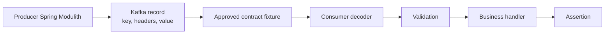
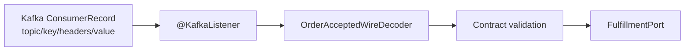

# Test consumer bằng contract fixture

Một producer Spring Modulith externalize `OrderAcceptedV1` ra Kafka. Consumer `fulfillment` được triển khai độc lập và phải xử lý bản ghi đó. Một bài test tạo trực tiếp `new OrderAcceptedV1(...)` rồi gọi service có thể xanh, nhưng vẫn bỏ sót các lỗi ở **wire contract**: tên field không khớp, timestamp sai định dạng, header version thiếu, serializer thay đổi hoặc message chứa một field mới khiến consumer từ chối.

**Contract fixture** là một mẫu thông điệp đã được chốt theo hợp đồng giao tiếp — thường ở dạng JSON, Avro/Protobuf binary kèm schema, hoặc một tập payload và metadata. **Test consumer bằng contract fixture** nghĩa là đưa chính representation đó qua đường giải mã/dispatch của consumer rồi xác minh **dữ liệu được hiểu đúng, nghiệp vụ được gọi đúng và thông điệp không hợp lệ bị xử lý có kiểm soát**.

Bài nằm trong chương **Externalization** của học phần `SPRING_MODULITH_VERIFICATION_TESTING`. Học phần chú trọng `ApplicationModules.verify()`, dependency rules, `@ApplicationModuleTest`, kiểm thử event, database và integration, kết hợp quality gate CI để ngăn hồi quy. Phạm vi bài này tập trung vào **kiểm thử consumer bằng bộ fixture có nguồn gốc và version rõ**, không lặp lại chi tiết triển khai producer registry, retry hay idempotency.

## 1. Tiêu chí hoàn thành của một consumer contract test

Với topic `orders.accepted.v1`, consumer phải trả lời được:

| Câu hỏi | Bằng chứng |
| --- | --- |
| Có đọc được payload v1 đã công bố? | Parse fixture v1 thành DTO đúng giá trị |
| Field bắt buộc thiếu thì sao? | Từ chối trước khi thực hiện side effect |
| Một field optional mới xuất hiện? | Xử lý theo compatibility policy đã thỏa thuận |
| Event type/version không hỗ trợ? | Từ chối hoặc route tới handler khác; không diễn giải nhầm |
| Kafka header/key có được consumer đọc đúng? | Test dispatch với `ConsumerRecord` và test broker |
| Handler có gọi đúng nghiệp vụ? | Assert lời gọi/side effect ứng với dữ liệu fixture |
| Deserialize/validate lỗi có bị ACK như đã xử lý? | Kiểm listener/error handler với integration test |

**Contract test không tự chứng minh broker đã giao message theo SLA hoặc consumer đã chống xử lý trùng.** Đây là các bất biến riêng, có thể thêm test tích hợp khi cần; trọng tâm đầu tiên là **message đã công bố có còn được consumer hiểu đúng hay không**.

## 2. Producer và consumer phải thống nhất *wire contract*

Giả sử producer có kiểu:

```java
// Producer: com.example.shop.orders.OrderAcceptedV1
@Externalized("orders.accepted.v1")
public record OrderAcceptedV1(
        UUID eventId,
        UUID orderId,
        long totalMinorUnits,
        String currency,
        Instant occurredAt
) {}
```

Đây là ví dụ mã nguồn rút gọn; import Java và `org.springframework.modulith.events.Externalized` cần được khai báo trong project producer.

**Contract phía ngoài JVM** được định nghĩa cụ thể như sau:

| Thành phần | Hợp đồng v1 của ví dụ |
| --- | --- |
| Topic | `orders.accepted.v1` |
| Header `eventType` | UTF-8 string `orders.accepted.v1` |
| Key | `orderId` dạng UUID string, **nếu adapter được cấu hình như vậy** |
| Value | JSON object UTF-8 |
| Field bắt buộc | `eventId`, `orderId`, `totalMinorUnits`, `currency`, `occurredAt` |
| `totalMinorUnits` | Số nguyên dương, không tính bằng floating point |
| `currency` | Một mã tiền tệ mà consumer hỗ trợ, ví dụ `VND` |
| `occurredAt` | RFC 3339/ISO-8601 timestamp có offset, có thể chuyển thành `Instant` |
| Compatibility | Trong cùng v1, consumer cho phép **field bổ sung không bắt buộc**, nhưng không cho phép thiếu/đổi nghĩa field bắt buộc |

Những quy ước này là **hợp đồng minh họa**, không phải mặc định của Spring Modulith/Kafka adapter. Ví dụ `@Externalized` riêng lẻ **không tự đảm bảo Kafka key là `orderId` hoặc header `eventType` tồn tại**. Fixture và test phải xuất phát từ **cấu hình producer thực tế**.



Đừng thay `W` bằng cách instantiate trực tiếp DTO consumer: một DTO Java có field đúng tên không chứng minh representation từ producer thật đúng JSON/header tương ứng.

## 3. Tổ chức bộ fixture có version và nguồn gốc

Trong **dự án consumer**, có thể chuẩn bị:

```text
src/test/resources/contracts/orders/
├── accepted-v1.valid.json
├── accepted-v1.additive.json
├── accepted-v1.missing-event-id.json
├── accepted-v1.invalid-amount.json
├── accepted-v1.renamed-field.json
└── accepted-v1.malformed.json

src/test/java/com/example/fulfillment/
├── OrderAcceptedWireDecoderTest.java
├── OrderAcceptedConsumerTest.java
└── OrderAcceptedKafkaIT.java
```

**Những đường dẫn trên là cấu trúc ví dụ cho người học.** Bài Markdown hiện tại chỉ trình bày **nội dung fixture và code test**, không tạo các file phụ trong repository học liệu.

Các fixture nên được:

1. **Xuất từ serialized producer message** hoặc xác nhận bằng contract test của producer; không tự đoán format.
2. Lưu trong version control với tên có version/intent rõ.
3. Review bởi cả producer và consumer owner khi thay đổi hợp đồng.
4. Giữ các mẫu cũ còn được hỗ trợ để phát hiện breaking change.
5. Không chứa dữ liệu người dùng thực, secret, token hoặc PII không cần thiết.

Một fixture được tự viết bằng tay vẫn hữu ích cho negative tests, nhưng **fixture golden** cần có bằng chứng nó thực sự đại diện cho message mà producer có thể phát.

## 4. Fixture v1 hợp lệ: JSON payload nguyên văn

Nội dung giả định của `accepted-v1.valid.json`:

```json
{
  "eventId": "de528cbe-c045-4ec9-8ae4-2471ff858a11",
  "orderId": "63dc31a5-2a8d-4abc-88c8-c7d85aae8abc",
  "totalMinorUnits": 125000,
  "currency": "VND",
  "occurredAt": "2026-11-26T03:00:00Z"
}
```

Payload này là **giá trị message**, không phải toàn bộ `ConsumerRecord`. Trong Kafka, topic, key và headers được lưu riêng. Đối với test đầy đủ, cần kiểm **value fixture và metadata fixture**:

```text
topic     = orders.accepted.v1
key       = 63dc31a5-2a8d-4abc-88c8-c7d85aae8abc
header    = eventType: orders.accepted.v1 (UTF-8 bytes)
value     = bytes của accepted-v1.valid.json (UTF-8)
```

Đừng đặt metadata giả vào trong JSON rồi tin rằng broker sẽ tự chuyển nó thành key/headers. Test harness phải tạo bản ghi theo đúng transport format đang dùng.

## 5. Fixture tiến hóa trong cùng v1: thêm field optional

Giả sử producer bắt đầu thêm `salesChannel` nhưng vẫn giữ các field và ngữ nghĩa v1:

```json
{
  "eventId": "de528cbe-c045-4ec9-8ae4-2471ff858a11",
  "orderId": "63dc31a5-2a8d-4abc-88c8-c7d85aae8abc",
  "totalMinorUnits": 125000,
  "currency": "VND",
  "occurredAt": "2026-11-26T03:00:00Z",
  "salesChannel": "WEB"
}
```

Đây là `accepted-v1.additive.json`. Chính sách của ví dụ: consumer v1 **bỏ qua field lạ** mà vẫn xử lý những field bắt buộc. Đây là **một lựa chọn compatibility được công bố**, không phải quy tắc mặc định cho mọi hệ thống.

Nếu hợp đồng yêu cầu strict schema và từ chối mọi field chưa biết, test đúng sẽ **từ chối fixture additive**, đồng thời producer phải phối hợp nâng version. Quan trọng là **test khớp policy thực tế**, không ép `ignoreUnknown=true` vô điều kiện cho mọi domain.

**Không đồng nhất thêm field với thay đổi vô hại:** một field bổ sung có thể làm lộ PII hoặc thay đổi nghĩa dữ liệu. Producer vẫn cần review field mới và hợp đồng công bố, dù consumer bỏ qua được.

## 6. Bộ fixture âm: có chủ ý và có expected outcome

### 6.1. Thiếu `eventId`

`accepted-v1.missing-event-id.json`:

```json
{
  "orderId": "63dc31a5-2a8d-4abc-88c8-c7d85aae8abc",
  "totalMinorUnits": 125000,
  "currency": "VND",
  "occurredAt": "2026-11-26T03:00:00Z"
}
```

**Expected:** deserialize có thể tạo Java record với `eventId=null` tùy cấu hình Jackson; **validation phải từ chối**. Đừng dựa vào niềm tin rằng mọi Jackson version tự ném exception khi thiếu record component.

### 6.2. Amount không hợp lệ

`accepted-v1.invalid-amount.json`:

```json
{
  "eventId": "de528cbe-c045-4ec9-8ae4-2471ff858a11",
  "orderId": "63dc31a5-2a8d-4abc-88c8-c7d85aae8abc",
  "totalMinorUnits": -10,
  "currency": "VND",
  "occurredAt": "2026-11-26T03:00:00Z"
}
```

**Expected:** parse có thể thành công, nhưng **business input validation** từ chối trước khi tạo fulfillment action.

### 6.3. Đổi tên một field bắt buộc

`accepted-v1.renamed-field.json`:

```json
{
  "eventId": "de528cbe-c045-4ec9-8ae4-2471ff858a11",
  "orderId": "63dc31a5-2a8d-4abc-88c8-c7d85aae8abc",
  "amountMinorUnits": 125000,
  "currency": "VND",
  "occurredAt": "2026-11-26T03:00:00Z"
}
```

**Expected:** field `totalMinorUnits` bị mất. Với Java primitive `long`, một cấu hình parser có thể gán mặc định `0`. Validation `totalMinorUnits > 0` phải bắt được thay vì lặng lẽ tạo phiếu giao hàng 0 đồng.

### 6.4. JSON hỏng cú pháp

`accepted-v1.malformed.json` (cố tình không hợp lệ):

```text
{"eventId": "de528cbe-c045-4ec9-8ae4-2471ff858a11",
 "orderId": "63dc31a5-2a8d-4abc-88c8-c7d85aae8abc",
```

**Expected:** lỗi parse, không gọi domain handler. Consumer error handler phải quyết định retry/quarantine/DLT theo policy; **không được ACK như đã xử lý thành công** chỉ vì test parser trả exception.

## 7. Consumer DTO không phụ thuộc Java class của producer

Trong ứng dụng fulfillment, contract được định nghĩa độc lập:

```java
// com/example/fulfillment/contracts/OrderAcceptedV1.java
package com.example.fulfillment.contracts;

import com.fasterxml.jackson.annotation.JsonIgnoreProperties;
import java.time.Instant;
import java.util.UUID;

@JsonIgnoreProperties(ignoreUnknown = true)
public record OrderAcceptedV1(
        UUID eventId,
        UUID orderId,
        long totalMinorUnits,
        String currency,
        Instant occurredAt
) {}
```

`@JsonIgnoreProperties(ignoreUnknown = true)` thể hiện **compatibility policy của ví dụ**, chỉ cho phép field additive **trong cùng event type/version đã được chấp thuận**. Nó không tự làm một message v2 tương thích, không kiểm dữ liệu không âm, và không xác thực nguồn event.

Không import `com.example.shop.orders.internal.OrderEntity` từ producer. Hai ứng dụng giao tiếp qua **wire contract**; nếu dùng thư viện hợp đồng chung thì nó phải có version rõ và không rò model nội bộ.

## 8. Decoder: kiểm event type trước, dữ liệu sau

Một decoder nhỏ giúp kiểm thử tách khỏi broker:

```java
// com/example/fulfillment/OrderAcceptedWireDecoder.java
package com.example.fulfillment;

import com.example.fulfillment.contracts.OrderAcceptedV1;
import com.fasterxml.jackson.core.JsonProcessingException;
import com.fasterxml.jackson.databind.ObjectMapper;
import java.util.Objects;
import org.springframework.stereotype.Component;

@Component
public final class OrderAcceptedWireDecoder {

    public static final String EVENT_TYPE = "orders.accepted.v1";
    private final ObjectMapper mapper;

    public OrderAcceptedWireDecoder(ObjectMapper mapper) {
        this.mapper = mapper;
    }

    public OrderAcceptedV1 decode(String payload, String eventType) {
        if (!EVENT_TYPE.equals(eventType)) {
            throw new IllegalArgumentException(
                    "Unsupported external event type");
        }
        Objects.requireNonNull(payload, "payload");

        final OrderAcceptedV1 event;
        try {
            event = mapper.readValue(payload, OrderAcceptedV1.class);
        } catch (JsonProcessingException ex) {
            throw new IllegalArgumentException(
                    "Malformed OrderAcceptedV1 payload", ex);
        }

        if (event == null
                || event.eventId() == null
                || event.orderId() == null
                || event.occurredAt() == null
                || event.totalMinorUnits() <= 0
                || !"VND".equals(event.currency())) {
            throw new IllegalArgumentException(
                    "Invalid OrderAcceptedV1 contract");
        }
        return event;
    }
}
```

**Điểm kiểm chứng:**

- Unknown `eventType` bị từ chối **trước** khi giải mã thành loại sự kiện sai.
- Parser và validator là **hai bước riêng**: JSON hợp lệ về cú pháp vẫn có thể vi phạm hợp đồng nghiệp vụ.
- Error message không in toàn payload hoặc các trường cá nhân.
- `ObjectMapper` phải được cấu hình với `JavaTimeModule` để đọc `Instant`, như Spring Boot thường làm khi có module Jackson Java Time thích hợp; trong test chúng ta cấu hình tường minh.

Nếu event dùng CloudEvents, Avro hoặc Protobuf, thay decoder bằng implementation đúng format; **đừng ép payload binary thành JSON string** chỉ để reuse test ở đây.

## 9. Test parser bằng fixture thực thay vì khởi tạo DTO

JUnit 5 test đọc file nguyên văn từ `src/test/resources`:

```java
// com/example/fulfillment/OrderAcceptedWireDecoderTest.java
package com.example.fulfillment;

import static org.junit.jupiter.api.Assertions.*;

import com.fasterxml.jackson.databind.ObjectMapper;
import com.fasterxml.jackson.datatype.jsr310.JavaTimeModule;
import java.nio.charset.StandardCharsets;
import java.time.Instant;
import java.util.UUID;
import org.junit.jupiter.api.Test;

class OrderAcceptedWireDecoderTest {

    private final OrderAcceptedWireDecoder decoder =
            new OrderAcceptedWireDecoder(
                    new ObjectMapper().registerModule(new JavaTimeModule()));

    private String fixture(String name) throws Exception {
        String path = "/contracts/orders/" + name;
        try (var input = getClass().getResourceAsStream(path)) {
            assertNotNull(input, "Missing fixture: " + path);
            return new String(
                    input.readAllBytes(), StandardCharsets.UTF_8);
        }
    }

    @Test
    void readsApprovedV1WirePayload() throws Exception {
        var event = decoder.decode(
                fixture("accepted-v1.valid.json"),
                OrderAcceptedWireDecoder.EVENT_TYPE);

        assertEquals(
                UUID.fromString("de528cbe-c045-4ec9-8ae4-2471ff858a11"),
                event.eventId());
        assertEquals(
                UUID.fromString("63dc31a5-2a8d-4abc-88c8-c7d85aae8abc"),
                event.orderId());
        assertEquals(125000L, event.totalMinorUnits());
        assertEquals("VND", event.currency());
        assertEquals(
                Instant.parse("2026-11-26T03:00:00Z"),
                event.occurredAt());
    }

    @Test
    void acceptsAdditiveOptionalFieldWithinV1() throws Exception {
        var event = decoder.decode(
                fixture("accepted-v1.additive.json"),
                OrderAcceptedWireDecoder.EVENT_TYPE);

        assertEquals(125000L, event.totalMinorUnits());
        assertNotNull(event.orderId());
    }
}
```

Đây là ví dụ **có thể đưa vào dự án consumer** sau khi tạo các fixture theo nội dung ở phần 4–6 và thêm JUnit/Jackson dependencies. `getResourceAsStream` yêu cầu đường dẫn đúng classpath; file không tồn tại khiến test fail rõ, không tự dùng dữ liệu fallback che lỗi.

**Đừng tạo DTO Java trong test rồi serialize nó để làm dữ liệu đầu vào duy nhất.** Khi consumer model và serializer của test giống nhau, hai bên có thể mắc cùng một lỗi đổi tên field và test vẫn xanh. Fixture được chốt **độc lập từ hợp đồng producer** giúp phát hiện drift.

## 10. Negative tests: parse lỗi phải bị phát hiện

Trong chính class `OrderAcceptedWireDecoderTest`, bổ sung:

```java
@Test
void rejectsBrokenContractFixtures() throws Exception {
    for (String name : java.util.List.of(
            "accepted-v1.missing-event-id.json",
            "accepted-v1.invalid-amount.json",
            "accepted-v1.renamed-field.json",
            "accepted-v1.malformed.json")) {

        String payload = fixture(name);
        assertThrows(IllegalArgumentException.class, () ->
                decoder.decode(
                        payload,
                        OrderAcceptedWireDecoder.EVENT_TYPE),
                "Expected rejection for " + name);
    }
}

@Test
void rejectsDifferentEventTypeEvenIfPayloadLooksCompatible()
        throws Exception {
    String payload = fixture("accepted-v1.valid.json");

    var error = assertThrows(IllegalArgumentException.class,
            () -> decoder.decode(
                    payload, "orders.accepted.v2"));

    assertEquals(
            "Unsupported external event type",
            error.getMessage());
}

@Test
void rejectsAbsentEventTypeHeader() throws Exception {
    assertThrows(IllegalArgumentException.class,
            () -> decoder.decode(
                    fixture("accepted-v1.valid.json"), null));
}
```

Tất cả các test này **dùng dữ liệu wire từ fixture**, không dựng DTO bằng constructor. Chúng có thể phát hiện ba lớp lỗi:

- JSON không parse được.
- JSON parse được nhưng vi phạm **semantic validation**.
- Payload có hình dạng giống v1 nhưng **message type/version khác**.

**Vì sao không chỉ dùng `ObjectMapper.readValue(...)` để assert exception?** Một số lỗi như `eventId` thiếu hoặc `long` không có giá trị có thể được Jackson chuyển thành `null`/`0` theo cấu hình. Nếu consumer chỉ parse mà không validate, test sẽ xanh giả.

### Cần strict schema thì làm thêm gì?

Ví dụ dùng `@JsonIgnoreProperties(ignoreUnknown = true)` nên intentionally chấp nhận field `salesChannel`. Nếu producer phải gửi đúng một tập field và consumer muốn **cấm ép kiểu** (ví dụ `"125000"` string thành `long`), cần thêm schema validation hoặc cấu hình Jackson coercion phù hợp với phiên bản. **Đừng tự kết luận từ Java type rằng mọi JSON scalar không đúng kiểu sẽ bị từ chối**.

## 11. Test đến tận hành vi consumer, không dừng ở decoder

Consumer cần biến contract thành hành động. Dùng một interface nhỏ cho xử lý nghiệp vụ để test lời gọi:

```java
// com/example/fulfillment/FulfillmentPort.java
package com.example.fulfillment;

import java.util.UUID;

public interface FulfillmentPort {
    void schedule(
            UUID orderId, UUID eventId,
            long totalMinorUnits, String currency);
}
```

```java
// com/example/fulfillment/OrderAcceptedConsumer.java
package com.example.fulfillment;

import org.springframework.stereotype.Service;

@Service
public class OrderAcceptedConsumer {

    private final OrderAcceptedWireDecoder decoder;
    private final FulfillmentPort fulfillment;

    public OrderAcceptedConsumer(
            OrderAcceptedWireDecoder decoder,
            FulfillmentPort fulfillment) {
        this.decoder = decoder;
        this.fulfillment = fulfillment;
    }

    public void consume(String payload, String eventType) {
        var event = decoder.decode(payload, eventType);
        fulfillment.schedule(
                event.orderId(),
                event.eventId(),
                event.totalMinorUnits(),
                event.currency());
    }
}
```

`FulfillmentPort` phải có một implementation trong ứng dụng thật. `schedule(...)` ở đây chỉ là **cổng nghiệp vụ** để quan sát đúng dữ liệu mà consumer truyền đi; việc lưu DB, xử lý nhận lại hoặc gọi transport khác phải được kiểm ở test của implementation tương ứng.

**Điểm thiết kế quan trọng:** decoder chạy **trước** `fulfillment.schedule(...)`. Khi fixture sai contract, không được tạo shipment hoặc một side effect một phần.

## 12. Mockito test: fixture dẫn đến đúng lời gọi nghiệp vụ

Ví dụ test class độc lập, cùng sử dụng `accepted-v1.valid.json`:

```java
// com/example/fulfillment/OrderAcceptedConsumerTest.java
package com.example.fulfillment;

import static org.junit.jupiter.api.Assertions.assertThrows;
import static org.mockito.Mockito.*;

import com.fasterxml.jackson.databind.ObjectMapper;
import com.fasterxml.jackson.datatype.jsr310.JavaTimeModule;
import java.nio.charset.StandardCharsets;
import java.util.UUID;
import org.junit.jupiter.api.Test;

class OrderAcceptedConsumerTest {

    private final FulfillmentPort fulfillment =
            mock(FulfillmentPort.class);

    private final OrderAcceptedConsumer consumer =
            new OrderAcceptedConsumer(
                    new OrderAcceptedWireDecoder(
                            new ObjectMapper()
                                    .registerModule(new JavaTimeModule())),
                    fulfillment);

    private String read(String name) throws Exception {
        try (var stream = getClass().getResourceAsStream(
                "/contracts/orders/" + name)) {
            if (stream == null) {
                throw new IllegalArgumentException(
                        "Missing contract fixture: " + name);
            }
            return new String(
                    stream.readAllBytes(), StandardCharsets.UTF_8);
        }
    }

    @Test
    void fixtureSchedulesOnlyExpectedOrder() throws Exception {
        consumer.consume(
                read("accepted-v1.valid.json"),
                "orders.accepted.v1");

        verify(fulfillment, times(1)).schedule(
                UUID.fromString(
                        "63dc31a5-2a8d-4abc-88c8-c7d85aae8abc"),
                UUID.fromString(
                        "de528cbe-c045-4ec9-8ae4-2471ff858a11"),
                125000L,
                "VND");
        verifyNoMoreInteractions(fulfillment);
    }

    @Test
    void invalidFixtureProducesNoBusinessAction() throws Exception {
        assertThrows(IllegalArgumentException.class, () ->
                consumer.consume(
                        read("accepted-v1.invalid-amount.json"),
                        "orders.accepted.v1"));

        verifyNoInteractions(fulfillment);
    }
}
```

Test thứ nhất chứng minh không chỉ parse được nhưng còn **truyền đúng eventId/orderId/amount/currency** đến cổng xử lý. Test thứ hai chứng minh lỗi contract **không tạo side effect** ở boundary này.

Tuy nhiên, Mockito chỉ quan sát lời gọi tới `FulfillmentPort`. Nó **không chứng minh DB đã commit, Kafka offset đã ACK đúng hoặc tác vụ idempotent**. Những điều này cần integration test với implementation/transaction thật nếu thuộc SLA.

## 13. Fixture gồm header: test chính đường Kafka listener

Đường thực tế thường là:



Một listener wrapper minh họa:

```java
// com/example/fulfillment/OrderAcceptedKafkaListener.java
package com.example.fulfillment;

import java.nio.charset.StandardCharsets;
import org.apache.kafka.clients.consumer.ConsumerRecord;
import org.springframework.kafka.annotation.KafkaListener;
import org.springframework.kafka.support.Acknowledgment;
import org.springframework.stereotype.Component;

@Component
public class OrderAcceptedKafkaListener {

    private final OrderAcceptedConsumer consumer;

    public OrderAcceptedKafkaListener(
            OrderAcceptedConsumer consumer) {
        this.consumer = consumer;
    }

    @KafkaListener(
            topics = "orders.accepted.v1",
            groupId = "fulfillment-orders")
    public void on(
            ConsumerRecord<String, String> record,
            Acknowledgment acknowledgment) {

        var header = record.headers().lastHeader("eventType");
        String eventType = header == null
                ? null
                : new String(header.value(), StandardCharsets.UTF_8);

        consumer.consume(record.value(), eventType);

        // Chỉ chạy khi consumer.consume() return thành công.
        acknowledgment.acknowledge();
    }
}
```

Đây là **listener mẫu với manual acknowledgement**. Để chạy, phải cấu hình listener container manual ACK mode tương thích, consumer deserializer cho value là `String`, tắt auto-commit nếu policy yêu cầu manual acknowledgement, và có implementation thật của `FulfillmentPort`. `acknowledge()` được gọi sau khi `consume(...)` trả về, nhưng điều đó **không tự chứng minh** business DB commit nếu port triển khai bất đồng bộ hoặc tự nuốt exception.

Nếu source event không có header `eventType` mà quy ước phiên bản nằm trong topic/envelope, **hãy sửa adapter và fixture theo hợp đồng thực tế**, không thêm header giả trong test để làm xanh.

## 14. Unit test Kafka listener với `ConsumerRecord` dựng từ fixture

Không cần broker để kiểm extraction của header:

```java
// Thân test trong cùng package com.example.fulfillment
// với Mockito mock, import các class Kafka tương ứng.
String payload = read("accepted-v1.valid.json");

var record = new ConsumerRecord<String, String>(
        "orders.accepted.v1",
        0,
        42L,
        "63dc31a5-2a8d-4abc-88c8-c7d85aae8abc",
        payload);

record.headers().add(
        "eventType",
        "orders.accepted.v1".getBytes(StandardCharsets.UTF_8));

var listener = new OrderAcceptedKafkaListener(consumer);
Acknowledgment ack = mock(Acknowledgment.class);

listener.on(record, ack);

verify(fulfillment).schedule(
        UUID.fromString("63dc31a5-2a8d-4abc-88c8-c7d85aae8abc"),
        UUID.fromString("de528cbe-c045-4ec9-8ae4-2471ff858a11"),
        125000L, "VND");
verify(ack).acknowledge();
```

Trong đoạn này `read(...)`, `consumer`, `fulfillment` thuộc fixture/helper và mock ở phần 12. Các imports bổ sung là `org.apache.kafka.clients.consumer.ConsumerRecord`, `org.springframework.kafka.support.Acknowledgment` và `java.nio.charset.StandardCharsets`. Đây là **thân phương thức test**, không phải Java class độc lập.

Ca lỗi metadata tương ứng:

```java
var record = new ConsumerRecord<String, String>(
        "orders.accepted.v1", 0, 43L,
        "63dc31a5-2a8d-4abc-88c8-c7d85aae8abc",
        read("accepted-v1.valid.json"));

record.headers().add(
        "eventType",
        "orders.accepted.v2".getBytes(StandardCharsets.UTF_8));

Acknowledgment ack = mock(Acknowledgment.class);

assertThrows(IllegalArgumentException.class,
        () -> new OrderAcceptedKafkaListener(consumer)
                .on(record, ack));

verifyNoInteractions(fulfillment, ack);
```

**Kết luận hợp lệ:** listener đọc đúng header; event type v2 không bị diễn giải nhầm thành v1; lỗi contract không dẫn đến gọi business port hoặc manual ACK trong method này.

**Kết luận chưa hợp lệ:** Kafka consumer group thực sự redeliver, offset chưa commit hoặc DLT hoạt động. Để xác minh những việc đó, chạy broker integration test với error handler/container đúng.

## 15. Kiểm tra cả topic/key chứ không chỉ payload

Một fixture contract thường có **hai phần**:

1. **Payload fixture**: `accepted-v1.valid.json` được decoder đọc.
2. **Metadata contract**: topic, key, headers, encoding và schema ID nếu có.

| Thuộc tính | Unit test ở consumer | Integration test |
| --- | --- | --- |
| JSON fields | Deserialize fixture và assert giá trị | Đọc value thật từ broker |
| Event type/version | Truyền header vào decoder; assert từ chối v2 | Kiểm record headers thật |
| Topic | Test config/handler mapping | Publish vào đúng topic, consumer nhận |
| Key | Tạo `ConsumerRecord` có key đã duyệt | Kiểm producer route/key hoặc consumer record |
| Encoding | Dùng UTF-8 fixture bytes | Broker/deserializer dùng format thực |
| Timestamp | Parse về `Instant` đúng | Kiểm wire timestamp/offset |

Trong ví dụ listener, **Kafka key không được business processor sử dụng**. Nếu thiết kế cần bắt buộc `record.key() == event.orderId().toString()` để bảo vệ ordering hoặc chống message routing nhầm, cần có validation tường minh và negative test. **Đừng viết một assertion về key rồi tuyên bố runtime đã kiểm key nếu listener thực tế bỏ qua nó**.

Tương tự, nếu schema ID nằm ở header theo Avro/Protobuf, fixture phải ghi nhận metadata đó; test chỉ JSON body không thể kiểm schema registry negotiation.

## 16. Contract fixture nên được đối chiếu với producer thế nào?

Một quy trình có thể áp dụng giữa hai repository:

```text
Producer PR:
  sửa event serializer/mapping
  |
  v
  producer contract test tạo wire message/candidate snapshot
  |
  v
  kiểm version, field, topic, headers/key
  |
  v
  review và phê duyệt candidate fixture
  |
  v
Consumer CI:
  chạy các fixture đang hỗ trợ
  |
  v
  valid/additive accepted; invalid/breaking rejected
```

Các điểm cần bảo đảm:

- **Fixture có provenance:** phiên bản producer/contract/schema, ngày duyệt, destination và serialization.
- **Không tự ghi đè golden fixture** mỗi khi test fail. Nếu test tự cập nhật snapshot rồi PASS, nó có thể che breaking change.
- Producer và consumer owner **thống nhất compatibility**. Thêm field optional không đồng nghĩa consumer chấp nhận mọi cách thay kiểu hoặc đổi nghĩa.
- Nếu schema thực tế là Avro/Protobuf, fixture cần **binary representation và schema/version** phù hợp thay vì copy một JSON không phản ánh transport.
- Với contract file chứa dữ liệu giả, **không dùng tài khoản/email/token thực**.

Một thay đổi fixture phải được review như **thay đổi giao diện tích hợp**, không xem như update test data vô hại.

## 17. Mức tương thích: ma trận expected result

| Trường hợp | Payload fixture | Header type | Kết quả mong đợi |
| --- | --- | --- | --- |
| V1 chuẩn | `valid.json` | v1 | **Accept** |
| V1 thêm optional field | `additive.json` | v1 | **Accept**, bỏ qua field mới theo policy |
| Thiếu `eventId` | `missing-event-id.json` | v1 | **Reject** |
| Amount âm | `invalid-amount.json` | v1 | **Reject** |
| Đổi tên field bắt buộc | `renamed-field.json` | v1 | **Reject** |
| JSON sai cú pháp | `malformed.json` | v1 | **Reject** |
| V1 payload nhưng header v2 | `valid.json` | v2 | **Reject/route to v2**, không gọi v1 handler |
| Không có type header | `valid.json` | absent | **Reject** theo contract ví dụ |

**Expected result là một phần của contract test.** Không viết test “miễn không exception” rồi kết luận hợp đồng được kiểm. Với fixture lỗi, phải chứng minh **lỗi xảy ra ở đúng lớp và không có business action**.

Nếu consumer hỗ trợ song song v1/v2, thiết kế dispatcher chọn **đúng decoder theo version** thay vì cho v1 decoder “thử parse” mọi message đến topic.

## 18. Broker integration: fixture thật đi qua container

Unit tests trên chỉ kiểm decoder/handler/listener method. Để kiểm cấu hình consumer chạy thật:

```text
Given:
  Kafka Testcontainers (hoặc broker kiểm thử tương đương)
  topic orders.accepted.v1 đã tạo
  Spring Kafka listener container đang chạy
  consumer group/test database được cô lập
  fixture v1 được lưu nguyên byte từ source contract

When:
  producer test gửi raw UTF-8 JSON fixture
  với eventType=v1, key theo hợp đồng

Then:
  consumer fulfillment ghi đúng business state
  eventId/orderId/amount/occurredAt không bị biến đổi
  lỗi không xuất hiện ở deserializer/error handler

When:
  gửi fixture missing-event-id/invalid-amount/malformed

Then:
  không tạo fulfillment action
  error handler áp dụng retry/quarantine/DLT theo policy
  không ACK message như đã xử lý thành công
```

Chỉ khi dùng **broker thật + Spring listener thật + serializer/converter thật**, bài test mới phát hiện được lỗi ở cấu hình deserializer, topic, header converter, error handler hoặc ACK mode. Một `ConsumerRecord` tạo bằng constructor **không chứng minh broker integration**.

### Một bẫy của test dữ liệu âm

Nếu listener reject một malformed message nhưng error handler retry vô hạn trên cùng partition, những fixture hợp lệ phía sau có thể bị chặn. Dùng test topic/consumer group riêng và cấu hình error flow có thể quan sát; kiểm rằng **đường xử lý lỗi không làm mất hoặc mắc kẹt các message hợp lệ** theo policy.

## 19. Idempotency/replay: chỉ kiểm ở mức phù hợp contract

Fixture v1 có `eventId` ổn định. Khi gửi lại cùng payload, consumer có thể nhận lại nó do producer retry hoặc broker redelivery.

Đối với suite **contract fixture**, cần ít nhất xác nhận:

1. Decoder luôn giữ **cùng `eventId`** cho cùng bytes.
2. Handler nhận cùng thông tin ở lần đọc lại.
3. Không tạo event ID mới trong bước deserialize/dispatch.

Nếu consumer ghi DB, cần một **integration test riêng** kiểm nhận lại cùng event không nhân đôi side effect. Điều đó thuộc **idempotency của consumer**, không được suy ra từ parser test. Tương tự, thứ tự sự kiện giữa nhiều aggregate cần test ordering/replay riêng khi nghiệp vụ yêu cầu.

Mục tiêu bài này là tạo **bộ fixture kiểm được hợp đồng**; không mở rộng sang một hệ thống inbox/retry đầy đủ.

## 20. Bảo vệ ranh giới Spring Modulith và CI

Ở producer Spring Modulith, `@ApplicationModuleTest`/`PublishedEvents` có thể chứng minh application event được phát. **Nó không thay thế consumer fixture tests**, vì `PublishedEvents` quan sát object JVM, không phải JSON/header/binary representation mà consumer nhận.

Ở cùng một modular monolith, chạy:

```java
// Test kiến trúc trong ứng dụng Spring Modulith:
@Test
void moduleGraphIsValid() {
    ApplicationModules.of(ShopApplication.class).verify();
}
```

Đoạn test trên cần các imports tương ứng và root application class có thật. Nó kiểm quy tắc module dependency/named interface/`allowedDependencies` được khai báo, **không** kiểm consumer đọc JSON chính xác.

Với consumer là **ứng dụng riêng**, producer `ApplicationModules.verify()` không quét module graph hoặc code consumer. Consumer cần **test contract và integration của chính nó**, còn producer cần schema/serialization contract tests để cả hai phía cùng bảo vệ một giao diện giao tiếp.

Quality gate đề xuất:

```text
Producer CI                         Consumer CI
-----------                         -----------
ApplicationModules.verify()         JSON fixture decoder tests
@ApplicationModuleTest              Valid + additive compatibility
Wire/schema contract tests  ----->  Missing/broken/version negative tests
Broker routing/headers             Listener/header dispatch tests
                                    Broker + error-handler integration
             \                     /
              Contract review / approval
                       |
                       v
                   Release gate
```

Đảm bảo **fixture tests thực sự chạy trong CI**, không bị `skipTests`, test filter hay `@Disabled` bỏ qua. Với Maven/Gradle, gắn suite cần thiết vào job release và báo rõ lỗi nào do **contract**, lỗi nào do **broker infrastructure**.

## 21. Checklist trước khi coi consumer contract đã được kiểm chứng

| Hạng mục | Bằng chứng phải có |
| --- | --- |
| Fixture đại diện cho bytes producer thật? | Golden capture, producer serialization test hoặc phê duyệt chung |
| Hợp đồng có version và owner? | Tài liệu/schema và change review |
| Có valid fixture? | Exact IDs, amount, currency và timestamp được assert |
| Có additive fixture? | Kết quả khớp policy unknown-field |
| Có fixture thiếu field bắt buộc? | Validation reject; không làm business action |
| Có fixture wrong type/version? | Dispatch reject hoặc route đúng handler |
| Có malformed/invalid payload? | Lỗi được phân loại, không ACK thành công giả |
| Có kiểm topic/key/header? | `ConsumerRecord`/broker metadata tests |
| Có test handler sau decode? | Verify đúng argument/business result |
| Có broker integration với converter thật? | Testcontainers/broker test PASS |
| Fixture không chứa dữ liệu nhạy cảm? | Review data classification |
| Producer và consumer cùng chấp thuận thay đổi? | Contract review và CI gate |

**Chốt phạm vi:** không cần đưa toàn bộ hệ thống fulfillment/analytics vào unit test của decoder. Chỉ đưa các phần cần thiết để chứng minh **một message theo hợp đồng được hiểu đúng và được chuyển tới nghiệp vụ với giá trị chính xác**.

## 22. Bài tập ngắn có đáp án

**Bài 1.** Test consumer tạo `new OrderAcceptedV1(...)` rồi gọi service, tất cả PASS. Producer sau đó đổi tên JSON field `totalMinorUnits` thành `amountMinorUnits`. Vì sao test không phát hiện?

**Đáp án:** Test bỏ qua **wire deserialization**. Dùng golden JSON fixture với field cũ, decoder validation và negative fixture đổi tên để bắt mismatch.

**Bài 2.** JSON thiếu `eventId`, Jackson vẫn tạo record có `eventId=null`. Test nên kiểm gì?

**Đáp án:** Semantic validation phải **reject**; đồng thời assert không có lời gọi `FulfillmentPort` hoặc business side effect.

**Bài 3.** Producer bổ sung `salesChannel` optional trong v1, consumer sử dụng `@JsonIgnoreProperties(ignoreUnknown = true)`. Có chắc đây là thay đổi an toàn?

**Đáp án:** Consumer có thể tiếp tục parse theo policy, nhưng producer vẫn phải review schema/version, ý nghĩa field và data exposure. **Parse PASS không tự chứng minh thay đổi được phép công bố**.

**Bài 4.** Payload có hình dạng v1 nhưng header `eventType=orders.accepted.v2`. Có nên cho v1 decoder parse thử?

**Đáp án:** Không theo contract ví dụ. Cần **reject hoặc dispatcher v2**; tránh diễn giải hai ngữ nghĩa khác nhau bằng sự giống nhau ngẫu nhiên của JSON fields.

**Bài 5.** Mockito test tạo `ConsumerRecord` với header đúng và listener ACK, nhưng production listener không đọc được Kafka message. Thiếu loại test nào?

**Đáp án:** **Broker integration test** với deserializer, converter, topic, consumer group và error handler thật.

**Bài 6.** Một fixture golden được cập nhật tự động mỗi lần CI fail. Nguy cơ là gì?

**Đáp án:** Breaking change có thể bị “chấp nhận” âm thầm. Golden fixture cần provenance, review và phê duyệt producer/consumer; không tự overwrite khi contract test fail.

## 23. Tổng kết

**Test consumer bằng contract fixture** kiểm đúng ranh giới mà external event đi qua: **bytes và metadata đã công bố → decoder/validator → business handler**. Một Java DTO do test tự instantiate hoặc `PublishedEvents` phía producer chưa đủ để chứng minh consumer hiểu đúng wire contract.

Hãy giữ một bộ fixture **có version, nguồn gốc, dữ liệu giả và expected outcome rõ**: valid v1, additive cùng version, missing/renamed field, invalid values, malformed payload và wrong event type. Kiểm decoder bằng JUnit, kiểm business dispatch bằng mock/fixture, rồi chạy broker integration để chứng minh listener, headers và error handling hoạt động thật.

Trong `SPRING_MODULITH_VERIFICATION_TESTING`, producer `ApplicationModules.verify()` và `@ApplicationModuleTest` bảo vệ module graph và event source, còn **consumer contract fixture tests** bảo vệ giao diện liên hệ thống. Kết hợp chúng trong **quality gate CI** giúp phát hiện schema drift và hồi quy trước khi phát hành.

## Tài liệu tham khảo

- [Spring Modulith — Application Events và Externalization](https://docs.spring.io/spring-modulith/reference/events.html)
- [Spring Modulith — Testing Application Modules](https://docs.spring.io/spring-modulith/reference/testing.html)
- [Spring for Apache Kafka — Reference](https://docs.spring.io/spring-kafka/reference/)
- [Spring Framework — Application Events](https://docs.spring.io/spring-framework/reference/core/beans/context-introduction.html)
- [Jackson — Annotations](https://github.com/FasterXML/jackson-annotations)
- [JSON Schema — Specification](https://json-schema.org/specification)
- [Testcontainers — Kafka Module](https://java.testcontainers.org/modules/kafka/)
