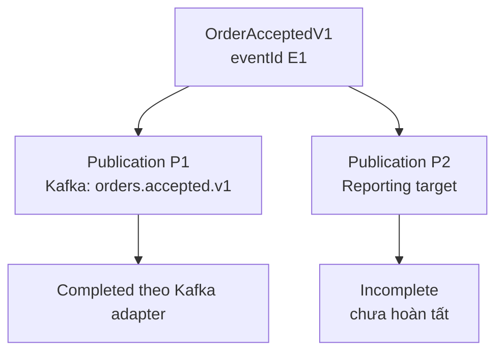
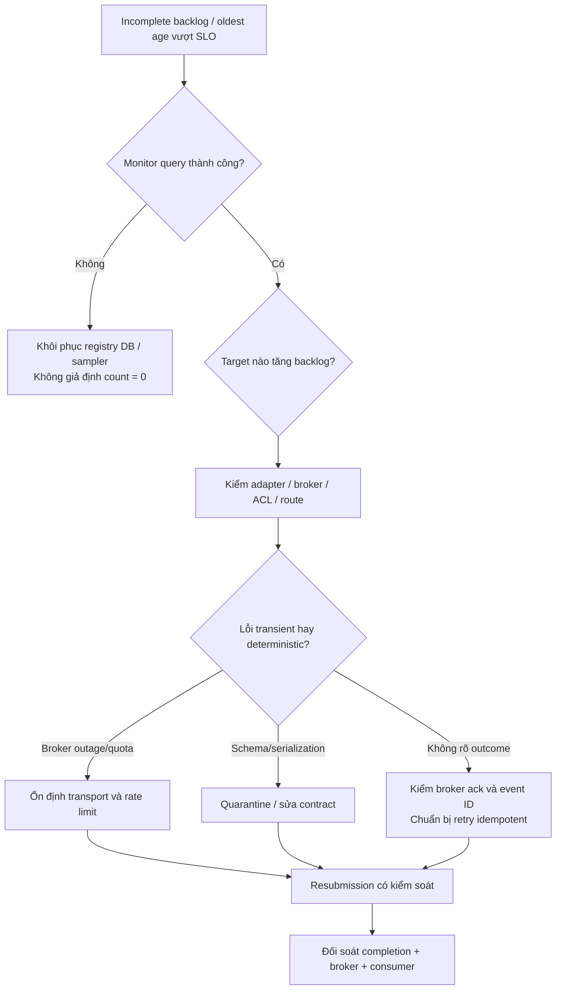
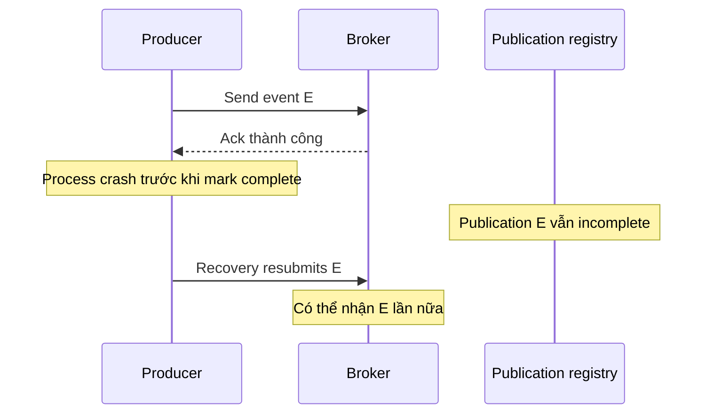

# Theo dõi publication chưa hoàn thành

Trong ứng dụng Spring Modulith, module `orders` xác nhận đơn hàng, phát `OrderAcceptedV1` và externalize event sang Kafka. Database đã commit nhưng Kafka mất kết nối vài phút. Nếu hệ thống có **Event Publication Registry** cùng persistence adapter được cấu hình đúng, ý định công bố tới target có thể vẫn được ghi nhận dù lần gửi chưa hoàn tất. Câu hỏi vận hành không còn là “đã gọi `publishEvent(...)` chưa?” mà là: **đang có bao nhiêu publication chưa hoàn thành, mắc kẹt bao lâu, thuộc target nào và khi nào phải can thiệp?**

Đây là chủ đề **“Theo dõi publication chưa hoàn thành”** trong chương *Externalization* của học phần `SPRING_MODULITH_VERIFICATION_TESTING`. Học phần rèn kiểm chứng ranh giới ứng dụng bằng `ApplicationModules`, quy tắc dependency, `@ApplicationModuleTest`, kiểm thử sự kiện/cơ sở dữ liệu/tích hợp và quality gate CI. Bài này đi trực tiếp vào **quan sát publication chưa hoàn tất**: định nghĩa bằng chứng, thiết kế metric/cảnh báo, mã Java và JUnit, kiểm thử broker outage/recovery, runbook điều tra và checklist kiểm chứng. Không thay các bước đó bằng một ví dụ producer phát event thành công đơn thuần.

## 1. Theo dõi đúng đối tượng: publication theo target, không phải số event

Giả sử `OrderAcceptedV1(eventId=E1)` được gửi đến Kafka để fulfillment và một adapter khác để reporting. Đây là **một business event** nhưng có thể là **nhiều publication đến những target riêng**:



Nếu chỉ đếm event ID duy nhất thì có thể bỏ sót P2. Các hệ thống có nhiều đích nhận cần đo **publication theo target** chứ không gộp thành “event đã gửi” hoặc “event chưa gửi”.

### Bốn trạng thái khác nhau cần diễn đạt chính xác

| Điều quan sát được | Có thể kết luận | Không thể kết luận |
| --- | --- | --- |
| Producer đã gọi `ApplicationEventPublisher.publishEvent(...)` | Event được publish trong Spring context theo semantics hiện tại | Publication được lưu bền vững |
| Publication có trong tập **incomplete** của registry | Chưa có completion được ghi nhận cho target đó | Broker chắc chắn chưa nhận message |
| Adapter đã ghi publication **completed** | Target publication đã hoàn tất theo điều kiện adapter | Consumer ngoài JVM đã commit nghiệp vụ |
| Consumer xử lý xong nghiệp vụ | Consumer có business effect theo contract của nó | Producer sẽ không gửi lại message |

**Incomplete không đồng nghĩa failed.** Publication mới được tạo có thể đang đợi dispatch hoặc acknowledgement bình thường. Mốc cần cảnh báo là **tuổi tồn đọng vượt ngưỡng chấp nhận**, backlog tăng liên tục hoặc số publication chưa hoàn tất bất thường theo target.

**Incomplete cũng không chứng minh broker chưa từng nhận message.** Ví dụ broker đã ack nhưng process crash trước khi registry ghi completion; resubmit có thể gửi lại cùng event. Không dùng danh sách incomplete như danh sách “message chắc chắn bị mất”.

### Đừng đo “listener chạy bao nhiêu lần” thay cho publication backlog

Một sự kiện có thể có nhiều listener, retry và resubmission. Đếm invocation từ log không cho biết **còn bao nhiêu công việc gửi chưa hoàn tất đang được lưu bền vững**. Nguồn sự thật để đo backlog là **publication persistence/registry**, nếu dự án thực sự cấu hình nó.

## 2. Bộ chỉ số tối thiểu và ngưỡng có ý nghĩa vận hành

Nên thiết kế dashboard từ **năm nhóm tín hiệu**:

| Metric đề xuất | Đơn vị | Ý nghĩa thực tế |
| --- | --- | --- |
| `app.publications.incomplete` | Publication | Tổng số publication chưa completion |
| `app.publications.oldest.age.seconds` | Giây | Tuổi publication incomplete lâu nhất |
| `app.publications.incomplete.by_target` | Publication | Phân bố backlog theo target ổn định |
| `app.publications.dispatch.failures` | Lần / khoảng thời gian | Lỗi adapter/broker đã quan sát |
| `app.publications.monitor.sample.success` | 0/1 | Lần lấy mẫu gần nhất đọc registry được hay không |

**Đây là các tên metric do bài đề xuất**, không phải tên Micrometer metrics mặc định được mọi bản Spring Modulith cung cấp. Khi triển khai, cần phân biệt metric mà framework/adapter đã có với metric ứng dụng tự bổ sung.

### Số lượng chưa hoàn tất

Ví dụ:

```text
Total incomplete: 83
  Kafka orders.accepted.v1: 80
  AMQP customer-updates:   3
```

Tổng số 83 hữu ích để đánh giá tải tồn đọng, nhưng nếu không nhóm theo target, operator không biết target nào đang gặp sự cố. **Không gắn `eventId` hay `publicationId` vào metric label**; mỗi ID khác nhau sẽ tạo cardinality rất lớn và làm tăng chi phí lưu trữ/queries.

### Tuổi publication lâu nhất

Ví dụ:

```text
Now:                    2026-11-26T10:20:00Z
Oldest incomplete:      2026-11-26T09:58:00Z
Oldest incomplete age:  22 minutes
Policy threshold:       5 minutes (minh họa)
```

Tuổi backlog giúp phát hiện **một event mắc kẹt** dù tổng số chỉ là 1. Trên các event vận hành quan trọng, đây thường là tín hiệu hữu ích hơn một chỉ số count đơn độc.

**Ngưỡng “5 phút” chỉ là chính sách ví dụ**, không phải default của Spring Modulith. Hãy lấy ngưỡng từ yêu cầu delivery latency, SLO, khả năng broker và mức độ quan trọng của event.

### Đừng nhầm tốc độ gửi và độ trễ consumer

Publication hoàn tất theo adapter producer **không bằng** consumer đã xử lý xong. Nếu dashboard publication sạch nhưng fulfillment vẫn trễ, hãy kiểm **consumer lag, deserialization errors, DLT hoặc consumer transaction**. Không tăng producer resubmission vô điều kiện để chữa sự cố downstream.

## 3. Lấy dữ liệu từ registry mà không bịa API hoặc schema

Event Publication Registry có các hình thức persistence/integration khác nhau theo **Spring Modulith version** và starter được cài. Có nơi lưu JDBC, có nơi dùng JPA hoặc adapter khác. Bài toán giám sát chỉ có nghĩa nếu bạn đã xác nhận:

1. Registry thực sự **theo dõi publication của externalization target** đang dùng.
2. Có một **persistent store** nếu bạn cần quan sát backlog qua restart.
3. API hoặc storage query nào chính thức xác định **incomplete** và **completed** cho adapter/version đó.
4. Cột/thời điểm nào thể hiện **lúc publication được đăng ký**.
5. Publication identity có gắn **target cụ thể** hay không.
6. Cơ chế resubmission được kích hoạt ở đâu; **theo dõi backlog không tự kích hoạt retry**.

**Không được viết một câu SQL dựa vào tên bảng hoặc cột phỏng đoán** như `event_publication.status = 'INCOMPLETE'` rồi tuyên bố đó là Spring Modulith schema. Tên bảng, field, kiểu lưu completed và cách lọc target là đặc điểm triển khai. Khi cần SQL vận hành, đối chiếu migration và API chính thức của **phiên bản thực tế**.

### Thiết kế cổng đọc chỉ phục vụ observability

Để phần đo lường không bị khóa vào một adapter cụ thể, có thể tạo một **read port** do tầng infrastructure/operations sở hữu:

```java
// com/example/shop/observability/PublicationBacklogSource.java
package com.example.shop.observability;

public interface PublicationBacklogSource {
    PublicationBacklog snapshot();
}
```

Phần code của `PublicationBacklogSource` là **interface do bài học tự định nghĩa**, **không phải API Spring Modulith có sẵn**. Adapter thực thi port này bằng registry query chính thức hoặc một read-only query vào persistence implementation đã được xác minh.

**Một snapshot có ba thành phần:**

```java
// com/example/shop/observability/PublicationBacklog.java
package com.example.shop.observability;

import java.time.Instant;
import java.util.Map;
import java.util.Objects;

public record PublicationBacklog(
        long incompleteCount,
        Instant oldestRegisteredAt,
        Map<String, Long> countByTarget
) {
    public PublicationBacklog {
        if (incompleteCount < 0) {
            throw new IllegalArgumentException(
                    "incompleteCount cannot be negative");
        }
        if (incompleteCount == 0 && oldestRegisteredAt != null) {
            throw new IllegalArgumentException(
                    "empty backlog cannot have an oldest publication");
        }
        if (incompleteCount > 0 && oldestRegisteredAt == null) {
            throw new IllegalArgumentException(
                    "nonempty backlog requires oldest timestamp");
        }
        countByTarget = Map.copyOf(
                Objects.requireNonNull(countByTarget, "countByTarget"));
        if (countByTarget.values().stream()
                .anyMatch(value -> value == null || value < 0)) {
            throw new IllegalArgumentException(
                    "target counts cannot be negative");
        }
    }
}
```

**Ý nghĩa các field:**

- `incompleteCount` là tổng publication incomplete **trên toàn bộ dữ liệu liên quan**, không phải kích thước một trang danh sách lấy mẫu.
- `oldestRegisteredAt` là thời điểm đăng ký publication incomplete cũ nhất, hoặc `null` khi backlog bằng 0. Không lấy timestamp của lần retry mới nhất thay cho tuổi từ lúc bắt đầu nợ delivery.
- `countByTarget` nhóm theo **tên target ổn định, đã được kiểm soát cardinality**, không theo eventId/customerId.

### Phân trang và tính nhất quán của snapshot

Nếu API chỉ trả 100 bản ghi đầu tiên, **không dùng `list.size()` làm gauge tổng** và không mặc định bản ghi đầu tiên là cũ nhất. Cần query **count đầy đủ, min registered timestamp và group by target**, hoặc truy vấn tập dữ liệu được phân trang đúng và có giới hạn tài nguyên.

Nếu count và oldest lấy từ nhiều truy vấn trong lúc publication chuyển trạng thái, hai số có thể không khớp tại cùng thời điểm. Có thể tính snapshot từ một transaction read-only có isolation thích hợp hoặc chấp nhận sai lệch tạm thời và thiết kế alert với **nhiều chu kỳ mẫu**, không khởi động recovery chỉ vì một lần đo không đồng nhất.

### Giới hạn quyền quan sát

Cổng đọc nên chỉ trả **count, timestamps, target name và các ID cần thiết để điều tra có phân quyền**. Không trả toàn bộ serialized event payload ra dashboard; registry có thể lưu dữ liệu nhạy cảm hoặc thông tin riêng của nghiệp vụ.

## 4. Java: đánh giá backlog bằng thời gian và số lượng

Sau khi có `PublicationBacklogSource`, logic cảnh báo có thể viết **thuần Java**, không phụ thuộc API nội bộ của Spring Modulith.

```java
// com/example/shop/observability/PublicationAssessment.java
package com.example.shop.observability;

import java.time.Duration;

public record PublicationAssessment(
        long incompleteCount,
        Duration oldestAge,
        boolean countThresholdExceeded,
        boolean ageThresholdExceeded
) {
    public boolean shouldAlert() {
        return countThresholdExceeded || ageThresholdExceeded;
    }
}
```

```java
// com/example/shop/observability/PublicationMonitor.java
package com.example.shop.observability;

import java.time.Clock;
import java.time.Duration;
import java.time.Instant;
import java.util.Objects;

public final class PublicationMonitor {

    private final PublicationBacklogSource source;
    private final Clock clock;
    private final Duration maxOldestAge;
    private final long maxIncompleteCount;

    public PublicationMonitor(
            PublicationBacklogSource source,
            Clock clock,
            Duration maxOldestAge,
            long maxIncompleteCount) {
        this.source = Objects.requireNonNull(source);
        this.clock = Objects.requireNonNull(clock);
        this.maxOldestAge = Objects.requireNonNull(maxOldestAge);
        if (maxOldestAge.isNegative() || maxOldestAge.isZero()) {
            throw new IllegalArgumentException(
                    "maxOldestAge must be positive");
        }
        if (maxIncompleteCount < 0) {
            throw new IllegalArgumentException(
                    "maxIncompleteCount cannot be negative");
        }
        this.maxIncompleteCount = maxIncompleteCount;
    }

    public PublicationAssessment inspect() {
        PublicationBacklog backlog = source.snapshot();
        Instant now = clock.instant();

        Duration age = backlog.oldestRegisteredAt() == null
                ? Duration.ZERO
                : Duration.between(backlog.oldestRegisteredAt(), now);

        // Một timestamp nằm trong tương lai vì lệch đồng hồ
        // không được biểu diễn thành tuổi âm.
        if (age.isNegative()) {
            age = Duration.ZERO;
        }

        return new PublicationAssessment(
                backlog.incompleteCount(),
                age,
                backlog.incompleteCount() > maxIncompleteCount,
                age.compareTo(maxOldestAge) > 0
        );
    }
}
```

Code này dùng toán tử **lớn hơn**: bằng đúng ngưỡng chưa báo động; đây là quyết định policy của ví dụ. Nếu SLO yêu cầu cảnh báo ngay khi đạt ngưỡng, đổi sang điều kiện **lớn hơn hoặc bằng** và sửa test tương ứng.

`PublicationMonitor` không resubmit event, không chỉnh registry, không mở broker connection. **Nó chỉ chuyển một snapshot thành đánh giá vận hành**, giúp unit test chính xác mà không kéo cả hạ tầng vào test.

### Vì sao không log từng event trong `inspect()`?

Metric sampling có thể chạy mỗi 15–60 giây. Nếu mỗi lần quét log tất cả incomplete publications kèm payload, hệ thống sẽ tạo **log storm**, tăng chi phí và có nguy cơ lộ PII. Dashboard thường chỉ cần aggregate; chi tiết theo ID nên được mở qua **công cụ vận hành có phân quyền**, giới hạn số bản ghi và có audit.

## 5. JUnit: chứng minh logic cảnh báo không đánh đồng backlog với lỗi

Sử dụng `Clock.fixed` để test không phụ thuộc thời gian thực, và giả lập port bằng lambda:

```java
// src/test/java/com/example/shop/observability/PublicationMonitorTest.java
package com.example.shop.observability;

import static org.junit.jupiter.api.Assertions.*;

import java.time.Clock;
import java.time.Duration;
import java.time.Instant;
import java.time.ZoneOffset;
import java.util.Map;
import org.junit.jupiter.api.Test;

class PublicationMonitorTest {

    private static final Instant NOW =
            Instant.parse("2026-11-26T10:20:00Z");

    private static final Clock CLOCK =
            Clock.fixed(NOW, ZoneOffset.UTC);

    @Test
    void emptyBacklogHasNoAlert() {
        PublicationBacklogSource source = () ->
                new PublicationBacklog(0, null, Map.of());

        var monitor = new PublicationMonitor(
                source, CLOCK, Duration.ofMinutes(5), 100);

        PublicationAssessment result = monitor.inspect();

        assertEquals(0, result.incompleteCount());
        assertEquals(Duration.ZERO, result.oldestAge());
        assertFalse(result.shouldAlert());
    }

    @Test
    void oneOldPublicationTriggersAgeAlert() {
        PublicationBacklogSource source = () ->
                new PublicationBacklog(
                        1,
                        NOW.minus(Duration.ofMinutes(22)),
                        Map.of("kafka:orders.accepted.v1", 1L));

        var monitor = new PublicationMonitor(
                source, CLOCK, Duration.ofMinutes(5), 100);

        PublicationAssessment result = monitor.inspect();

        assertEquals(Duration.ofMinutes(22), result.oldestAge());
        assertTrue(result.ageThresholdExceeded());
        assertFalse(result.countThresholdExceeded());
        assertTrue(result.shouldAlert());
    }

    @Test
    void largeYoungBacklogTriggersCountAlert() {
        PublicationBacklogSource source = () ->
                new PublicationBacklog(
                        120,
                        NOW.minus(Duration.ofSeconds(30)),
                        Map.of("kafka:orders.accepted.v1", 120L));

        var monitor = new PublicationMonitor(
                source, CLOCK, Duration.ofMinutes(5), 100);

        PublicationAssessment result = monitor.inspect();

        assertEquals(120, result.incompleteCount());
        assertFalse(result.ageThresholdExceeded());
        assertTrue(result.countThresholdExceeded());
    }

    @Test
    void exactlyAtThresholdFollowsChosenPolicy() {
        PublicationBacklogSource source = () ->
                new PublicationBacklog(
                        100,
                        NOW.minus(Duration.ofMinutes(5)),
                        Map.of("kafka:orders.accepted.v1", 100L));

        var monitor = new PublicationMonitor(
                source, CLOCK, Duration.ofMinutes(5), 100);

        assertFalse(monitor.inspect().shouldAlert());
    }

    @Test
    void oneTargetFailureDoesNotDisappearInTotal() {
        PublicationBacklogSource source = () ->
                new PublicationBacklog(
                        3,
                        NOW.minus(Duration.ofMinutes(12)),
                        Map.of(
                                "kafka:orders.accepted.v1", 2L,
                                "amqp:customer-updates", 1L));

        var monitor = new PublicationMonitor(
                source, CLOCK, Duration.ofMinutes(5), 100);

        var result = monitor.inspect();
        assertEquals(3, result.incompleteCount());
        assertTrue(result.shouldAlert());
    }
}
```

Những test này kiểm **toán học và chính sách cảnh báo**. Chúng **không xác nhận persistence adapter đã query đúng database** hoặc một publication thật có chuyển từ incomplete sang completed sau Kafka acknowledgement; phần đó cần integration test ở mục 9.

**Lưu ý về timestamp:** ví dụ chặn tuổi âm bằng `Duration.ZERO` để không phát metric âm, nhưng ở production cần thêm metric/cảnh báo **clock skew**, vì timestamp tương lai có thể che giấu publication cũ nếu đồng hồ giữa các node lệch nghiêm trọng. Không dùng điều chỉnh thời gian ngầm như một cách sửa dữ liệu registry.

## 6. Xuất metric bằng Micrometer: không query DB trên mỗi lần scrape

Nếu ứng dụng dùng Micrometer, có thể tạo một sampler định kỳ gọi `PublicationMonitor.inspect()` rồi cập nhật các gauge. **Đừng để mỗi lần Prometheus scrape tự quét hàng triệu publication**, vì áp lực đọc có thể tăng đúng lúc broker đang sự cố.

Ví dụ có chủ đích tách **đọc snapshot** và **xuất metric**:

```java
// com/example/shop/observability/PublicationMetricSampler.java
package com.example.shop.observability;

import io.micrometer.core.instrument.Gauge;
import io.micrometer.core.instrument.MeterRegistry;
import java.time.Clock;
import java.util.concurrent.atomic.AtomicLong;
import org.springframework.scheduling.annotation.Scheduled;
import org.springframework.stereotype.Component;

@Component
public final class PublicationMetricSampler {

    private final PublicationMonitor monitor;

    private final AtomicLong incomplete = new AtomicLong();
    private final AtomicLong oldestAgeSeconds = new AtomicLong();
    private final AtomicLong sampleOk = new AtomicLong();
    private final AtomicLong lastSampleEpochSeconds = new AtomicLong();

    public PublicationMetricSampler(
            PublicationMonitor monitor,
            MeterRegistry meters) {
        this.monitor = monitor;

        Gauge.builder(
                "app.publications.incomplete",
                incomplete, AtomicLong::doubleValue
        ).register(meters);

        Gauge.builder(
                "app.publications.oldest.age.seconds",
                oldestAgeSeconds, AtomicLong::doubleValue
        ).register(meters);

        Gauge.builder(
                "app.publications.monitor.sample.success",
                sampleOk, AtomicLong::doubleValue
        ).register(meters);

        Gauge.builder(
                "app.publications.monitor.last.success.epoch.seconds",
                lastSampleEpochSeconds, AtomicLong::doubleValue
        ).register(meters);
    }

    // 30 giây chỉ là nhịp lấy mẫu minh họa.
    @Scheduled(fixedDelay = 30_000)
    public void refresh() {
        try {
            PublicationAssessment status = monitor.inspect();
            incomplete.set(status.incompleteCount());
            oldestAgeSeconds.set(status.oldestAge().toSeconds());
            lastSampleEpochSeconds.set(
                    java.time.Instant.now().getEpochSecond());
            sampleOk.set(1);
        } catch (RuntimeException ex) {
            // Không đổi backlog thành ZERO khi DB/registry lỗi.
            // Metric sampleOk=0 báo rõ snapshot đang không đáng tin.
            sampleOk.set(0);
        }
    }
}
```

**Cấu hình phải bổ sung trong project thật:**

- Một bean `PublicationMonitor` được tạo với `PublicationBacklogSource`, `Clock` và ngưỡng được phê duyệt. Class ở mục 4 không tự là Spring bean.
- `@EnableScheduling` hoặc scheduler phù hợp để `@Scheduled` thực sự chạy.
- `MeterRegistry` và exporter Micrometer/Actuator theo hạ tầng quan sát.
- Logging/counter riêng cho lỗi lấy mẫu, có rate limiting để không tạo log storm khi DB down.

Nếu scheduler bị tắt hoặc nguồn dữ liệu không truy cập được, số gauge backlog có thể giữ nguyên giá trị cũ. **Vì vậy phải alert cả `sample.success==0` và độ cũ của `last.success.epoch.seconds`**, không chỉ dashboard incomplete bằng 0. Lưu ý metric age được cập nhật theo thời điểm lấy mẫu; khi sampler ngừng, age cũng đứng yên, nên cần kiểm freshness.

### Không giấu lỗi đọc dưới “backlog = 0”

Đây là anti-pattern:

```java
try {
    return source.snapshot();
} catch (Exception ignored) {
    return new PublicationBacklog(0, null, Map.of());
}
```

Nó biến **registry query failure** thành một dashboard xanh giả. Đúng hơn là **giữ snapshot trước**, đánh dấu nguồn dữ liệu không khả dụng và phát cảnh báo instrumentation. Nếu nguồn theo dõi bị lỗi, không thể khẳng định “không có publication incomplete”.

### Cardinality và query cost

Metric theo `target` nên dùng **tập target ổn định được allowlist**; đừng dùng `eventId`, `orderId`, `publicationId`, email hay chuỗi exception làm label. Không expose tên database hostname/credential trong endpoint metric công khai. Một danh sách diagnostic có giới hạn (ví dụ 20 ID) nên phục vụ operator **qua quyền truy cập riêng**, không thành label của time-series.

## 7. Chính sách alert: chọn tín hiệu, ngưỡng và chống nhiễu

Một cảnh báo hữu ích không chỉ là “count > 0”. Ngay cả hệ thống khỏe có thể có publication vừa đăng ký đang đợi adapter gửi, nên **count khác 0 trong khoảnh khắc ngắn** thường chưa đáng báo động.

Ví dụ thiết kế mức cảnh báo:

| Tình huống | Đánh giá | Phản ứng minh họa |
| --- | --- | --- |
| 1 publication incomplete, tuổi 20 giây | Có thể bình thường | Theo dõi |
| 1 publication incomplete, tuổi 18 phút; SLO 5 phút | Có dấu hiệu **stuck** | Alert người trực vận hành |
| 1.500 publication incomplete, tuổi lâu nhất 2 phút; count threshold 500 | Backlog tăng bất thường | Cảnh báo, kiểm throughput |
| Count/age vẫn 0 nhưng `sample.success=0` | **Không có dữ liệu đo hợp lệ** | Alert monitoring pipeline |
| Kafka target backlog tăng, AMQP target ổn | Lỗi/thiếu capacity cục bộ theo target | Điều tra Kafka adapter/broker |
| Backlog giảm sau broker hồi phục | Recovery có tiến triển | Quan sát cho đến hết nợ |

Các con số chỉ là **policy ví dụ**. Một ứng dụng thanh toán có thể cần độ trễ rất ngắn; batch analytics có thể chấp nhận hàng giờ. Hãy phân loại target/event type theo mức độ quan trọng và SLO được phê duyệt.

### Đừng báo động trên một snapshot đơn lẻ

Có thể dùng điều kiện như:

```text
Alert candidate:
    oldestAge > 5 minutes
    OR incompleteCount > 500

Alert firing:
    candidate xảy ra trong 3 chu kỳ lấy mẫu liên tiếp
    AND monitor.sample.success = 1

Monitor blind:
    không có successful sample trong 2 phút
```

Quy tắc trên **không phải default Spring Modulith/Micrometer**. Nó minh họa việc kết hợp ngưỡng và *persistence window* nhằm giảm nhiễu trong trường hợp spike ngắn, trong khi monitor mất khả năng đọc phải có alert riêng.

**Cảnh báo theo độ tuổi cần chú ý ưu tiên:** nếu một publication phục vụ giao vận bị kẹt 2 giờ nhưng backlog tổng chỉ 1, đó vẫn có thể là một lỗi nghiệp vụ nghiêm trọng.

### Hai chỉ số bổ sung có ích

- **Backlog growth rate:** chênh lệch số lượng incomplete qua các lần lấy mẫu, giúp biết debt đang tăng hay hệ thống đang bắt kịp.
- **Completion throughput:** số publication hoàn tất trong một khoảng thời gian, nếu adapter/registry cung cấp một nguồn đo đáng tin cậy.

Không tính throughput bằng cách lấy **giảm số incomplete** rồi luôn gọi đó là completion: một job cleanup, thay đổi retention hoặc lỗi query cũng có thể làm số count giảm. Với sự kiện quan trọng, completion throughput phải dựa trên event/metric completion thật, không suy từ delta của gauge đơn giản.

## 8. Runbook: khi nào publication thực sự bị kẹt?

Khi có alert, operator cần xác định **tại sao completion không được ghi nhận** trước khi resubmit.



### Thứ tự điều tra đề xuất

1. **Kiểm sức khỏe nguồn quan sát.** Sampler đọc được registry không? Timestamp sample có mới? Có quá nhiều query timeout?
2. **Khoanh vùng target.** Kafka hay AMQP? Destination nào? Sự cố có xảy ra ở tất cả event type không?
3. **Đọc số lượng và tuổi.** Backlog đang tăng, đứng yên hay giảm? Publication lâu nhất xuất hiện trước hay sau một release?
4. **Kiểm adapter/transport.** Broker availability, DNS, credentials, ACL, topic/exchange provisioning, quota, latency và publisher ack errors.
5. **Phân loại lỗi.** Timeout có thể là kết quả không chắc chắn; lỗi schema/serializer thường không được chữa bằng retry liên tục.
6. **Xác minh recovery path.** Có persistent registry không? Resubmission trigger/job hoạt động? Có khởi chạy được sau restart?
7. **Lấy vài ID diagnostic được phân quyền.** Kiểm event type, target, thời điểm đăng ký và lỗi đã phân loại; không mở payload nhạy cảm bừa bãi.
8. **Thực hiện recovery có giới hạn.** Backoff, batching, quota và multi-instance coordination phù hợp.
9. **Xác nhận bằng chứng đóng sự cố.** Count/age giảm, publication hoàn tất theo adapter, broker nhận event; nếu business cần, đối soát downstream riêng.

### Bảng triệu chứng và hướng điều tra

| Triệu chứng | Khả năng thường gặp | Bằng chứng cần lấy |
| --- | --- | --- |
| Tất cả target cùng tăng backlog | Broker/network chung, registry/adapter hoặc scheduler hỏng | Transport health, sampler health, exception class |
| Chỉ một target kẹt | ACL, route, quota hoặc consumer/adapter của target đó | Target mapping và broker errors |
| Chỉ một loại event kẹt lâu | Mapper/schema không tương thích, poison publication | Serialization error theo event type và ID |
| Broker có message nhưng registry vẫn incomplete | Ack/completion update thất bại hoặc process crash | Broker record, completion records, restart timeline |
| Backlog không giảm sau khi broker khỏe | Recovery chưa bật hoặc resubmission không chạy | Job/trigger logs và registry readback |
| Dashboard count = 0 nhưng sampler lỗi | Monitoring blind | `sample.success` và tuổi successful sample |
| Registry hoàn tất, downstream chưa cập nhật | Vấn đề phía consumer, không phải producer backlog | Consumer lag, DLT, processing transaction |

**Không tự chỉnh trực tiếp trạng thái completed trong registry** để làm dashboard xanh. Completion có ý nghĩa về việc externalization đã đạt điều kiện thành công theo adapter; sửa bằng SQL không có bằng chứng có thể làm mất publication chưa được gửi.

## 9. Recovery an toàn: theo dõi phải gắn với hành động có kiểm soát

Quan sát backlog chỉ có ích nếu vận hành biết cách **khôi phục mà không tạo side effect sai**.

### Quy trình phục hồi một target

```text
1. Tạm xác định phạm vi sự cố và source of truth:
     registry publication theo target

2. Sửa nguyên nhân:
     broker, ACL, route, serializer hoặc recovery scheduler

3. Chọn tập publication cần resubmit:
     đúng target, đúng time window, có audit

4. Resubmit theo API/cơ chế của phiên bản đang sử dụng:
     batching + rate limit + backoff + concurrency control

5. Theo dõi:
     incomplete count / oldest age / completion / broker ack

6. Đối soát:
     eventId ổn định, không tạo business event mới;
     downstream xử lý duplicate an toàn theo contract
```

**Không gọi lại business method `acceptOrder()` để retry publication.** Nó có thể tạo `OrderAcceptedV1` mới với eventId khác hoặc thay đổi trạng thái nghiệp vụ; resubmit phải dùng lại **publication/event đã được ghi nhận**.

**Không giả định mọi phiên bản Spring Modulith tự resubmit incomplete publication** sau khi broker hoạt động lại. Cần kiểm tài liệu và cơ chế thực sự được bật: startup recovery, scheduled job hoặc operator action. Những API như liệt kê incomplete publications và resubmit có thể khác giữa phiên bản; bài không sử dụng tên method giả để đánh lừa người đọc.

### Tại sao phải chấp nhận duplicate?



Registry incomplete là **bằng chứng thiếu completion**, không phải bằng chứng broker chưa từng nhận. Do đó recovery hướng tới *at-least-once publication* thường có nguy cơ duplicate. Giữ `eventId`/payload ổn định và yêu cầu consumer **idempotent** khi contract cần. Monitoring không được đánh đồng “đã gửi hai lần” với “đã phát hai business events”.

### Nhiều instance cùng recovery

Nếu ứng dụng chạy ba replica, tránh để cả ba cùng quét và gửi một publication incomplete mà không có cơ chế claim/locking/lease phù hợp. Tùy persistence adapter/version, có thể có khả năng điều phối; nếu tự viết worker, phải thiết kế coordination riêng. **Ngay cả có lock vẫn phải chuẩn bị duplicate** do ack không chắc chắn.

### Audit cho các thao tác can thiệp

Với publication quan trọng, lưu được ai đã khởi chạy resubmit, lúc nào, target nào, bộ lọc nào và kết quả. Không lấy payload event chứa PII làm bản ghi audit mặc định. Một dashboard chỉ có nút “Retry All” không giới hạn target, tốc độ, số lượng hoặc quyền truy cập là rủi ro vận hành.

## 10. Kiểm thử theo dõi backlog: từ JUnit đến broker thật

Các metric chỉ đáng tin nếu **adapter đọc registry đúng** và phản ánh chuyển trạng thái khi externalization thất bại/phục hồi. Nên chia thành ba nhóm test, mỗi nhóm có bằng chứng riêng.

### 10.1. JUnit test: sampler giữ dữ liệu cũ khi nguồn đọc lỗi

Kiểm đúng chính sách ở mục 6 bằng `SimpleMeterRegistry` mà không cần broker:

```java
// src/test/java/com/example/shop/observability/
// PublicationMetricSamplerTest.java
package com.example.shop.observability;

import static org.junit.jupiter.api.Assertions.*;

import io.micrometer.core.instrument.simple.SimpleMeterRegistry;
import java.time.Clock;
import java.time.Duration;
import java.time.Instant;
import java.time.ZoneOffset;
import java.util.Map;
import java.util.concurrent.atomic.AtomicBoolean;
import org.junit.jupiter.api.Test;

class PublicationMetricSamplerTest {

    @Test
    void failureMarksSampleUnhealthyWithoutZeroingBacklog() {
        var now = Instant.parse("2026-11-26T10:20:00Z");
        var broken = new AtomicBoolean(false);

        PublicationBacklogSource source = () -> {
            if (broken.get()) {
                throw new IllegalStateException(
                        "registry temporarily unavailable");
            }
            return new PublicationBacklog(
                    2,
                    now.minus(Duration.ofMinutes(12)),
                    Map.of("kafka:orders.accepted.v1", 2L));
        };

        var monitor = new PublicationMonitor(
                source,
                Clock.fixed(now, ZoneOffset.UTC),
                Duration.ofMinutes(5),
                100);

        try (var meters = new SimpleMeterRegistry()) {
            var sampler = new PublicationMetricSampler(
                    monitor, meters);

            sampler.refresh();

            assertEquals(2.0, meters.get(
                    "app.publications.incomplete")
                    .gauge().value());
            assertEquals(720.0, meters.get(
                    "app.publications.oldest.age.seconds")
                    .gauge().value());
            assertEquals(1.0, meters.get(
                    "app.publications.monitor.sample.success")
                    .gauge().value());

            broken.set(true);
            sampler.refresh();

            // Backlog vẫn là snapshot cuối hợp lệ, KHÔNG trở về 0.
            assertEquals(2.0, meters.get(
                    "app.publications.incomplete")
                    .gauge().value());
            assertEquals(0.0, meters.get(
                    "app.publications.monitor.sample.success")
                    .gauge().value());
        }
    }
}
```

Test sử dụng `Clock.fixed` cho logic age và một `AtomicBoolean` để giả lập registry query failure. Nó chứng minh **logic xuất metric đúng**; không chứng minh registry của Spring Modulith đã ghi lại publication E. Cần test truy vấn storage và broker ở hai bước tiếp theo.

### 10.2. Integration test với persistence adapter thật

Khởi chạy **đúng loại database/persistence adapter** của ứng dụng, đã có migration schema publication chính thức. Tạo publication test qua luồng được framework hỗ trợ và kiểm:

| Kịch bản | Điều cần assert |
| --- | --- |
| Store rỗng | `incompleteCount=0`, `oldestRegisteredAt=null` |
| Một publication mới tới Kafka | Count tăng theo semantics của adapter trước completion |
| Completion được ghi nhận | Publication không còn trong tập incomplete |
| Hai target cho cùng event | Count theo **target**, không đếm một event ID là một việc |
| Một publication rất cũ | `oldestRegisteredAt` vẫn là mốc đăng ký gốc, không thay bằng lần retry |
| Source query lỗi | Sampler đánh dấu không khỏe; không báo count 0 giả |
| Quét danh sách có phân trang | Count là tổng toàn bộ, oldest không bị bỏ sót |
| Completed history được lưu để audit | Query incomplete **không tính completed** |

**Không tự INSERT vào một bảng tên đoán mò.** Tạo publication bằng API/luồng framework thật; kiểm snapshot qua adapter đọc thật. Nếu cần tạo một publication cũ có timestamp cố định, dùng test fixture/migration hoặc seam được persistence adapter hỗ trợ, không sửa schema production bừa bãi.

Một integration test trên H2 không luôn tương đương PostgreSQL/MySQL về indexing/locking/isolation; với chỉ số đếm backlog quan trọng, nên có ít nhất một test dựa trên **database production cùng họ** hoặc Testcontainers tương ứng.

### 10.3. Broker outage → recovery: quan sát chuyển trạng thái

Một kịch bản dùng Kafka/RabbitMQ Testcontainers hoặc broker test tương đương:

```text
Given:
  - Ứng dụng Spring Modulith producer chạy với externalization adapter thật
  - Persistent Event Publication Registry được bật và có schema hợp lệ
  - Monitoring adapter đọc chính registry đã cấu hình
  - Broker test và destination đã provision
  - Baseline count/oldest được ghi nhận trước khi test

When:
  1. Làm broker tạm unavailable có kiểm soát.
  2. Service tạo business event E và COMMIT transaction.

Then:
  3. Business state đã commit.
  4. Publication đến target tương ứng được quan sát là incomplete
     theo contract của adapter/persistence thật.
  5. Count/oldest age và by-target snapshot thể hiện công việc chưa xong.
  6. Monitor sample vẫn thành công dù transport đang lỗi.

When:
  7. Khôi phục broker.
  8. Kích hoạt recovery/resubmission ĐƯỢC CẤU HÌNH THẬT.

Then:
  9. Broker nhận event E đúng identity.
 10. Publication target E được ghi completion theo adapter.
 11. Incomplete snapshot không còn tính publication E.
 12. Gauge sau chu kỳ sampling phản ánh snapshot mới.
```

**Các điều kiện dễ làm test xanh giả:**

- Nếu event không hề được registry theo dõi, count có thể mãi 0; bắt buộc có **positive assertion** về việc publication được đăng ký.
- Nếu test chỉ xem **tổng count** khi nhiều job đang chạy, publication khác có thể che mất E. Dùng isolation và đối chiếu **publication/event/target identity** ở diagnostic integration test.
- Nếu broker chưa hoàn tất startup/topic chưa provision, test có thể đo lỗi cấu hình chứ không phải outage cần mô phỏng.
- Nếu test annotate `@Transactional` và rollback mặc định, listener after-commit có thể không chạy. Phải **commit thật**; có thể dùng `TestTransaction` khi cần chủ động kết thúc test-managed transaction.
- Nếu dùng `Thread.sleep(100)` rồi assert count 0, dễ flaky. Dùng **poll with bounded timeout** trên trạng thái publication và broker, với điều kiện dừng rõ.
- Nếu muốn test khả năng survive restart, phải **restart ứng dụng thật** hoặc ít nhất reinitialize context/adapter dựa trên cùng persistent store, không chỉ restart broker.

### Tính đúng theo thời gian quan trọng hơn thời điểm cố định

Đối với ứng dụng bất đồng bộ, assertion nên là:

```text
Eventually (within bounded deadline):
    publication E becomes completed
    AND broker has a record for E

Not:
    exactly 100 milliseconds after recovery, count is zero
```

Trường hợp broker đã nhận E trước khi publisher crash rồi recovery gửi lại, có thể tồn tại hai record cùng eventId. **Không dùng điều kiện “broker chỉ có đúng một message”** để đánh giá một registry được thiết kế theo at-least-once. Điều cần kiểm ở bài này là **completion được ghi đúng và dashboard không còn nợ publication E**.

### `@ApplicationModuleTest` giúp ở điểm nào?

Một module test với `PublishedEvents` có thể xác nhận `orders` đã phát `OrderAcceptedV1` đúng. Nhưng nó **không** chứng minh Event Publication Registry persistent, broker outage tạo backlog hay metric age đúng. Đừng dùng số phần tử trong `PublishedEvents` thay cho count incomplete publications.

## 11. Quality gate, checklist và tình huống tự kiểm tra

### Quality gate CI cho publication monitoring

```text
Pull request
  |
  v
Unit tests
  |-- Clock.fixed: count/age policy
  '-- Sampler error: không biến DB failure thành count=0
  |
  v
ApplicationModules.verify()
  '-- Observability không import internal API sai/cycle
  |
  v
Persistence integration tests
  |-- Query incomplete đúng total/oldest/per target
  '-- Completion làm publication biến khỏi backlog
  |
  v
Broker + registry integration tests
  |-- Outage sau commit: incomplete tăng
  |-- Recovery: completion và dashboard giảm
  '-- Restart: persistence và sampling còn tin cậy
  |
  v
Monitoring checks
  |-- Alert threshold/freshness có unit test
  '-- Metric labels không chứa eventId/PII
  |
  v
Merge/release nếu các gate bắt buộc PASS
```

Test `ApplicationModules.verify()` chỉ kiểm kiến trúc Java/modularity, không xác nhận Kafka hoặc registry latency. Ngược lại, monitor JUnit PASS không chứng minh dependency rules đúng. Đó là lý do học phần `SPRING_MODULITH_VERIFICATION_TESTING` nên giữ **architecture gate** và **reliability observability gate** độc lập.

Để CI thật sự có giá trị, hãy xác nhận test suite integration được gọi bởi Maven/Gradle job tương ứng, không bị `skipTests`, profile thiếu adapter, `@Disabled` hoặc test filter bỏ qua. STEP viết bài này **không chạy build/Gradle**, vì việc QA chuyên môn và test thực tế thuộc pipeline dự án cùng bước kiểm tra sau.

### Checklist trước khi cho dashboard publication vào vận hành

| Câu hỏi kiểm chứng | Bằng chứng mong muốn |
| --- | --- |
| Đang theo dõi đúng externalization target? | Adapter/registry wiring và test positive |
| Persistent store có bật không? | Publication vẫn còn sau app restart nếu SLA yêu cầu |
| Count đếm **publication/target**? | Test một event nhiều target |
| Query incomplete loại trừ completed? | DB integration test |
| Oldest age tính từ registration gốc? | Fixed-clock và storage test |
| Có bỏ sót dữ liệu vì pagination? | Count/min timestamp trên toàn bộ tập |
| Metrics phân biệt zero với monitor lỗi? | `sample.success` và freshness alert |
| Target labels ổn định, cardinality thấp? | Review metric labels |
| Có cảnh báo theo tuổi và số lượng? | Threshold tests với clock cố định |
| Có policy giảm false alarms? | Alert persistence window, SLO hợp lệ |
| Recovery có được cấu hình **thật**? | Broker outage/recovery test |
| Đã chuẩn bị duplicate delivery? | Event ID giữ nguyên, consumer contract rõ |
| Multi-instance resubmit có an toàn? | Claim/concurrency validation |
| Có phân quyền xem publication details? | ACL/audit/retention |
| CI thực sự chạy registry/broker tests? | Build report và release gate |

### Bài tập 1 — Count bằng 0 nhưng datasource lỗi

Dashboard hiển thị `incomplete=0`, nhưng sampler không truy cập được registry database suốt 15 phút. Có thể kết luận không còn publication tồn đọng không?

**Đáp án:** **Không.** Zero có thể là giá trị cũ hoặc fallback sai. Phải hiển thị `sample.success=0`/sample freshness, khôi phục nguồn đọc và chỉ kết luận sau một lần query thành công.

### Bài tập 2 — Một event, hai target

Event `E1` gửi tới Kafka và AMQP. Kafka hoàn tất, AMQP chưa hoàn tất. Metric phải đếm bao nhiêu publication incomplete?

**Đáp án:** **Một publication incomplete cho target AMQP**, không phải “event đã hoàn tất” chỉ vì Kafka thành công; cũng không phải hai nếu Kafka đã được ghi complete.

### Bài tập 3 — Oldest publication và pagination

API diagnostic trả tối đa 100 publication mới nhất; developer lấy `min(registeredAt)` trong 100 bản ghi đó để hiển thị “oldest age”. Có đáng tin?

**Đáp án:** **Không**, trừ khi truy vấn chứng minh đó là tập đầy đủ hoặc sắp xếp/lọc đúng. Cần aggregate `min` trên **toàn bộ incomplete publications** hoặc một query/iterator được đảm bảo không bỏ sót publication cũ.

### Bài tập 4 — Broker có message nhưng registry incomplete

Operator thấy Kafka đã nhận E nhưng registry còn incomplete. Có nên xóa record E như một cách sửa nhanh?

**Đáp án:** **Không.** Có thể process chết trước khi ghi completion hoặc có lỗi update store. Điều tra ack/completion, dùng cơ chế recovery được hỗ trợ và audit. Resubmit có thể tạo duplicate; consumer cần idempotency.

### Bài tập 5 — `@ApplicationModuleTest` PASS

`PublishedEvents` ghi nhận một `OrderAcceptedV1` và `ApplicationModules.verify()` PASS. Đã chứng minh hệ thống theo dõi được publication incomplete chưa?

**Đáp án:** **Chưa.** Hai test kiểm event source và ranh giới module. Cần persistent registry adapter và test outage/completion/metrics để chứng minh monitor thấy publication thật.

### Bài tập 6 — Backlog chỉ một publication nhưng quá hạn

Một publication tồn đọng 45 phút, trong khi count threshold là 500 và tổng incomplete chỉ 1. Dashboard có nên im lặng?

**Đáp án:** **Không** nếu SLO delivery latency ngắn hơn 45 phút. Cảnh báo phải xét **oldest age** độc lập với count. Một sự kiện quan trọng mắc kẹt có thể gây hậu quả lớn dù backlog nhỏ.

### Bài tập 7 — Broker hồi phục nhưng backlog không giảm

Kafka đã khỏe lại, nhưng publication incomplete vẫn giữ nguyên sau một giờ. Bước kiểm tra ưu tiên?

**Đáp án:** Xác minh **resubmission/recovery trigger thật sự đang chạy**, rồi kiểm adapter/topic/ACL, serialization errors và completion persistence. Broker khỏe không tự đảm bảo job recovery được bật hoặc publication được mark completed.

### Kết luận thực hành

Để **theo dõi publication chưa hoàn thành**, hãy xem một publication là **công việc gửi đến target có vòng đời được registry ghi nhận**, đo **count + oldest age + per-target backlog**, và luôn kiểm **tình trạng sức khỏe của chính công cụ đo**. Snapshot, JUnit fixed-clock test và Micrometer chỉ giải quyết lớp observability; phải có **persistent registry và broker integration test** để chứng minh số liệu phản ánh tình trạng externalization thật.

Quan trọng nhất, **incomplete không đồng nghĩa broker chưa nhận** và **completed không đồng nghĩa consumer đã xử lý**. Khi backlog vượt SLO, hãy điều tra nguyên nhân, dùng recovery đúng phiên bản/adapter, giữ event identity, chuẩn bị duplicate và xác nhận completion sau can thiệp. Đưa các bất biến đó vào **quality gate CI** để monitoring không trở thành một dashboard xanh giả.

## Tài liệu tham khảo

- [Spring Modulith — Working with Application Events, Publication Registry và Event Externalization](https://docs.spring.io/spring-modulith/reference/events.html)
- [Spring Modulith — Testing Application Modules](https://docs.spring.io/spring-modulith/reference/testing.html)
- [Spring Modulith — Verifying Application Module Structure](https://docs.spring.io/spring-modulith/reference/verification.html)
- [Spring Framework — Transaction-bound Events](https://docs.spring.io/spring-framework/reference/data-access/transaction/event.html)
- [Micrometer — Gauges](https://docs.micrometer.io/micrometer/reference/concepts/gauges.html)
- [Micrometer — Naming Meters](https://docs.micrometer.io/micrometer/reference/concepts/naming.html)
- [Spring Boot — Observability and Metrics](https://docs.spring.io/spring-boot/reference/actuator/metrics.html)
- [Spring for Apache Kafka — Reference](https://docs.spring.io/spring-kafka/reference/)
- [Testcontainers — Kafka Module](https://java.testcontainers.org/modules/kafka/)
