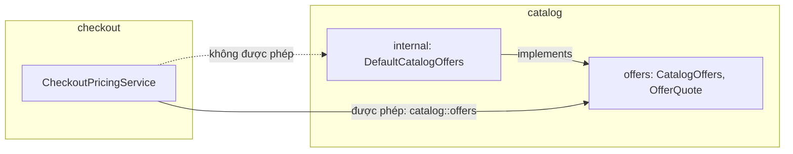

# ApplicationModules.toString và mô tả cấu trúc

Khi bảo vệ một ứng dụng Spring Modulith, câu hỏi đầu tiên thường không phải “test nào đang lỗi?” mà là **“Spring Modulith đang hiểu cấu trúc ứng dụng của chúng ta như thế nào?”**. Hai nhóm phát triển có thể cùng nói về `catalog`, `checkout` và `payment`, nhưng ranh giới **application module** thực tế lại được suy ra từ package, annotation và cấu hình phát hiện module. Nếu hiểu sai cấu trúc đang được nhận diện, một bài kiểm thử kiến trúc sẽ khó chẩn đoán và một sơ đồ tài liệu có thể đánh lừa người đọc.

`ApplicationModules.toString()` là một điểm khởi đầu hữu ích: nó tạo **biểu diễn dạng văn bản của mô hình application module** mà Spring Modulith đã xây dựng. Ta có thể đọc hoặc ghi biểu diễn đó vào log test để quan sát những gì công cụ nhìn thấy, sau đó dùng `ApplicationModules.verify()` để **thực sự kiểm chứng** các quy tắc kiến trúc.

Bài thuộc chương **Observability tests** của lộ trình **SPRING_MODULITH_VERIFICATION_TESTING**. Mục tiêu là đọc mô tả cấu trúc một cách có phương pháp, phát hiện sai lệch so với thiết kế dự kiến, kết hợp `ApplicationModules.verify()`, `@ApplicationModuleTest`, test sự kiện, database/tích hợp và thiết lập quality gate CI để phát hiện phụ thuộc sai hoặc hồi quy.

> **Phân biệt cốt lõi:** `toString()` **mô tả một mô hình tĩnh** để con người quan sát; `verify()` **đánh giá các ràng buộc kiến trúc**; `@ApplicationModuleTest` và các phép đo/tracing ở runtime **kiểm tra những khía cạnh khác**. Một mô tả đẹp không có nghĩa mọi quy tắc đều hợp lệ hoặc ứng dụng đang chạy đúng.

## 1. `ApplicationModules` là gì và `toString()` giúp ích ở đâu?

Trong Spring Modulith, `org.springframework.modulith.core.ApplicationModules` biểu diễn tập **application module** được nhận diện từ ứng dụng Spring Boot. Cách khởi tạo thường dùng:

```java
ApplicationModules modules =
        ApplicationModules.of(ShopApplication.class);
```

Ở ví dụ này, `ShopApplication` là lớp `@SpringBootApplication` ở package gốc `com.example.shop`. Theo quy ước phát hiện mặc định, các package con trực tiếp của package gốc thường là ứng viên application module. Thiết kế thực tế có thể thay đổi với cấu hình hoặc annotation đặc biệt; vì vậy **hãy kiểm tra mô hình công cụ nhận diện thay vì suy đoán từ tên thư mục**.

Có thể gọi:

```java
String description = modules.toString();
System.out.println(description);
```

Ý nghĩa thực dụng:

- **Nhìn thấy mô hình được nhận diện:** hỗ trợ đối chiếu danh sách module, phạm vi package và các đặc điểm được mô tả bởi phiên bản Spring Modulith đang dùng.
- **Kiểm tra giả định:** ví dụ nhóm nghĩ có module `checkout` riêng nhưng mô hình lại nhận diện theo cách khác.
- **Cung cấp ngữ cảnh cho lỗi test:** khi `verify()` báo phụ thuộc sai, mô tả cấu trúc giúp người đọc hình dung module nào là chủ sở hữu.
- **Hỗ trợ code review và onboarding:** có một bản mô tả xuất phát từ mã nguồn, thay vì chỉ dựa trên sơ đồ vẽ thủ công.
- **Theo dõi thay đổi kiến trúc:** khi package hoặc cấu hình phát hiện module đổi, mô tả được in trong test có thể giúp nhận biết sự khác biệt.

**Không nên coi chuỗi trả về của `toString()` là một giao thức dữ liệu có định dạng bất biến.** Nội dung, thứ tự và cách trình bày có thể thay đổi giữa các phiên bản Spring Modulith. Đừng tự suy ra mọi trường dữ liệu chắc chắn có mặt hoặc dùng nó làm nguồn sự thật duy nhất cho một hệ thống phân tích tự động.

## 2. Ví dụ xuyên suốt: `catalog` cung cấp API cho `checkout`

Hãy xây dựng một hệ thống đặt hàng nhỏ với hai application module chính:

- **`catalog`** sở hữu báo giá, chính sách giá và phần lưu trữ dữ liệu.
- **`checkout`** nhận yêu cầu mua hàng và tra cứu báo giá qua một API được công bố.

Package ứng dụng:

```text
com.example.shop
├── ShopApplication.java
├── catalog/
│   ├── offers/
│   │   ├── package-info.java        ← @NamedInterface("offers")
│   │   ├── CatalogOffers.java
│   │   └── OfferQuote.java
│   └── internal/
│       └── DefaultCatalogOffers.java
└── checkout/
    ├── package-info.java            ← allowedDependencies = "catalog::offers"
    └── CheckoutPricingService.java
```

Lớp khởi động:

```java
// src/main/java/com/example/shop/ShopApplication.java
package com.example.shop;

import org.springframework.boot.SpringApplication;
import org.springframework.boot.autoconfigure.SpringBootApplication;

@SpringBootApplication
public class ShopApplication {

    public static void main(String[] args) {
        SpringApplication.run(ShopApplication.class, args);
    }
}
```

Module `catalog` công bố một package hợp đồng có tên `offers`:

```java
// src/main/java/com/example/shop/catalog/offers/package-info.java

/**
 * API tra cứu báo giá dành cho application module khác.
 * Không công bố repository, entity hay thuật toán định giá.
 */
@org.springframework.modulith.NamedInterface("offers")
package com.example.shop.catalog.offers;
```

```java
// src/main/java/com/example/shop/catalog/offers/OfferQuote.java
package com.example.shop.catalog.offers;

import java.math.BigDecimal;
import java.util.Currency;

public record OfferQuote(
        String sku,
        BigDecimal amount,
        Currency currency
) {}
```

```java
// src/main/java/com/example/shop/catalog/offers/CatalogOffers.java
package com.example.shop.catalog.offers;

import java.util.Optional;

public interface CatalogOffers {
    Optional<OfferQuote> findBySku(String sku);
}
```

Ví dụ implementation bên trong `catalog`:

```java
// src/main/java/com/example/shop/catalog/internal/DefaultCatalogOffers.java
package com.example.shop.catalog.internal;

import com.example.shop.catalog.offers.CatalogOffers;
import com.example.shop.catalog.offers.OfferQuote;
import java.math.BigDecimal;
import java.util.Currency;
import java.util.Optional;
import org.springframework.stereotype.Service;

@Service
class DefaultCatalogOffers implements CatalogOffers {

    @Override
    public Optional<OfferQuote> findBySku(String sku) {
        if (!"SKU-101".equals(sku)) {
            return Optional.empty();
        }

        return Optional.of(new OfferQuote(
                sku,
                new BigDecimal("120000"),
                Currency.getInstance("VND")
        ));
    }
}
```

Bên `checkout` khai báo quyền phụ thuộc hẹp:

```java
// src/main/java/com/example/shop/checkout/package-info.java

@org.springframework.modulith.ApplicationModule(
    allowedDependencies = "catalog::offers"
)
package com.example.shop.checkout;
```

```java
// src/main/java/com/example/shop/checkout/CheckoutPricingService.java
package com.example.shop.checkout;

import com.example.shop.catalog.offers.CatalogOffers;
import com.example.shop.catalog.offers.OfferQuote;
import java.util.Optional;
import org.springframework.stereotype.Service;

@Service
public class CheckoutPricingService {

    private final CatalogOffers offers;

    public CheckoutPricingService(CatalogOffers offers) {
        this.offers = offers;
    }

    public Optional<OfferQuote> quoteFor(String sku) {
        return offers.findBySku(sku);
    }
}
```

Trong trường hợp mặc định, `catalog` và `checkout` là **hai application module**, còn `offers` là **named interface của module `catalog`**, không phải một application module thứ ba. Class `DefaultCatalogOffers` ở `catalog.internal` là implementation, không phải kiểu API mà `checkout` cần import.

## 3. In mô tả cấu trúc trong một bài test JUnit

Cách thực hành đơn giản nhất là tạo một test chuyên dùng để quan sát mô hình:

```java
// src/test/java/com/example/shop/ModuleStructureDescriptionTest.java
package com.example.shop;

import org.junit.jupiter.api.Test;
import org.springframework.modulith.core.ApplicationModules;

class ModuleStructureDescriptionTest {

    @Test
    void printsDetectedApplicationModules() {
        ApplicationModules modules =
                ApplicationModules.of(ShopApplication.class);

        System.out.println("=== SPRING MODULITH STRUCTURE ===");
        System.out.println(modules.toString());
    }
}
```

Test này cố ý chỉ **in mô tả**. Nó hữu ích như một công cụ khám phá, nhưng **không có assertion và không gọi `verify()`**, nên **không nên được coi là quality gate kiến trúc**. Nếu cấu trúc tồn tại nhưng có phụ thuộc không hợp lệ, test vẫn có thể PASS.

Để in mô tả và thực thi kiểm chứng trong cùng bài test:

```java
// src/test/java/com/example/shop/ModulithArchitectureTest.java
package com.example.shop;

import org.junit.jupiter.api.Test;
import org.springframework.modulith.core.ApplicationModules;

class ModulithArchitectureTest {

    @Test
    void describesAndVerifiesStructure() {
        ApplicationModules modules =
                ApplicationModules.of(ShopApplication.class);

        // In trước để còn có ngữ cảnh nếu verify() ném lỗi.
        System.out.println(modules);

        // Đây mới là quality gate cấu trúc.
        modules.verify();
    }
}
```

Vì `ApplicationModules` là một đối tượng Java, `System.out.println(modules)` sẽ gọi `toString()` tương đương cách in tường minh ở trên.

**Lưu ý về log test:** JUnit, Maven, Gradle và CI có thể thu thập, ẩn hoặc chỉ xuất `stdout` khi test lỗi tùy cấu hình. Nếu không thấy mô tả trên màn hình, hãy kiểm tra chế độ hiển thị standard streams hoặc test report của công cụ build; không kết luận `toString()` không hoạt động chỉ vì log chưa hiển thị.

## 4. Đọc mô tả bằng câu hỏi kiến trúc, không bằng suy đoán định dạng

Chuỗi `toString()` được thiết kế để người đọc nhìn mô hình Spring Modulith. **Không nên học thuộc chính xác dấu gạch ngang, thụt lề hoặc thứ tự từng dòng.** Thay vào đó, hãy dùng một bộ câu hỏi có thể áp dụng dù phiên bản thư viện thay đổi cách biểu diễn.

| Điều cần quan sát | Câu hỏi kiểm tra | Giải thích khi sai lệch |
| --- | --- | --- |
| **Tên module** | Công cụ đang nhận diện `catalog`, `checkout` như dự kiến không? | Có thể đặt sai package gốc hoặc cấu hình phát hiện |
| **Phạm vi package** | Những class nghiệp vụ thuộc đúng module sở hữu không? | Có thể di chuyển class sang package khác module |
| **API công bố** | Named interface `offers` có được khai báo trong module `catalog` không? | Kiểm tra `package-info.java` và tên annotation |
| **Phụ thuộc dự kiến** | `checkout` phụ thuộc vào `catalog` theo hướng đã thiết kế không? | Có thể xuất hiện import hoặc chiều phụ thuộc mới |
| **Phụ thuộc ngoài dự kiến** | Có class nội bộ nào bị sử dụng từ module khác không? | Chạy `verify()` và đọc báo cáo vi phạm |
| **Chu trình** | Quan hệ giữa các module có tạo vòng không? | Xem các mũi tên phụ thuộc và phân chia trách nhiệm |
| **Đối chiếu người dùng API** | `checkout` có thực sự chỉ dùng `catalog::offers`? | Kiểm tra `allowedDependencies` và test kiến trúc |

Ví dụ sau là **bản phác thảo khái niệm để đọc**, **không phải chuỗi đầu ra chính xác của `ApplicationModules.toString()`**:

```text
[Ứng dụng com.example.shop]
  application module: catalog
    phần API được công bố: catalog::offers
    phần nội bộ: catalog.internal
  application module: checkout
    phụ thuộc dự kiến: checkout -> catalog::offers
```

Tùy phiên bản và cách cấu hình, chuỗi thực tế có thể trình bày thông tin khác, hoặc không liệt kê mọi trường như bản phác thảo. Nếu cần chứng minh cụ thể named interface hay từng quan hệ phụ thuộc, hãy **kiểm tra annotation/mã và chạy `verify()`** thay vì suy luận từ việc một dòng có hoặc không xuất hiện trong `toString()`.

### Cách đọc theo ba tầng

**Tầng 1 — Tồn tại:** Có đúng những application module mà nhóm đã thống nhất không? Thiếu `checkout` là vấn đề nhận diện cấu trúc cần kiểm tra trước khi nhìn từng import.

**Tầng 2 — Ranh giới:** Class nào thuộc `catalog`, class nào thuộc `checkout`? Package `catalog.internal` nằm trong module `catalog`, không phải “thư viện chung” để module khác truy cập.

**Tầng 3 — Quy tắc:** Những quan hệ được mô hình cho phép có phù hợp với chủ đích kiến trúc không? Đến bước này, `ApplicationModules.verify()` và test khác mới trả lời đầy đủ phần có thể kiểm chứng tự động.

## 5. `toString()` và `verify()`: mô tả khác với phán định

Hai phương thức thường được đặt cạnh nhau, nhưng phục vụ mục đích khác nhau:

| Khía cạnh | `ApplicationModules.toString()` | `ApplicationModules.verify()` |
| --- | --- | --- |
| Câu hỏi | “Mô hình module trông như thế nào?” | “Mô hình có vi phạm quy tắc kiến trúc không?” |
| Kết quả | Chuỗi mô tả phục vụ quan sát/log | Kiểm chứng; báo lỗi khi có vi phạm |
| Vai trò trong test | Thông tin chẩn đoán | Assertion/quality gate về cấu trúc |
| Có kiểm tra hành vi bean không? | **Không** | **Không** |
| Có kiểm tra giá trị trả về từ `CatalogOffers` không? | **Không** | **Không** |
| Có phát hiện mọi API bị công bố quá rộng không? | **Không** | **Không nhất thiết** |
| Có nên assert nguyên văn chuỗi không? | **Thông thường không** | Không áp dụng |

`verify()` có thể phát hiện các dạng vi phạm cấu trúc phổ biến, bao gồm:

1. Quan hệ phụ thuộc giữa các application module gây chu trình không hợp lệ.
2. Module khác tham chiếu kiểu trong phần chưa công bố của **closed module**.
3. Module tiêu thụ có `allowedDependencies` nhưng sử dụng một module hoặc named interface ngoài phạm vi được phép.

**Mô tả cấu trúc có ích để hiểu vi phạm, chứ không sửa vi phạm thay ta.** Chẳng hạn, khi `checkout` tham chiếu `catalog.internal.DefaultCatalogOffers`, `toString()` có thể giúp ta định vị `catalog` là module sở hữu, còn `verify()` mới quyết định quan hệ đó không hợp lệ theo quy tắc kiến trúc.

### Vì sao không dùng snapshot đầy đủ của `toString()` làm gate?

Một test kiểu này dễ gây báo động giả:

```java
// KHÔNG KHUYẾN NGHỊ như một contract kiến trúc bền vững
assertThat(ApplicationModules.of(ShopApplication.class).toString())
        .isEqualTo(""" 
                ... nguyên văn hàng trăm dòng của một phiên bản ...
                """);
```

Dù mã ứng dụng vẫn giữ đúng kiến trúc, một phiên bản Spring Modulith mới có thể thay cách trình bày, thứ tự hoặc chi tiết mô tả. Snapshot bị vỡ không nhất thiết là ranh giới module bị phá. Ngược lại, một thay đổi nghiệp vụ có thể vi phạm mà chuỗi mô tả không cung cấp đủ bằng chứng để phát hiện.

**Khuyến nghị:** dùng `toString()` để chẩn đoán và review; dùng `verify()` để chặn phụ thuộc sai; nếu cần các quy tắc kiến trúc đặc thù hơn, viết assertion có ý nghĩa trên mô hình có API chính thức hoặc dùng phép kiểm tra bổ sung phù hợp, không parse chuỗi không được cam kết là định dạng máy đọc.

## 6. Thực hành phát hiện một thay đổi cấu trúc ngoài ý muốn

Giả sử trước khi refactor, mô hình hợp lệ:



Một lập trình viên đổi `CheckoutPricingService` để inject trực tiếp lớp triển khai. Ví dụ phản chứng (giả sử lớp triển khai được khai báo `public` chỉ để phép biên dịch Java cho phép):

```java
// VÍ DỤ VI PHẠM, KHÔNG GIỮ TRONG MÃ SẢN XUẤT
package com.example.shop.checkout;

import com.example.shop.catalog.internal.DefaultCatalogOffers;

class BadCheckoutService {

    private final DefaultCatalogOffers catalog;

    BadCheckoutService(DefaultCatalogOffers catalog) {
        this.catalog = catalog;
    }
}
```

Với `catalog` là closed module, tham chiếu này đi vào phần nội bộ chưa công bố. Bài kiểm thử `verify()` cần phát hiện vi phạm cấu trúc khi quan hệ thực sự tồn tại trong mã được phân tích.

**Lưu ý:** trong ví dụ triển khai ban đầu `DefaultCatalogOffers` là package-private, vì thế đoạn phản chứng **không biên dịch được** nếu giữ nguyên visibility. Để quan sát riêng lỗi Spring Modulith, hãy tạo một kiểu nội bộ giả lập `public` cho bài thực hành hoặc tạm đổi visibility trong nhánh thử nghiệm rồi khôi phục. Đừng coi lỗi biên dịch Java là lỗi do `verify()` trả về.

Cách điều tra:

1. In `ApplicationModules.of(ShopApplication.class).toString()` để xem ngữ cảnh mô hình.
2. Chạy `ApplicationModules.of(ShopApplication.class).verify()` để xác định có vi phạm kiến trúc.
3. Đọc phần phụ thuộc từ `checkout` đến `catalog.internal` trong mã.
4. Đổi dependency injection về **interface `CatalogOffers` thuộc `catalog::offers`**.
5. Chạy lại compile, `verify()` và các test hành vi chịu ảnh hưởng.

Chỉ thêm một dòng `import` **không được sử dụng** có thể không tạo ra phụ thuộc nhận diện được từ mã đã biên dịch. Khi dựng ví dụ âm, hãy sử dụng kiểu đó ở field, tham số, kết quả hoặc lời gọi cụ thể.

### Ma trận thí nghiệm

| Thay đổi trong mã/cấu hình | `toString()` giúp gì? | `verify()` mong đợi | Còn cần test nào? |
| --- | --- | --- | --- |
| **Baseline:** `checkout` dùng `CatalogOffers` | Cung cấp mô hình tham chiếu để đọc | PASS nếu toàn bộ kiến trúc hợp lệ | Module/integration test |
| `checkout` dùng `catalog.internal` public | Ngữ cảnh module sở hữu | FAIL vì truy cập phần chưa công bố | Compile trước test |
| `checkout` dùng `catalog::events` dù chỉ cho phép `offers` | Hỗ trợ xem mô hình và các phần API | FAIL do `allowedDependencies` | Event test nếu cần quyền mới |
| Xóa `@NamedInterface("offers")` | Có thể giúp đối chiếu thay đổi công bố | FAIL nếu phụ thuộc ngoài module vẫn còn | Compile và review API |
| Đổi tên `offers` thành `pricing` nhưng giữ quyền cũ | Hỗ trợ tra cứu ngữ cảnh | FAIL do tên cấu hình không khớp | Cập nhật contract |
| Đổi báo giá từ VND sang USD mà vẫn giữ chữ ký | Không đánh giá ý nghĩa tiền tệ | Có thể PASS | Contract/database/integration |
| Đặt repository public vào package `catalog.offers` | Có thể vẫn mô tả mô hình hợp lệ | Có thể PASS | Review bề mặt API |

Các kết quả PASS/FAIL trong bảng là **kỳ vọng của bài tập**, không phải kết quả đã chạy trên một repository cụ thể. Một vi phạm ở module khác cũng có thể làm `verify()` thất bại dù thí nghiệm đang tập trung vào `checkout`.

## 7. Mô tả cấu trúc khác với observability ở runtime

Tên chương **Observability tests** dễ khiến người học nghĩ `toString()` giống log ứng dụng, metrics hoặc distributed tracing. Thực tế, cần phân biệt ba tầng:

| Tầng quan sát | Dữ liệu/nguồn | Trả lời điều gì? |
| --- | --- | --- |
| **Cấu trúc tĩnh** | `ApplicationModules.of(...).toString()` | Những application module nào được mô hình hóa từ mã/cấu hình? |
| **Tính hợp lệ kiến trúc** | `ApplicationModules.verify()` | Các quan hệ phụ thuộc hiện tại có đúng quy tắc không? |
| **Runtime/behavior** | `@ApplicationModuleTest`, integration test, Spring events, log, metrics, trace | Bean có khởi tạo, request/event có chạy, dữ liệu có đúng không? |

`toString()` **không** chứng minh:

- Một bean `CatalogOffers` đã được đăng ký và inject thành công trong ứng dụng thật.
- Một lời gọi `findBySku` mất bao nhiêu mili giây hoặc phát sinh bao nhiêu truy vấn SQL.
- Event `OrderPlaced` hoặc `PriceChanged` đã được publish, commit hay xử lý xong.
- Transaction thực sự rollback, hay nhiều yêu cầu đồng thời có thể gây mất cập nhật.
- Một request đã đi qua module nào theo thời gian thực.

Các câu hỏi đó thuộc các phép kiểm tra hành vi hoặc công cụ quan sát runtime. Mô tả module là **bản đồ của hệ thống**, không phải **bản ghi hành trình của một request**.

### Liên hệ với logs và traces

Khi điều tra lỗi production, log và trace có thể cho biết một request `checkout` gọi API của `catalog` rồi thất bại. Nhưng log đó không bảo đảm mã nguồn không có một phụ thuộc “đi tắt” đến `catalog.internal` ở đường chạy khác. Ngược lại, `verify()` có thể bảo vệ ranh giới tĩnh nhưng không nói lời gọi nào đang chậm.

Vì vậy nên dùng **cả hai**: architecture test để giữ topology hợp lệ, và test/observability runtime để biết các luồng nghiệp vụ hoạt động thế nào.

## 8. Dùng `@ApplicationModuleTest` để bổ sung bằng chứng về module thực tế

Sau khi `toString()` giúp xác nhận module `catalog` tồn tại, hãy kiểm tra **Spring context** có khởi tạo đúng bean hợp đồng không:

```java
// src/test/java/com/example/shop/catalog/CatalogModuleTest.java
package com.example.shop.catalog;

import com.example.shop.catalog.offers.CatalogOffers;
import org.junit.jupiter.api.Test;
import org.springframework.beans.factory.annotation.Autowired;
import org.springframework.modulith.test.ApplicationModuleTest;

import static org.assertj.core.api.Assertions.assertThat;

@ApplicationModuleTest
class CatalogModuleTest {

    @Autowired
    CatalogOffers offers;

    @Test
    void exposesOffersBean() {
        assertThat(offers).isNotNull();
    }

    @Test
    void knownSkuProducesVndQuote() {
        var quote = offers.findBySku("SKU-101").orElseThrow();

        assertThat(quote.amount()).isEqualByComparingTo("120000");
        assertThat(quote.currency().getCurrencyCode()).isEqualTo("VND");
    }
}
```

Bài test này khởi tạo phạm vi module phù hợp nhờ `@ApplicationModuleTest`. Nó kiểm tra bean `CatalogOffers` và kết quả dữ liệu của ví dụ. Để chạy được, project cần Spring Modulith test và các dependency Spring Boot Test, JUnit, AssertJ phù hợp.

Đối với implementation thật dựa vào JPA, test cần datasource, schema và dữ liệu kiểm thử thích hợp. Nếu module phụ thuộc những module khác, phạm vi bootstrap hoặc test double phải được thiết kế đúng thay vì biến lớp implementation nội bộ thành API chỉ để test nạp được context.

**Cần duy trì `verify()` riêng:** có bean hợp lệ ở runtime không đồng nghĩa module khác đã tham chiếu đúng API ở mức kiến trúc.

## 9. Mô tả module không thay thế test sự kiện và database

Khi hệ thống được mở rộng, `catalog` có thể phát `PriceChanged`, còn `checkout` có thể tạo đơn và ghi database. Đây là những tình huống cần test bổ trợ, dù mô hình module vẫn trông đúng.

### Khi có event

Giả sử module `catalog` công bố `catalog::events` chứa kiểu `PriceChanged`. Cần kiểm tra riêng:

1. **Cấu trúc:** module nghe sự kiện có quyền phụ thuộc đúng named interface `events` hay không?
2. **Phát sự kiện:** thao tác thay giá có thực sự phát `PriceChanged` chứa đúng SKU, mức giá và thời điểm không?
3. **Giao dịch:** event được phát hoặc xử lý trước/sau commit theo ý đồ nghiệp vụ chưa?
4. **Listener:** người tiêu thụ xử lý sự kiện đúng, kể cả tình huống nhận lặp hoặc xử lý lại?
5. **Bảo mật dữ liệu:** event payload có vô tình mang entity hoặc dữ liệu không cần thiết không?

`ApplicationModules.toString()` có thể giúp nhận diện các module liên quan, nhưng **không thể tự trả lời năm câu hỏi trên**. Test event với `@ApplicationModuleTest`, Spring Test application events hoặc các công cụ scenario của Spring Modulith theo phiên bản đang sử dụng cần kiểm chứng hành vi thực tế.

### Khi có database

Sau khi chuyển `DefaultCatalogOffers` từ in-memory sang repository/JPA:

| Nguy cơ | Test phù hợp | Tại sao `toString()` không đủ? |
| --- | --- | --- |
| Thiếu bean repository, context không khởi tạo | `@ApplicationModuleTest` hoặc integration test | Cấu trúc package không xác nhận Spring wiring |
| Truy vấn sai SKU | Database/contract test | Mô hình module không chứa giá trị bản ghi |
| Giá trị hoặc tiền tệ bị ánh xạ sai | Producer contract/integration | Kiểu API đúng vẫn có thể trả dữ liệu sai |
| Transaction sai hoặc race condition | Integration/concurrency test | Phụ thuộc hợp lệ không chứng minh atomicity |
| DTO vô tình trả entity JPA | API review, test chữ ký, integration | Một phần API được công bố có thể vẫn thiết kế quá rộng |
| Module tiêu thụ import repository trực tiếp | `ApplicationModules.verify()` | Đây là vấn đề ranh giới, không phải SQL |

Giữ các loại kiểm tra ở đúng tầng giúp người học **không nhầm tính quan sát của mô hình với tính đúng đắn của hệ thống khi chạy**.

## 10. Biến mô tả cấu trúc thành công cụ điều tra trong CI

Một pipeline có thể chạy kiến trúc test cùng các nhóm test khác khi mở pull request:

```bash
./gradlew test
```

Hoặc với Maven:

```bash
mvn test
```

Nếu các integration test nằm trong task/plugin riêng, CI cần chạy thêm các bước được dự án cấu hình. Không nên mặc định một lệnh `test` đơn lẻ sẽ chạy mọi bài test tích hợp.

### Quy trình đề xuất

1. **Compile:** đảm bảo mã nguồn và chữ ký Java hợp lệ.
2. **In mô hình khi cần:** trong test kiến trúc hoặc job chẩn đoán, gọi `ApplicationModules.of(ShopApplication.class).toString()`; lưu log/test report ở nơi người review có thể đọc.
3. **Chặn sai kiến trúc:** gọi `ApplicationModules.verify()` và để test JUnit thất bại nếu có vi phạm.
4. **Kiểm tra hành vi:** chạy `@ApplicationModuleTest`, test event, database và integration phù hợp.
5. **Review thay đổi topology:** nếu xuất hiện module mới, package bị di chuyển hoặc named interface đổi tên, đối chiếu với quyết định thiết kế.
6. **Giữ output có kiểm soát:** log cấu trúc có thể chứa tên package/class nội bộ, nên lưu trong phạm vi CI phù hợp; không tự động công khai khi dự án có yêu cầu bảo mật.

**Không dùng `try/catch` để nuốt lỗi của `verify()`.** Nếu chỉ in `toString()` rồi coi job PASS, quality gate đã mất nhiệm vụ bảo vệ ranh giới.

### Khi nào nên in mô tả?

- Lúc đầu xây dựng bộ test kiến trúc để xác nhận mô hình phát hiện đúng.
- Trong một job chẩn đoán hoặc khi có thay đổi package/module lớn.
- Khi `verify()` thất bại và người đọc cần ngữ cảnh về các application module.
- Khi onboarding để giới thiệu ranh giới hiện tại của codebase.

Không nhất thiết in một mô tả dài trên mọi request runtime. `ApplicationModules` phù hợp với **phân tích cấu trúc ở môi trường phát triển/test**, không phải cơ chế logging lưu lượng nghiệp vụ.

## 11. Phân biệt “cấu trúc quan sát được” với “cấu trúc mong muốn”

Một lỗi tư duy phổ biến là cho rằng **mọi thứ được `toString()` hiển thị đều đã được thiết kế đúng**. Thực tế, mô hình được xây dựng từ **mã hiện tại**, bao gồm cả những sai sót do cách tổ chức package.

Ví dụ:

- Nếu lập trình viên đặt lớp `CheckoutService` nhầm vào package `catalog.internal`, mô hình sẽ xem đó là phần code của `catalog`, trong khi nhóm nghiệp vụ muốn nó thuộc `checkout`.
- Nếu một package `misc` được thêm ở cùng mức package module và bị nhận diện là một application module mới, mô hình có thể phản ánh sự tồn tại đó dù nhóm chưa hề thống nhất mô-đun `misc`.
- Nếu một repository được đặt trong package có `@NamedInterface`, mô hình có thể coi repository là API công bố hợp lệ theo khai báo, dù đó là quyết định thiết kế không mong muốn.
- Nếu `checkout` được cấp quyền phụ thuộc quá rộng, `verify()` cũng có thể PASS vì quy tắc đã bị nới lỏng; điều này không tự chứng minh quyền rộng hơn là cần thiết.

Do đó, quy trình review phải so sánh **mô hình thực tế** với **ý đồ thiết kế**, không chỉ kiểm tra công cụ có chạy được hay không. `toString()` giúp thấy cái đang có; `verify()` bảo vệ các bất biến được biểu diễn; review và test chuyên biệt bảo vệ chất lượng quyết định kiến trúc.

### Một checklist quan sát cấu trúc

- [ ] `ShopApplication` nằm ở package gốc mong muốn để Spring Modulith phát hiện các application module.
- [ ] `catalog` và `checkout` được nhận diện đúng theo cách tổ chức package.
- [ ] Những kiểu API liên module nằm ở package gốc hoặc package `@NamedInterface` có chủ đích.
- [ ] `catalog.internal` giữ repository, entity và implementation; `checkout` không tham chiếu trực tiếp các kiểu đó.
- [ ] `allowedDependencies` của `checkout` biểu diễn đúng `catalog::offers`.
- [ ] `verify()` được chạy trong test suite, không chỉ có `toString()` được in ra.
- [ ] Khi module/topology thay đổi, có review danh sách module và các đường phụ thuộc dự kiến.
- [ ] Test module, sự kiện, database và tích hợp vẫn được chạy cho các rủi ro liên quan.

## 12. Bài thực hành: từ mô tả cấu trúc tới kiểm chứng có ý nghĩa

### Đề bài

Bạn phụ trách một pull request chuyển hệ thống bán hàng từ các package hỗn hợp sang hai application module `catalog` và `checkout`. Người viết PR báo rằng “`ApplicationModules.toString()` đã in ra đúng hai tên nên cấu trúc chắc chắn hợp lệ”. Bạn cần chứng minh vì sao kết luận đó chưa đủ và xây dựng bộ kiểm chứng tin cậy.

### Các bước thực hiện

1. **Thiết lập mô hình:** đặt `ShopApplication` trong `com.example.shop`, tạo các package `catalog`, `checkout`; giữ implementation tại `catalog.internal`.
2. **Công bố hợp đồng:** tạo `catalog.offers` với `@NamedInterface("offers")`, `CatalogOffers` và `OfferQuote`.
3. **Giới hạn người tiêu thụ:** trong `checkout/package-info.java` đặt `allowedDependencies = "catalog::offers"`; `CheckoutPricingService` chỉ inject `CatalogOffers`.
4. **In mô tả:** viết `ApplicationModules.of(ShopApplication.class).toString()` trong test JUnit; quan sát các application module được nhận diện mà không giả định một định dạng chuỗi cố định.
5. **Viết quality gate:** thêm `ApplicationModules.of(ShopApplication.class).verify()` và chạy baseline; phân biệt đâu là bước quan sát, đâu là bước kiểm chứng.
6. **Tạo phụ thuộc sai:** cho `checkout` thực sự tham chiếu một kiểu `public` giả lập nằm ở `catalog.internal`, chạy compile và `verify()`; giải thích vì sao module name đúng nhưng quan hệ phụ thuộc vẫn sai.
7. **Tạo sai lệch API:** tạm bỏ `@NamedInterface("offers")` hoặc đổi tên nhưng không cập nhật `allowedDependencies`; quan sát sự thay đổi và lỗi kiến trúc.
8. **Tạo lỗi hành vi:** giữ nguyên cấu trúc nhưng đổi mức giá từ `120000` thành `120`; kiểm tra vì sao `toString()` và `verify()` không phát hiện, còn `@ApplicationModuleTest` phải có assertion bắt lỗi.
9. **Khôi phục:** bỏ mọi thay đổi cố ý sai, chạy lại test kiến trúc và test hành vi, bổ sung event/database/integration tests nếu hệ thống có các thành phần ấy.
10. **Đưa vào CI:** yêu cầu compile, `verify()` và các test hành vi bắt buộc đều PASS; giữ bản mô tả như thông tin hỗ trợ điều tra, không dùng snapshot chuỗi làm rào chắn chính.

### Bảng kết quả mong đợi

| Trạng thái | Mô tả từ `toString()` | `verify()` | Test hành vi |
| --- | --- | --- | --- |
| Hai module đúng, phụ thuộc đúng, giá đúng | Dùng để đọc cấu trúc | **PASS** | **PASS** |
| Hai module đúng nhưng `checkout` dùng `internal` | Vẫn có thể nhận diện đúng hai module | **FAIL** | Có thể không phát hiện |
| Hai module đúng nhưng named interface bị đổi sai tên | Dùng để xem cấu trúc hiện tại | **FAIL** | Có thể không phát hiện |
| Hai module đúng, phụ thuộc đúng nhưng giá sai | Có thể trông không đổi | **PASS** | **FAIL** nếu test có assertion về giá |
| Đặt code nhầm package làm sai ranh giới sở hữu | Có thể cho thấy mô hình khác kỳ vọng | Tùy quy tắc được khai báo | Cần review tổ chức mã |

Đây là kết quả **kỳ vọng theo tình huống minh họa**, không phải log thực thi của một dự án cụ thể.

### Câu hỏi tự đánh giá

**1. Vì sao `toString()` hữu ích nhưng không phải architecture test?** Vì nó cung cấp mô tả dễ đọc của mô hình, không tự áp đặt một assertion rằng các phụ thuộc tuân thủ mọi quy tắc kiến trúc.

**2. Khi `verify()` thất bại, vì sao nên in mô hình trước khi gọi nó?** Để có thêm ngữ cảnh nhận diện module và tổ chức package trong log ngay cả khi test ném lỗi.

**3. Có nên assert nguyên văn toàn bộ chuỗi `toString()` không?** Thông thường không. Định dạng không phải hợp đồng máy đọc ổn định; hãy assert các bất biến kiến trúc thực sự và dùng `verify()` làm gate.

**4. Nếu test module PASS nhưng `verify()` FAIL thì sao?** Khả năng khởi tạo bean và hành vi cục bộ chưa sửa được một phụ thuộc chéo module sai; phải sửa chiều hoặc phạm vi phụ thuộc.

**5. Nếu `verify()` PASS nhưng dữ liệu báo giá sai thì sao?** Kiến trúc không vi phạm các quy tắc được kiểm tra, nhưng cần sửa implementation và tăng độ bao phủ của producer/consumer contract, database hoặc integration test.

## 13. Ghi nhớ

**`ApplicationModules.toString()` giúp quan sát và diễn giải mô hình module đang được Spring Modulith nhận diện.** Hãy dùng nó khi khám phá cấu trúc, onboarding, review refactor hoặc chẩn đoán lỗi kiểm chứng; đừng phụ thuộc vào một định dạng chuỗi bất biến. **`ApplicationModules.verify()` mới là bước phán định ranh giới kiến trúc**, bao gồm phụ thuộc không được công bố, `allowedDependencies` và chu trình. Cuối cùng, **`@ApplicationModuleTest`**, kiểm thử sự kiện, database, tích hợp và observability runtime cung cấp bằng chứng về hành vi thật. Khi được ghép thành **quality gate CI**, các công cụ này giúp một mô hình vừa dễ hiểu vừa có ranh giới và hành vi được bảo vệ.

### Tài liệu tham khảo

- [Spring Modulith Reference — Application Modules và Named Interfaces](https://docs.spring.io/spring-modulith/reference/fundamentals.html)
- [Spring Modulith Reference — Verifying Application Module Structure](https://docs.spring.io/spring-modulith/reference/verification.html)
- [Spring Modulith Reference — Integration Testing Application Modules](https://docs.spring.io/spring-modulith/reference/testing.html)
