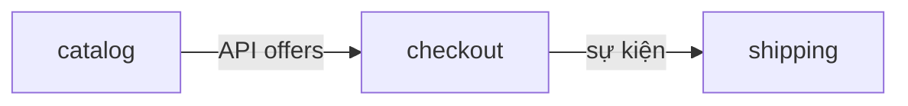
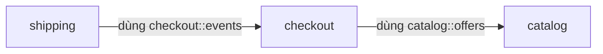
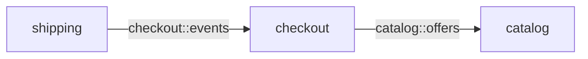
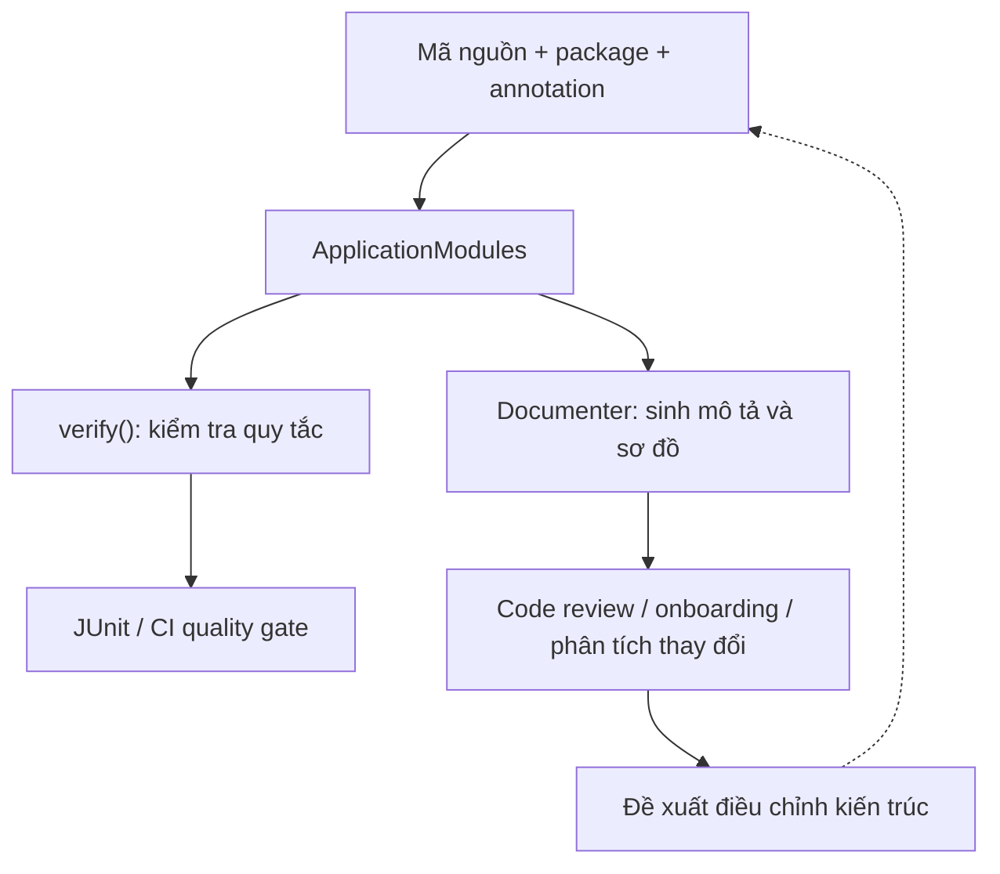
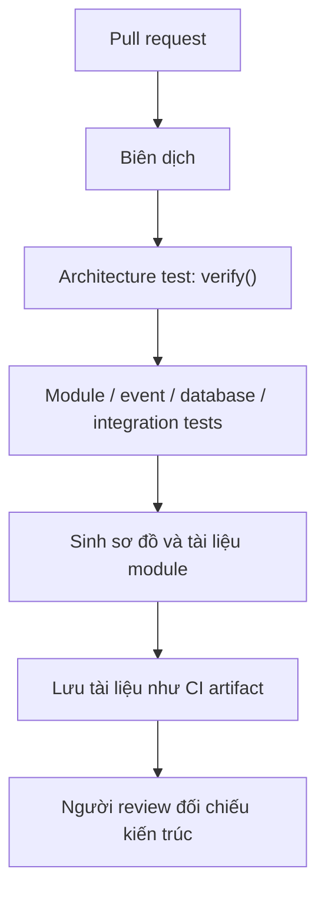

# Sinh tài liệu module để kiểm tra kiến trúc

Một hệ thống Spring Modulith có thể chạy đúng chức năng nhưng dần hình thành **phụ thuộc chéo module**, công bố quá nhiều kiểu nội bộ hoặc tạo một vòng phụ thuộc khó nhận biết. Khi người phát triển chỉ xem code theo từng class, bức tranh về **module nào sở hữu chức năng, module nào đang phụ thuộc vào module nào** rất dễ bị bỏ sót.

Spring Modulith cung cấp mô hình `ApplicationModules` cùng công cụ `org.springframework.modulith.docs.Documenter` để **sinh tài liệu kiến trúc từ cấu trúc ứng dụng**. Tài liệu được tạo tự động, đặc biệt là sơ đồ các application module và mô tả từng module, giúp nhóm phát triển quan sát, thảo luận và kiểm tra xem cấu trúc hiện tại còn phù hợp với thiết kế mong muốn hay không.

Bài thuộc chương **Observability tests** của chương trình **SPRING_MODULITH_VERIFICATION_TESTING**. Chúng ta sẽ xây dựng một ví dụ, sinh tài liệu module, đọc các đường phụ thuộc, kết hợp **`ApplicationModules.verify()`** làm quality gate, sau đó xác định vai trò bổ trợ của **`@ApplicationModuleTest`**, test sự kiện, cơ sở dữ liệu và tích hợp trong CI.

> **Ghi nhớ ngay từ đầu:** Tài liệu được sinh tự động phản ánh **mô hình kiến trúc mà Spring Modulith nhận diện**, chứ không phải lời khẳng định mọi quyết định thiết kế đều đúng. **`Documenter` dùng để mô tả; `verify()` dùng để kiểm chứng các quy tắc cấu trúc; kiểm thử hành vi và quan sát runtime giải quyết các câu hỏi khác.**

## 1. Vì sao nên sinh tài liệu thay vì chỉ vẽ sơ đồ thủ công?

Giả sử ứng dụng có ba module `catalog`, `checkout` và `shipping`:

- `catalog` quản lý sản phẩm, giá và dữ liệu sản phẩm.
- `checkout` tạo đơn hàng, cần tra cứu báo giá từ `catalog`.
- `shipping` chuẩn bị giao hàng khi nhận sự kiện đơn đã được tạo.

Nhóm có thể vẽ sơ đồ ban đầu:



Nhưng sơ đồ này dễ gây hiểu lầm về **hướng phụ thuộc mã nguồn**. Về kiến trúc tĩnh, `checkout` tham chiếu API của `catalog`; `shipping` tham chiếu **kiểu sự kiện do `checkout` công bố**. Do đó sơ đồ phụ thuộc compile-time đúng hơn là:



Một sơ đồ nghiệp vụ “dòng thông tin đi từ đâu đến đâu” và sơ đồ “mã nguồn module nào phụ thuộc vào module nào” **không nhất thiết có mũi tên cùng chiều**. Đây là lý do tài liệu kiến trúc cần được tạo từ mô hình ứng dụng và có lời giải thích rõ ràng.

| Tài liệu thủ công | Tài liệu sinh từ `ApplicationModules` |
| --- | --- |
| Thuận tiện khi trình bày mục tiêu hoặc kiến trúc mong muốn | Hữu ích khi phản ánh cấu trúc được phát hiện từ mã |
| Có thể không cập nhật sau khi đổi package/import | Có thể tái tạo sau mỗi lần thay đổi |
| Cho phép thêm ngữ cảnh nghiệp vụ không có trong mã | Gắn sát các application module và quan hệ phân tích được |
| Không tự phát hiện phụ thuộc sai | Có thể kết hợp `verify()` và test để chặn phụ thuộc sai |
| Vẫn cần người bảo trì | Vẫn cần review để xác nhận mô hình được phát hiện là **đúng ý đồ** |

**Mục tiêu không phải loại bỏ mọi sơ đồ thủ công**, mà là dùng chúng cho phần giải thích nghiệp vụ và dùng tài liệu sinh tự động để đối chiếu với mã thực tế.

## 2. `ApplicationModules`, `Documenter` và `verify()` đóng vai trò gì?

Ba khái niệm thường xuất hiện cùng nhau nhưng cần phân biệt:

| Thành phần | Vai trò chính | Điều không bảo đảm |
| --- | --- | --- |
| `ApplicationModules.of(...)` | Khởi tạo mô hình application module từ lớp ứng dụng/cấu hình | Chưa kết luận các phụ thuộc hợp lệ |
| `ApplicationModules.toString()` | Tạo mô tả văn bản để xem nhanh mô hình | Không tự trở thành một bài test kiến trúc |
| `Documenter` | Sinh tài liệu trực quan, chẳng hạn sơ đồ PlantUML và tài liệu module theo phiên bản sử dụng | Không tự sửa quan hệ sai; không phải runtime tracer |
| `ApplicationModules.verify()` | Kiểm tra các quy tắc cấu trúc như phụ thuộc vượt API, giới hạn và chu trình | Không chứng minh SQL, transaction, event hay logic nghiệp vụ đúng |
| `@ApplicationModuleTest` | Kiểm thử bootstrap và hành vi của module trong Spring test context | Không thay thế `verify()` hoặc mô tả toàn bộ topology |
| Test event/database/tích hợp | Kiểm chứng hành vi ở runtime và sự phối hợp thật | Không thay thế đánh giá ranh giới tĩnh |

Thông thường, quy trình hợp lý là **dựng mô hình → kiểm chứng → sinh tài liệu → đọc và review → chạy các test hành vi**. Việc sinh tài liệu giúp quan sát; điều kiện `verify()` PASS mới làm test kiến trúc thành quality gate.

## 3. Dựng một ứng dụng ví dụ có ranh giới rõ ràng

Giả sử lớp khởi động `ShopApplication` nằm ở `com.example.shop`. Theo quy ước phát hiện module mặc định, các package con trực tiếp có thể được nhận diện là application module:

```text
com.example.shop
├── ShopApplication.java
├── catalog/                               ← module catalog
│   ├── offers/
│   │   ├── package-info.java             ← @NamedInterface("offers")
│   │   ├── CatalogOffers.java
│   │   └── OfferQuote.java
│   └── internal/
│       ├── PriceRepository.java
│       └── DefaultCatalogOffers.java
├── checkout/                              ← module checkout
│   ├── package-info.java                  ← dùng catalog::offers
│   ├── CheckoutService.java
│   ├── events/
│   │   ├── package-info.java             ← @NamedInterface("events")
│   │   └── OrderPlaced.java
│   └── internal/
│       └── OrderRepository.java
└── shipping/                              ← module shipping
    ├── package-info.java                  ← dùng checkout::events
    └── OrderPlacedListener.java
```

Lớp khởi động:

```java
// src/main/java/com/example/shop/ShopApplication.java
package com.example.shop;

import org.springframework.boot.SpringApplication;
import org.springframework.boot.autoconfigure.SpringBootApplication;

@SpringBootApplication
public class ShopApplication {

    public static void main(String[] args) {
        SpringApplication.run(ShopApplication.class, args);
    }
}
```

### Module `catalog` công bố hợp đồng báo giá

File `catalog/offers/package-info.java`:

```java
/**
 * Hợp đồng tra cứu báo giá dành cho các application module khác.
 * Không công bố repository hoặc entity lưu trữ.
 */
@org.springframework.modulith.NamedInterface("offers")
package com.example.shop.catalog.offers;
```

Hai kiểu API:

```java
// catalog/offers/OfferQuote.java
package com.example.shop.catalog.offers;

import java.math.BigDecimal;
import java.util.Currency;

public record OfferQuote(
        String sku,
        BigDecimal amount,
        Currency currency
) {}
```

```java
// catalog/offers/CatalogOffers.java
package com.example.shop.catalog.offers;

import java.util.Optional;

public interface CatalogOffers {
    Optional<OfferQuote> findBySku(String sku);
}
```

Phần `catalog.internal` hiện thực API và quản lý repository. Module khác không cần import repository để lấy giá.

### Module `checkout` chỉ dùng `catalog::offers`

File `checkout/package-info.java`:

```java
@org.springframework.modulith.ApplicationModule(
    allowedDependencies = "catalog::offers"
)
package com.example.shop.checkout;
```

Ví dụ service:

```java
// checkout/CheckoutService.java
package com.example.shop.checkout;

import com.example.shop.catalog.offers.CatalogOffers;
import com.example.shop.catalog.offers.OfferQuote;
import java.util.Optional;
import org.springframework.stereotype.Service;

@Service
public class CheckoutService {

    private final CatalogOffers offers;

    public CheckoutService(CatalogOffers offers) {
        this.offers = offers;
    }

    public Optional<OfferQuote> quoteFor(String sku) {
        return offers.findBySku(sku);
    }
}
```

### Module `checkout` công bố sự kiện cho `shipping`

Tạo `checkout/events/package-info.java`:

```java
/**
 * Các sự kiện nghiệp vụ của checkout dành cho module tích hợp.
 * Payload chỉ mang dữ liệu cần thiết; không trả entity.
 */
@org.springframework.modulith.NamedInterface("events")
package com.example.shop.checkout.events;
```

```java
// checkout/events/OrderPlaced.java
package com.example.shop.checkout.events;

import java.time.Instant;
import java.util.UUID;

public record OrderPlaced(
        UUID orderId,
        Instant occurredAt
) {}
```

File `shipping/package-info.java`:

```java
@org.springframework.modulith.ApplicationModule(
    allowedDependencies = "checkout::events"
)
package com.example.shop.shipping;
```

Listener:

```java
// shipping/OrderPlacedListener.java
package com.example.shop.shipping;

import com.example.shop.checkout.events.OrderPlaced;
import org.springframework.modulith.events.ApplicationModuleListener;
import org.springframework.stereotype.Component;

@Component
class OrderPlacedListener {

    @ApplicationModuleListener
    void on(OrderPlaced event) {
        // Khởi tạo công việc giao hàng bằng event.orderId().
        // Trong hệ thống thật phải xử lý lặp, lỗi và giao dịch.
    }
}
```

Đây là **mã minh họa quan hệ phụ thuộc**, không phải ứng dụng hoàn chỉnh: cần implementation `CatalogOffers`, logic tạo đơn/phát `OrderPlaced`, repository và môi trường Spring Test phù hợp khi kiểm thử hành vi.

**Hai quan hệ kiến trúc cần quan sát trên sơ đồ** là `checkout -> catalog` và `shipping -> checkout`. Các package `offers` và `events` là named interface, **không phải application module độc lập**.

## 4. Thêm công cụ sinh tài liệu vào test scope

Spring Modulith có mô-đun tài liệu `spring-modulith-docs`, cung cấp `org.springframework.modulith.docs.Documenter`. Trong một dự án đã quản lý phiên bản Spring Modulith bằng BOM hoặc cơ chế quản lý dependency, có thể thêm dependency vào test scope.

Với Gradle:

```groovy
dependencies {
    testImplementation 'org.springframework.modulith:spring-modulith-docs'
    testImplementation 'org.springframework.boot:spring-boot-starter-test'
}
```

Với Maven:

```xml
<dependency>
    <groupId>org.springframework.modulith</groupId>
    <artifactId>spring-modulith-docs</artifactId>
    <scope>test</scope>
</dependency>
```

Đây là **đoạn cấu hình bổ sung**, không phải toàn bộ build file. Dự án cần Spring Modulith core, Spring Boot và JUnit phù hợp; phiên bản của các dependency phải được quản lý đồng bộ. Nếu không dùng BOM/dependency management, cần chỉ định phiên bản tương thích theo cấu hình thực tế.

Đặt Documenter trong phạm vi **test hoặc tác vụ sinh tài liệu** thường hợp lý hơn việc gắn logic tạo sơ đồ vào luồng request runtime của ứng dụng.

## 5. Sinh sơ đồ PlantUML từ `ApplicationModules`

Ví dụ JUnit dùng `Documenter`:

```java
// src/test/java/com/example/shop/ModulithDocumentationTest.java
package com.example.shop;

import org.junit.jupiter.api.Test;
import org.springframework.modulith.core.ApplicationModules;
import org.springframework.modulith.docs.Documenter;

class ModulithDocumentationTest {

    @Test
    void createsArchitectureDiagrams() {
        ApplicationModules modules =
                ApplicationModules.of(ShopApplication.class);

        // Kiểm chứng trước: không tạo cảm giác sơ đồ hợp lệ
        // đồng nghĩa với ranh giới kiến trúc đã được xác nhận.
        modules.verify();

        // Sơ đồ tổng quan các module.
        new Documenter(modules)
                .writeModulesAsPlantUml()
                .writeIndividualModulesAsPlantUml();
    }
}
```

Các thao tác trong ví dụ mang ý nghĩa:

- `ApplicationModules.of(ShopApplication.class)` tạo mô hình từ ứng dụng.
- `modules.verify()` xác nhận các quy tắc kiến trúc cơ bản trước khi tạo tài liệu.
- `writeModulesAsPlantUml()` tạo **biểu diễn tổng quan quan hệ giữa các module** dưới dạng PlantUML.
- `writeIndividualModulesAsPlantUml()` tạo biểu diễn tập trung vào **từng module**, hữu ích khi nhiều quan hệ khiến sơ đồ tổng quan quá dày đặc.

Tùy phiên bản thư viện, Documenter còn hỗ trợ cách sinh tài liệu gộp hoặc tài liệu mô tả module (thường được gọi là **module canvas**). API và tùy chọn đầu ra cụ thể có thể thay đổi theo phiên bản; nên sử dụng Javadoc/reference của phiên bản đã khai báo trong build.

### Biến thể sinh bộ tài liệu gộp

Một cách gọi khác thường được dùng với `Documenter`:

```java
@Test
void createsCompleteModuleDocumentation() {
    ApplicationModules modules =
            ApplicationModules.of(ShopApplication.class);

    modules.verify();

    new Documenter(modules).writeDocumentation();
}
```

Có thể dùng **một trong hai cách** phù hợp với mục tiêu: chỉ tạo sơ đồ theo phương thức tường minh hoặc dùng thao tác sinh bộ tài liệu tổng hợp. Không cần bắt buộc cả hai cùng chạy trong một bộ test nếu chúng tạo các hiện vật trùng lặp.

**Lưu ý quan trọng về đầu ra:** tên file, đường dẫn sinh tài liệu mặc định và nội dung từng loại hiện vật phụ thuộc phiên bản Spring Modulith, tùy chọn Documenter và hệ thống build. Không nên tự ghi cứng một đường dẫn như thể đó là hợp đồng ổn định; hãy quan sát nơi Documenter thực sự ghi file trong project rồi cấu hình CI để lưu đúng thư mục.

## 6. Đọc sơ đồ sinh ra để kiểm tra kiến trúc

### 6.1. Sơ đồ tổng quan trả lời câu hỏi nào?

Sơ đồ module tổng quan giúp nhóm xem:

1. Spring Modulith đang **nhận diện những application module nào**.
2. Mỗi module có **phụ thuộc tĩnh tới module nào** theo phần mô hình được biểu diễn.
3. Mô hình có xuất hiện **phụ thuộc ngược**, **chu trình** hoặc một module kết nối tới quá nhiều module khác không.
4. Những vùng nào cần soi kỹ bằng sơ đồ riêng và mã nguồn.

Với ứng dụng ví dụ, hướng phụ thuộc mong muốn là:



**Đây là sơ đồ kỳ vọng về mặt kiến trúc**, không phải ảnh chụp chính xác từ PlantUML được sinh trong một project đã chạy. Sơ đồ thực tế có thể hiển thị các thành phần và nhãn khác, tùy mô hình nhận diện và tùy chọn hiển thị.

Cách đọc hữu ích là mô tả mỗi mũi tên thành một câu: “`checkout` biết đến API báo giá của `catalog`”; “`shipping` biết đến kiểu sự kiện của `checkout`”. Sau đó hỏi **vì sao quan hệ đó cần thiết**, nó có phù hợp với quyền hạn `allowedDependencies` không, và nó có làm module sở hữu mất khả năng refactor độc lập không.

### 6.2. Sơ đồ từng module hữu ích khi nào?

Khi ứng dụng có nhiều module, một sơ đồ tổng quan có thể trở thành “mạng nhện”. Sơ đồ dành riêng cho `checkout` giúp tập trung vào:

- Những module `checkout` đang sử dụng.
- Những module đang phụ thuộc vào `checkout`.
- Bề mặt API công bố mà nhóm cần bảo trì, kết hợp với thông tin package và annotation.
- Tác động tiềm năng nếu đổi tên interface hoặc chuyển vị trí một kiểu public.

Không nên giả định sơ đồ riêng **luôn tự hiển thị mọi method, mọi class và mọi annotation**. Nếu cần trả lời một câu hỏi ở mức kiểu Java, hãy đọc package source và sử dụng phép kiểm tra/API phù hợp thay vì suy đoán từ phần trình bày.

### 6.3. Module canvas bổ sung điều gì?

Một số khả năng tài liệu của Spring Modulith mô tả mỗi application module như một **module canvas**: giúp tập hợp những thông tin mà người phát triển cần khi tìm hiểu module và các điểm tích hợp của nó. Tùy phiên bản và cấu hình, các phần mô tả có thể liên quan tới giao diện cung cấp, phụ thuộc tới module khác, các thành phần Spring được nhận diện và sự kiện.

Dùng module canvas như **mục lục để điều tra**, không coi sự hiện diện của một bean hoặc event trong tài liệu là bằng chứng rằng bean đã khởi tạo thành công hay event đã thực sự được phát ở runtime.

| Tầng tài liệu | Câu hỏi nên hỏi |
| --- | --- |
| Toàn ứng dụng | Các module lớn và chiều phụ thuộc có phù hợp thiết kế không? |
| Từng module | Module này nhận phụ thuộc từ ai và đang dùng những module nào? |
| API/module canvas | Phần API công bố và các điểm tích hợp có dễ hiểu, đủ tối thiểu không? |
| Mã và JavaDoc | Chính xác class/method/DTO nào thuộc hợp đồng, với ngữ nghĩa gì? |
| Test kiến trúc/hành vi | Những quy tắc và hành vi nào đã được kiểm chứng thực sự? |

## 7. Quan sát cấu trúc không đồng nghĩa với kiểm chứng hợp lệ

`Documenter` và `ApplicationModules.verify()` xử lý **hai nhiệm vụ khác nhau**:



Một sơ đồ có thể hiển thị đường phụ thuộc không mong muốn nhưng **không tự ngăn commit**. Ngược lại, `verify()` trả về kết quả kiểm chứng có thể làm JUnit thất bại khi gặp vi phạm.

Đặt test kiến trúc riêng giúp người phát triển hiểu rõ đâu là điều kiện bắt buộc:

```java
// src/test/java/com/example/shop/ModulithArchitectureTest.java
package com.example.shop;

import org.junit.jupiter.api.Test;
import org.springframework.modulith.core.ApplicationModules;

class ModulithArchitectureTest {

    @Test
    void verifiesAllModuleBoundaries() {
        ApplicationModules.of(ShopApplication.class).verify();
    }
}
```

Trong các quy tắc cốt lõi, phép kiểm chứng có thể phát hiện:

- Các quan hệ phụ thuộc tạo chu trình giữa application module.
- Module ngoài sử dụng kiểu không thuộc API đã công bố của **closed module**.
- Phụ thuộc của module tiêu thụ vượt danh sách `allowedDependencies`.

**Một giới hạn quan trọng:** `verify()` kiểm chứng theo những quy tắc **đã được biểu diễn**. Nếu một repository bị chuyển vào package công bố hoặc `allowedDependencies` bị nới quá rộng, mô hình có thể vẫn hợp lệ về mặt quy tắc nhưng **không còn phù hợp với ý đồ thiết kế**. Vì vậy, review sơ đồ và bề mặt API vẫn cần thiết.

## 8. Bộ thí nghiệm dùng tài liệu để phát hiện “kiến trúc bị trôi”

Giữ một bản baseline hợp lệ, sau đó tạo từng thay đổi tạm thời để học cách đọc sơ đồ và diễn giải test:

| Thí nghiệm | Thay đổi | Điều nên quan sát trong tài liệu | Kỳ vọng với `verify()` |
| --- | --- | --- | --- |
| **A — Baseline** | `checkout` dùng `catalog::offers`; `shipping` dùng `checkout::events` | Hướng phụ thuộc phù hợp thiết kế | **PASS** nếu toàn bộ mô hình hợp lệ |
| **B — Đi tắt vào internal** | `checkout` tham chiếu kiểu public ở `catalog.internal` | Vẫn thấy quan hệ giữa hai module; cần soi mức API trong mã | **FAIL** do dùng phần không công bố |
| **C — Sai named interface** | `checkout` dùng một kiểu `catalog::events`, chưa được cho phép | Có thể vẫn là cùng cặp module trên sơ đồ tổng quan | **FAIL** do vượt `allowedDependencies` |
| **D — Chu trình** | Thêm quan hệ `catalog -> checkout` khi đã có `checkout -> catalog` | Sơ đồ có thể bộc lộ hai chiều | **FAIL** do phụ thuộc vòng |
| **E — Đổi tên interface lệch quyền** | Đổi `@NamedInterface("offers")` thành `"pricing"`, không cập nhật `checkout` | Mô hình và metadata API thay đổi; không nhất thiết có mũi tên mới | **FAIL** do quyền không còn khớp |
| **F — Đặt sai package** | Chuyển một class `checkout` vào package `catalog.internal` | Module sở hữu class bị nhận diện khác dự kiến | **Phụ thuộc quy tắc**; cần review |
| **G — Công bố quá rộng** | Chuyển repository vào package `catalog.offers` | Tên module có thể không đổi, sơ đồ vẫn nhìn “đẹp” | Có thể **PASS**; cần review API |
| **H — Sai dữ liệu** | `CatalogOffers` trả giá sai nhưng vẫn dùng đúng API | Sơ đồ cấu trúc có thể không đổi | Có thể **PASS**; test hành vi phải phát hiện |

Các kết quả này là **kỳ vọng của bài thực hành**, không phải khẳng định đã chạy test trên dự án cụ thể. Từng sơ đồ sinh ra có thể khác tùy phiên bản và cấu hình.

### Thí nghiệm phụ thuộc sai nhưng Java vẫn biên dịch

Nếu class `DefaultCatalogOffers` ở `catalog.internal` là package-private, `checkout` không thể import nó; lỗi biên dịch Java xảy ra trước khi Spring Modulith kiểm tra kiến trúc. Để kiểm tra riêng ranh giới của Modulith, dùng **một kiểu public giả lập** trong `catalog.internal` và thật sự tham chiếu kiểu đó từ field hoặc method của `checkout`. Một dòng `import` không sử dụng chưa chắc tạo được phụ thuộc mà công cụ phân tích nhìn thấy trong bytecode.

Sau thí nghiệm, xóa mã cố tình sai và chạy lại cả test kiến trúc lẫn tài liệu để khôi phục baseline.

### Vì sao tài liệu hữu ích dù không luôn cho thấy sai phạm?

Một đường `checkout -> catalog` có thể xuất hiện trong cả hai trường hợp:

- `checkout` dùng đúng `CatalogOffers`.
- `checkout` dùng sai `catalog.internal.PriceRepository`.

Nhìn ở **mức module**, cả hai có cùng hướng phụ thuộc. Phần sai nằm ở **API cụ thể được sử dụng**. Vì vậy, sơ đồ tổng quan giúp định vị quan hệ cần xem, nhưng **`verify()` và việc đọc kiểu phụ thuộc** mới phân biệt hợp lệ và không hợp lệ.

## 9. Kiểm tra sự thay đổi tài liệu trong pull request

Một bản sinh tài liệu có thể cho thấy các thay đổi khó nhận ra khi chỉ đọc diff Java:

- Một application module mới xuất hiện sau khi thêm package cấp cao.
- Quan hệ phụ thuộc đổi chiều hoặc thêm module tiêu thụ mới.
- Một module vốn ít phụ thuộc trở thành điểm nối của nhiều module khác.
- Một module bị phân chia/gộp lại do thay cấu hình phát hiện.
- Named interface hoặc quyền tiêu thụ bị đổi tên, cần đối chiếu với các module liên quan.

Cách tổ chức review hiệu quả:

1. **Sinh lại tài liệu** ở trạng thái mã của pull request, không dùng hình vẽ cũ.
2. **Đọc sơ đồ tổng quan** để nhận ra module và đường phụ thuộc mới.
3. **Đọc sơ đồ theo module** với những module bị thay đổi.
4. **Đối chiếu ý đồ nghiệp vụ**: module mới có một trách nhiệm rõ ràng không? Phụ thuộc mới có cần thiết không?
5. **Kiểm chứng hợp đồng**: named interface, kiểu public và `allowedDependencies` có được thiết kế hẹp và đồng bộ không?
6. **Chạy `verify()` và test hành vi** để bảo vệ các thuộc tính mà tài liệu không chứng minh.

**Không nên dùng snapshot nguyên văn mọi dòng PlantUML/AsciiDoc làm tiêu chí duy nhất để chặn PR.** Thứ tự hoặc cấu trúc trình bày có thể thay đổi giữa các phiên bản công cụ; một thay đổi biểu diễn không nhất thiết là lỗi kiến trúc. Nếu cần kiểm tra các bất biến riêng, hãy dùng các assertion được thiết kế cho mô hình hoặc bộ kiểm tra kiến trúc chuyên biệt.

### Ví dụ biên bản review ngắn

| Câu hỏi | Câu trả lời cần có trước khi hợp nhất |
| --- | --- |
| Có application module mới không? | Tên và trách nhiệm được đồng ý, không phải package phát sinh vô tình |
| Có mũi tên phụ thuộc mới không? | Giải thích vì sao module tiêu thụ cần API của module cung cấp |
| Phụ thuộc có đi vào internal không? | Không; test `verify()` bảo vệ ranh giới |
| Có API mới được công bố không? | Chữ ký, DTO và JavaDoc đã được kiểm tra |
| Có sự kiện tích hợp mới không? | Event payload, thời điểm phát, listener và khả năng retry được test |
| CI có tái tạo tài liệu không? | Có bước rõ ràng, artifact được tìm thấy và người review có thể truy cập khi cần |

## 10. Kết hợp tài liệu với `@ApplicationModuleTest` để kiểm tra hành vi

Sơ đồ chỉ phản ánh các module và phụ thuộc tĩnh. Nó không xác nhận Spring đã tạo đúng bean hay một lời gọi có trả đúng dữ liệu không.

Một bài test của module `catalog` có thể dùng API công khai:

```java
// src/test/java/com/example/shop/catalog/CatalogModuleTest.java
package com.example.shop.catalog;

import com.example.shop.catalog.offers.CatalogOffers;
import org.junit.jupiter.api.Test;
import org.springframework.beans.factory.annotation.Autowired;
import org.springframework.modulith.test.ApplicationModuleTest;

import static org.assertj.core.api.Assertions.assertThat;

@ApplicationModuleTest
class CatalogModuleTest {

    @Autowired
    CatalogOffers offers;

    @Test
    void exposesPublicOffersContract() {
        assertThat(offers).isNotNull();
    }
}
```

Đây là **test khởi tạo/wiring**, chưa chứng minh báo giá chính xác. Trong một dự án thật, nên thêm kiểm thử `findBySku` cho SKU tồn tại/không tồn tại, giá trị tiền, quy tắc làm tròn và đầu vào không hợp lệ.

Nếu implementation dùng database, cần datasource và dữ liệu test phù hợp. Khi ứng dụng thay repository, tài liệu module vẫn có thể gần như không đổi — **đó có thể là một dấu hiệu tốt** vì ranh giới công khai ổn định — nhưng các test persistence vẫn phải chạy.

### Sự kiện: sơ đồ đúng vẫn có thể xử lý sai

Tương tự, sơ đồ có thể xác nhận `shipping` chỉ tham chiếu kiểu `OrderPlaced` thuộc `checkout::events`. Tuy nhiên, vẫn cần kiểm tra:

| Câu hỏi sự kiện | Phép kiểm tra thích hợp |
| --- | --- |
| `checkout` có thực sự phát `OrderPlaced` khi tạo đơn thành công không? | Producer/event test |
| Payload `orderId` và `occurredAt` có đúng không? | Contract test cho event |
| Listener `shipping` có xử lý đúng khi event đến không? | `@ApplicationModuleTest`/integration test |
| Event có thể bị xử lý lặp mà không tạo giao hàng trùng không? | Test idempotency |
| Event được xử lý tại thời điểm transaction phù hợp không? | Test transaction/event integration |
| Module nghe event có quyền tham chiếu đúng không? | `ApplicationModules.verify()` |

Trong Spring Modulith, một listener gắn `@ApplicationModuleListener` có các đặc điểm xử lý sự kiện cần hiểu theo phiên bản đang sử dụng. Không thể suy ra cơ chế xử lý, độ bền hoặc thứ tự giao nhận chỉ bằng việc nhìn mũi tên trên sơ đồ.

## 11. Mối quan hệ với kiểm thử database và tích hợp

Khi mô hình kiến trúc được sinh ra từ code, các package nội bộ và ứng dụng thực tế vẫn có thể phát triển nhanh:

- `catalog` chuyển từ in-memory sang JPA.
- `checkout` thêm transaction và logic lưu đơn.
- `shipping` gọi dịch vụ vận chuyển ngoài hoặc lưu tiến trình giao hàng.

Những thay đổi này có thể giữ nguyên **các mũi tên kiến trúc hợp lệ** nhưng phát sinh nhiều loại hồi quy runtime:

| Rủi ro | Dấu hiệu ở tài liệu | Kiểm thử cần thêm |
| --- | --- | --- |
| Trả sai giá từ repository | Không nhất thiết thấy | Test database/producer contract |
| Transaction tạo đơn bị rollback sai | Không thể suy ra từ sơ đồ | Integration/transaction test |
| Bean `CatalogOffers` không có implementation | Không được tài liệu chứng minh | `@ApplicationModuleTest` hoặc `@SpringBootTest` |
| Event đúng kiểu nhưng phát sai thời điểm | Không được tài liệu chứng minh | Event/transaction test |
| `shipping` tham chiếu trực tiếp `checkout.internal` | Có thể vẫn là cùng đường phụ thuộc module | `verify()` |
| Một kiểu JPA entity lọt vào API công khai | Sơ đồ tổng quan có thể không phản ánh đủ | API signature review/test |

Vì vậy, cần duy trì một **kim tự tháp bằng chứng**: sơ đồ giúp quan sát topology; `verify()` bảo vệ quy tắc; test module và test tích hợp xác nhận hành vi; observability runtime hỗ trợ chẩn đoán những luồng thật đang chạy.

## 12. Tích hợp sinh tài liệu vào CI mà không nhầm với quality gate

Một workflow thực tế nên tách ý nghĩa của **sinh hiện vật** và **kiểm tra PASS/FAIL**.

Ví dụ chạy JUnit tests với Gradle:

```bash
./gradlew test
```

Hoặc với Maven:

```bash
mvn test
```

Nếu muốn chỉ chạy bài test sinh tài liệu trong quá trình phát triển, có thể dùng bộ lọc test phù hợp với công cụ build, ví dụ với Gradle:

```bash
./gradlew test --tests 'com.example.shop.ModulithDocumentationTest'
```

Với Maven Surefire:

```bash
mvn -Dtest=ModulithDocumentationTest test
```

Việc lọc test chỉ giúp xem tài liệu nhanh; **pipeline chính vẫn phải chạy các bài test kiến trúc và hành vi bắt buộc**. Nếu test tạo tài liệu đã gọi `modules.verify()` thì nó cũng có thể fail do kiến trúc, nhưng nên có test `ModulithArchitectureTest` độc lập để ý nghĩa quality gate luôn rõ ràng.

### Quy trình CI đề xuất



**Gợi ý triển khai:**

1. Cài dependency `spring-modulith-docs` trong phạm vi phù hợp.
2. Tạo JUnit test hoặc tác vụ sinh tài liệu rõ tên, sử dụng `Documenter`.
3. Cho test kiến trúc `verify()` chạy ở mỗi PR, đảm bảo lỗi gây **non-zero exit**.
4. Chạy các test module, event, database/tích hợp theo cấu hình dự án; lưu ý một lệnh `test` chưa chắc đã bao gồm những integration test nằm ở task/plugin riêng.
5. Sau khi sinh tài liệu, xác minh các file đầu ra thực sự được tạo tại vị trí **đã quan sát hoặc cấu hình**, rồi đưa thư mục đó vào cơ chế upload artifact của CI.
6. Trong review, so sánh ý đồ thiết kế với sơ đồ/module canvas mới; yêu cầu giải thích đối với phụ thuộc hoặc API mới.
7. Không tự động commit file sinh ra vào repository nếu chưa có quy ước rõ ràng. Có thể dùng artifact từ CI để tránh diff lớn không cần thiết; nếu team chọn commit tài liệu, cần cơ chế tái tạo nhất quán.

Lưu ý: mã Java gọi `Documenter` **không tự tải lên** CI artifact hoặc tự cấp quyền truy cập tài liệu; bước lưu/trình bày là trách nhiệm của pipeline. Ngoài ra, sơ đồ có thể chứa tên class/package nội bộ, nên áp dụng chính sách lưu trữ/phân quyền phù hợp.

### Vì sao không dùng tài liệu như bằng chứng duy nhất?

Giả sử một PR chuyển `PriceRepository` từ `catalog.internal` sang chính `catalog.offers`. Tài liệu có thể vẫn thể hiện đúng các module và chiều phụ thuộc. `verify()` cũng có thể PASS vì repository đã nằm trong API được công bố. Nhưng **đây là thay đổi làm lộ chi tiết lưu trữ**; chỉ code review hoặc một bài kiểm tra bề mặt API có yêu cầu rõ mới giúp chặn.

Vì vậy, tài liệu được tạo tự động là **công cụ thảo luận và quan sát**, không phải “giấy phép” để mở rộng API tùy ý.

## 13. Các lỗi thường gặp khi sinh và đọc tài liệu module

**1. Chỉ chạy `Documenter`, không chạy `verify()`.** Hệ thống vẫn có thể tạo sơ đồ khi có phụ thuộc không hợp lệ. Phải giữ bài test kiến trúc làm gate rõ ràng.

**2. Nhầm mũi tên nghiệp vụ với mũi tên phụ thuộc mã nguồn.** Sự kiện có thể đi từ `checkout` sang `shipping`, nhưng dependency Java của listener thường là `shipping` đến kiểu event công bố bởi `checkout`.

**3. Hiểu một named interface là một application module riêng.** `catalog.offers` vẫn thuộc module `catalog`; chú thích `@NamedInterface` chỉ công bố một nhóm kiểu API.

**4. Ghi cứng đường dẫn và tên file sinh ra mà chưa xác minh.** Vị trí và cách đặt tên đầu ra thay đổi theo phiên bản/cấu hình build; trước khi upload artifact, kiểm tra thư mục thực tế.

**5. Dùng snapshot nguyên văn tài liệu làm thay thế kiểm chứng kiến trúc.** Định dạng/giá trị trình bày có thể thay đổi, tạo false positive hoặc bỏ sót sai lệch ngữ nghĩa.

**6. Chuyển module thành open để sơ đồ/test bớt phức tạp.** Open module nới lỏng ranh giới nội bộ; đó không phải giải pháp tự động cho một phụ thuộc sai.

**7. Tin rằng module canvas cho biết bean hoạt động tốt.** Module canvas mô tả mô hình; `@ApplicationModuleTest` và test runtime mới xác nhận wiring, dữ liệu và giao dịch.

**8. Chỉ quan sát sơ đồ tổng quan.** Sơ đồ ở mức module có thể không phân biệt phụ thuộc hợp lệ tới named interface với phụ thuộc sai tới `internal`; cần `verify()` và soi mã/chi tiết module.

**9. Quên regenerate tài liệu khi refactor module.** Sơ đồ cũ có thể làm review hiểu sai kiến trúc mới. Nên sinh lại từ cùng commit với code đang đánh giá.

**10. Cho rằng CI đã kiểm tra mọi tích hợp chỉ vì `./gradlew test` PASS.** Tùy dự án, integration test có thể được cấu hình ở task hoặc plugin riêng; chất lượng gate phụ thuộc các job thực tế được chạy.

## 14. Bài thực hành: dùng tài liệu sinh ra để phát hiện phụ thuộc sai

### Bối cảnh

Ứng dụng bán hàng có ba module `catalog`, `checkout`, `shipping`. Nhóm phát triển cần một **bộ tài liệu kiến trúc tái tạo được** để review PR, đồng thời muốn tự động chặn các phụ thuộc trái với hợp đồng.

### Nhiệm vụ từng bước

1. **Dựng module:** tạo `ShopApplication` trong `com.example.shop`; đặt `catalog`, `checkout`, `shipping` ở các package con trực tiếp.
2. **Công bố API báo giá:** tạo `catalog.offers`, khai báo `@NamedInterface("offers")`, định nghĩa `CatalogOffers` và `OfferQuote`; giữ implementation ở `catalog.internal`.
3. **Công bố kiểu sự kiện:** tạo `checkout.events` với `@NamedInterface("events")` và `OrderPlaced`.
4. **Giới hạn người tiêu thụ:** `checkout` chỉ dùng `catalog::offers`; `shipping` chỉ dùng `checkout::events`.
5. **Dựng test kiến trúc:** viết `ApplicationModules.of(ShopApplication.class).verify()` và xác nhận baseline không có phụ thuộc sai.
6. **Sinh tài liệu:** dùng `Documenter` với `writeModulesAsPlantUml()` và `writeIndividualModulesAsPlantUml()` hoặc phương thức sinh tài liệu gộp phù hợp; kiểm tra đầu ra được tạo.
7. **Đọc sơ đồ:** xác định chiều phụ thuộc `checkout -> catalog`, `shipping -> checkout`; giải thích vì sao chiều dòng nghiệp vụ có thể khác chiều phụ thuộc mã.
8. **Tạo lỗi mức API:** để `checkout` tham chiếu một kiểu public giả lập ở `catalog.internal`. Chạy lại compile và `verify()`; giải thích vì sao sơ đồ tổng quan có thể chưa đủ kết luận.
9. **Tạo lỗi mức module:** thêm phụ thuộc `catalog -> checkout` để hình thành chu trình khi đã có chiều ngược lại. Quan sát sự thay đổi trên sơ đồ và lỗi test.
10. **Tạo lỗi hành vi:** vẫn giữ quan hệ module đúng nhưng trả báo giá sai. Đối chiếu vì sao tài liệu và `verify()` có thể PASS, còn test `@ApplicationModuleTest`/database cần FAIL nếu có assertion thích hợp.
11. **Khôi phục và xác minh:** bỏ mã sai, sinh lại tài liệu, chạy test kiến trúc và các test hành vi liên quan.
12. **Đưa vào CI:** chạy bộ kiểm thử bắt buộc, sinh và lưu tài liệu như artifact để reviewer có thể đối chiếu cùng commit.

### Kết quả mong đợi

| Tình trạng | Tài liệu module | `verify()` | Test runtime |
| --- | --- | --- | --- |
| Cấu trúc và hành vi đúng | Phản ánh các module và phụ thuộc mong đợi | **PASS** | **PASS** |
| Phụ thuộc vào kiểu nội bộ của module khác | Sơ đồ tổng quan có thể vẫn trông giống baseline | **FAIL** | Có thể không phát hiện |
| Chu trình mới giữa các module | Có thể bộc lộ chiều phụ thuộc mới | **FAIL** | Không nhất thiết nhận ra |
| Công bố repository nhầm vào API | Có thể vẫn biểu diễn như một mô hình hợp lệ | Có thể **PASS** | Cần review/kiểm tra API |
| Báo giá sai, ranh giới đúng | Cấu trúc có thể không đổi | Có thể **PASS** | **FAIL** khi test có expected value |

**Đây là kết quả kỳ vọng của bài thực hành**, không phải báo cáo đã chạy build/test trong một repository cụ thể.

### Câu hỏi tự đánh giá

**1. Vì sao tài liệu sinh từ `ApplicationModules` đáng tin hơn sơ đồ viết tay về cấu trúc hiện tại?** Vì tài liệu bắt nguồn từ mô hình được xây dựng từ code/cấu hình tại thời điểm sinh, giảm nguy cơ bỏ sót thay đổi; nhưng vẫn cần đối chiếu với ý đồ kiến trúc.

**2. Vì sao `Documenter` không thay thế `ApplicationModules.verify()`?** Vì sinh mô tả không tự phán định mọi quan hệ phụ thuộc là hợp lệ hoặc khiến test thất bại theo các quy tắc cần bảo vệ.

**3. Vì sao `shipping -> checkout` có thể là chiều đúng trên sơ đồ phụ thuộc, dù event đi từ `checkout` tới `shipping`?** Vì `shipping` cần tham chiếu kiểu `OrderPlaced` mà `checkout` công bố; hướng compile-time dependency được xác định bởi code tiêu thụ.

**4. Khi sơ đồ không đổi nhưng một test database FAIL, có nên kết luận tài liệu sai không?** Không. Topology tĩnh và dữ liệu runtime là hai tầng thông tin khác nhau; cần sửa hành vi và giữ test phù hợp.

**5. Khi thêm một named interface, cần kiểm tra những gì?** Package công bố, các kiểu/DTO/event public, `allowedDependencies` của người tiêu thụ, phụ thuộc hiện có, test kiến trúc, test hành vi và tài liệu sinh lại.

## 15. Ghi nhớ

**Sinh tài liệu module là một cách quan sát và kiểm tra sự tiến hóa kiến trúc của Spring Modulith.** Từ `ApplicationModules.of(...)`, dùng **`Documenter`** để tạo sơ đồ tổng quan, sơ đồ từng module và tài liệu mô tả tương ứng với phiên bản dự án. Đọc chúng để đối chiếu **module sở hữu, chiều phụ thuộc và API công bố** với thiết kế dự kiến. Dùng **`ApplicationModules.verify()`** như quality gate cấu trúc, không dùng sơ đồ hay snapshot văn bản thay cho phán định. Cuối cùng, duy trì **`@ApplicationModuleTest`**, kiểm thử sự kiện, database, tích hợp và quan sát runtime để xác nhận hành vi. Khi kết hợp trong **CI**, tài liệu giúp nhóm hiểu kiến trúc còn kiểm thử giúp ngăn phụ thuộc sai và hồi quy.

### Tài liệu tham khảo

- [Spring Modulith Reference — Documenting Application Modules](https://docs.spring.io/spring-modulith/reference/documentation.html)
- [Spring Modulith Reference — Application Modules](https://docs.spring.io/spring-modulith/reference/fundamentals.html)
- [Spring Modulith Reference — Verifying Application Module Structure](https://docs.spring.io/spring-modulith/reference/verification.html)
- [Spring Modulith Reference — Integration Testing Application Modules](https://docs.spring.io/spring-modulith/reference/testing.html)
