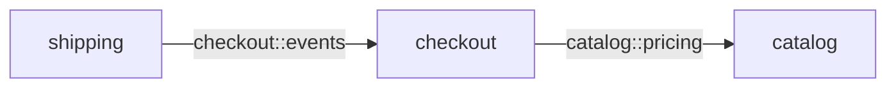

# Kiểm tra mô hình trong CI

Một ứng dụng Spring Modulith có thể duy trì được ranh giới module trong giai đoạn đầu, nhưng những pull request nhỏ về sau vẫn có thể tạo phụ thuộc ngược, import trực tiếp repository nội bộ hoặc dùng một named interface chưa được cấp phép. Nếu chỉ phát hiện các sai lệch này trong đợt rà soát kiến trúc định kỳ, chi phí sửa chữa thường tăng lên vì nhiều tính năng đã xây dựng trên mối phụ thuộc sai.

**Kiểm tra mô hình trong CI (Continuous Integration)** đưa các ràng buộc kiến trúc vào cùng quy trình kiểm tra mã nguồn như biên dịch và unit test. Mỗi pull request được đánh giá trên **mô hình application module thực tế** được Spring Modulith nhận diện; khi quy tắc bị vi phạm, bài test thất bại và pipeline có thể chặn việc hợp nhất.

Bài thuộc chương **Observability tests** của lộ trình **SPRING_MODULITH_VERIFICATION_TESTING**. Trọng tâm là dùng `ApplicationModules.of(...).verify()` làm quality gate tự động, quan sát cấu trúc qua `toString()` hoặc tài liệu sinh từ `Documenter` khi cần, đồng thời phân biệt kiểm chứng ranh giới với `@ApplicationModuleTest`, test sự kiện, database và tích hợp.

> **Nguyên tắc quan trọng:** CI chỉ bảo vệ những điều **thực sự được kiểm tra trong những job bắt buộc**. Có class test kiến trúc trong repository, có sơ đồ module, hoặc thấy job màu xanh chưa đủ nếu pipeline bỏ qua test, chạy sai module, nới rộng quy tắc hoặc không bắt buộc job PASS trước khi merge.

## 1. “Kiểm tra mô hình” nghĩa là kiểm tra điều gì?

Spring Modulith tạo một mô hình các **application module** dựa trên cấu trúc package và cấu hình của ứng dụng. Chẳng hạn, với lớp `@SpringBootApplication` ở `com.example.shop`, các package con trực tiếp như `catalog`, `checkout`, `shipping` thường được xem là các application module theo quy ước phát hiện mặc định.

`ApplicationModules` là đối tượng đại diện cho mô hình đó:

```java
ApplicationModules modules =
        ApplicationModules.of(ShopApplication.class);
```

Hai thao tác thường gặp:

```java
String description = modules.toString(); // Quan sát mô hình
modules.verify();                        // Kiểm chứng các quy tắc
```

Mục đích và giới hạn:

| Thao tác | Trả lời câu hỏi | Vai trò trong CI |
| --- | --- | --- |
| `ApplicationModules.of(...)` | Mô hình những module nào được phát hiện từ ứng dụng? | Đầu vào để kiểm chứng |
| `toString()` | Mô hình hiện tại được mô tả như thế nào? | Ngữ cảnh chẩn đoán, không phải assertion |
| `Documenter` | Có thể sinh sơ đồ/tài liệu module để review không? | Hiện vật quan sát kiến trúc, có thể lưu làm artifact |
| **`verify()`** | Những phụ thuộc và ranh giới có thỏa quy tắc kiến trúc không? | **Điều kiện PASS/FAIL của architecture gate** |
| `@ApplicationModuleTest` | Bean và hành vi một module hoạt động đúng trong Spring test context không? | Bảo vệ hành vi/wiring ở phạm vi module |
| Event/database/integration test | Giao dịch, dữ liệu và trao đổi giữa module có đúng không? | Bảo vệ hành vi runtime và hồi quy |

Những quy tắc quan trọng mà `verify()` kiểm tra gồm **chu trình phụ thuộc giữa module**, **việc truy cập kiểu không thuộc API công bố của closed module** và **giới hạn `allowedDependencies`**. Kết quả tùy mô hình, cấu hình và phiên bản Spring Modulith cụ thể.

Đây là **kiểm tra cấu trúc tĩnh**, không phải cách đo thời gian phản hồi, số SQL query, lượng event đang chờ xử lý hay dữ liệu transaction tại runtime.

## 2. Ví dụ: mô hình `catalog`, `checkout`, `shipping`

Giả sử hệ thống bán hàng có:

- **`catalog`**: quản lý thông tin giá; công bố API tra cứu giá `catalog::pricing`.
- **`checkout`**: tạo đơn; cần tra cứu giá và công bố kiểu sự kiện `checkout::events`.
- **`shipping`**: phản ứng với sự kiện đơn được tạo; không cần truy cập repository của `checkout`.

Bố cục dự kiến:

```text
com.example.shop
├── ShopApplication.java                 ← @SpringBootApplication
├── catalog/                              ← application module
│   ├── pricing/
│   │   ├── package-info.java            ← @NamedInterface("pricing")
│   │   ├── PriceCatalog.java
│   │   └── PriceQuote.java
│   └── internal/
│       └── InMemoryPriceCatalog.java
├── checkout/                             ← application module
│   ├── package-info.java                ← allowedDependencies: catalog::pricing
│   ├── CheckoutPricingService.java
│   └── events/
│       ├── package-info.java            ← @NamedInterface("events")
│       └── OrderPlaced.java
└── shipping/                             ← application module
    ├── package-info.java                ← allowedDependencies: checkout::events
    └── OrderPlacedListener.java
```

Hướng **phụ thuộc mã nguồn** mong muốn:



Điều này có thể khác **hướng luồng nghiệp vụ**: một sự kiện được phát từ `checkout` đến `shipping`, nhưng mã listener trong `shipping` phải tham chiếu kiểu sự kiện do `checkout` định nghĩa. Vì thế trong sơ đồ phụ thuộc tĩnh, mũi tên đi từ `shipping` tới `checkout`.

### 2.1. Module `catalog` công bố API tối thiểu

File `src/main/java/com/example/shop/catalog/pricing/package-info.java`:

```java
/**
 * Hợp đồng tra cứu giá mà các module khác được phép sử dụng.
 *
 * <p>Không công bố entity, repository hoặc thuật toán định giá.
 */
@org.springframework.modulith.NamedInterface("pricing")
package com.example.shop.catalog.pricing;
```

Các kiểu hợp đồng:

```java
// PriceQuote.java
package com.example.shop.catalog.pricing;

import java.math.BigDecimal;
import java.util.Currency;

public record PriceQuote(
        String sku,
        BigDecimal amount,
        Currency currency
) {}
```

```java
// PriceCatalog.java
package com.example.shop.catalog.pricing;

import java.util.Optional;

public interface PriceCatalog {
    Optional<PriceQuote> findBySku(String sku);
}
```

Implementation minh họa được giữ trong `catalog.internal`:

```java
// InMemoryPriceCatalog.java
package com.example.shop.catalog.internal;

import com.example.shop.catalog.pricing.PriceCatalog;
import com.example.shop.catalog.pricing.PriceQuote;
import java.math.BigDecimal;
import java.util.Currency;
import java.util.Optional;
import org.springframework.stereotype.Service;

@Service
class InMemoryPriceCatalog implements PriceCatalog {

    @Override
    public Optional<PriceQuote> findBySku(String sku) {
        if (!"SKU-101".equals(sku)) {
            return Optional.empty();
        }

        return Optional.of(new PriceQuote(
                sku,
                new BigDecimal("150000"),
                Currency.getInstance("VND")
        ));
    }
}
```

Dùng implementation đơn giản giúp bài học tập trung vào CI. Khi thay bằng JPA, repository và entity vẫn thuộc module `catalog`, còn test database sẽ được bổ sung riêng.

### 2.2. Module `checkout` giới hạn phụ thuộc

File `src/main/java/com/example/shop/checkout/package-info.java`:

```java
@org.springframework.modulith.ApplicationModule(
    allowedDependencies = "catalog::pricing"
)
package com.example.shop.checkout;
```

Service thuộc `checkout` chỉ import API đã công bố:

```java
// CheckoutPricingService.java
package com.example.shop.checkout;

import com.example.shop.catalog.pricing.PriceCatalog;
import com.example.shop.catalog.pricing.PriceQuote;
import java.util.Optional;
import org.springframework.stereotype.Service;

@Service
public class CheckoutPricingService {

    private final PriceCatalog prices;

    public CheckoutPricingService(PriceCatalog prices) {
        this.prices = prices;
    }

    public Optional<PriceQuote> quoteFor(String sku) {
        return prices.findBySku(sku);
    }
}
```

Khi `checkout` có chức năng tạo đơn thật, module có thể công bố `checkout::events`:

```java
// checkout/events/package-info.java
@org.springframework.modulith.NamedInterface("events")
package com.example.shop.checkout.events;
```

```java
// checkout/events/OrderPlaced.java
package com.example.shop.checkout.events;

import java.time.Instant;
import java.util.UUID;

public record OrderPlaced(
        UUID orderId,
        Instant occurredAt
) {}
```

Đặt giới hạn cho `shipping`:

```java
// shipping/package-info.java
@org.springframework.modulith.ApplicationModule(
    allowedDependencies = "checkout::events"
)
package com.example.shop.shipping;
```

Ví dụ listener:

```java
// shipping/OrderPlacedListener.java
package com.example.shop.shipping;

import com.example.shop.checkout.events.OrderPlaced;
import org.springframework.modulith.events.ApplicationModuleListener;
import org.springframework.stereotype.Component;

@Component
class OrderPlacedListener {

    @ApplicationModuleListener
    void on(OrderPlaced event) {
        // Khởi tạo quy trình giao hàng theo event.orderId().
        // Hệ thống thật cần test retry, idempotency và giao dịch.
    }
}
```

Đoạn mã chỉ thể hiện **hợp đồng và chiều phụ thuộc**. Nó chưa bao gồm logic tạo đơn và `ApplicationEventPublisher` để phát sự kiện, nên không được coi là ví dụ tích hợp sự kiện chạy hoàn chỉnh.

## 3. Viết một architecture test JUnit thật sự có assertion

Đặt test trong package gốc của ứng dụng, ví dụ `src/test/java/com/example/shop/ModulithArchitectureTest.java`:

```java
package com.example.shop;

import org.junit.jupiter.api.Test;
import org.springframework.modulith.core.ApplicationModules;

class ModulithArchitectureTest {

    @Test
    void moduleDependenciesFollowArchitectureRules() {
        ApplicationModules.of(ShopApplication.class).verify();
    }
}
```

Đây là một bài test có tác dụng **PASS/FAIL**. Nếu `verify()` phát hiện vi phạm, bài test JUnit thất bại, khiến lệnh test và job CI có thể trả về mã thoát khác 0.

Có thể in mô hình trước khi kiểm chứng để dễ chẩn đoán:

```java
@Test
void printsAndVerifiesModuleStructure() {
    ApplicationModules modules =
            ApplicationModules.of(ShopApplication.class);

    System.out.println("=== APPLICATION MODULES ===");
    System.out.println(modules.toString());

    // Phán định: không chỉ in cấu trúc rồi cho test PASS.
    modules.verify();
}
```

**Không cần giữ cả hai test như những bản sao trong một dự án thật.** Chọn một bài test kiến trúc rõ tên có gọi `verify()`; việc in `toString()` là tùy chọn để hỗ trợ điều tra.

### Vì sao test này có thể chạy ở CI mà không cần database?

`ApplicationModules.verify()` xây dựng và kiểm chứng **mô hình module**, không kiểm tra SQL hay thực thi `CheckoutPricingService.quoteFor`. Vì vậy, test kiến trúc thông thường **không cần khởi động toàn bộ Spring ApplicationContext** hoặc kết nối datasource chỉ để đánh giá dependency graph.

Điều kiện vẫn là mã test và các class liên quan biên dịch được, dependency `spring-modulith-core`/starter tương thích được cấu hình, và lớp `ShopApplication` nằm đúng package để phát hiện các module.

Nếu một test dùng `@SpringBootTest` hoặc `@ApplicationModuleTest`, đó là **loại test khác**, có thể cần context, bean hạ tầng và database test.

## 4. Tạo vi phạm có kiểm soát để chứng minh gate hoạt động

Một quality gate chỉ đáng tin nếu có thể **chủ động làm nó thất bại**. Với bài toán ví dụ, thử từng tình huống ở nhánh thực hành, sau đó khôi phục mã hợp lệ.

| Tình huống | Mã hoặc cấu hình thay đổi | Kỳ vọng `verify()` |
| --- | --- | --- |
| **A — Baseline** | `checkout` dùng `catalog::pricing`; `shipping` dùng `checkout::events` | **PASS** nếu các module khác hợp lệ |
| **B — Vào nội bộ** | `checkout` tham chiếu một class public ở `catalog.internal` | **FAIL** do dùng API không công bố |
| **C — Sai named interface** | `checkout` tham chiếu kiểu trong `catalog::events` nhưng chỉ cho phép `catalog::pricing` | **FAIL** do vượt `allowedDependencies` |
| **D — Mất công bố** | Bỏ `@NamedInterface("pricing")` nhưng `checkout` tiếp tục dùng các kiểu trong package con | **FAIL** do phần API không còn được công bố |
| **E — Chu trình module** | Thêm quan hệ `catalog -> checkout` khi đã có `checkout -> catalog` | **FAIL** do vòng phụ thuộc |
| **F — Mở quyền quá rộng** | Nới `allowedDependencies` để hợp thức hóa một API khác đã công bố | Có thể **PASS** dù thiết kế không còn đúng ý đồ |
| **G — Sai nghiệp vụ** | Giữ đúng API nhưng implementation trả giá `150` thay vì `150000` | `verify()` có thể **PASS**; test hành vi phải phát hiện |

Các kết quả là **kỳ vọng của mô hình ví dụ**, không phải thông báo đã chạy thử trong repository thực tế.

### Cách dựng lỗi truy cập nội bộ mà Java vẫn biên dịch

Class nội bộ package-private thường bị Java chặn ngay khi module khác import. Để quan sát riêng vi phạm Spring Modulith, tạo một **kiểu public giả lập** trong subpackage nội bộ:

```java
// Chỉ dùng trong thí nghiệm:
// catalog/internal/TemporaryPricingDiagnostic.java
package com.example.shop.catalog.internal;

public class TemporaryPricingDiagnostic {

    public String details() {
        return "internal-only";
    }
}
```

Tạm dùng kiểu đó trong `checkout`:

```java
// Chỉ dùng trong thí nghiệm:
package com.example.shop.checkout;

import com.example.shop.catalog.internal.TemporaryPricingDiagnostic;

class BadCheckoutDependency {

    private final TemporaryPricingDiagnostic diagnostic;

    BadCheckoutDependency(TemporaryPricingDiagnostic diagnostic) {
        this.diagnostic = diagnostic;
    }
}
```

Mã có thể qua bước biên dịch Java nhưng làm `checkout` tham chiếu phần nội bộ của một **closed module**. Khi chạy `ModulithArchitectureTest`, kiểm chứng kiến trúc cần báo lỗi.

**Đừng chỉ thêm một dòng `import` không sử dụng.** Import thừa có thể không trở thành dependency trong bytecode được phân tích. Với thí nghiệm âm, sử dụng kiểu trong field, constructor hoặc phương thức. Sau đó **xóa cả hai class tạm** và kiểm tra gate PASS trở lại.

## 5. Đưa architecture test vào lệnh build

Một file test không tự được thực thi nếu build không chạy đúng test task. Cần biết test kiến trúc nằm trong **test source set** hoặc cấu hình test tương đương mà CI thật sự gọi.

### Với Gradle

Trong dự án Spring Boot/Gradle sử dụng JUnit 5, cấu hình test thường có dạng:

```groovy
dependencies {
    testImplementation 'org.springframework.modulith:spring-modulith-starter-test'
    testImplementation 'org.springframework.boot:spring-boot-starter-test'
}

tasks.named('test') {
    useJUnitPlatform()
}
```

Đây là **đoạn trích cấu hình**, không phải toàn bộ `build.gradle`. Dự án phải quản lý các phiên bản Spring Boot/Spring Modulith tương thích, thường qua BOM hoặc dependency management.

Chạy toàn bộ test task:

```bash
./gradlew test
```

Để kiểm chứng riêng architecture gate trong lúc phát triển:

```bash
./gradlew test --tests 'com.example.shop.ModulithArchitectureTest'
```

Lệnh dùng `--tests` là **bộ lọc để chẩn đoán nhanh**, không phải thay thế test suite đầy đủ trong pipeline chính.

### Với Maven

Một dự án Maven có thể dùng JUnit 5 cùng Spring Boot test và Spring Modulith; ví dụ dependency test:

```xml
<dependency>
    <groupId>org.springframework.modulith</groupId>
    <artifactId>spring-modulith-starter-test</artifactId>
    <scope>test</scope>
</dependency>
```

Maven cần quản lý phiên bản dependency và cấu hình plugin Surefire/JUnit 5 phù hợp. Chạy:

```bash
mvn -B test
```

Kiểm chứng riêng lớp test kiến trúc:

```bash
mvn -B -Dtest=ModulithArchitectureTest test
```

Lưu ý: với một số dự án, test tích hợp nằm ở task `integrationTest` của Gradle hoặc plugin Failsafe của Maven và **không tự chạy bởi lệnh `test`**. CI phải gọi thêm các bước đã được dự án cấu hình nếu muốn chúng là điều kiện bắt buộc.

### Quan sát mã thoát của lệnh build

CI không phán định dựa trên câu chữ trong log mà chủ yếu dựa vào **trạng thái exit code** của bước chạy. Nếu bài test JUnit thất bại, lệnh build phải thất bại và job không được đánh dấu thành công.

Không dùng cách “làm xanh” giả tạo như bỏ qua bài test:

```bash
# KHÔNG DÙNG làm quality gate:
./gradlew build -x test

# KHÔNG DÙNG làm quality gate:
mvn -DskipTests package
```

Hai lệnh trên có thể tạo ra bản build mà **không chạy architecture test**. Chúng có mục đích riêng trong vài quy trình build, nhưng không được dùng thay cho bước CI bắt buộc kiểm chứng ranh giới.

## 6. Ví dụ GitHub Actions: quality gate trên pull request

Giả sử source của ứng dụng và Gradle wrapper nằm ở root của một repository ví dụ. Có thể tạo workflow `.github/workflows/modulith-quality.yml`:

```yaml
name: Modulith quality gate

on:
  pull_request:
  push:
    branches: [main]

jobs:
  architecture-and-tests:
    runs-on: ubuntu-latest
    permissions:
      contents: read

    steps:
      - name: Checkout source
        uses: actions/checkout@v4

      - name: Set up Java
        uses: actions/setup-java@v4
        with:
          distribution: temurin
          java-version: '21'

      - name: Configure Gradle
        uses: gradle/actions/setup-gradle@v4

      - name: Compile and run mandatory tests
        run: bash ./gradlew --no-daemon test

      - name: Upload JUnit reports
        if: always()
        uses: actions/upload-artifact@v4
        with:
          name: modulith-test-reports
          path: |
            **/build/test-results/test/*.xml
            **/build/reports/tests/test/**
          if-no-files-found: warn
```

Workflow này minh họa **bước CI có thể chạy trên GitHub Actions**, không phải cấu hình đã được triển khai ở một repository cụ thể. Phiên bản Java phải phù hợp phiên bản Spring Boot của dự án; nếu wrapper nằm trong thư mục con thì cần đặt `working-directory` đúng.

Điểm cần hiểu:

1. `pull_request` và `push` giúp chạy test khi có thay đổi được đẩy lên hoặc đề nghị hợp nhất.
2. `bash ./gradlew --no-daemon test` chạy test task, bao gồm `ModulithArchitectureTest` **nếu** nó được cấu hình trong source set mà task này thực thi.
3. Khi test thất bại, bước chạy và job thất bại; **bước upload vẫn chạy** nhờ `if: always()` để lưu báo cáo chẩn đoán.
4. Upload report giúp review lỗi, **không làm test thất bại trở thành PASS**.
5. Muốn chặn merge, phải cấu hình **branch protection hoặc ruleset** yêu cầu check `architecture-and-tests` thành công; chỉ tạo workflow chưa chắc tự bắt buộc mọi PR chờ check.

Nếu dự án có task `integrationTest` riêng, một phương án là bổ sung bước sau:

```yaml
      - name: Run integration tests
        run: bash ./gradlew --no-daemon integrationTest
```

Chỉ thêm bước này **khi task đã được cấu hình** và môi trường CI cung cấp database hoặc dịch vụ hạ tầng mà test cần. Không giả định Gradle luôn có sẵn task `integrationTest`.

Tương tự, với Maven hãy chạy các goal/plugin mà dự án đã thiết kế để bao phủ unit test và integration test, thay vì chỉ kiểm tra compile.

## 7. Phân tầng gate: nhanh để phản hồi, đủ sâu để ngăn hồi quy

Kiểm tra cấu trúc chỉ là **một tầng** trong chiến lược quality gate. Để tránh việc pipeline quá chậm hoặc thường xuyên báo lỗi khó chẩn đoán, hãy phân biệt các nhóm:

| Tầng | Câu hỏi | Gợi ý phép kiểm tra | Mức độ phụ thuộc runtime |
| --- | --- | --- | --- |
| **Biên dịch** | Mã Java còn hợp lệ sau refactor không? | Gradle/Maven compile | Thấp |
| **Kiến trúc** | Ranh giới và quyền phụ thuộc có đúng không? | `ApplicationModules.verify()` | Thường không cần Spring context/database |
| **API contract** | DTO, chữ ký, quy tắc lỗi có còn được bảo vệ không? | Unit test, test chữ ký chuyên biệt | Thấp đến trung bình |
| **Module** | Bean và nghiệp vụ từng module có hoạt động không? | `@ApplicationModuleTest` | Có Spring test context |
| **Sự kiện** | Event có được phát/nhận đúng không? | Spring Test events, Modulith event tests | Context và transaction tùy ca |
| **Database** | Repository, mapping và transaction có đúng không? | Test với datasource phù hợp | Cần dữ liệu và hạ tầng test |
| **Tích hợp** | Các module phối hợp thật có đúng không? | `@SpringBootTest` hoặc integration suite | Có thể cần nhiều dependency |
| **Quan sát tài liệu** | Topology có trôi khỏi thiết kế mong muốn không? | `toString()`, `Documenter`, review | Chủ yếu mô hình tĩnh |

Với một PR, **architecture gate nên luôn được thực thi** vì phát hiện sai phạm sớm và không phụ thuộc cơ sở dữ liệu. Các test module, sự kiện, database và tích hợp cần được triển khai thành những bước CI phù hợp với rủi ro và yêu cầu phát hành.

Nếu tổ chức tách pipeline thành “kiểm tra nhanh PR” và “kiểm thử sâu”, phải xác định **những job nào bắt buộc trước khi merge**; không nên coi test chạy sau khi đã merge là biện pháp duy nhất bảo vệ các hợp đồng quan trọng.

### Ví dụ một module test bảo vệ bean public

```java
// src/test/java/com/example/shop/catalog/CatalogModuleTest.java
package com.example.shop.catalog;

import com.example.shop.catalog.pricing.PriceCatalog;
import org.junit.jupiter.api.Test;
import org.springframework.beans.factory.annotation.Autowired;
import org.springframework.modulith.test.ApplicationModuleTest;

import static org.assertj.core.api.Assertions.assertThat;

@ApplicationModuleTest
class CatalogModuleTest {

    @Autowired
    PriceCatalog prices;

    @Test
    void publicPricingBeanIsAvailable() {
        assertThat(prices).isNotNull();
    }

    @Test
    void knownSkuReturnsExpectedPrice() {
        var quote = prices.findBySku("SKU-101").orElseThrow();

        assertThat(quote.amount()).isEqualByComparingTo("150000");
        assertThat(quote.currency().getCurrencyCode()).isEqualTo("VND");
    }
}
```

Test này cần các dependency Spring Modulith test/Boot Test và bean `InMemoryPriceCatalog` ở ví dụ trên. Nó chứng minh Spring inject được bean và giá trị trả về đúng theo dữ liệu minh họa; nó **không thay thế** `verify()`, đồng thời cũng chưa chứng minh transaction JPA hoặc các quy tắc nghiệp vụ khác.

## 8. Sự kiện và database trong CI: quan hệ đúng chưa đủ

### Với named interface công bố sự kiện

`shipping` dùng `checkout::events` là quan hệ kiến trúc hợp lệ, nhưng `verify()` không chứng minh `checkout` thực sự phát `OrderPlaced` khi tạo đơn thành công.

Các ca test nên cân nhắc:

- Tạo đơn thành công dẫn tới một sự kiện `OrderPlaced` có `orderId` và thời điểm hợp lý.
- Tạo đơn thất bại không dẫn đến sự kiện nghiệp vụ sai điều kiện.
- Listener `shipping` xử lý đúng sự kiện đã công bố, không phụ thuộc vào entity nội bộ của `checkout`.
- Nếu sự kiện có thể được xử lý lại, listener cần xử lý lặp an toàn (**idempotency**).
- Với sự kiện transaction-bound hoặc xử lý bất đồng bộ, cần kiểm tra thời điểm commit, retry và xử lý lỗi tương ứng.

Có thể dùng `@ApplicationModuleTest` cùng cơ chế ghi nhận sự kiện trong Spring Test, hoặc công cụ scenario event của Spring Modulith tương thích với phiên bản dự án. Những kiểm tra này thuộc **runtime behavior gate**, khác với sơ đồ phụ thuộc tĩnh.

### Với database

Khi `catalog` thay implementation từ in-memory sang JPA:

| Rủi ro | Gate cần có | `verify()` có phát hiện không? |
| --- | --- | --- |
| Repository trả sai giá | Test dữ liệu và mapping | Không |
| Thiếu schema hoặc bean repository | Module/integration test | Không |
| SQL gây deadlock/race condition | Transaction/concurrency test | Không |
| DTO API lộ `PriceEntity` nội bộ | API review/contract test; kiểm tra phụ thuộc nếu có người dùng sai | Không bảo đảm phát hiện mọi rò rỉ |
| `checkout` dùng trực tiếp repository của `catalog` | Architecture test | Có thể phát hiện nếu quan hệ vi phạm được phân tích |
| Mở rộng `allowedDependencies` không cần thiết | Review chính sách API | Có thể vẫn PASS theo quy tắc mới |

Khi CI dùng Testcontainers hoặc database test thật, cần cấp đúng runtime/container permissions và tránh phụ thuộc vào dữ liệu môi trường cá nhân. Test phải tạo và dọn dữ liệu theo cách tái lập được, không làm ảnh hưởng database sản xuất.

## 9. Dùng mô tả module làm bằng chứng hỗ trợ trong CI

`ApplicationModules.toString()` hoặc `Documenter` có thể giúp nhóm review kiến trúc, nhất là khi xuất hiện module mới hoặc các package được chuyển vị trí. Nhưng chúng phục vụ **quan sát/đọc hiểu**, không thay cho bước kiểm chứng.

Một test có thể in mô hình trước khi gọi `verify()`:

```java
@Test
void architectureGateWithDiagnostics() {
    ApplicationModules modules =
            ApplicationModules.of(ShopApplication.class);

    System.out.println(modules); // Gợi ý chẩn đoán trong CI log
    modules.verify();            // Điều kiện bắt buộc
}
```

Nếu có dependency `spring-modulith-docs`, có thể dùng `Documenter` trong một test/tác vụ sinh tài liệu riêng. Chẳng hạn:

```java
// Ví dụ bổ sung khi đã cấu hình spring-modulith-docs.
ApplicationModules modules =
        ApplicationModules.of(ShopApplication.class);

new org.springframework.modulith.docs.Documenter(modules)
        .writeDocumentation();
```

Tài liệu/sơ đồ có thể được lưu như **CI artifact** để reviewer nhìn được cấu trúc hiện tại, nhưng cần tự cấu hình bước upload theo **đường dẫn đầu ra thực tế**. Cách trình bày và đường dẫn sinh file tùy phiên bản Documenter và thiết lập build.

**Không nên snapshot nguyên văn `toString()` hoặc file PlantUML rồi coi mọi thay đổi chuỗi là lỗi kiến trúc.** Định dạng mô tả có thể thay đổi mà không ảnh hưởng đến các ranh giới đã cam kết. Nếu cần chặn một bất biến riêng, hãy tạo test có tiêu chí rõ thay vì parse text không được cam kết là định dạng ổn định.

Sơ đồ cũng có thể cho thấy `checkout -> catalog` trong cả hai trường hợp dùng đúng `catalog.pricing.PriceCatalog` và dùng sai `catalog.internal.PriceRepository`. Ở mức module, chiều quan hệ giống nhau; **`verify()` và phân tích kiểu cụ thể** mới làm rõ phần nào của API bị sử dụng.

## 10. Khi CI đỏ: quy trình chẩn đoán đúng nguyên nhân

Một báo cáo test thất bại nên dẫn người phát triển đến **nguyên nhân thực tế**, thay vì khuyến khích “sửa để CI xanh” bằng cách nới bỏ mọi ràng buộc.

| Triệu chứng | Kiểm tra đầu tiên | Cách xử lý đúng |
| --- | --- | --- |
| Java compile FAIL khi import `catalog.internal` | Lớp có package-private hoặc chữ ký Java đã đổi? | Dùng API public đã công bố; không vội đổi visibility |
| `verify()` báo truy cập phần nội bộ | Class/field/method nào tạo dependency qua ranh giới? | Thay bằng interface/DTO thuộc named interface phù hợp |
| `verify()` báo ngoài `allowedDependencies` | Module tiêu thụ có nhu cầu thật với interface đó không? | Chọn API đúng hoặc review quyền mới có lý do |
| `verify()` báo chu trình | Hai module đang nắm trách nhiệm gì và chiều gọi nào gây vòng? | Điều chỉnh ranh giới, giao tiếp sự kiện hoặc tách hợp đồng |
| Test module không khởi tạo được context | Bean, dependency module hoặc datasource test thiếu? | Sửa wiring/hạ tầng test mà không phá ranh giới |
| Event test FAIL, architecture test PASS | Publisher có phát đúng event, listener có nhận/commit đúng không? | Sửa luồng sự kiện, transaction, retry và dữ liệu |
| Test database FAIL | Schema, seed data, transaction hoặc mapping thay đổi? | Sửa persistence và giữ hợp đồng public |
| CI xanh dù thử một phụ thuộc sai | Có chạy đúng test class/task/source set không? | Kiểm tra cấu hình thực thi, không kết luận gate hoạt động |

### Checklist xử lý lỗi `verify()`

1. Đọc tên **module tiêu thụ**, **module cung cấp** và kiểu bị tham chiếu trong báo cáo lỗi.
2. Xác định kiểu đó thuộc **API mặc định**, một **named interface**, hay **subpackage nội bộ**.
3. Đối chiếu `allowedDependencies` của module tiêu thụ.
4. Đánh giá xem nhu cầu nghiệp vụ nên được đáp ứng bằng API đang có, API mới hẹp hơn hay một kiểu giao tiếp khác.
5. Sửa mã/cấu hình mà không nới quyền một cách tùy tiện.
6. Chạy compile, test kiến trúc, rồi test hành vi liên quan.
7. Xem lại sơ đồ và JavaDoc nếu đã thay đổi hợp đồng hoặc chiều phụ thuộc.

**Không nên đổi tất cả module thành open, xóa `verify()` hoặc thay `allowedDependencies` bằng wildcard chỉ để qua pipeline.** Những cách đó thường che giấu việc phân ranh giới trách nhiệm chưa hợp lý.

## 11. Những trường hợp “CI xanh giả” cần phòng tránh

### 11.1. Test tồn tại nhưng không được chạy

Có thể xảy ra nếu test class nằm sai source set, build task dùng filter không bao gồm class đó, JUnit 5 chưa được cấu hình hoặc job dùng `-x test`/skip flags. Cách kiểm chứng tốt nhất là **tạo một vi phạm kiến trúc có kiểm soát** và xác nhận đúng job bắt buộc chuyển sang FAIL.

### 11.2. Mô hình được tạo từ sai lớp ứng dụng

Nếu `ApplicationModules.of(...)` dùng lớp đặt ở package không chứa các module dự kiến hoặc cấu hình phát hiện module khác môi trường build, phạm vi kiểm tra có thể không đúng.

Kiểm tra `ShopApplication` và đối chiếu **danh sách application module nhận diện được** với mô hình kỳ vọng trong review; nếu dự án dùng custom detection, cần test cấu hình ấy phù hợp. Đừng tự động tin rằng một lệnh `verify()` PASS chứng minh mọi package quan trọng đã nằm trong phạm vi được phát hiện.

### 11.3. Quy tắc bị nới rộng

Ví dụ `checkout` chỉ cần `catalog::pricing`, nhưng ai đó mở `allowedDependencies` để được dùng thêm một API không cần thiết. `verify()` có thể PASS **vì quy tắc hiện tại đã chấp nhận phụ thuộc**. CI cần kết hợp code review hoặc chính sách hạn chế việc công bố/tiêu thụ API để ngăn những thay đổi quyền thiếu căn cứ.

### 11.4. API đã công bố chứa kiểu không phù hợp

Nếu đưa `PriceRepository` public vào chính package được đánh dấu `@NamedInterface("pricing")`, về mặt kiến trúc nó có thể được xem là kiểu công bố. **`verify()` không tự biết đội ngũ muốn giữ repository nội bộ**. Cần rà soát bề mặt public API và có thể thêm test riêng cho chữ ký/loại kiểu được phép công bố.

### 11.5. Kiểm tra cấu trúc thay cho kiểm tra nghiệp vụ

Một bài test kiến trúc PASS trong khi `PriceCatalog` trả giá sai không phải lỗi của `verify()`. Các test contract, module, sự kiện, database và tích hợp phải có assertion về kết quả thật, không chỉ xác nhận context khởi động.

### 11.6. Status check không được đánh dấu bắt buộc

Workflow có thể chạy và đôi lúc FAIL nhưng PR vẫn được merge nếu branch protection/ruleset không yêu cầu job đó thành công. Quy trình CI chỉ trở thành **quality gate** khi chính sách merge của repository thực sự tôn trọng trạng thái kiểm tra.

### 11.7. Test tích hợp bị bỏ qua không rõ lý do

Nếu `@ApplicationModuleTest` hoặc integration test phụ thuộc database nhưng bị vô hiệu hóa thường xuyên, pipeline không còn bảo vệ các hợp đồng runtime tương ứng. Có thể phân chia job theo chi phí, nhưng phải minh bạch **nhóm test nào là bắt buộc trước khi hợp nhất**.

## 12. Một quy trình pull request giúp mô hình ổn định

Khi có PR chạm vào mô hình module, người viết nên tự rà soát trước khi gửi review:

- [ ] Xác nhận lớp khởi động và cấu hình phát hiện module vẫn nhận diện đúng các module quan trọng.
- [ ] Xem các import mới xuyên ranh giới: chúng có đi qua API mặc định hoặc `@NamedInterface` được công bố không?
- [ ] Kiểm tra mọi thay đổi `allowedDependencies`: có nhu cầu nghiệp vụ cụ thể và quyền đủ hẹp không?
- [ ] Đảm bảo repository/entity/adapter chưa bị chuyển vào package công khai ngoài ý muốn.
- [ ] Chạy `ApplicationModules.verify()` và xem rõ test xuất hiện trong kết quả build.
- [ ] Chạy `@ApplicationModuleTest`, test event, database và tích hợp phù hợp với phạm vi thay đổi.
- [ ] Nếu có module mới, thay đổi tên named interface hoặc chiều phụ thuộc, cập nhật JavaDoc/tài liệu kiến trúc và sinh lại sơ đồ khi cần.
- [ ] Không vô hiệu hóa một bài test thất bại chỉ để tạo kết quả CI xanh.
- [ ] Kiểm tra job quality gate đã được repository đánh dấu là required check.

**Đọc diff về quyền phụ thuộc cũng quan trọng như đọc diff Java.** Một thay đổi một dòng trong `package-info.java` có thể hợp thức hóa một phạm vi phụ thuộc rộng hơn rất nhiều so với phần code trong cùng PR.

## 13. Bài thực hành: cố tình phá ranh giới để kiểm tra CI gate

### Đề bài

Ứng dụng mẫu có ba module `catalog`, `checkout`, `shipping`. Người hướng dẫn yêu cầu tạo **architecture gate trên pull request** sao cho một dependency trực tiếp vào `catalog.internal` hoặc một chu trình mới **không được merge**.

### Các bước

1. **Dựng baseline:** tạo lớp `ShopApplication` và ba application module với package như ví dụ.
2. **Công bố hợp đồng:** khai báo `catalog::pricing` với `PriceCatalog`, `PriceQuote`; khai báo `checkout::events` với `OrderPlaced`.
3. **Giới hạn phía tiêu thụ:** `checkout` chỉ được `catalog::pricing`; `shipping` chỉ được `checkout::events`.
4. **Viết architecture test:** gọi `ApplicationModules.of(ShopApplication.class).verify()` từ JUnit. In `toString()` trước khi gọi `verify()` nếu muốn thêm ngữ cảnh chẩn đoán.
5. **Chạy local:** dùng Gradle/Maven test task tương ứng, xác nhận test kiến trúc thực sự được thực thi.
6. **Tạo lỗi internal:** thêm `TemporaryPricingDiagnostic` public giả lập trong `catalog.internal` và dùng nó từ `checkout`. Kiểm tra compile có thể PASS nhưng `verify()` phải FAIL.
7. **Tạo lỗi chu trình:** sau khi khôi phục bước 6, thêm một phụ thuộc thực sự từ `catalog` tới API của `checkout`, trong khi đã tồn tại `checkout -> catalog`. Quan sát test kiến trúc báo lỗi.
8. **Tạo lỗi ngoài quyền:** nếu có một named interface khác của `catalog`, cho `checkout` dùng nó mà không bổ sung vào `allowedDependencies`; ghi nhận nguyên nhân thất bại.
9. **Dựng CI:** cấu hình GitHub Actions hoặc nền tảng CI tương đương để chạy test task với exit status được giữ nguyên; lưu JUnit reports khi job FAIL.
10. **Bảo vệ nhánh:** đánh dấu job architecture/test là điều kiện bắt buộc trước khi merge.
11. **Kiểm tra hành vi:** đổi giá trị báo giá trong `InMemoryPriceCatalog` thành `150` nhưng giữ đúng API. Cho thấy `verify()` vẫn có thể PASS, trong khi test `@ApplicationModuleTest` có assertion về `150000` phải FAIL.
12. **Khôi phục sạch:** bỏ các lỗi chủ ý, chạy toàn bộ gate và bảo đảm mọi bước cần thiết PASS. Nếu có database/event thật, bổ sung suite tương ứng và thiết lập môi trường CI tái tạo được.

### Ma trận nghiệm thu

| Thay đổi | Compile | Architecture gate | Module/behavior gate | Có được merge? |
| --- | --- | --- | --- | --- |
| Mô hình và hành vi đúng | PASS | PASS | PASS | Có, nếu các điều kiện khác cũng đạt |
| Dùng class public thuộc `catalog.internal` | Có thể PASS | **FAIL** | Có thể PASS | **Không** |
| Tạo chu trình phụ thuộc | Có thể PASS | **FAIL** | Không nhất thiết FAIL | **Không** |
| Bỏ `@NamedInterface("pricing")` | Có thể PASS | **FAIL** | Không nhất thiết FAIL | **Không** |
| Giá trả sai, phụ thuộc vẫn đúng | PASS | Có thể PASS | **FAIL** khi test có expected value | **Không** |
| Bỏ qua test bằng `-x test` | Có thể PASS | **Không được chạy** | Không được chạy | **Không được coi là nghiệm thu hợp lệ** |

Kết quả ở bảng là **kỳ vọng của bài thực hành**, không phải kết quả đã chạy trên môi trường cụ thể.

### Câu hỏi tự đánh giá

**1. Vì sao không chỉ in `ApplicationModules.toString()` trong CI?** Vì chuỗi đó dùng để quan sát mô hình, không tự phán định quan hệ module có hợp lệ; cần một test gọi `verify()`.

**2. Vì sao job Gradle `test` PASS chưa chắc chứng minh mọi integration test PASS?** Vì integration test có thể nằm ở task/plugin hoặc source set riêng chưa được job gọi.

**3. Có thể dùng một class public trong `catalog.internal` từ `checkout` mà Java vẫn compile không?** Có thể, nếu Java visibility/classpath cho phép; nhưng closed module vẫn có quy tắc kiến trúc ngăn phụ thuộc đó.

**4. Vì sao `verify()` PASS nhưng việc chuyển repository vào `catalog.pricing` vẫn đáng lo?** Vì repository lúc ấy có thể nằm trong API đã công bố; quy tắc được khai báo không chứng minh quyết định công bố là đúng về thiết kế.

**5. Muốn PR bị chặn khi architecture test FAIL, cần những điều kiện nào?** Bài test phải thực sự được chạy, lỗi phải làm job thất bại, và repository phải yêu cầu status check đó thành công trước khi merge.

## 14. Ghi nhớ

**Kiểm tra mô hình Spring Modulith trong CI** nghĩa là biến ranh giới application module thành **điều kiện tự động** trên mỗi thay đổi. Viết JUnit test sử dụng **`ApplicationModules.of(ShopApplication.class).verify()`**, đặt trong test suite mà pipeline thực sự chạy và yêu cầu status check thành công trước khi hợp nhất. Dùng **`toString()`** hoặc **`Documenter`** để quan sát cấu trúc và hỗ trợ review, không coi chúng là chất thay thế cho assertion kiến trúc. Cuối cùng, kết hợp **`@ApplicationModuleTest`**, test contract, sự kiện, database và tích hợp để CI bảo vệ cả ranh giới lẫn hành vi runtime. Một quality gate tốt phải **chặn được lỗi được cố tình tạo ra**, nhưng cũng phải tránh việc nới luật hoặc bỏ test để “xanh” giả.

### Tài liệu tham khảo

- [Spring Modulith Reference — Verifying Application Module Structure](https://docs.spring.io/spring-modulith/reference/verification.html)
- [Spring Modulith Reference — Application Modules và Named Interfaces](https://docs.spring.io/spring-modulith/reference/fundamentals.html)
- [Spring Modulith Reference — Integration Testing Application Modules](https://docs.spring.io/spring-modulith/reference/testing.html)
- [Spring Modulith Reference — Documenting Application Modules](https://docs.spring.io/spring-modulith/reference/documentation.html)
