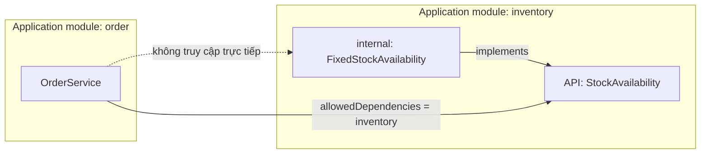

# Log module test context và bean bootstrap

Trong ứng dụng Spring Modulith, một bài test có thể thất bại **ngay khi khởi tạo Spring ApplicationContext**: không tìm thấy bean của module phụ thuộc, có nhiều bean cùng kiểu, thiếu datasource, hoặc một cấu hình test vô tình tải quá nhiều thành phần. Lúc ấy phương thức `@Test` thậm chí chưa chạy, nên chỉ nhìn assertion thường không đủ để biết lỗi nằm ở đâu.

**Log module test context và bean bootstrap** là cách quan sát những gì Spring đang khởi tạo trong bài kiểm thử module: **module nào đang được test, chế độ bootstrap nào được chọn, context có những bean nào, cấu hình/profile nào đang có hiệu lực và việc khởi tạo thất bại ở bước nào**. Thông tin đó giúp phân biệt một lỗi cấu hình test với một lỗi ranh giới kiến trúc hoặc một hồi quy nghiệp vụ.

Bài thuộc chương **Observability tests** của lộ trình **SPRING_MODULITH_VERIFICATION_TESTING**. Chúng ta sẽ dùng `@ApplicationModuleTest`, phân tích ba chế độ bootstrap, ghi log an toàn từ `ApplicationContext`, kiểm chứng kiến trúc độc lập bằng `ApplicationModules.verify()`, rồi gắn kiểm thử module, sự kiện, database/tích hợp với quality gate CI.

> **Điểm cốt lõi:** Log cho biết **test context đang quan sát được gì**; một bean có tên trong registry chưa chắc đã được khởi tạo hoặc thực hiện đúng nghiệp vụ. `ApplicationModules.verify()` kiểm chứng **ràng buộc kiến trúc**, còn `@ApplicationModuleTest` và các test khác kiểm chứng **bootstrap và hành vi runtime**. Cần cả ba loại bằng chứng, không thể thay thế lẫn nhau.

## 1. Vì sao cần quan sát bootstrap ở phạm vi module?

Giả sử có các application module `inventory`, `order`, `payment` trong cùng ứng dụng. `order` gọi một API tra cứu tồn kho thuộc `inventory`, nhưng không cần tải toàn bộ cơ chế thanh toán khi kiểm tra logic đơn hàng.

Một unit test thuần Java không khởi tạo Spring context, nên không phát hiện lỗi dependency injection, bean configuration hoặc component scan. Một `@SpringBootTest` toàn ứng dụng có thể phát hiện chúng, nhưng đôi khi kéo theo nhiều bean/hạ tầng không liên quan và làm lỗi khó cô lập. `@ApplicationModuleTest` của Spring Modulith giúp khởi tạo **phạm vi module được chọn** và, tùy chế độ, thêm các module phụ thuộc cần thiết.

Khi thấy lỗi `NoSuchBeanDefinitionException`, cần biết đây là tình huống nào:

1. Module đang test thật sự thiếu một bean nội bộ.
2. Module cần API của module khác, nhưng test đang ở chế độ bootstrap cô lập.
3. Cấu hình/bean test chưa được nạp hoặc đang bị điều kiện `@Profile` loại trừ.
4. Một repository hoặc hạ tầng bị thiếu vì database/test configuration chưa sẵn sàng.
5. Dependency giữa hai module đã được thiết kế sai ranh giới.

Các nguyên nhân trên dẫn tới **cách sửa khác nhau**. Quan sát mode, active profiles, bean definitions và báo cáo lỗi context giúp tránh phản xạ “mở rộng component scan cho hết lỗi”, vì cách đó dễ phá tính độc lập của module.

## 2. Ba tầng bằng chứng: mô hình, context và hành vi

| Tầng | Công cụ/bằng chứng | Câu hỏi chính | Điều chưa chứng minh |
| --- | --- | --- | --- |
| **Mô hình tĩnh** | `ApplicationModules.of(...)`, `verify()` | Phụ thuộc giữa các module có hợp lệ không? | Spring tạo bean và gọi nghiệp vụ đúng hay không |
| **Bootstrap runtime trong test** | `@ApplicationModuleTest`, context startup log, bean registry | Module test có khởi động không, những bean nào có trong context? | Bean có thực hiện đúng transaction, truy vấn hoặc event không |
| **Hành vi runtime** | AssertJ/JUnit, event test, database/integration test | Kết quả và tác dụng phụ có đúng hợp đồng không? | Không tự chứng minh mọi phụ thuộc tĩnh đều hợp lệ |

Ngoài ra, metrics, log sản xuất và distributed tracing có thể quan sát luồng request thực tế, nhưng chúng **không phải nội dung mà `@ApplicationModuleTest` tự động kiểm tra**. Log test là một lớp observability phục vụ phát triển/CI, không phải monitoring production.

## 3. Ví dụ ứng dụng: hai module có phụ thuộc một chiều

Giả sử lớp `@SpringBootApplication` nằm tại `com.example.shop.ShopApplication`. Theo quy ước phát hiện mặc định, các package con trực tiếp `inventory` và `order` là application module.

```text
com.example.shop
├── ShopApplication.java
├── inventory/                          ← module sở hữu tồn kho
│   ├── StockAvailability.java          ← API mặc định ở package gốc
│   └── internal/
│       └── FixedStockAvailability.java ← bean hiện thực
└── order/                              ← module tiêu thụ tồn kho
    ├── package-info.java               ← allowedDependencies = "inventory"
    └── OrderService.java
```

Tại đây `inventory` là **closed module** theo cách tổ chức thông thường. `StockAvailability` được công bố từ package gốc, còn `inventory.internal` không phải API cho module ngoài.

```java
// src/main/java/com/example/shop/ShopApplication.java
package com.example.shop;

import org.springframework.boot.SpringApplication;
import org.springframework.boot.autoconfigure.SpringBootApplication;

@SpringBootApplication
public class ShopApplication {

    public static void main(String[] args) {
        SpringApplication.run(ShopApplication.class, args);
    }
}
```

Định nghĩa hợp đồng ở module `inventory`:

```java
// src/main/java/com/example/shop/inventory/StockAvailability.java
package com.example.shop.inventory;

/** API chỉ đọc; không thực hiện thao tác giữ hoặc trừ hàng. */
public interface StockAvailability {

    int availableToPromise(String sku);
}
```

Implementation đơn giản, không cần database:

```java
// src/main/java/com/example/shop/inventory/internal/FixedStockAvailability.java
package com.example.shop.inventory.internal;

import com.example.shop.inventory.StockAvailability;
import org.springframework.stereotype.Service;

@Service
class FixedStockAvailability implements StockAvailability {

    @Override
    public int availableToPromise(String sku) {
        return "SKU-101".equals(sku) ? 7 : 0;
    }
}
```

Giới hạn phụ thuộc của `order` trong `order/package-info.java`:

```java
@org.springframework.modulith.ApplicationModule(
    allowedDependencies = "inventory"
)
package com.example.shop.order;
```

Service tiêu thụ chỉ nhập contract:

```java
// src/main/java/com/example/shop/order/OrderService.java
package com.example.shop.order;

import com.example.shop.inventory.StockAvailability;
import org.springframework.stereotype.Service;

@Service
public class OrderService {

    private final StockAvailability stocks;

    public OrderService(StockAvailability stocks) {
        this.stocks = stocks;
    }

    public boolean canPlace(String sku, int quantity) {
        return quantity > 0
                && stocks.availableToPromise(sku) >= quantity;
    }
}
```



Một điểm cần phân biệt: **`OrderService.canPlace` chỉ tra cứu tồn kho**, không giữ hàng. Nếu luồng nghiệp vụ cần đặt giữ thật, phải thiết kế API ghi và kiểm thử transaction/concurrency riêng; việc đặt tên `canPlace` không được tạo cảm giác đã khóa số lượng hàng.

## 4. `@ApplicationModuleTest` xác định module nào đang bootstrap?

Một bài test ở package `com.example.shop.inventory` có thể dùng:

```java
// src/test/java/com/example/shop/inventory/InventoryModuleTest.java
package com.example.shop.inventory;

import org.junit.jupiter.api.Test;
import org.springframework.beans.factory.annotation.Autowired;
import org.springframework.modulith.test.ApplicationModuleTest;

import static org.assertj.core.api.Assertions.assertThat;

@ApplicationModuleTest
class InventoryModuleTest {

    @Autowired
    StockAvailability availability;

    @Test
    void publicStockContractWorks() {
        assertThat(availability.availableToPromise("SKU-101"))
                .isEqualTo(7);
    }
}
```

Spring Modulith suy ra module mục tiêu từ vị trí package của lớp test theo các quy tắc phát hiện module được cấu hình. **Đặt lớp test trong đúng package module** quan trọng hơn việc cố gắng lấy tên module từ tên class. Khi package test không thuộc module mong muốn hoặc cấu hình phát hiện đặc biệt, cần kiểm tra thông báo bootstrap và chỉnh vị trí/cấu hình test cho đúng.

`@ApplicationModuleTest` dùng các khả năng bootstrap test của Spring, nhưng **không đồng nghĩa với việc khởi động tất cả application module**. Tùy chế độ, nó giới hạn những thành phần ứng dụng được xét đến; đồng thời các bean hạ tầng do Spring Boot auto-configuration/test configuration cung cấp vẫn có thể hiện diện.

### Ba chế độ bootstrap

`@ApplicationModuleTest` hỗ trợ các `BootstrapMode` thường dùng:

| Chế độ | Phạm vi application module | Khi nào dùng |
| --- | --- | --- |
| **`STANDALONE`** | Chỉ module đích về mặt thành phần ứng dụng; không tự nạp implementation từ các module phụ thuộc | Kiểm tra tính độc lập, dùng test double cho phụ thuộc ngoài |
| **`DIRECT_DEPENDENCIES`** | Module đích và các application module mà nó phụ thuộc trực tiếp | Kiểm tra tích hợp với các phụ thuộc trực tiếp |
| **`ALL_DEPENDENCIES`** | Module đích cùng các module trong chuỗi phụ thuộc bắc cầu của nó | Khi logic cần cả các phụ thuộc xa hơn |

Mặc định thông thường là `STANDALONE`; có thể ghi rõ mode để người đọc test không phải suy đoán:

```java
import org.springframework.modulith.test.ApplicationModuleTest;
import org.springframework.modulith.test.ApplicationModuleTest.BootstrapMode;

@ApplicationModuleTest(mode = BootstrapMode.STANDALONE)
class InventoryModuleBootstrapTest {
    // ...
}
```

**Không hiểu nhầm `ALL_DEPENDENCIES` thành “khởi động mọi module trong ứng dụng”.** Nó nói về các module nằm trong **đồ thị phụ thuộc của module đang kiểm thử**, không phải những module hoàn toàn không liên quan. Phạm vi bean Spring thực tế vẫn chịu tác động của auto-configuration, test configuration và phiên bản thư viện.

### Tình huống `order` cần `inventory`

`OrderService` có constructor nhận `StockAvailability`. Nếu thử bootstrap **chỉ `order` ở `STANDALONE`**, không có test double cho `StockAvailability`, context **có thể thất bại khi tạo bean `OrderService`** vì implementation nằm trong module `inventory` chưa được nạp.

Đổi sang `DIRECT_DEPENDENCIES` là lựa chọn có chủ đích khi muốn kiểm thử sự phối hợp thật với `inventory`:

```java
// src/test/java/com/example/shop/order/OrderModuleIntegrationTest.java
package com.example.shop.order;

import com.example.shop.inventory.StockAvailability;
import org.junit.jupiter.api.Test;
import org.springframework.beans.factory.annotation.Autowired;
import org.springframework.modulith.test.ApplicationModuleTest;
import org.springframework.modulith.test.ApplicationModuleTest.BootstrapMode;

import static org.assertj.core.api.Assertions.assertThat;

@ApplicationModuleTest(mode = BootstrapMode.DIRECT_DEPENDENCIES)
class OrderModuleIntegrationTest {

    @Autowired
    OrderService orders;

    @Autowired
    StockAvailability stocks;

    @Test
    void bootsOrderWithItsDirectDependency() {
        assertThat(stocks.availableToPromise("SKU-101"))
                .isEqualTo(7);
        assertThat(orders.canPlace("SKU-101", 3)).isTrue();
        assertThat(orders.canPlace("SKU-101", 8)).isFalse();
    }
}
```

Test này không cần DB vì implementation minh họa là in-memory. Nếu chuyển `inventory` sang JPA, test sẽ phải cung cấp datasource và dữ liệu phù hợp, hoặc dùng test double khi mục tiêu chỉ là kiểm tra `order` cô lập.

## 5. Bật log cho module test và quá trình tạo Spring context

Có hai nguồn log cần phân biệt:

1. **Log framework:** do Spring Modulith, Spring Test, Spring Boot và bean factory phát ra khi bootstrap. Tên logger và chi tiết thông báo phụ thuộc phiên bản.
2. **Log có chủ đích của bài test:** do chúng ta tự ghi để hiện rõ profile, bean definitions và những contract quan trọng đã nạp.

Không nên phụ thuộc vào một câu log cụ thể như thể đó là API ổn định. Điều cần đọc là **trạng thái bootstrap và nguyên nhân lỗi**.

### Cấu hình log qua test profile

Ví dụ file cấu hình test `src/test/resources/application-test.yml`:

```yaml
logging:
  level:
    org.springframework.modulith: DEBUG
    org.springframework.test.context: DEBUG
    org.springframework.beans.factory.support: INFO
```

Với test sử dụng profile `test`, có thể khai báo:

```java
import org.springframework.test.context.ActiveProfiles;

@ActiveProfiles("test")
@ApplicationModuleTest
class InventoryModuleTest {
    // ...
}
```

Các đoạn trên là **cấu hình minh họa**: khi dự án đã có `application-test.yml` hoặc cơ chế test property riêng, cần gộp theo quy ước thực tế. Không ghi log level `DEBUG` cho mọi package trên mọi pipeline nếu lượng log quá lớn.

Khi điều tra sâu một lỗi tạo bean, có thể tạm tăng:

```yaml
logging:
  level:
    org.springframework.beans.factory.support: DEBUG
```

Log ở mức này dễ rất dài, nên chỉ bật có mục tiêu. Ngoài ra, việc tăng level **không bảo đảm mọi thao tác tạo bean đều có dòng log riêng**; Spring/auto-configuration quyết định nội dung thực tế. Không kết luận bean không tồn tại chỉ vì không tìm được tên nó trong vài dòng log.

### Log và thời điểm bootstrap

Một Spring test context thường trải qua các pha: xác định cấu hình → tạo bean definitions/đánh giá điều kiện → refresh ApplicationContext → khởi tạo những singleton cần thiết → injection vào test → chạy phương thức `@Test`.

Nếu **context thất bại trước pha injection**, code log nằm trong method `@Test` **không được thực thi**. Khi đó phải xem **exception, nested cause, Spring Test bootstrap log** và test report, không tìm một dòng `LOGGER.info` vốn chưa có cơ hội chạy.

## 6. Tự ghi log các bean mà module test nhận diện

Một cách quan sát minh bạch là inject `ConfigurableApplicationContext` rồi đọc tên bean definitions và kiểu có thể xác định từ bean factory **mà không tự gọi `getBean()` cho toàn bộ context**.

```java
// src/test/java/com/example/shop/inventory/InventoryBeanBootstrapTest.java
package com.example.shop.inventory;

import java.util.Arrays;
import org.junit.jupiter.api.Test;
import org.slf4j.Logger;
import org.slf4j.LoggerFactory;
import org.springframework.beans.factory.annotation.Autowired;
import org.springframework.context.ConfigurableApplicationContext;
import org.springframework.modulith.test.ApplicationModuleTest;
import org.springframework.modulith.test.ApplicationModuleTest.BootstrapMode;

import static org.assertj.core.api.Assertions.assertThat;

@ApplicationModuleTest(mode = BootstrapMode.STANDALONE)
class InventoryBeanBootstrapTest {

    private static final Logger LOG =
            LoggerFactory.getLogger(InventoryBeanBootstrapTest.class);

    @Autowired
    ConfigurableApplicationContext context;

    @Autowired
    StockAvailability stockAvailability;

    @Test
    void logsBeanDefinitionsAndChecksPublicContract() {
        var factory = context.getBeanFactory();

        LOG.info("Active profiles: {}",
                Arrays.toString(context.getEnvironment().getActiveProfiles()));
        LOG.info("Registered bean definitions: {}",
                factory.getBeanDefinitionCount());

        for (String beanName : factory.getBeanDefinitionNames()) {
            // false: tránh ép FactoryBean khởi tạo chỉ để tìm kiểu.
            Class<?> beanType = factory.getType(beanName, false);

            if (beanType != null
                    && beanType.getName().startsWith("com.example.shop")) {
                LOG.info("Application bean: name={}, type={}",
                        beanName, beanType.getName());
            }
        }

        assertThat(stockAvailability.availableToPromise("SKU-101"))
                .isEqualTo(7);
    }
}
```

**Các chi tiết đáng chú ý:**

- `context.getEnvironment().getActiveProfiles()` giúp kiểm tra profile đã được bật hay chưa, tránh dùng nhầm cấu hình `dev`/test.
- `getBeanDefinitionCount()` tính **bean definitions**, không phải số đối tượng bean thực sự đã được tạo hay số module đang được bootstrap.
- `getBeanDefinitionNames()` liệt kê tên bean được đăng ký. Những tên này có thể là tên do Spring tự sinh hoặc tên từ `@Bean`, **không nhất thiết giống tên class**.
- `factory.getType(beanName, false)` cố gắng xác định kiểu mà không khởi tạo `FactoryBean` chỉ để biết type. Một số kiểu có thể chưa xác định hoặc là proxy/factory; giá trị `null` không chứng minh bean thiếu.
- Bộ lọc `startsWith("com.example.shop")` chỉ giảm nhiễu khi xem log. Các bean được tạo qua `@Bean`, AOP proxy hoặc factory có thể không có type trong package này; vì vậy **đây là phép lọc chẩn đoán, không phải phép kiểm tra tuyệt đối về thành viên module**.
- Assertion cuối mới xác minh một hành vi quan sát được qua API công khai. Log không thay thế assertion.

**Không nên gọi `getBean(name)` cho toàn bộ bean definitions chỉ để in danh sách.** Việc đó có thể kích hoạt tạo bean lazy, khởi tạo kết nối/hạ tầng và làm biến dạng chính trạng thái bootstrap mà ta muốn quan sát.

### Ví dụ log tự viết

Đoạn sau là **minh họa theo format của code test**, không phải output đã được thực thi hay format được Spring Modulith cam kết:

```text
INFO  InventoryBeanBootstrapTest - Active profiles: [test]
INFO  InventoryBeanBootstrapTest - Registered bean definitions: <N>
INFO  InventoryBeanBootstrapTest - Application bean: name=fixedStockAvailability, type=com.example.shop.inventory.internal.FixedStockAvailability
```

Số lượng bean `<N>`, tên bean và type có thể khác do phiên bản Spring, annotation, proxy, auto-configuration và test setup. Không sao chép output này thành “expected snapshot” cứng cho mọi môi trường.

## 7. Bean definition, bean instance và “module được bootstrap” không đồng nghĩa

Một lỗi phân tích thường gặp là xem mỗi dòng log tên bean như bằng chứng rằng một component đã hoạt động thành công. Cần chia các khái niệm:

| Khái niệm | Ví dụ quan sát | Điều có thể kết luận |
| --- | --- | --- |
| **Bean definition** | Bean factory liệt kê `orderService` | Có metadata đăng ký bean; không bảo đảm đã tạo instance |
| **Bean type** | `getType(name, false)` trả `OrderService.class` | Spring xác định được type ở thời điểm kiểm tra |
| **Bean instance** | `context.getBean(OrderService.class)` thành công | Bean được truy xuất/khởi tạo thành công tại thời điểm gọi |
| **Spring context refresh** | Test đi đến method `@Test` | Pha refresh phù hợp đã hoàn tất; không chứng minh mọi đường gọi nghiệp vụ |
| **Application module được đưa vào bootstrap** | `BootstrapMode.DIRECT_DEPENDENCIES` hoặc log từ module test | Chính sách chọn module; không suy ra số bean bằng số module |
| **Hành vi hợp lệ** | Assertion về kết quả, database và event | Một contract cụ thể đáp ứng kỳ vọng đã kiểm thử |
| **Kiến trúc hợp lệ** | `ApplicationModules.verify()` PASS | Các quy tắc phụ thuộc được kiểm chứng không bị vi phạm |

Nói cách khác, thấy `OrderService` được Spring khởi tạo **không chứng minh `order` không phụ thuộc vào `inventory.internal`**. Cần `verify()` để kiểm tra ranh giới. Ngược lại, `verify()` PASS không chứng minh `StockAvailability` có bean thật hoặc một datasource kết nối được.

## 8. Chẩn đoán ba trường hợp bootstrap khác nhau

### Trường hợp A: `inventory` bootstrap độc lập

Với `InventoryBeanBootstrapTest` ở `STANDALONE`, module `inventory` có implementation nội bộ `FixedStockAvailability`. Kết quả kỳ vọng: context khởi tạo và có bean `StockAvailability`, assertion dữ liệu mẫu PASS.

Nếu thiếu bean `StockAvailability`, cần kiểm tra implementation có `@Service`/`@Bean` hay không, package của class có nằm trong module đang test không, bean có bị profile hoặc conditional configuration loại bỏ không.

### Trường hợp B: `order` bootstrap `STANDALONE` khi thiếu phụ thuộc ngoài

`OrderService` cần `StockAvailability`, nhưng mode cô lập không tự đưa implementation thuộc `inventory` vào context. Nếu không có test double hoặc cấu hình hỗ trợ, việc tạo `OrderService` có thể thất bại.

Cách xử lý đúng phụ thuộc **mục tiêu test**:

- Muốn kiểm tra logic `order` độc lập? Cung cấp một **test double** cho interface `StockAvailability` theo cơ chế mock/test configuration phù hợp phiên bản Spring Boot.
- Muốn kiểm tra sự phối hợp thật với `inventory`? Dùng `DIRECT_DEPENDENCIES`, như ví dụ ở phần 4.
- Muốn thử các module phụ thuộc bắc cầu? Cân nhắc `ALL_DEPENDENCIES`, nhưng tránh mở rộng phạm vi chỉ để né một lỗi cấu hình.

**Đừng sửa bằng cách import hoặc inject lớp `inventory.internal.FixedStockAvailability` từ `order`**. Việc đó có thể tạo phụ thuộc trái ranh giới dù giúp test tìm thấy implementation.

### Trường hợp C: `DIRECT_DEPENDENCIES` vẫn thất bại

Nếu `order` nạp cả `inventory` nhưng vẫn không khởi tạo được context, có thể là:

- Bean `StockAvailability` chưa được đăng ký hoặc có nhiều implementation gây ambiguity.
- `inventory` cần một hạ tầng khác (datasource, messaging) không có trong môi trường test.
- Một `@Profile` hoặc điều kiện cấu hình đã loại bean khỏi context.
- Một module phụ thuộc bắc cầu chưa được đưa vào khi dùng chế độ chỉ nạp trực tiếp.
- Cấu hình Spring/TestConfiguration hoặc component wiring có lỗi độc lập với phạm vi module.

Dựa vào **root cause trong exception** và log cấu hình để xác định nguyên nhân. **Không tăng mode lên `ALL_DEPENDENCIES` như một phản xạ mặc định**: context rộng hơn có thể làm test khó cô lập và che giấu hợp đồng phụ thuộc chưa được mô tả.

### Ma trận nhanh

| Triệu chứng | Điều cần đọc trong log/test report | Giải pháp nên cân nhắc |
| --- | --- | --- |
| `NoSuchBeanDefinitionException` | Kiểu bean bị thiếu, mode, module của dependency | Test double hoặc bootstrap phụ thuộc phù hợp |
| `NoUniqueBeanDefinitionException` | Danh sách candidate, qualifier/primary | Phân biệt bean theo ngữ nghĩa, không scan thêm vô tội vạ |
| `BeanCreationException` | Nested cause đầu tiên, bean/configuration liên quan | Sửa constructor, config, hạ tầng hoặc dữ liệu test |
| Lỗi datasource/schema | Auto-config, active profile, JDBC/JPA cause | Dùng test DB/schema/migration phù hợp |
| Context chạy nhưng thiếu behavior | Assertion test có đủ không | Thêm contract/module/integration test |
| Context chạy nhưng dùng internal | `verify()` và đường dependency | Chuyển sang API công bố |
| Test log không xuất hiện | Test có chạy tới method không, logging level/report config | Đọc startup exception, bật framework logs hoặc test output |

## 9. Kiểm chứng kiến trúc phải là bài test độc lập

Log bean bootstrap không kiểm chứng xem các module đang **phụ thuộc vào đúng API** hay không. Đặt JUnit architecture test ở package gốc:

```java
// src/test/java/com/example/shop/ModulithArchitectureTest.java
package com.example.shop;

import org.junit.jupiter.api.Test;
import org.springframework.modulith.core.ApplicationModules;

class ModulithArchitectureTest {

    @Test
    void dependencyBoundariesRemainValid() {
        ApplicationModules.of(ShopApplication.class).verify();
    }
}
```

`verify()` phân tích mô hình application module, thường **không phải khởi động toàn bộ Spring ApplicationContext** để kiểm tra phụ thuộc. Với closed module, một tham chiếu từ module khác vào subpackage không công bố có thể bị từ chối; `allowedDependencies` giúp giới hạn các quan hệ cụ thể và phát hiện phụ thuộc vòng.

Ví dụ nếu `order` tham chiếu một class `public` ở `inventory.internal`, Java có thể cho biên dịch nhưng `ApplicationModules.verify()` cần phát hiện quan hệ vượt ranh giới. Nếu class package-private, Java chặn trước. Còn `@ApplicationModuleTest` có thể vẫn khởi động được nếu context đủ bean — **bootstrap PASS không chứng minh kiến trúc PASS**.

Bảng so sánh:

| Tình huống | Log/context test | `verify()` |
| --- | --- | --- |
| `inventory` khởi tạo độc lập, bean hợp lệ | Có thể PASS | PASS nếu mô hình không có vi phạm |
| `order` `STANDALONE` thiếu bean của `inventory` | **FAIL** khi tạo context nếu không dùng test double | Có thể PASS vì dependency kiến trúc là hợp lệ |
| `order` dùng class `public` ở `inventory.internal` | Có thể PASS nếu wiring tình cờ đủ | **FAIL** do phụ thuộc vào phần không công bố |
| `order` tạo chu trình với module khác | Có thể khởi tạo hoặc không, tùy wiring | **FAIL** theo quy tắc chu trình |
| Bean đúng nhưng trả dữ liệu sai | Context có thể PASS | Có thể PASS; assertion hành vi phải FAIL |

Mọi kết quả là **kỳ vọng từ thiết kế ví dụ**, không phải báo cáo đã chạy Gradle/Maven trên repository cụ thể.

## 10. Kiểm thử sự kiện, database và tích hợp: đọc log cho đúng tầng

### 10.1. Event test

Khi `order` phát sự kiện `OrderPlaced` và module `shipping` lắng nghe, log context giúp biết listener bean có được đăng ký/khởi tạo hay không. Nhưng điều đó **không chứng minh sự kiện đã phát hoặc được xử lý**.

Cần những test riêng:

1. Khi đặt đơn thành công, event `OrderPlaced` có payload đúng được publish.
2. Khi transaction tạo đơn thất bại, event không bị xử lý sai điều kiện.
3. Listener thực hiện tác dụng phụ đúng; có chính sách xử lý lại/idempotency nếu cần.
4. Nếu dùng `@ApplicationModuleListener`, xác minh thời điểm xử lý, transaction và retry theo cách cấu hình của phiên bản Spring Modulith thực tế.

Trong Spring Test, có thể dùng `@RecordApplicationEvents` và `ApplicationEvents` để ghi nhận event trong test context; đối với luồng bất đồng bộ/transaction-bound có thể cần thêm công cụ scenario/test integration phù hợp.

**Log “listener bean registered” khác với assert “event đã được nhận”**, và cả hai đều khác với việc chứng minh event được lưu/giao nhận bền vững.

### 10.2. Database test

Nếu `FixedStockAvailability` được thay bằng Spring Data JPA, việc bootstrap module có thể yêu cầu datasource, migration và dữ liệu test. Dòng log “repository bean initialized” không chứng minh câu query đúng hoặc transaction an toàn dưới cạnh tranh.

Các câu hỏi cần kiểm tra riêng:

| Câu hỏi | Bằng chứng phù hợp |
| --- | --- |
| Repository bean được tạo không? | Context test và kiểm tra bean |
| Datasource nào được chọn? | Active profile, datasource config đã kiểm duyệt, test setup |
| Query trả số lượng đúng không? | Test database với dữ liệu seed |
| Nhiều yêu cầu giữ hàng có làm vượt tồn không? | Concurrency/integration test |
| Mapping entity sang DTO có đúng không? | Contract + database test |
| Module khác có import repository trực tiếp không? | `ApplicationModules.verify()` |
| Transaction rollback khi có lỗi không? | Integration/transaction test |

Không log **mật khẩu, JDBC URL chứa credentials, access token hoặc dữ liệu khách hàng** chỉ để tiện chẩn đoán. Nếu cần xác nhận database đích, dùng tên profile, nhãn môi trường đã kiểm duyệt hoặc test container metadata an toàn.

### 10.3. Integration test

Một test tích hợp nhiều module có thể dùng `@SpringBootTest` hoặc phạm vi `@ApplicationModuleTest` mở rộng có chủ đích. Nếu lỗi xuất hiện khi context boot toàn ứng dụng nhưng không xuất hiện ở test module cô lập, hãy so sánh:

- Active profiles, test properties và bean conditions.
- Các module được đưa vào context.
- Bean trùng kiểu hoặc auto-configuration khác biệt.
- Dữ liệu database/event infrastructure của từng môi trường.

Không mặc định lỗi là do Spring Modulith hoặc tăng mức log vô hạn. Dùng **dấu vết có mục đích + assertion rõ ràng** sẽ rút ngắn thời gian điều tra hơn là đổ toàn bộ bean registry vào log.

## 11. Ghi log thế nào để hữu ích nhưng không tạo flaky test?

Nên phân biệt **log dùng cho con người** và **assertion dùng làm quality gate**.

| Nội dung | Có nên log? | Có nên assert cứng? |
| --- | --- | --- |
| Tên module đang test và `BootstrapMode` | Có, khi chẩn đoán | Có thể kiểm tra cấu hình/đích test bằng cơ chế phù hợp, không dựa vào câu log |
| Active profiles | Có, trong test log | Chỉ assert khi đó là bất biến bắt buộc |
| Tổng số bean definitions | Có thể log | **Không nên** assert số lượng tuyệt đối dễ thay đổi |
| Tên mọi bean Spring Boot | Chỉ khi điều tra chuyên sâu | Không nên snapshot nguyên danh sách |
| Sự có mặt của API `StockAvailability` | Có thể log | **Có**, dùng injection/getBean và assertion hành vi |
| Bean repository nội bộ cụ thể | Có thể log trong test module | Không nên biến thành contract chéo module |
| Kết quả nghiệp vụ | Log đủ để chẩn đoán, tránh dữ liệu nhạy cảm | **Có**, bằng expected values rõ ràng |
| Ranh giới module hợp lệ | `toString()` có thể giúp đọc | **Có**, bằng `ApplicationModules.verify()` |

Một anti-pattern phổ biến:

```java
// KHÔNG KHUYẾN NGHỊ: số bean tuyệt đối không phải hợp đồng ổn định.
assertThat(context.getBeanFactory().getBeanDefinitionCount()).isEqualTo(143);
```

Các phiên bản Spring Boot, starter, proxy và test configuration khác nhau có thể làm số lượng definitions thay đổi dù kiến trúc/logic vẫn đúng. Hãy assert **contract bean có mặt và hoạt động đúng**, đồng thời dùng số tổng chỉ làm dấu hiệu chẩn đoán.

Tương tự, đừng viết test phân tích một câu log cụ thể của Spring Modulith để suy ra chế độ bootstrap. Cách đặt tên logger và format output **không phải hợp đồng nghiệp vụ**.

## 12. Thiết lập CI để không mất log khi bootstrap thất bại

Một bài test khởi động context thất bại trước khi vào `@Test` vẫn tạo báo cáo JUnit/build, miễn test runner và CI được cấu hình lưu output. Do đó, giữ lại **test results và stack trace** là quan trọng.

### Gradle/JUnit

Trong dự án dùng Groovy DSL:

```groovy
tasks.named('test') {
    useJUnitPlatform()

    testLogging {
        events 'failed', 'skipped'
        exceptionFormat = 'full'
        showStandardStreams = true
    }
}
```

Cấu hình này hữu ích khi điều tra, nhưng `showStandardStreams = true` có thể làm log CI rất dài. Khi pipeline ổn định, có thể tắt stdout thường xuyên và chỉ mở có mục tiêu trong job chẩn đoán; ưu tiên giữ test report và exception đủ thông tin.

Lệnh chạy:

```bash
./gradlew test
```

Hoặc dùng Maven trong dự án đã cấu hình Surefire/JUnit 5:

```bash
mvn -B test
```

**Lưu ý:** `test` trong Gradle hoặc goal `test` của Maven có thể **không** bao gồm các integration test được tách thành task/plugin riêng. CI phải chạy những suite bắt buộc theo cấu hình thực tế của project.

### Ví dụ GitHub Actions lưu test report

```yaml
name: Modulith test diagnostics

on:
  pull_request:

jobs:
  module-tests:
    runs-on: ubuntu-latest
    permissions:
      contents: read

    steps:
      - uses: actions/checkout@v4

      - uses: actions/setup-java@v4
        with:
          distribution: temurin
          java-version: '21'

      - uses: gradle/actions/setup-gradle@v4

      - name: Run architecture and module tests
        run: bash ./gradlew --no-daemon test

      - name: Preserve JUnit reports
        if: always()
        uses: actions/upload-artifact@v4
        with:
          name: modulith-test-reports
          path: |
            **/build/test-results/test/*.xml
            **/build/reports/tests/test/**
          if-no-files-found: warn
```

Đây là ví dụ **một workflow khả thi khi Gradle wrapper nằm ở root**. Java version, path và cách chạy integration test phải điều chỉnh theo dự án; không có bằng chứng workflow này đã được chạy hoặc cấu hình trên workspace hiện tại.

`if: always()` giúp giữ báo cáo kể cả khi bước test thất bại. Tuy nhiên, upload report không thay đổi kết quả bài test. Để ngăn merge sai, repository phải cấu hình branch protection/ruleset yêu cầu job kiểm thử thành công.

### Ba loại gate cần có

1. **Architecture gate:** `ApplicationModules.of(ShopApplication.class).verify()` làm JUnit thất bại nếu vi phạm cấu trúc.
2. **Module bootstrap/contract gate:** `@ApplicationModuleTest` với `STANDALONE` hoặc chế độ mở rộng phù hợp, assertion về bean và hành vi.
3. **Behavior/integration gate:** event, database, transaction và các phụ thuộc runtime khác được kiểm tra ở suite tương ứng.

Nếu một job dùng `-x test`, `-DskipTests` hoặc không chạy source set chứa test kiến trúc, pipeline xanh **không chứng minh gate còn hoạt động**.

## 13. Bài thực hành: điều tra một module test context không khởi động

### Bối cảnh

Module `inventory` có `StockAvailability` và `FixedStockAvailability`. Module `order` cần `StockAvailability`. Một PR bổ sung `OrderService`; test `@ApplicationModuleTest` đặt trong package `order` nhưng bootstrap thất bại với lỗi thiếu bean.

### Nhiệm vụ theo trình tự

1. **Thiết lập baseline:** tạo cấu trúc `ShopApplication`, `inventory`, `order` cùng API và implementation như ví dụ.
2. **Viết architecture test:** gọi `ApplicationModules.of(ShopApplication.class).verify()` và xác nhận quan hệ `order -> inventory` qua API mặc định là hợp lệ.
3. **Test module cô lập:** đặt một lớp ở package `order` với `@ApplicationModuleTest(mode = BootstrapMode.STANDALONE)` và không cung cấp test double cho `StockAvailability`. Quan sát nguyên nhân context fail.
4. **Đọc stack trace:** tìm kiểu bean bị thiếu, module sở hữu nó và kiểm tra mode đã chọn. Ghi rõ vì sao thiếu bean trong context **chưa có nghĩa kiến trúc sai**.
5. **Đổi sang kiểm thử phụ thuộc trực tiếp:** dùng `@ApplicationModuleTest(mode = BootstrapMode.DIRECT_DEPENDENCIES)` và xác nhận `OrderService`/API inventory được inject theo thiết kế.
6. **Thêm log có kiểm soát:** in active profiles, tổng số bean definitions và những type trong `com.example.shop` mà bean factory có thể xác định. Không khởi tạo toàn bộ bean chỉ để log.
7. **Thử một thay đổi cấu hình:** tạm làm implementation `StockAvailability` không được đăng ký. So sánh lỗi context ở `DIRECT_DEPENDENCIES` với lỗi thiếu module do `STANDALONE`.
8. **Tạo lỗi kiến trúc riêng:** từ `order` tham chiếu thật tới một kiểu `public` giả lập ở `inventory.internal`. Chạy `verify()`, giải thích vì sao lỗi này khác việc thiếu bean.
9. **Tạo lỗi hành vi:** thay giá trị tồn kho mẫu từ `7` xuống `2` nhưng giữ bean và API; xác nhận context có thể boot còn assertion nghiệp vụ phải thất bại.
10. **Thử hạ tầng mở rộng:** nếu thay implementation bằng JPA, cung cấp datasource/seed data và test database; nếu phát event, bổ sung test payload và listener.
11. **Khôi phục mã sạch:** loại bỏ các lỗi cố ý; chạy kiến trúc test, module test và những suite liên quan.
12. **Đưa vào CI:** cho job chạy các test bắt buộc, giữ stack trace/JUnit report khi bootstrap fail và bảo đảm required check chặn merge nếu FAIL.

### Ma trận nghiệm thu

| Trạng thái | Bootstrap context | `verify()` | Assertion hành vi |
| --- | --- | --- | --- |
| `inventory` standalone có bean hợp lệ | PASS | PASS nếu toàn mô hình hợp lệ | PASS với tồn kho mẫu |
| `order` standalone thiếu `StockAvailability` và không có test double | **FAIL** khi tạo bean | Có thể PASS | Chưa chạy |
| `order` direct dependencies với bean phù hợp | PASS | PASS nếu toàn mô hình hợp lệ | PASS với dữ liệu đúng |
| `order` tham chiếu `inventory.internal` public | Có thể PASS | **FAIL** | Có thể PASS |
| Bean tồn tại nhưng trả số lượng sai | PASS | Có thể PASS | **FAIL** nếu expected value được kiểm tra |
| Database test thiếu schema | **FAIL** hoặc fail khi truy vấn | Có thể PASS | **FAIL/Chưa chạy**, tùy pha |

Các kết quả ở bảng là **kỳ vọng của bài tập**, không phải log đã chạy trên một repository thực tế.

### Câu hỏi tự đánh giá

**1. Tại sao không thấy log `InventoryBeanBootstrapTest` khi test context fail?** Vì method `@Test` có thể chưa được thực thi; phải đọc log Spring bootstrap và nested exception được test runner lưu.

**2. `STANDALONE` và `DIRECT_DEPENDENCIES` khác nhau ở điểm nào?** `STANDALONE` tập trung module đích; `DIRECT_DEPENDENCIES` còn đưa các application module mà module đích phụ thuộc trực tiếp vào phạm vi bootstrap.

**3. Danh sách bean definitions có xác nhận mọi bean đã khởi tạo xong không?** Không. Registry có thể chứa bean lazy, factory và metadata chưa tạo instance; cần hiểu khác biệt definition/type/instance.

**4. Vì sao test có bean `StockAvailability` vẫn có thể vi phạm kiến trúc?** Vì bean wiring có thể thành công trong khi mã phụ thuộc vào lớp `inventory.internal` hoặc tạo chu trình; cần `ApplicationModules.verify()`.

**5. Nên log những thông tin gì khi debug?** Mode, module đích, active profiles, bean definitions/type có chọn lọc và root cause của lỗi; không log secrets hoặc snapshot toàn bộ beans làm assertion.

**6. Làm sao CI bảo vệ cả cấu trúc và hành vi?** Chạy `verify()` cùng `@ApplicationModuleTest`, contract, event/database/integration tests phù hợp, lưu báo cáo khi thất bại và yêu cầu job thành công trước merge.

## 14. Các lỗi thường gặp

**“`@ApplicationModuleTest` phải nạp toàn bộ ứng dụng.”** Không. Nó được thiết kế để khởi tạo phạm vi application module có chủ đích; `BootstrapMode` xác định cách mở rộng sang các module phụ thuộc.

**“Có bean trong log tức là bean đã được tạo và hoạt động.”** Không. Phải phân biệt bean definition, type và instance; chỉ assertion hành vi hoặc test tích hợp mới xác nhận công dụng thực.

**“Thiếu bean nghĩa là `allowedDependencies` sai.”** Không nhất thiết. Một dependency kiến trúc hợp lệ vẫn có thể vắng mặt trong `STANDALONE`; mode, mock và test configuration cần được xem xét trước.

**“Mở `ALL_DEPENDENCIES` luôn là cách sửa nhanh nhất.”** Context có thể nạp nhiều module hơn cần thiết và mất tính cô lập. Hãy xác định mục tiêu test, dependency trực tiếp/bắc cầu và hạ tầng thực sự cần.

**“Log context PASS thì không cần chạy `verify()`.”** Sai. Bootstrap thành công là bằng chứng runtime, không chứng minh ranh giới phụ thuộc được tuân thủ.

**“`verify()` PASS nghĩa là database và sự kiện cũng đúng.”** Sai. Giao dịch, consistency, retry, event payload và mapping cần các test riêng.

**“Assert số bean bằng một hằng số sẽ bảo vệ module.”** Không bền vững. Số bean và tên bean thường thay đổi theo phiên bản starter/auto-configuration; hãy assert contract có nghĩa.

**“Bật TRACE cho toàn bộ Spring trên mọi PR sẽ giúp quan sát tốt nhất.”** Không nhất thiết; log quá lớn có thể che mất nguyên nhân, làm chậm pipeline và tăng nguy cơ lộ dữ liệu cấu hình. Chỉ bật theo phạm vi và thời gian cần thiết.

## 15. Ghi nhớ

**Log module test context và bean bootstrap** giúp người phát triển thấy những gì `@ApplicationModuleTest` đang thực sự nạp, đặc biệt khi thay đổi `BootstrapMode`, active profiles và dependency injection. Dùng `ConfigurableApplicationContext` và bean factory để quan sát **bean definitions/type** có chọn lọc; đọc **root cause trong log khởi động** khi test không đến được phương thức `@Test`. Không dùng số bean, chuỗi log hay context startup làm thay cho assertion hành vi. Chạy **`ApplicationModules.verify()`** để bảo vệ ranh giới tĩnh; kết hợp **`@ApplicationModuleTest`**, test sự kiện, database, tích hợp và báo cáo CI để phát hiện cả lỗi cấu hình lẫn hồi quy. Một quality gate có giá trị phải vừa **thất bại khi cấu trúc/hành vi sai**, vừa cung cấp đủ thông tin để tìm được nguyên nhân mà không phá ranh giới module.

### Tài liệu tham khảo

- [Spring Modulith Reference — Integration Testing Application Modules](https://docs.spring.io/spring-modulith/reference/testing.html)
- [Spring Modulith Reference — Application Modules](https://docs.spring.io/spring-modulith/reference/fundamentals.html)
- [Spring Modulith Reference — Verifying Application Module Structure](https://docs.spring.io/spring-modulith/reference/verification.html)
- [Spring Framework Reference — Testing](https://docs.spring.io/spring-framework/reference/testing.html)
