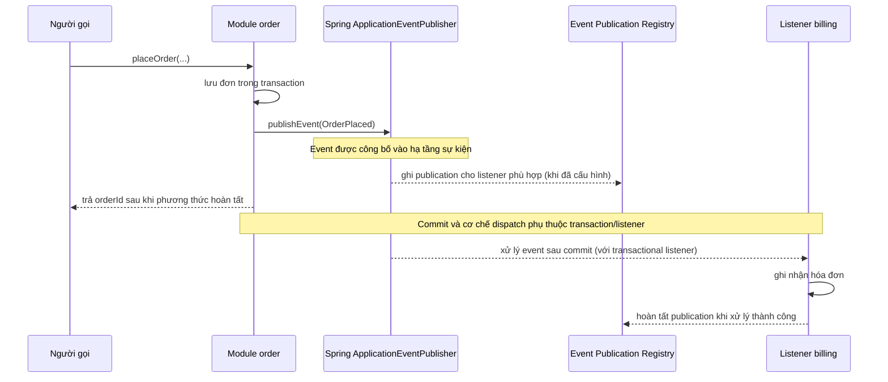
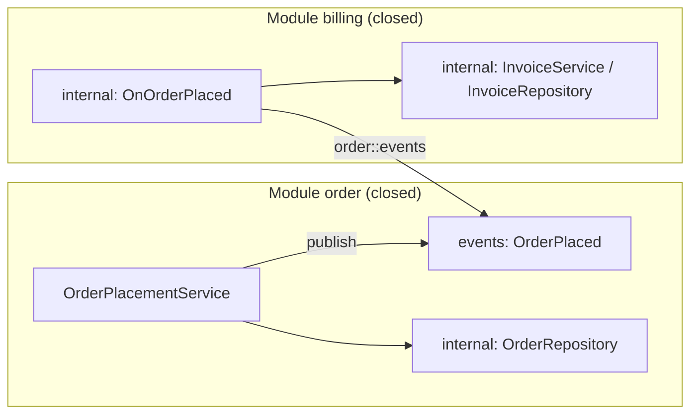
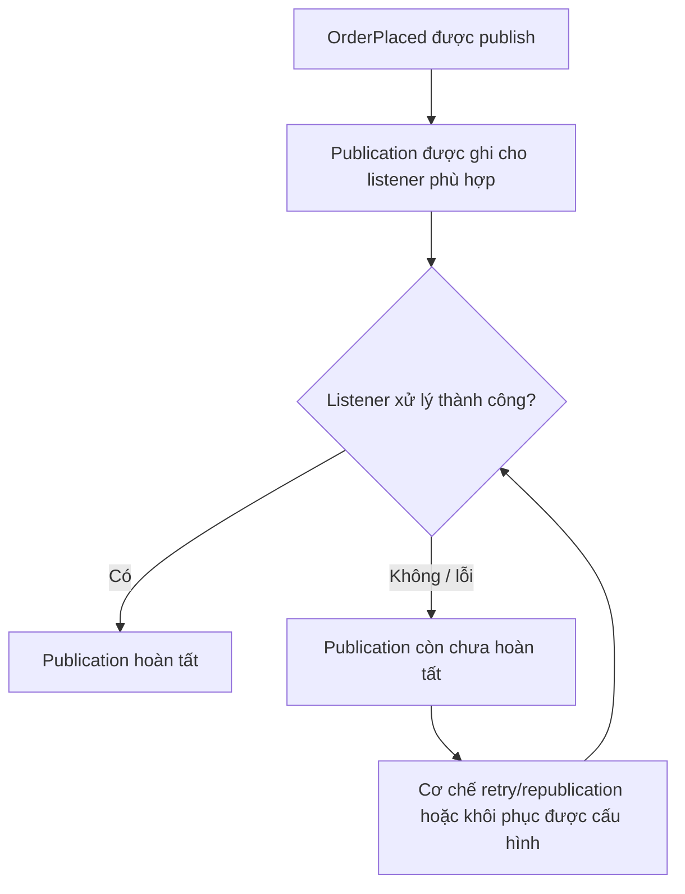

# Theo dõi event publication trong test

Trong ứng dụng Spring Modulith, một lời gọi `ApplicationEventPublisher.publishEvent(...)` thành công **chưa đủ chứng minh** module khác đã xử lý sự kiện. Sự kiện có thể đã được công bố trong Spring context nhưng transaction chưa commit; listener có thể chạy bất đồng bộ, thất bại hoặc phải thử lại. Nếu test chỉ tìm thấy một đối tượng event mà kết luận “tích hợp thành công”, lỗi thực tế sẽ lọt qua CI.

**Theo dõi event publication trong test** nghĩa là xác định rõ mình đang quan sát **sự kiện được phát**, **sự kiện được listener tiếp nhận**, **publication được ghi nhận để xử lý đáng tin cậy**, hay **publication đã xử lý hoàn tất**. Đây là những mốc khác nhau, cần các phép kiểm tra khác nhau.

Bài thuộc chương **Observability tests** của lộ trình **SPRING_MODULITH_VERIFICATION_TESTING**: rèn khả năng kiểm chứng ranh giới bằng `ApplicationModules`, kết hợp `@ApplicationModuleTest`, test sự kiện, dữ liệu và tích hợp, rồi đưa các kiểm tra kiến trúc và hành vi vào **quality gate CI**.

> **Nguyên tắc:** Test “đã publish” không tự chứng minh “đã commit”, “đã giao”, “đã xử lý” hoặc “đã đánh dấu hoàn tất”. Cần đặt tên test và assertion theo đúng **mốc quan sát** mà nó thực sự kiểm chứng.

## 1. Từ publish đến xử lý: phải phân biệt bốn mốc

Giả sử module `order` tạo đơn hàng và phát `OrderPlaced`. Module `billing` nghe sự kiện để bắt đầu quy trình lập hóa đơn. Một luồng lý tưởng có thể được mô tả:



Sơ đồ là **mô hình khái niệm**. Thứ tự chi tiết và thời điểm lưu publication/dispatch phụ thuộc phiên bản Spring Modulith, giao dịch và cách cấu hình listener hoặc registry. Đặc biệt, `ApplicationEventPublisher` không phải message broker bên ngoài và không tự đem lại bảo đảm xử lý thành công.

| Mốc | Câu hỏi | Ví dụ phép kiểm tra |
| --- | --- | --- |
| **E1 — Published** | Mã đã phát một `OrderPlaced` có payload đúng chưa? | `@RecordApplicationEvents` + `ApplicationEvents` |
| **E2 — Transactionally eligible** | Giao dịch liên quan đã commit để listener sau commit có thể xử lý chưa? | Test transaction và kiểm chứng điều kiện sau commit |
| **E3 — Delivery/processing** | Listener thực sự thực hiện tác dụng phụ mong muốn chưa? | Test tích hợp + quan sát bất đồng bộ có chờ điều kiện |
| **E4 — Publication lifecycle** | Publication cho listener có được lưu/đánh dấu hoàn tất hoặc còn chưa hoàn tất khi lỗi không? | Test tích hợp với **Event Publication Registry** và kho lưu trữ tương ứng |

Trong một số ứng dụng chỉ cần E1; trong luồng hóa đơn, thanh toán hay tích hợp quan trọng, **E1 không đủ**. Chọn phép kiểm tra theo rủi ro nghiệp vụ, không theo độ tiện của API test.

## 2. Hai cơ chế hay bị nhầm: `ApplicationEvents` và Event Publication Registry

### Spring Test `ApplicationEvents`

Spring Framework cung cấp `@RecordApplicationEvents` và `ApplicationEvents` để test ghi lại các **application event được phát** trong `ApplicationContext` của bài test.

Nó phù hợp để trả lời các câu như: “Một lần tạo đơn hợp lệ có phát `OrderPlaced` không?”, “`orderId` trong event có đúng không?”, “Khi đầu vào sai có phát event không?”.

**Giới hạn:** recorder không phải kho lưu publication bền vững, không cho biết liệu một transactional listener bất đồng bộ đã chạy xong, có retry hoặc đã cập nhật database phía nhận hay chưa.

### Spring Modulith Event Publication Registry

Spring Modulith có **Event Publication Registry**, dùng để theo dõi publication đến những listener thuộc cơ chế transactional event publication khi đã cấu hình hạ tầng phù hợp. Registry hỗ trợ quan sát trạng thái publication còn chờ/chưa hoàn tất và việc xử lý thành công; các store tương ứng có thể dùng JDBC, JPA hoặc cách lưu trữ khác tùy module và phiên bản.

Registry không phải một cơ chế được Spring Test tự động bổ sung chỉ bằng `@RecordApplicationEvents`. Muốn kiểm thử nó, cần có **listener phù hợp, module lưu publication và hạ tầng lưu trữ được cấu hình trong test**. Đừng giả định cứ gọi `publishEvent` là sẽ có bản ghi publication nếu chưa có transactional listener tương ứng hoặc registry backend đang không được kích hoạt.

| Đặc điểm | Spring Test `ApplicationEvents` | Spring Modulith Event Publication Registry |
| --- | --- | --- |
| Mục đích | Ghi lại event phát trong test context | Theo dõi vòng đời publication cho listener được hỗ trợ |
| Tính bền vững | Phục vụ phạm vi test, không phải kho durable | Phụ thuộc backend lưu trữ và cấu hình |
| Cần listener để thấy event? | **Không** | Cần publication target/listener phù hợp để phát sinh bản ghi |
| Xác nhận handler hoàn tất? | **Không** | Có thể hỗ trợ xác định publication còn chờ/đã hoàn tất |
| Tình huống test | Kiểm chứng contract payload, điều kiện phát | Kiểm chứng retry, lỗi listener, completion và recovery |
| Test thay thế được DB? | Không | Không; vẫn phải kiểm tra tác dụng phụ nghiệp vụ |

## 3. Bối cảnh ví dụ: module `order` phát, `billing` nhận

Giả sử ứng dụng có `@SpringBootApplication` ở `com.example.store.StoreApplication`, các package con trực tiếp là application module theo cách phát hiện mặc định:

```text
com.example.store
├── StoreApplication.java
├── order/                                 ← application module order
│   ├── OrderPlacementService.java        ← service nghiệp vụ
│   ├── events/
│   │   ├── package-info.java             ← @NamedInterface("events")
│   │   └── OrderPlaced.java
│   └── internal/
│       ├── OrderEntity.java
│       └── OrderRepository.java
└── billing/                               ← application module billing
    ├── package-info.java                 ← allowedDependencies=order::events
    └── internal/
        ├── OnOrderPlaced.java             ← @ApplicationModuleListener
        ├── InvoiceService.java
        └── InvoiceRepository.java
```

Mục tiêu là **phụ thuộc tĩnh một chiều**: module `billing` tham chiếu kiểu event `OrderPlaced` mà `order` công bố; `order` **không cần tham chiếu lớp hay repository của billing**.



**Chiều event được phát** là `order → billing` khi nhìn theo luồng nghiệp vụ. **Chiều dependency mã Java** là `billing → order` vì listener import kiểu do `order` sở hữu. Đó không phải chu trình nếu `order` không import lại kiểu ở `billing`.

### Công bố kiểu event bằng named interface

File `src/main/java/com/example/store/order/events/package-info.java`:

```java
/**
 * Những sự kiện của order được công bố cho module tiêu thụ.
 * Payload không mang entity/repository nội bộ.
 */
@org.springframework.modulith.NamedInterface("events")
package com.example.store.order.events;
```

Kiểu event:

```java
// src/main/java/com/example/store/order/events/OrderPlaced.java
package com.example.store.order.events;

import java.time.Instant;
import java.util.UUID;

public record OrderPlaced(
        UUID orderId,
        String sku,
        int quantity,
        Instant occurredAt
) {}
```

Đây là một **hợp đồng dữ liệu công khai**. Các trường phải có ngữ nghĩa ổn định: `orderId` định danh đơn, `sku` và `quantity` phản ánh đơn đã đặt, `occurredAt` là thời điểm nghiệp vụ tạo event. Không trả cả `OrderEntity` chỉ vì việc lấy entity đang thuận tiện.

Phía `billing`, file `package-info.java`:

```java
@org.springframework.modulith.ApplicationModule(
    allowedDependencies = "order::events"
)
package com.example.store.billing;
```

Ký hiệu `order::events` dùng trong cấu hình Spring Modulith; code Java vẫn import `com.example.store.order.events.OrderPlaced`.

## 4. Publisher: phát event trong luồng lưu dữ liệu

Ví dụ thực tế nên đặt việc tạo đơn và phát sự kiện trong cùng **luồng nghiệp vụ có ranh giới transaction rõ ràng**.

Entity nội bộ:

```java
// src/main/java/com/example/store/order/internal/OrderEntity.java
package com.example.store.order.internal;

import jakarta.persistence.Entity;
import jakarta.persistence.Id;
import jakarta.persistence.Table;
import java.util.UUID;

@Entity
@Table(name = "shop_orders")
public class OrderEntity {

    @Id
    private UUID id;

    private String sku;

    private int quantity;

    protected OrderEntity() {}

    public OrderEntity(UUID id, String sku, int quantity) {
        this.id = id;
        this.sku = sku;
        this.quantity = quantity;
    }

    public UUID getId() {
        return id;
    }
}
```

Repository nội bộ:

```java
// src/main/java/com/example/store/order/internal/OrderRepository.java
package com.example.store.order.internal;

import java.util.UUID;
import org.springframework.data.jpa.repository.JpaRepository;

/** Public vì nhu cầu truy cập Java nội bộ module, KHÔNG phải API Modulith. */
public interface OrderRepository
        extends JpaRepository<OrderEntity, UUID> {}
```

Service tại package gốc của `order`:

```java
// src/main/java/com/example/store/order/OrderPlacementService.java
package com.example.store.order;

import com.example.store.order.events.OrderPlaced;
import com.example.store.order.internal.OrderEntity;
import com.example.store.order.internal.OrderRepository;
import java.time.Instant;
import java.util.UUID;
import org.springframework.context.ApplicationEventPublisher;
import org.springframework.stereotype.Service;
import org.springframework.transaction.annotation.Transactional;

@Service
public class OrderPlacementService {

    private final OrderRepository orders;
    private final ApplicationEventPublisher events;

    public OrderPlacementService(
            OrderRepository orders,
            ApplicationEventPublisher events) {
        this.orders = orders;
        this.events = events;
    }

    @Transactional
    public UUID placeOrder(String sku, int quantity) {
        if (sku == null || sku.isBlank() || quantity <= 0) {
            throw new IllegalArgumentException("Invalid order request");
        }

        UUID id = UUID.randomUUID();
        orders.save(new OrderEntity(id, sku, quantity));

        events.publishEvent(new OrderPlaced(
                id, sku, quantity, Instant.now()
        ));

        return id;
    }
}
```

**Những giả định của ví dụ:**

- Ứng dụng có Spring Data JPA, transaction manager, database test, schema và cấu hình persistence phù hợp. Mã chưa bao gồm migration hoặc các luật đặt hàng thực tế.
- Phương thức được gọi **qua Spring proxy** để `@Transactional` có hiệu lực. Tự gọi cùng class (*self-invocation*) có thể làm annotation transaction không được áp dụng như mong muốn.
- Việc gọi `publishEvent` xảy ra **bên trong transaction**. Test recorder có thể ghi nhận event ngay lúc được phát; các listener `AFTER_COMMIT` chỉ có cơ hội xử lý sau commit thật.
- Một hệ thống thật cần xử lý đồng thời, trạng thái đơn và chính sách phát sự kiện khi ghi dữ liệu lỗi; đoạn mã này tập trung vào quy trình test publication.

**Không nên nhầm `orders.save(...)` với commit**. Commit diễn ra ở ranh giới transaction do Spring quản lý; nếu transaction rollback sau `publishEvent`, việc recorder từng nhìn thấy event không bảo đảm đơn đã được lưu bền vững.

## 5. Test E1: ghi lại event bằng `@RecordApplicationEvents`

Đây là phép thử đầu tiên: **publisher có phát đúng kiểu và đúng payload không?**

Đặt test tại `src/test/java/com/example/store/order/OrderPublicationTest.java`:

```java
package com.example.store.order;

import com.example.store.order.events.OrderPlaced;
import java.util.UUID;
import org.junit.jupiter.api.Test;
import org.springframework.beans.factory.annotation.Autowired;
import org.springframework.modulith.test.ApplicationModuleTest;
import org.springframework.test.context.event.ApplicationEvents;
import org.springframework.test.context.event.RecordApplicationEvents;

import static org.assertj.core.api.Assertions.assertThat;

@ApplicationModuleTest
@RecordApplicationEvents
class OrderPublicationTest {

    @Autowired
    OrderPlacementService orders;

    @Autowired
    ApplicationEvents recordedEvents;

    @Test
    void publishesOneEventWithCorrectPayload() {
        UUID orderId = orders.placeOrder("SKU-101", 2);

        var published = recordedEvents.stream(OrderPlaced.class)
                .filter(event -> event.orderId().equals(orderId))
                .toList();

        assertThat(published).hasSize(1);
        assertThat(published.get(0).sku()).isEqualTo("SKU-101");
        assertThat(published.get(0).quantity()).isEqualTo(2);
        assertThat(published.get(0).occurredAt()).isNotNull();
    }

    @Test
    void invalidRequestDoesNotPublishOrderPlaced() {
        org.assertj.core.api.Assertions.assertThatThrownBy(
                () -> orders.placeOrder("", 0)
        ).isInstanceOf(IllegalArgumentException.class);

        assertThat(recordedEvents.stream(OrderPlaced.class).count())
                .isZero();
    }
}
```

**Tại sao có `@ApplicationModuleTest`?** Test khởi tạo module `order` theo phạm vi bootstrap Spring Modulith, giúp kiểm tra publisher và các bean của module trong một Spring context. Mặc định, test module độc lập không nhất thiết nạp các module tiêu thụ, nên test này có thể xác nhận **`OrderPlaced` được phát ngay cả khi `billing` chưa được bootstrap**.

**Tại sao có `@RecordApplicationEvents`?** Đây là cơ chế của Spring Test ghi lại các application events trong context của test. `ApplicationEvents.stream(OrderPlaced.class)` cung cấp stream các event đúng kiểu để filter và assert. Đây không phải bảng event publication của Spring Modulith.

**Điều kiện chạy:** test cần một test database được cấu hình để JPA repository có thể lưu `OrderEntity`; nếu không, context có thể lỗi trước khi chạy test. Trong môi trường dùng migration hoặc Testcontainers, phải cung cấp schema và hạ tầng test trước. Không nên bỏ JPA repository khỏi module chỉ để làm một assertion event xanh.

### Tại sao lọc theo `orderId`?

Ứng dụng có thể có những event được phát trong quá trình test context khởi tạo hoặc các thao tác khác. Lọc bằng ID được tạo trong test giúp assertion tập trung vào đúng nghiệp vụ. Với test yêu cầu “chính xác một `OrderPlaced`”, có thể kiểm tra tổng số nhưng cần chắc chắn test không có thêm nguồn phát event ngoài dự kiến.

**Kiểm thử chỉ bằng event class name là quá yếu**: một event có ID sai, số lượng sai hoặc được phát cả khi đơn bị từ chối cũng là lỗi contract cần phát hiện.

## 6. Hiểu đúng giới hạn của recorder

Giả sử phương thức phát event rồi có một ngoại lệ khiến transaction rollback. `@RecordApplicationEvents` **có thể đã ghi lại sự kiện được publish** dù dữ liệu nghiệp vụ không commit. Bởi vậy, không suy luận từ test E1 rằng event đã đến listener sau commit.

| Điều `ApplicationEvents` có thể xác nhận | Điều chưa được xác nhận |
| --- | --- |
| Một đối tượng `OrderPlaced` được phát trong test context | Giao dịch tạo đơn đã commit |
| `orderId`, SKU, số lượng, thời điểm trong payload | Bản ghi order đã tồn tại sau commit trong DB |
| Event được phát khi thao tác được gọi | Listener `billing` đã chạy xong |
| Không có event với một nhánh đầu vào sai (nếu test được thiết kế đúng) | Retry, durable publication hoặc recovery đã hoạt động |
| Số event được recorder quan sát cho một thao tác | Không có sự kiện trùng ở một giao dịch thử lại khác |

### Cạm bẫy `@Transactional` trên test

Một test Spring gắn `@Transactional` ở mức class/method có thể được **tự động rollback cuối test**. Nếu listener sử dụng `@TransactionalEventListener(phase = AFTER_COMMIT)` hoặc `@ApplicationModuleListener`, listener **không nhất thiết chạy** vì không có commit thật.

Do đó, khi mục tiêu là kiểm tra xử lý sau commit:

1. Không tùy tiện gắn `@Transactional` bao ngoài toàn bộ test.
2. Gọi một **service transactional thực tế** qua Spring proxy để nó tạo và commit transaction.
3. Nếu buộc dùng transaction do test điều khiển, hãy sử dụng cơ chế commit của Spring Test (`TestTransaction`) hoặc `TransactionTemplate` phù hợp, rồi kiểm tra hậu quả sau commit.
4. Với listener bất đồng bộ, chờ điều kiện bằng timeout hữu hạn, không dùng `Thread.sleep(...)` cố định làm “bằng chứng” xử lý xong.

Test E1 ở trên **không tự chứng minh các điều kiện sau commit**; cần tầng kiểm thử tiếp theo.

## 7. Module tiêu thụ dùng `@ApplicationModuleListener`

Listener của module `billing` có thể dùng annotation tiện ích `@ApplicationModuleListener` để xử lý event theo mô hình listener module của Spring Modulith. Ví dụ:

```java
// src/main/java/com/example/store/billing/internal/OnOrderPlaced.java
package com.example.store.billing.internal;

import com.example.store.order.events.OrderPlaced;
import org.springframework.modulith.events.ApplicationModuleListener;
import org.springframework.stereotype.Component;

@Component
class OnOrderPlaced {

    private final InvoiceService invoices;

    OnOrderPlaced(InvoiceService invoices) {
        this.invoices = invoices;
    }

    @ApplicationModuleListener
    void on(OrderPlaced event) {
        invoices.startInvoiceOnce(event.orderId());
    }
}
```

`InvoiceService` trong ví dụ là dịch vụ thuộc module `billing`, có trách nhiệm ghi nhận hóa đơn, bảo đảm không tạo trùng với cùng `orderId` và cung cấp hành vi quan sát được cho test. Phần triển khai repository/bảng hóa đơn không được cung cấp ở đây vì sẽ phụ thuộc cơ sở dữ liệu và quy tắc hóa đơn của từng dự án; phải bổ sung trước khi chạy tích hợp.

Điểm quan trọng: **annotation trên listener không tự biến việc xử lý thành idempotent**. Nếu event được giao lại hoặc xử lý lại sau lỗi, `invoices.startInvoiceOnce(...)` phải bảo đảm tính đúng đắn; thường cần một khóa định danh nghiệp vụ/unique constraint hoặc cơ chế ghi nhận trạng thái ở database.

Tương tự, **`@ApplicationModuleListener` không phải một API của module `order`**. Module `billing` sở hữu listener, `order` chỉ công bố kiểu event; quyền phụ thuộc được kiểm soát bằng `order::events`.

### Phân biệt phạm vi test module

Test `@ApplicationModuleTest` của `order` ở chế độ độc lập có thể **không chứa listener `billing`**. Việc không thấy trạng thái xử lý hóa đơn trong test ấy **không có nghĩa event không được phát**. Để kiểm tra listener, chạy một test `billing` với cấu hình phù hợp hoặc test tích hợp `@SpringBootTest` nạp cả publisher và consumer.

Đây là lý do một suite tốt thường có cả **publisher contract test** và **consumer/integration test**, thay vì cố gắng dùng một test cho mọi tầng.

## 8. Test E2/E3: chờ hiệu ứng xử lý sau commit

Khi listener hoạt động theo cơ chế bất đồng bộ hoặc được kích hoạt sau commit, assertion ngay sau lời gọi tạo đơn có thể chạy **trước listener** và cho kết quả không ổn định.

### Cách tiếp cận

Một integration test cần:

- Gọi service `order` qua Spring bean và để transaction thực sự commit.
- Nạp listener `billing`, repository/bảng hóa đơn và các dependency cần thiết.
- Chờ **một điều kiện nghiệp vụ quan sát được**, ví dụ đã có invoice cho `orderId`, trong thời hạn xác định.
- Dùng timeout và báo lỗi rõ nếu điều kiện không xảy ra; không bỏ qua failure chỉ vì xử lý bất đồng bộ.

Ví dụ test sau giả định ứng dụng đã có bảng `billing_invoices` chứa `order_id` và listener thật ghi bản ghi tương ứng:

```java
// src/test/java/com/example/store/OrderToBillingIntegrationTest.java
package com.example.store;

import com.example.store.order.OrderPlacementService;
import java.time.Duration;
import java.util.UUID;
import org.junit.jupiter.api.Test;
import org.springframework.beans.factory.annotation.Autowired;
import org.springframework.boot.test.context.SpringBootTest;
import org.springframework.jdbc.core.JdbcTemplate;

import static org.assertj.core.api.Assertions.assertThat;
import static org.awaitility.Awaitility.await;

@SpringBootTest
class OrderToBillingIntegrationTest {

    @Autowired
    OrderPlacementService orders;

    @Autowired
    JdbcTemplate jdbc;

    @Test
    void billingEventuallyCreatesInvoiceAfterOrderCommit() {
        UUID id = orders.placeOrder("SKU-101", 2);

        await().atMost(Duration.ofSeconds(10))
                .untilAsserted(() -> {
                    Integer count = jdbc.queryForObject(
                            "select count(*) from billing_invoices "
                                    + "where order_id = ?",
                            Integer.class, id
                    );
                    assertThat(count).isEqualTo(1);
                });
    }
}
```

**Điều kiện và giới hạn của đoạn mã:**

- Đây là **ví dụ tích hợp có giả định schema**. Muốn chạy cần implementation thật của `InvoiceService`, bảng `billing_invoices`, transaction manager, dữ liệu/migration và dependency Awaitility.
- Cần gọi publisher trong một transaction được commit; test trên không có `@Transactional` bao ngoài, nên `@Transactional` tại service có thể commit sau khi method trở về.
- Timeout 10 giây là giá trị minh họa; hãy lựa chọn dựa trên thời gian thực tế của pipeline.
- Nếu bảng hóa đơn có thể được tạo bởi tác vụ không liên quan, test nên dùng `orderId` riêng cho lần chạy và môi trường dữ liệu được cô lập.
- Query JDBC kiểm tra **tác dụng phụ đã xảy ra**, nhưng **không chứng minh một publication trong registry đã được đánh dấu hoàn tất**. Phần đó cần kiểm tra riêng.

**Vì sao không dùng `Thread.sleep(1000)`?** Scheduler, CI và database có độ trễ khác nhau. Một lần ngủ cố định có thể quá ngắn (flaky) hoặc lãng phí khi điều kiện đã đúng. Công cụ chờ theo điều kiện với giới hạn thời gian làm test ổn định và dễ chẩn đoán hơn.

### Test consumer với sự kiện giả lập

Để test riêng nghiệp vụ listener, có thể gọi handler thông qua test trong cùng module hoặc dùng một ứng dụng test context phát `OrderPlaced` theo giao dịch thích hợp. Khi đó test phải kiểm tra **tác dụng phụ của `billing`** và nhánh xử lý trùng, không chỉ kiểm tra method `on(...)` không ném exception.

Không nên để một bài test module tiêu thụ sửa trực tiếp repository của module phát hoặc import class `order.internal` chỉ để tạo dữ liệu. Nếu cần thiết lập trạng thái, dùng fixture của module sở hữu hoặc một API/test support được thiết kế riêng.

## 9. Event Publication Registry: quan sát publication chưa hoàn tất

Spring Modulith hỗ trợ **Event Publication Registry** để theo dõi việc gửi event tới listener theo cơ chế transactional event publication. Khi được cấu hình với backend lưu trữ phù hợp, registry có thể ghi các publication cần xử lý và đánh dấu chúng hoàn tất sau khi listener xử lý thành công.

Đây là tầng khác với recorder của Spring Test:



Sơ đồ mô tả **vòng đời khái niệm**. Cách đánh dấu complete, lưu trạng thái, thực hiện retry/republication và giữ lại lịch sử phụ thuộc **phiên bản, module event publication store và cấu hình ứng dụng**. Không nên suy luận rằng mọi loại `ApplicationEventPublisher` hoặc listener đều mặc nhiên có durable publication.

### Cần cấu hình những gì khi test registry?

Một test đầy đủ thường yêu cầu:

1. **Spring Modulith events infrastructure** và backend publication store tương ứng với ứng dụng, ví dụ module JDBC hoặc JPA của Spring Modulith.
2. **DataSource/EntityManager** và schema dành cho publication store (theo tài liệu của phiên bản đang sử dụng), không chỉ schema đơn hàng.
3. **Transactional event listener** đủ điều kiện nhận publication, ví dụ listener module `billing`.
4. **Giao dịch thật sự commit**, để kiểm chứng xử lý sau commit và kết quả hoàn tất có ý nghĩa.
5. **Cơ chế quan sát trạng thái registry** được hỗ trợ trong phiên bản dùng tại dự án: API công khai, repository test adapter được hỗ trợ hoặc truy vấn read-only theo schema đã xác nhận.
6. **Bài test khôi phục/cleanup** tách biệt để không làm bản ghi từ test trước ảnh hưởng kết quả.

Không đưa tên bảng, tên cột, method của registry hay semantics của retry vào test bằng suy đoán. **Hợp đồng API/DDL cụ thể cần được xác nhận theo đúng phiên bản Spring Modulith và backend publication store**.

### Ma trận trạng thái cần kiểm chứng

| Thí nghiệm | Event đã publish? | Listener | Registry kỳ vọng | Bằng chứng bổ sung |
| --- | --- | --- | --- | --- |
| **A — Thành công** | Có | Xử lý thành công sau commit | Publication không còn ở tập **chưa hoàn tất**, hoặc được đánh dấu completed theo backend | Hóa đơn tồn tại đúng một lần |
| **B — Lỗi listener** | Có | Ném exception hoặc lỗi DB | Publication còn **chưa hoàn tất** theo semantics được cấu hình | Không có hoặc chưa có hóa đơn hoàn tất |
| **C — Khôi phục** | Đã publish từ trước | Được retry/republication có chủ đích | Trạng thái chuyển theo quy tắc completion | Side effect được thực thi mà không tạo trùng |
| **D — Transaction rollback** | Recorder có thể từng nhìn thấy | Listener sau commit không nên thực thi | Không suy luận một publication bền vững đã hoàn tất; kiểm tra theo backend | Không có đơn đã commit/hóa đơn tương ứng |
| **E — Không có listener phù hợp** | Có | Không có publication target | Không mặc định xuất hiện publication cho listener không tồn tại | Test E1 vẫn có thể PASS |

Đây là **kỳ vọng thiết kế để xây dựng test**; chưa phải kết quả chạy trên một project. Với lỗi bất đồng bộ, test phải có timeout và cơ chế đồng bộ hóa phù hợp trước khi kiểm tra kho registry, nếu không kết quả “chưa hoàn tất” có thể chỉ là do listener đang chạy.

### Kỹ thuật tạo lỗi có kiểm soát

Có thể dùng một test double của dịch vụ `InvoiceService` để **ném exception đúng một lần** khi listener xử lý; sau đó cho dịch vụ hoạt động bình thường và kích hoạt cơ chế retry/republication của phiên bản đang dùng.

Quy trình kiểm tra:

1. Publish một `OrderPlaced` với `orderId` duy nhất trong transaction commit.
2. Đảm bảo listener đã đi vào nhánh lỗi (đồng bộ hóa bằng tín hiệu/latch hoặc quan sát được trong test, không chỉ chờ tùy tiện).
3. Xác nhận publication ở trạng thái **chưa hoàn tất** qua cơ chế quan sát hỗ trợ.
4. Cho listener xử lý thành công ở lần tiếp theo bằng cơ chế retry/republication thực sự.
5. Xác nhận completion và dữ liệu hóa đơn chỉ có một bản ghi phù hợp.
6. Cleanup các publication và dữ liệu test để lần chạy sau độc lập.

Nếu phần registry và recovery không được cấu hình trong ứng dụng, **không được báo bài test E4 đã PASS chỉ vì test E1/E3 đều PASS**.

## 10. Idempotency: vì sao publication hoàn tất vẫn chưa đủ?

Một listener có thể ghi dữ liệu thành công nhưng lỗi xảy ra ngay trước khi hệ thống đánh dấu publication hoàn tất. Sau đó event được xử lý lại, làm phát sinh **side effect trùng** nếu mã không bảo vệ idempotency.

Với nghiệp vụ hóa đơn, nên sử dụng `orderId` làm khóa nghiệp vụ:

```sql
-- Ví dụ cấu trúc bảng của module billing:
create table billing_invoices (
    order_id uuid primary key,
    status varchar(32) not null
);
```

Một phương thức `InvoiceService.startInvoiceOnce(orderId)` cần được hiện thực bằng giao dịch và thao tác ghi dữ liệu an toàn trước cạnh tranh. **Kiểm tra tồn tại rồi insert không có khóa/unique constraint** vẫn có nguy cơ tạo trùng khi nhiều worker chạy đồng thời.

Các ca test quan trọng:

| Trường hợp | Kỳ vọng |
| --- | --- |
| Nhận một event lần đầu | Tạo một invoice cho `orderId` |
| Nhận cùng event lần thứ hai | Không tạo invoice thứ hai hoặc side effect lặp không mong muốn |
| Hai listener xử lý cùng ID gần đồng thời | Không vượt unique constraint hoặc gây trạng thái nghiệp vụ bất hợp lệ |
| Listener thất bại trước commit DB | Không có dữ liệu nửa chừng; publication có thể cần xử lý lại |
| DB commit nhưng completion registry gặp lỗi | Retry an toàn nhờ idempotency |
| Event tới chậm so với thay đổi trạng thái order | Có quy tắc xử lý trạng thái hiện tại, không ghi đè sai |

**Publication tracking không thay thế idempotency**. Registry giúp biết phần công việc cần xử lý lại; tính đúng đắn khi xử lý lại vẫn là trách nhiệm của module nhận và database.

## 11. Kiểm chứng ranh giới bằng `ApplicationModules.verify()`

Một luồng event có thể xử lý thành công nhưng cấu trúc module lại sai. Ví dụ, `billing` gọi trực tiếp `order.internal.OrderRepository` thay vì chỉ dùng kiểu `OrderPlaced`. Lúc này test phát/nhận sự kiện có thể vẫn xanh, nhưng module nhận đã phụ thuộc vào chi tiết triển khai của module phát.

Đặt một JUnit architecture test ở package gốc:

```java
// src/test/java/com/example/store/ModulithArchitectureTest.java
package com.example.store;

import org.junit.jupiter.api.Test;
import org.springframework.modulith.core.ApplicationModules;

class ModulithArchitectureTest {

    @Test
    void eventConsumersRespectModuleBoundaries() {
        ApplicationModules.of(StoreApplication.class).verify();
    }
}
```

`verify()` kiểm chứng mô hình application module, gồm những quy tắc trọng yếu như **chu trình phụ thuộc**, **truy cập phần không công bố của closed module** và **giới hạn `allowedDependencies`**. Phép kiểm chứng này thường không cần khởi tạo Spring ApplicationContext hoặc truy vấn database chỉ để phân tích dependency graph.

| Thay đổi | `verify()` | Event test |
| --- | --- | --- |
| `billing` chỉ tham chiếu `order::events` | PASS nếu toàn mô hình hợp lệ | Cần test publish và xử lý |
| `billing` tham chiếu `order.internal.OrderRepository` public | **FAIL** nếu quan hệ được phân tích | Có thể vẫn PASS |
| `billing` tham chiếu một named interface khác của `order` chưa được cho phép | **FAIL** | Có thể vẫn PASS |
| `order` phụ thuộc ngược vào `billing` gây chu trình | **FAIL** | Không chắc phát hiện |
| Event có payload sai nhưng cấu trúc đúng | Có thể PASS | **FAIL** nếu assertion đủ mạnh |
| Listener không chạy vì không commit | Có thể PASS | Test E3 phải phát hiện |
| Registry còn publication chưa hoàn tất sau lỗi | Có thể PASS | Test E4 cần theo dõi |

Nếu một kiểu nội bộ là package-private, Java có thể chặn import từ module khác trước khi test kiến trúc chạy. Khi muốn tạo thí nghiệm FAIL riêng cho `verify()`, dùng một **kiểu public giả lập trong subpackage internal** và thật sự tham chiếu kiểu đó từ field hoặc method. Một import thừa không sử dụng có thể không tạo dependency nhận diện được trong bytecode.

## 12. Log event publication sao cho dễ chẩn đoán và an toàn

Trong test event, một dòng log “Publishing OrderPlaced” không chứng minh việc xử lý hoàn tất. Tuy nhiên, log có cấu trúc và correlation ID giúp gắn các mốc E1–E4 với cùng một nghiệp vụ.

### Những trường nên dùng

| Trường | Vai trò |
| --- | --- |
| `eventType` | Ví dụ `OrderPlaced` |
| `orderId` | Correlation key xuyên các module |
| `publicationTarget` | Listener hoặc thành phần đích, khi registry có cung cấp |
| `stage` | `PUBLISHED`, `HANDLING`, `COMPLETED`, `FAILED` theo mô hình log của ứng dụng |
| `attempt` | Lần xử lý/retry nếu hệ thống có theo dõi |
| `duration` | Thời gian xử lý khi đo được |
| `failureCategory` | Nhóm lỗi đã phân loại, tránh log nguyên dữ liệu nhạy cảm |

Ví dụ log **minh họa do ứng dụng tự định nghĩa**, không phải format mặc định Spring Modulith:

```text
INFO  order  eventType=OrderPlaced stage=PUBLISHED orderId=8f... 
INFO  billing eventType=OrderPlaced stage=HANDLING orderId=8f...
WARN  billing eventType=OrderPlaced stage=FAILED orderId=8f... failureCategory=DATABASE
INFO  billing eventType=OrderPlaced stage=COMPLETED orderId=8f... attempt=2
```

Không log token, dữ liệu thẻ thanh toán, mật khẩu hay toàn bộ entity khách hàng. `orderId` trong test cần là ID riêng để loại bỏ nhầm lẫn giữa các test song song. Log có giá trị chẩn đoán nhưng **assertion vẫn cần đọc trạng thái/tác dụng phụ thật**, không chỉ tìm một chuỗi `COMPLETED` trong log.

### Điều kiện để log hữu ích

- Có **một correlation ID ổn định** cho cả publisher và listener.
- Ghi rõ **giai đoạn** đang quan sát thay vì dùng từ chung chung “sent”.
- Thời gian xử lý bất đồng bộ có timeout hữu hạn trong test.
- Khi listener thất bại, giữ được stack trace hoặc phân loại lỗi phù hợp trong JUnit report.
- Không assert thứ tự toàn bộ log giữa các thread, vì thứ tự đó có thể không ổn định.

## 13. Xây dựng ma trận test không bị “PASS giả”

Một test suite về event cần xác định rõ **nó đảm bảo mốc nào**:

| Test | E1 publish | E2 commit | E3 xử lý | E4 registry |
| --- | :---: | :---: | :---: | :---: |
| `OrderPublicationTest` + `ApplicationEvents` | ✅ | Không đủ | Không đủ | Không đủ |
| Test repository kiểm tra đơn sau commit | Gián tiếp | ✅ theo trạng thái DB được kiểm tra | Không đủ | Không đủ |
| Integration test chờ hóa đơn | Gián tiếp | Phụ thuộc thiết kế test | ✅ | Không đủ |
| Test publication store với listener lỗi | Gián tiếp | ✅ khi có giao dịch và backend | Phát hiện lỗi/khôi phục | ✅ |
| `ApplicationModules.verify()` | Không | Không | Không | Không |
| `@ApplicationModuleTest` chỉ assert bean tồn tại | Không | Không | Không | Không |

Chú thích: ô ✅ chỉ là **khả năng kiểm chứng khi test được viết và cấu hình tương ứng**; nó không khẳng định đoạn mã minh họa đã được chạy trên workspace thực tế.

### Dấu hiệu của test event yếu

**“Có `@RecordApplicationEvents` nên chắc chắn listener đã xử lý.”** Sai; recorder ghi nhận publish, không đợi handler hoàn tất.

**“Có `@ApplicationModuleListener` nên tự động có retry bền vững.”** Không nên suy luận vậy. Cần xem cấu hình event publication store, transaction và cơ chế recovery đang dùng.

**“Có một lần event xuất hiện trong log nên bảo đảm exactly once.”** Không. Một event có thể được xử lý lại. Cần thiết kế idempotency và test xử lý trùng.

**“Test chạy một giây không thấy invoice nên listener sai.”** Có thể listener chưa đến lượt chạy. Dùng điều kiện chờ và timeout có giới hạn, kết hợp kiểm tra root cause.

**“Không có bản ghi registry nghĩa là không publish.”** Có thể ứng dụng không có listener phù hợp hoặc registry chưa được cấu hình. Dùng recorder cho E1 và kiểm tra cấu hình cho E4.

**“`verify()` PASS nghĩa là mọi event đều được phát và tiêu thụ.”** Không. `verify()` chỉ kiểm chứng cấu trúc dependency.

**“Gắn `@Transactional` lên test sẽ giống luồng production hơn.”** Không nhất thiết. Transaction của test mặc định có thể rollback, làm `AFTER_COMMIT` listener không chạy.

## 14. Đưa event publication tests vào CI quality gate

Với Gradle, bài test kiến trúc và unit/module tests thường có thể chạy:

```bash
./gradlew test
```

Với Maven:

```bash
mvn -B test
```

Khi test E3/E4 dùng database thật, publication store, Testcontainers hoặc asynchronous listeners, dự án có thể tách chúng sang **integrationTest task** (Gradle) hoặc một pha/plugin integration-test riêng (Maven). **Không mặc định `test` đã bao gồm mọi suite**; CI phải chạy các bước mà repository thực sự cấu hình.

Một chính sách CI phù hợp:

1. **Architecture gate bắt buộc:** `ApplicationModules.of(StoreApplication.class).verify()` phải PASS.
2. **Publisher contract gate:** test E1 xác nhận event type, payload, điều kiện có/không phát.
3. **Consumer integration gate:** test E3 chờ tác dụng phụ sau commit bằng timeout hữu hạn, seed/cleanup dữ liệu đúng cách.
4. **Publication lifecycle gate (nếu ứng dụng dùng registry):** test E4 kiểm tra trạng thái pending/completed, lỗi listener và recovery qua hạ tầng publication store tương ứng.
5. **Database/idempotency gate:** xử lý lặp và concurrent delivery không tạo dữ liệu nghiệp vụ trùng.
6. **Báo cáo khi thất bại:** lưu JUnit reports, stack traces và log có correlation ID; không nuốt exception của test.
7. **Required status check:** khi các bước bắt buộc FAIL, pull request không được hợp nhất theo chính sách nhánh.

Một lỗi CI thường gặp là cho phép job vẫn thành công dù test bất đồng bộ timeout, hoặc chỉ in warning khi kho publication còn bản ghi chưa hoàn tất. Nếu E4 là yêu cầu nghiệp vụ, phép kiểm tra phải có assertion và **làm job thất bại** khi không đạt.

### Ví dụ GitHub Actions (minh họa)

```yaml
name: Modulith event tests

on:
  pull_request:

jobs:
  architecture-and-events:
    runs-on: ubuntu-latest
    permissions:
      contents: read

    steps:
      - uses: actions/checkout@v4

      - uses: actions/setup-java@v4
        with:
          distribution: temurin
          java-version: '21'

      - uses: gradle/actions/setup-gradle@v4

      - name: Run architecture and module tests
        run: bash ./gradlew --no-daemon test

      - name: Run publication integration tests
        run: bash ./gradlew --no-daemon integrationTest

      - name: Preserve test reports
        if: always()
        uses: actions/upload-artifact@v4
        with:
          name: modulith-event-reports
          path: |
            **/build/test-results/**/*.xml
            **/build/reports/tests/**
          if-no-files-found: warn
```

**Điều kiện:** workflow chỉ chạy được khi project có Gradle wrapper, task `integrationTest` được định nghĩa, database/test infrastructure có sẵn và phiên bản Java tương thích. Nếu chưa cấu hình task đó, phải bổ sung cấu hình build thích hợp; không coi đây là pipeline đã triển khai hoặc đã chạy.

Để chặn merge, còn phải thiết lập branch protection/ruleset yêu cầu job thành công. Việc upload report bằng `if: always()` giúp thu thập chẩn đoán **mà không biến test FAIL thành PASS**.

## 15. Bài thực hành: nhìn thấy publish, lỗi listener và recovery

### Bối cảnh

Ứng dụng bán hàng có module `order` tạo đơn và phát `OrderPlaced`. `billing` nghe sự kiện để tạo hóa đơn. Nhóm muốn biết liệu một pull request có làm mất sự kiện, phát sai payload, xử lý không hoàn tất hoặc tạo hóa đơn trùng hay không.

### Yêu cầu

1. **Thiết kế module:** tạo `order` và `billing` là hai application module; `order::events` công bố `OrderPlaced`, `billing` chỉ được phụ thuộc vào phần API đó.
2. **Viết publisher:** `OrderPlacementService.placeOrder` lưu một đơn và phát `OrderPlaced` trong ranh giới transaction thực tế.
3. **Test E1:** dùng `@ApplicationModuleTest` + `@RecordApplicationEvents` + `ApplicationEvents`; assert event được phát đúng `orderId`, SKU, quantity và chỉ phát khi yêu cầu hợp lệ.
4. **Test E2:** xác minh dữ liệu đơn được commit và một listener sau commit chỉ chạy khi điều kiện giao dịch phù hợp. Thử trường hợp rollback để hiểu giới hạn recorder.
5. **Viết listener `billing`:** dùng `@ApplicationModuleListener`, gọi thao tác tạo hóa đơn idempotent.
6. **Test E3:** chạy full integration test, chờ một bản ghi hóa đơn bằng Awaitility (hoặc cơ chế chờ theo điều kiện tương đương), timeout hữu hạn và dữ liệu độc lập giữa các test.
7. **Bật registry nếu hệ thống yêu cầu:** cấu hình Event Publication Registry và backend lưu trữ theo phiên bản, chuẩn bị schema, quan sát trạng thái publication bằng API/adapter đã xác nhận.
8. **Test E4 lỗi:** làm listener lỗi một lần, chờ trạng thái chưa hoàn tất được quan sát; cho xử lý lại có chủ đích, xác nhận completion và không tạo hóa đơn trùng.
9. **Thử phụ thuộc sai:** cho `billing` tham chiếu một kiểu `public` giả lập trong `order.internal`; chạy `ApplicationModules.verify()` và giải thích vì sao test E1 vẫn có thể PASS.
10. **Khôi phục và khóa CI:** bỏ lỗi cố ý, chạy architecture/module/integration suites phù hợp, lưu test reports và yêu cầu trạng thái PASS trước merge.

### Bảng nghiệm thu

| Tình trạng | Test E1 | Test E3 | Test E4 | `verify()` |
| --- | --- | --- | --- | --- |
| Publish, commit, listener xử lý và hoàn tất đúng | PASS | PASS | PASS khi registry được cấu hình | PASS nếu cấu trúc hợp lệ |
| Không phát `OrderPlaced` | **FAIL** | Thường FAIL | Không được suy luận nếu không có publication | Có thể PASS |
| Phát event nhưng listener lỗi | PASS | **FAIL** hoặc timeout | Có thể thấy publication chưa hoàn tất | Có thể PASS |
| Dữ liệu rollback, recorder đã thấy event | Có thể PASS cho kiểm tra “publish” | Không nên ghi side effect sau commit | Phụ thuộc backend/transaction | Có thể PASS |
| Listener tạo hóa đơn trùng khi retry | PASS | **FAIL** nếu test kiểm tra số bản ghi | Có thể completed sau xử lý lỗi nghiệp vụ | Có thể PASS |
| `billing` gọi repository nội bộ của `order` | Có thể PASS | Có thể PASS | Có thể PASS | **FAIL** |

Bảng ghi **kỳ vọng theo thiết kế**, không phải kết quả đã thực thi trong một repository cụ thể.

### Câu hỏi tự đánh giá

**1. `@RecordApplicationEvents` kiểm chứng điều gì?** Nó ghi nhận các event được phát vào Spring ApplicationContext trong test, phù hợp để assert kiểu, payload và điều kiện phát; không mặc nhiên xác nhận listener đã chạy xong hoặc registry hoàn tất.

**2. Vì sao test có `@Transactional` dễ gây hiểu nhầm với listener sau commit?** Spring Test thường rollback transaction do test quản lý; listener `AFTER_COMMIT` sẽ không chạy nếu không có commit thật.

**3. Khi nào cần Event Publication Registry?** Khi muốn theo dõi vòng đời publication đến transactional listeners và hỗ trợ xử lý/khôi phục đáng tin cậy theo hạ tầng được cấu hình, thay vì chỉ ghi nhận một event đã được publish.

**4. Vì sao event publication có thể còn chưa hoàn tất dù hóa đơn đã được ghi?** Có thể lỗi giữa tác dụng phụ nghiệp vụ và bước đánh dấu publication hoàn tất; listener cần idempotent để xử lý lại an toàn.

**5. Tại sao test E3 cần chờ theo điều kiện?** Vì listener có thể chạy bất đồng bộ hoặc sau commit; assertion ngay lập tức có thể chạy quá sớm, gây flaky test.

**6. `ApplicationModules.verify()` có phát hiện listener chưa xử lý không?** Không. Nó kiểm chứng ranh giới và quan hệ phụ thuộc tĩnh; event publication tracking là kiểm thử hành vi và trạng thái runtime.

## 16. Ghi nhớ

**Theo dõi event publication đúng cách là phân biệt “đã phát”, “đã commit”, “đã xử lý” và “đã hoàn tất publication”.** Dùng **`@RecordApplicationEvents` / `ApplicationEvents`** trong `@ApplicationModuleTest` để kiểm tra contract của publisher. Dùng **test tích hợp** với commit thật và chờ theo điều kiện để kiểm chứng listener. Khi ứng dụng cấu hình **Spring Modulith Event Publication Registry**, bổ sung kiểm thử publication chưa hoàn tất, completion, xử lý lỗi và recovery theo backend được dùng. Thiết kế listener **idempotent** và kiểm thử database để tránh side effect trùng. Cuối cùng, chạy **`ApplicationModules.verify()`** như architecture gate độc lập, rồi đưa tất cả phép kiểm tra quan trọng vào **CI** để chặn cả phụ thuộc sai lẫn hồi quy sự kiện.

### Tài liệu tham khảo

- [Spring Modulith Reference — Working with Application Events](https://docs.spring.io/spring-modulith/reference/events.html)
- [Spring Modulith Reference — Integration Testing Application Modules](https://docs.spring.io/spring-modulith/reference/testing.html)
- [Spring Modulith Reference — Verifying Application Module Structure](https://docs.spring.io/spring-modulith/reference/verification.html)
- [Spring Framework Reference — Testing](https://docs.spring.io/spring-framework/reference/testing.html)
