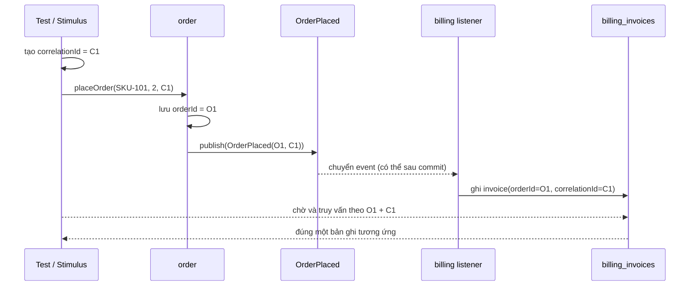
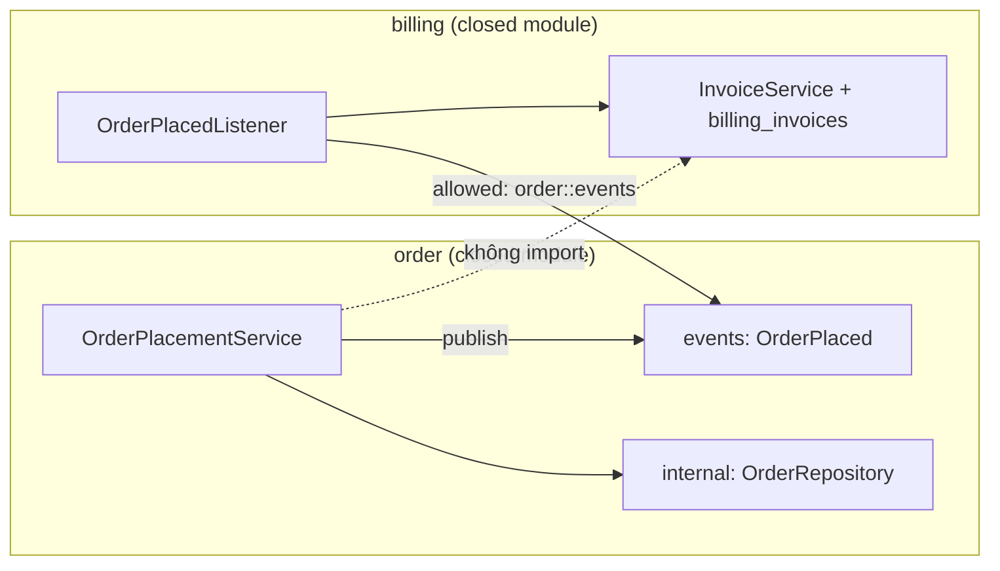

# Correlation ID giữa stimulus và listener

Khi kiểm thử sự kiện trong Spring Modulith, một *stimulus* (tác nhân kích hoạt) có thể là lời gọi `placeOrder(...)`, một lệnh nghiệp vụ, hoặc một event đầu vào. Lời gọi đó phát sinh một hoặc nhiều sự kiện; listener ở module khác nhận sự kiện và tạo tác dụng phụ. Nếu test chỉ viết “chờ một `OrderPlaced` xuất hiện”, nó có thể nhận nhầm sự kiện từ một thao tác khác, nhất là khi test chạy song song hoặc listener hoạt động bất đồng bộ.

**Correlation ID** là một định danh được tạo hoặc tiếp nhận tại điểm bắt đầu luồng nghiệp vụ và được **truyền nhất quán** qua các bước liên quan. Nhờ đó, bài test có thể hỏi chính xác: “Sự kiện nào và tác dụng phụ nào thuộc về **stimulus này**?”, thay vì chấp nhận bất kỳ sự kiện cùng kiểu nào.

Bài học thuộc chương **Observability tests** của **SPRING_MODULITH_VERIFICATION_TESTING**. Chúng ta sẽ thiết kế correlation ID giữa `order` và `billing`, thực hành `@ApplicationModuleTest`, `@RecordApplicationEvents`, `Scenario` và test tích hợp; phân biệt correlation với completion của Event Publication Registry; rồi kết hợp `ApplicationModules.verify()` và quality gate CI để ngăn phụ thuộc sai, nhầm event và hồi quy dữ liệu.

> **Tư tưởng chính:** Một correlation ID có giá trị khi nó đi từ **stimulus → sự kiện → listener → tác dụng phụ/log**, và test kiểm tra **cùng một giá trị** ở các mốc ấy. Correlation ID **không tự bảo đảm** event được giao, transaction được commit, listener chạy đúng hoặc xử lý exactly-once.

## 1. Vấn đề: chờ đúng loại event nhưng nhầm giao dịch

Giả sử hai lời gọi diễn ra gần nhau:

- Stimulus A: tạo đơn cho `SKU-101`.
- Stimulus B: tạo đơn cho `SKU-202`.

Cả hai đều phát `OrderPlaced`. Listener `billing` có thể nhận hai event ở thứ tự khác với thứ tự thao tác bắt đầu. Một test viết như sau không đủ sức phân biệt:

```java
// VÍ DỤ YẾU: chỉ kiểm tra loại event.
assertThat(events.stream(OrderPlaced.class).findAny()).isPresent();
```

Test có thể PASS nhờ event B dù thao tác A không phát gì. Tương tự, một bài test kiểm tra “có bản ghi hóa đơn” mà không gắn bản ghi với đơn hiện tại có thể PASS vì dữ liệu được tạo từ test khác.

Thay vào đó, stimulus A tạo một `correlationId` riêng và truyền vào lời gọi:

```java
UUID correlationId = UUID.randomUUID();
UUID orderId = orders.placeOrder(
        "SKU-101", 2, correlationId
);
```

Sau đó phải kiểm tra `OrderPlaced.correlationId()` **bằng đúng** `correlationId`, và hóa đơn do listener tạo cũng mang correlation ID đó.



Sơ đồ trên mô tả **mối liên hệ dữ liệu**. Nó không cam kết thời điểm dispatch: hành vi trước/sau commit, thực thi bất đồng bộ và lưu publication phụ thuộc listener, transaction cùng cấu hình Spring Modulith thực tế.

## 2. Correlation ID khác gì `orderId`, `eventId`, `traceId`?

Các ID có mục đích khác nhau; dùng lẫn sẽ khiến test và log khó diễn giải.

| Định danh | Đại diện cho | Vòng đời điển hình | Khi kiểm thử |
| --- | --- | --- | --- |
| **`correlationId`** | Một luồng nghiệp vụ hoặc một yêu cầu cần theo dõi xuyên bước | Có thể giữ nguyên qua nhiều event/listener | So khớp stimulus với event và side effect |
| **`orderId`** | Một thực thể/aggregate đơn hàng | Bền vững theo vòng đời đơn | Kiểm tra dữ liệu đơn/hóa đơn gắn đúng đơn |
| **`eventId`** | Một lần phát sinh sự kiện có danh tính riêng | Riêng cho từng sự kiện | Khử trùng lặp theo thông điệp, kiểm chứng retry |
| **`causationId`** | Event/lệnh trực tiếp gây ra event kế tiếp | Thay đổi qua từng bước trong chuỗi | Lần theo quan hệ cha–con giữa các sự kiện |
| **`traceId`** | Trace quan sát phân tán của hệ thống telemetry | Tùy phạm vi trace và sampling | Liên kết span/log trong tracing |
| **`requestId`** | Một HTTP/message request tại điểm vào | Có thể chỉ gắn với request đầu tiên | Điều tra request đầu vào |

Trong một thao tác tạo đơn đơn giản, `correlationId` *có thể* bằng một request ID, nhưng đó là **quy ước có chủ đích**, không phải điều Spring Modulith tự làm. Nếu một luồng kéo dài qua retry, hàng đợi hoặc nhiều yêu cầu HTTP, correlation ID nghiệp vụ có thể cần tồn tại lâu hơn một `traceId` kỹ thuật.

Một `orderId` có thể đủ làm khóa liên kết cho **một luồng chỉ xử lý một đơn**. Tuy nhiên, nếu một nghiệp vụ tạo nhiều đơn, gửi nhiều event hoặc hoàn thành qua nhiều bước, correlation ID riêng giúp biểu thị quan hệ chung mà không phải tái sử dụng danh tính aggregate.

**Không dùng correlation ID làm khóa idempotency một cách máy móc.** Nếu cùng một luồng có nhiều tác vụ hợp lệ, chỉ một correlation ID có thể gom chúng lại và vô tình chặn công việc cần thiết. Tính idempotent thường dựa trên `eventId`, `orderId` cùng loại tác vụ, hoặc khóa nghiệp vụ được định nghĩa rõ.

## 3. Quy tắc thiết kế correlation ID

Một thiết kế có thể kiểm thử và bảo trì được nên thống nhất:

1. **Một nguồn tạo:** xác định ranh giới nào tạo correlation ID. Ví dụ controller, API command handler hoặc test stimulus, không phải mỗi listener tự sinh giá trị mới.
2. **Truyền tường minh:** đưa ID trong command/event payload hoặc metadata có hợp đồng; đừng dựa duy nhất vào `ThreadLocal`.
3. **Không đổi giữa chặng:** listener giữ correlation ID từ event đầu vào khi ghi trạng thái hoặc phát event tiếp theo.
4. **Có mặt trong log:** dùng cùng một tên như `correlationId` ở publisher và listener; nếu cần MDC, đặt và dọn đúng phạm vi xử lý.
5. **Dữ liệu và telemetry tách bạch:** correlation ID nối nghiệp vụ; trace ID phục vụ tracing; có thể ghi cả hai nếu có lợi.
6. **Có quy tắc validate:** xác định hành vi khi đầu vào thiếu ID. Trong ví dụ này, `null` là lỗi; hệ thống khác có thể cho service đầu vào tạo ID một lần.
7. **Không chứa thông tin nhạy cảm:** dùng UUID ngẫu nhiên hoặc ID không đoán được; không đặt email, số thẻ hoặc dữ liệu cá nhân làm correlation ID.
8. **Có phép kiểm tra âm:** test chứng minh event của stimulus B **không làm** bài test dành cho stimulus A PASS.

Trong tài liệu sau, ta dùng `UUID correlationId` làm hợp đồng giữa các module. Đây là **lựa chọn của ví dụ**, không phải annotation hay API có sẵn của Spring Modulith.

## 4. Thiết kế module: `order` phát, `billing` nhận

Giả sử `StoreApplication` đặt tại package gốc `com.example.store` và các package con là application module theo cơ chế phát hiện mặc định:

```text
com.example.store
├── StoreApplication.java
├── order/                                  ← application module
│   ├── OrderPlacementService.java         ← điểm vào nghiệp vụ
│   ├── events/
│   │   ├── package-info.java             ← @NamedInterface("events")
│   │   └── OrderPlaced.java              ← payload có correlationId
│   └── internal/
│       ├── OrderEntity.java
│       └── OrderRepository.java
└── billing/                                ← application module
    ├── package-info.java                  ← allowedDependencies=order::events
    └── internal/
        ├── OrderPlacedListener.java
        └── InvoiceService.java
```

Trong mô hình này, `order` sở hữu transaction tạo đơn và kiểu `OrderPlaced`; `billing` sở hữu hóa đơn cùng listener. **`billing` tham chiếu `order::events`**, nhưng `order` không nhập repository hoặc service thuộc `billing`.



### API event được công bố

File `src/main/java/com/example/store/order/events/package-info.java`:

```java
/**
 * Sự kiện nghiệp vụ order được công bố cho module khác.
 * Không trả entity hoặc repository nội bộ.
 *
 * <p>correlationId giữ nguyên từ yêu cầu tạo đơn.
 * eventId xác định riêng đối tượng sự kiện này.
 */
@org.springframework.modulith.NamedInterface("events")
package com.example.store.order.events;
```

File `OrderPlaced.java`:

```java
package com.example.store.order.events;

import java.time.Instant;
import java.util.Objects;
import java.util.UUID;

public record OrderPlaced(
        UUID eventId,
        UUID correlationId,
        UUID orderId,
        String sku,
        int quantity,
        Instant occurredAt
) {
    public OrderPlaced {
        Objects.requireNonNull(eventId, "eventId");
        Objects.requireNonNull(correlationId, "correlationId");
        Objects.requireNonNull(orderId, "orderId");
        Objects.requireNonNull(sku, "sku");
        Objects.requireNonNull(occurredAt, "occurredAt");

        if (sku.isBlank() || quantity <= 0) {
            throw new IllegalArgumentException("Invalid event payload");
        }
    }
}
```

Dùng record công khai giúp các module tiêu thụ không phải đọc `OrderEntity`. `eventId` là ID **riêng cho event**, còn `correlationId` là ID **chung của luồng**; hai giá trị không nên mặc định bằng nhau.

Bên `billing` chỉ được dùng event API này:

```java
// src/main/java/com/example/store/billing/package-info.java
@org.springframework.modulith.ApplicationModule(
    allowedDependencies = "order::events"
)
package com.example.store.billing;
```

## 5. Producer: nhận correlation ID từ stimulus và truyền vào event

Để ví dụ có transaction thật, module `order` dùng một entity JPA tối giản:

```java
// order/internal/OrderEntity.java
package com.example.store.order.internal;

import jakarta.persistence.Entity;
import jakarta.persistence.Id;
import jakarta.persistence.Table;
import java.util.UUID;

@Entity
@Table(name = "shop_orders")
public class OrderEntity {

    @Id
    private UUID id;

    private String sku;
    private int quantity;
    private UUID correlationId;

    protected OrderEntity() {}

    public OrderEntity(
            UUID id, String sku, int quantity, UUID correlationId) {
        this.id = id;
        this.sku = sku;
        this.quantity = quantity;
        this.correlationId = correlationId;
    }

    public UUID getId() {
        return id;
    }
}
```

Repository nội bộ:

```java
// order/internal/OrderRepository.java
package com.example.store.order.internal;

import java.util.UUID;
import org.springframework.data.jpa.repository.JpaRepository;

/** Java-public nhưng vẫn thuộc package internal của module order. */
public interface OrderRepository
        extends JpaRepository<OrderEntity, UUID> {}
```

Service tại package gốc của module `order`:

```java
// order/OrderPlacementService.java
package com.example.store.order;

import com.example.store.order.events.OrderPlaced;
import com.example.store.order.internal.OrderEntity;
import com.example.store.order.internal.OrderRepository;
import java.time.Instant;
import java.util.Objects;
import java.util.UUID;
import org.springframework.context.ApplicationEventPublisher;
import org.springframework.stereotype.Service;
import org.springframework.transaction.annotation.Transactional;

@Service
public class OrderPlacementService {

    private final OrderRepository orders;
    private final ApplicationEventPublisher events;

    public OrderPlacementService(
            OrderRepository orders,
            ApplicationEventPublisher events) {
        this.orders = orders;
        this.events = events;
    }

    @Transactional
    public UUID placeOrder(
            String sku, int quantity, UUID correlationId) {

        Objects.requireNonNull(correlationId, "correlationId");

        if (sku == null || sku.isBlank() || quantity <= 0) {
            throw new IllegalArgumentException("Invalid order");
        }

        UUID orderId = UUID.randomUUID();
        orders.save(new OrderEntity(
                orderId, sku, quantity, correlationId
        ));

        events.publishEvent(new OrderPlaced(
                UUID.randomUUID(), // eventId riêng cho event
                correlationId,     // giữ từ stimulus
                orderId,
                sku,
                quantity,
                Instant.now()
        ));

        return orderId;
    }
}
```

Đây là **mã minh họa phục vụ test**: cần Spring Data JPA, transaction manager, schema `shop_orders` và datasource test phù hợp. Trong dự án thực tế, còn cần chính sách idempotency cho chính thao tác `placeOrder`: một request bị gửi lại có thể tạo đơn mới nếu không có command ID hay unique constraint thích hợp.

Những điểm quan trọng:

- Test tạo `correlationId` **một lần** rồi truyền vào service.
- Service không gọi `UUID.randomUUID()` để **thay thế** correlation ID đã nhận; nó chỉ tạo các ID có mục đích khác là `orderId` và `eventId`.
- `@Transactional` được áp dụng khi service được gọi qua Spring proxy; nếu một method cùng object tự gọi `placeOrder`, transaction proxy có thể không kích hoạt.
- `publishEvent` được gọi khi transaction còn hoạt động, nên recorder có thể nhìn thấy event trước khi database commit; test sau commit phải xử lý khác.

Nếu ứng dụng nhận correlation ID qua HTTP header, cần có quy tắc kiểm tra độ dài/định dạng, mức độ tin cậy và cách tạo mới khi header không hợp lệ. **Không được tin mù quáng ID do bên ngoài cung cấp** trong một ranh giới an ninh.

## 6. Test producer: `@RecordApplicationEvents` so khớp stimulus với event

Test đầu tiên xác nhận **đúng thao tác đã phát đúng event**, không cần module `billing` chạy.

```java
// src/test/java/com/example/store/order/OrderCorrelationPublicationTest.java
package com.example.store.order;

import com.example.store.order.events.OrderPlaced;
import java.util.UUID;
import org.junit.jupiter.api.Test;
import org.springframework.beans.factory.annotation.Autowired;
import org.springframework.modulith.test.ApplicationModuleTest;
import org.springframework.test.context.event.ApplicationEvents;
import org.springframework.test.context.event.RecordApplicationEvents;

import static org.assertj.core.api.Assertions.assertThat;
import static org.assertj.core.api.Assertions.assertThatThrownBy;

@ApplicationModuleTest
@RecordApplicationEvents
class OrderCorrelationPublicationTest {

    @Autowired
    OrderPlacementService orders;

    @Autowired
    ApplicationEvents recordedEvents;

    @Test
    void correlatesPublishedEventWithStimulus() {
        UUID correlationId = UUID.randomUUID();

        UUID orderId = orders.placeOrder(
                "SKU-101", 2, correlationId
        );

        var matches = recordedEvents.stream(OrderPlaced.class)
                .filter(event ->
                        correlationId.equals(event.correlationId()))
                .toList();

        assertThat(matches).hasSize(1);

        OrderPlaced event = matches.get(0);
        assertThat(event.orderId()).isEqualTo(orderId);
        assertThat(event.correlationId()).isEqualTo(correlationId);
        assertThat(event.eventId()).isNotNull();
        assertThat(event.sku()).isEqualTo("SKU-101");
        assertThat(event.quantity()).isEqualTo(2);
    }

    @Test
    void invalidStimulusDoesNotPublishEvent() {
        UUID correlationId = UUID.randomUUID();

        assertThatThrownBy(() ->
                orders.placeOrder("", 0, correlationId)
        ).isInstanceOf(IllegalArgumentException.class);

        long published = recordedEvents.stream(OrderPlaced.class)
                .filter(event ->
                        correlationId.equals(event.correlationId()))
                .count();

        assertThat(published).isZero();
    }
}
```

**Vì sao lọc theo correlation ID?** Một test context có thể phát event do các thao tác khác; nếu chỉ kiểm tra sự tồn tại của một `OrderPlaced` bất kỳ thì test có thể cho PASS giả. Kết hợp `correlationId` với `orderId` còn giúp bảo vệ trường hợp service tạo đúng một event nhưng điền sai đơn.

**Giới hạn:** `ApplicationEvents` ghi lại event được **publish** trong Spring Test context; nó không chứng minh listener `billing` đã xử lý hoặc Event Publication Registry đã đánh dấu completion. Test `@ApplicationModuleTest` của `order` ở chế độ cô lập cũng thường không boot module `billing`.

**Dữ liệu test:** ví dụ cần datasource/schema cho repository JPA. Có thể thay JPA bằng test double hợp lệ khi chỉ muốn test producer, nhưng phải giữ một test transaction/database riêng nếu tính nhất quán dữ liệu là yêu cầu nghiệp vụ.

### Cạm bẫy: test có `@Transactional` ngoài ý muốn

Nếu gắn `@Transactional` lên phương thức hoặc class test, Spring Test thường rollback transaction do test quản lý sau mỗi bài test. Listener `AFTER_COMMIT` có thể **không chạy** vì không xảy ra commit thật. Vì thế, khi kiểm tra bước xử lý của listener, nên để service transactional được gọi qua proxy và commit trước khi test chờ tác dụng phụ, hoặc dùng `TestTransaction`/`TransactionTemplate` có chủ đích.

Test ở trên cố ý **không gắn `@Transactional` trên lớp test**. Nó kiểm tra event đã publish, không tự khẳng định toàn bộ luồng end-to-end đã hoàn tất.

## 7. Dùng `Scenario` của Spring Modulith để chờ đúng event

Trong các phiên bản Spring Modulith hỗ trợ test scenario API, `org.springframework.modulith.test.Scenario` cho phép mô tả **stimulus và điều kiện cần chờ** dưới dạng một chuỗi thao tác.

Ví dụ test tại package `order`:

```java
// src/test/java/com/example/store/order/OrderScenarioCorrelationTest.java
package com.example.store.order;

import com.example.store.order.events.OrderPlaced;
import java.util.UUID;
import org.junit.jupiter.api.Test;
import org.springframework.beans.factory.annotation.Autowired;
import org.springframework.modulith.test.ApplicationModuleTest;
import org.springframework.modulith.test.Scenario;

import static org.assertj.core.api.Assertions.assertThat;

@ApplicationModuleTest
class OrderScenarioCorrelationTest {

    @Autowired
    OrderPlacementService orders;

    @Test
    void waitsForEventBelongingToThisStimulus(Scenario scenario) {
        UUID correlationId = UUID.randomUUID();

        scenario.stimulate(() ->
                    orders.placeOrder("SKU-101", 2, correlationId)
                )
                .andWaitForEventOfType(OrderPlaced.class)
                .matching(event ->
                        correlationId.equals(event.correlationId()))
                .toArriveAndVerify(event -> {
                    assertThat(event.correlationId())
                            .isEqualTo(correlationId);
                    assertThat(event.orderId()).isNotNull();
                    assertThat(event.eventId()).isNotNull();
                });
    }
}
```

Đọc chuỗi thao tác:

1. `stimulate(...)`: kích hoạt use case, ở đây là gọi service tạo đơn.
2. `andWaitForEventOfType(OrderPlaced.class)`: chỉ quan sát loại event cần thiết.
3. `matching(...)`: **lọc correlation ID trùng với stimulus**.
4. `toArriveAndVerify(...)`: kiểm tra payload của event được chọn thay vì một event bất kỳ.

Mục tiêu của `Scenario` là mô tả rõ logic **“làm A, chờ B của chính A”**; đây không phải bằng chứng rằng một module tiêu thụ khác đã hoàn tất mọi tác dụng phụ. Với listener bất đồng bộ hoặc trạng thái persisted, cần dùng phép chờ **state change**/integration test phù hợp.

**Chú ý phiên bản:** DSL `Scenario` có thể có khác biệt về tùy chọn chờ và API nâng cao giữa các phiên bản Spring Modulith. Ví dụ sử dụng chuỗi thao tác cơ bản; khi thực thi, đối chiếu dependency `spring-modulith-test` và reference/Javadoc của phiên bản đang dùng.

### Vì sao chỉ chờ `OrderPlaced` là chưa đủ?

Ví dụ dễ gây PASS giả:

```java
// DỄ NHẬN NHẦM EVENT, đặc biệt khi có nhiều stimulus:
scenario.stimulate(() -> orders.placeOrder("SKU-101", 2, id))
        .andWaitForEventOfType(OrderPlaced.class)
        .toArriveAndVerify(event -> assertThat(event).isNotNull());
```

Đoạn này chỉ chứng minh có event đúng **loại**, chưa chứng minh event đó thuộc stimulus `id`. Dùng `.matching(event -> id.equals(event.correlationId()))` và assert các khóa nghiệp vụ để xác định **đúng event**.

## 8. Listener: giữ correlation ID khi xử lý bất đồng bộ

Module `billing` tiêu thụ `OrderPlaced` được công bố trong `order::events`. Một listener minh họa:

```java
// billing/internal/OrderPlacedListener.java
package com.example.store.billing.internal;

import com.example.store.order.events.OrderPlaced;
import org.slf4j.MDC;
import org.springframework.modulith.events.ApplicationModuleListener;
import org.springframework.stereotype.Component;

@Component
class OrderPlacedListener {

    private final InvoiceService invoices;

    OrderPlacedListener(InvoiceService invoices) {
        this.invoices = invoices;
    }

    @ApplicationModuleListener
    void on(OrderPlaced event) {
        // Đặt MDC ngay trong thread đang xử lý listener.
        try (MDC.MDCCloseable ignored = MDC.putCloseable(
                "correlationId",
                event.correlationId().toString())) {

            invoices.startInvoiceOnce(
                    event.orderId(), event.correlationId()
            );
        }
    }
}
```

`InvoiceService.startInvoiceOnce(...)` là một dịch vụ **nội bộ của billing**. Nó cần ghi correlation ID cùng trạng thái hóa đơn và bảo đảm xử lý lặp an toàn. Đoạn listener trên là ví dụ tương tác; muốn chạy cần một implementation `InvoiceService`, database và schema của `billing`.

### Tại sao không chỉ dựa vào MDC ở publisher?

`MDC` (Mapped Diagnostic Context) của SLF4J thường gắn với **thread hiện tại**. `@ApplicationModuleListener` có thể chạy bất đồng bộ hoặc trong ngữ cảnh thực thi khác; vì thế correlation ID đặt ở MDC của request/publisher **không mặc nhiên xuất hiện** trong thread listener.

Giải pháp của ví dụ:

- Correlation ID được **truyền bền vững trong event payload**; listener lấy từ `event.correlationId()`.
- Listener tự đặt MDC trong thread mình đang chạy để log có cùng khóa liên kết.
- `try-with-resources` đóng `MDCCloseable` để khôi phục/xóa giá trị trong phạm vi tương ứng, tránh “rò rỉ” correlation ID sang công việc khác của thread pool.

Nếu ứng dụng dùng Micrometer Tracing hoặc context-propagation tự động, có thể cấu hình thêm việc truyền trace context qua executor và messaging; **không nên coi MDC và trace ID được truyền tự động ở mọi cấu hình**.

### Ví dụ log tương quan

```text
INFO  order   event=OrderPlaced stage=PUBLISHED  correlationId=C1 orderId=O1
INFO  billing event=OrderPlaced stage=HANDLING   correlationId=C1 orderId=O1
INFO  billing event=OrderPlaced stage=COMPLETED  correlationId=C1 orderId=O1
```

Đây là **mẫu log do ứng dụng định nghĩa**, không phải output mặc định của Spring Modulith. Các nhãn `C1`, `O1` tượng trưng cho ID thực. Log giúp điều tra nhưng không thể thay thế assertion về database hoặc publication registry.

## 9. Test listener: kiểm tra tác dụng phụ gắn đúng correlation ID

Muốn kết luận listener thực sự hoàn thành việc tạo hóa đơn, cần một bài test tích hợp nạp cả `order` và `billing`, cho transaction tạo đơn commit và **chờ dữ liệu có cùng `orderId` + `correlationId`**.

Ví dụ áp dụng khi dùng PostgreSQL với bảng hóa đơn:

```sql
-- DDL minh họa cho module billing (không phải schema có sẵn):
create table billing_invoices (
    order_id uuid primary key,
    correlation_id uuid not null,
    status varchar(32) not null
);
```

Một phương thức `InvoiceService.startInvoiceOnce(orderId, correlationId)` có thể dùng giao dịch và ràng buộc `primary key (order_id)` để không tạo hai bản ghi hóa đơn cho cùng một đơn. Phải định nghĩa rõ cách xử lý nếu một `orderId` được gửi lại với **correlation ID mâu thuẫn**, tránh âm thầm coi hai luồng không liên quan là một.

Test tích hợp:

```java
// src/test/java/com/example/store/OrderBillingCorrelationTest.java
package com.example.store;

import com.example.store.order.OrderPlacementService;
import java.time.Duration;
import java.util.UUID;
import org.junit.jupiter.api.Test;
import org.springframework.beans.factory.annotation.Autowired;
import org.springframework.boot.test.context.SpringBootTest;
import org.springframework.jdbc.core.JdbcTemplate;

import static org.assertj.core.api.Assertions.assertThat;
import static org.awaitility.Awaitility.await;

@SpringBootTest
class OrderBillingCorrelationTest {

    @Autowired
    OrderPlacementService orders;

    @Autowired
    JdbcTemplate jdbc;

    @Test
    void listenerPersistsSameCorrelationIdAsStimulus() {
        UUID correlationId = UUID.randomUUID();

        UUID orderId = orders.placeOrder(
                "SKU-101", 2, correlationId
        );

        await().atMost(Duration.ofSeconds(10))
                .untilAsserted(() -> {
                    Integer matches = jdbc.queryForObject(
                            "select count(*) from billing_invoices "
                                    + "where order_id = ? "
                                    + "and correlation_id = ?",
                            Integer.class,
                            orderId,
                            correlationId
                    );

                    assertThat(matches).isEqualTo(1);
                });
    }
}
```

**Điều kiện để ví dụ chạy:**

1. Có bean `InvoiceService` thực hiện ghi hóa đơn và listener `OrderPlacedListener` đã được Spring đăng ký.
2. Có datasource và schema/test migrations cho cả `shop_orders` lẫn `billing_invoices`, cùng transaction manager thích hợp.
3. Có dependency Awaitility; test không bọc ngoài bởi một transaction tự rollback khiến listener sau commit không được kích hoạt.
4. `@ApplicationModuleListener` được cấu hình để xử lý theo semantics của phiên bản Spring Modulith đang sử dụng.
5. Từng lần chạy có correlation ID riêng và dữ liệu được cô lập/cleanup để tránh kết quả từ lần chạy trước.

Đây là **mẫu integration test có các giả định rõ ràng**, không phải bằng chứng test đã chạy ở workspace hiện tại.

### Vì sao chờ cả `orderId` lẫn `correlationId`?

Chỉ đếm “tổng số hóa đơn lớn hơn 0” có thể PASS nhờ dữ liệu cũ. Chỉ lọc correlation ID cũng có thể chưa đủ nếu một luồng nghiệp vụ tạo nhiều đơn; kiểm tra cả hai khóa giúp xác nhận **đúng hóa đơn của đúng stimulus**.

Nếu yêu cầu là “listener không tạo hóa đơn trùng”, bài test còn phải kiểm tra unique constraint và thử xử lý lại cùng event. Không nên dùng `Thread.sleep(1000)` rồi giả định listener đã chạy; chờ điều kiện có timeout hữu hạn giúp tránh flaky test.

## 10. Test âm: hai stimulus song song không được nhận nhầm event

Một bài test correlation ID đáng tin cần có **ít nhất một ca âm** chứng minh bộ lọc thực sự chọn đúng thao tác.

Ví dụ ở producer test:

```java
@Test
void eventFromAnotherStimulusMustNotMatch() {
    UUID correlationA = UUID.randomUUID();
    UUID correlationB = UUID.randomUUID();

    UUID orderA = orders.placeOrder("SKU-101", 1, correlationA);
    UUID orderB = orders.placeOrder("SKU-202", 1, correlationB);

    var eventsForA = recordedEvents.stream(OrderPlaced.class)
            .filter(event ->
                    correlationA.equals(event.correlationId()))
            .toList();

    var eventsForB = recordedEvents.stream(OrderPlaced.class)
            .filter(event ->
                    correlationB.equals(event.correlationId()))
            .toList();

    assertThat(eventsForA).hasSize(1);
    assertThat(eventsForA.get(0).orderId()).isEqualTo(orderA);

    assertThat(eventsForB).hasSize(1);
    assertThat(eventsForB.get(0).orderId()).isEqualTo(orderB);

    assertThat(eventsForA.get(0).correlationId())
            .isNotEqualTo(eventsForB.get(0).correlationId());
}
```

Đây là **phương thức bổ sung cho lớp `OrderCorrelationPublicationTest`** ở phần 6, dùng lại các field `orders` và `recordedEvents`, không phải một class Java độc lập.

Điều này kiểm chứng hai luồng liên tiếp trong cùng test context. Để kiểm tra race condition thực sự, cần điều phối hai thao tác đồng thời bằng executor/test harness, có timeout và môi trường DB cô lập. **Một test thực hiện hai lời gọi tuần tự không chứng minh hệ thống an toàn dưới đồng thời.**

### Nếu listener phát thêm sự kiện?

Giả sử `billing` tạo `InvoiceIssued(eventId, correlationId, orderId,...)`. Khi đó **correlation ID vẫn giữ nguyên**, còn `eventId` mới được tạo. Nếu cần biết sự kiện `InvoiceIssued` cụ thể nào xuất phát trực tiếp từ `OrderPlaced`, có thể thêm `causationId = OrderPlaced.eventId()`.

```text
Stimulus:      correlationId=C1
OrderPlaced:   eventId=E1, correlationId=C1
InvoiceIssued: eventId=E2, correlationId=C1, causationId=E1
```

Phân biệt như vậy giúp log/test biểu diễn được cả **một luồng chung** và **quan hệ nguyên nhân trực tiếp** giữa từng event. Không sử dụng cùng một `eventId` cho nhiều event khác nhau để tạo cảm giác chúng thuộc một luồng.

## 11. Từ correlation tới Event Publication Registry

Spring Modulith có cơ chế **Event Publication Registry** để theo dõi publication đến các transactional event listener khi hạ tầng tương ứng được bật. Correlation ID là **metadata nghiệp vụ để liên kết**; registry là **cơ chế theo dõi vòng đời gửi/hoàn thành publication**. Hai khái niệm bổ trợ nhau nhưng không thay thế nhau.

| Điều cần hỏi | Correlation ID giúp gì? | Cần thêm gì để kiểm chứng? |
| --- | --- | --- |
| Sự kiện này thuộc request nào? | Truy vết từ stimulus sang event | Test recorder hoặc log |
| Listener xử lý đúng đơn không? | Gắn event với `orderId` + `correlationId` | Database/integration assertion |
| Publication đã hoàn tất chưa? | Giúp truy tìm publication liên quan nếu registry/backend lưu được thông tin đó | Event Publication Registry và trạng thái completion |
| Listener thất bại thì sao? | Gắn lỗi với luồng nghiệp vụ | Test failure, trạng thái chưa hoàn tất, recovery |
| Sau retry có tạo hóa đơn trùng? | Nối các lần xử lý cùng tác vụ | Unique constraint/idempotency test |
| Có phụ thuộc sai giữa hai module? | Không | `ApplicationModules.verify()` |

**Không mặc định Event Publication Registry cho phép truy vấn trực tiếp bằng correlation ID.** API công khai, metadata của publication, cách lưu event và schema phụ thuộc phiên bản Spring Modulith/backend. Một thiết kế có thể cần adapter read-only dành cho test hoặc tra cứu qua event payload, nhưng phải xác nhận khả năng thực tế thay vì đoán tên bảng/cột hay phương thức.

Một bộ kiểm tra riêng về registry cần:

- Backend publication phù hợp (JDBC/JPA hoặc backend khác được hỗ trợ) và schema test.
- Transactional listener được nhận diện; một event không có listener phù hợp không tự tạo publication cần theo dõi.
- Test listener thất bại một lần rồi recovery theo cơ chế mà ứng dụng thực sự bật.
- Assertion publication **chưa hoàn tất** sau lỗi và hoàn tất sau xử lý thành công.
- Cleanup và dữ liệu test cô lập.

**Recorder nhìn thấy event không đồng nghĩa registry đã ghi publication.** Và một publication được đánh dấu hoàn tất cũng không chứng minh mọi tác dụng phụ nghiệp vụ đúng nếu listener có bug; luôn đối chiếu với database và contract test.

## 12. `@ApplicationModuleTest`, bootstrap mode và quan sát listener

Test module `order` có thể chạy trong phạm vi cô lập, thường theo chế độ `STANDALONE`, nên không nạp implementation của `billing`. Đây là hành vi hữu ích: producer contract test **không phải chịu rủi ro hạ tầng của consumer**.

Khi muốn kiểm tra listener và trạng thái hóa đơn, có vài lựa chọn:

| Mục tiêu | Phạm vi đề xuất | Bằng chứng |
| --- | --- | --- |
| Publisher phát đúng event và correlation ID | `@ApplicationModuleTest` cho `order` | `ApplicationEvents` hoặc `Scenario` |
| Listener `billing` xử lý một event và ghi đúng dữ liệu | `@ApplicationModuleTest` cho `billing` với phụ thuộc/test setup thích hợp | Assert hóa đơn |
| Event chạy xuyên cả hai module thực tế | `@SpringBootTest` hoặc module test có phạm vi được lựa chọn rõ | Assert event và side effect sau commit |
| Retry/completion publication | Integration test có registry backend và listener thật | Pending/completed + DB |
| Ranh giới dependency đúng | JUnit `ApplicationModules.verify()` | Architecture gate |

Trong Spring Modulith, các `BootstrapMode` như `STANDALONE`, `DIRECT_DEPENDENCIES`, `ALL_DEPENDENCIES` điều khiển các module được đưa vào bootstrap. **Không nên hiểu `ALL_DEPENDENCIES` là mọi module của ứng dụng**, hoặc mở rộng mode chỉ để test vô tình nhìn thấy listener cần thiết.

Trong ví dụ `billing` phụ thuộc `order::events`, test `billing` với `DIRECT_DEPENDENCIES` có thể nạp cả `order` và `billing`, nhưng phạm vi runtime/bean vẫn tùy cấu hình; cần xem test context và dữ liệu thật. Nếu mục tiêu là luồng đầy đủ, một integration test rõ phạm vi thường dễ đọc hơn.

## 13. Không nhầm log correlation với trace propagation

Có ba lớp dễ bị lẫn:

1. **Correlation ở payload:** `OrderPlaced.correlationId()` — tồn tại cùng event và có thể được lưu, phát lại, kiểm thử.
2. **Correlation trong MDC/log:** một cặp key–value ở thread hiện tại — hữu ích cho log tại bước xử lý, nhưng cần tự truyền/khôi phục trên ranh giới async nếu chưa có hỗ trợ.
3. **Distributed tracing:** `traceId`/`spanId` từ Micrometer Tracing/OpenTelemetry — mô tả quan hệ quan sát giữa các span, cần instrument/context propagation và có thể bị sampling.

Một chuỗi log có cùng `correlationId` là **dấu hiệu hỗ trợ chẩn đoán**, không phải assertion cho tác dụng phụ. Ví dụ code có thể log “COMPLETED” trước khi transaction sau đó rollback; test phải xác minh dữ liệu và thời điểm commit.

Đừng nhét toàn bộ `OrderEntity` hoặc thông tin thanh toán vào MDC/event chỉ để giúp debug. Correlation ID nên là ID kỹ thuật/kinh doanh tối thiểu, tránh dữ liệu nhạy cảm và có chính sách retention phù hợp.

### Quy tắc khi chuyển sang broker bên ngoài

Nếu sau này event được gửi qua Kafka, RabbitMQ hoặc một giao thức message khác, cần **quyết định rõ** correlation ID nằm trong payload hay header, cách serialize/deserialize và khả năng tương thích với consumer. Không giả định Spring in-process `ApplicationEventPublisher` tự truyền metadata sang một broker ngoài.

Có thể dùng cả header và payload tùy yêu cầu, nhưng phải xác định nguồn giá trị chính và test hai nơi **khớp nhau**, tránh tình trạng cùng một event có hai correlation ID khác nhau.

## 14. Những lỗi và cách chẩn đoán thường gặp

| Triệu chứng | Nguyên nhân có thể | Test/sửa đúng |
| --- | --- | --- |
| Test nhận `OrderPlaced` của stimulus khác | Chỉ lọc theo event type | Lọc `correlationId` và `orderId` |
| Publisher log C1 nhưng listener log ID rỗng | MDC không qua async thread | Đọc `event.correlationId()`, đặt MDC trong listener |
| Listener tự tạo C2 khi nhận C1 | Không truyền ID qua contract | Giữ C1 trong payload và side effect |
| `@RecordApplicationEvents` PASS, chưa có invoice | Recorder chỉ xác nhận publish | Thêm test tích hợp chờ trạng thái hóa đơn |
| Listener không chạy trong test `@Transactional` | Không commit transaction do test quản lý | Commit có chủ đích hoặc test không bao transaction ngoài |
| Test chập chờn khi chờ listener | Assert ngay hoặc ngủ cố định | Chờ điều kiện với timeout hữu hạn |
| Test ghi nhận đúng correlation nhưng hóa đơn trùng | Thiếu idempotency | Unique constraint và test retry |
| Không có publication trong registry | Chưa bật backend/không có listener phù hợp | Kiểm tra cấu hình registry và target |
| Event được xử lý nhưng completion chưa có | Listener hoặc hạ tầng completion lỗi/race | Test E4 có đồng bộ hóa phù hợp |
| Event/DB test PASS nhưng module import nội bộ | Test hành vi không kiểm chứng architecture | `ApplicationModules.verify()` |
| Test xanh dù ID bị trộn giữa hai luồng | Assert quá chung, dùng dữ liệu cũ | Tạo ID riêng và test âm nhiều stimulus |

Khi CI báo lỗi event bất đồng bộ, hãy giữ **stack trace, correlation ID và các mốc quan sát** trong test report. Chỉ tăng log level trên package liên quan; không bật TRACE toàn bộ Spring một cách mặc định làm che mất nguyên nhân và tăng nguy cơ lộ dữ liệu.

## 15. Kiểm chứng ranh giới bằng `ApplicationModules.verify()`

Correlation ID giúp gắn kết các bước nghiệp vụ, nhưng **không phải quy tắc phụ thuộc kiến trúc**. Một listener có thể ghi đúng correlation ID trong khi lại import trực tiếp `order.internal.OrderRepository` — thiết kế đó vẫn sai đối với closed module.

Đặt bài test độc lập tại package gốc:

```java
// src/test/java/com/example/store/ModulithArchitectureTest.java
package com.example.store;

import org.junit.jupiter.api.Test;
import org.springframework.modulith.core.ApplicationModules;

class ModulithArchitectureTest {

    @Test
    void eventConsumersKeepModuleBoundaries() {
        ApplicationModules.of(StoreApplication.class).verify();
    }
}
```

Bài test dùng Spring Modulith để kiểm chứng các quy tắc cấu trúc chủ yếu: phụ thuộc xuyên module phải đi qua API được công bố, `allowedDependencies` phải được tuân thủ và không có chu trình phụ thuộc bị cấm.

| Thay đổi | `verify()` mong đợi | Test correlation mong đợi |
| --- | --- | --- |
| `billing` chỉ tham chiếu `order::events` | PASS nếu các module khác hợp lệ | PASS khi ID giữ nguyên |
| `billing` import kiểu `public` từ `order.internal` | **FAIL** | Có thể PASS vì event vẫn được xử lý |
| `billing` dùng named interface khác chưa được cho phép | **FAIL** | Có thể PASS |
| `order` phụ thuộc ngược vào `billing` tạo vòng | **FAIL** | Có thể PASS |
| Listener thay C1 bằng C2 nhưng ranh giới đúng | Có thể PASS | **FAIL** khi assert ID |
| Publisher phát event của đơn khác | Có thể PASS | **FAIL** khi assert `orderId` |
| Thêm repository public vào chính package `order.events` | Có thể PASS | Cần API review và test hợp đồng bổ sung |

**Đối với thí nghiệm truy cập internal:** nếu class package-private, Java có thể từ chối biên dịch trước khi chạy `verify()`. Muốn kiểm tra riêng luật Modulith, tạo kiểu `public` giả lập trong `order.internal` và thực sự dùng từ module ngoài bằng field/chữ ký; đừng chỉ thêm một `import` không dùng.

Không giải quyết vi phạm bằng cách chuyển module thành open, chuyển repository sang named interface hoặc nới quyền `allowedDependencies` vô điều kiện. Hãy sửa hợp đồng module hoặc cách phối hợp nghiệp vụ.

## 16. CI quality gate: chặn trộn event giữa các stimulus

Một pipeline đáng tin cần phân biệt loại kiểm tra:

| Gate | Kiểm tra điều gì? | Ví dụ lỗi phải chặn |
| --- | --- | --- |
| **Compile** | Java type và chữ ký hợp lệ | DTO/event đổi constructor mà caller chưa cập nhật |
| **Architecture** | `ApplicationModules.verify()` | Listener phụ thuộc vào kiểu nội bộ của module khác |
| **Producer contract** | `@RecordApplicationEvents`, `Scenario` | Event mang sai correlation ID hoặc sai orderId |
| **Listener/DB integration** | Chờ side effect sau commit | Hóa đơn ghi correlation ID sai, listener không chạy |
| **Publication lifecycle** | Registry/backend, khi được dùng | Publication kẹt hoặc recovery không đúng |
| **Idempotency** | Duplicate/retry/concurrency | Một đơn bị lập hai hóa đơn |
| **Review bảo mật và API** | Payload/log không lộ dữ liệu, bề mặt public tối thiểu | Đưa entity hoặc dữ liệu nhạy cảm vào event |

Với Gradle:

```bash
./gradlew test
```

Với Maven:

```bash
mvn -B test
```

Nếu các bài test PostgreSQL/Awaitility/registry được tách vào task `integrationTest` hoặc Maven Failsafe, pipeline phải gọi thêm task/plugin thực tế. **Lệnh `test` không mặc định chạy mọi integration test** trong mọi dự án.

Ví dụ workflow GitHub Actions khi repository đã có Gradle `integrationTest` task:

```yaml
name: Modulith correlation and event tests

on:
  pull_request:

jobs:
  architecture-and-events:
    runs-on: ubuntu-latest
    permissions:
      contents: read

    steps:
      - uses: actions/checkout@v4

      - uses: actions/setup-java@v4
        with:
          distribution: temurin
          java-version: '21'

      - uses: gradle/actions/setup-gradle@v4

      - name: Run architecture and module tests
        run: bash ./gradlew --no-daemon test

      - name: Run listener and database integration tests
        run: bash ./gradlew --no-daemon integrationTest

      - name: Preserve JUnit reports
        if: always()
        uses: actions/upload-artifact@v4
        with:
          name: correlation-test-reports
          path: |
            **/build/test-results/**/*.xml
            **/build/reports/tests/**
          if-no-files-found: warn
```

Đây là **cấu hình minh họa**, không phải workflow đã chạy trên repository được giao. Cần Gradle wrapper, Java phù hợp, một task `integrationTest` đã được định nghĩa và môi trường database/testcontainers hợp lệ. Nếu dùng PostgreSQL container, phải cung cấp cơ chế tạo schema và dữ liệu test đúng phiên bản.

Để job thực sự chặn merge, repository cần đánh dấu status check bắt buộc qua branch protection/ruleset. Upload report với `if: always()` giúp lấy chẩn đoán dù test FAIL, nhưng **không biến kết quả FAIL thành PASS**.

## 17. Bài thực hành: từ stimulus đến listener có cùng correlation ID

### Bối cảnh

Module `order` phát `OrderPlaced`; module `billing` lắng nghe và tạo hóa đơn. Một đợt chạy CI phát hiện có event `OrderPlaced` nhưng không xác định được hóa đơn nào thuộc lời gọi tạo đơn nào. Học viên phải bổ sung correlation ID và viết test đủ mạnh để không nhận nhầm kết quả.

### Các bước thực hiện

1. **Thiết kế ranh giới:** `order` và `billing` là hai closed module; công bố `order::events`, cho `billing` chỉ dùng named interface này.
2. **Chọn danh tính:** định nghĩa riêng `orderId`, `eventId`, `correlationId`. Viết rõ nguồn tạo và phạm vi tồn tại của từng ID.
3. **Tạo hợp đồng event:** đặt `OrderPlaced` trong package `order.events` có `@NamedInterface("events")` và chứa `correlationId` bất biến.
4. **Tạo stimulus:** test tạo `UUID correlationId = UUID.randomUUID()` và truyền vào `OrderPlacementService.placeOrder(...)`.
5. **Test producer:** dùng `@ApplicationModuleTest` + `@RecordApplicationEvents`, lọc `ApplicationEvents` theo correlation ID rồi assert `orderId`, `eventId`, SKU và quantity.
6. **Test scenario:** dùng `Scenario.stimulate(...).andWaitForEventOfType(...).matching(...)` để chờ event của đúng stimulus.
7. **Viết listener:** `billing` nhận `OrderPlaced`, đọc `event.correlationId()`, ghi cùng ID vào hóa đơn. Nếu đặt MDC, bảo đảm dọn sau khi xử lý.
8. **Test tích hợp:** chạy test có commit thật, chờ bản ghi `billing_invoices` theo cả `orderId` và correlation ID bằng điều kiện có timeout.
9. **Test âm hai stimulus:** phát liên tiếp hai `OrderPlaced` với correlation ID khác nhau; xác nhận event và dữ liệu không bị đối chiếu chéo.
10. **Thử lỗi trộn ID:** cố tình để listener tạo `UUID.randomUUID()` làm correlation ID mới, xác nhận integration test FAIL, rồi khôi phục.
11. **Thử lỗi retry:** xử lý lại cùng event; xác nhận unique constraint/idempotency ngăn hóa đơn trùng. Nếu dùng registry, kiểm tra pending/completed theo backend thật.
12. **Thử lỗi kiến trúc:** để `billing` tham chiếu kiểu `public` giả lập ở `order.internal`; xác nhận `ApplicationModules.verify()` phát hiện và bỏ mã sai.
13. **Khóa CI:** chạy architecture, producer, listener/database và publication tests bắt buộc; lưu log tương quan và test report; kiểm tra rằng lỗi cố tình tạo làm job FAIL.

### Ma trận nghiệm thu

| Tình trạng | Producer test | Listener/DB test | Architecture test |
| --- | --- | --- | --- |
| Đúng event, cùng ID, dữ liệu đúng | PASS | PASS | PASS nếu cấu trúc hợp lệ |
| Event có correlation ID của stimulus khác | **FAIL** | Có thể FAIL | Có thể PASS |
| Không phát event | **FAIL** | **FAIL/timeout** | Có thể PASS |
| Listener tự đổi ID | Producer có thể PASS | **FAIL** | Có thể PASS |
| Listener chưa được khởi tạo trong module test cô lập | Producer có thể PASS | Không được suy luận; chạy integration | Có thể PASS |
| Retry tạo hai hóa đơn | Producer có thể PASS | **FAIL** nếu test idempotency phù hợp | Có thể PASS |
| `billing` dùng `order.internal` | Có thể PASS | Có thể PASS | **FAIL** |

Kết quả ở bảng là **kỳ vọng thiết kế**, không phải kết quả đã chạy trên workspace hiện tại.

### Câu hỏi tự đánh giá

**1. Vì sao không đủ khi chỉ đợi một `OrderPlaced` bất kỳ?** Vì nó có thể thuộc stimulus khác; phải lọc cùng correlation ID và kiểm tra khóa nghiệp vụ.

**2. Có nên dùng `traceId` thay `correlationId` ở mọi nơi không?** Không mặc định. Trace ID thuộc telemetry và phạm vi trace; correlation ID có thể là định danh nghiệp vụ kéo dài qua nhiều giao dịch/retry.

**3. Vì sao MDC ở publisher có thể biến mất trong listener?** Vì MDC thường gắn với thread; listener async có thể chạy ở thread khác. Đưa ID vào event payload và đặt MDC tại listener.

**4. `@RecordApplicationEvents` có chứng minh listener đã ghi hóa đơn chưa?** Không. Nó ghi nhận event được publish; cần test tích hợp chờ side effect thật sau commit.

**5. `Scenario` giúp ích gì?** Nó diễn tả stimulus và điều kiện chờ event/state theo một chuỗi kiểm thử, đồng thời cho phép lọc đúng event bằng correlation ID.

**6. Correlation ID có bảo đảm xử lý exactly-once không?** Không. Cần cơ chế publication/retry phù hợp, khóa idempotency và kiểm thử database.

**7. `ApplicationModules.verify()` có phát hiện correlation ID bị thay sai không?** Không. Nó kiểm tra dependency graph/ràng buộc kiến trúc, không phân tích giá trị payload hoặc side effect của listener.

## 18. Ghi nhớ

**Correlation ID là sợi dây liên kết stimulus với event và listener.** Hãy tạo/tiếp nhận một ID tại điểm bắt đầu nghiệp vụ, đưa nó vào payload công khai, giữ nguyên khi listener xử lý và ghi nó vào dữ liệu/log cần quan sát. Dùng **`@RecordApplicationEvents` / `ApplicationEvents`** hoặc **`Scenario`** trong `@ApplicationModuleTest` để bắt đúng event; dùng **test tích hợp sau commit và Awaitility** để kiểm tra tác dụng phụ; nếu có **Event Publication Registry**, kiểm tra thêm vòng đời publication và recovery. Phân biệt correlation với `eventId`, `orderId` và `traceId`, đồng thời bảo vệ idempotency. Cuối cùng, chạy **`ApplicationModules.verify()`** như architecture gate độc lập và duy trì các phép kiểm tra bắt buộc trong **CI** để ngăn phụ thuộc sai, trộn event và hồi quy.

### Tài liệu tham khảo

- [Spring Modulith Reference — Integration Testing Application Modules](https://docs.spring.io/spring-modulith/reference/testing.html)
- [Spring Modulith Reference — Working with Application Events](https://docs.spring.io/spring-modulith/reference/events.html)
- [Spring Modulith Reference — Verifying Application Module Structure](https://docs.spring.io/spring-modulith/reference/verification.html)
- [Spring Framework Reference — Testing](https://docs.spring.io/spring-framework/reference/testing.html)
