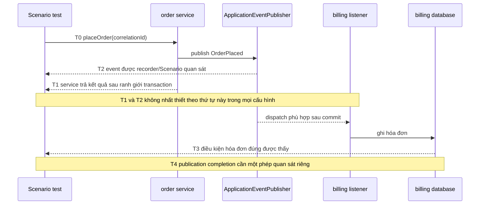
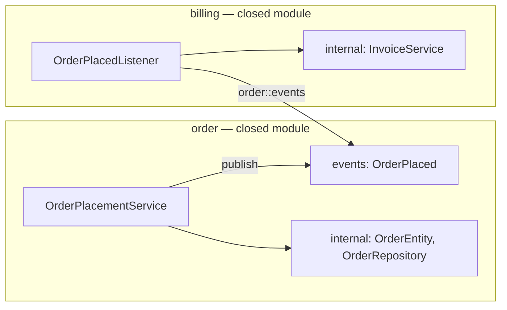

# Ghi nhận thời gian scenario

Một bài kiểm thử Spring Modulith có thể xác nhận “đã phát `OrderPlaced`” và “listener đã tạo hóa đơn”, nhưng vẫn bỏ sót câu hỏi quan trọng: **mất bao lâu để các điều kiện ấy xảy ra?** Khi xử lý sự kiện sau commit hoặc bất đồng bộ, việc chỉ nhìn kết quả cuối cùng có thể che khuất việc một listener bị chậm, một transaction kéo dài hoặc một bài test thường xuyên chạm giới hạn thời gian chờ.

**Ghi nhận thời gian scenario** là quan sát các khoảng thời gian có ý nghĩa trong một kịch bản kiểm thử: bắt đầu kích hoạt (*stimulus*), lời gọi trả về, event được quan sát, tác dụng phụ của listener trở nên thấy được và — nếu có theo dõi publication — trạng thái hoàn tất. Giá trị thời gian cần đi kèm **định nghĩa mốc đo, correlation ID và phạm vi test**, chứ không chỉ là một con số `elapsed=123ms`.

Bài thuộc chương **Observability tests** của lộ trình **SPRING_MODULITH_VERIFICATION_TESTING**. Chúng ta sẽ thực hành `Scenario`, `@ApplicationModuleTest`, `@RecordApplicationEvents`, `System.nanoTime()`, test event và database có chờ theo điều kiện, quan sát metrics, rồi kết hợp `ApplicationModules.verify()` và quality gate CI để ngăn phụ thuộc sai, hồi quy hành vi và phép đo dễ gây hiểu lầm.

> **Nguyên tắc:** Thời gian chờ trong test **không mặc nhiên là SLA/SLO nghiệp vụ**. `await().atMost(10s)` chỉ giới hạn việc **đợi điều kiện**; một lần PASS không chứng minh p95 hay p99 của production nhỏ hơn 10 giây. Hãy phân biệt “test không treo”, “đã quan sát độ trễ” và “hệ thống đạt ngân sách hiệu năng”.

## 1. Scenario gồm những mốc thời gian nào?

Giả sử một lời gọi đặt hàng của module `order` phát `OrderPlaced`; module `billing` nhận event và tạo bản ghi hóa đơn. Có thể đặt những mốc quan sát sau:

| Mốc | Tên | Ý nghĩa |
| --- | --- | --- |
| **T0** | Stimulus started | Test bắt đầu kích hoạt lời gọi `placeOrder(...)` |
| **T1** | Stimulus returned | Lời gọi service kết thúc; với transaction được quản lý ở service proxy, commit thường hoàn tất trước khi caller nhận kết quả thành công |
| **T2** | Event observed | Test nhìn thấy một `OrderPlaced` **thuộc đúng stimulus** |
| **T3** | Side effect visible | Test nhìn thấy hóa đơn của đúng đơn trong database sau khi listener xử lý |
| **T4** | Publication completed | Backend Event Publication Registry xác nhận publication tương ứng hoàn tất, nếu được cấu hình và có API quan sát |



**Đừng giả định mọi mốc luôn theo thứ tự T0 → T1 → T2 → T3 → T4.** Event có thể được phát **trong** phương thức transactional trước khi lời gọi trả về, nên recorder có thể thấy T2 trước T1. Listener bất đồng bộ có thể bắt đầu sau commit, còn việc đánh dấu publication hoàn tất phụ thuộc registry/backend.

### Những khoảng thời gian cần gọi đúng tên

| Khoảng đo | Cách đo gợi ý | Kết luận hợp lệ |
| --- | --- | --- |
| **Stimulus call duration** | T0 đến T1 với đồng hồ đơn điệu | Độ trễ lời gọi service như test quan sát, gồm các bước đồng bộ liên quan |
| **Time to observed event** | T0 tới T2 | Thời gian đến lúc test nhận thấy event phù hợp; **không** phải thời gian listener hoàn thành |
| **Time to side effect** | T0 tới T3 | Độ trễ end-to-end **được quan sát từ test** đến trạng thái nghiệp vụ |
| **Listener handler duration** | Bắt đầu/kết thúc handler trong cùng lần xử lý | Thời gian chạy logic handler, **không** bao gồm thời gian xếp hàng trước đó |
| **Time to publication completion** | T0 tới T4 qua registry nếu có | Thời gian đến trạng thái hoàn tất của publication theo backend |
| **Test-method duration** | Trước/sau toàn bộ JUnit method | Bao gồm fixture, assertion, overhead test; **không** tương đương thời gian nghiệp vụ |

Khi ghi log hoặc tạo biểu đồ, luôn đặt tên thống nhất như `stimulusMs`, `eventObservedMs`, `sideEffectVisibleMs`. Đặt tên mơ hồ `processingTime` sẽ khiến người đọc không biết đó là handler, cả luồng hay chỉ thời gian đợi.

## 2. Dùng đồng hồ nào để ghi nhận thời gian?

Có hai loại thời gian cần phân biệt:

- **Thời điểm tuyệt đối (*wall-clock timestamp*):** “event xảy ra lúc 10:00:00 UTC”; trong Java thường dùng `Instant` và `Clock`.
- **Khoảng thời gian đã trôi qua (*elapsed duration*):** “từ lúc test kích hoạt đến lúc quan sát event là 37 ms”; trong cùng JVM, dùng `System.nanoTime()` hoặc công cụ stopwatch dựa trên nguồn thời gian đơn điệu.

```java
long startedNanos = System.nanoTime();

// Thao tác cần quan sát
performAction();

long elapsedNanos = System.nanoTime() - startedNanos;
java.time.Duration elapsed =
        java.time.Duration.ofNanos(elapsedNanos);

System.out.println("Elapsed: " + elapsed.toMillis() + " ms");
```

`System.nanoTime()` có điểm gốc tùy ý; **không phải Unix epoch**. Ta chỉ nên sử dụng **hiệu hai lần đọc trong cùng JVM**. `Instant.now()` phù hợp để gắn timestamp vào event nhưng có thể chịu tác động đồng bộ/điều chỉnh đồng hồ hệ thống; không nên lấy hai timestamp độc lập làm đồng hồ hiệu năng chính khi kiểm thử độ trễ ngắn.

| Công cụ | Phù hợp | Không nên dùng để |
| --- | --- | --- |
| `System.nanoTime()` | Đo elapsed giữa hai mốc trong cùng JVM | In thời điểm UTC; đối chiếu thẳng với timestamp DB hoặc máy khác |
| `Duration` | Biểu diễn khoảng thời gian và ngưỡng chờ rõ đơn vị | Tự cung cấp nguồn thời gian |
| `Clock` + `Instant` | Quy định thời gian nghiệp vụ, test thời hạn/hết hạn | Đo độ trễ chính xác nếu clock bị cố định trong test |
| `System.currentTimeMillis()` | Timestamp đơn giản khi cần tương tác thời gian tuyệt đối | Benchmark ngắn có yêu cầu tính đơn điệu |
| Micrometer `Timer` | Thu thập phân phối latency qua nhiều lần đo | Tự chứng minh hành vi hoặc phụ thuộc kiến trúc hợp lệ |

### Không so sánh nhầm hai miền đồng hồ

Ví dụ sau **không có nghĩa**:

```java
// SAI: nanoTime không có cùng epoch với Instant.
long elapsed = System.nanoTime() - event.occurredAt().toEpochMilli();
```

Một vế là số nanosecond kể từ điểm gốc tùy ý, vế kia là millisecond tính từ epoch UTC. Ngay cả khi quy đổi đơn vị, hai điểm gốc vẫn khác nhau.

Để đo khoảng thời gian giữa **hai JVM hoặc hai service**, cần đồng bộ/tracing phù hợp và hiểu sai số đồng hồ; việc trừ hai `System.nanoTime()` đọc trên hai process không hợp lệ.

## 3. Ví dụ ứng dụng: `order` phát event, `billing` xử lý

Giả sử ứng dụng `com.example.store.StoreApplication` nhận diện hai application module theo package con trực tiếp:

```text
com.example.store
├── StoreApplication.java
├── order/
│   ├── OrderPlacementService.java           ← stimulus của test
│   ├── events/
│   │   ├── package-info.java               ← @NamedInterface("events")
│   │   └── OrderPlaced.java
│   └── internal/
│       ├── OrderEntity.java
│       └── OrderRepository.java
└── billing/
    ├── package-info.java                   ← allowedDependencies = "order::events"
    └── internal/
        ├── OrderPlacedListener.java
        └── InvoiceService.java
```

Module `order` sở hữu dữ liệu tạo đơn và **kiểu event được công bố**. Module `billing` biết `OrderPlaced` nhưng không được import `order.internal.OrderRepository`.



### Công bố event qua named interface

File `src/main/java/com/example/store/order/events/package-info.java`:

```java
/**
 * Sự kiện đơn hàng dành cho các application module tiêu thụ.
 *
 * <p>correlationId liên kết các bước cùng một luồng nghiệp vụ.
 * occurredAt là thời điểm nghiệp vụ tạo event, không phải
 * phép đo thời gian xử lý của listener.
 */
@org.springframework.modulith.NamedInterface("events")
package com.example.store.order.events;
```

Kiểu sự kiện:

```java
// order/events/OrderPlaced.java
package com.example.store.order.events;

import java.time.Instant;
import java.util.Objects;
import java.util.UUID;

public record OrderPlaced(
        UUID eventId,
        UUID correlationId,
        UUID orderId,
        Instant occurredAt
) {
    public OrderPlaced {
        Objects.requireNonNull(eventId, "eventId");
        Objects.requireNonNull(correlationId, "correlationId");
        Objects.requireNonNull(orderId, "orderId");
        Objects.requireNonNull(occurredAt, "occurredAt");
    }
}
```

`eventId` là danh tính của **một sự kiện**, `orderId` của **một đơn**, còn `correlationId` nối event với stimulus. Không tự suy luận ba giá trị này là một. Mọi test dưới đây dùng correlation ID riêng để tránh nhận nhầm event của thao tác khác.

### Bên tiêu thụ giới hạn phụ thuộc

File `src/main/java/com/example/store/billing/package-info.java`:

```java
@org.springframework.modulith.ApplicationModule(
    allowedDependencies = "order::events"
)
package com.example.store.billing;
```

`@ApplicationModule` này giới hạn **phụ thuộc ở mức kiến trúc**; nó không tự cấu hình thời gian chờ, transaction hay tốc độ xử lý event.

## 4. Publisher transactional để có mốc stimulus rõ ràng

Dùng JPA trong ví dụ giúp liên hệ với bài test sau commit. Entity nội bộ:

```java
// order/internal/OrderEntity.java
package com.example.store.order.internal;

import jakarta.persistence.Entity;
import jakarta.persistence.Id;
import jakarta.persistence.Table;
import java.util.UUID;

@Entity
@Table(name = "shop_orders")
public class OrderEntity {

    @Id
    private UUID id;

    private UUID correlationId;

    protected OrderEntity() {}

    public OrderEntity(UUID id, UUID correlationId) {
        this.id = id;
        this.correlationId = correlationId;
    }
}
```

Repository nội bộ:

```java
// order/internal/OrderRepository.java
package com.example.store.order.internal;

import java.util.UUID;
import org.springframework.data.jpa.repository.JpaRepository;

/** Public theo Java nhưng thuộc API nội bộ của module order. */
public interface OrderRepository
        extends JpaRepository<OrderEntity, UUID> {}
```

Service tại package gốc:

```java
// order/OrderPlacementService.java
package com.example.store.order;

import com.example.store.order.events.OrderPlaced;
import com.example.store.order.internal.OrderEntity;
import com.example.store.order.internal.OrderRepository;
import java.time.Instant;
import java.util.Objects;
import java.util.UUID;
import org.springframework.context.ApplicationEventPublisher;
import org.springframework.stereotype.Service;
import org.springframework.transaction.annotation.Transactional;

@Service
public class OrderPlacementService {

    private final OrderRepository orders;
    private final ApplicationEventPublisher events;

    public OrderPlacementService(
            OrderRepository orders,
            ApplicationEventPublisher events) {
        this.orders = orders;
        this.events = events;
    }

    @Transactional
    public UUID placeOrder(UUID correlationId) {
        Objects.requireNonNull(correlationId, "correlationId");

        UUID orderId = UUID.randomUUID();
        orders.save(new OrderEntity(orderId, correlationId));

        events.publishEvent(new OrderPlaced(
                UUID.randomUUID(),
                correlationId,
                orderId,
                Instant.now()
        ));

        return orderId;
    }
}
```

Ví dụ cần JPA, transaction manager, datasource, schema và test data phù hợp mới chạy được. `@Transactional` hoạt động khi phương thức được gọi qua proxy Spring đúng cách. Nếu service ném exception hoặc transaction rollback, recorder vẫn **có thể đã thấy** event được phát trước rollback, nhưng listener chạy **sau commit** không có cùng kết luận.

Đối với phép đo T0–T1, lời gọi qua proxy bao gồm thời gian xử lý giao dịch đồng bộ mà caller phải đợi. Đối với T0–T2, recorder quan sát event khi được publish, không phải khi hóa đơn được tạo.

## 5. Đo thời gian `Scenario` đến event phù hợp

Spring Modulith có `org.springframework.modulith.test.Scenario`, cho phép mô tả một stimulus và **điều kiện chờ** event. Kết hợp correlation ID với đồng hồ đơn điệu giúp ghi nhận thời gian của một luồng rõ ràng.

```java
// src/test/java/com/example/store/order/OrderScenarioTimingTest.java
package com.example.store.order;

import com.example.store.order.events.OrderPlaced;
import java.time.Duration;
import java.util.UUID;
import org.junit.jupiter.api.Test;
import org.slf4j.Logger;
import org.slf4j.LoggerFactory;
import org.springframework.beans.factory.annotation.Autowired;
import org.springframework.modulith.test.ApplicationModuleTest;
import org.springframework.modulith.test.Scenario;

import static org.assertj.core.api.Assertions.assertThat;

@ApplicationModuleTest
class OrderScenarioTimingTest {

    private static final Logger LOG =
            LoggerFactory.getLogger(OrderScenarioTimingTest.class);

    @Autowired
    OrderPlacementService orders;

    @Test
    void measuresTimeUntilMatchingEventIsObserved(Scenario scenario) {
        UUID correlationId = UUID.randomUUID();
        long startedNanos = System.nanoTime();

        scenario.stimulate(() ->
                    orders.placeOrder(correlationId)
                )
                .andWaitForEventOfType(OrderPlaced.class)
                .matching(event ->
                        correlationId.equals(event.correlationId()))
                .toArriveAndVerify(event -> {
                    assertThat(event.correlationId())
                            .isEqualTo(correlationId);
                    assertThat(event.orderId()).isNotNull();
                });

        Duration observedElapsed = Duration.ofNanos(
                System.nanoTime() - startedNanos
        );

        LOG.info(
                "scenario=order_event_observed correlationId={} elapsedMs={}",
                correlationId,
                observedElapsed.toMillis()
        );

        // Sanity check về phép đo, KHÔNG phải một SLA.
        assertThat(observedElapsed).isGreaterThanOrEqualTo(Duration.ZERO);
    }
}
```

Đoạn test dựa trên các API scenario có trong Spring Modulith test; tùy phiên bản thư viện có thể có khác biệt ở cấu hình timeout và các tùy chọn DSL. Khi triển khai, phải dùng phiên bản `spring-modulith-test` tương thích với dự án. Test này cũng cần datasource/schema cho `OrderRepository` như phần trước.

### Đọc kết quả đúng cách

- `Scenario.stimulate(...)` thực hiện stimulus, sau đó `andWaitForEventOfType(...)` chờ một `OrderPlaced`.
- `.matching(...)` chọn event **thuộc đúng correlation ID**, tránh PASS nhờ event của test/stimulus khác.
- `.toArriveAndVerify(...)` xác nhận payload event được quan sát.
- `System.nanoTime()` đặt **ngoài** chuỗi scenario đo khoảng thời gian để hoàn tất **cả lời gọi stimulus, bước chờ, callback assertion và overhead test API**.

Vì vậy, `observedElapsed` trong code **không phải chính xác timestamp T2 trừ T0**; nó là **thời gian thực hiện toàn chuỗi scenario đến khi phép xác minh trả về**. Với event đến đồng bộ, con số phần lớn phản ánh lời gọi + overhead test; với event bất đồng bộ, nó có thể bao gồm thời gian chờ.

Muốn báo chính xác hơn về mốc T2, có thể ghi `System.nanoTime()` **trong callback** và so với T0; nhưng callback vẫn diễn ra tại thời điểm test xử lý event, không phải timestamp phát sinh nghiệp vụ trong publisher.

```java
// Minh họa đo tới callback của Scenario:
java.util.concurrent.atomic.AtomicLong observedAtNanos =
        new java.util.concurrent.atomic.AtomicLong();

long startNanos = System.nanoTime();

scenario.stimulate(() -> orders.placeOrder(correlationId))
        .andWaitForEventOfType(OrderPlaced.class)
        .matching(event ->
                correlationId.equals(event.correlationId()))
        .toArriveAndVerify(event -> {
            observedAtNanos.set(System.nanoTime());
            assertThat(event.correlationId())
                    .isEqualTo(correlationId);
        });

Duration toCallback = Duration.ofNanos(
        observedAtNanos.get() - startNanos
);
```

Đoạn bổ sung này nằm **bên trong một test đã có field `orders`, biến `correlationId` và tham số `Scenario scenario`**; không phải một file Java độc lập. `AtomicLong` là lựa chọn rõ nghĩa khi callback có thể được thực thi trong một ngữ cảnh khác; cũng cần ghi lại **điều gì** được đo trong tên metric/log.

### “Event arrived” chưa phải “listener completed”

Test của module `order` có thể chạy trong phạm vi `@ApplicationModuleTest` độc lập, **không bootstrap module `billing`**. Ngay cả khi event được recorder quan sát, không thể khẳng định đã có hóa đơn hoặc publication hoàn tất.

Khi cần đo đến kết quả của listener, phải chọn **mốc T3** và chạy kiểm thử tích hợp với module nhận, transaction và database thật hoặc test environment tương đương.

## 6. Đo riêng thời gian lời gọi stimulus bằng `@RecordApplicationEvents`

Một cách khác giúp tránh nhập nhằng là tách rõ **duration của lời gọi đồng bộ** và **kiểm tra event đã publish**.

```java
// src/test/java/com/example/store/order/OrderStimulusDurationTest.java
package com.example.store.order;

import com.example.store.order.events.OrderPlaced;
import java.time.Duration;
import java.util.UUID;
import org.junit.jupiter.api.Test;
import org.springframework.beans.factory.annotation.Autowired;
import org.springframework.modulith.test.ApplicationModuleTest;
import org.springframework.test.context.event.ApplicationEvents;
import org.springframework.test.context.event.RecordApplicationEvents;

import static org.assertj.core.api.Assertions.assertThat;

@ApplicationModuleTest
@RecordApplicationEvents
class OrderStimulusDurationTest {

    @Autowired
    OrderPlacementService orders;

    @Autowired
    ApplicationEvents events;

    @Test
    void separatesCallDurationFromPublicationAssertion() {
        UUID correlationId = UUID.randomUUID();

        long started = System.nanoTime();
        UUID orderId = orders.placeOrder(correlationId);
        Duration callDuration = Duration.ofNanos(
                System.nanoTime() - started
        );

        var matching = events.stream(OrderPlaced.class)
                .filter(event ->
                        correlationId.equals(event.correlationId()))
                .toList();

        assertThat(matching).hasSize(1);
        assertThat(matching.get(0).orderId()).isEqualTo(orderId);

        System.out.printf(
                "scenario=order_call correlationId=%s callMs=%d%n",
                correlationId, callDuration.toMillis()
        );
    }
}
```

Đây là **hai phép kiểm tra khác nhau**: duration đo lời gọi qua service proxy; `ApplicationEvents` xác nhận một event phù hợp được publish. Khi test không có transaction do test quản lý bao ngoài, việc trả về thành công từ một service `@Transactional` thường bao gồm commit transaction; tuy nhiên E1 **không xác nhận listener sau commit**.

**Không bắt buộc test nào cũng cần `Scenario`.** Nếu mục tiêu chỉ là đo một lời gọi và kiểm tra synchronous publication, `@RecordApplicationEvents` có thể đủ và dễ đọc. Khi có stimulus → asynchronous event hoặc side effect cần chờ, `Scenario` hoặc công cụ chờ theo điều kiện làm rõ ý đồ hơn.

## 7. Đo đến khi listener ghi dữ liệu: thời gian end-to-end quan sát được

Giả sử module `billing` xử lý `OrderPlaced` và ghi một hóa đơn với `order_id` và `correlation_id`. Đó là **tác dụng phụ quan sát được** — mốc T3. Một bài test tích hợp có thể đo từ trước stimulus tới lúc thấy bản ghi:

```sql
-- DDL minh họa, không phải schema có sẵn trong project:
create table billing_invoices (
    order_id uuid primary key,
    correlation_id uuid not null,
    status varchar(32) not null
);
```

Trong `billing`, listener được quản lý bởi Spring Modulith:

```java
// billing/internal/OrderPlacedListener.java
package com.example.store.billing.internal;

import com.example.store.order.events.OrderPlaced;
import org.springframework.modulith.events.ApplicationModuleListener;
import org.springframework.stereotype.Component;

@Component
class OrderPlacedListener {

    private final InvoiceService invoices;

    OrderPlacedListener(InvoiceService invoices) {
        this.invoices = invoices;
    }

    @ApplicationModuleListener
    void on(OrderPlaced event) {
        invoices.createOnce(
                event.orderId(),
                event.correlationId()
        );
    }
}
```

`InvoiceService.createOnce(...)` ở đây là một **dịch vụ cần được dự án hiện thực**, có repository/schema/giao dịch phù hợp và idempotency để tránh tạo trùng hóa đơn. Chưa có implementation này thì ví dụ tích hợp **chưa chạy được nguyên xi**.

### Chờ kết quả bằng Awaitility

```java
// src/test/java/com/example/store/OrderBillingTimingTest.java
package com.example.store;

import com.example.store.order.OrderPlacementService;
import java.time.Duration;
import java.util.UUID;
import org.junit.jupiter.api.Test;
import org.springframework.beans.factory.annotation.Autowired;
import org.springframework.boot.test.context.SpringBootTest;
import org.springframework.jdbc.core.JdbcTemplate;

import static org.assertj.core.api.Assertions.assertThat;
import static org.awaitility.Awaitility.await;

@SpringBootTest
class OrderBillingTimingTest {

    @Autowired
    OrderPlacementService orders;

    @Autowired
    JdbcTemplate jdbc;

    @Test
    void recordsTimeUntilInvoiceBecomesVisible() {
        UUID correlationId = UUID.randomUUID();

        long started = System.nanoTime();
        UUID orderId = orders.placeOrder(correlationId);

        await()
                .atMost(Duration.ofSeconds(10))
                .untilAsserted(() -> {
                    Integer count = jdbc.queryForObject(
                            "select count(*) from billing_invoices "
                                    + "where order_id = ? "
                                    + "and correlation_id = ?",
                            Integer.class,
                            orderId,
                            correlationId
                    );
                    assertThat(count).isEqualTo(1);
                });

        Duration endToEnd = Duration.ofNanos(
                System.nanoTime() - started
        );

        System.out.printf(
                "scenario=order_to_invoice correlationId=%s elapsedMs=%d%n",
                correlationId,
                endToEnd.toMillis()
        );
    }
}
```

**Điều kiện để chạy ví dụ:**

1. `@SpringBootTest` nạp được cả `order` và `billing`, bao gồm `OrderPlacedListener` và `InvoiceService`.
2. Cần datasource/schema cho cả bảng đơn hàng và hóa đơn, dependency Awaitility, transaction manager và cơ chế xử lý event đúng với phiên bản Spring Modulith.
3. Test **không có transaction bên ngoài tự rollback** làm listener sau commit không được kích hoạt; gọi `placeOrder` qua Spring bean/proxy thực sự commit.
4. Mỗi test tạo correlation ID riêng, dữ liệu được seed/cleanup hoặc cô lập để tránh nhìn thấy bản ghi của lần chạy khác.
5. Timeout 10 giây là **giới hạn chờ minh họa**, không phải yêu cầu độ trễ sản phẩm.

### Con số `endToEnd` đo đến đâu?

Nó đo **thời gian từ trước lời gọi đặt đơn đến lần polling mà test thấy đúng bản ghi hóa đơn**. Thời gian thực tế listener commit xong có thể sớm hơn lần test polling tiếp theo. Do đó, đây là **độ trễ quan sát bởi test**, không phải timestamp chính xác của commit và cũng không tách được queue delay khỏi execution time.

Đừng gán nhãn giá trị này là “thời gian listener xử lý”. Muốn đo riêng handler, đặt đồng hồ **trong listener**; muốn đo thời gian xếp hàng, cần quan sát thời điểm enqueue và bắt đầu xử lý bằng một cơ chế được thiết kế rõ ràng.

## 8. Đo riêng handler và giữ correlation ID trong log

Nếu cần phân biệt listener chạy chậm với listener được gọi muộn, có thể instrument chính handler. Ví dụ:

```java
// Trích đoạn dùng bên trong billing/internal/OrderPlacedListener.java
private static final org.slf4j.Logger LOG =
        org.slf4j.LoggerFactory.getLogger(
                OrderPlacedListener.class
        );

@org.springframework.modulith.events.ApplicationModuleListener
void on(com.example.store.order.events.OrderPlaced event) {
    try (org.slf4j.MDC.MDCCloseable ignored =
            org.slf4j.MDC.putCloseable(
                    "correlationId",
                    event.correlationId().toString())) {

        long started = System.nanoTime();
        boolean successful = false;

        try {
            invoices.createOnce(
                    event.orderId(),
                    event.correlationId()
            );
            successful = true;
        } finally {
            long elapsedMs = java.time.Duration.ofNanos(
                    System.nanoTime() - started
            ).toMillis();

            LOG.info(
                    "stage=listener_handling event=OrderPlaced "
                            + "handlerMs={} success={}",
                    elapsedMs,
                    successful
            );
        }
    }
}
```

Đây là **trích đoạn thay thế method** trong ví dụ listener đã có field `invoices`, không phải class Java độc lập. Nếu xử lý lỗi, đừng nuốt exception để ép log `success=true`. Giữ exception đi theo cơ chế của listener để publication tracking/retry có thể hoạt động theo cấu hình.

**Lưu ý về MDC:** `MDC` thường gắn với thread. Một listener bất đồng bộ có thể chạy trên thread khác với publisher, nên **không thể giả định MDC được tự động truyền** qua ranh giới async. Cách ở trên lấy correlation ID **từ event payload**, đặt vào MDC ngay trong listener rồi dọn khi kết thúc.

### Không suy luận queue delay bằng cách lấy `Instant` trừ nhau một cách vội vàng

Có thể định nghĩa một timestamp `listenerStartedAt` và tính gần đúng `listenerStartedAt - event.occurredAt()`, nhưng khoảng đó bao gồm nhiều yếu tố: thời gian từ khi event được tạo đến khi transaction commit, lịch executor, scheduling, thời gian queue và sai số đồng hồ. Trong cùng JVM với một `Clock` nhất quán, nó có thể hỗ trợ quan sát nhưng **không đồng nghĩa độ trễ riêng của queue**.

Muốn đo queue delay một cách có nghĩa, cần xác định **enqueue timestamp** và **dequeue/start timestamp** trong cùng cơ chế hàng đợi và xử lý vấn đề đồng hồ, retry, transaction. Đừng đưa ra con số chính xác hơn dữ liệu quan sát cho phép.

## 9. Tách “thời gian nghiệp vụ” và “thời gian chạy thật” với `Clock`

Một test nghiệp vụ khác có thể cần xác nhận event mang đúng `occurredAt`. Không nên dùng cùng kỹ thuật đo duration để test timestamp tuyệt đối.

Một cách thiết kế tốt là inject `Clock` vào module phát sự kiện:

```java
// Ví dụ phần thêm vào service, cần bean Clock phù hợp.
private final java.time.Clock clock;

// Trong constructor nhận Clock:
this.clock = clock;

// Khi xây dựng event:
java.time.Instant occurredAt = java.time.Instant.now(clock);
```

Trong test thời gian nghiệp vụ, có thể dùng một `Clock.fixed(...)` để tạo timestamp **ổn định, có thể assert chính xác**:

```java
java.time.Clock fixedClock = java.time.Clock.fixed(
        java.time.Instant.parse("2026-01-01T00:00:00Z"),
        java.time.ZoneOffset.UTC
);

assertThat(java.time.Instant.now(fixedClock))
        .isEqualTo(java.time.Instant.parse("2026-01-01T00:00:00Z"));
```

**Đồng hồ cố định không phù hợp đo elapsed time.** Nếu dùng `Instant.now(fixedClock)` trước và sau một thao tác, hiệu sẽ bằng 0 dù thao tác mất nhiều giây. Hãy tách hai câu hỏi:

- *Event xảy ra lúc nào theo đồng hồ nghiệp vụ?* → `Clock`/`Instant`.
- *Thao tác mất bao lâu trong test?* → `System.nanoTime()` hoặc `Timer`.

Nếu cần đo nhiều chặng với một abstraction để test deterministic, có thể bọc nguồn elapsed time trong interface riêng và dùng **fake ticker** trong unit test. Nhưng đừng trình bày thời gian giả lập đó như số đo performance của runtime thật.

## 10. Thêm metrics với Micrometer `Timer` khi cần tổng hợp nhiều lần

Log `elapsedMs` có ích để điều tra **một lần chạy**. Nếu muốn theo dõi phân phối thời gian trên nhiều lần chạy hoặc môi trường, Micrometer `Timer` phù hợp hơn vì cung cấp cơ chế ghi duration và kết nối hệ thống metrics.

Ví dụ đơn giản với một `SimpleMeterRegistry` trong test:

```java
import io.micrometer.core.instrument.Timer;
import io.micrometer.core.instrument.simple.SimpleMeterRegistry;

SimpleMeterRegistry registry = new SimpleMeterRegistry();

try {
    Timer.Sample sample = Timer.start(registry);

    try {
        // Thực thi stimulus/scenario có điều kiện chờ thực sự.
        performObservedScenario();
    } finally {
        sample.stop(Timer.builder("modulith.scenario.elapsed")
                .description("Observed elapsed time for a test scenario")
                .tag("scenario", "order_to_billing")
                .register(registry));
    }

    long samples = registry.get("modulith.scenario.elapsed")
            .timer()
            .count();

    assertThat(samples).isEqualTo(1L);
} finally {
    registry.close();
}
```

Trích đoạn này minh họa **cách instrument**, giả định có method `performObservedScenario()` và AssertJ assertion trong test; không phải một file Java hoàn chỉnh. `Timer.Sample` bắt đầu ở thời điểm gọi `Timer.start`, và `stop` ghi duration vào một timer với những tag đã khai báo. `finally` bảo đảm phần ghi metric diễn ra cả khi scenario ném lỗi; kết quả metrics khi thất bại cần được giải thích bằng outcome tag/log trong hệ thống thực tế.

**Không gắn `correlationId`, `orderId`, `eventId`, email hoặc raw URL làm tag metrics.** Những giá trị gần như độc nhất sẽ gây *high cardinality*, làm tăng số chuỗi metrics và chi phí lưu trữ. Thay vào đó:

| Dùng trong log/traces | Dùng làm tag metrics |
| --- | --- |
| `correlationId=...` | `scenario=order_to_billing` |
| `orderId=...` | `outcome=success/failure` |
| `eventId=...` | `component=publisher/listener` |
| Stack trace cụ thể | `failureType=timeout/database/business` (tập giá trị hữu hạn) |

Metrics cần tập hợp **nhiều phép đo** mới có ý nghĩa khi tính percentile. Một bài test đơn lẻ với `Timer.count() == 1` chỉ chứng minh đã instrument, không thể suy ra p95 hoặc p99 thực tế. Nếu dùng histogram/percentile, hãy bật cấu hình phù hợp với hệ thống quan sát và hiểu thời hạn gom mẫu.

## 11. Timeout chờ và latency budget là hai khái niệm khác nhau

Một scenario có thể phải chờ đến khi listener ghi dữ liệu. Đặt giới hạn chờ là cần thiết để **CI không bị treo**:

```java
await()
    .atMost(java.time.Duration.ofSeconds(10))
    .untilAsserted(() -> {
        // Assertion về tác dụng phụ cần chờ.
    });
```

Đây là **failure bound cho phép chờ**, không phải tuyên bố hệ thống đủ nhanh cho người dùng. Tương tự, việc ghi `elapsedMs=8000` rồi test PASS vì nhỏ hơn 10 giây không chứng minh dịch vụ đáp ứng SLO 200 ms.

| Mục tiêu | Cách đo/kiểm tra | Lưu ý |
| --- | --- | --- |
| Không đợi vô hạn | `Scenario` có wait bound hoặc Awaitility `atMost` | Timeout phải báo lỗi khi điều kiện không xảy ra |
| Giảm flaky do async | Chờ **điều kiện** thay vì `Thread.sleep` cố định | Vẫn cần cô lập dữ liệu và correlation ID |
| Kiểm tra logic thời hạn nghiệp vụ | Inject `Clock` và dùng thời gian test có kiểm soát | Không đo performance với clock cố định |
| Phát hiện hồi quy latency rõ rệt | So sánh nhiều mẫu trên hạ tầng ổn định, định nghĩa phép đo | Cần baseline và kiểm soát môi trường |
| Chứng minh SLO vận hành | Metrics production/staging có đủ mẫu, percentile, tải phù hợp | Không dựa trên một assertion JUnit |
| Chẩn đoán xử lý chậm | Tách latency đồng bộ, queue, handler, DB | Không gộp thành một con số khó giải thích |

### Vì sao không assert `elapsedMs < 100` trong mỗi unit test?

Độ trễ quan sát trong CI bị ảnh hưởng bởi:

- JVM class loading, JIT và garbage collection.
- CPU chia sẻ trên runner, contention hoặc chạy test song song.
- Khởi tạo Spring context và hạ tầng database/test containers.
- Scheduler bất đồng bộ, polling interval và thiết lập timeout.
- Cold/warm cache, migration/schema và dữ liệu nền.

Nếu đặt một ngưỡng chặt mà không kiểm soát các yếu tố này, test sẽ **flaky** và gây mất niềm tin vào quality gate. Trong các bài kiểm thử chức năng, hãy assert **kết quả đúng trước timeout hợp lý** và ghi lại duration để quan sát. Nếu tổ chức cần **performance gate**, hãy xây dựng suite riêng với tải, môi trường, số lần lặp, baseline và ngân sách đã được định nghĩa.

**Ngoại lệ có chủ đích:** một số contract nghiệp vụ có deadline cứng cần test (ví dụ token hết hạn sau 5 phút). Khi đó thường nên kiểm tra **logic deadline bằng `Clock` giả lập**, không bằng việc chờ thực 5 phút trong CI.

## 12. Correlation ID giúp phép đo thuộc đúng stimulus

Khi các listener chạy async, một thời gian end-to-end chỉ có ý nghĩa nếu điểm kết thúc thuộc **cùng stimulus**. Nếu test chỉ đếm “có ít nhất một hóa đơn”, nó có thể PASS từ dữ liệu cũ.

Một phép đo vững hơn dùng cả `correlationId` và khóa aggregate:

```java
UUID correlationId = UUID.randomUUID();
long started = System.nanoTime();

UUID orderId = orders.placeOrder(correlationId);

// Sau đó chờ:
// select count(*) from billing_invoices
// where order_id = ? and correlation_id = ?

Duration observed = Duration.ofNanos(
        System.nanoTime() - started
);
```

**Lưu ý:** trích đoạn trên chỉ minh họa điểm đặt đồng hồ; phải thực sự có đoạn `await().untilAsserted(...)` như phần 7 giữa hai lần đọc. Nếu bỏ bước chờ, `observed` chỉ gần với thời gian gọi stimulus.

### Hai stimulus chạy sát nhau

| Stimulus | Correlation ID | Order ID | Event mong đợi | Side effect mong đợi |
| --- | --- | --- | --- | --- |
| A | C-A | O-A | `OrderPlaced(C-A, O-A)` | Invoice của O-A, C-A |
| B | C-B | O-B | `OrderPlaced(C-B, O-B)` | Invoice của O-B, C-B |

Bài test âm nên chứng minh **event/side effect B không thỏa điều kiện chờ cho A**. Việc gọi hai stimulus tuần tự giúp kiểm tra bộ lọc; muốn chứng minh tính đúng đắn dưới cạnh tranh phải thực sự chạy đồng thời và có công cụ điều phối.

### Idempotency cũng ảnh hưởng tới phép đo

Nếu listener retry vì publication chưa được đánh dấu hoàn tất, event của cùng đơn có thể được xử lý lại. Khi đó có thể ghi:

- `correlationId` chung của luồng.
- `eventId` định danh event.
- `attempt` hoặc `retryCount` của lần xử lý nếu hạ tầng cung cấp.
- `handlerMs` cho mỗi attempt và `timeToCompletedMs` của cả publication.

**Đừng cộng các duration của nhiều attempt rồi gọi đó là end-to-end latency**, vì còn thời gian đợi giữa các lần retry và các pha commit. Muốn đo thời gian đến hoàn tất, cần hai mốc bao quanh toàn bộ lifecycle.

## 13. Khi có Event Publication Registry

Spring Modulith hỗ trợ theo dõi event publication tới các transactional listener bằng **Event Publication Registry** khi backend phù hợp đã được cấu hình. Khi listener xử lý lỗi, một publication có thể còn chưa hoàn tất; sau khi recovery thành công, registry có thể đánh dấu hoàn tất theo semantics backend.

Tuy nhiên:

- `@RecordApplicationEvents` chỉ ghi nhận event được publish trong test context, **không phải** cơ sở dữ liệu publication.
- `Scenario.andWaitForEventOfType(...)` chờ event được quan sát, **không tự bảo đảm** trạng thái publication completed.
- Test end-to-end chờ hóa đơn được tạo chứng minh side effect, nhưng **không nhất thiết chứng minh** registry đã được cập nhật completion.
- Registry có API/query/schema khác nhau tùy phiên bản và publication store; **không tự đoán tên bảng hay method** để đo T4.
- Phép đo T0–T4 cần định nghĩa rõ publication nào và listener target nào được theo dõi, nhất là khi một event có nhiều listener.

Nếu cần kiểm tra T4, hãy dùng API quan sát trạng thái registry được phiên bản hiện tại hỗ trợ, đồng bộ hóa đủ để tránh race với listener, xác nhận pending/completed và lưu metric/log với loại `publication_completion`. Đối với các luồng quan trọng, cần test **listener lỗi một lần → pending → retry/republication → completed** và bảo đảm side effect idempotent.

### Cảnh báo về “đã thấy hóa đơn” và “đã completed”

Một listener có thể **commit dữ liệu hóa đơn thành công** nhưng gặp lỗi ngay sau đó, trước khi publication được đánh dấu hoàn tất. Khi event được xử lý lại, có nguy cơ tạo hai hóa đơn nếu không có unique constraint hoặc khóa nghiệp vụ. Đây là lý do thời gian T3 và T4 cần được phân biệt, và các test dữ liệu/idempotency phải chạy cùng các test publication lifecycle.

## 14. Kiểm chứng kiến trúc riêng bằng `ApplicationModules.verify()`

Một scenario có thể chạy nhanh và đúng kết quả mà vẫn phá ranh giới module, ví dụ `billing` truy cập thẳng `order.internal.OrderRepository`. Thời gian ngắn **không chứng minh tính hợp lệ kiến trúc**.

Đặt test ở package gốc:

```java
// src/test/java/com/example/store/ModulithArchitectureTest.java
package com.example.store;

import org.junit.jupiter.api.Test;
import org.springframework.modulith.core.ApplicationModules;

class ModulithArchitectureTest {

    @Test
    void verifiesModuleBoundaries() {
        ApplicationModules.of(StoreApplication.class).verify();
    }
}
```

`verify()` phân tích các quy tắc cấu trúc quan trọng, gồm giới hạn phụ thuộc của closed module, `allowedDependencies` và chu trình phụ thuộc. Nó không kiểm tra `elapsedMs`, transaction, event payload hoặc trạng thái hóa đơn.

| Thí nghiệm | `verify()` mong đợi | Scenario/event/integration test |
| --- | --- | --- |
| `billing` chỉ dùng `order::events` | PASS nếu toàn mô hình hợp lệ | Cần test event và side effect |
| `billing` dùng kiểu public trong `order.internal` | **FAIL** khi có phụ thuộc thực sự | Có thể PASS |
| `billing` dùng named interface chưa được cấp phép | **FAIL** | Có thể PASS |
| `order` phụ thuộc ngược vào `billing`, tạo chu trình | **FAIL** | Có thể PASS |
| Event đúng nhưng listener chậm bất thường | Có thể PASS | Ghi nhận duration, test timeout/performance phù hợp |
| Listener ghi hóa đơn sai correlation ID | Có thể PASS | **FAIL** nếu lọc đúng ID |
| Repository được công bố nhầm trong named interface | Có thể PASS theo mô hình đã khai báo | Cần review API riêng |

Muốn tạo ca vi phạm internal có thể biên dịch, dùng một kiểu **public giả lập** ở `order.internal` và tham chiếu thực sự từ `billing` trong field/chữ ký/lời gọi. Nếu kiểu package-private, Java có thể chặn ở compile trước test kiến trúc; chỉ thêm import không sử dụng cũng có thể không tạo dependency được công cụ phân tích nhìn thấy.

## 15. Dùng log và metrics mà không làm hỏng test

Một bản ghi thời gian có giá trị khi nó có đủ **ngữ cảnh**. Ví dụ log minh họa:

```text
INFO scenario=order_event_observed correlationId=C1 eventObservedMs=36
INFO scenario=order_to_invoice    correlationId=C1 sideEffectVisibleMs=81
INFO component=billing_listener   correlationId=C1 handlerMs=11 success=true
```

Đây **không phải số đo đã chạy**, chỉ là ví dụ cách đặt tên trường. Đừng lấy những con số ấy làm baseline hoặc expected values.

Quy ước hữu ích:

| Trường | Gợi ý |
| --- | --- |
| `scenario` | Tên có số lượng giá trị hữu hạn, ví dụ `order_to_invoice` |
| `correlationId` | UUID của stimulus; đặt trong log hoặc trace, không làm tag metrics |
| `stage` | `stimulus`, `event_observed`, `listener_handling`, `side_effect_visible` |
| `elapsedMs` hoặc `durationNs` | Có đơn vị rõ ràng; không trộn millisecond với nanosecond |
| `outcome` | `success`, `timeout`, `failure` |
| `attempt` | Nếu có retry, phân biệt từng lần xử lý |
| `environment` | Biết đây là local, CI, staging hay production |

Không log token, mật khẩu, dữ liệu thanh toán hoặc toàn bộ entity chỉ để xem độ trễ. Trong CI, dùng correlation ID riêng cho mỗi test và lưu JUnit report/stack trace khi timeout, không chỉ in một con số cuối cùng rồi bỏ qua exception.

### Nếu scenario thất bại, vẫn cần biết duration

Có thể ghi duration trong `finally` nhưng **không nuốt lỗi**:

```java
long started = System.nanoTime();

try {
    performObservedScenario();
} finally {
    Duration elapsed = Duration.ofNanos(
            System.nanoTime() - started
    );
    LOG.info("scenario={} elapsedMs={}",
            "order_to_billing",
            elapsed.toMillis());
}
```

Đoạn này giả định có `LOG` và `performObservedScenario()` trong cùng test. `finally` được thực hiện cả khi scenario ném assertion/timeout, nhưng ngoại lệ vẫn tiếp tục truyền ra để test **FAIL đúng cách**. Khi cần phân biệt thành công và thất bại trong metric, bổ sung `outcome` trong `catch` hoặc trạng thái được ghi nhận rõ, tránh log mọi lần là “completed”.

## 16. Đưa việc ghi thời gian vào CI quality gate

Một CI pipeline tốt phải **phân biệt kiểm tra bắt buộc với dữ liệu quan sát**:

| Nhóm kiểm tra | PASS/FAIL dựa trên | Vai trò của thời gian |
| --- | --- | --- |
| **Compile** | Mã và chữ ký Java hợp lệ | Không liên quan trực tiếp |
| **Architecture** | `ApplicationModules.verify()` | Không đo latency; bảo vệ module boundary |
| **Producer contract** | Event type, payload, correlation ID đúng | Có thể ghi thời gian stimulus/event observed |
| **Module bootstrap** | `@ApplicationModuleTest` có bean và hành vi đúng | Log thời gian scenario, không assert số bean/timing cố định |
| **Listener/database integration** | Đúng hóa đơn của đúng đơn sau commit | Chờ với timeout và ghi `sideEffectVisibleMs` |
| **Publication lifecycle** | Pending/completed và recovery đúng khi registry được dùng | Có thể ghi time to completion |
| **Performance gate riêng** | Ngân sách và phương pháp đo đã được thống nhất | So sánh nhiều mẫu trong môi trường kiểm soát |

Với Gradle:

```bash
./gradlew test
```

Với Maven:

```bash
mvn -B test
```

Nếu test Awaitility/JPA/registry được tách sang `integrationTest` hoặc plugin Maven Failsafe, pipeline phải chạy **đúng task/plugin đã cấu hình**; chỉ chạy `test` không mặc định bao phủ mọi test tích hợp.

### Ví dụ GitHub Actions

```yaml
name: Modulith scenario timing tests

on:
  pull_request:

jobs:
  architecture-module-integration:
    runs-on: ubuntu-latest
    permissions:
      contents: read

    steps:
      - uses: actions/checkout@v4

      - uses: actions/setup-java@v4
        with:
          distribution: temurin
          java-version: '21'

      - uses: gradle/actions/setup-gradle@v4

      - name: Run architecture and module tests
        run: bash ./gradlew --no-daemon test

      - name: Run event and database integration tests
        run: bash ./gradlew --no-daemon integrationTest

      - name: Preserve test reports
        if: always()
        uses: actions/upload-artifact@v4
        with:
          name: modulith-scenario-reports
          path: |
            **/build/test-results/**/*.xml
            **/build/reports/tests/**
          if-no-files-found: warn
```

Đây là **workflow minh họa**, chỉ hoạt động nếu dự án có Gradle wrapper, một task `integrationTest` đã được định nghĩa, Java phù hợp, datasource/schema và các dependency test cần thiết. Không có bằng chứng workflow này đã chạy ở workspace được giao.

Muốn chặn merge, branch protection/ruleset phải yêu cầu job thành công. Upload reports với `if: always()` giúp điều tra lỗi mà không biến test FAIL thành PASS.

### Cách tránh một quality gate bị “xanh giả”

1. Không chỉ `System.out.println(elapsed)` mà quên assertion nghiệp vụ: scenario vẫn có thể trả giá sai hoặc nhận nhầm event.
2. Không dùng `Thread.sleep` cố định thay cho chờ điều kiện.
3. Không tăng timeout vô hạn để che lỗi xử lý sự kiện.
4. Không assert ngưỡng latency quá chặt trên runner CI dùng chung khi chưa có phương pháp performance test.
5. Không chỉ nhìn `Scenario` event arrived mà bỏ qua listener/DB nếu yêu cầu là hóa đơn hoàn tất.
6. Không để `verify()` bị bỏ qua bởi filter test hoặc các cờ `-x test`, `skipTests`.
7. Không mở `allowedDependencies` tùy tiện, chuyển module thành open hoặc đưa repository vào public API để làm CI xanh.
8. Không kết luận đạt SLO production từ một lần chạy JUnit trên dữ liệu nhỏ.

## 17. Bài thực hành: đo từ đặt đơn tới hóa đơn

### Bối cảnh

Nhóm phát triển có hai module `order` và `billing`. Trong một pull request, có phản ánh rằng listener tạo hóa đơn **thỉnh thoảng chậm**, nhưng test chỉ kiểm tra có `OrderPlaced` được publish. Bạn cần bổ sung phép đo và kiểm tra để phân biệt **chờ event** với **chờ tác dụng phụ**.

### Các bước

1. **Vẽ timeline:** định nghĩa T0 stimulus started, T1 service returned, T2 event observed, T3 invoice visible và T4 publication completion (nếu dùng registry). Ghi rõ mốc nào test có thể quan sát.
2. **Tạo ranh giới:** `order` công bố `@NamedInterface("events")`; `billing` khai báo `allowedDependencies = "order::events"`; giữ repository và entity ở các subpackage nội bộ.
3. **Tạo correlation ID:** trong test, tạo một `UUID` riêng rồi truyền qua service vào `OrderPlaced`.
4. **Viết producer test:** dùng `@ApplicationModuleTest` và `@RecordApplicationEvents` để xác nhận đúng event của correlation ID; đo riêng T0–T1 bằng `System.nanoTime()`.
5. **Viết `Scenario` test:** `stimulate(...).andWaitForEventOfType(OrderPlaced.class).matching(...).toArriveAndVerify(...)`; ghi thời gian toàn chuỗi và giải thích phần overhead/đợi.
6. **Instrument handler:** listener ghi `handlerMs` của từng lần xử lý và dùng MDC trong thread listener, không dựa vào MDC của publisher.
7. **Viết test T3:** với test DB và invoice service thật, dùng Awaitility chờ một hóa đơn khớp cả `orderId` và `correlationId`, ghi duration và đặt timeout hữu hạn.
8. **Thử hai stimulus:** tạo hai correlation ID khác nhau, chứng minh điều kiện của A không thể được thỏa bằng event hoặc hóa đơn của B.
9. **Thử làm chậm listener có kiểm soát:** thay handler bằng test double có cơ chế điều phối bằng latch/barrier; quan sát T3 lớn lên trong khi T2 có thể không đổi. Không dùng `Thread.sleep` để giả định thứ tự chắc chắn.
10. **Thử lỗi listener:** buộc listener ném exception; xác nhận test T3 FAIL/timeout, thu được log chẩn đoán, không nuốt lỗi để job vẫn PASS.
11. **Kiểm tra publication nếu có:** dùng registry/backend thực tế để xác nhận trạng thái pending rồi hoàn tất sau recovery; không suy luận T4 từ recorder.
12. **Tạo lỗi kiến trúc:** cho `billing` tham chiếu kiểu public giả lập thuộc `order.internal`, chạy `ApplicationModules.verify()` và khôi phục.
13. **Khóa CI:** yêu cầu architecture + producer + module/event/database integration tests; ghi duration vào log/report; nếu có performance gate, xác định riêng môi trường, số mẫu và ngân sách.

### Ma trận kết quả mong đợi

| Tình huống | `Scenario` đến event | Side-effect test T3 | `verify()` |
| --- | --- | --- | --- |
| Publish đúng, listener ghi hóa đơn đúng | PASS | PASS | PASS nếu kiến trúc hợp lệ |
| Publish đúng nhưng listener thất bại | PASS có thể xảy ra | **FAIL/timeout** | Có thể PASS |
| Publish sai correlation ID | **FAIL/timeout** khi lọc đúng | **FAIL/timeout** nếu lọc đúng | Có thể PASS |
| Listener chậm nhưng vẫn hoàn tất trước timeout | PASS; T2 có thể gần như cũ | PASS, ghi T3 cao hơn | Có thể PASS |
| Listener tạo hóa đơn sai ID | Producer test có thể PASS | **FAIL** khi lọc orderId/correlationId | Có thể PASS |
| `billing` import `order.internal` public | Có thể PASS | Có thể PASS | **FAIL** |
| `billing` không được bootstrap trong test producer | PASS với recorder | Không kết luận; cần test tích hợp | Có thể PASS |

Các kết quả này là **kỳ vọng thiết kế**, không phải log đã thực thi. Khi dùng timeout trong CI, phải chọn ngưỡng dựa trên độ biến thiên hợp lý, không kéo dài vô hạn để che lỗi.

### Câu hỏi tự đánh giá

**1. `Duration.between(Instant.now(), ...)` có thích hợp làm phép đo hiệu năng ngắn chính không?** Không phải lựa chọn ưu tiên. Dùng đồng hồ đơn điệu như `System.nanoTime()` cho elapsed time; `Clock`/`Instant` phục vụ timestamp nghiệp vụ.

**2. Vì sao test `Scenario` PASS chưa chứng minh listener đã tạo hóa đơn?** Vì nó có thể chỉ chờ event được publish/quan sát. Muốn biết side effect, phải có listener trong context và kiểm tra database hoặc trạng thái nghiệp vụ thật.

**3. Thời gian `await().atMost(10s)` có phải SLA 10 giây?** Không. Đây là giới hạn chờ của test; muốn định nghĩa SLO cần phương pháp và dữ liệu vận hành phù hợp.

**4. Vì sao nên dùng correlation ID?** Để đo từ stimulus tới event và side effect **của cùng một luồng**, tránh PASS nhờ dữ liệu/event khác.

**5. Vì sao không dùng correlation ID làm tag Micrometer?** Vì số lượng giá trị gần như vô hạn gây high cardinality; hãy để ID trong log/trace và dùng tag có tập giá trị hữu hạn.

**6. Nếu `verify()` PASS nhưng listener chậm thì sao?** Mô hình phụ thuộc hợp lệ theo quy tắc, còn latency là vấn đề runtime; cần phép đo sự kiện, handler, DB và test/performance observability phù hợp.

**7. Làm sao tránh flaky test với listener bất đồng bộ?** Chờ điều kiện có timeout, dữ liệu cô lập, correlation ID riêng, kiểm soát hạ tầng và tránh `Thread.sleep` cố định.

## 18. Ghi nhớ

**Ghi nhận thời gian scenario cần có mốc đo, phạm vi và ngữ nghĩa rõ ràng.** Dùng `System.nanoTime()` để đo elapsed trong cùng JVM, `Clock`/`Instant` cho timestamp nghiệp vụ, và `Duration` để biểu diễn đơn vị. Với **`@ApplicationModuleTest`**, **`Scenario`** hoặc **`@RecordApplicationEvents`**, chỉ kết luận event đã được quan sát; muốn đo đến **listener hoàn thành**, phải có integration test chờ side effect sau commit. Phân biệt handler duration, time to event, time to invoice và publication completion; dùng correlation ID để tránh nhầm stimulus. Khi cần tổng hợp, dùng Micrometer `Timer` với tags ít giá trị. Cuối cùng, kết hợp **`ApplicationModules.verify()`** với test event, database và CI quality gate để bảo vệ cả **ranh giới kiến trúc** lẫn **hành vi**, không biến một phép đo thời gian đơn lẻ thành khẳng định thiếu căn cứ về hiệu năng sản xuất.

### Tài liệu tham khảo

- [Spring Modulith Reference — Integration Testing Application Modules](https://docs.spring.io/spring-modulith/reference/testing.html)
- [Spring Modulith Reference — Working with Application Events](https://docs.spring.io/spring-modulith/reference/events.html)
- [Spring Modulith Reference — Verifying Application Module Structure](https://docs.spring.io/spring-modulith/reference/verification.html)
- [Spring Framework Reference — Testing](https://docs.spring.io/spring-framework/reference/testing.html)
- [Micrometer Reference — Timers](https://docs.micrometer.io/micrometer/reference/concepts/timers.html)
