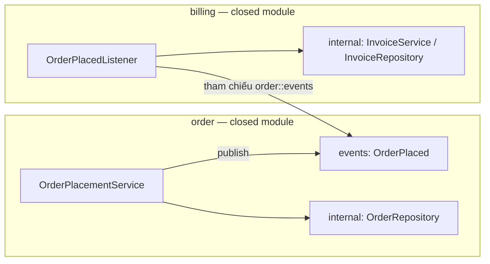
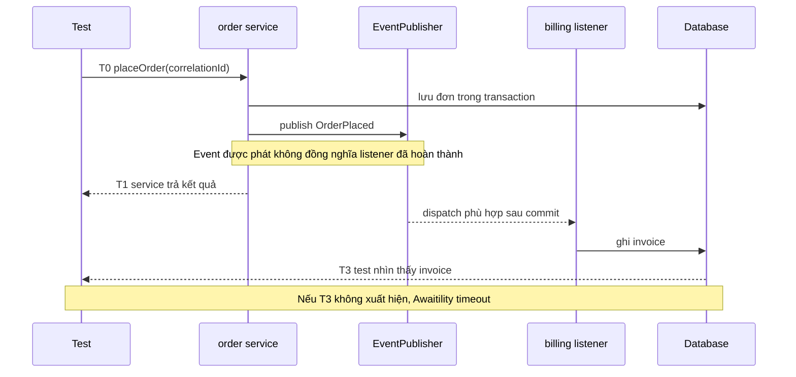

# Chẩn đoán timeout bằng thread dump và log

Một bài kiểm thử Spring Modulith có thể bị **timeout** khi đang khởi tạo `@ApplicationModuleTest`, chờ `Scenario` quan sát một event hoặc đợi listener cập nhật cơ sở dữ liệu. Trong cả ba trường hợp, kết quả bề ngoài có thể chỉ là “quá thời gian chờ”, nhưng **nguyên nhân và cách khắc phục rất khác nhau**: thiếu bean, giao dịch không commit, listener không được nạp, executor hết luồng, connection pool cạn, SQL bị khóa, hoặc đơn giản là assertion đang chờ sai sự kiện.

**Thread dump** là ảnh chụp các luồng Java tại một thời điểm, bao gồm trạng thái, stack trace và thông tin khóa. **Log có tương quan** cho biết những mốc nghiệp vụ và mốc bootstrap đã xảy ra trước khi test đứng lại. Ghép hai nguồn này với kết quả test và dữ liệu database giúp trả lời câu hỏi: **“Đang chờ cái gì, ai phải làm việc tiếp theo và vì sao việc ấy chưa xảy ra?”**

Bài thuộc chương **Observability tests** của lộ trình **SPRING_MODULITH_VERIFICATION_TESTING**: rèn kỹ năng quan sát lỗi trong `@ApplicationModuleTest`, kiểm thử sự kiện, database và tích hợp; đồng thời giữ `ApplicationModules.verify()` thành quality gate độc lập trong CI để ngăn phụ thuộc sai và hồi quy.

> **Điểm quan trọng:** Một test bị timeout **không tự chứng minh có deadlock**. Một thread mang trạng thái `WAITING` **không tự chứng minh ứng dụng bị treo**. Cần đặt dump bên cạnh **thời điểm, correlation ID, điều kiện mà test chờ và ít nhất một nguồn bằng chứng khác** trước khi kết luận.

## 1. Xác định chính xác timeout xảy ra ở đâu

Trong Spring Modulith, có ít nhất sáu dạng timeout dễ bị gọi chung là “test bị treo”:

| Triệu chứng | Phạm vi xảy ra | Điều cần xác nhận trước |
| --- | --- | --- |
| **Context bootstrap chậm hoặc không hoàn tất** | Trước khi method `@Test` chạy | Lớp cấu hình nào, bean nào và hạ tầng nào đang được khởi tạo? |
| **`Scenario` chờ event mãi** | Sau stimulus, trong bước chờ event | Event có thực sự publish? Predicate có khớp đúng correlation ID? |
| **Awaitility chờ side effect** | Sau khi service trả về | Listener đã nhận event? Giao dịch đã commit? Database đã ghi chưa? |
| **JUnit `@Timeout` hoặc timeout ở test runner** | Toàn method/test | Test đang chờ điều kiện, bị block trên lock, hay bị hạ tầng chậm? |
| **Timeout từ database/connection pool** | Trong repository/transaction | Hết connection, SQL lock, network I/O hay truy vấn chậm? |
| **CI job timeout** | Toàn bước build, có thể bị hệ thống CI kết thúc | JVM/test worker có còn tồn tại để chụp dump không? |

**Thứ tự chẩn đoán nên là:** xác định tầng gây timeout → thu thập mốc log và dump khi JVM còn sống → xem các stack liên quan → đối chiếu với event/transaction/DB → tái hiện có kiểm soát → viết test chống hồi quy.

Không nên sửa mọi trường hợp bằng cách tăng `atMost(...)` từ 5 lên 60 giây. Thời gian chờ lớn hơn có thể tạm che giấu executor không xử lý hoặc transaction không bao giờ commit.

## 2. Mô hình minh họa: `order` phát, `billing` nghe sự kiện

Giả sử ứng dụng có `StoreApplication` ở package `com.example.store`. Theo quy ước phát hiện module mặc định, các package `order` và `billing` là hai application module.

```text
com.example.store
├── StoreApplication.java
├── order/
│   ├── OrderPlacementService.java        ← stimulus
│   ├── events/
│   │   ├── package-info.java            ← @NamedInterface("events")
│   │   └── OrderPlaced.java
│   └── internal/
│       ├── OrderEntity.java
│       └── OrderRepository.java
└── billing/
    ├── package-info.java                ← allowedDependencies: order::events
    └── internal/
        ├── OrderPlacedListener.java     ← @ApplicationModuleListener
        ├── InvoiceService.java
        └── InvoiceRepository.java
```

Chiều **phụ thuộc Java**: `billing → order::events`, do listener trong `billing` import `OrderPlaced`. Chiều **thực hiện nghiệp vụ**: `order` phát event, `billing` nhận và ghi hóa đơn. Hai chiều này không nên bị nhầm khi đọc thread dump.



Công bố event:

```java
// src/main/java/com/example/store/order/events/package-info.java
/**
 * Sự kiện order được công bố cho các application module khác.
 * correlationId liên kết stimulus, event và kết quả listener.
 */
@org.springframework.modulith.NamedInterface("events")
package com.example.store.order.events;
```

```java
// src/main/java/com/example/store/order/events/OrderPlaced.java
package com.example.store.order.events;

import java.time.Instant;
import java.util.UUID;

public record OrderPlaced(
        UUID orderId,
        UUID correlationId,
        Instant occurredAt
) {}
```

Module tiêu thụ giới hạn quyền phụ thuộc:

```java
// src/main/java/com/example/store/billing/package-info.java
@org.springframework.modulith.ApplicationModule(
    allowedDependencies = "order::events"
)
package com.example.store.billing;
```

**Trong ví dụ này**, `OrderPlacementService.placeOrder(correlationId)` là một Spring bean có `@Transactional`: nó lưu đơn qua repository nội bộ và phát `OrderPlaced`. `OrderPlacedListener` có `@ApplicationModuleListener` và gọi `InvoiceService.createOnce(orderId, correlationId)` để tạo hóa đơn. Các kiểu repository/entity và schema phải được hiện thực trong dự án thật; phần minh họa tập trung vào **đo và chẩn đoán timeout**, không cung cấp một ứng dụng JPA hoàn chỉnh.

## 3. Sơ đồ timeline để không nhầm nơi bị kẹt

Trước khi mở dump, hãy chia một scenario thành các mốc có thể quan sát:



Thứ tự sự kiện recorder nhìn thấy (`T2`) và thời điểm service trả về (`T1`) có thể khác tùy transaction/listener. Vì vậy cần ghi log tại các mốc, không tự suy luận thứ tự chỉ từ tên phương thức.

| Mốc | Log nên có | Nếu thiếu thì hỏi |
| --- | --- | --- |
| **T0 — STIMULUS_STARTED** | `correlationId`, loại yêu cầu | Test đã gọi đúng service chưa? |
| **T1 — STIMULUS_RETURNED** | `orderId`, elapsed | Service bị block hay transaction không trả về? |
| **T2 — EVENT_PUBLISHED** | `eventType`, `orderId`, `correlationId` | Có thật sự phát event, event đúng payload không? |
| **T2b — LISTENER_STARTED** | `listener`, `orderId`, `correlationId` | Listener có được đăng ký và dispatch không? |
| **T3 — SIDE_EFFECT_VISIBLE** | Dữ liệu invoice đã commit và nhìn thấy | DB writer có lỗi hoặc bị khóa không? |
| **T4 — PUBLICATION_COMPLETED** | Trạng thái registry nếu được cấu hình | Có lỗi giữa side effect và bước đánh dấu hoàn tất không? |

**Đừng dùng một dòng `PUBLISHED` để khẳng định `LISTENER_COMPLETED`.** Nếu cần kiểm chứng trạng thái publication được lưu bền vững, phải dùng Event Publication Registry/backend phù hợp, không chỉ phân tích log của publisher.

## 4. Tạo test có timeout hữu hạn và thông tin điều tra tốt

Một test tích hợp có thể dùng `@SpringBootTest` và Awaitility chờ hóa đơn của **đúng stimulus**. Giả sử bảng `billing_invoices` có các cột `order_id`, `correlation_id`, và bean `OrderPlacementService` cùng listener đã được cài đặt.

```java
// src/test/java/com/example/store/OrderToBillingTest.java
package com.example.store;

import com.example.store.order.OrderPlacementService;
import java.time.Duration;
import java.util.UUID;
import org.awaitility.core.ConditionTimeoutException;
import org.junit.jupiter.api.Test;
import org.slf4j.Logger;
import org.slf4j.LoggerFactory;
import org.springframework.beans.factory.annotation.Autowired;
import org.springframework.boot.test.context.SpringBootTest;
import org.springframework.jdbc.core.JdbcTemplate;

import static org.assertj.core.api.Assertions.assertThat;
import static org.awaitility.Awaitility.await;

@SpringBootTest
class OrderToBillingTest {

    private static final Logger LOG =
            LoggerFactory.getLogger(OrderToBillingTest.class);

    @Autowired
    OrderPlacementService orders;

    @Autowired
    JdbcTemplate jdbc;

    @Test
    void createsInvoiceForThisStimulus() {
        UUID correlationId = UUID.randomUUID();
        long started = System.nanoTime();

        LOG.info("stage=STIMULUS_STARTED correlationId={}",
                correlationId);

        UUID orderId = orders.placeOrder(correlationId);

        LOG.info("stage=STIMULUS_RETURNED correlationId={} orderId={}",
                correlationId, orderId);

        try {
            await()
                .alias("invoice for order " + orderId)
                .pollInterval(Duration.ofMillis(200))
                .atMost(Duration.ofSeconds(8))
                .untilAsserted(() -> {
                    Integer count = jdbc.queryForObject(
                        "select count(*) from billing_invoices "
                            + "where order_id = ? and correlation_id = ?",
                        Integer.class, orderId, correlationId
                    );
                    assertThat(count).isEqualTo(1);
                });

            LOG.info("stage=SIDE_EFFECT_VISIBLE "
                     + "correlationId={} orderId={}",
                     correlationId, orderId);
        } catch (ConditionTimeoutException timeout) {
            LOG.error("stage=SCENARIO_TIMEOUT "
                    + "correlationId={} orderId={}",
                    correlationId, orderId, timeout);
            try {
                ThreadDumpDiagnostics.printAllThreads();
            } catch (RuntimeException diagnosticError) {
                // Không để lỗi thu dump che mất timeout ban đầu.
                timeout.addSuppressed(diagnosticError);
            }
            throw timeout; // Giữ test FAIL và stack trace gốc.
        } finally {
            long elapsedMs = Duration.ofNanos(
                    System.nanoTime() - started
            ).toMillis();
            LOG.info("stage=SCENARIO_FINISHED "
                     + "correlationId={} elapsedMs={}",
                     correlationId, elapsedMs);
        }
    }
}
```

**Điều kiện chạy:** ví dụ cần `OrderPlacementService`, `InvoiceService`, Spring Data JPA/JDBC, transaction manager, schema test, Awaitility và các dependency Spring Boot Test tương ứng. Không tự coi ví dụ là test đã được chạy trong repository hiện tại.

Những điểm đáng chú ý:

- `correlationId` được tạo riêng cho từng stimulus; test **không đếm mọi invoice trong database**.
- `await().atMost(...)` giới hạn việc chờ để test không treo vô hạn.
- `pollInterval(...)` xác định khoảng thăm dò, không phải chu kỳ xử lý của listener.
- Khi timeout, giữ exception gốc và thu thập thread dump **trước khi test kết thúc**, lúc JVM còn sống.
- `finally` ghi elapsed dù test thất bại; đây là **thời gian quan sát của test**, không phải SLA của ứng dụng.
- Test **không gắn `@Transactional` ở lớp test**, tránh trường hợp transaction test rollback khiến listener sau commit không chạy.

**Nếu SQL query tự treo trong một lần polling**, Awaitility không phải lúc nào cũng chủ động hủy được một JDBC call bị block bên dưới. Phải có **query/statement timeout, connection timeout hoặc timeout hạ tầng** phù hợp, và dùng dump/log để phân biệt một condition không thỏa với một polling query không trả về.

## 5. Chụp thread dump tự động khi Awaitility timeout

Để đoạn test ở trên hoàn chỉnh về mặt chẩn đoán, thêm một helper trong **test source set**. Nó đọc dữ liệu từ `ThreadMXBean` thuộc JDK, không cần thư viện native:

```java
// src/test/java/com/example/store/ThreadDumpDiagnostics.java
package com.example.store;

import java.lang.management.ManagementFactory;
import java.lang.management.ThreadInfo;
import java.lang.management.ThreadMXBean;
import org.slf4j.Logger;
import org.slf4j.LoggerFactory;

final class ThreadDumpDiagnostics {

    private static final Logger LOG =
            LoggerFactory.getLogger(ThreadDumpDiagnostics.class);

    private ThreadDumpDiagnostics() {}

    static void printAllThreads() {
        ThreadMXBean bean =
                ManagementFactory.getThreadMXBean();

        for (ThreadInfo info : bean.dumpAllThreads(true, true)) {
            if (info == null) {
                continue;
            }

            LOG.error("THREAD name={} state={} lockOwner={}",
                    info.getThreadName(),
                    info.getThreadState(),
                    info.getLockOwnerName());

            for (StackTraceElement frame : info.getStackTrace()) {
                LOG.error("  at {}", frame);
            }

            for (var monitor : info.getLockedMonitors()) {
                LOG.error("  locked monitor {}", monitor);
            }

            for (var synchronizer : info.getLockedSynchronizers()) {
                LOG.error("  locked synchronizer {}", synchronizer);
            }
        }
    }
}
```

**Giới hạn của phương pháp trong test:**

1. Helper chỉ chạy nếu code đã đến `catch` và JVM còn hoạt động.
2. Một lỗi ở **Spring context bootstrap** xảy ra trước khi method `@Test` chạy sẽ không gọi helper này.
3. Nếu cả thread thực thi test hoặc JVM bị block nghiêm trọng, đoạn `catch` có thể không có cơ hội thực thi.
4. Thread dump có thể rất dài và chứa tên method/class nội bộ, thậm chí giá trị nhạy cảm trong một số biểu diễn; chỉ lưu ở nơi có quyền truy cập phù hợp.
5. Một dump tại một thời điểm **không đủ** để kết luận deadlock; cần đối chiếu log và thường nên có nhiều ảnh chụp theo thời gian.

Trong môi trường có quy định bảo mật nghiêm ngặt, có thể lọc/chia sẻ chỉ những thread liên quan. Nhưng khi điều tra deadlock hoặc cạn thread pool, một dump toàn bộ JVM thường hữu ích hơn vì nguyên nhân nằm ở **thread khác** với thread test đang đợi.

**Không nên biến helper thành một đoạn bắt mọi exception rồi trả về PASS.** Mục tiêu là tăng bằng chứng khi timeout, không thay đổi kết quả kiểm thử.

## 6. Thu thập thread dump từ JVM còn sống bằng `jcmd`

Khi test **chưa tới `catch`**, context bootstrap treo hoặc một thread bị kẹt trong I/O, cần chụp dump **bên ngoài JVM đang chạy**. Công cụ `jcmd` đi kèm JDK là lựa chọn thường gặp.

### Bước 1 — Tìm đúng Java process

Trên môi trường đã cài JDK và có quyền truy cập JVM:

```bash
jcmd -l
```

Danh sách có thể gồm Gradle daemon, Maven, ứng dụng thử nghiệm và **JVM test worker**. Với Gradle, quá trình thực thi test thường là **worker JVM riêng**, không nhất thiết là process `gradle` hoặc Gradle daemon mà bạn nhìn thấy đầu tiên.

**Phải chọn PID của JVM chứa thread test đang kẹt**. Chụp dump Gradle daemon trong khi test chạy ở process khác có thể cho hàng trăm thread không liên quan và khiến kết luận sai.

### Bước 2 — Chụp ít nhất hai ảnh cách nhau một khoảng

Ví dụ trên Linux/macOS hoặc shell tương thích:

```bash
# Thay 13842 bằng PID đã xác định bằng jcmd -l.
jcmd 13842 Thread.print -l > dump-1.txt

# Sau vài giây, khi test vẫn đang kẹt:
jcmd 13842 Thread.print -l > dump-2.txt
```

Có thể dùng công cụ `jstack` của JDK tương ứng nếu môi trường hỗ trợ:

```bash
jstack -l 13842 > dump-jstack.txt
```

Trên PowerShell:

```powershell
jcmd 13842 Thread.print -l |
    Out-File -FilePath dump-1.txt -Encoding utf8
```

Đây là **lệnh hướng dẫn để thực hành**, không phải lệnh đã thực thi trên workspace. Trong môi trường thực tế, chức năng attach có thể bị giới hạn bởi người dùng hệ điều hành, container, chính sách bảo mật, khác phiên bản/kiến trúc JDK hoặc việc JVM đã bị dừng.

### Vì sao nên có nhiều dump?

Một luồng ở `TIMED_WAITING` tại cả hai thời điểm có thể đang chờ sự kiện hợp lệ, nhưng nếu cả hai dump đều cho thấy nó đứng tại cùng một lock và thread sở hữu lock cũng không tiến triển, khả năng bị kẹt cần được điều tra kỹ hơn.

Đặc biệt, **so sánh stack của thread xử lý event** và các thread giữ tài nguyên cùng lúc; đừng chỉ tìm chữ `BLOCKED` ở bất cứ đâu rồi gắn nhãn deadlock.

### Trường hợp JVM đã bị CI kết thúc

Nếu job CI timeout và hệ thống đã kill JVM, `jcmd` **không thể chụp lại quá khứ**. Cần thiết kế một bước chẩn đoán **trước** giới hạn timeout của CI, hoặc thu dump tại timeout ở tầng test khi JVM còn sống. Đặt timeout toàn job lớn hơn timeout chẩn đoán/test để có cơ hội lưu artifact, nhưng không kéo dài vô hạn.

Không tùy tiện chạy các công cụ attach trên production mà chưa hiểu ảnh hưởng tới độ trễ và yêu cầu phân quyền. Với dữ liệu production, thread dump có thể là hiện vật nhạy cảm.

## 7. Cách đọc trạng thái thread mà không suy diễn quá mức

Một thread dump JVM thường có tên thread, trạng thái và các stack frame. Các trạng thái thường gặp:

| Trạng thái | Ý nghĩa trong Java | Cạm bẫy khi diễn giải |
| --- | --- | --- |
| **`RUNNABLE`** | Thread sẵn sàng hoặc đang thực thi theo mô hình JVM | Có thể nằm trong native/network I/O; **không chứng minh đang tiêu thụ CPU cao** |
| **`BLOCKED`** | Chờ lấy Java monitor lock (ví dụ `synchronized`) | Có thể là contention ngắn; cần xem lock owner và dump khác |
| **`WAITING`** | Chờ vô thời hạn cho tín hiệu/thao tác khác | Thread pool rảnh có thể ở trạng thái này hoàn toàn bình thường |
| **`TIMED_WAITING`** | Chờ có thời hạn như sleep/park/wait | Awaitility polling hoặc executor idle có thể ở trạng thái này |
| **`NEW`** | Thread chưa được start | Hiếm khi là bằng chứng chính về timeout event |
| **`TERMINATED`** | Thread đã kết thúc | Thường không xuất hiện trong dump các thread còn sống |

Một vài ví dụ **minh họa**, không phải output đã chụp:

```text
"Test worker" TIMED_WAITING
    at jdk.internal.misc.Unsafe.park(...)
    at java.util.concurrent.locks.LockSupport.parkNanos(...)
    at org.awaitility...

"applicationTaskExecutor-3" WAITING
    at jdk.internal.misc.Unsafe.park(...)
    at java.util.concurrent.ThreadPoolExecutor.getTask(...)
```

Ở đây thread test đang chờ một điều kiện, còn worker executor có thể đang **rảnh**. Chưa thể kết luận event bị mất. Cần kiểm tra event đã publish, listener có đăng ký đúng không và executor có task nào được submit không.

Ví dụ khác:

```text
"applicationTaskExecutor-2" RUNNABLE
    at sun.nio.ch.SocketDispatcher.read0(...)
    at org.postgresql...

"Test worker" TIMED_WAITING
    at org.awaitility...
```

Stack của listener/DB thread có thể chỉ ra nó đang đợi phản hồi database ở mức native I/O. Trạng thái `RUNNABLE` **không loại trừ việc I/O bị chặn**. Muốn phân biệt SQL lock, network chậm hay query chậm phải xem tiếp log JDBC, connection pool và trạng thái database, không chỉ thread dump.

### Tìm đường từ test đến nguồn tài nguyên

Một quy trình đọc dump hữu ích:

1. Tìm thread test hoặc tên method có liên quan đến `Scenario`/`Awaitility`.
2. Đọc stack để biết nó đang **đợi điều kiện** hay bị block khi **chạy điều kiện**.
3. Tìm thread đang xử lý listener của event tương ứng (nếu có).
4. Quan sát thread đó đang gọi service, repository, JDBC, queue hay lock nào.
5. Xác định thread khác đang giữ monitor/connection/resource hoặc nguyên nhân không có worker nào xử lý.
6. Đối chiếu **hai dump** và log có correlation ID để xem có tiến triển giữa các mốc không.

Đôi khi thread dump cho biết **không có listener thread hoạt động** — điều này cũng có giá trị. Khi ấy hướng điều tra chuyển sang **event không publish, listener không được bootstrap, transaction chưa commit hoặc task chưa vào executor**.

## 8. Phân biệt Java deadlock, SQL lock và executor starvation

Ba dạng “kẹt” này có triệu chứng giống nhau ở test nhưng bằng chứng rất khác.

### 8.1. Java monitor deadlock

Hai thread giữ hai monitor rồi chờ monitor của nhau. Thread dump có thể cho thấy hai thread `BLOCKED`, mỗi thread đang đợi lock do thread kia giữ. `ThreadMXBean.findDeadlockedThreads()` có thể hỗ trợ xác định các deadlock Java-level mà JVM phát hiện.

```java
import java.lang.management.ManagementFactory;
import java.lang.management.ThreadMXBean;

ThreadMXBean bean =
        ManagementFactory.getThreadMXBean();

long[] deadlocked = bean.findDeadlockedThreads();

if (deadlocked != null) {
    System.err.println(
            "Detected Java-level deadlocked threads: "
                    + java.util.Arrays.toString(deadlocked)
    );
}
```

**Giới hạn:** phương thức này không phát hiện mọi loại “kẹt”, như lock nằm trong database, thread chờ message không tới hoặc deadlock phân tán giữa hai dịch vụ. Một kết quả `null` không đồng nghĩa không có nguyên nhân gây timeout.

### 8.2. SQL lock hoặc transaction giữ quá lâu

Thread trong Java có thể đang ở phương thức JDBC/driver chờ database. Việc tra cứu `pg_stat_activity`, lock views hoặc transaction diagnostics là **phụ thuộc hệ quản trị database**. Đừng kết luận SQL deadlock chỉ từ một frame `SocketDispatcher.read0`.

Cần đối chiếu:

- SQL nào đang được thực thi, bao lâu, trong transaction nào.
- Pool còn connection không, số connection active/idle/pending ra sao.
- Database đang chờ row lock/table lock hay đang gặp network delay.
- Transaction tạo đơn đã commit chưa; listener `AFTER_COMMIT` có cơ hội được kích hoạt chưa.
- Test có dùng transaction rollback hoặc data fixture giữ lock không.

### 8.3. Executor starvation / queue backlog

Một event listener bất đồng bộ cần thread từ executor. Nếu toàn bộ worker đang xử lý tác vụ dài hoặc đang chờ những tác vụ chỉ có **chính executor đó** mới thực thi được, task mới có thể nằm trong queue rất lâu.

Dấu hiệu cần kết hợp:

| Quan sát | Ý nghĩa có thể | Kiểm tra tiếp |
| --- | --- | --- |
| Tất cả worker bận, queue tăng | Executor thiếu năng lực/đang nghẽn | Số worker, queue, tác vụ dài, cấu hình executor |
| Worker thread đều `WAITING` ở `getTask` | Có thể executor đang rảnh | Listener có thật sự được đăng ký hoặc task được submit chưa? |
| Test chờ `Future.get()` trong thread thuộc cùng pool | Nguy cơ tự chặn nếu pool không còn worker | Tách chờ và xử lý, điều chỉnh thiết kế async |
| Log có `TaskRejectedException` | Task bị từ chối khi quá tải/đóng pool | Chính sách queue/rejection và lỗi caller |
| Event publish xuất hiện nhưng không có log listener | Chưa đủ để kết luận queue nghẽn | Kiểm tra after-commit, listener registration, registry |

Không mặc định tăng số thread là cách sửa. Nếu worker đang bị SQL lock, mở rộng pool có thể làm database chịu tải nặng hơn.

## 9. Timeout khi khởi tạo `@ApplicationModuleTest`

Một bài test module có thể không bao giờ chạy tới dòng `LOG.info` trong method vì **Spring test context thất bại trước đó**. Khi ấy helper trong `catch (ConditionTimeoutException)` ở phần 4 không có tác dụng.

### Chọn đúng phạm vi module

`@ApplicationModuleTest` hỗ trợ các chế độ bootstrap thường gặp:

| `BootstrapMode` | Phạm vi application module | Rủi ro khi chẩn đoán |
| --- | --- | --- |
| **`STANDALONE`** | Module đích, không tự đưa implementation của module phụ thuộc vào | Thiếu bean phụ thuộc ngoài nếu chưa có test double |
| **`DIRECT_DEPENDENCIES`** | Module đích và module phụ thuộc trực tiếp | Có thể kéo theo datasource/bean hạ tầng của dependency |
| **`ALL_DEPENDENCIES`** | Module đích và dependency bắc cầu | Context rộng, khó cô lập lỗi hơn |

Ví dụ test riêng module `order`:

```java
package com.example.store.order;

import org.junit.jupiter.api.Test;
import org.springframework.modulith.test.ApplicationModuleTest;
import org.springframework.modulith.test.ApplicationModuleTest.BootstrapMode;

@ApplicationModuleTest(mode = BootstrapMode.STANDALONE)
class OrderModuleBootstrapTest {

    @Test
    void moduleStarts() {
        // Method này chỉ chạy sau khi test context được khởi tạo.
    }
}
```

Một test `STANDALONE` của `order` **không tự nạp `billing`** chỉ vì `billing` nghe `OrderPlaced`. Nếu test chỉ chờ hóa đơn mà không có listener `billing` trong context, chờ mãi không giải quyết vấn đề. Để kiểm thử cả hai module, hãy dùng **integration test có phạm vi đầy đủ**, không nới bootstrap mode một cách mù quáng.

### Các bước khi context bootstrap timeout

1. Xem test report và log Spring Boot/Spring Test để xác định bean/configuration cuối cùng được khởi tạo.
2. Xác định timeout xảy ra trước method `@Test` hay trong assertion.
3. Kiểm tra `BootstrapMode`, `@ActiveProfiles`, datasource, migration, broker và test container.
4. Chụp dump của **JVM test worker đang sống** bằng `jcmd`, vì code trong test chưa chạy.
5. Xem thread đang kết nối DB, chờ bean initialization, lock hoặc network.
6. Đối chiếu profile/cấu hình; chỉ thêm test double hoặc phụ thuộc đúng khi thực sự cần.
7. Chạy lại test module và test kiến trúc riêng để bảo đảm sửa bootstrap không phá ranh giới.

**Không chuyển mọi test sang `ALL_DEPENDENCIES` chỉ để mất lỗi thiếu bean**. Context rộng hơn có thể che giấu thiết kế thiếu hợp đồng hoặc làm test chậm, không ổn định.

## 10. Timeout của `Scenario`: event chưa tới hay predicate không khớp?

Spring Modulith hỗ trợ DSL `Scenario` trong kiểm thử module. Một test có thể chờ event thuộc đúng `correlationId`:

```java
// Trích đoạn nằm trong @ApplicationModuleTest của module order.
@Test
void waitsForMatchingOrderPlaced(Scenario scenario) {
    UUID correlationId = UUID.randomUUID();

    scenario.stimulate(() ->
                orders.placeOrder(correlationId)
            )
            .andWaitForEventOfType(OrderPlaced.class)
            .matching(event ->
                    correlationId.equals(event.correlationId()))
            .toArriveAndVerify(event ->
                    assertThat(event.correlationId())
                            .isEqualTo(correlationId)
            );
}
```

Đoạn này giả định test class có field `orders`, import `org.springframework.modulith.test.Scenario` và AssertJ. Chi tiết tùy chọn timeout của DSL có thể khác giữa các phiên bản; đối chiếu reference/Javadoc của phiên bản dự án thay vì tự đoán tên method.

Nếu test hết thời gian chờ, điều tra theo trình tự:

1. **Stimulus có được thực thi?** Log T0/T1; có exception hoặc transaction rollback không?
2. **Có event kiểu `OrderPlaced` được phát?** Dùng `@RecordApplicationEvents`/`ApplicationEvents` để xác nhận E1.
3. **`correlationId` có khớp?** Một event cùng kiểu của stimulus khác không thỏa predicate.
4. **Test đang chờ publish hay side effect?** `andWaitForEventOfType(...)` không tự kiểm tra listener đã ghi invoice.
5. **Có test `@Transactional` bao ngoài?** Transaction test thường rollback, khiến listener sau commit không được gọi.
6. **Listener có được bootstrap?** Test module `order` cô lập không bảo đảm nạp `billing`.
7. **Có dấu hiệu executor/DB bị nghẽn?** Lúc đó mới dùng dump để phân tích thread và lock.

### Recorder giúp tách “không publish” với “listener chưa xử lý”

```java
// Trong @ApplicationModuleTest + @RecordApplicationEvents.
UUID correlationId = UUID.randomUUID();

orders.placeOrder(correlationId);

var matching = recordedEvents.stream(OrderPlaced.class)
        .filter(event ->
                correlationId.equals(event.correlationId()))
        .toList();

assertThat(matching).hasSize(1);
```

`recordedEvents` là field kiểu `org.springframework.test.context.event.ApplicationEvents` được inject vào test. Đoạn này xác minh **đã publish event phù hợp**. Nó không kiểm tra commit, listener delivery hay publication completion.

**Nếu recorder không thấy event**, đừng vội kiểm tra listener thread; trước tiên sửa publisher hoặc test setup. **Nếu recorder thấy event nhưng hóa đơn không xuất hiện**, chuyển sang transaction boundary, listener bootstrap và database.

## 11. Timeout vì listener `AFTER_COMMIT` không bao giờ chạy

`@ApplicationModuleListener` thường được dùng cho luồng xử lý event phù hợp với ranh giới module và transaction. Một cạm bẫy phổ biến: test được gắn `@Transactional` ở cấp test, sau đó transaction **tự rollback khi test kết thúc**.

Tình huống:

```java
// PHẢN VÍ DỤ: dễ gây ngộ nhận khi test chờ listener sau commit.
@SpringBootTest
@Transactional
class IncorrectOrderBillingTest {

    @Test
    void waitsForInvoice() {
        orders.placeOrder(correlationId);
        // Awaitility chờ invoice do listener AFTER_COMMIT ghi.
        // Test transaction có thể chưa bao giờ commit tại đây.
    }
}
```

Nếu `placeOrder` tham gia transaction bao ngoài của test, listener sau commit không được kích hoạt trước khi test rollback. Thread dump có thể chỉ thấy **Awaitility đang đợi bình thường** và worker executor rảnh; không có Java deadlock nào để sửa.

Cách xử lý:

- Tránh `@Transactional` bao ngoài test end-to-end khi muốn quan sát listener sau commit.
- Gọi service transactional qua Spring proxy để transaction thật sự kết thúc/commit.
- Nếu cần điều khiển transaction của test, dùng cơ chế của Spring Test như `TestTransaction` hoặc `TransactionTemplate` với cấu hình phù hợp.
- Sau khi commit, chờ **tác dụng phụ có correlation ID đúng**, rồi kiểm tra DB và listener logs.
- Tách riêng test publisher E1 và test side effect E3; không suy luận E3 chỉ từ recorder.

**Không nên khắc phục bằng cách tắt transaction của listener** chỉ để test PASS, nếu yêu cầu nghiệp vụ đòi hỏi xử lý sau commit.

## 12. Sử dụng log theo correlation ID để nối các thread

Một thread dump chỉ cho biết thread đang ở đâu, không tự nói nó xử lý **đơn nào**. Ngược lại, log có `correlationId` cho biết luồng nghiệp vụ nhưng không luôn chỉ ra thread nào đang block. Kết hợp cả hai bằng tên thread và mốc timestamp sẽ giúp điều tra.

Một listener có thể lấy correlation ID từ **event payload**, thay vì trông chờ MDC truyền qua thread bất đồng bộ:

```java
// Trích đoạn từ OrderPlacedListener, đã có field InvoiceService invoices.
@org.springframework.modulith.events.ApplicationModuleListener
void on(com.example.store.order.events.OrderPlaced event) {

    try (org.slf4j.MDC.MDCCloseable ignored =
            org.slf4j.MDC.putCloseable(
                    "correlationId",
                    event.correlationId().toString())) {

        long started = System.nanoTime();
        LOG.info("stage=LISTENER_STARTED orderId={}",
                event.orderId());

        try {
            invoices.createOnce(
                    event.orderId(), event.correlationId());
            LOG.info("stage=LISTENER_COMPLETED orderId={}",
                    event.orderId());
        } finally {
            long elapsedMs = java.time.Duration.ofNanos(
                    System.nanoTime() - started
            ).toMillis();
            LOG.info("stage=LISTENER_FINISHED handlerMs={}",
                    elapsedMs);
        }
    }
}
```

Đây là **trích đoạn method**, không phải class Java độc lập: cần field `invoices`, logger `LOG` và implementation thực tế. Đặt correlation ID trong MDC **ngay tại thread listener** vì MDC dựa trên thread-local không mặc nhiên truyền qua executor.

Một log format có thể thêm tên thread và correlation ID; ví dụ cấu hình Logback/Spring Boot theo quy ước dự án:

```yaml
logging:
  pattern:
    console: "%d{HH:mm:ss.SSS} [%thread] %-5level %logger{24} correlationId=%X{correlationId} - %msg%n"
```

Log minh họa:

```text
10:22:01.102 [Test worker] INFO  order   correlationId=C1 - STIMULUS_STARTED
10:22:01.180 [Test worker] INFO  order   correlationId=C1 - EVENT_PUBLISHED
10:22:01.205 [task-2]     INFO  billing correlationId=C1 - LISTENER_STARTED
10:22:09.210 [Test worker] ERROR test    correlationId=C1 - SCENARIO_TIMEOUT
```

**Đây không phải output đã chụp.** Timestamps và thread names chỉ minh họa. Khi dump được lấy quanh `10:22:09`, hãy tìm thread `task-2` trong dump rồi kiểm tra stack, database logs và trạng thái executor. Nếu thread listener không có trong dump, đó là một tín hiệu cần kiểm tra **nó đã hoàn thành, thất bại hay chưa từng được chạy**, không phải bằng chứng tức thời về “event bị mất”.

Không log token, mật khẩu, thông tin thanh toán, toàn bộ entity hay giá trị nhạy cảm để debug. Correlation ID nên là mã định danh không chứa thông tin cá nhân.

## 13. Event Publication Registry và timeout khôi phục

Khi ứng dụng dùng **Spring Modulith Event Publication Registry** với publication store phù hợp, cần phân biệt thêm:

- **Published:** ứng dụng đã gọi `publishEvent`.
- **Recorded publication:** registry đã ghi publication cho target listener phù hợp.
- **Listener succeeded:** handler thực hiện thành công theo định nghĩa của nó.
- **Publication completed:** registry ghi nhận hoàn tất theo semantics backend.
- **Pending/recovery:** publication còn chưa hoàn tất và cần xử lý lại.

Một timeout khi chờ hóa đơn có thể xảy ra **dù publication được ghi nhận**. Ngược lại, hóa đơn có thể được ghi nhưng completion cập nhật chậm hoặc lỗi. Không suy luận từ một thread dump rằng publication đã completed.

| Quan sát | Điều có thể kết luận | Việc cần làm tiếp |
| --- | --- | --- |
| Recorder có event, registry không có publication | Chưa chắc có listener/registry backend phù hợp | Kiểm tra cấu hình, target và transaction |
| Registry có publication chưa hoàn tất, listener log lỗi | Có công việc cần khôi phục theo semantics backend | Xem stack trace, recovery và idempotency |
| Listener đã ghi hóa đơn, publication chưa completed | Side effect và completion là hai mốc khác nhau | Kiểm tra lỗi giữa DB commit và completion |
| Retry xảy ra nhiều lần với cùng event | Nguy cơ side effect trùng | Dùng khóa nghiệp vụ và test idempotency |
| Không thấy event ở recorder | Publisher/test setup có vấn đề | Điều tra E1 trước E4 |

API, schema và cơ chế retry của registry phụ thuộc phiên bản Spring Modulith và module lưu trữ (JDBC/JPA hoặc backend tương ứng). **Không tự đoán bảng/cột hay method** để viết một “test registry” không dựa trên API/backend thực tế.

## 14. Kết hợp thread dump với database và executor metrics

Để chẩn đoán một timeout có thể do hạ tầng, nên thu các tín hiệu vừa đủ theo phạm vi:

| Tầng | Chỉ số/log hữu ích | Bằng chứng cần đối chiếu |
| --- | --- | --- |
| **Spring test** | Loại test, `BootstrapMode`, phase bootstrap/method | Test đã chạy đến đoạn chờ chưa? |
| **Event publisher** | `correlationId`, event type, orderId, mốc publish | Có E1 cho đúng stimulus không? |
| **Transaction** | Commit/rollback, exception, transaction boundary | AFTER_COMMIT có thể được gọi chưa? |
| **Executor** | Active threads, queue length, task rejection | Listener đã được submit/chạy chưa? |
| **JDBC pool** | Active/idle/pending connections, acquisition time | Có cạn pool hoặc đợi connection không? |
| **Database** | Slow query, lock wait, transaction age | Query nào hoặc transaction nào đang giữ tài nguyên? |
| **Event registry** | Pending/completed theo listener target | Publication đang ở giai đoạn nào? |
| **CI** | JUnit report, stack trace, JVM dump và elapsed | Timeout phát ra từ đâu, trước khi job bị kill? |

Nếu ứng dụng có Micrometer/Actuator, nhiều hệ thống cung cấp metrics về executor hoặc connection pool khi đã instrument và cấu hình. **Không mặc định mọi metric luôn tồn tại**; phải xác nhận tên và khả năng thu thập theo phiên bản Spring Boot, provider và backend đã bật.

Một thread `RUNNABLE` trong driver JDBC cùng lúc Hikari pool báo pending cao là dấu hiệu đáng chú ý, nhưng chưa đủ để kết luận database deadlock. Cần query/transaction diagnostics để tìm nguyên nhân chính.

## 15. Ranh giới module vẫn phải được kiểm chứng riêng

Thread dump và log có thể chỉ ra listener `billing` đang gọi trực tiếp `order.internal.OrderRepository`. Kể cả khi việc đó không gây timeout, nó vẫn là **vi phạm ranh giới kiến trúc** trong một closed module.

Đặt một JUnit architecture test ở package gốc:

```java
// src/test/java/com/example/store/ModulithArchitectureTest.java
package com.example.store;

import org.junit.jupiter.api.Test;
import org.springframework.modulith.core.ApplicationModules;

class ModulithArchitectureTest {

    @Test
    void moduleDependenciesStayValid() {
        ApplicationModules.of(StoreApplication.class).verify();
    }
}
```

`ApplicationModules.verify()` kiểm chứng các quy tắc cấu trúc, gồm phụ thuộc tới API đã công bố, `allowedDependencies` và những chu trình bị cấm. Nó **không chạy listener, không quan sát thread stack và không biết transaction đã commit**.

| Trường hợp | `verify()` | Test event/DB | Dump/log |
| --- | --- | --- | --- |
| `billing` chỉ dùng `order::events` | PASS nếu toàn mô hình hợp lệ | Cần để kiểm chứng hành vi | Hữu ích khi thất bại/timeout |
| `billing` phụ thuộc vào `order.internal` | **FAIL** nếu quan hệ được phân tích | Có thể vẫn PASS | Không thay thế kiến trúc test |
| `order` phụ thuộc ngược vào `billing`, tạo chu trình | **FAIL** | Không nhất thiết phát hiện | Có thể chẳng có timeout |
| Listener không được nạp | Có thể PASS | **FAIL/timeout** | Thường không có thread listener hoạt động |
| Test transaction rollback, không có AFTER_COMMIT | Có thể PASS | **FAIL/timeout** | Thread Awaitility có thể đang đợi bình thường |
| DB lock khiến listener bị block | Có thể PASS | **FAIL/timeout** | Dump + DB diagnostics quan trọng |
| Event payload sai correlation ID | Có thể PASS | **FAIL/timeout** nếu lọc đúng | Log giúp truy ra ID sai |

Để tạo ca vi phạm kiến trúc có thể biên dịch, dùng kiểu `public` giả lập trong `order.internal` và tham chiếu thực sự từ `billing`. Nếu class package-private, Java thường chặn trước khi `verify()` chạy; chỉ thêm `import` thừa có thể không tạo phụ thuộc trong bytecode.

Không sửa timeout bằng cách mở toàn bộ module, đưa repository vào named interface hoặc nới `allowedDependencies` vô điều kiện.

## 16. Thu thập bằng chứng trong CI trước khi job kết thúc

Một pipeline tốt cần **bảo đảm test FAIL nếu timeout**, đồng thời giữ được **stack trace và log** phục vụ chẩn đoán. Thread dump trong `catch` có thể được ghi vào output của test nếu cấu hình log phù hợp.

Ví dụ Gradle Groovy DSL:

```groovy
tasks.named('test') {
    useJUnitPlatform()

    testLogging {
        events 'failed', 'skipped'
        exceptionFormat = 'full'
        showStandardStreams = true
    }
}
```

Chạy test:

```bash
./gradlew test
```

Hoặc trong project Maven/JUnit 5 đã cấu hình:

```bash
mvn -B test
```

**Một lệnh `test` không mặc định chạy mọi integration test** nếu dự án tách chúng vào `integrationTest`, Maven Failsafe hoặc một task riêng. Đối với test listener/JPA, CI cần chạy **đúng suite** cùng database/test infrastructure phù hợp.

### Ví dụ workflow GitHub Actions

```yaml
name: Modulith timeout diagnostics

on:
  pull_request:

jobs:
  architecture-and-integration:
    runs-on: ubuntu-latest
    permissions:
      contents: read
    timeout-minutes: 20

    steps:
      - uses: actions/checkout@v4

      - uses: actions/setup-java@v4
        with:
          distribution: temurin
          java-version: '21'

      - uses: gradle/actions/setup-gradle@v4

      - name: Run architecture and module tests
        run: bash ./gradlew --no-daemon test

      - name: Run event and database integration tests
        run: bash ./gradlew --no-daemon integrationTest

      - name: Preserve test reports
        if: always()
        uses: actions/upload-artifact@v4
        with:
          name: modulith-timeout-reports
          path: |
            **/build/test-results/**/*.xml
            **/build/reports/tests/**
            **/build/diagnostics/**
          if-no-files-found: warn
```

Đây là **một cấu hình minh họa**, không phải workflow đã triển khai trên repository được giao. Nó giả định Gradle wrapper nằm ở root, Java 21 phù hợp, task `integrationTest` tồn tại và test database đã được cấu hình. Thư mục `build/diagnostics` chỉ hữu ích nếu dự án **thực sự có bước ghi file dump vào đó**; ví dụ helper ở phần 5 chỉ log dump, không tự tạo file.

**Quan trọng về timeout CI:**

- `timeout-minutes` giới hạn job, **không tự chụp thread dump**.
- Nếu job bị hệ thống CI kill trước khi test có cơ hội log, có thể không còn dump để upload.
- Muốn bảo đảm có dump trong tình huống test thật sự treo, cần watchdog/đoạn điều phối **được thiết kế riêng** để nhận diện JVM test worker và chạy `jcmd` **trước** khi job timeout; đây không phải khả năng tự động của GitHub Actions.
- Không chạy một script attach vào PID đoán mò: có thể chụp nhầm Gradle daemon hoặc process khác.
- Nếu test-level timeout gọi helper và giữ JUnit output, artifact thường dễ thu thập hơn, nhưng vẫn không xử lý được tình huống JVM hoàn toàn không phản hồi.

Một gate chỉ thật sự bảo vệ pull request khi repository yêu cầu **status check của job** thành công trước khi merge. Upload artifact bằng `if: always()` là để điều tra, không được biến test thất bại thành PASS.

## 17. Quy trình điều tra timeout trong 10 phút đầu

Khi một bài test thất bại, thứ tự sau giúp tránh chạy nhiều công cụ mà không có giả thuyết:

1. **Phân loại:** bootstrap, `Scenario`, Awaitility, JDBC, JUnit hay CI job timeout? Ghi lại tên test, runner và thời điểm.
2. **Tìm stimulus:** có `STIMULUS_STARTED` và `STIMULUS_RETURNED` cùng correlation ID không?
3. **Tìm publish:** có event loại đúng, đúng `orderId` và `correlationId` không? Nếu cần dùng `ApplicationEvents`.
4. **Tìm commit/listener:** transaction đã commit? Listener có được nạp/đã bắt đầu? Nếu không, chưa cần kết luận database lock.
5. **Chụp dump khi còn sống:** chọn đúng JVM test worker; lấy ít nhất hai snapshot nếu lỗi tái hiện lâu.
6. **Đọc stack liên quan:** test đang chờ điều kiện hay SQL query; listener đang làm việc, đợi lock hay vắng mặt?
7. **Đối chiếu hạ tầng:** pool, executor queue, SQL lock và publication registry theo công nghệ được dùng.
8. **Tái hiện hẹp:** chạy lại đúng test và dữ liệu độc lập; không che lỗi bằng cách tăng timeout vô hạn.
9. **Sửa nguyên nhân:** ranh giới transaction, listener bootstrap, executor/DB hoặc predicate; tránh nới `allowedDependencies` thiếu căn cứ.
10. **Khóa bằng test:** kiến trúc `verify()`, event/payload, side effect sau commit và timeout hợp lý đều phải PASS trong CI.

Mỗi kết luận cần được viết theo dạng **“bằng chứng A + B cho thấy khả năng X”**. Nếu dump chỉ cho thấy `WAITING`, hãy nói “thread đang đợi” chứ chưa vội nói “deadlock”.

## 18. Bài thực hành: ba timeout trông giống nhau nhưng nguyên nhân khác nhau

### Bối cảnh

Ứng dụng có hai module `order` và `billing`. `order` publish `OrderPlaced`; `billing` tạo hóa đơn. Test tích hợp dùng Awaitility chờ bản ghi `billing_invoices` đúng `orderId` và `correlationId`.

### Nhiệm vụ

1. **Tạo baseline:** công bố `order::events`, khai báo `billing` chỉ phụ thuộc `order::events`; dùng `ApplicationModules.of(StoreApplication.class).verify()` để kiểm chứng cấu trúc.
2. **Tạo test publisher:** dùng `@ApplicationModuleTest`, `@RecordApplicationEvents` và `ApplicationEvents` để xác nhận event đúng correlation ID được publish.
3. **Tạo test integration:** dùng `@SpringBootTest`, datasource, listener thật và Awaitility timeout hữu hạn để chờ hóa đơn đúng đơn.
4. **Gắn log:** ghi các mốc `STIMULUS_STARTED`, `STIMULUS_RETURNED`, `EVENT_PUBLISHED`, `LISTENER_STARTED`, `SIDE_EFFECT_VISIBLE`.
5. **Thêm thread dump helper:** khi Awaitility timeout, thu stack bằng `ThreadMXBean`, ghi log và **ném lại exception**.
6. **Thử ca A — Không có commit:** tạm thêm transaction test bao ngoài gây rollback hoặc tạo điều kiện listener after-commit không chạy; quan sát recorder có thể vẫn thấy event nhưng side effect timeout.
7. **Thử ca B — Listener không được bootstrap:** chuyển test sang phạm vi module `order` cô lập nhưng vẫn chờ hóa đơn; kiểm tra bean/context và vì sao thread dump không có worker billing đang xử lý.
8. **Thử ca C — Listener chờ hạ tầng:** dùng một test double có latch hoặc một cơ chế điều phối an toàn để làm listener chờ có kiểm soát; chụp hai thread dump và tìm thread/listener liên quan.
9. **Thử ca D — Predicate sai:** cố ý dùng correlation ID khác khi chờ; test timeout dù listener có thể đã ghi dữ liệu đúng cho stimulus thực. Sửa predicate và xác nhận PASS.
10. **Chạy `jcmd`:** khi JVM còn sống, dùng `jcmd -l` để tìm đúng test worker, chụp `Thread.print -l` hai lần rồi so sánh.
11. **Thử lỗi ranh giới:** cho `billing` tham chiếu kiểu `public` giả lập trong `order.internal`; xác nhận `verify()` FAIL, rồi khôi phục.
12. **Khóa CI:** chạy architecture, publisher, module và integration suites; lưu báo cáo khi FAIL, bảo đảm job là required status check và timeout chẩn đoán xảy ra trước timeout toàn job.

### Kết quả mong đợi

| Tình huống | Event recorder | Hóa đơn sau commit | Thread dump/log | `verify()` |
| --- | --- | --- | --- | --- |
| **Baseline** | Có event đúng ID | Có invoice đúng ID | Có đủ mốc, không timeout | PASS nếu mô hình hợp lệ |
| **Không có commit** | Có thể có event | Không xuất hiện theo luồng after-commit | Awaitility đợi; không nhất thiết có deadlock | Có thể PASS |
| **Không bootstrap billing** | Có thể có event | Không có | Không thấy listener hoạt động; xem phạm vi context | Có thể PASS |
| **Listener kẹt latch/DB** | Có thể có event | Chưa xuất hiện | Stack liên quan tới chờ/lệnh DB | Có thể PASS |
| **Predicate sai ID** | Event đúng ID thật | Dữ liệu có thể đã đúng | Test vẫn timeout vì assertion lọc sai | Có thể PASS |
| **Phụ thuộc vào `order.internal`** | Có thể PASS | Có thể PASS | Timeout không bắt buộc xảy ra | **FAIL** |

Đây là **kết quả kỳ vọng của bài tập**, không phải báo cáo đo đạc trong một repository đã chạy.

### Câu hỏi tự đánh giá

**1. Thread `WAITING` có chứng minh deadlock không?** Không. Worker executor rảnh hoặc thread Awaitility đang chờ điều kiện có thể `WAITING`/`TIMED_WAITING` bình thường. Cần đối chiếu stack, lock owner, nhiều dump và log.

**2. Vì sao `jcmd` có thể chụp nhầm process khi chạy Gradle?** Vì Gradle daemon và JVM thực thi test có thể là các process khác nhau. Phải xác định PID của test worker.

**3. Vì sao test `@Transactional` có thể chờ mãi listener after-commit?** Transaction do test quản lý thường rollback; nếu service tham gia transaction đó, listener sau commit không được kích hoạt.

**4. Vì sao recorder thấy event mà integration test vẫn timeout?** Recorder xác nhận publish, không xác nhận commit, dispatch, listener completion hoặc side effect DB.

**5. Một thread `RUNNABLE` ở driver JDBC nói gì?** Có thể đang thực thi hoặc chờ native/network I/O; cần database/pool diagnostics để xác định có SQL lock hay không.

**6. Khi CI đã kill JVM, có thể `jcmd` để lấy dump không?** Không. Cần thu dump trước khi process chết, hoặc qua helper khi test-level timeout trong JVM còn sống.

**7. `ApplicationModules.verify()` giúp gì trong sự cố runtime?** Nó kiểm chứng ranh giới phụ thuộc tĩnh để ngăn dùng API nội bộ hoặc tạo chu trình, nhưng không xác định chính xác thread/transaction gây timeout.

**8. Vì sao phải ném lại `ConditionTimeoutException` sau khi log dump?** Để giữ tính đúng đắn của quality gate: timeout vẫn là lỗi test và job CI phải FAIL.

## 19. Ghi nhớ

**Chẩn đoán timeout bằng thread dump và log là một quy trình suy luận dựa trên bằng chứng, không phải tìm một stack có chữ `WAITING`.** Hãy bắt đầu bằng việc phân loại timeout, đánh dấu stimulus/event/listener bằng correlation ID, thu dump của **đúng JVM test worker khi nó còn sống**, so sánh nhiều ảnh chụp và đối chiếu với transaction, executor, connection pool, database cùng publication registry. Sử dụng `@ApplicationModuleTest`, `Scenario`, `@RecordApplicationEvents` và Awaitility để kiểm chứng đúng tầng; dùng `ApplicationModules.verify()` làm **architecture gate riêng**. Trong CI, giới hạn chờ hữu hạn, giữ stack trace/log/test report và bảo đảm test timeout vẫn FAIL. Mục tiêu không chỉ là làm bài test hết treo mà còn **loại bỏ nguyên nhân và ngăn hồi quy**.

### Tài liệu tham khảo

- [Spring Modulith Reference — Integration Testing Application Modules](https://docs.spring.io/spring-modulith/reference/testing.html)
- [Spring Modulith Reference — Working with Application Events](https://docs.spring.io/spring-modulith/reference/events.html)
- [Spring Modulith Reference — Verifying Application Module Structure](https://docs.spring.io/spring-modulith/reference/verification.html)
- [Spring Framework Reference — Testing](https://docs.spring.io/spring-framework/reference/testing.html)
- [JDK `jcmd` command](https://docs.oracle.com/en/java/javase/21/docs/specs/man/jcmd.html)
- [Java `ThreadMXBean` API](https://docs.oracle.com/en/java/javase/21/docs/api/java.management/java/lang/management/ThreadMXBean.html)
