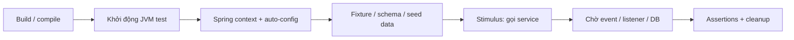
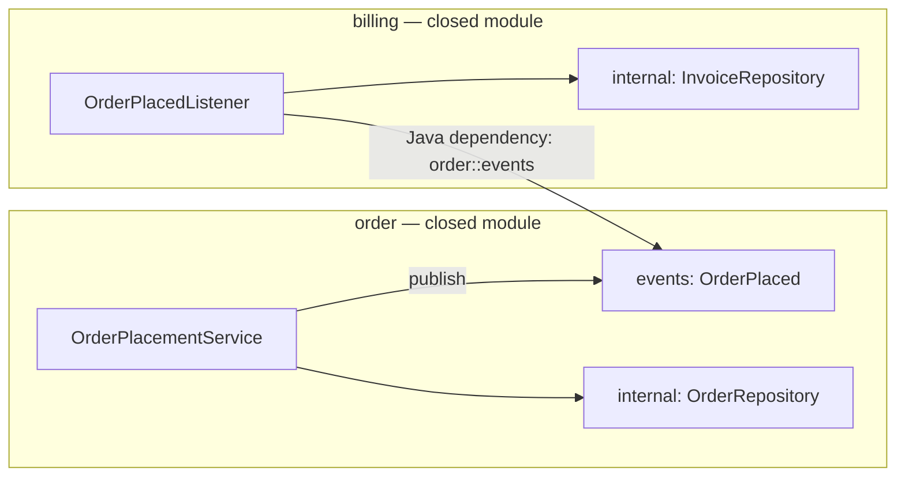
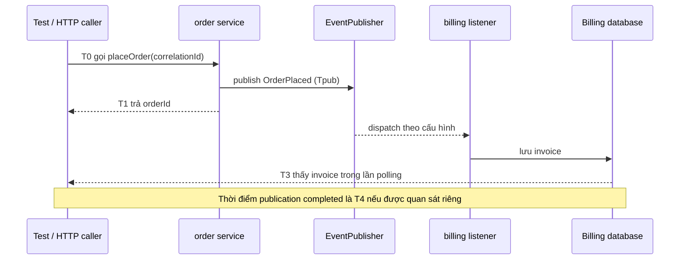

# Phân biệt test chậm với production behavior chậm

Một bài kiểm thử Spring Modulith mất 18 giây để PASS, trong khi endpoint tạo đơn ở môi trường production thường trả lời trong 120 ms. Có phải hệ thống sản xuất đang chậm không? Ngược lại, một test module hoàn tất trong 40 ms có chứng minh người dùng production sẽ không phải chờ vài giây? **Cả hai kết luận đều không có đủ cơ sở.**

Trong một lần chạy test, thời gian có thể nằm ở **biên dịch, khởi động JVM, dựng Spring ApplicationContext, khởi tạo Testcontainers, migration database, tạo dữ liệu thử, transaction, thực thi nghiệp vụ, xử lý sự kiện, polling của Awaitility hoặc dọn dẹp môi trường**. Ở production, độ trễ còn chịu ảnh hưởng của tải đồng thời, contention, connection pool, network, dữ liệu thật, cache, phân phối request và hàng đợi bất đồng bộ. Hai môi trường dùng chung code nhưng **không nhất thiết đo cùng đại lượng**.

Bài thuộc chương **Observability tests** trong lộ trình **SPRING_MODULITH_VERIFICATION_TESTING**. Chúng ta học cách phân tích thời gian test thay vì chỉ nhìn `BUILD SUCCESSFUL`; đo riêng bootstrap, stimulus, event và side effect; dùng `@ApplicationModuleTest`, `Scenario`, `ApplicationEvents`, database/integration test; đối chiếu log, metrics và tracing khi có dấu hiệu production chậm. Đồng thời, **`ApplicationModules.verify()`** vẫn giữ vai trò quality gate riêng để ngăn phụ thuộc module sai và hồi quy kiến trúc.

> **Quy tắc quan trọng:** *Test chạy lâu* là thông tin về **thời gian một phép kiểm tra hoàn tất**. *Production behavior chậm* là nhận định về **độ trễ của một hành vi được xác định dưới điều kiện vận hành được xác định**. Chỉ so sánh khi biết chính xác **điểm bắt đầu/kết thúc, tải, dữ liệu, môi trường và cách lấy mẫu**.

## 1. Ba câu hỏi cần trả lời trước khi tối ưu

Hãy xem xét ba tình huống:

| Tình huống | Điều đã quan sát | Điều **chưa thể** kết luận |
| --- | --- | --- |
| Gradle chạy toàn bộ test trong 2 phút | Thời gian build/test suite của môi trường phát triển hoặc CI | API production mất 2 phút |
| `@ApplicationModuleTest` cần 9 giây để chạy một assertion | Có thể mất phần lớn thời gian khởi tạo context, container hoặc database | Method nghiệp vụ mất 9 giây |
| Awaitility chờ hóa đơn 3 giây mới thấy dữ liệu | Test quan sát side effect sau 3 giây, gồm cả polling và thời gian xử lý thực | HTTP request cũng mất 3 giây; listener thực sự chạy 3 giây |

Trước khi kết luận, luôn làm rõ:

1. **Đang đo cái gì?** Build, test class, Spring context, lời gọi service, thời gian tới event, hay thời gian tới bản ghi database?
2. **Môi trường và khối lượng nào?** Local/CI/staging/production, cold/warm, test dữ liệu ít hay dữ liệu thật, có bao nhiêu request và listener đồng thời?
3. **Bằng chứng nào đủ để quyết định?** Log phân đoạn, JUnit report, Spring Boot/Micrometer metrics, distributed trace, SQL diagnostics, số lần chạy và phân phối latency?

Nếu chưa trả lời được ba câu hỏi, “test chậm vì production chậm” chỉ là giả thuyết, không phải phát hiện.

## 2. Phân rã thời gian một lần chạy test

Với một test Spring Boot có `@ApplicationModuleTest`, hãy hình dung:



Tổng thời gian quan sát từ CI thường có thể phân rã **một cách khái niệm** như sau:

\[
T_{\mathrm{CI}} \approx T_{\mathrm{build}} + T_{\mathrm{JVM}}
+ T_{\mathrm{context}} + T_{\mathrm{fixture}}
+ T_{\mathrm{stimulus}} + T_{\mathrm{wait}} + T_{\mathrm{assert/cleanup}}
\]

Đây là **mô hình phân tích**, không phải công thức đo chính xác trong mọi pipeline: các bước có thể chồng lấn, task chạy song song, context được cache, container dùng chung và số liệu từ log có thể khác phạm vi đo. Không cộng các duration ghi từ những đồng hồ hoặc khoảng thời gian chồng lấn mà không làm rõ.

| Thành phần | Dấu hiệu thường gặp | Để kiểm chứng |
| --- | --- | --- |
| Biên dịch / dependency resolution | Lần đầu tải dependency lâu, dù test method rất ngắn | Build log, Gradle/Maven task timing |
| JVM/class loading/JIT | Lần chạy đầu chậm hơn các lần sau | So sánh cold vs warm có ghi rõ điều kiện |
| Spring context bootstrap | Test method chưa bắt đầu; `@SpringBootTest` rộng | Startup logs, test context cache và bootstrap mode |
| Testcontainers / migration | Container startup hoặc schema migration chiếm nhiều giây | Container logs, migration timing, fixture timing |
| Stimulus | Thời gian thực thi lời gọi qua Spring proxy | Đo ngay quanh lời gọi, không gồm setup |
| Event/side-effect wait | Awaitility poll đến khi listener hoàn tất | Timestamp publish/commit/listener và polling interval |
| Assertion / cleanup | Query xác nhận chậm; dọn DB hoặc container mất thời gian | Ghi log quanh từng pha |

**Ví dụ có chủ đích:** nếu một lớp test cần 12 giây để context khởi tạo nhưng `orders.placeOrder(...)` chỉ mất 25 ms, nhận định đúng là **“module test có startup overhead cao”**. Nó chưa chỉ ra endpoint production đang chậm.

## 3. Đừng đo sai loại thời gian

Trong Java, hãy phân biệt **thời điểm** và **khoảng thời gian**:

```java
long startNanos = System.nanoTime();

performOperation();

long elapsedNanos = System.nanoTime() - startNanos;
java.time.Duration elapsed =
        java.time.Duration.ofNanos(elapsedNanos);
```

`System.nanoTime()` phù hợp đo elapsed giữa hai mốc trong cùng JVM: nó có **điểm gốc tùy ý**, không phải timestamp UTC. Để gắn thời điểm nghiệp vụ cho event, dùng `Instant` và cân nhắc inject `Clock` để kiểm thử logic thời hạn có thể lặp lại.

```java
java.time.Instant occurredAt =
        java.time.Instant.now(clock); // Clock được inject vào service
```

| Nhu cầu | Công cụ phù hợp | Cảnh báo |
| --- | --- | --- |
| Đo thời gian lời gọi trong JVM | `System.nanoTime()`, `Duration` | Không so sánh hai giá trị nanoTime giữa các JVM |
| Kiểm tra timestamp của event | `Instant`, `Clock` | Clock cố định không dùng để benchmark |
| Đo phân phối nhiều lời gọi | Micrometer `Timer` hoặc công cụ đo tải | Cần đủ mẫu và định nghĩa điểm đo |
| Đo hành trình qua nhiều thành phần | Distributed tracing + logs/metrics tương quan | Phụ thuộc instrumentation, sampling và context propagation |
| Kiểm tra đúng deadline nghiệp vụ | `Clock.fixed(...)` trong test deterministic | Không bắt test ngủ thật vài phút |
| Chặn bài test đợi vô hạn | Awaitility/Scenario timeout | Timeout không phải SLO production |

Không viết:

```java
// SAI: epoch và đơn vị không tương thích.
long latency = System.nanoTime()
        - event.occurredAt().toEpochMilli();
```

Một số liệu chỉ có ý nghĩa khi **hai mốc dùng cùng loại đồng hồ, cùng đơn vị và cùng định nghĩa sự kiện**.

## 4. Ví dụ: `order` phát sự kiện, `billing` tạo hóa đơn

Để quan sát được cả độ trễ đồng bộ và bất đồng bộ, dùng một ứng dụng bán hàng gồm hai application module:

```text
com.example.store
├── StoreApplication.java                    ← @SpringBootApplication
├── order/                                   ← application module order
│   ├── OrderPlacementService.java
│   ├── events/
│   │   ├── package-info.java               ← @NamedInterface("events")
│   │   └── OrderPlaced.java
│   └── internal/
│       ├── OrderEntity.java
│       └── OrderRepository.java
└── billing/                                 ← application module billing
    ├── package-info.java                   ← allowedDependencies=order::events
    └── internal/
        ├── OrderPlacedListener.java
        ├── InvoiceService.java
        └── InvoiceRepository.java
```

Trong ví dụ, `order` công bố **event contract**; `billing` phụ thuộc vào kiểu event của `order` nhưng không phụ thuộc repository nội bộ của `order`.



Chiều **dòng nghiệp vụ** là `order → billing`; chiều **phụ thuộc Java** là `billing → order`, vì listener phải import `OrderPlaced`. Đây không phải chu trình nếu `order` không import ngược kiểu của `billing`.

### 4.1. Công bố kiểu sự kiện qua named interface

File `src/main/java/com/example/store/order/events/package-info.java`:

```java
/**
 * Sự kiện order mà các application module khác được phép nhận.
 *
 * <p>correlationId gắn kết lời gọi tạo đơn, event và hóa đơn.
 * occurredAt là timestamp nghiệp vụ, không phải handler duration.
 */
@org.springframework.modulith.NamedInterface("events")
package com.example.store.order.events;
```

File `OrderPlaced.java`:

```java
package com.example.store.order.events;

import java.time.Instant;
import java.util.Objects;
import java.util.UUID;

public record OrderPlaced(
        UUID eventId,
        UUID correlationId,
        UUID orderId,
        Instant occurredAt
) {
    public OrderPlaced {
        Objects.requireNonNull(eventId, "eventId");
        Objects.requireNonNull(correlationId, "correlationId");
        Objects.requireNonNull(orderId, "orderId");
        Objects.requireNonNull(occurredAt, "occurredAt");
    }
}
```

File `src/main/java/com/example/store/billing/package-info.java`:

```java
@org.springframework.modulith.ApplicationModule(
    allowedDependencies = "order::events"
)
package com.example.store.billing;
```

`eventId` định danh một event, `orderId` định danh một đơn và `correlationId` định danh một luồng nghiệp vụ. Dùng cùng correlation ID qua các mốc giúp test biết mình đang đo đúng thao tác, không nhận nhầm event hoặc dữ liệu của test khác.

### 4.2. Service phát event sau khi lưu đơn trong transaction

Giả sử `OrderRepository` là Spring Data JPA repository của entity nội bộ `OrderEntity` (có `UUID id`). Một service minh họa:

```java
// src/main/java/com/example/store/order/OrderPlacementService.java
package com.example.store.order;

import com.example.store.order.events.OrderPlaced;
import com.example.store.order.internal.OrderEntity;
import com.example.store.order.internal.OrderRepository;
import java.time.Clock;
import java.time.Instant;
import java.util.Objects;
import java.util.UUID;
import org.springframework.context.ApplicationEventPublisher;
import org.springframework.stereotype.Service;
import org.springframework.transaction.annotation.Transactional;

@Service
public class OrderPlacementService {

    private final OrderRepository orders;
    private final ApplicationEventPublisher publisher;
    private final Clock clock;

    public OrderPlacementService(
            OrderRepository orders,
            ApplicationEventPublisher publisher,
            Clock clock) {
        this.orders = orders;
        this.publisher = publisher;
        this.clock = clock;
    }

    @Transactional
    public UUID placeOrder(UUID correlationId) {
        Objects.requireNonNull(correlationId, "correlationId");

        UUID orderId = UUID.randomUUID();
        orders.save(new OrderEntity(orderId, correlationId));

        publisher.publishEvent(new OrderPlaced(
                UUID.randomUUID(),
                correlationId,
                orderId,
                Instant.now(clock)
        ));

        return orderId;
    }
}
```

**Giả định để chạy ví dụ:** project phải cung cấp bean `Clock`, entity/repository đúng chữ ký, JPA/transaction manager, schema và database test. Đây là skeleton minh họa cách đo, không phải toàn bộ ứng dụng đã chạy. Trong hệ thống thật còn cần validation, idempotency, chính sách retry và bảo vệ dữ liệu.

Lời gọi `publisher.publishEvent(...)` diễn ra **bên trong transaction**; việc một test nhìn thấy event không chứng minh listener sau commit đã chạy. Nếu lời gọi `placeOrder` được thực hiện qua proxy Spring và không có transaction bên ngoài bao bọc, thời điểm method trả về thành công thường đã qua bước hoàn tất transaction đồng bộ của proxy.

## 5. Xác định bốn mốc đo khác nhau trong cùng luồng

Đừng đặt tên chung là “thời gian tạo đơn” cho mọi phép đo. Hãy ghi rõ phạm vi:



| Đại lượng | Điểm đầu và kết thúc | Thực sự phản ánh |
| --- | --- | --- |
| **`placeOrderCallMs`** | Ngay trước/sau lời gọi `orders.placeOrder` | Thời gian caller đợi lời gọi qua Spring proxy |
| **`eventObservedMs`** | Từ stimulus đến callback/recorder thấy event | Tốc độ test quan sát publication, không phải listener hoàn tất |
| **`handlerBodyMs`** | Bắt đầu/kết thúc phần thân handler | Thời gian chạy logic handler được đo; không nhất thiết gồm scheduling/transaction commit |
| **`invoiceVisibleMs`** | Từ stimulus tới lần test thấy invoice | End-to-end *được test quan sát*, gồm cả độ trễ polling |
| **`publicationCompletedMs`** | Từ stimulus tới registry báo completed | Cần test riêng với Event Publication Registry/backend |
| **`testMethodMs`** | Đầu/cuối phương thức JUnit | Gồm setup trong method, stimulus, assertions, chờ và cleanup |

**Một mốc event có thể xảy ra trước khi lời gọi service trả về.** Nếu event được publish trong transaction, recorder có thể nhận được `OrderPlaced` trước T1. Vì vậy không giả định thứ tự T0–T1–Tpub tuyệt đối chỉ dựa trên tên.

## 6. Đo lời gọi nghiệp vụ, không tính Spring context vào duration

```java
// src/test/java/com/example/store/order/OrderCallTimingTest.java
package com.example.store.order;

import java.time.Duration;
import java.util.UUID;
import org.junit.jupiter.api.Test;
import org.springframework.beans.factory.annotation.Autowired;
import org.springframework.modulith.test.ApplicationModuleTest;

import static org.assertj.core.api.Assertions.assertThat;

@ApplicationModuleTest
class OrderCallTimingTest {

    @Autowired
    OrderPlacementService orders;

    @Test
    void recordsOnlyTheServiceCallDuration() {
        UUID correlationId = UUID.randomUUID();

        long started = System.nanoTime();
        UUID orderId = orders.placeOrder(correlationId);
        Duration callDuration = Duration.ofNanos(
                System.nanoTime() - started
        );

        assertThat(orderId).isNotNull();

        System.out.printf(
                "metric=placeOrderCallMs correlationId=%s value=%d%n",
                correlationId, callDuration.toMillis()
        );
    }
}
```

**Đọc đúng:** `callDuration` đo **lời gọi bên trong test method**, không gồm phần Spring context đã bootstrap trước khi method chạy. Nó có thể gồm các bước đồng bộ của Spring proxy và transaction manager. Với ví dụ JPA, nó còn có thể chịu ảnh hưởng của SQL, dữ liệu và connection pool của test.

**Không nên đưa assertion như `callDuration.toMillis() < 50` vào mọi PR** khi runner CI chia sẻ CPU và database test có độ biến thiên lớn. Một lần chậm không đồng nghĩa SLO production vi phạm; hãy ghi số liệu để điều tra và dùng một performance suite riêng nếu cần ngân sách latency.

### Cần biết những gì về test này?

- `@ApplicationModuleTest` nạp **phạm vi module được chọn**, không mặc định nạp mọi module của hệ thống.
- Mặc định thông thường là `BootstrapMode.STANDALONE`, phù hợp test module `order` độc lập.
- Nếu `OrderPlacementService` phụ thuộc datasource/JPA, module test vẫn có thể cần hạ tầng database cho phần Spring Boot auto-configuration.
- Nếu cần cả consumer `billing` để kiểm tra side effect, test riêng của `order` **chưa đủ**.
- Thời gian log từ method không mô tả thời gian **khởi động ứng dụng production** hoặc HTTP round-trip.

### Ba chế độ bootstrap và tác động lên tốc độ test

| Chế độ | Ý nghĩa ứng dụng | Có thể ảnh hưởng thời gian thế nào? |
| --- | --- | --- |
| `STANDALONE` | Module đích | Context thường hẹp hơn; có thể cần test doubles |
| `DIRECT_DEPENDENCIES` | Module đích + những module nó phụ thuộc trực tiếp | Có thể thêm bean/hạ tầng của dependency |
| `ALL_DEPENDENCIES` | Module đích + phụ thuộc bắc cầu | Context có thể rộng hơn nữa |

Ví dụ:

```java
import org.springframework.modulith.test.ApplicationModuleTest;
import org.springframework.modulith.test.ApplicationModuleTest.BootstrapMode;

@ApplicationModuleTest(mode = BootstrapMode.STANDALONE)
class OrderOnlyTest {
    // ...
}
```

**`ALL_DEPENDENCIES` không có nghĩa “mọi module trong ứng dụng”.** Nó chỉ mở rộng theo đồ thị phụ thuộc. Mở scope để hết lỗi thiếu bean có thể làm test chậm hơn và giảm tính cô lập; phải chọn mode theo **mục tiêu kiểm thử**, không phải theo mong muốn “test xanh”.

## 7. So sánh thời gian test class với thời gian method

Một báo cáo JUnit thường hiển thị duration của test/test class theo cách mà test runner đo. Nhưng thời gian thực tế để chạy một test class Spring có thể bao gồm bootstrap/test extension và sự tái sử dụng context.

Ví dụ minh họa, **không phải log đã chạy**:

```text
Gradle test task:                         24.4 s
  JVM + Spring context + container setup: 22.7 s
  test method placeOrder():                0.1 s
  assertions / teardown / overhead:       1.6 s
```

Trong tình huống đó, tối ưu `OrderPlacementService` chưa chắc làm CI nhanh hơn đáng kể. Cần xem khởi tạo context, migration, container, các tập dữ liệu và caching.

### Spring Test context cache có thể làm kết quả rất khác

Các test cùng cấu hình context phù hợp có thể được Spring Test **cache và tái sử dụng** trong cùng JVM test, giảm chi phí bootstrap cho lớp sau. Nhưng thay đổi `@ActiveProfiles`, test properties, `@MockBean`/`@MockitoBean`, `@DirtiesContext`, module bootstrap mode hoặc các customizers khác có thể khiến một context mới được dựng.

| Dấu hiệu | Giả thuyết cần xác minh |
| --- | --- |
| Lớp test đầu tiên chậm, các lớp sau nhanh | Cold startup và context caching |
| Nhiều test class giống nhau đều startup lâu | Context cache miss, key khác nhau hoặc JVM workers riêng |
| Thời gian tăng sau khi thêm test property riêng | Context cache bị phân mảnh |
| Dùng `@DirtiesContext` khắp nơi | Context bị đánh dấu bẩn và phải dựng lại |
| `@SpringBootTest` rất rộng để test một service nhỏ | Đang trả startup cost của nhiều bean/hạ tầng |
| Mỗi test tạo mới Testcontainers | Container startup/teardown lặp lại |

Đây là **giả thuyết**, chưa phải kết luận. Đo log context startup, cấu hình cache và số lần khởi động thật trước khi sửa. Đừng bỏ `@DirtiesContext` nếu một test thực sự làm bẩn shared state; phải sửa tính cô lập và cleanup trước.

### Cold vs warm phải được ghi chú

Khi so sánh hai commit, hãy kiểm soát:

- Có tải dependency/build cache ở lần chạy đầu hay không.
- Context đã được cache hay đang tạo mới.
- Container/database có sẵn hay phải startup lại.
- JVM đã warm JIT và cache dữ liệu hay chưa.
- Runner CI có đang chia sẻ CPU với job khác không.

Không lấy một lượt cold của commit A so với lượt warm của commit B rồi kết luận thuật toán B nhanh gấp đôi.

## 8. Test event đã publish: nhanh không có nghĩa consumer nhanh

Một producer test sử dụng `@RecordApplicationEvents`:

```java
// src/test/java/com/example/store/order/OrderEventContractTest.java
package com.example.store.order;

import com.example.store.order.events.OrderPlaced;
import java.util.UUID;
import org.junit.jupiter.api.Test;
import org.springframework.beans.factory.annotation.Autowired;
import org.springframework.modulith.test.ApplicationModuleTest;
import org.springframework.test.context.event.ApplicationEvents;
import org.springframework.test.context.event.RecordApplicationEvents;

import static org.assertj.core.api.Assertions.assertThat;

@ApplicationModuleTest
@RecordApplicationEvents
class OrderEventContractTest {

    @Autowired
    OrderPlacementService orders;

    @Autowired
    ApplicationEvents events;

    @Test
    void publishesEventForThisStimulus() {
        UUID correlationId = UUID.randomUUID();

        UUID orderId = orders.placeOrder(correlationId);

        var matches = events.stream(OrderPlaced.class)
                .filter(event ->
                        correlationId.equals(event.correlationId()))
                .toList();

        assertThat(matches).hasSize(1);
        assertThat(matches.get(0).orderId()).isEqualTo(orderId);
        assertThat(matches.get(0).eventId()).isNotNull();
    }
}
```

Test này xác nhận **E1: event được publish vào Spring ApplicationContext** với đúng `correlationId` và `orderId`. Nó không chứng minh:

- Transaction đã commit hoặc dữ liệu order được lưu bền vững.
- Listener `billing` đã được bootstrap.
- Listener đã ghi invoice hoặc xử lý trong bao lâu.
- Publication trong registry đã hoàn tất.
- Production xử lý event nhanh dưới tải thực.

Một producer test chạy trong 30 ms có thể hoàn toàn hợp lý dù consumer đang chậm ở production. **Producer duration và consumer latency là hai đại lượng khác nhau.**

## 9. `Scenario` chờ event: timeout không phải độ trễ production

Spring Modulith có test DSL `Scenario` để mô tả stimulus → điều kiện chờ:

```java
// Trong test @ApplicationModuleTest của module order.
@Test
void waitsForMatchingEvent(Scenario scenario) {
    UUID correlationId = UUID.randomUUID();

    scenario.stimulate(() ->
                orders.placeOrder(correlationId)
            )
            .andWaitForEventOfType(OrderPlaced.class)
            .matching(event ->
                    correlationId.equals(event.correlationId()))
            .toArriveAndVerify(event ->
                    assertThat(event.correlationId())
                            .isEqualTo(correlationId)
            );
}
```

Đoạn trích giả định test class đã inject `orders`, import `Scenario` từ `org.springframework.modulith.test`, `OrderPlaced`, `UUID` và AssertJ. Các tùy chọn timeout cụ thể của DSL cần đối chiếu với phiên bản Spring Modulith đang dùng.

**Phải phân biệt hai khái niệm:**

- `Scenario` chờ đúng event được quan sát. Đây là kết quả của **hạ tầng test và publisher**.
- Listener `billing` thực sự xử lý và ghi hóa đơn. Đây là **hành vi tích hợp**, có thể xảy ra sau commit và bất đồng bộ.

Một test `Scenario` chậm có thể do predicate đang tìm sai correlation ID hoặc đang chờ event không bao giờ được phát, chứ không phải service production đang xử lý chậm.

### Một phép đo Scenario có thể bị tính sai phạm vi

```java
long started = System.nanoTime();

scenario.stimulate(() -> orders.placeOrder(correlationId))
        .andWaitForEventOfType(OrderPlaced.class)
        .matching(event ->
                correlationId.equals(event.correlationId()))
        .toArriveAndVerify(event ->
                assertThat(event.orderId()).isNotNull()
        );

Duration observed = Duration.ofNanos(
        System.nanoTime() - started
);
```

Duration ở đây bao gồm **stimulus, chờ của Scenario, callback assertion và overhead test DSL**. Nó **không phải** thời gian chạy nội bộ của listener. Nếu muốn đo chính xác hơn mốc quan sát event, có thể đặt timestamp trong callback nhưng vẫn phải ghi nhãn là **test-observed event**.

Khi event publish được quan sát đồng bộ, duration rất ngắn; khi listener chạy bất đồng bộ, sự kiện được ghi nhận có thể sớm hơn tác dụng phụ nhiều giây. Đây là lý do cần một test E3 khác.

## 10. Đo side effect bằng integration test mà không nhầm với HTTP latency

Để chẩn đoán consumer, dùng `@SpringBootTest` nạp hai module, một datasource phù hợp và chờ hóa đơn theo đúng ID. Giả sử listener `billing` dùng `@ApplicationModuleListener` và ghi bảng `billing_invoices(order_id, correlation_id, status)`.

```java
// src/test/java/com/example/store/OrderBillingIntegrationTest.java
package com.example.store;

import com.example.store.order.OrderPlacementService;
import java.time.Duration;
import java.util.UUID;
import org.junit.jupiter.api.Test;
import org.springframework.beans.factory.annotation.Autowired;
import org.springframework.boot.test.context.SpringBootTest;
import org.springframework.jdbc.core.JdbcTemplate;

import static org.assertj.core.api.Assertions.assertThat;
import static org.awaitility.Awaitility.await;

@SpringBootTest
class OrderBillingIntegrationTest {

    @Autowired
    OrderPlacementService orders;

    @Autowired
    JdbcTemplate jdbc;

    @Test
    void observesInvoiceForTheSameOrder() {
        UUID correlationId = UUID.randomUUID();

        long beforeCall = System.nanoTime();
        UUID orderId = orders.placeOrder(correlationId);

        Duration callDuration = Duration.ofNanos(
                System.nanoTime() - beforeCall
        );

        await()
            .pollInterval(Duration.ofMillis(100))
            .atMost(Duration.ofSeconds(8))
            .untilAsserted(() -> {
                Integer invoiceCount = jdbc.queryForObject(
                    "select count(*) from billing_invoices "
                      + "where order_id = ? "
                      + "and correlation_id = ?",
                    Integer.class, orderId, correlationId
                );
                assertThat(invoiceCount).isEqualTo(1);
            });

        Duration visibleDuration = Duration.ofNanos(
                System.nanoTime() - beforeCall
        );

        System.out.printf(
                "correlationId=%s callMs=%d invoiceVisibleMs=%d%n",
                correlationId,
                callDuration.toMillis(),
                visibleDuration.toMillis()
        );
    }
}
```

**Các điều kiện cần có để chạy thực tế:** entity/repository, listener, `InvoiceService` idempotent, migration và datasource cho hai bảng, dependency Awaitility, transaction manager và Spring Boot Test. Test không gắn `@Transactional` bao ngoài nên service transaction có thể commit thật trước khi listener `AFTER_COMMIT` chạy.

### Cách đọc hai con số

Nếu log minh họa cho thấy `callMs=65` và `invoiceVisibleMs=850`:

- Caller chỉ đợi khoảng **65 ms** để service trả kết quả.
- Test mất khoảng **850 ms** từ trước lời gọi tới lần polling thấy invoice.
- **Không được** kết luận “HTTP request mất 850 ms” nếu endpoint không đợi hóa đơn.
- **Không được** kết luận “listener chạy đúng 785 ms”: khoảng chênh còn gồm scheduling, chờ sau commit, polling interval, transaction, JDBC và test overhead.

Một test E3 thành công **chứng minh side effect xuất hiện trước timeout**, không phải chứng minh production SLO. Production có thể có tải, dữ liệu, executor và hạ tầng khác.

### Tại sao Awaitility làm tăng độ trễ quan sát?

Awaitility kiểm tra điều kiện theo các lần polling. Nếu invoice commit ngay sau một lần polling, test chỉ nhìn thấy nó ở lần tiếp theo. Với `pollInterval(100 ms)`, sai lệch quan sát do polling có thể đáng kể so với một handler chỉ chạy vài millisecond.

Nếu cần đo thời điểm commit chính xác, nên dùng telemetry ở **bên ghi dữ liệu** hoặc sự kiện hoàn tất có instrumentation phù hợp. Không thể trừ thẳng `invoiceVisibleMs - callMs` rồi coi là handler duration.

### Không dùng transaction rollback của test để đo after-commit

Một test có `@Transactional` cấp class thường được Spring Test rollback khi kết thúc. Nếu service tham gia transaction đó, listener `AFTER_COMMIT` **có thể không chạy trước timeout**. Khi thấy Awaitility chờ 8 giây, nguyên nhân có thể là **test transaction không commit**, không phải listener production chậm.

Hãy thực hiện một lời gọi service transactional qua Spring proxy với commit thật hoặc chủ động dùng `TestTransaction`/`TransactionTemplate` khi cần kiểm soát transaction trong test.

## 11. Production chậm có nghĩa là chậm ở bước nào?

Với endpoint nhận đơn và một listener bất đồng bộ, cần đặt tên từng ngân sách latency:

| Production metric | Điểm đo | Câu hỏi |
| --- | --- | --- |
| **HTTP request latency** | Khi request đến ứng dụng → khi response rời server (theo instrumentation) | Người gọi chờ bao lâu? |
| **Service call latency** | Trước/sau gọi `OrderPlacementService` qua proxy | Logic và giao dịch đồng bộ mất bao lâu? |
| **Database query latency** | Truy vấn/tác vụ SQL cụ thể | DB có bị chậm, lock, hoặc thiếu index không? |
| **Event enqueue/dispatch delay** | Từ publish/commit đến khi listener bắt đầu | Worker/executor có bị backlog không? |
| **Listener handling duration** | Bắt đầu/kết thúc handler | Mã xử lý invoice mất bao lâu? |
| **Time to business completion** | Bắt đầu yêu cầu → invoice đã commit | Luồng bất đồng bộ hoàn thành sau bao lâu? |
| **Publication completion delay** | Bắt đầu publication → registry completed | Registry/retry có làm kéo dài trạng thái chưa hoàn tất không? |

Nếu HTTP API trả lời sớm, listener chậm **không nhất thiết làm HTTP chậm**, nhưng có thể làm quy trình phát hành hóa đơn chậm và gây vi phạm một SLO nghiệp vụ khác.

Nếu listener xử lý đồng bộ trong cùng lời gọi, hoặc ứng dụng **chủ động đợi** kết quả của consumer trước khi trả response, độ trễ listener có thể tác động trực tiếp lên request. Phải xác nhận cấu hình thật thay vì giả định `@ApplicationModuleListener` luôn hoạt động giống một lời gọi đồng bộ.

## 12. Micrometer: đo hành vi production mà không trộn startup cost của test

Trong ứng dụng Spring Boot có cấu hình Micrometer phù hợp, có thể dùng `Timer` để đo các lời gọi nhiều lần. Ví dụ một adapter bên ngoài service gọi `placeOrder`:

```java
// Ví dụ đo duration của lời gọi service qua Spring proxy.
package com.example.store.web;

import com.example.store.order.OrderPlacementService;
import io.micrometer.core.instrument.MeterRegistry;
import io.micrometer.core.instrument.Timer;
import java.util.UUID;
import org.springframework.stereotype.Component;

@Component
public class TimedOrderCommand {

    private final OrderPlacementService orders;
    private final MeterRegistry meters;

    public TimedOrderCommand(
            OrderPlacementService orders,
            MeterRegistry meters) {
        this.orders = orders;
        this.meters = meters;
    }

    public UUID execute(UUID correlationId) {
        Timer.Sample sample = Timer.start(meters);

        try {
            return orders.placeOrder(correlationId);
        } finally {
            sample.stop(Timer.builder("shop.order.place")
                    .description("Time observed by order command adapter")
                    .tag("operation", "place_order")
                    .register(meters));
        }
    }
}
```

**Định nghĩa:** metric `shop.order.place` đo duration của **lời gọi service proxy từ adapter**, không bao gồm toàn bộ HTTP stack, không gồm chi phí khởi tạo Spring context, và **không chờ** listener `billing` hoàn tất nếu luồng bất đồng bộ.

Đây là instrumentation minh họa; trong ứng dụng thật có thể sử dụng Spring/Micrometer Observation, auto-instrumentation hoặc AOP để tránh bọc từng method thủ công. Cần kiểm tra instrumentation hiện có để không đo trùng hoặc sinh nhiều metric có cùng ý nghĩa khác nhau.

### High cardinality là một lỗi observability

**Không dùng** `correlationId`, `orderId`, `eventId` hoặc email khách hàng làm tag Micrometer Timer:

```java
// KHÔNG NÊN: mỗi request tạo một time series mới.
Timer.builder("shop.order.place")
        .tag("correlationId", correlationId.toString());
```

Hãy dùng tag thuộc tập giá trị nhỏ, ví dụ `operation=place_order`, `outcome=success/failure` hoặc `component=publisher/listener`; để correlation ID trong **structured log/tracing** khi cần truy vết một lần chạy.

### So sánh p50, p95 và p99 đúng cách

Một số đo test `42 ms` là **một mẫu**, không phải p95. Percentile biểu diễn phân phối nhiều quan sát trong một khoảng thời gian và dưới tải nhất định:

- **p50:** khoảng một nửa mẫu có độ trễ không vượt ngưỡng này.
- **p95:** khoảng 95% mẫu không vượt ngưỡng này theo cách thống kê/histogram đang dùng.
- **p99:** nhấn mạnh phần đuôi latency; nhạy với tải và nghẽn hiếm gặp.

Khi so sánh production trước/sau thay đổi, phải xác định **cùng endpoint/operation, cùng tập traffic, thời gian cửa sổ, tỷ lệ lỗi, mức tải, region và cách tổng hợp**. Một p95 giảm vì chỉ còn request nhẹ không chứng minh code được tối ưu.

Nếu metrics dùng histogram hoặc percentile được cấu hình, cần biết độ chính xác và cách tổng hợp của backend. Một `SimpleMeterRegistry` trong test với một mẫu đơn lẻ không đại diện cho phân phối production.

## 13. Tracing: tìm xem độ trễ nằm ở service, DB hay listener

Giả sử production cho thấy độ trễ tạo hóa đơn tăng. Một trace có thể gồm:

```text
Trace / correlationId: C1
  HTTP POST /orders                  125 ms
    OrderPlacementService            80 ms
      INSERT shop_orders             35 ms
    publish OrderPlaced               3 ms
  [request hoàn tất]
  Event delivery / billing flow     1.7 s
    queue/scheduling                 900 ms
    InvoiceService                   600 ms
      INSERT billing_invoices        520 ms
    completion/other                 200 ms
```

**Đây là ví dụ minh họa cách phân rã**, không phải trace đã đo. Các span có thể chồng lấn và không nên cộng đơn giản thành một tổng nếu mốc thời gian không nối tiếp.

Tracing giúp trả lời **“thành phần nào chậm?”**, nhưng cần cấu hình instrumentation phù hợp, context propagation qua event/executor và sampling. Spring in-process event và transaction boundary không mặc nhiên bảo đảm một trace phân tán liên tục trong mọi phiên bản/cấu hình.

### Correlation ID và trace ID không phải một

- `correlationId` là ID nghiệp vụ giúp nối stimulus → event → side effect, có thể được lưu cùng event.
- `traceId` là ID của hệ thống distributed tracing; trace có thể chia thành nhiều span, chịu sampling và ranh giới context propagation.
- `orderId` là ID aggregate và thường hữu ích để kiểm tra dữ liệu.

**Khi listener bất đồng bộ**, MDC thường gắn với thread. Nếu cần log cùng correlation ID, listener nên lấy từ `event.correlationId()` và đặt MDC trong phạm vi xử lý, sau đó dọn đi; không giả định MDC ở publisher tự động xuất hiện ở thread listener.

```java
// Trích đoạn bên trong listener, đã có event và InvoiceService invoices.
try (org.slf4j.MDC.MDCCloseable ignored =
        org.slf4j.MDC.putCloseable(
            "correlationId",
            event.correlationId().toString())) {

    invoices.createOnce(
            event.orderId(),
            event.correlationId()
    );
}
```

`InvoiceService.createOnce` ở đây phải được cài đặt idempotent và kiểm thử riêng; đoạn trên chỉ minh họa **truyền ngữ cảnh log**, không giải quyết vấn đề retry, durable publication hoặc transaction.

## 14. Những nguyên nhân làm test chậm nhưng production vẫn bình thường

### 14.1. Startup cost, context caching và auto-configuration

Test đầu tiên phải tạo ApplicationContext, đọc bean definitions và auto-configure hạ tầng. Nếu mỗi test class thay đổi profile hoặc context customizer, Spring Test có thể không tái sử dụng cache.

**Kiểm tra:** log context startup/cache, số context thực sự được khởi tạo, test properties, `@DirtiesContext` và khác biệt giữa `@ApplicationModuleTest` với `@SpringBootTest`.

**Hướng xử lý:** thu hẹp scope đúng mục tiêu; chuẩn hóa test configuration; giảm biến thể context khi hợp lý; sửa cleanup để tái sử dụng context an toàn. Không hy sinh độ chính xác của test chỉ để có con số thời gian thấp.

### 14.2. Testcontainers, schema migration và seed data

Một test JPA có thể cần tạo database container và chạy migration. Đây là việc thường **không xảy ra trước mỗi request production**, nên không thể lấy startup cost của container làm API latency.

**Kiểm tra:** log container startup, migration duration, số lần tạo/dừng container, dữ liệu seed và trạng thái cache image.

**Hướng xử lý:** dùng fixture nhỏ và tái lập được; chia sẻ hạ tầng test đúng mức; chạy container theo lifecycle có kiểm soát. Đừng thay test DB bằng mock ở tất cả nơi nếu mục tiêu còn là kiểm chứng transaction, query và mapping.

### 14.3. CI runner bị tranh chấp CPU/I/O

Runner dùng chung có thể chậm không ổn định. Một bài test vừa PASS trong 2 giây vừa FAIL timeout ở 8 giây là dấu hiệu phải kiểm tra môi trường, scheduling, GC, CPU throttling và database container.

**Kiểm tra:** nhiều lần chạy có điều kiện giống nhau, CPU/memory/GC, runner type và log hạ tầng.

**Hướng xử lý:** cải thiện isolation, giảm parallelism khi gây contention, dùng timeout hợp lý cho test chức năng. Không khẳng định production chậm nếu chỉ một runner bận.

### 14.4. Polling interval và test setup sai

Awaitility có thể thấy điều kiện trễ hơn lúc thực sự được thỏa. Một predicate lọc sai correlation ID còn khiến test chờ đến timeout mặc dù listener đã xử lý xong.

**Kiểm tra:** event payload, `orderId`, `correlationId`, dữ liệu DB thật, `pollInterval`, `atMost` và transaction boundary.

**Hướng xử lý:** chờ điều kiện có ý nghĩa; không dùng `Thread.sleep` cố định hoặc đếm dữ liệu cũ. Giảm polling interval chỉ khi cần và đã cân nhắc tải truy vấn.

### 14.5. Test transaction không commit

`@Transactional` cấp test thường rollback khi test kết thúc. Với `@ApplicationModuleListener` hoặc `@TransactionalEventListener(phase = AFTER_COMMIT)`, listener **không được gọi theo ngữ nghĩa sau commit** nếu test đang giữ một transaction chưa commit.

**Kiểm tra:** log transaction, vị trí annotation, test runner rollback và lúc listener được kỳ vọng chạy.

**Hướng xử lý:** thiết kế test E3 có commit thật hoặc điều khiển transaction bằng `TestTransaction`; không nới timeout vô hạn cho một event sẽ không đến.

## 15. Những nguyên nhân production chậm nhưng test module vẫn nhanh

| Hiện tượng production | Vì sao test có thể không thấy? | Bằng chứng phù hợp |
| --- | --- | --- |
| SQL chậm khi bảng lớn | Test DB có vài dòng, cache nóng | Query plan, dữ liệu có phân phối đại diện |
| Connection pool cạn | Test chạy tuần tự, ít kết nối | Pool active/idle/pending, thời gian acquire |
| Lock contention khi nhiều order | Test không chạy cạnh tranh | Transaction/lock wait, concurrency test |
| Listener backlog | Test có một event; production hàng nghìn event | Queue depth, active workers, time-to-handle |
| Network latency tới dịch vụ ngoài | Test dùng stub/in-process handler | Dependency metrics, trace, timeout/error rate |
| Cấu hình resource khác | CI có CPU và memory khác production | Capacity, GC, CPU throttling, I/O |
| Cache miss hoặc cold data | Test chỉ truy vấn một SKU quen thuộc | Hit ratio, nhiều key/data shape |
| Retry và publication pending | Test chỉ happy path, không lỗi listener | Registry state, retry count, idempotency test |
| Lỗi theo tải hoặc giờ cao điểm | Test không mô phỏng arrival rate và burst | Load test + production histogram |
| HTTP chậm ở edge/network | Test gọi Java service trực tiếp, bỏ HTTP stack | Server/client timing, ingress/load balancer trace |

Một `@ApplicationModuleTest` nhanh là bằng chứng có ích rằng **hành vi cục bộ trong điều kiện test** tương đối nhanh; nó không chứng minh throughput, tail latency hoặc năng lực chịu tải của production.

### Cần phân biệt tải và correctness

Khi production p95 tăng, có thể bắt đầu từ quan sát thực:

1. Traffic và concurrency có tăng không?
2. Tỷ lệ lỗi và retry có tăng không?
3. DB connection acquisition, lock waits, query duration có khác trước không?
4. Queue hoặc event publication pending có tăng không?
5. Có thay đổi deployment, resource limit, feature flag hay schema không?
6. Trace nào đại diện cho request chậm và request bình thường?

Sau đó mới xây dựng một **test tái hiện có kiểm soát** thay vì lấy thời gian từ một unit test làm chứng minh.

## 16. Thí nghiệm phân biệt nguyên nhân: bốn ca có kết luận khác nhau

### Thí nghiệm A — Context lạnh, logic nhanh

**Thiết lập:** chạy một `@ApplicationModuleTest` mới với datasource/container lạnh; ghi tổng thời gian task và duration quanh `placeOrder`.

**Kỳ vọng:** task có thể chậm nhiều giây, trong khi lời gọi method chỉ mất hàng chục millisecond. Nếu lần chạy warm nhanh hơn, kiểm tra startup/caching trước khi tối ưu nghiệp vụ.

**Không kết luận:** production API chậm bằng thời gian build.

### Thí nghiệm B — Test chờ event không đúng ID

**Thiết lập:** tạo hai stimulus với correlation ID khác nhau, cố tình đặt predicate Awaitility/Scenario chỉ tìm ID không được publish.

**Kỳ vọng:** test chờ tới timeout, dù event đúng của stimulus kia đã được phát và listener có thể chạy bình thường.

**Cách sửa:** lọc đúng ID, assert sự tồn tại của event và tác dụng phụ tương ứng. Không tăng timeout chỉ để test chạy lâu hơn.

### Thí nghiệm C — Listener bị block trong database

**Thiết lập:** dùng test DB/transaction riêng với một rào cản đồng thời hoặc lock được điều phối có kiểm soát để listener phải chờ. Ghi mốc publish, listener start và invoice visible; thu database/connection-pool diagnostics.

**Kỳ vọng:** producer call có thể trả sớm, nhưng time-to-invoice tăng hoặc timeout. Nếu listener chờ lock/connection, sửa contention, transaction hoặc query mới giải quyết nguyên nhân.

**Không kết luận:** `@ApplicationModuleTest` producer nhanh đồng nghĩa listener production ổn.

### Thí nghiệm D — Production queue nghẽn nhưng test integration tuần tự PASS

**Thiết lập:** chạy một performance/integration suite riêng với tải và arrival rate được thiết kế, quan sát executor queue, active workers, duration và error rates; không dùng hàng loạt lệnh `Thread.sleep` giả lập tải thiếu kiểm soát.

**Kỳ vọng:** có thể thấy p95 time-to-invoice tăng theo tải trong khi một test E1 đơn lẻ vẫn PASS.

**Cách xử lý:** xác định bottleneck bằng metric/trace, kiểm tra parallelism/backpressure, transaction/DB, retry; hiệu chỉnh năng lực theo SLO thực tế. Test chức năng và performance test cần hai loại tiêu chí độc lập.

## 17. Một bảng quyết định khi nhóm báo “test chậm”

| Điều nhìn thấy | Bước đo/đọc tiếp | Ưu tiên xử lý |
| --- | --- | --- |
| Toàn build lâu, test method nhanh | Build task duration, dependency/cache, JVM startup | Build/test infrastructure |
| Chỉ lớp đầu tiên chậm | Context startup, Testcontainers, cache warm/cold | Test setup và chia sẻ context |
| Test module độc lập nhanh, `@SpringBootTest` chậm | Scope, auto-config, external dependencies | Thu hẹp test theo mục tiêu |
| `Scenario` chờ event tới timeout | `ApplicationEvents`, event type, correlation ID | Publisher/predicate/transaction |
| Event đã phát nhưng invoice không có | Listener bootstrap, after-commit, queue, DB | Consumer/integration |
| Chỉ CI thất bại ngẫu nhiên | Runner contention, timeout, test order, shared state | Flaky test và isolation |
| Production p95 cao, test vẫn xanh | Metrics theo traffic, traces, dependency bottleneck | Phân tích production |
| Test kết quả sai nhưng rất nhanh | Assertions/contract và logic nghiệp vụ | Sửa correctness trước latency |
| Có lỗi dependency module | `ApplicationModules.verify()` | Sửa kiến trúc, không chữa bằng tăng timeout |

**Thứ tự hợp lý:** xác nhận correctness và phạm vi đo → định vị pha chậm → xây dựng giả thuyết → thu bằng chứng → sửa → đo lại trong điều kiện so sánh được.

## 18. `ApplicationModules.verify()` bảo vệ điều gì khi test đang chậm?

Một test hành vi có thể PASS rất nhanh dù mã phá ranh giới: `billing` nhập trực tiếp `order.internal.OrderRepository`. Đây là vấn đề khác hẳn performance nhưng vẫn phải được kiểm tra.

```java
// src/test/java/com/example/store/ModulithArchitectureTest.java
package com.example.store;

import org.junit.jupiter.api.Test;
import org.springframework.modulith.core.ApplicationModules;

class ModulithArchitectureTest {

    @Test
    void moduleDependenciesStayValid() {
        ApplicationModules.of(StoreApplication.class).verify();
    }
}
```

`verify()` phân tích những quy tắc kiến trúc trọng yếu, như **chu trình phụ thuộc**, **tham chiếu phần không công bố của closed module** và **`allowedDependencies`**. Nó thường không cần khởi tạo toàn bộ Spring ApplicationContext hay database chỉ để phân tích ranh giới.

| Tình huống | `verify()` | Test hành vi | Test thời gian |
| --- | --- | --- | --- |
| `billing` chỉ dùng `order::events` | PASS nếu mô hình hợp lệ | Phải kiểm tra publish và side effect | Ghi duration theo mốc |
| `billing` dùng `order.internal` public | **FAIL** theo ranh giới | Có thể vẫn PASS | Không liên quan |
| `order` phụ thuộc ngược vào `billing` tạo vòng | **FAIL** | Có thể vẫn PASS | Không liên quan |
| Listener không được nạp trong test | Có thể PASS | **FAIL/timeout** | Có thể lâu do chờ |
| Database query chậm dưới tải | Có thể PASS | Có thể PASS hoặc timeout | Cần metrics/load test |
| Context test khởi động chậm | Có thể PASS | Có thể PASS | Test suite chậm, không tự suy ra production |
| API công bố repository quá rộng | Có thể PASS theo quy tắc hiện tại | Cần review API | Không phải vấn đề timing |

Nếu một kiểu nội bộ là package-private, Java có thể chặn sử dụng từ module khác ngay lúc compile. Muốn thử riêng lỗi Spring Modulith, dùng kiểu `public` giả lập trong package nội bộ và tạo **phụ thuộc thực sự** qua field/chữ ký/lời gọi; không chỉ thêm import thừa. Khôi phục mã sau thử nghiệm.

**Đừng nới `allowedDependencies`, đổi module thành open hoặc đưa repository ra API để “làm test nhanh/đỡ lỗi”.** Các thay đổi ấy tác động tới kiến trúc, không giải quyết nguyên nhân timing.

## 19. Quality gate CI: tốc độ test và hiệu năng production cần tiêu chí riêng

Một pipeline đáng tin cần kiểm chứng **cả cấu trúc lẫn hành vi**, nhưng không dùng một ngưỡng latency tùy ý làm điều kiện duy nhất.

| Nhóm gate | Điều kiện PASS/FAIL | Có cần đo timing? |
| --- | --- | --- |
| **Compile** | Type và chữ ký Java hợp lệ | Thời gian task chỉ để tối ưu build |
| **Architecture** | `ApplicationModules.verify()` không vi phạm | Có thể đo thời gian test, không coi là performance SLO |
| **Module contract** | `@ApplicationModuleTest` trả kết quả đúng | Log duration giúp điều tra |
| **Event contract** | `ApplicationEvents`/`Scenario` bắt đúng payload | Timeout hữu hạn, correlation ID rõ |
| **DB/integration** | Side effect đúng sau commit | Awaitility có timeout để tránh treo |
| **Publication lifecycle** | Registry pending/completed/recovery đúng khi được dùng | Có thể đo time-to-completion riêng |
| **Performance gate** | Budget có baseline, đủ mẫu, môi trường và tải được định nghĩa | Là phép kiểm tra latency/throughput chuyên biệt |

Ví dụ Gradle:

```bash
./gradlew test
```

Hoặc Maven:

```bash
mvn -B test
```

Nếu test DB, listener hoặc performance được tách vào task `integrationTest` hoặc plugin Maven Failsafe, CI phải gọi đúng những bước đó. Một lệnh `test` không mặc định bao phủ mọi suite.

### Workflow CI minh họa

```yaml
name: Modulith architecture and behavior gates

on:
  pull_request:

jobs:
  module-checks:
    runs-on: ubuntu-latest
    permissions:
      contents: read

    steps:
      - uses: actions/checkout@v4

      - uses: actions/setup-java@v4
        with:
          distribution: temurin
          java-version: '21'

      - uses: gradle/actions/setup-gradle@v4

      - name: Architecture and module tests
        run: bash ./gradlew --no-daemon test

      - name: Database and event integration tests
        run: bash ./gradlew --no-daemon integrationTest

      - name: Save JUnit reports
        if: always()
        uses: actions/upload-artifact@v4
        with:
          name: modulith-quality-reports
          path: |
            **/build/test-results/**/*.xml
            **/build/reports/tests/**
          if-no-files-found: warn
```

**Đây là YAML minh họa**, không phải pipeline đã chạy. Nó chỉ dùng được khi repository có Gradle wrapper, Java phù hợp, một task `integrationTest` thực sự được định nghĩa và môi trường database/container hỗ trợ.

**Để chặn merge**, repository phải yêu cầu status check `module-checks` thành công bằng branch protection/ruleset. Upload artifact với `if: always()` giúp điều tra lỗi mà không được che hoặc đổi kết quả FAIL.

### Nên ghi gì trong báo cáo khi test chậm?

Một báo cáo chẩn đoán có thể dùng:

```text
Test: OrderBillingIntegrationTest.observesInvoiceForTheSameOrder
Environment: CI, Java 21, cold Spring context
Context startup: measured separately
Fixture setup: measured separately
Correlation ID: C1
Place-order call: 46 ms
Invoice visible to poller: 630 ms
Awaitility limit: 8 s
Result: PASS
Interpretation: producer completed before billing side effect; not HTTP p95.
```

Tất cả số liệu trên là **minh họa cách báo cáo**, không phải benchmark được thực thi. Đối với test FAIL, lưu root cause, logs theo correlation ID, stack trace và thông tin executor/DB nếu cần, không chỉ một dòng “timeout after 8 seconds”.

## 20. Bài thực hành: chẩn đoán “test chậm” trước khi tối ưu production

### Bối cảnh

Nhóm phát triển nhận báo cáo: “`OrderBillingIntegrationTest` mất 15 giây, có lẽ service tạo đơn ở production quá chậm”. Bạn phải đưa ra kết luận dựa trên phép đo, không dựa trên thời gian test suite đơn lẻ.

### Nhiệm vụ

1. **Xác định kiến trúc:** tạo hai module `order` và `billing`; công bố `order::events`, cho `billing` chỉ phụ thuộc API này và giữ repository nội bộ.
2. **Tạo architecture gate:** viết JUnit test gọi `ApplicationModules.of(StoreApplication.class).verify()`.
3. **Viết producer:** `OrderPlacementService` lưu đơn trong transaction, phát `OrderPlaced` mang `orderId` và `correlationId`.
4. **Tạo test E1:** dùng `@ApplicationModuleTest` và `@RecordApplicationEvents` để chứng minh sự kiện của đúng stimulus được publish.
5. **Đo method:** đọc `System.nanoTime()` quanh `orders.placeOrder(...)`; ghi `callMs` và không tính context startup.
6. **Đo scenario:** dùng `Scenario.stimulate(...).andWaitForEventOfType(...).matching(...)`; ghi thời gian chuỗi scenario, giải thích nó bao gồm polling/overhead gì.
7. **Đo E3:** chạy `@SpringBootTest` có listener `billing` và test database, dùng Awaitility chờ invoice đúng `orderId` và `correlationId`.
8. **Phân rã startup:** ghi số lần context được dựng, thời gian Testcontainers/migration và test method; so sánh cold vs warm cùng điều kiện.
9. **Tạo sai lệch test:** cố tình lọc sai correlation ID hoặc giữ `@Transactional` rollback bao ngoài test E3. Chứng minh timeout không có nghĩa production listener chậm.
10. **Tạo chậm thật ở consumer:** dùng test double/latch hoặc dữ liệu DB được điều phối để làm listener chậm có kiểm soát; so sánh `callMs` với `invoiceVisibleMs`.
11. **Quan sát production có kiểm soát:** trên staging hoặc môi trường được phép, so sánh service duration, queue depth, DB latency và phân phối p50/p95/p99 ở tải được ghi rõ. Không trộn test fixture với traffic thực.
12. **Thử vi phạm kiến trúc:** cho `billing` tham chiếu kiểu public giả lập ở `order.internal`; xác nhận `verify()` FAIL, sau đó khôi phục.
13. **Khóa CI:** yêu cầu compile, architecture, module/event và DB/integration tests; lưu JUnit reports. Nếu có performance gate, định nghĩa riêng ngân sách, số mẫu và môi trường.

### Ma trận nghiệm thu

| Tình huống | Test suite | `callMs` | `invoiceVisibleMs` | Kết luận chính |
| --- | --- | --- | --- | --- |
| Cold context chậm, nghiệp vụ nhanh | Lâu | Có thể thấp | Có thể thấp | Tối ưu setup/cache trước |
| Predicate chờ sai event | Chạm timeout | Có thể thấp | Không đo được bằng predicate sai | Sửa test, không suy ra production |
| Listener DB chậm | Có thể lâu | Có thể thấp | Cao hoặc timeout | Điều tra listener/DB |
| API đồng bộ bị lock DB | Có thể lâu | Cao | Có thể cao/chưa tới | Điều tra transaction/SQL |
| Production queue nghẽn, test 1 event nhanh | Test có thể nhanh | Thấp | Thấp trong test | Cần metrics/load test đại diện |
| `billing` import `order.internal` | Có thể chạy nhanh | Không quyết định | Không quyết định | **Architecture gate FAIL** |

Bảng là **kỳ vọng để thí nghiệm**, không phải kết quả đo trong workspace.

### Câu hỏi tự đánh giá

**1. Vì sao một `@ApplicationModuleTest` tốn 10 giây không chứng minh service mất 10 giây?** Vì thời gian đó có thể gồm startup Spring context, JPA, migration và fixture trước khi method nghiệp vụ chạy.

**2. Một producer test PASS trong 30 ms có chứng minh invoice luôn được tạo trong 30 ms không?** Không. Nó chỉ xác nhận publish/contract ở phạm vi test; listener sau commit và side effect có thể xảy ra muộn hơn.

**3. Khi nào `System.nanoTime()` thích hợp hơn `Instant.now()`?** Khi đo elapsed trong cùng JVM. `Instant` phục vụ timestamp nghiệp vụ và có thể bị điều chỉnh bởi đồng hồ hệ thống.

**4. `await().atMost(8s)` có đồng nghĩa SLO production 8 giây không?** Không. Đây là giới hạn chờ để tránh test treo; SLO cần định nghĩa đại lượng, môi trường và phân phối dữ liệu.

**5. Vì sao `invoiceVisibleMs` thường lớn hơn thời gian handler thực sự?** Nó gồm service call, sau commit, scheduling, chờ tài nguyên và khoảng sai lệch do polling.

**6. Vì sao không dùng correlation ID làm tag Micrometer?** Vì giá trị gần như duy nhất trên mỗi request gây high cardinality. Hãy dùng nó trong logs/traces, không trong tập nhãn metrics kích thước nhỏ.

**7. `verify()` có cho biết production p95 latency không?** Không. Nó bảo vệ ranh giới phụ thuộc tĩnh, không đo request, transaction hay listener.

**8. Khi hai commit cho thời gian test khác nhau, cần so sánh thế nào?** Kiểm soát cùng runner, warm/cold, context cache, dữ liệu, concurrency, số lần chạy và định nghĩa phép đo trước khi quy kết nguyên nhân.

## 21. Ghi nhớ

**Phân biệt test chậm với production behavior chậm bằng cách định nghĩa và đo đúng pha.** Thời gian build, Spring context, Testcontainers và fixture **không phải** latency của một lời gọi production. `@ApplicationModuleTest` và `Scenario` hỗ trợ kiểm chứng module và event; `@RecordApplicationEvents` xác nhận publication, còn integration test với Awaitility có thể quan sát side effect sau commit — nhưng thời gian polling quan sát được **không phải** thời gian handler chính xác. Dùng `System.nanoTime()` cho elapsed, `Clock`/`Instant` cho thời điểm nghiệp vụ và Micrometer/tracing để phân tích phân phối latency production. Giữ `ApplicationModules.verify()` thành **architecture gate độc lập**, kết hợp contract/event/database/integration tests và một **performance gate riêng khi có yêu cầu được định nghĩa**. Chỉ tối ưu sau khi xác định **đúng bottleneck, đúng môi trường và đúng bằng chứng**.

### Tài liệu tham khảo

- [Spring Modulith Reference — Integration Testing Application Modules](https://docs.spring.io/spring-modulith/reference/testing.html)
- [Spring Modulith Reference — Verifying Application Module Structure](https://docs.spring.io/spring-modulith/reference/verification.html)
- [Spring Modulith Reference — Working with Application Events](https://docs.spring.io/spring-modulith/reference/events.html)
- [Spring Framework Reference — TestContext Framework](https://docs.spring.io/spring-framework/reference/testing/testcontext-framework.html)
- [Micrometer Reference — Timers](https://docs.micrometer.io/micrometer/reference/concepts/timers.html)
- [Spring Boot Reference — Observability](https://docs.spring.io/spring-boot/reference/actuator/observability.html)
