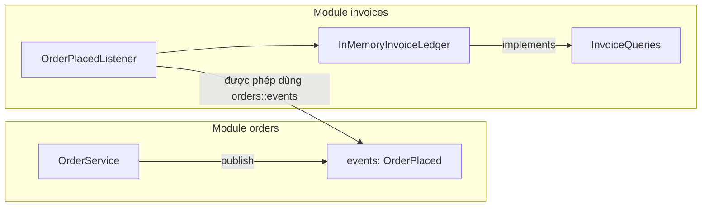

# Không làm assertion phụ thuộc log không ổn định

Một bài kiểm thử Spring Modulith chạy xanh vì trong console xuất hiện câu `"OrderPlaced published successfully"`. Sau khi nâng phiên bản Spring Boot, đổi logger từ `INFO` sang `DEBUG`, bật structured logging hoặc chuyển listener sang một executor khác, bài test bắt đầu thất bại dù nghiệp vụ vẫn chạy đúng. Tệ hơn, một lời gọi có thể ghi câu “published successfully” **trước khi transaction rollback**; test so khớp log vẫn PASS dù đơn hàng chưa được lưu và listener sau commit chưa xử lý.

Nguyên nhân nằm ở việc chọn **sai đối tượng assertion**. Log chủ yếu là **bằng chứng quan sát để chẩn đoán**; nó không mặc nhiên là hợp đồng nghiệp vụ ổn định. Thông điệp log có thể thay đổi theo phiên bản framework, cấu hình mức log, định dạng, timestamp, locale, thread, MDC, buffering và cách triển khai. Test chức năng, test sự kiện và test kiến trúc phải xác nhận **sự thật mà hệ thống cần bảo đảm** chứ không chỉ xác nhận một câu chữ từng xuất hiện.

Bài thuộc chương **Observability tests** của lộ trình **SPRING_MODULITH_VERIFICATION_TESTING**. Chúng ta sẽ thay thế các assertion dễ vỡ dựa trên log bằng **`ApplicationModules.verify()`**, **`@ApplicationModuleTest`**, **`@RecordApplicationEvents` / `ApplicationEvents`**, **`Scenario`**, kiểm tra trạng thái database và tích hợp, đồng thời tổ chức quality gate trong CI để phát hiện sai ranh giới và hồi quy. Log vẫn giữ vai trò quan trọng: cho biết **nên điều tra ở đâu khi assertion thật thất bại**.

> **Quy tắc thực hành:** Nếu điều cần bảo đảm là “event được phát”, hãy **assert event**; nếu là “hóa đơn được tạo”, hãy **assert trạng thái hóa đơn**; nếu là “module không dùng API nội bộ”, hãy **gọi `verify()`**. Chỉ assert log khi **chính log/audit record là hợp đồng được quy định rõ**, và khi đó hãy kiểm tra trường ổn định thay vì toàn bộ dòng log.

## 1. Vì sao một chuỗi log không phải hợp đồng nghiệp vụ?

Hãy xem ba test thường gặp:

```java
// Phản ví dụ 1: phụ thuộc câu chữ do ứng dụng hoặc framework in ra.
assertThat(output.getOut())
        .contains("Started Orders module in 1.37 seconds");

// Phản ví dụ 2: giả định một thông báo đồng nghĩa với tác dụng phụ.
assertThat(output.getOut())
        .contains("Invoice created successfully");

// Phản ví dụ 3: chờ một log xuất hiện thay vì trạng thái nghiệp vụ.
await().atMost(Duration.ofSeconds(5)).until(() ->
        output.getOut().contains("Billing listener completed")
);
```

Các đoạn trên có thể thất bại khi hệ thống đúng, hoặc PASS khi hệ thống sai:

| Thay đổi hoặc tình huống | Chuỗi log thay đổi thế nào? | Hợp đồng thật có thay đổi không? |
| --- | --- | --- |
| Thay `INFO` thành `DEBUG` | Dòng không được in ở môi trường test | Không nhất thiết |
| Đổi template `Invoice created` thành `Invoice issued` | Assertion cũ FAIL | Có thể không |
| Đổi locale/timezone hoặc bật JSON logging | Dòng văn bản khác hẳn | Có thể không |
| Log có timestamp, PID, thread name, trace ID | Chuỗi có thành phần biến thiên | Không |
| Listener chạy async | Log xuất hiện muộn hoặc khác thứ tự | Không nhất thiết |
| Service log “done” trước khi ghi DB hoặc commit | Test có thể PASS sớm | **Có thể nghiệp vụ chưa hoàn thành** |
| Listener bắt đầu nhưng ném exception ở bước tiếp theo | Log “started” tồn tại | **Tác dụng phụ không hoàn tất** |
| Log level bị tắt trong profile CI | Test FAIL mặc dù dữ liệu đúng | Không |
| Test khác phát event tương tự | Test có thể nhận nhầm log | Có thể **không** hoàn thành đúng stimulus |

Log có thể là một phần của **hợp đồng vận hành**, chẳng hạn mã audit, nhưng **thông điệp tự do** không nên mặc nhiên được đối xử như API ổn định.

### Một ví dụ “PASS giả”

```java
void handle(OrderPlaced event) {
    LOG.info("Invoice created successfully: {}", event.orderId());

    // Dòng này có thể ném exception hoặc rollback.
    invoices.createOnce(event.orderId());
}
```

Log đã được ghi **trước khi** hành vi cần bảo đảm xảy ra. Một assertion chỉ kiểm tra sự tồn tại của câu log không thể xác nhận hóa đơn tồn tại.

Ngay cả khi chuyển log xuống sau `createOnce`, transaction vẫn có thể rollback ở bước tiếp theo; **mốc log không luôn bằng mốc commit**. Test tích hợp phải xác minh **trạng thái bên ngoài transaction** hoặc một contract quan sát được tương đương.

## 2. Quy tắc chọn nguồn assertion theo câu hỏi

Hãy bắt đầu từ **câu hỏi nghiệp vụ/kiến trúc**, rồi chọn bằng chứng ít phụ thuộc cách trình bày nhất.

| Cần chứng minh | Không nên dựa vào | Assertion phù hợp |
| --- | --- | --- |
| Application module có ranh giới hợp lệ | `"Modules verified successfully"` trong console | `ApplicationModules.of(...).verify()` |
| Module có bean public phù hợp | Dòng `"Created bean foo"` | Inject bean và assert hợp đồng của nó |
| Service trả đúng dữ liệu | `LOG.info("Returned quote")` | Assert result, DTO, lỗi hoặc trạng thái |
| Một event đúng được publish | Dòng `"Publishing OrderPlaced"` | `ApplicationEvents.stream(OrderPlaced.class)` |
| Event thuộc đúng stimulus | Tên event trong log | So khớp `correlationId` và khóa nghiệp vụ |
| Listener tạo đúng hóa đơn | `"Billing listener completed"` | Query DB hoặc API đọc trạng thái module nhận |
| Transaction đã commit | Dòng `"Saving order"` | Truy vấn trạng thái đã commit qua transaction phù hợp |
| Publication được hoàn tất | Dòng `"Event delivered"` | Trạng thái registry/backend được hỗ trợ |
| Chạy đúng profile/configuration | Dòng log startup cụ thể | `Environment`, bean/condition hoặc test configuration |
| Chất lượng observability của audit | Một câu log tùy ý | Event code/structured fields được **định nghĩa là hợp đồng** |

**Bằng chứng gốc** nên được ưu tiên: đối tượng Java, event payload, HTTP response, database row, publication state và dependency graph. Log giúp đặt ngữ cảnh khi những bằng chứng ấy không đúng.

## 3. Tạo một ví dụ có ranh giới Spring Modulith rõ ràng

Xây dựng ứng dụng bán hàng với hai application module `orders` và `invoices` dưới package gốc `com.example.shop`.

```text
com.example.shop
├── ShopApplication.java
├── orders/                             ← application module orders
│   ├── OrderService.java               ← API đặt đơn
│   └── events/
│       ├── package-info.java          ← @NamedInterface("events")
│       └── OrderPlaced.java            ← event công khai
└── invoices/                           ← application module invoices
    ├── package-info.java              ← allowedDependencies = orders::events
    ├── InvoiceQueries.java             ← API đọc để test/consumer sử dụng
    └── internal/
        ├── InMemoryInvoiceLedger.java
        └── OrderPlacedListener.java
```

Hướng **phụ thuộc Java** mong muốn là `invoices → orders::events`, vì listener thuộc `invoices` import `OrderPlaced`. Hướng **truyền thông tin nghiệp vụ** là `orders → invoices` khi event được publish.



Lớp gốc của Spring Boot:

```java
// src/main/java/com/example/shop/ShopApplication.java
package com.example.shop;

import org.springframework.boot.SpringApplication;
import org.springframework.boot.autoconfigure.SpringBootApplication;

@SpringBootApplication
public class ShopApplication {

    public static void main(String[] args) {
        SpringApplication.run(ShopApplication.class, args);
    }
}
```

Đây là ví dụ **in-process và in-memory**, nhằm tạo các phép kiểm tra dễ hiểu mà không phải khởi tạo database. Sau đó chúng ta sẽ mở rộng sang transaction, `@ApplicationModuleListener` và DB; không coi phiên bản in-memory là giải pháp lưu đơn/hóa đơn cho production.

### 3.1. Công bố event qua named interface

File `orders/events/package-info.java`:

```java
/**
 * Sự kiện nghiệp vụ của orders được công bố cho module khác.
 * Không xuất entity, repository hoặc adapter nội bộ.
 */
@org.springframework.modulith.NamedInterface("events")
package com.example.shop.orders.events;
```

Kiểu event:

```java
// orders/events/OrderPlaced.java
package com.example.shop.orders.events;

import java.time.Instant;
import java.util.Objects;
import java.util.UUID;

public record OrderPlaced(
        UUID orderId,
        UUID correlationId,
        String sku,
        int quantity,
        Instant occurredAt
) {
    public OrderPlaced {
        Objects.requireNonNull(orderId, "orderId");
        Objects.requireNonNull(correlationId, "correlationId");
        Objects.requireNonNull(sku, "sku");
        Objects.requireNonNull(occurredAt, "occurredAt");

        if (sku.isBlank() || quantity <= 0) {
            throw new IllegalArgumentException("Invalid event payload");
        }
    }
}
```

`correlationId` nối stimulus của test với event và tác dụng phụ. `orderId` định danh một đơn hàng. Không dùng câu log có chứa SKU làm khóa correlation vì SKU không phải định danh duy nhất của một thao tác.

### 3.2. Service phát event

```java
// orders/OrderService.java
package com.example.shop.orders;

import com.example.shop.orders.events.OrderPlaced;
import java.time.Instant;
import java.util.Objects;
import java.util.UUID;
import org.springframework.context.ApplicationEventPublisher;
import org.springframework.stereotype.Service;

@Service
public class OrderService {

    private final ApplicationEventPublisher events;

    public OrderService(ApplicationEventPublisher events) {
        this.events = events;
    }

    public UUID place(
            String sku, int quantity, UUID correlationId) {
        Objects.requireNonNull(correlationId, "correlationId");

        if (sku == null || sku.isBlank() || quantity <= 0) {
            throw new IllegalArgumentException("Invalid order");
        }

        UUID orderId = UUID.randomUUID();

        events.publishEvent(new OrderPlaced(
                orderId,
                correlationId,
                sku,
                quantity,
                Instant.now()
        ));

        return orderId;
    }
}
```

**Giới hạn cố ý:** service chỉ phát event, **chưa lưu order**. Vì vậy test dưới đây chứng minh contract publish chứ **không** được diễn giải là transaction tạo đơn đã commit. Khi thiết kế ứng dụng thật, cần bổ sung persistence và bảo đảm ranh giới transaction phù hợp.

Dù service này ghi log gì — hoặc không ghi log — test nghiệp vụ phải xác nhận giá trị trả về và event.

### 3.3. Module invoices chỉ được phụ thuộc vào `orders::events`

File `invoices/package-info.java`:

```java
@org.springframework.modulith.ApplicationModule(
    allowedDependencies = "orders::events"
)
package com.example.shop.invoices;
```

Định nghĩa API đọc hóa đơn:

```java
// invoices/InvoiceQueries.java
package com.example.shop.invoices;

import java.util.UUID;

public interface InvoiceQueries {
    boolean exists(UUID orderId, UUID correlationId);
}
```

Implementation in-memory, thuộc package nội bộ của **cùng module invoices**:

```java
// invoices/internal/InMemoryInvoiceLedger.java
package com.example.shop.invoices.internal;

import com.example.shop.invoices.InvoiceQueries;
import java.util.UUID;
import java.util.concurrent.ConcurrentHashMap;
import java.util.concurrent.ConcurrentMap;
import org.springframework.stereotype.Component;

@Component
public class InMemoryInvoiceLedger implements InvoiceQueries {

    private final ConcurrentMap<UUID, UUID> correlations =
            new ConcurrentHashMap<>();

    public void createOnce(UUID orderId, UUID correlationId) {
        UUID previous = correlations.putIfAbsent(
                orderId, correlationId
        );

        if (previous != null && !previous.equals(correlationId)) {
            throw new IllegalStateException(
                    "Conflicting correlation for order"
            );
        }
    }

    @Override
    public boolean exists(UUID orderId, UUID correlationId) {
        return correlationId.equals(correlations.get(orderId));
    }
}
```

Tính idempotent ở đây chỉ phục vụ **bản đồ trong một JVM**. Nó không cung cấp lưu trữ bền vững, không bao phủ nhiều instance và không thay thế unique constraint hoặc transaction database trong sản phẩm.

Listener **đồng bộ** dùng `@EventListener` để ví dụ không phụ thuộc vào database/commit:

```java
// invoices/internal/OrderPlacedListener.java
package com.example.shop.invoices.internal;

import com.example.shop.orders.events.OrderPlaced;
import org.springframework.context.event.EventListener;
import org.springframework.stereotype.Component;

@Component
class OrderPlacedListener {

    private final InMemoryInvoiceLedger ledger;

    OrderPlacedListener(InMemoryInvoiceLedger ledger) {
        this.ledger = ledger;
    }

    @EventListener
    void on(OrderPlaced event) {
        ledger.createOnce(
                event.orderId(), event.correlationId()
        );
    }
}
```

**Vì sao `@EventListener` chứ chưa phải `@ApplicationModuleListener`?** Ví dụ đơn giản này không có transaction producer để listener xử lý sau commit. `@EventListener` mặc định xử lý đồng bộ theo cơ chế Spring application events (trừ khi ứng dụng cấu hình dispatch khác). Khi muốn kiểm tra transactional event publication đáng tin cậy, phải bổ sung transaction, listener phù hợp và backend dữ liệu; phần 9 sẽ phân tích riêng.

Bây giờ ta có **ba contract để kiểm chứng độc lập**: dependency giữa module, event được publish và trạng thái hóa đơn được tạo. Không contract nào đòi hỏi một dòng log cố định.

## 4. Test kiến trúc: kiểm tra bằng `verify()`, không grep log

Một phản ví dụ dễ gặp:

```java
// KHÔNG NÊN:
@Test
void modulesAreValid() {
    System.out.println(ApplicationModules.of(
            ShopApplication.class));
    assertThat(capturedLogs)
            .contains("orders -> invoices");
}
```

Đoạn này chỉ so sánh mô tả văn bản, thậm chí có thể hiểu **sai chiều dependency Java**. Nó không bắt buộc tuân thủ named interfaces hoặc `allowedDependencies`.

Test đúng:

```java
// src/test/java/com/example/shop/ModulithArchitectureTest.java
package com.example.shop;

import org.junit.jupiter.api.Test;
import org.springframework.modulith.core.ApplicationModules;

class ModulithArchitectureTest {

    @Test
    void applicationModulesRespectBoundaries() {
        ApplicationModules.of(ShopApplication.class).verify();
    }
}
```

`verify()` kiểm tra các quy tắc cấu trúc chính, gồm **phụ thuộc vòng**, **truy cập API không công bố của closed module**, và **giới hạn phụ thuộc** đã khai báo. Nếu phát hiện vi phạm, JUnit báo thất bại mà không cần test nào tìm câu `"Violation detected"` trong log.

Còn `toString()` có thể được dùng để bổ sung thông tin chẩn đoán:

```java
@Test
void printsModelAndVerifiesIt() {
    ApplicationModules modules =
            ApplicationModules.of(ShopApplication.class);

    System.out.println(modules); // Dùng để đọc mô hình.
    modules.verify();             // Đây mới là assertion kiến trúc.
}
```

Trong dự án thật, không cần giữ hai bài test làm trùng nhiệm vụ. Chọn một bài architecture test rõ tên; in mô hình khi hữu ích. **Không coi biểu diễn `toString()` là định dạng snapshot ổn định**.

### Một vi phạm dù log vẫn đẹp

Nếu module `invoices` tham chiếu một kiểu `public` giả lập thuộc `orders.internal`, Java có thể cho compile nhưng closed module không cho truy cập kiểu đó. `verify()` có thể phát hiện vi phạm; log event vẫn có thể xuất hiện bình thường.

Để thí nghiệm chính xác, phải tạo **dependency thực sự** qua field/chữ ký/method; một `import` không sử dụng có thể không xuất hiện trong bytecode được phân tích. Nếu lớp nội bộ là package-private, Java chặn trước khi test kiến trúc chạy.

## 5. Test event: kiểm tra payload thay vì thông báo “published”

Với `@ApplicationModuleTest` tại package `com.example.shop.orders`, ta có thể test module phát độc lập. Không cần module `invoices` đang chạy.

```java
// src/test/java/com/example/shop/orders/OrdersPublicationTest.java
package com.example.shop.orders;

import com.example.shop.orders.events.OrderPlaced;
import java.util.UUID;
import org.junit.jupiter.api.Test;
import org.springframework.beans.factory.annotation.Autowired;
import org.springframework.modulith.test.ApplicationModuleTest;
import org.springframework.test.context.event.ApplicationEvents;
import org.springframework.test.context.event.RecordApplicationEvents;

import static org.assertj.core.api.Assertions.assertThat;
import static org.assertj.core.api.Assertions.assertThatThrownBy;

@ApplicationModuleTest
@RecordApplicationEvents
class OrdersPublicationTest {

    @Autowired
    OrderService orders;

    @Autowired
    ApplicationEvents recordedEvents;

    @Test
    void emitsEventWithCorrectBusinessData() {
        UUID correlationId = UUID.randomUUID();

        UUID orderId = orders.place(
                "SKU-101", 2, correlationId
        );

        var matches = recordedEvents.stream(OrderPlaced.class)
                .filter(event ->
                        correlationId.equals(event.correlationId()))
                .toList();

        assertThat(matches).hasSize(1);

        OrderPlaced event = matches.get(0);
        assertThat(event.orderId()).isEqualTo(orderId);
        assertThat(event.sku()).isEqualTo("SKU-101");
        assertThat(event.quantity()).isEqualTo(2);
        assertThat(event.occurredAt()).isNotNull();
    }

    @Test
    void rejectsInvalidInputWithoutPublishingEvent() {
        UUID correlationId = UUID.randomUUID();

        assertThatThrownBy(() ->
                orders.place("", 0, correlationId))
                .isInstanceOf(IllegalArgumentException.class);

        assertThat(recordedEvents.stream(OrderPlaced.class)
                .filter(event ->
                        correlationId.equals(event.correlationId()))
                .count()).isZero();
    }
}
```

**Điều test bảo vệ:**

- Đúng loại sự kiện và **đúng correlation ID** cho stimulus.
- Event có `orderId`, SKU, quantity như nghiệp vụ mong đợi.
- Dữ liệu không hợp lệ bị từ chối và không phát event của stimulus đó.

**Điều test chưa bảo vệ:** commit database, delivery sang module tiêu thụ, trạng thái Event Publication Registry hoặc listener sau commit. `ApplicationEvents` của Spring Test ghi lại event được publish trong test context, **không phải message broker hoặc registry bền vững**.

Dù đổi template log từ `"OrderPlaced published"` sang `"Order placed"`, các assertions trên vẫn kiểm tra đúng hợp đồng.

### Vì sao nên kiểm tra exception type hơn chuỗi thông báo?

Khi quy tắc là “đơn không hợp lệ phải bị từ chối”, exception type và trạng thái nghiệp vụ thường là contract phù hợp hơn:

```java
assertThatThrownBy(() ->
        orders.place("", -1, UUID.randomUUID()))
        .isInstanceOf(IllegalArgumentException.class);
```

Không mặc định so khớp toàn bộ câu `"Invalid order"`, trừ khi **thông báo lỗi đó là API công khai được tài liệu hóa**. Trong REST API, có thể cần assert **error code, HTTP status và các trường machine-readable** thay vì câu tiếng Việt/tiếng Anh có thể được bản địa hóa.

## 6. Dùng `Scenario` để chờ đúng event, không chờ đúng câu log

Spring Modulith cung cấp DSL `Scenario` giúp mô tả *stimulus → điều kiện chờ*. Ví dụ trong test module `orders`:

```java
// Trích đoạn thuộc OrdersScenarioTest ở package com.example.shop.orders.
// Test class đã @ApplicationModuleTest và inject OrderService orders.
@Test
void matchesEventFromThisStimulus(Scenario scenario) {
    UUID correlationId = UUID.randomUUID();

    scenario.stimulate(() ->
                orders.place("SKU-101", 2, correlationId)
            )
            .andWaitForEventOfType(OrderPlaced.class)
            .matching(event ->
                    correlationId.equals(event.correlationId()))
            .toArriveAndVerify(event -> {
                assertThat(event.correlationId())
                        .isEqualTo(correlationId);
                assertThat(event.quantity()).isEqualTo(2);
            });
}
```

Cần import `org.springframework.modulith.test.Scenario` và các kiểu xuất hiện trong đoạn trích. Tùy phiên bản Spring Modulith, các tùy chọn giới hạn thời gian và biến thể DSL có thể khác; dùng API của dependency đã chọn.

**Phản ví dụ dễ PASS giả:**

```java
scenario.stimulate(() ->
            orders.place("SKU-101", 2, correlationId))
        .andWaitForEventOfType(OrderPlaced.class)
        .toArriveAndVerify(event ->
                assertThat(event).isNotNull());
```

Test này chỉ chứng minh có một event đúng **loại**. Nếu nhiều stimulus chạy gần nhau, điều kiện quá rộng có thể nhận nhầm event. Hãy dùng `.matching(...)` theo **correlation ID** và assert payload; đừng đợi một log có chứa `"OrderPlaced"`.

### Khi `Scenario` timeout

Không nên sửa bằng:

```java
// Phản ứng không nên dùng làm giải pháp đầu tiên:
// Tăng mọi timeout từ 5 giây lên 60 giây vì không thấy câu log.
```

Thay vào đó:

1. Xác nhận stimulus được gọi và trả kết quả/exception như mong đợi.
2. Dùng `ApplicationEvents` kiểm tra event có thật sự được publish không.
3. Kiểm tra predicate correlation ID có đúng không.
4. Phân biệt test đang chờ **event** hay **tác dụng phụ của listener**.
5. Đọc log để chẩn đoán dispatch, transaction, executor và database nếu test hành vi thất bại.

Log có ích **sau khi** test chỉ ra contract nào không đạt.

## 7. Test side effect: kiểm tra trạng thái thay vì “listener completed”

Vì ví dụ ban đầu sử dụng `@EventListener` đồng bộ và `InMemoryInvoiceLedger`, có thể viết một integration test đơn giản:

```java
// src/test/java/com/example/shop/OrderToInvoiceIntegrationTest.java
package com.example.shop;

import com.example.shop.invoices.InvoiceQueries;
import com.example.shop.orders.OrderService;
import java.time.Duration;
import java.util.UUID;
import org.junit.jupiter.api.Test;
import org.springframework.beans.factory.annotation.Autowired;
import org.springframework.boot.test.context.SpringBootTest;

import static org.assertj.core.api.Assertions.assertThat;
import static org.awaitility.Awaitility.await;

@SpringBootTest
class OrderToInvoiceIntegrationTest {

    @Autowired
    OrderService orders;

    @Autowired
    InvoiceQueries invoices;

    @Test
    void invoiceStateMatchesTheEvent() {
        UUID correlationId = UUID.randomUUID();

        UUID orderId = orders.place(
                "SKU-101", 2, correlationId
        );

        await().atMost(Duration.ofSeconds(3))
                .untilAsserted(() ->
                        assertThat(invoices.exists(
                                orderId, correlationId))
                                .isTrue());
    }
}
```

Trong **cấu hình mặc định của ví dụ** `@EventListener` chạy đồng bộ nên trạng thái có thể đã đúng ngay khi `orders.place(...)` trả về. Awaitility vẫn cho thấy cách assert điều kiện quan sát được; nó không biến ví dụ thành luồng bất đồng bộ. Khi chuyển sang `@ApplicationModuleListener` với transaction, test mới cần thực sự chờ xử lý sau commit.

Test chỉ cần quan sát **`InvoiceQueries` là API được module invoices cung cấp**; không cần import `invoices.internal.InMemoryInvoiceLedger`. Như vậy test phản ánh cách tiêu thụ hợp đồng thay vì phụ thuộc vào chi tiết triển khai nội bộ.

### Vì sao không kiểm tra log của listener?

Một listener có thể ghi:

```java
LOG.info("Invoice handler completed orderId={}", event.orderId());
```

nhưng sau đó transaction hoặc database có thể xảy ra lỗi. Test tìm dòng đó **không kiểm chứng kết quả bền vững**. Trong hệ thống thật, hãy query database hoặc đọc trạng thái qua API do module sở hữu công bố, ở thời điểm transaction đã commit.

### Khi nào cần dùng database thật?

Khi hệ thống chuyển từ in-memory sang persistence, những thuộc tính sau chỉ được bảo vệ bằng test phù hợp:

- Transaction commit/rollback và khả năng đọc dữ liệu sau commit.
- Mapping entity/DTO, migration schema và ràng buộc unique.
- Idempotency khi cùng event bị xử lý lại.
- Sự phối hợp giữa publisher và listener sau commit.
- Trạng thái Event Publication Registry khi được kích hoạt.

Một ví dụ tích hợp có thể dùng `JdbcTemplate` đọc bảng hóa đơn:

```java
// Trích đoạn trong @SpringBootTest với datasource/schema thật.
await().atMost(Duration.ofSeconds(10))
        .untilAsserted(() -> {
            Integer count = jdbc.queryForObject(
                    "select count(*) from issued_invoices "
                            + "where order_id = ? "
                            + "and correlation_id = ?",
                    Integer.class,
                    orderId,
                    correlationId
            );

            assertThat(count).isEqualTo(1);
        });
```

Đoạn này giả định bảng `issued_invoices`, `order_id` và `correlation_id` **được dự án tự định nghĩa**, cùng datasource, transaction và dữ liệu test phù hợp. Không phải schema Spring Modulith tạo sẵn. `jdbc`, `orderId`, `correlationId` là biến có sẵn trong test tích hợp. Hãy dùng Testcontainers hoặc cơ chế DB test được dự án quy định để kết quả tái lập được.

**Không đếm tổng tất cả invoice** để xác định một stimulus đã thành công: dữ liệu của test trước có thể tạo PASS giả. Kiểm tra đúng `orderId` và `correlationId`.

## 8. Khi dùng `@ApplicationModuleListener` và Event Publication Registry

Trong ứng dụng giao dịch thật, `order` có thể lưu đơn bằng JPA trong phương thức `@Transactional` và publish `OrderPlaced`. Module `invoices` sử dụng `@ApplicationModuleListener` để xử lý sự kiện theo cơ chế module listener của Spring Modulith.

```java
// Trích đoạn minh họa: chỉ áp dụng khi publisher có transaction thật.
@Component
class TransactionalOrderPlacedListener {

    private final InvoiceService invoices;

    TransactionalOrderPlacedListener(InvoiceService invoices) {
        this.invoices = invoices;
    }

    @ApplicationModuleListener
    void on(OrderPlaced event) {
        invoices.issueOnce(
                event.orderId(), event.correlationId()
        );
    }
}
```

**Đừng đặt ví dụ listener này song song với `OrderPlacedListener` in-memory cho cùng event trong một ứng dụng test rồi mặc định chúng tương đương.** Đây là **phương án triển khai thay thế**: cần transaction cho publisher, service persistence thực, datasource và cấu hình listener/registry tương thích. Khi chuyển đổi, phải loại bỏ hoặc vô hiệu hóa listener minh họa trước để tránh xử lý hai lần ngoài ý muốn.

Các mốc cần test khi có publication tracking:

| Mốc | Bằng chứng nên assert | Log giúp gì? |
| --- | --- | --- |
| **E1 — Event được publish** | `ApplicationEvents` và payload | Tìm stimulus/correlation ID |
| **E2 — Transaction hoàn tất** | Trạng thái đã commit hoặc test transaction | Đọc lỗi commit/rollback |
| **E3 — Listener xử lý** | Hóa đơn hoặc tác dụng phụ quan sát được | Biết handler đã bắt đầu, bị lỗi hay timeout |
| **E4 — Publication completed** | Trạng thái Event Publication Registry/backend được hỗ trợ | Điều tra publication còn chờ và recovery |

Registry không phải `ApplicationEvents`: nó theo dõi vòng đời publication tới những transactional listener phù hợp **khi đã cấu hình hạ tầng lưu trữ**. Không suy đoán bảng, cột, API hay retry semantics giống nhau ở mọi phiên bản Spring Modulith. Test trạng thái registry phải dựa trên backend/API **được phiên bản hiện tại hỗ trợ**.

**Một log `"Event delivered"` không đủ xác nhận publication completed.** Listener có thể commit tác dụng phụ nhưng lỗi trước khi đánh dấu completion, rồi được gọi lại. Cần test idempotency, pending/recovery và trạng thái DB.

## 9. Log có thể không ổn định theo những cách nào?

### 9.1. Startup, framework và bean bootstrap

Dòng startup của Spring Boot có thể thay đổi nội dung theo phiên bản, profile, auto-configuration và thời gian thực:

```text
Started ShopApplication in 4.207 seconds ...
```

Không viết snapshot test so khớp `"4.207"`, PID, thread name, bean count hay tên mọi configuration class. Những giá trị này **không phải hợp đồng của module**.

Để kiểm tra bean thật sự có mặt:

```java
@Autowired
OrderService orders;

@Test
void ordersApiIsWired() {
    assertThat(orders).isNotNull();
}
```

Trong test module, một assertion về hành vi của bean còn hữu ích hơn `isNotNull()`. Nếu `@ApplicationModuleTest` không khởi tạo được context, method `@Test` chưa chạy: phải đọc **stack trace và nested cause** từ Spring Test, không mong một dòng log riêng trong method cứu được lỗi bootstrap.

### 9.2. Level/filter/appenders

Bất kỳ môi trường nào cũng có thể cấu hình:

```yaml
logging:
  level:
    com.example.shop: WARN
```

Một dòng `LOG.info(...)` lúc ấy có thể không xuất hiện. **Business test không nên FAIL** vì một profile đã chủ ý giảm mức log. Ngược lại, một test dành riêng cho **hợp đồng logging** cần cấu hình logger/output của chính nó và có lý do kiểm tra mức log cụ thể.

### 9.3. Chạy bất đồng bộ và thứ tự log

Hai event có thể được xử lý trên các executor thread khác nhau; một dòng từ listener B có thể xuất hiện trước một dòng từ listener A dù event A được publish trước.

Không assert một chuỗi log **theo thứ tự cố định giữa thread** nếu hợp đồng nghiệp vụ không yêu cầu thứ tự đó. Nếu có yêu cầu tuần tự hóa, test phải kiểm tra **state/order contract** với cơ chế đồng bộ hoặc transaction phù hợp.

### 9.4. MDC, trace ID và correlation ID

`MDC` thường gắn với thread. Listener bất đồng bộ không mặc nhiên thừa hưởng MDC của publisher. Do đó, một test tìm `correlationId` trong log có thể FAIL dù event payload hoàn toàn đúng.

Hãy đặt correlation ID **trong event**, rồi nếu cần log:

```java
try (org.slf4j.MDC.MDCCloseable ignored =
        org.slf4j.MDC.putCloseable(
                "correlationId",
                event.correlationId().toString())) {

    invoices.issueOnce(
            event.orderId(), event.correlationId()
    );
}
```

Đây là trích đoạn của listener transaction/persistence đã có `invoices`, không phải class độc lập. `try-with-resources` giúp dọn MDC của thread đang xử lý. Test **payload và database** vẫn là assertion chính; MDC chỉ bổ sung khả năng tìm log.

### 9.5. Locale, serialization và structured logs

Một ứng dụng có thể chuyển từ pattern text sang JSON:

```text
2026-11-26 INFO billing - Invoice created orderId=...
```

hoặc:

```json
{"level":"INFO","logger":"billing","eventCode":"INVOICE_ISSUED","orderId":"..."}
```

**Đây là hai định dạng minh họa, không phải output đã ghi nhận.** Nếu consumer thật của log phụ thuộc JSON field, hãy dùng **contract test của schema log** hoặc lớp phát structured event ổn định. Đừng bắt mọi bài test nghiệp vụ so khớp toàn bộ chuỗi JSON gồm timestamp, field order và escaping.

### 9.6. Buffering và captured output

Captured console output phụ thuộc test extension, appender, logging backend, context initialization và flush. Với async appender hoặc logging ngoài thread test, log có thể chưa được ghi khi assertion chạy.

Kể cả khi `CapturedOutput` hoạt động, nó **không phải cơ chế chờ event processing đáng tin cậy**. Hãy chờ condition nghiệp vụ có timeout, rồi dùng log để hiểu vì sao condition không đạt.

## 10. Khi nào được assert log? Ngoại lệ phải có chủ đích

Có những trường hợp **chính log/audit record là sản phẩm**:

- Chính sách bảo mật yêu cầu mỗi lần truy cập bị từ chối phải có **mã sự kiện audit** nhất quán.
- Công cụ giám sát phụ thuộc **event code hoặc structured field** đã được tài liệu hóa.
- Pipeline phải loại bỏ secrets/PII khỏi thông điệp log.
- Đội vận hành dựa trên một schema logging được version và xem đó như hợp đồng tích hợp.

Lúc này, test về logging là hợp lý, nhưng **nên kiểm tra thành phần ổn định**, không kiểm tra nguyên văn toàn bộ dòng log.

### Ví dụ một mã chẩn đoán có ý nghĩa ổn định

```java
// orders/OrderDiagnosticReporter.java
package com.example.shop.orders;

import java.util.UUID;
import org.slf4j.Logger;
import org.slf4j.LoggerFactory;
import org.springframework.stereotype.Component;

@Component
public class OrderDiagnosticReporter {

    private static final Logger LOG =
            LoggerFactory.getLogger(OrderDiagnosticReporter.class);

    public void reject(UUID correlationId) {
        LOG.warn("eventCode=ORDER_INPUT_REJECTED correlationId={}",
                correlationId);
    }
}
```

Nếu **`ORDER_INPUT_REJECTED` được đội vận hành quy định là một contract**, test có thể kiểm tra mã đó. Với Spring Boot test utility `OutputCaptureExtension`:

```java
// src/test/java/com/example/shop/orders/OrderDiagnosticContractTest.java
package com.example.shop.orders;

import java.util.UUID;
import org.junit.jupiter.api.Test;
import org.junit.jupiter.api.extension.ExtendWith;
import org.springframework.boot.test.system.CapturedOutput;
import org.springframework.boot.test.system.OutputCaptureExtension;

import static org.assertj.core.api.Assertions.assertThat;

@ExtendWith(OutputCaptureExtension.class)
class OrderDiagnosticContractTest {

    private final OrderDiagnosticReporter reporter =
            new OrderDiagnosticReporter();

    @Test
    void emitsStableAuditCode(CapturedOutput output) {
        UUID correlationId = UUID.randomUUID();

        reporter.reject(correlationId);

        assertThat(output.getOut())
                .contains("eventCode=ORDER_INPUT_REJECTED")
                .contains("correlationId=" + correlationId);
    }
}
```

**Giới hạn và điều kiện:**

- Đây là test **cho hợp đồng logging đã chủ động thiết kế**, không phải test việc một đơn thật sự bị từ chối trong nghiệp vụ.
- `OutputCaptureExtension` thuộc `org.springframework.boot.test.system`; cần dependency Spring Boot Test tương thích và logging backend in ra output mà extension thu được.
- Vì test tạo `OrderDiagnosticReporter` trực tiếp, nó **không kiểm tra Spring DI**. Nếu cần kiểm tra wiring, bổ sung test context riêng.
- Chỉ kiểm tra **event code và correlation ID do ứng dụng kiểm soát**; không so khớp timestamp, thread, PID, duration hoặc nguyên toàn dòng.
- Nếu logging cấu hình tắt WARN hoặc appender async không flush, môi trường test phải được cấu hình có chủ đích; không tái sử dụng test này như bằng chứng về side effect.
- Với structured logging là API chính thức, ưu tiên **test đối tượng audit có kiểu hoặc JSON schema** tại nguồn phát để giảm phụ thuộc console formatting.

### Khi audit quan trọng, typed event/sink thường tốt hơn chuỗi

Ví dụ có thể định nghĩa:

```java
public record AuditRecord(
        String eventCode,
        UUID correlationId,
        String outcome
) {}
```

Sau đó cung cấp một `AuditSink` để nhận `AuditRecord`, và test bằng **fake sink** hoặc kiểm tra bản ghi audit được lưu bền vững. Logger chỉ là một adapter xuất thông điệp từ typed record.

Cách này làm hợp đồng trở thành **dữ liệu có kiểu**, thay vì dựa trên câu chữ tình cờ trong `LOG.info(...)`. Với audit quan trọng cho tuân thủ/bảo mật, test còn phải kiểm tra retention, lỗi lưu audit và chính sách không lộ dữ liệu, chứ không chỉ tìm mã.

## 11. Mẫu anti-pattern và cách thay bằng assertion ổn định

| Anti-pattern | Rủi ro | Thay bằng |
| --- | --- | --- |
| `assertThat(log).contains("Started ...")` | Log startup đổi theo version, duration | Bootstrap test + assert bean hoặc behavior |
| `assertThat(log).contains("No cycles")` | Không có assertion kiến trúc thật | `ApplicationModules.verify()` |
| `assertThat(log).contains("Publishing OrderPlaced")` | Log có thể trước commit hoặc sai payload | `ApplicationEvents` assert event |
| `assertThat(log).contains("Listener finished")` | Listener có thể lỗi sau log | Assert database/state sau commit |
| So sánh nguyên chuỗi stack trace | Exception wrapping và line number thay đổi | Assert exception type, contract, cause có ý nghĩa |
| Snapshot toàn danh sách bean | Auto-config/proxy làm thay đổi danh sách | Assert bean API cần thiết và hành vi |
| Snapshot `ApplicationModules.toString()` | Format mô tả không phải stable API | `verify()` + test bất biến có ý nghĩa |
| Parse timestamp từ console để assert tốc độ | Clock/format/timezone/async sai lệch | `System.nanoTime()`, `Timer` và test hiệu năng riêng |
| Chờ câu log có event type | Có thể nhận event của stimulus khác | Predicate theo correlation ID/aggregate ID |
| Assert thứ tự log của hai async listener | Scheduling không ổn định | Contract về state/ordering qua cơ chế tương ứng |
| Kiểm tra `INFO` xuất hiện để xác minh không lỗi | INFO vẫn có khi downstream fail | Assert kết quả và exception/report lỗi |
| Dùng regex rộng `.*success.*` | PASS giả từ câu log của case khác | Assertion có type/ID/state chính xác |

Điểm chung: một assertion tốt phải **thất bại khi contract bị phá** và **tiếp tục PASS khi chỉ cách trình bày log thay đổi**.

## 12. Chẩn đoán một bài test bất đồng bộ bị timeout

Giả sử test chờ hóa đơn 8 giây nhưng không thấy dữ liệu. Trong CI, log có thể chứa:

```text
INFO  orders   correlationId=C1 stage=EVENT_PUBLISHED
INFO  invoices correlationId=C1 stage=LISTENER_STARTED
ERROR invoices correlationId=C1 stage=DATABASE_FAILURE
```

Các dòng trên chỉ là **ví dụ**, không phải output đã chạy. Chúng hỗ trợ điều tra nhưng không nên là assertion chính.

Quy trình đúng:

1. Kiểm tra **stimulus** có chạy và kết quả trả về hay không.
2. Dùng `ApplicationEvents` hoặc `Scenario` xác nhận event `OrderPlaced` **đúng ID** đã publish.
3. Kiểm tra transaction đã commit nếu listener cần `AFTER_COMMIT`; `@Transactional` đặt trên test có thể rollback và ngăn listener chạy.
4. Xem listener có được bootstrap trong context không; `@ApplicationModuleTest` của module phát ở `STANDALONE` thường **không nạp module nhận**.
5. Kiểm tra executor, connection pool, DB locks, migration và schema nếu listener đã bắt đầu.
6. Dùng log theo correlation ID và stack trace để xác định nguyên nhân; nếu cần thu thread dump khi JVM còn sống.
7. Sửa nguyên nhân và kiểm tra lại **side effect** bằng assertion trạng thái với timeout hữu hạn.

**Không tăng timeout vô hạn chỉ vì thiếu dòng `LISTENER_COMPLETED`**. Nếu listener chưa bao giờ được bootstrap hoặc transaction không commit, đợi lâu hơn không làm nghiệp vụ đúng lên.

### `@ApplicationModuleTest` và phạm vi bootstrap

Các chế độ thường gặp:

| Chế độ | Phạm vi module | Ý nghĩa khi test event |
| --- | --- | --- |
| `STANDALONE` | Module đích | Thích hợp kiểm tra publisher/contract độc lập |
| `DIRECT_DEPENDENCIES` | Module đích và dependency trực tiếp | Dùng khi module cần tích hợp thật với dependency |
| `ALL_DEPENDENCIES` | Module đích và dependency bắc cầu | Không có nghĩa “mọi module của ứng dụng” |

Đổi mode chỉ có ý nghĩa khi phạm vi phụ thuộc và mục tiêu test yêu cầu. Một module **tiêu thụ** event không đương nhiên là dependency của module **phát**; test producer không cần nạp consumer để assert E1. Test end-to-end nên khai báo rõ phạm vi bằng `@SpringBootTest` hoặc cách cấu hình tích hợp tương đương.

## 13. Kiểm chứng log không chứa dữ liệu nhạy cảm

Bài học “không phụ thuộc vào log không ổn định” không có nghĩa **không bao giờ kiểm tra logging về mặt bảo mật**. Một số tiêu chí có thể định nghĩa thành contract:

- Không đưa access token, mật khẩu hoặc dữ liệu thẻ vào log.
- Không ghi cả `OrderEntity` hay dữ liệu cá nhân chỉ để debug.
- Log có event code/correlation ID không chứa thông tin nhạy cảm nếu chính sách yêu cầu.
- Lỗi được phân loại bằng mã ổn định; phần chi tiết nội bộ chỉ xuất hiện ở nơi có quyền truy cập.
- Thông tin audit bắt buộc được lưu theo yêu cầu tuân thủ.

Tuy nhiên, **so khớp một vài chuỗi cấm trong console không chứng minh không thể rò rỉ** qua mọi appender, exception hoặc kênh telemetry. Cần kết hợp kiểm tra code/configuration, sanitization/redaction, sink test và phân quyền lưu trữ.

Ví dụ một phép kiểm tra bổ sung có thể dùng dữ liệu sentinel do test kiểm soát để xác minh một adapter log **không xuất nguyên token**. Đừng dùng token thật hoặc PII thực tế trong test. Nếu backend log không phải console, hãy kiểm tra **đúng sink** chứ không giả định `CapturedOutput` bao phủ toàn bộ.

## 14. CI quality gate: log để chẩn đoán, assertion để quyết định

Một quality gate cho Spring Modulith nên tách các loại kiểm tra rõ ràng:

| Gate | Assertion quyết định PASS/FAIL | Log/report dùng để |
| --- | --- | --- |
| **Compile** | Type/chữ ký Java hợp lệ | Xem nguyên nhân compiler error |
| **Architecture** | `ApplicationModules.verify()` | Định vị module, kiểu và dependency sai |
| **Module contract** | `@ApplicationModuleTest` và assertion giá trị/bean | Điều tra bootstrap, profile |
| **Event producer** | `ApplicationEvents` hoặc `Scenario` với payload/ID | Truy xuất publish path |
| **Listener/DB integration** | Query hoặc API state sau commit | Chẩn đoán timeout, transaction, DB |
| **Publication lifecycle** | Registry pending/completed/recovery khi dùng | Phân tích listener failures |
| **Audit/logging contract** | Chỉ các field/schema đã có quy định ổn định | Chẩn đoán lỗi logging adapter |
| **Performance riêng** | Latency budget với phương pháp đo/đủ mẫu | Phân tích bottleneck |

Lệnh Gradle/JUnit thông dụng:

```bash
./gradlew test
```

Lệnh Maven khi đã cấu hình JUnit 5:

```bash
mvn -B test
```

Một dự án có thể đặt integration test ở Gradle task `integrationTest` hoặc Maven Failsafe; **`test` không tự bao gồm mọi suite**. CI phải gọi đúng các task/plugin đã được cấu hình. Test không được bị skip bằng `-x test` hoặc `-DskipTests` trong quality gate bắt buộc.

### Ví dụ GitHub Actions

```yaml
name: Modulith architecture and behavior checks

on:
  pull_request:

jobs:
  modulith-quality:
    runs-on: ubuntu-latest
    permissions:
      contents: read

    steps:
      - uses: actions/checkout@v4

      - uses: actions/setup-java@v4
        with:
          distribution: temurin
          java-version: '21'

      - uses: gradle/actions/setup-gradle@v4

      - name: Verify architecture and module contracts
        run: bash ./gradlew --no-daemon test

      - name: Verify database and event integration
        run: bash ./gradlew --no-daemon integrationTest

      - name: Keep JUnit reports on failure
        if: always()
        uses: actions/upload-artifact@v4
        with:
          name: modulith-test-reports
          path: |
            **/build/test-results/**/*.xml
            **/build/reports/tests/**
          if-no-files-found: warn
```

**Đây là workflow minh họa**, chỉ chạy khi repository có Gradle wrapper, Java phù hợp, task `integrationTest` thật sự tồn tại và database/test infrastructure được cung cấp. Không có bằng chứng workflow đã chạy trong workspace bài học.

Để chặn merge, phải cấu hình **branch protection/ruleset** yêu cầu job `modulith-quality` thành công. `if: always()` giúp lưu báo cáo lỗi, **không** biến test FAIL thành PASS.

### Giữ đủ log khi test thất bại, nhưng không lấy log làm oracle

Với Gradle, một cấu hình có thể dùng:

```groovy
tasks.named('test') {
    useJUnitPlatform()

    testLogging {
        events 'failed', 'skipped'
        exceptionFormat = 'full'
        showStandardStreams = true
    }
}
```

Việc in toàn bộ stdout/stderr trong mọi PR có thể tạo output lớn, nên chỉ bật có mục tiêu hoặc giữ qua JUnit reports khi cần. Khi test FAIL, cần **giữ nguyên exception và exit code**; không viết `catch` chỉ log rồi trả về bình thường.

**Một dòng log `"BUILD SUCCESSFUL"` hoặc `"Tests passed"` được copy từ task khác không phải nguồn quyết định.** CI cần dựa vào exit status của test runner và các required checks đã được cấu hình.

## 15. Thiết kế ca âm để chứng minh assertion thực sự bảo vệ contract

Một bài test tốt không chỉ PASS ở baseline; nó còn **FAIL khi ta cố ý phá đúng điều đang kiểm tra**.

| Thí nghiệm | Thay đổi có kiểm soát | Assertion đúng phải phản ứng |
| --- | --- | --- |
| **A — Đổi thông điệp log** | Đổi `"Order placed"` thành `"Placed order"` | Test kiến trúc/event/DB **vẫn PASS** |
| **B — Tắt `INFO`** | Cấu hình `com.example.shop: WARN` | Test hành vi **vẫn PASS**, trừ logging contract riêng |
| **C — Phát event sai quantity** | Service đặt `quantity = 999` trong event | Producer contract test **FAIL** |
| **D — Không publish event** | Bỏ lời gọi `publishEvent` | `ApplicationEvents`/`Scenario` **FAIL** |
| **E — Listener không tạo state** | Bỏ `ledger.createOnce(...)` | Side-effect test **FAIL** |
| **F — Dùng sai correlation ID** | Listener ghi ID ngẫu nhiên mới | Test đối chiếu state **FAIL** |
| **G — Vi phạm API nội bộ** | `invoices` import kiểu `public` ở `orders.internal` | `ApplicationModules.verify()` **FAIL** |
| **H — Đổi event code audit đã cam kết** | Đổi `ORDER_INPUT_REJECTED` thành mã khác | Test **logging contract riêng FAIL** |
| **I — Listener async chậm** | Dùng latch/test harness điều phối handler | Test chờ side effect có timeout hữu hạn; log order không quyết định |
| **J — DB rollback** | Cố ý làm transaction thất bại sau publish | Test commit/state **FAIL**; recorder có thể vẫn thấy event |

Đây là **kỳ vọng để thực hành**, không phải kết quả test đã chạy trên dự án cụ thể. Sau mỗi ca âm, **khôi phục baseline** rồi chạy lại các bài test cần thiết.

### Một tiêu chí review dễ áp dụng

Với mỗi assertion, hãy hỏi:

1. Nó sẽ **FAIL khi hành vi sai** nhưng log vẫn viết `success` không?
2. Nó sẽ **PASS khi hành vi đúng** nhưng câu log được dịch hoặc đổi format không?
3. Nó có phân biệt **đúng stimulus** bằng ID, hay có thể PASS nhờ event/dữ liệu khác?
4. Nó kiểm tra **đúng tầng**: cấu trúc, publish, commit, side effect hay publication completed?
5. Nếu test FAIL, log có đủ correlation ID/root cause để chẩn đoán mà không lộ secrets không?

Nếu câu trả lời cho (1) hoặc (2) là “không”, assertion có thể đang buộc chặt vào một implementation detail không ổn định.

## 16. Bài thực hành: sửa bộ test dễ vỡ do log

### Bối cảnh

Hệ thống `orders` / `invoices` có một bài test đang PASS khi tìm thấy ba chuỗi:

```text
"Orders module initialized"
"OrderPlaced published"
"Invoice created successfully"
```

Sau khi đổi cấu hình logging trong CI, toàn bộ test FAIL dù nhóm chưa thay đổi nghiệp vụ. Nhiệm vụ là viết lại kiểm thử sao cho **phụ thuộc vào contract thật** và vẫn dễ chẩn đoán khi có lỗi.

### Các bước

1. **Phân loại từng chuỗi:** câu nào cố xác minh bootstrap, câu nào publish, câu nào side effect? Viết lại mỗi yêu cầu thành điều kiện có thể assert bằng API/state.
2. **Tạo application modules:** `orders` công bố `@NamedInterface("events")`; `invoices` khai báo `allowedDependencies = "orders::events"`.
3. **Viết architecture gate:** JUnit `ApplicationModules.of(ShopApplication.class).verify()`. Tạo kiểu `public` giả lập trong `orders.internal`, tham chiếu từ `invoices`, chứng minh gate FAIL rồi khôi phục.
4. **Viết producer contract test:** dùng `@ApplicationModuleTest` và `@RecordApplicationEvents`; assert payload `OrderPlaced` và correlation ID đúng.
5. **Viết test input xấu:** truyền quantity không hợp lệ; assert exception type và không có event của stimulus đó.
6. **Dùng `Scenario` nếu cần chờ:** kích hoạt `place`, dùng `.andWaitForEventOfType(...).matching(...)` để xác nhận event thuộc đúng stimulus, không tìm câu log.
7. **Viết consumer test:** dùng `@SpringBootTest` với `InvoiceQueries` để assert `exists(orderId, correlationId)`; nếu listener async, dùng Awaitility và timeout hữu hạn.
8. **Thêm phiên bản DB:** với transaction thật, assert invoice sau commit qua repository/API hoặc JDBC; tách test publisher E1 với test listener E3.
9. **Đổi log:** sửa thông điệp, đổi `INFO` thành `DEBUG`, bật structured JSON logging. Xác nhận test chức năng/kiến trúc **không đổi kết quả**.
10. **Thử phá hành vi:** bỏ `publishEvent` hoặc bỏ `createOnce`; test liên quan phải **FAIL** ngay cả khi để nguyên câu `LOG.info("...success...")`.
11. **Nếu có audit contract:** định nghĩa mã `ORDER_INPUT_REJECTED`, viết một test logging contract **riêng** chỉ assert mã/field ổn định hoặc kiểm tra typed audit sink.
12. **Khóa CI:** chạy architecture/module/event/integration tests; lưu JUnit reports và log theo correlation ID khi FAIL; cấu hình required status checks trước merge.

### Ma trận nghiệm thu

| Thay đổi | Architecture test | Producer event test | Consumer/state test | Logging contract test |
| --- | --- | --- | --- | --- |
| Baseline đúng | PASS | PASS | PASS | PASS nếu đã định nghĩa |
| Đổi câu log không liên quan contract | PASS | PASS | PASS | Không cần kiểm tra |
| Tắt INFO | PASS | PASS | PASS | Phụ thuộc chính sách logging contract |
| Bỏ `publishEvent` | Có thể PASS | **FAIL** | **FAIL** nếu consumer phụ thuộc event | Không quyết định |
| Event sai `correlationId` | Có thể PASS | **FAIL** | **FAIL** nếu đối chiếu đúng ID | Không quyết định |
| Không ghi invoice | Có thể PASS | Có thể PASS | **FAIL** | Không quyết định |
| Import `orders.internal` | **FAIL** | Có thể PASS | Có thể PASS | Không quyết định |
| Đổi mã audit đã cam kết | Có thể PASS | Có thể PASS | Có thể PASS | **FAIL** |

Các kết quả trên là **kỳ vọng của bài tập**, không phải báo cáo đã thực thi trên workspace.

### Câu hỏi tự đánh giá

**1. Vì sao không nên assert `"Started ShopApplication in 2.5 seconds"`?** Vì duration, PID, format và thông điệp framework có thể thay đổi; đó không phải hợp đồng của ứng dụng. Hãy assert bean và hành vi cần thiết.

**2. Có `"OrderPlaced published"` trong log chứng minh điều gì?** Chỉ chứng minh mã có thể đã phát thông điệp log ở một thời điểm; không tự chứng minh event payload đúng, transaction commit hoặc listener hoàn tất.

**3. Công cụ nào phù hợp để kiểm tra event được publish trong module test?** `@RecordApplicationEvents` với `ApplicationEvents`, hoặc DSL `Scenario` lọc event theo correlation ID.

**4. Công cụ nào bảo vệ module `invoices` không dùng kiểu nội bộ `orders.internal`?** `ApplicationModules.verify()` trong architecture test; log không thay thế quy tắc phụ thuộc tĩnh.

**5. Vì sao test listener nên assert database hoặc API trạng thái?** Vì đó là tác dụng phụ nghiệp vụ thực sự. Log “completed” có thể xuất hiện trước commit hoặc bị in sai thời điểm.

**6. Khi nào test logging có lý do tồn tại?** Khi mã audit, structured field, log schema hoặc điều kiện không tiết lộ thông tin nhạy cảm được định nghĩa là hợp đồng cần bảo vệ. Nên test riêng và kiểm tra thành phần ổn định.

**7. Có nên dùng `CapturedOutput` để đợi listener async hoàn tất?** Không phải lựa chọn tin cậy. Hãy chờ side effect hoặc publication state bằng timeout, rồi dùng captured log để chẩn đoán.

**8. Vì sao CI cần giữ log dù không assert log?** Vì khi test dựa trên API/state FAIL, log có correlation ID, stack trace và thông tin transaction/executor/DB giúp truy nguyên nhanh hơn.

## 17. Ghi nhớ

**Không làm assertion phụ thuộc log không ổn định** là chọn **nguồn bằng chứng đúng** cho từng contract. Trong Spring Modulith, dùng **`ApplicationModules.verify()`** để kiểm chứng ranh giới, **`@ApplicationModuleTest`** để kiểm tra module, **`ApplicationEvents` hoặc `Scenario`** để kiểm chứng event, và **database/API trạng thái** để xác nhận listener, transaction và tích hợp. Log, thread name, timestamp, bean count, `toString()` và thứ tự output giúp chẩn đoán nhưng không nên quyết định PASS/FAIL của nghiệp vụ. Khi logging/audit **thật sự là hợp đồng**, hãy kiểm tra mã hoặc schema ổn định trong test riêng và kiểm soát configuration. Trong **CI**, để assertion và exit status làm quality gate, còn log/JUnit reports cung cấp chứng cứ tìm nguyên nhân hồi quy — không phải vật thay thế cho kiểm thử.

### Tài liệu tham khảo

- [Spring Modulith Reference — Verifying Application Module Structure](https://docs.spring.io/spring-modulith/reference/verification.html)
- [Spring Modulith Reference — Integration Testing Application Modules](https://docs.spring.io/spring-modulith/reference/testing.html)
- [Spring Modulith Reference — Working with Application Events](https://docs.spring.io/spring-modulith/reference/events.html)
- [Spring Framework Reference — Testing](https://docs.spring.io/spring-framework/reference/testing.html)
- [Spring Boot Reference — Testing Spring Boot Applications](https://docs.spring.io/spring-boot/reference/testing/spring-boot-applications.html)
