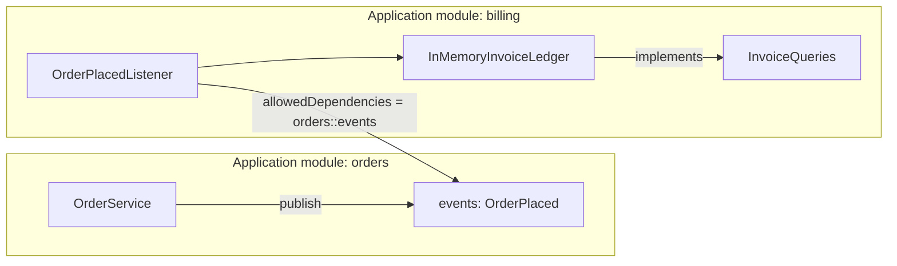
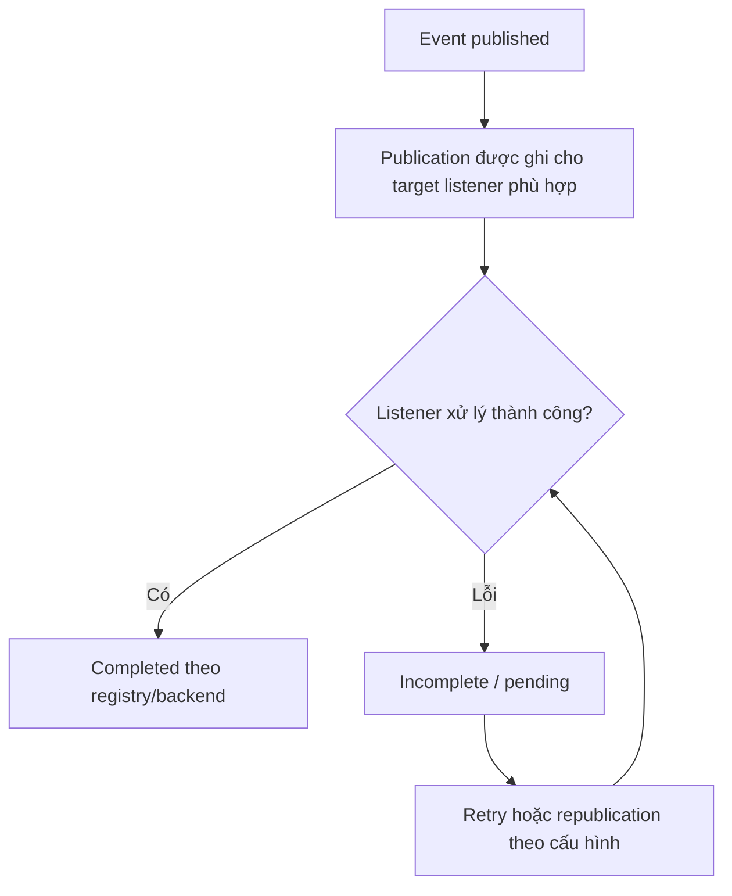
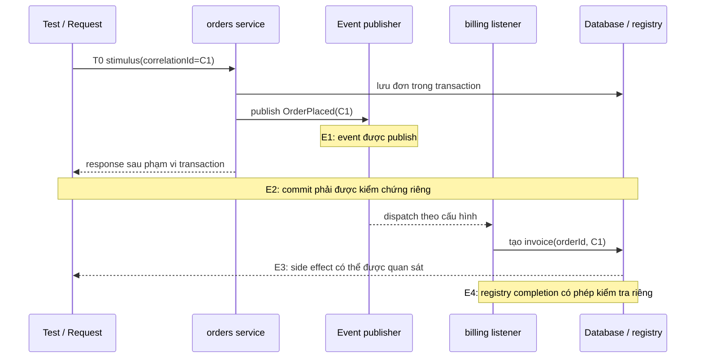

# Bằng chứng cấu trúc, hành vi và vận hành

Khi một pull request sửa module `orders` của ứng dụng Spring Modulith, nhóm phát triển có thể nhận được ba tín hiệu đều màu xanh: `ApplicationModules.verify()` không báo lỗi, bài test tạo đơn PASS và log ghi “Event published”. Ba tín hiệu đó có đủ để khẳng định **module không bị phụ thuộc sai**, **nghiệp vụ hoạt động đúng**, và **hệ thống vận hành đáng tin cậy** không?

**Không.** Mỗi nguồn thông tin chỉ hỗ trợ một **loại kết luận** trong một **phạm vi** nhất định. Một dependency graph hợp lệ không chứng minh transaction đã commit. Một test ghi nhận event không chứng minh listener đã xử lý. Một dòng log `SUCCESS` không chứng minh dữ liệu thật được lưu. Một latency metric đẹp của một instance cũng không chứng minh mọi request trong hệ thống đều đáp ứng SLO.

**Bằng chứng cấu trúc, hành vi và vận hành** là phương pháp kiểm tra các tuyên bố về phần mềm bằng những nguồn phù hợp và có thể kiểm chứng lại. Trong chương **Observability tests** của lộ trình **SPRING_MODULITH_VERIFICATION_TESTING**, chúng ta xây dựng chuỗi bằng chứng từ **mô hình module** → **test module/event/database** → **log, metrics, tracing và publication lifecycle**, rồi đưa các kiểm tra bắt buộc vào **CI quality gate**.

> **Tư tưởng cốt lõi:** Đừng hỏi chung chung “có test/log không?”. Hãy hỏi: **“Tôi đang khẳng định điều gì? Bằng chứng nào đo đúng điều đó, trong môi trường nào, ở thời điểm nào, và phép kiểm tra có thất bại khi tôi cố ý phá điều ấy không?”**

## 1. Ba nhóm bằng chứng trả lời ba loại câu hỏi

| Nhóm | Câu hỏi trọng tâm | Công cụ phù hợp trong Spring Modulith | Không thể tự kết luận |
| --- | --- | --- | --- |
| **Cấu trúc (structural)** | Các module phụ thuộc đúng ranh giới đã khai báo không? | `ApplicationModules.of(...)`, `verify()`, `@ApplicationModule`, `@NamedInterface` | Bean hoạt động, event được xử lý, dữ liệu commit |
| **Hành vi (behavioral)** | Đầu vào cụ thể tạo ra kết quả và tác dụng phụ đúng không? | JUnit, `@ApplicationModuleTest`, `@RecordApplicationEvents`, `ApplicationEvents`, `Scenario`, database/integration tests | Mọi phụ thuộc tĩnh hợp lệ; production luôn đạt SLO |
| **Vận hành (operational)** | Khi chạy thực, event/request/transaction/worker đang diễn biến thế nào? | Structured logs, correlation ID, Micrometer metrics, tracing, DB/executor metrics, Event Publication Registry | Một câu log tự nó chứng minh hợp đồng nghiệp vụ; không có sự cố trong mọi khoảng thời gian |

Ba nhóm **bổ sung nhau, không thay thế nhau**.

Ví dụ: test `@ApplicationModuleTest` có thể PASS dù module tiêu thụ đã tham chiếu lớp nội bộ của module khác ở một nhánh chưa được thực thi. `verify()` có thể phát hiện phụ thuộc đó. Nhưng `verify()` cũng có thể PASS khi listener không tạo hóa đơn do thiếu cấu hình transaction. Cuối cùng, các test trong CI có thể PASS trên một request nhỏ trong khi production bị nghẽn connection pool dưới tải cao.

### Phân biệt “đúng trong test” và “đúng trong production”

Một test có thể xác nhận:

- Với **mã tại commit X**;
- trên **JDK, dependency, cấu hình và dữ liệu test Y**;
- khi chạy **stimulus Z**;
- thì **assertion A** đạt.

Điều đó không tự chứng minh một kết luận rộng hơn như “mọi request production luôn nhanh”, “không bao giờ mất event” hay “mọi lỗi mạng đều được xử lý”. Khi cần khẳng định mức vận hành, phải có **quan sát ở môi trường và cửa sổ thời gian thích hợp** cùng test lỗi/retry tương ứng.

## 2. Chọn bằng chứng theo *claim*, không theo công cụ đang có

Một *claim* là tuyên bố muốn bảo vệ. Ví dụ: “Module `billing` chỉ phụ thuộc `orders::events`”. Claim này khác hoàn toàn “Mỗi đơn thành công tạo đúng một hóa đơn”.

| Mã claim | Tuyên bố cần chứng minh | Bằng chứng chính | Phép thử âm giúp xác nhận gate hoạt động |
| --- | --- | --- | --- |
| **S1** | Không có dependency cycle bị cấm | `ApplicationModules.verify()` | Cố ý tạo chu trình và thấy test FAIL |
| **S2** | `billing` không dùng `orders.internal` | `verify()` và review API | Tham chiếu kiểu public ở subpackage internal |
| **S3** | `billing` chỉ dùng named interface được cấp phép | `allowedDependencies` + `verify()` | Tham chiếu API công bố nhưng chưa được cho phép |
| **B1** | Tạo đơn phát event đúng payload | `ApplicationEvents` hoặc `Scenario` | Bỏ publish hoặc đổi `orderId`/`correlationId` |
| **B2** | Listener tạo hóa đơn đúng đơn | Module/integration test + truy vấn trạng thái | Listener không ghi hoặc ghi sai correlation ID |
| **B3** | Xử lý lại event không tạo hóa đơn trùng | Idempotency/integration/concurrency test | Giao lại một event hoặc gây xử lý đồng thời |
| **O1** | Có thể truy vết một luồng nghiệp vụ | Log/trace có correlation ID, schema ổn định | Cắt truyền ID qua async listener |
| **O2** | Hệ thống không tích lũy publication chưa xử lý quá giới hạn | Registry/backend + metrics/alert trong một khoảng thời gian | Gây lỗi listener và xác minh thấy backlog |
| **O3** | Độ trễ hoàn tất hóa đơn đạt SLO đã định nghĩa | Histogram/trace từ tải và thời gian quan sát phù hợp | Tạo tải hoặc nghẽn có kiểm soát để kiểm tra phép đo |

**Không chọn bằng chứng phụ chỉ vì nó tiện hơn.** Chẳng hạn, một log `invoice created` không phải bằng chứng chính cho B2 nếu transaction còn có thể rollback. Ngược lại, không phải lúc nào test B2 cũng cần production trace; state assertion sau commit mới là phép đo trọng tâm.

## 3. Ba đặc tính của bằng chứng đáng tin cậy

### 3.1. Có phạm vi rõ ràng

Viết “test PASS” là quá mơ hồ. Nên nói rõ: “`OrdersPublicationTest` PASS khi gọi `placeOrder` với correlation ID duy nhất, trong Spring Modulith standalone module test, sử dụng một event publisher in-process”.

Đối với vận hành, luôn ghi **môi trường, khoảng thời gian, traffic, cấu hình instrumentation** và mức độ đầy đủ của dữ liệu. Một tracing sample không phủ 100% traffic nếu hệ thống lấy mẫu.

### 3.2. Có thể bị bác bỏ

Một bài test chỉ in ra danh sách module hoặc log `success` nhưng không bao giờ thất bại là **tư liệu quan sát**, không phải quality gate.

Ví dụ:

```java
// Chỉ có ý nghĩa chẩn đoán, không phải assertion kiến trúc.
System.out.println(
        ApplicationModules.of(ShopApplication.class)
);
```

Trong khi đó:

```java
// Có khả năng FAIL khi quy tắc kiến trúc bị vi phạm.
ApplicationModules.of(ShopApplication.class).verify();
```

Với bài test event, hãy thử **tắt lời gọi publish** và xác nhận test thực sự FAIL. Với integration test, thử cho listener ghi sai ID và xác nhận assertion về dữ liệu phát hiện được.

### 3.3. Có nguồn gốc và khả năng tái lập

Khi lưu bằng chứng trong CI, nên gắn **commit SHA, tên job/test, JDK/dependency version, profile, thời điểm, test report và trạng thái PASS/FAIL**. Đối với test có database, cần ghi nhận schema migration, test configuration và nguồn fixture. Không cần ghi bí mật hoặc sao chép dữ liệu thật để đạt khả năng tái lập.

Bằng chứng vận hành từ production có thể cần cùng version/deployment ID và cửa sổ metrics; **không ghép một p95 của tuần trước với bản build mới** rồi coi là kết luận của bản build ấy.

## 4. Mô hình thực hành: `orders` và `billing`

Giả sử ứng dụng `com.example.shop.ShopApplication` gồm hai application module được phát hiện theo quy ước package con trực tiếp:

```text
com.example.shop
├── ShopApplication.java
├── orders/                                  ← module phát sự kiện
│   ├── OrderService.java                   ← API đặt đơn
│   └── events/
│       ├── package-info.java              ← @NamedInterface("events")
│       └── OrderPlaced.java
└── billing/                                 ← module nhận sự kiện
    ├── package-info.java                  ← allowedDependencies: orders::events
    ├── InvoiceQueries.java                ← API quan sát trạng thái hóa đơn
    └── internal/
        ├── InMemoryInvoiceLedger.java
        └── OrderPlacedListener.java
```

Chiều **luồng nghiệp vụ** là `orders → billing` khi event được phát cho listener. Chiều **phụ thuộc mã Java** là `billing → orders::events`, vì listener phải import kiểu event do `orders` sở hữu.



### 4.1. Lớp gốc

```java
// src/main/java/com/example/shop/ShopApplication.java
package com.example.shop;

import org.springframework.boot.SpringApplication;
import org.springframework.boot.autoconfigure.SpringBootApplication;

@SpringBootApplication
public class ShopApplication {

    public static void main(String[] args) {
        SpringApplication.run(ShopApplication.class, args);
    }
}
```

Spring Modulith sẽ tạo mô hình application module dựa trên package và cấu hình phát hiện module thực tế. Nếu dự án dùng cơ chế phát hiện tùy biến, phải xác minh danh sách module tìm được; **`verify()` PASS trên mô hình nhận diện sai phạm vi không phải bằng chứng đầy đủ**.

### 4.2. Công bố `orders::events`

File `src/main/java/com/example/shop/orders/events/package-info.java`:

```java
/**
 * Event contract được công bố cho module bên ngoài orders.
 * Không để lộ entity, repository hoặc implementation nội bộ.
 */
@org.springframework.modulith.NamedInterface("events")
package com.example.shop.orders.events;
```

File `OrderPlaced.java`:

```java
package com.example.shop.orders.events;

import java.time.Instant;
import java.util.Objects;
import java.util.UUID;

public record OrderPlaced(
        UUID eventId,
        UUID orderId,
        UUID correlationId,
        String sku,
        int quantity,
        Instant occurredAt
) {
    public OrderPlaced {
        Objects.requireNonNull(eventId, "eventId");
        Objects.requireNonNull(orderId, "orderId");
        Objects.requireNonNull(correlationId, "correlationId");
        Objects.requireNonNull(sku, "sku");
        Objects.requireNonNull(occurredAt, "occurredAt");
        if (sku.isBlank() || quantity <= 0) {
            throw new IllegalArgumentException(
                    "Invalid OrderPlaced payload"
            );
        }
    }
}
```

Trong contract này:

- `eventId` định danh riêng một event.
- `orderId` định danh đơn hàng.
- `correlationId` liên kết stimulus, event, listener và log.
- `occurredAt` là timestamp nghiệp vụ, **không phải** phép đo duration của listener.

Từng trường có mục đích rõ ràng; **không thay mọi ID bằng một UUID duy nhất** nếu hệ thống có thể phát nhiều event trong cùng một luồng.

### 4.3. Publisher đơn giản cho phép kiểm thử E1

```java
// src/main/java/com/example/shop/orders/OrderService.java
package com.example.shop.orders;

import com.example.shop.orders.events.OrderPlaced;
import java.time.Instant;
import java.util.UUID;
import org.springframework.context.ApplicationEventPublisher;
import org.springframework.stereotype.Service;

@Service
public class OrderService {

    private final ApplicationEventPublisher events;

    public OrderService(ApplicationEventPublisher events) {
        this.events = events;
    }

    public UUID place(
            String sku, int quantity, UUID correlationId) {

        if (correlationId == null || sku == null
                || sku.isBlank() || quantity <= 0) {
            throw new IllegalArgumentException("Invalid order");
        }

        UUID orderId = UUID.randomUUID();

        events.publishEvent(new OrderPlaced(
                UUID.randomUUID(),
                orderId,
                correlationId,
                sku,
                quantity,
                Instant.now()
        ));

        return orderId;
    }
}
```

**Giới hạn của ví dụ:** `OrderService` hiện chỉ phát event; **chưa lưu đơn vào database và không có transaction**. Do đó, các test trước tiên chỉ chứng minh **event in-process được phát**. Không suy luận từ chúng rằng transaction của ứng dụng production đã commit hoặc publication được lưu bền vững.

### 4.4. Consumer có state quan sát được

File `billing/package-info.java`:

```java
@org.springframework.modulith.ApplicationModule(
    allowedDependencies = "orders::events"
)
package com.example.shop.billing;
```

API đọc trạng thái của module `billing`:

```java
// src/main/java/com/example/shop/billing/InvoiceQueries.java
package com.example.shop.billing;

import java.util.UUID;

public interface InvoiceQueries {
    boolean exists(UUID orderId, UUID correlationId);
}
```

Implementation nội bộ:

```java
// billing/internal/InMemoryInvoiceLedger.java
package com.example.shop.billing.internal;

import com.example.shop.billing.InvoiceQueries;
import java.util.UUID;
import java.util.concurrent.ConcurrentHashMap;
import java.util.concurrent.ConcurrentMap;
import org.springframework.stereotype.Component;

@Component
class InMemoryInvoiceLedger implements InvoiceQueries {

    private final ConcurrentMap<UUID, UUID> invoices =
            new ConcurrentHashMap<>();

    void createOnce(UUID orderId, UUID correlationId) {
        UUID previous = invoices.putIfAbsent(
                orderId, correlationId
        );

        if (previous != null && !previous.equals(correlationId)) {
            throw new IllegalStateException(
                    "Conflicting correlation ID"
            );
        }
    }

    @Override
    public boolean exists(UUID orderId, UUID correlationId) {
        return correlationId.equals(invoices.get(orderId));
    }
}
```

Listener đồng bộ:

```java
// billing/internal/OrderPlacedListener.java
package com.example.shop.billing.internal;

import com.example.shop.orders.events.OrderPlaced;
import org.springframework.context.event.EventListener;
import org.springframework.stereotype.Component;

@Component
class OrderPlacedListener {

    private final InMemoryInvoiceLedger invoices;

    OrderPlacedListener(InMemoryInvoiceLedger invoices) {
        this.invoices = invoices;
    }

    @EventListener
    void on(OrderPlaced event) {
        invoices.createOnce(
                event.orderId(),
                event.correlationId()
        );
    }
}
```

**Tại sao dùng `@EventListener`?** Ví dụ mở đầu không có transaction, nên một listener Spring đồng bộ mặc định giúp kiểm tra chuỗi hành vi mà không cần giả lập commit. **Đây chưa phải ví dụ về transactional event publication hoặc khả năng khôi phục sau lỗi**. Khi chuyển sang `@ApplicationModuleListener` và JPA thật, phải bổ sung transaction và backend publication phù hợp.

`ConcurrentHashMap` ở đây chỉ chứng minh state **trong một JVM** và giúp test chạy độc lập với database. Nó không bảo đảm dữ liệu bền vững, không thay thế unique constraint hoặc idempotency giữa nhiều instance.

## 5. Bằng chứng cấu trúc: JUnit gọi `ApplicationModules.verify()`

Đặt test trong package gốc của ứng dụng:

```java
// src/test/java/com/example/shop/ModulithArchitectureTest.java
package com.example.shop;

import org.junit.jupiter.api.Test;
import org.springframework.modulith.core.ApplicationModules;

class ModulithArchitectureTest {

    @Test
    void dependenciesRespectPublishedModuleApis() {
        ApplicationModules.of(ShopApplication.class).verify();
    }
}
```

Đây là **architecture gate**. Nếu Spring Modulith phát hiện một phụ thuộc bị cấm, test JUnit sẽ FAIL. `ApplicationModules.verify()` kiểm chứng các ràng buộc cấu trúc trọng yếu, gồm chu trình phụ thuộc, truy cập API không công bố của closed module và quy tắc `allowedDependencies`.

Phép kiểm tra này thường **không cần dựng toàn bộ Spring ApplicationContext**, kết nối database hoặc đợi listener xử lý để phân tích dependency graph. Nhưng nó phụ thuộc vào **mô hình các module được phát hiện**, classpath và cấu hình thực tế.

### Log và sơ đồ là bằng chứng hỗ trợ, không phải assertion

```java
ApplicationModules modules =
        ApplicationModules.of(ShopApplication.class);

// Hỗ trợ đọc topology trong CI, không phải phép kiểm chứng:
System.out.println(modules.toString());

// Điều kiện PASS/FAIL:
modules.verify();
```

Có thể sinh tài liệu/sơ đồ từ `Documenter` khi đã có `spring-modulith-docs`, nhưng một file PlantUML đẹp **không thay cho** `verify()`. Đừng snapshot nguyên chuỗi `toString()` rồi coi mọi thay đổi format là lỗi kiến trúc.

### Thí nghiệm âm: truy cập API nội bộ

Giả sử module `orders` có class `public` trong `orders.internal`:

```java
// Chỉ dùng cho thí nghiệm, không giữ lại.
package com.example.shop.orders.internal;

public class TemporaryOrderDiagnostic {
    public String explain() {
        return "internal";
    }
}
```

Nếu `billing` tham chiếu thật kiểu đó qua field/chữ ký trong mã, Java có thể vẫn biên dịch nhưng **closed module** không công bố subpackage `internal`. `verify()` cần phát hiện phụ thuộc vượt ranh giới.

**Không chỉ thêm một import thừa** rồi mong công cụ phân tích báo lỗi: import không sử dụng có thể không để lại dependency trong bytecode. Nếu class là package-private, Java có thể từ chối biên dịch trước cả bước kiểm chứng Modulith.

### Một “PASS giả” ở tầng cấu trúc

Nếu ai đó **di chuyển repository sang package công bố** hoặc nới `allowedDependencies`, `verify()` có thể PASS vì **chính quy tắc được khai báo đã thay đổi**. Vì vậy CI vẫn cần review bề mặt public API và mọi thay đổi `package-info.java` có tác động tới hợp đồng module.

## 6. Bằng chứng hành vi ở publisher: `@ApplicationModuleTest`

Test trong package `orders` dùng `@ApplicationModuleTest` và cơ chế Spring Test ghi nhận event:

```java
// src/test/java/com/example/shop/orders/OrdersPublicationTest.java
package com.example.shop.orders;

import com.example.shop.orders.events.OrderPlaced;
import java.util.UUID;
import org.junit.jupiter.api.Test;
import org.springframework.beans.factory.annotation.Autowired;
import org.springframework.modulith.test.ApplicationModuleTest;
import org.springframework.test.context.event.ApplicationEvents;
import org.springframework.test.context.event.RecordApplicationEvents;

import static org.assertj.core.api.Assertions.assertThat;
import static org.assertj.core.api.Assertions.assertThatThrownBy;

@ApplicationModuleTest
@RecordApplicationEvents
class OrdersPublicationTest {

    @Autowired
    OrderService orders;

    @Autowired
    ApplicationEvents recordedEvents;

    @Test
    void recordsOrderPlacedFromThisStimulus() {
        UUID correlationId = UUID.randomUUID();

        UUID orderId = orders.place(
                "SKU-101", 2, correlationId
        );

        var matching = recordedEvents.stream(OrderPlaced.class)
                .filter(event ->
                        correlationId.equals(event.correlationId()))
                .toList();

        assertThat(matching).hasSize(1);
        OrderPlaced event = matching.get(0);

        assertThat(event.orderId()).isEqualTo(orderId);
        assertThat(event.sku()).isEqualTo("SKU-101");
        assertThat(event.quantity()).isEqualTo(2);
        assertThat(event.eventId()).isNotNull();
    }

    @Test
    void invalidRequestDoesNotPublishOrderPlaced() {
        UUID correlationId = UUID.randomUUID();

        assertThatThrownBy(() ->
                orders.place("", 0, correlationId))
                .isInstanceOf(IllegalArgumentException.class);

        long count = recordedEvents.stream(OrderPlaced.class)
                .filter(event ->
                        correlationId.equals(event.correlationId()))
                .count();

        assertThat(count).isZero();
    }
}
```

### Những gì test thực sự xác nhận

- Service nhận stimulus và trả một `orderId`.
- Một event `OrderPlaced` có **đúng correlation ID** được publish.
- Event mang đúng SKU, số lượng và order ID.
- Yêu cầu sai được từ chối, không phát event thuộc correlation ID đó.

### Những gì test không xác nhận

- Database của `orders` đã commit (ví dụ này **không có DB**).
- Listener `billing` đã chạy, vì test module `orders` thường bootstrap phạm vi module đích.
- Event được giao bền vững hoặc Event Publication Registry đã completed.
- Dưới tải production, không có event nào bị xử lý chậm.

`ApplicationEvents` thuộc **Spring Test**, phục vụ ghi nhận event **được publish trong test context**. Nó không phải broker, không phải publication store, không thay thế integration test.

### Tránh nguồn bằng chứng sai

```java
// KHÔNG ĐỦ:
assertThat(logOutput).contains("OrderPlaced published");

// ĐÚNG MỤC TIÊU E1:
assertThat(recordedEvents.stream(OrderPlaced.class)
        .filter(e -> correlationId.equals(e.correlationId()))
        .count()).isEqualTo(1);
```

Một dòng `published` có thể xuất hiện trước khi transaction rollback hoặc trước khi event payload được xử lý. **Assertion trên chính event** giữ hợp đồng rõ ràng hơn.

## 7. `Scenario`: bằng chứng đúng cho “stimulus → event”

Spring Modulith cung cấp DSL `Scenario` để mô tả một stimulus và điều kiện chờ event. Ví dụ trích trong một test `@ApplicationModuleTest` thuộc `orders`:

```java
// Đoạn trích: orders là field đã được inject.
@Test
void scenarioWaitsForMatchingEvent(Scenario scenario) {
    UUID correlationId = UUID.randomUUID();

    scenario.stimulate(() ->
                orders.place("SKU-101", 2, correlationId)
            )
            .andWaitForEventOfType(OrderPlaced.class)
            .matching(event ->
                    correlationId.equals(event.correlationId()))
            .toArriveAndVerify(event -> {
                assertThat(event.correlationId())
                        .isEqualTo(correlationId);
                assertThat(event.quantity()).isEqualTo(2);
            });
}
```

Cần import `org.springframework.modulith.test.Scenario`, `OrderPlaced`, `UUID` và AssertJ trong class chứa đoạn trích. Phiên bản Spring Modulith cụ thể có thể có những tùy chọn timeout khác nhau; đối chiếu reference/Javadoc của phiên bản đang dùng.

**Bằng chứng của test:** có event loại `OrderPlaced` **với correlation ID của stimulus này** được quan sát và payload đúng. **Không** kết luận listener bên ngoài module đã xử lý xong.

Không thay `.matching(...)` bằng việc “có một event đúng loại” khi nhiều stimulus có thể chạy gần nhau: test có thể PASS nhờ event khác.

## 8. Bằng chứng hành vi ở consumer: kiểm tra tác dụng phụ

Với listener đồng bộ, dữ liệu in-memory ở ví dụ đã được cập nhật khi `OrderService.place(...)` trả về. Integration test có thể assert qua **API đọc của module billing** thay vì import implementation nội bộ:

```java
// src/test/java/com/example/shop/OrderBillingIntegrationTest.java
package com.example.shop;

import com.example.shop.billing.InvoiceQueries;
import com.example.shop.orders.OrderService;
import java.util.UUID;
import org.junit.jupiter.api.Test;
import org.springframework.beans.factory.annotation.Autowired;
import org.springframework.boot.test.context.SpringBootTest;

import static org.assertj.core.api.Assertions.assertThat;

@SpringBootTest
class OrderBillingIntegrationTest {

    @Autowired
    OrderService orders;

    @Autowired
    InvoiceQueries invoices;

    @Test
    void invoiceExistsForThisOrderAndCorrelation() {
        UUID correlationId = UUID.randomUUID();

        UUID orderId = orders.place(
                "SKU-101", 2, correlationId
        );

        assertThat(invoices.exists(orderId, correlationId))
                .isTrue();
    }
}
```

Đây là bằng chứng B2 **trong phạm vi Spring context in-memory**, không phải bằng chứng dữ liệu tồn tại sau khi JVM chết. Test không cần log `"Invoice created successfully"` hay truy cập `billing.internal.InMemoryInvoiceLedger`.

### Nếu listener chuyển sang bất đồng bộ?

Giả sử ứng dụng thực sử dụng `@ApplicationModuleListener` và luồng transactional. Một assertion ngay sau `placeOrder` có thể chạy **trước listener**, gây flaky test. Khi đó cần:

1. Publisher có **transaction thực** và `@Transactional` được áp dụng qua Spring proxy.
2. Listener được bootstrap trong test tích hợp và có hạ tầng mà nó cần.
3. Test không vô tình giữ transaction ngoài rồi rollback khiến `AFTER_COMMIT` không được kích hoạt.
4. Chờ **tác dụng phụ đã commit** với timeout hữu hạn.
5. Kiểm tra correlation ID để tránh nhận dữ liệu của stimulus khác.

Một ví dụ kiểm chứng sau commit, **chỉ dùng khi đã có database và schema của ứng dụng**:

```java
// Trong @SpringBootTest có JdbcTemplate jdbc,
// OrderService transactional và các bảng đã được migration.
UUID correlationId = UUID.randomUUID();
UUID orderId = orders.place(
        "SKU-101", 2, correlationId
);

await()
    .atMost(java.time.Duration.ofSeconds(10))
    .untilAsserted(() -> {
        Integer count = jdbc.queryForObject(
                "select count(*) from billing_invoices "
                        + "where order_id = ? "
                        + "and correlation_id = ?",
                Integer.class, orderId, correlationId
        );
        assertThat(count).isEqualTo(1);
    });
```

**Không ghép đoạn code này vào bản in-memory rồi tuyên bố đã test commit.** Nó là **biến thể triển khai** khi service lưu đơn thật, listener ghi hóa đơn, schema `billing_invoices` tồn tại và có Awaitility/JDBC test dependencies. Trong dự án thật, tạo fixture và dọn dữ liệu để tránh giao thoa giữa các lần chạy.

### Idempotency và consistency cần bài test riêng

Kiểm tra “đã có một hóa đơn” chưa đủ chứng minh “không thể tạo hai hóa đơn”. Với JPA/JDBC, cần ràng buộc unique theo khóa nghiệp vụ và test sự kiện được giao lại/cạnh tranh, ví dụ **một `orderId` chỉ có một invoice**. Nếu listener xử lý lại event sau lỗi, tác dụng phụ phải an toàn.

Bằng chứng hành vi càng tốt khi chỉ ra **nhánh thất bại**: đầu vào sai, transaction rollback, duplicate delivery, database unavailable, listener retry và xử lý lỗi.

## 9. Tách rõ `@ApplicationModuleTest` và `@SpringBootTest`

Hai annotation đều liên quan Spring test context nhưng phục vụ mục tiêu khác nhau:

| Mục tiêu | Phạm vi gợi ý | Bằng chứng nhận được |
| --- | --- | --- |
| Kiểm tra một module độc lập | `@ApplicationModuleTest` mặc định/ `STANDALONE` | Bean và contract của module |
| Kiểm tra module cùng dependency trực tiếp | `DIRECT_DEPENDENCIES` | Wiring và tương tác trong phạm vi phụ thuộc trực tiếp |
| Kiểm tra module và dependency bắc cầu | `ALL_DEPENDENCIES` | Behavior trong tập module phụ thuộc được nạp |
| Kiểm tra cả publisher và consumer không nằm trong cùng dependency graph chọn lọc | `@SpringBootTest` hoặc test context được cấu hình rõ | Tương tác end-to-end trong ứng dụng test |
| Kiểm tra môi trường production thực | Observability/metrics/traces cùng SLO và kiểm soát phát hành | Bằng chứng tại môi trường vận hành, không thay cho CI |

`ALL_DEPENDENCIES` **không đồng nghĩa toàn bộ các module**. Nó mở rộng theo dependency graph của module mục tiêu. Một module **nhận event** không mặc nhiên là dependency của module **phát**; vì vậy test `orders` độc lập có thể không nạp `billing`.

Khi test thiếu bean, cần xem bootstrap mode, test doubles và cấu hình. **Không sửa mọi lỗi bằng cách mở module thành open hoặc nới `allowedDependencies`**: các thay đổi ấy che giấu sai phạm thiết kế thay vì làm bằng chứng đáng tin hơn.

## 10. Bằng chứng vận hành: logs, metrics, traces và publication registry

Bằng chứng vận hành giúp giải thích **tại sao một luồng chạy chậm, bị lỗi hoặc kẹt**, và giúp theo dõi hệ thống sau khi triển khai. Nhưng nó phải được diễn giải đúng.

### 10.1. Structured logs có correlation ID

Ví dụ log do ứng dụng định nghĩa:

```text
stage=EVENT_PUBLISHED correlationId=C1 orderId=O1
stage=LISTENER_STARTED correlationId=C1 orderId=O1
stage=INVOICE_COMMITTED correlationId=C1 orderId=O1
```

Đây là **ví dụ định dạng**, không phải log đã chạy. Ba dòng đó có giá trị khi điều tra luồng C1. Nhưng:

- Log `PUBLISHED` không chứng minh transaction commit.
- Log `LISTENER_STARTED` không chứng minh listener hoàn tất.
- Log `INVOICE_COMMITTED` không bảo đảm câu chữ luôn khớp thực tế nếu được ghi trước commit.
- Nếu ứng dụng tắt mức log hoặc đổi format, **contract nghiệp vụ không nhất thiết thay đổi**.

Hãy assert trên **event/DB/state**, dùng log để xác định mốc và nguyên nhân lỗi.

### 10.2. Correlation ID, trace ID và event ID

| ID | Dùng để | Sai lầm cần tránh |
| --- | --- | --- |
| `correlationId` | Nối stimulus → event → listener → state | Để listener tự sinh ID mới |
| `orderId` | Định danh aggregate và kiểm tra dữ liệu | Dùng mỗi SKU như định danh đơn |
| `eventId` | Định danh riêng event, hữu ích cho duplicate detection | Coi mọi event của một luồng có cùng eventId |
| `traceId` | Nối telemetry spans/traces | Giả định trace không bị sampling hoặc tự truyền qua mọi executor |

`MDC` của SLF4J thường gắn với thread. Listener bất đồng bộ có thể chạy ở thread khác, nên **không mặc nhiên nhận MDC từ publisher**. Cách rõ ràng là đặt correlation ID trong **event payload** rồi tái tạo MDC ở listener:

```java
// Trích đoạn trong listener, đã có event và service invoices.
try (org.slf4j.MDC.MDCCloseable ignored =
        org.slf4j.MDC.putCloseable(
                "correlationId",
                event.correlationId().toString())) {

    invoices.issueOnce(
            event.orderId(), event.correlationId()
    );
}
```

Đây là trích đoạn cho biến thể persistence, không phải phần thay thế trực tiếp vào `InMemoryInvoiceLedger` nếu `issueOnce` chưa được cài đặt. `try-with-resources` giúp dọn giá trị MDC trong phạm vi xử lý. Không đưa secrets hoặc toàn bộ entity khách hàng vào log chỉ để theo dõi.

### 10.3. Metrics trả lời câu hỏi phân phối theo thời gian

Khi có Micrometer, một `Timer` có thể đo thời gian lời gọi service:

```java
// Trích đoạn trong một adapter có MeterRegistry meters
// và OrderService orders đã được inject.
io.micrometer.core.instrument.Timer.Sample sample =
        io.micrometer.core.instrument.Timer.start(meters);

try {
    orders.place("SKU-101", 2, correlationId);
} finally {
    sample.stop(
        io.micrometer.core.instrument.Timer
            .builder("shop.orders.place")
            .tag("operation", "place")
            .register(meters)
    );
}
```

`Timer` ở đây đo **lời gọi từ adapter**, không bao gồm toàn bộ HTTP request, queue, listener hoặc hóa đơn đã commit. `finally` ghi duration ngay cả khi lỗi; nếu metric yêu cầu phân biệt thành công/thất bại, bổ sung nhãn outcome có tập giá trị nhỏ.

**Không làm tag metrics bằng `correlationId`, `orderId` hoặc email.** Những giá trị gần như duy nhất sẽ tạo high cardinality. Đặt ID trong log/tracing; tags phù hợp hơn là `operation`, `outcome`, `component` với tập giá trị hữu hạn.

Một lần test `Timer.count()==1` chỉ chứng minh instrumentation hoạt động, **không chứng minh production p95/p99**. Những chỉ số ấy cần nhiều mẫu dưới tải, thời gian và cách tổng hợp phù hợp.

### 10.4. Tracing phải có phạm vi và tỷ lệ lấy mẫu

Một trace có thể cho thấy request tạo đơn, transaction, việc publish event và quá trình listener xử lý hóa đơn. Nhưng việc nối span xuyên executor hoặc messaging cần instrumentation/context propagation đúng, và trace sampling có thể bỏ sót một số yêu cầu.

Không kết luận “không thấy span nên listener không chạy” trước khi kiểm tra **sampling, cấu hình và correlation ID**. Nếu cần kiểm chứng nghiệp vụ, trạng thái database hay event publication vẫn là bằng chứng chính.

### 10.5. Event Publication Registry chứng minh trạng thái khác recorder

Khi ứng dụng cấu hình **Spring Modulith Event Publication Registry** và backend publication store phù hợp, registry có thể theo dõi các publication cho transactional listeners, trạng thái chưa hoàn tất và việc xử lý thành công.



**Không đồng nhất các mốc:**

| Mốc | Bằng chứng phù hợp |
| --- | --- |
| `OrderPlaced` được publish vào Spring context | `ApplicationEvents` hoặc `Scenario` |
| Transaction tạo đơn đã commit | DB/transaction integration test |
| Listener tạo hóa đơn | Query trạng thái hóa đơn sau commit |
| Publication đã được đánh dấu completed | API/backend registry tương ứng |
| Retry không tạo hóa đơn trùng | Idempotency + DB concurrency/integration test |

Registry không được kích hoạt chỉ bởi `@RecordApplicationEvents`. Việc có bản ghi publication, cơ chế retry, thời điểm completed và schema phụ thuộc **phiên bản Spring Modulith, transactional listener và backend lưu trữ**. Không tự suy đoán tên bảng/cột hoặc method để “chứng minh” một mốc chưa được quan sát.

## 11. Một luồng nghiệp vụ có nhiều bằng chứng ở nhiều thời điểm

Đối với biến thể transactional và bất đồng bộ, timeline khái niệm là:



Sơ đồ chỉ thể hiện **các loại bằng chứng**; thứ tự và timing chính xác phụ thuộc transaction, listener và backend. Trong phiên bản in-memory `@EventListener` đồng bộ ở phần 4, không có bước commit/order persistence hoặc publication registry; đừng áp semantics của biến thể transactional lên baseline đó.

### Bảng phân định trách nhiệm

| Nhóm | Quan sát sau stimulus | Bài test/metrics chịu trách nhiệm |
| --- | --- | --- |
| Structural | Graph dependency hợp lệ | `ModulithArchitectureTest` |
| Behavior E1 | Một event đúng ID/payload | `OrdersPublicationTest`, `Scenario` |
| Behavior E3 | Hóa đơn tồn tại đúng ID | `OrderBillingIntegrationTest` hoặc DB test |
| Behavior duplicate | Không có hai hóa đơn cùng đơn | Concurrency/idempotency test |
| Operational | Correlation logs/traces có thể tìm được | Instrumentation/smoke test chuyên biệt |
| Operational | P95 time-to-invoice trong cửa sổ quan sát | Metrics/histogram trên môi trường phù hợp |
| Reliability | Không còn publication pending quá ngưỡng | Registry state + monitoring/alert |

**Điểm then chốt:** operational metric có thể là **bằng chứng vận hành sau triển khai**, nhưng không biến thành `assertTrue` đơn giản trong một unit test. Tuyên bố về SLO cần định nghĩa độ trễ, tỷ lệ thành công, cửa sổ thời gian và khối lượng traffic.

## 12. Không biến log thành oracle của test

Bốn phản ví dụ đáng nhớ:

```java
// 1. Không kiểm tra quy tắc module:
assertThat(capturedLogs).contains("Modules verified");

// 2. Không kiểm tra payload event:
assertThat(capturedLogs).contains("Publishing OrderPlaced");

// 3. Không xác nhận hóa đơn sau commit:
assertThat(capturedLogs).contains("Invoice created");

// 4. Không xác nhận latency production:
assertThat(capturedLogs).contains("completed in 25ms");
```

Các chuỗi trên có thể đổi theo phiên bản framework, logger level, format, locale, thread hoặc thời điểm log. Chúng cũng có thể tồn tại dù bước nghiệp vụ phía sau thất bại.

**Ngoại lệ:** nếu một mã audit hoặc schema structured logging **được tuyên bố là contract chính thức**, có thể viết logging contract test riêng để kiểm tra **event code/field ổn định**. Ví dụ, `eventCode=ORDER_REJECTED` là contract vận hành do ứng dụng sở hữu; vẫn tránh snapshot toàn bộ timestamp, thread và câu thông báo. Với audit quan trọng, một `AuditRecord` có kiểu và `AuditSink` dễ kiểm chứng hơn một câu `LOG.info` tự do.

Không assert thứ tự log giữa nhiều async threads trừ khi chính thứ tự là một **hợp đồng nghiệp vụ** và test kiểm soát được cơ chế đồng bộ.

## 13. Bằng chứng âm quan trọng hơn một lần PASS

Giả sử toàn bộ test hiện tại đều PASS. Để đánh giá chất lượng của chúng, có thể làm **mutation thủ công có kiểm soát** trên nhánh thực hành rồi khôi phục:

| Thí nghiệm | Điều cố ý phá | Gate đúng phải FAIL |
| --- | --- | --- |
| **A** | `billing` import kiểu public ở `orders.internal` | Structural |
| **B** | Thêm vòng phụ thuộc module | Structural |
| **C** | Xóa `@NamedInterface("events")` nhưng consumer vẫn dùng package con | Structural |
| **D** | Bỏ `publishEvent` | Producer behavior |
| **E** | Phát `OrderPlaced` với `correlationId` khác stimulus | Producer behavior |
| **F** | Không gọi `createOnce` trong listener | Consumer behavior |
| **G** | Listener tạo hóa đơn của đơn khác | Consumer behavior |
| **H** | Duplicate delivery tạo thêm dữ liệu trùng | Idempotency/integration |
| **I** | Transaction rollback sau publish | Test commit/state; recorder E1 có thể vẫn thấy event |
| **J** | Lỗi publication completion | Registry/integration khi cấu hình backend |
| **K** | Tắt INFO, đổi câu log nhưng giữ hành vi đúng | Business/structural tests **phải tiếp tục PASS** |
| **L** | Làm listener chậm dưới tải | Performance/operational observability cần ghi nhận |

Các kết quả là **kỳ vọng thiết kế của bài thực hành**, không phải thông báo đã chạy code trên repository hiện tại.

Không giữ lại mutation sau khi thử. Đối với JUnit architecture test, luôn chắc rằng class test thực sự được chạy trong CI; một bài test không được test runner phát hiện sẽ cho **gate xanh giả**.

## 14. Khi bằng chứng mâu thuẫn nhau, xử lý thế nào?

### Case A — `verify()` PASS, listener test FAIL

Đây không phải mâu thuẫn. Mô hình phụ thuộc hợp lệ theo quy tắc nhưng **behavior runtime** có thể sai. Kiểm tra listener có được bootstrap không, transaction đã commit chưa, correlation ID có khớp không, database/bean có thiếu không.

**Không sửa** bằng cách nới `allowedDependencies` hoặc chuyển module thành open nếu kiến trúc đã hợp lệ.

### Case B — Event recorder PASS, invoice không xuất hiện

`@RecordApplicationEvents` chỉ chứng minh event được publish. Điều tra transaction rollback, `@ApplicationModuleListener` sau commit, executor, lỗi listener, publication registry, schema hoặc điều kiện test chờ sai.

Dùng **correlation ID** để nối stimulus đến event và invoice; đừng chấp nhận một bản ghi hóa đơn bất kỳ trong database.

### Case C — Test integration PASS, `verify()` FAIL

Một luồng hoàn toàn có thể chạy đúng trong khi phụ thuộc code sai. Ví dụ consumer dùng repository nội bộ của module phát; integration test PASS vì DI vẫn hoạt động, nhưng ranh giới bị vi phạm.

Chỉnh thiết kế để dùng **API đã công bố hoặc event contract**; không tắt `verify()` chỉ vì hệ thống “vẫn chạy”.

### Case D — CI PASS, production có publication pending tăng

Không có gì đảm bảo test một stimulus không lỗi ở CI mô phỏng đủ lỗi database, retry và tải đồng thời của production. Cần kiểm tra **metrics trong cửa sổ thời gian, trạng thái registry, lỗi listener và cấu hình recovery**, rồi xây dựng bài test hồi quy mới cho nguyên nhân đã tìm thấy.

Đừng kết luận production ổn chỉ từ JUnit PASS; cũng đừng quy trách nhiệm ngay cho Spring Modulith nếu chưa có dấu vết transaction/DB/executor.

### Case E — Log nói completed, DB không có invoice

Log có thể được ghi trước commit, từ một request khác hoặc bởi nhánh code thiếu xử lý lỗi. Dùng trạng thái DB sau commit và ID đúng làm bằng chứng chính; log dùng để tìm chỗ ghi sai hoặc nguyên nhân rollback.

## 15. Xây quality gate CI theo ba nhóm bằng chứng

Một CI pipeline phải phân biệt **kết quả chặn merge** và **hiện vật quan sát bổ trợ**.

| Bước | Cần PASS/FAIL? | Hiện vật phù hợp |
| --- | --- | --- |
| Biên dịch | Có | Compiler/build report |
| `ApplicationModules.verify()` | Có | JUnit XML, lỗi dependency/chu trình |
| `@ApplicationModuleTest` và event contract | Có | JUnit XML, test logs |
| Consumer/database/integration tests | Có nếu thuộc phạm vi phát hành | JUnit XML, migrations/test DB setup |
| Publication/retry/idempotency tests | Có khi nghiệp vụ yêu cầu | Test reports, failure diagnostics |
| Metrics/log/traces của CI test | Thường là bằng chứng hỗ trợ | Structured logs, diagnostics |
| Production SLO/alert sau triển khai | Thuộc release/operations policy riêng | Dashboards, traces, alert history |
| Tài liệu module/sơ đồ | Dùng cho review, không thay verifier | PlantUML/documentation artifacts |

### Ví dụ GitHub Actions

Workflow minh họa cho repository có Gradle wrapper và **task `integrationTest` đã được cấu hình**:

```yaml
name: Modulith evidence gates

on:
  pull_request:
  push:
    branches: [main]

jobs:
  architecture-behavior:
    runs-on: ubuntu-latest
    permissions:
      contents: read

    steps:
      - name: Checkout
        uses: actions/checkout@v4

      - name: Set up Java
        uses: actions/setup-java@v4
        with:
          distribution: temurin
          java-version: '21'

      - name: Configure Gradle
        uses: gradle/actions/setup-gradle@v4

      - name: Run architecture, module and event tests
        run: bash ./gradlew --no-daemon test

      - name: Run DB and integration tests
        run: bash ./gradlew --no-daemon integrationTest

      - name: Preserve JUnit evidence
        if: always()
        uses: actions/upload-artifact@v4
        with:
          name: modulith-evidence
          path: |
            **/build/test-results/**/*.xml
            **/build/reports/tests/**
          if-no-files-found: warn
```

**Đây không phải workflow đã chạy trên workspace.** Muốn dùng cần Gradle wrapper tại root, JDK tương thích, task `integrationTest` thật sự tồn tại và database/container test đã được cấu hình. Với Maven, chọn Surefire/Failsafe và các phase phù hợp với dự án.

`if: always()` giúp **lưu báo cáo khi test FAIL**, nhưng không biến job FAIL thành PASS. Để chặn merge, phải cấu hình branch protection/ruleset yêu cầu job `architecture-behavior` thành công.

### Tránh “CI xanh giả”

- Không chạy `./gradlew build -x test` hoặc `mvn -DskipTests package` thay cho quality gate.
- Không dùng filter test bỏ sót `ModulithArchitectureTest`.
- Không nới module scope/allowed dependencies chỉ để đi qua lỗi.
- Không coi một CI log chứa từ “success” là bằng chứng nghiệp vụ.
- Không bỏ các integration tests yêu cầu database mà không ghi rõ scope và hệ quả.
- Không đặt ngưỡng latency production dựa trên một test đơn lẻ trên CI runner dùng chung.
- Không lưu secrets, access token hay dữ liệu khách hàng trong test reports hoặc uploaded logs.

## 16. Bộ hồ sơ bằng chứng tối thiểu cho một pull request

Để reviewer hiểu rõ một thay đổi quan trọng, có thể dùng bảng *claim → evidence → scope → result* trong mô tả PR.

| Claim | Phép kiểm tra/nguồn dữ liệu | Scope | Trạng thái minh họa |
| --- | --- | --- | --- |
| Không có phụ thuộc module trái phép | `ModulithArchitectureTest` | Toàn application module model của commit | PASS |
| Producer phát event đúng contract | `OrdersPublicationTest` | `orders`, stimulus ID riêng | PASS |
| Consumer tạo invoice đúng ID | `OrderBillingIntegrationTest` | ApplicationContext test, in-memory | PASS |
| JPA transaction/commit hoạt động | DB integration suite nếu đã triển khai | Test database và schema được khai báo | CHƯA KIỂM TRA |
| Retry không tạo invoice trùng | Idempotency test nếu đã triển khai | Duplicate delivery/concurrency | CHƯA KIỂM TRA |
| Time-to-invoice production đạt SLO | Metrics/histogram tương ứng | Deployment và cửa sổ giám sát xác định | KHÔNG KẾT LUẬN TỪ CI |

**Đây là mẫu báo cáo minh họa, không phải kết quả đã thực thi.** Không tự điền PASS cho các hàng chỉ vì artifact/test code tồn tại; chỉ có kết quả chạy thật mới là bằng chứng cho trạng thái PASS.

### Metadata nên gắn với bằng chứng

- Commit/revision, branch và phiên bản build/dependency.
- Tên test/job, PASS/FAIL và error report.
- JDK/OS/test profile, datasource/test container nếu có.
- Thời gian chạy và cửa sổ quan sát khi so metrics.
- Correlation ID của ca lỗi, **không** bao gồm secrets/PII.
- Phạm vi được kiểm chứng và các giả định chưa được kiểm tra.

Không cần phơi bày những thông tin nhạy cảm vào PR công khai. Với dữ liệu production, phải tuân thủ phân quyền, retention và chính sách log/trace của tổ chức.

## 17. Ngăn nhầm lẫn giữa *evidence*, *diagnostic* và *policy*

Ba khái niệm này có vai trò khác nhau:

| Khái niệm | Ví dụ | Vai trò |
| --- | --- | --- |
| **Evidence — bằng chứng** | Assertion `verify()` PASS; invoice tồn tại đúng ID | Hỗ trợ một kết luận đã xác định |
| **Diagnostic — chẩn đoán** | Thread dump, JDBC logs, trace của request lỗi | Giúp tìm nguyên nhân khi điều kiện không đạt |
| **Policy — chính sách** | “PR không được merge khi architecture test FAIL” | Quy định hành động dựa trên bằng chứng |

Một log đầy đủ có thể rất hữu ích nhưng không tự tạo chính sách chặn merge. Ngược lại, policy “required status check” chỉ có ý nghĩa khi job thực sự chạy **test có assertion** và báo lỗi đúng cách.

Một dashboard với đường latency tăng không tự biết đâu là lỗi nghiệp vụ nếu chưa có SLO/threshold. Một quality gate trên p95 cũng không có giá trị nếu metrics thiếu traffic đại diện hoặc không được cấu hình thu thập.

## 18. Bài thực hành: dựng chuỗi bằng chứng cho một module event-driven

### Bối cảnh

Ứng dụng có hai module `orders` và `billing`. Trong một pull request, nhóm refactor `OrderPlaced` và listener lập hóa đơn. Reviewer cần kiểm tra ba tuyên bố:

- **Cấu trúc:** `billing` chỉ phụ thuộc vào `orders::events`.
- **Hành vi:** event mang đúng đơn, listener tạo invoice đúng và tránh xử lý trùng.
- **Vận hành:** khi event xử lý lỗi hoặc chậm, có thể truy vết và biết publication nào cần khôi phục (nếu hệ thống dùng registry).

### Các bước thực hiện

1. **Định nghĩa mô hình:** tạo hai application module và giữ `OrderPlaced` trong `orders.events` được đánh dấu `@NamedInterface("events")`.
2. **Giới hạn phụ thuộc:** khai báo `allowedDependencies = "orders::events"` cho `billing`. Repository, entity và adapter ở subpackage nội bộ.
3. **Viết architecture test:** dùng `ApplicationModules.of(ShopApplication.class).verify()`; không assert văn bản `toString()`.
4. **Viết publisher:** `OrderService.place` trả `orderId`, phát `OrderPlaced` mang `eventId`, `orderId`, `correlationId`, SKU và quantity.
5. **Kiểm tra E1:** dùng `@ApplicationModuleTest` và `@RecordApplicationEvents`, lọc `ApplicationEvents` theo correlation ID, assert toàn bộ payload có ý nghĩa.
6. **Kiểm tra negative path:** truyền input không hợp lệ, xác nhận exception và không có event tương ứng.
7. **Kiểm tra consumer:** dùng `@SpringBootTest` và `InvoiceQueries` kiểm tra invoice đúng ID; không phụ thuộc log của listener.
8. **Chuyển sang database thật nếu bài tập có phần persistence:** bổ sung transaction, schema, listener và integration test với commit thật. Dùng Awaitility chờ trạng thái DB, tránh test transaction rollback.
9. **Thử duplicate delivery:** gửi lại cùng `OrderPlaced`; xác nhận unique constraint/idempotency không tạo side effect trùng.
10. **Bật observability:** log có correlation ID ở publisher và listener, metric duration có tag ít giá trị, trace theo cấu hình instrumentation.
11. **Nếu có Event Publication Registry:** thiết lập backend phù hợp, thử listener lỗi một lần và kiểm chứng pending → recovery → completed bằng API/state thực tế.
12. **Tạo vi phạm cấu trúc:** dùng kiểu public giả lập ở `orders.internal` từ `billing`; xác nhận `verify()` FAIL rồi khôi phục.
13. **Thử PASS giả:** giữ log `"Invoice created"` nhưng bỏ tác dụng phụ; integration test vẫn phải FAIL. Đổi text log khi hành vi đúng và đảm bảo test nghiệp vụ vẫn PASS.
14. **Đưa vào CI:** chạy architecture, module, event và database/integration suites đúng task; lưu JUnit reports, cấu hình required status check.
15. **Lập bảng chứng cứ PR:** ghi rõ claim, test/source, commit và phạm vi. Đánh dấu **CHƯA KIỂM TRA** cho những hàng chưa có kết quả chạy thực tế.

### Ma trận kết quả kỳ vọng

| Thay đổi | Structural gate | Behavioral gate | Operational evidence |
| --- | --- | --- | --- |
| Baseline hợp lệ, invoice đúng | PASS | PASS | Có thể quan sát nếu instrumentation bật |
| `billing` dùng `orders.internal` | **FAIL** | Có thể PASS | Log không sửa được dependency |
| Event `correlationId` sai | Có thể PASS | **FAIL** | Log hỗ trợ tìm ID sai |
| Event được publish nhưng listener không chạy | Có thể PASS | Producer E1 có thể PASS; consumer E3 **FAIL** | Kiểm tra commit, registration, executor |
| Transaction rollback sau publish | Có thể PASS | E1 có thể PASS; commit/state test **FAIL** | Log không chứng minh DB commit |
| Listener xử lý trùng khi retry | Có thể PASS | Idempotency test **FAIL** | Registry/retry metrics giúp điều tra |
| Chỉ thay câu log `INFO` | PASS | PASS | Logging contract riêng có thể cần cập nhật |
| Production có backlog publication | Có thể PASS | Test happy path có thể PASS | Registry/metrics/alerts phải phản ánh |
| Chuyển module thành open để hợp thức hóa lỗi | Có thể PASS theo luật mới | Có thể PASS | Cần architecture/API policy review |

Bảng này ghi **kỳ vọng thiết kế**, không phải kết quả đã đo ở workspace thực tế.

### Câu hỏi tự đánh giá

**1. `ApplicationModules.verify()` PASS chứng minh được điều gì?** Mô hình module được Spring Modulith phát hiện thỏa các quy tắc kiến trúc đã cấu hình; không chứng minh dữ liệu commit hay listener đã xử lý.

**2. `@RecordApplicationEvents` nhìn thấy `OrderPlaced` thì có thể kết luận invoice tồn tại không?** Không. Nó ghi nhận event đã publish trong test context, không phải trạng thái DB hay publication completion.

**3. Khi nào dùng `@ApplicationModuleTest` và khi nào dùng `@SpringBootTest`?** Module test dùng để kiểm tra phạm vi module và dependency được chọn; integration test rộng hơn dùng khi cần cả producer, consumer và hạ tầng liên quan.

**4. Log có `LISTENER_COMPLETED` nhưng DB không có invoice, nên tin nguồn nào?** Truy vấn trạng thái sau commit và contract nghiệp vụ là bằng chứng chính; log giúp điều tra lý do ghi sai mốc hoặc transaction rollback.

**5. Micrometer Timer một mẫu có chứng minh production p95 không?** Không. Cần nhiều mẫu dưới tải và cửa sổ quan sát được xác định, với histogram/percentile đủ chất lượng.

**6. Registry completed có tự chứng minh listener không tạo dữ liệu trùng không?** Không. Cần test idempotency và ràng buộc dữ liệu, nhất là trường hợp xử lý lại.

**7. Vì sao cần tạo vi phạm có kiểm soát khi kiểm tra CI?** Để chứng minh assertion và runner thực sự FAIL với loại lỗi mà gate tuyên bố bảo vệ.

**8. Có thể báo release an toàn chỉ vì ba job CI xanh không?** Không nên tuyên bố quá mức. Phải xem phạm vi test, còn thiếu DB/retry/concurrency nào và các điều kiện vận hành hoặc SLO của đợt phát hành.

## 19. Ghi nhớ

**Bằng chứng cấu trúc, hành vi và vận hành cần được phân định theo claim.** Dùng **`ApplicationModules.verify()`** để kiểm tra ranh giới tĩnh; dùng **`@ApplicationModuleTest`**, **`ApplicationEvents`/`Scenario`**, database và integration tests để kiểm chứng kết quả cụ thể; dùng **logs, metrics, traces, correlation ID và Event Publication Registry** để quan sát/điều tra vòng đời runtime. Không thay assertion bằng câu log, không lấy một event được publish làm bằng chứng listener completed, không suy production SLO từ một lần chạy CI. Mỗi kết luận cần có **phạm vi, nguồn, thời điểm, môi trường và khả năng bị bác bỏ**. Khi đưa vào **CI quality gate**, để các phép kiểm chứng thật quyết định PASS/FAIL, lưu reports cho việc truy nguyên, và ghi rõ những điều **chưa được kiểm tra**.

### Tài liệu tham khảo

- [Spring Modulith Reference — Verifying Application Module Structure](https://docs.spring.io/spring-modulith/reference/verification.html)
- [Spring Modulith Reference — Integration Testing Application Modules](https://docs.spring.io/spring-modulith/reference/testing.html)
- [Spring Modulith Reference — Application Events](https://docs.spring.io/spring-modulith/reference/events.html)
- [Spring Modulith Reference — Documenting Application Modules](https://docs.spring.io/spring-modulith/reference/documentation.html)
- [Spring Framework Reference — Testing](https://docs.spring.io/spring-framework/reference/testing.html)
- [Spring Boot Reference — Observability](https://docs.spring.io/spring-boot/reference/actuator/observability.html)
- [Micrometer Reference — Timers](https://docs.micrometer.io/micrometer/reference/concepts/timers.html)
