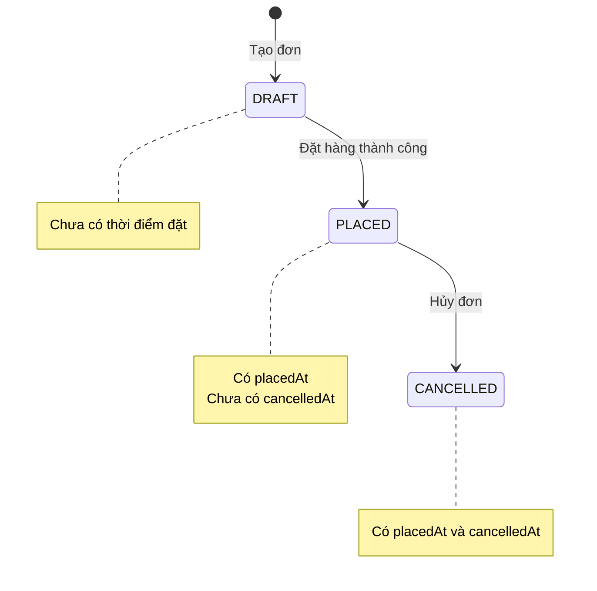
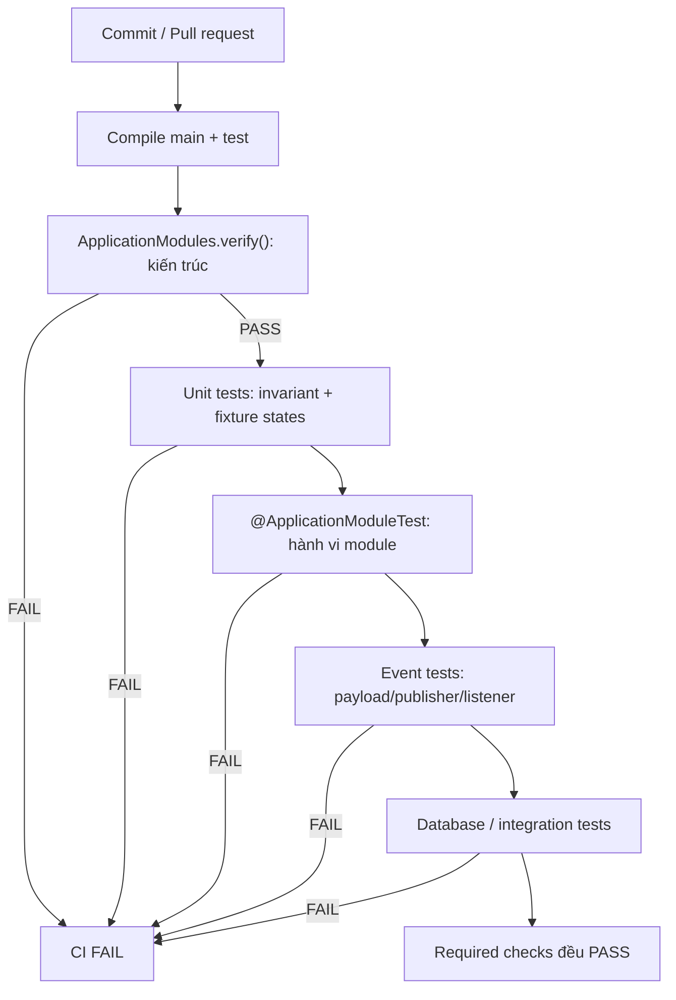

# Fixture đại diện đúng trạng thái module

> **Chương:** Test data  
> **Module học:** `SPRING_MODULITH_VERIFICATION_TESTING` — rèn kỹ năng kiểm chứng ranh giới kiến trúc Spring Modulith bằng `ApplicationModules` và quy tắc phụ thuộc module; thực hành `@ApplicationModuleTest`, kiểm thử sự kiện, cơ sở dữ liệu, tích hợp và quality gate trên CI.

## 1. Tại sao fixture phải phản ánh **trạng thái của module**?

Giả sử ứng dụng bán hàng có hai application module: `orders` quản lý vòng đời đơn hàng; `inventory` quản lý số lượng hàng khả dụng. Một bài test của `orders` cần dữ liệu “đơn đã đặt”. Người viết test tạo một object với `status = PLACED` nhưng không có thời điểm đặt hàng, số lượng bằng 0 và chưa đi qua quy tắc chuyển trạng thái. Bài test có thể PASS nếu chỉ kiểm một getter, nhưng dữ liệu đó **không đại diện cho một đơn hàng thực tế mà module cho phép tồn tại**.

Ở tình huống khác, fixture của `orders` truy cập trực tiếp `inventory.internal.StockJpaRepository` để thiết lập tồn kho. Các bài test nghiệp vụ chạy được, song việc chuẩn bị dữ liệu lại dạy cho code test cách đi xuyên qua ranh giới module, gây coupling và làm yếu mục tiêu kiến trúc.

**Fixture đại diện đúng trạng thái module** không chỉ là object chứa vài giá trị hợp lệ về kiểu Java. Nó phải mô tả được:

1. **Trạng thái nghiệp vụ** ở một thời điểm xác định.
2. **Bất biến (invariants)** mà module sở hữu và phải bảo vệ.
3. **Đường chuyển trạng thái** hợp lệ dẫn đến trạng thái đó, nếu test cần tính chân thực của domain.
4. **Ranh giới sở hữu dữ liệu**: module nào có quyền tạo, thay đổi và quan sát từng phần state.
5. **Điều kiện của test**: trạng thái ban đầu, hành động kích hoạt và kết quả cần assert.

Sau bài này, bạn sẽ thiết kế được fixture cho unit test, `@ApplicationModuleTest`, event test, persistence/integration test và biết cách xác nhận chúng phù hợp với `ApplicationModules.verify()` cùng CI quality gate.

## 2. Phân biệt fixture với dữ liệu tùy ý và kết quả mong đợi

**Fixture** là tập dữ liệu, object, bean giả hoặc trạng thái được chuẩn bị có chủ đích để một test chạy trong điều kiện xác định. Nó là **đầu vào và bối cảnh** của test, không phải bản thân kết luận đúng/sai.

| Khái niệm | Ví dụ trong module `orders` | Vai trò |
| --- | --- | --- |
| Object fixture | Một `Order` ở trạng thái `DRAFT` hợp lệ | Khởi tạo trạng thái domain |
| State fixture | Một `Order` đã `PLACED` với `placedAt` hợp lệ | Bối cảnh trước hành động tiếp theo |
| Dependency stub | `StockQuery` giả trả “còn hàng” | Điều khiển câu trả lời từ module `inventory` |
| Database fixture | Bản ghi `customer_orders` đã đặt trong DB test | Kiểm chứng persistence, query, transaction |
| Event fixture | Payload `OrderPlaced` có ID, timestamp xác định | Kiểm thử hợp đồng sự kiện hoặc listener |
| Assertion | “Sau lệnh cancel, trạng thái là `CANCELLED`” | Kết quả mong muốn, **không** phải fixture |

Một record có đầy đủ field cũng chưa đủ để gọi là fixture tốt. Ví dụ `placedAt` có giá trị nhưng `status = DRAFT` có thể vi phạm state invariant. Ngược lại, một fixture có giá trị mặc định ít nhất có thể rất tốt nếu nó phản ánh đúng tình huống mà test kiểm tra.

### 2.1. Cách suy nghĩ bằng Given–When–Then

```text
Given:
  Order đang PLACED, stock đã được kiểm tra theo hợp đồng
When:
  Khách hàng hủy đơn
Then:
  Order chuyển sang CANCELLED, lưu thời điểm hủy;
  phát sự kiện nếu hợp đồng nghiệp vụ yêu cầu
```

Với tình huống đó, fixture phù hợp là **đơn đã đặt hợp lệ**. Dùng fixture `CANCELLED` ngay từ đầu sẽ khiến test không còn kiểm được đường chuyển `PLACED → CANCELLED`.

## 3. Bắt đầu từ mô hình trạng thái do module sở hữu

Để minh họa xuyên suốt, xét state machine đơn giản thuộc module `orders`:



Mô hình này là **ví dụ học tập**, không phải state machine mặc định của Spring Modulith. Trong hệ thống thật, nhóm có thể có `PENDING_PAYMENT`, `RESERVED`, `SHIPPED` hoặc quy tắc hủy khác. Fixture phải lấy trạng thái và invariant từ **domain contract của chính dự án**, không tự bịa các status chỉ để tăng số ca test.

### 3.1. Ma trận invariant để thiết kế fixture

| Trạng thái | `placedAt` | `cancelledAt` | Đường tạo hợp lệ | Fixture dùng để thử |
| --- | --- | --- | --- | --- |
| `DRAFT` | `null` | `null` | Tạo đơn hợp lệ | Place, thiếu hàng, validate quantity |
| `PLACED` | Khác `null` | `null` | `DRAFT → PLACED` | Cancel, query đơn đã đặt, publish/consume event |
| `CANCELLED` | Khác `null` | Khác `null`, không sớm hơn `placedAt` | `DRAFT → PLACED → CANCELLED` | Không cho hủy lại hoặc hành vi idempotency theo policy |

Những tình huống **không hợp lệ** (chẳng hạn `DRAFT` nhưng có `cancelledAt`) cũng có thể cần test — nhưng phải được gắn nhãn là **invalid-state fixture dành cho kiểm thử validation/migration**, không dùng lẫn với fixture chuẩn của luồng nghiệp vụ.

### 3.2. Ranh giới sở hữu dữ liệu

- `orders` sở hữu ID đơn, số lượng được đặt, trạng thái và thời điểm chuyển trạng thái đơn.
- `inventory` sở hữu dữ liệu tồn kho, cơ chế reservation, repository và transaction tồn kho.
- `orders` có thể hỏi `inventory.StockQuery` (API công bố), **không** cần biết cách `inventory` lưu hàng.
- Event `OrderPlaced` là dữ liệu qua ranh giới; fixture event cần phản ánh **hợp đồng công bố** của module phát ra, không ôm toàn bộ entity nội bộ.

Mục tiêu là chuẩn bị **đúng phần state của module đang thử**, còn điều kiện bên ngoài được mô tả qua hợp đồng module hoặc thiết lập trong một integration test có chủ đích.

## 4. Mã domain tối thiểu: dựng trạng thái qua hành vi, không sửa field tùy ý

Các đoạn Java dưới đây là **mô hình minh họa tự chứa**, có thể điều chỉnh tên class, quy tắc thời gian và persistence cho codebase thật. Ở `src/main/java/com/example/shop/orders/OrderStatus.java`:

```java
package com.example.shop.orders;

public enum OrderStatus {
    DRAFT, PLACED, CANCELLED
}
```

Domain entity minh họa tại `src/main/java/com/example/shop/orders/Order.java`:

```java
package com.example.shop.orders;

import java.time.Instant;
import java.util.Objects;
import java.util.UUID;

public final class Order {

    private final UUID id;
    private final String sku;
    private final int quantity;
    private OrderStatus status;
    private Instant placedAt;
    private Instant cancelledAt;

    private Order(UUID id, String sku, int quantity) {
        this.id = Objects.requireNonNull(id);
        if (sku == null || sku.isBlank()) {
            throw new IllegalArgumentException("SKU must not be blank");
        }
        if (quantity <= 0) {
            throw new IllegalArgumentException("Quantity must be positive");
        }
        this.sku = sku;
        this.quantity = quantity;
        this.status = OrderStatus.DRAFT;
    }

    public static Order draft(UUID id, String sku, int quantity) {
        return new Order(id, sku, quantity);
    }

    public void place(Instant at) {
        if (status != OrderStatus.DRAFT) {
            throw new IllegalStateException("Only a draft can be placed");
        }
        placedAt = Objects.requireNonNull(at);
        status = OrderStatus.PLACED;
    }

    public void cancel(Instant at) {
        if (status != OrderStatus.PLACED) {
            throw new IllegalStateException("Only a placed order can be cancelled");
        }
        Instant cancellationTime = Objects.requireNonNull(at);
        if (cancellationTime.isBefore(placedAt)) {
            throw new IllegalArgumentException("Cancellation precedes placement");
        }
        cancelledAt = cancellationTime;
        status = OrderStatus.CANCELLED;
    }

    public UUID id() { return id; }
    public String sku() { return sku; }
    public int quantity() { return quantity; }
    public OrderStatus status() { return status; }
    public Instant placedAt() { return placedAt; }
    public Instant cancelledAt() { return cancelledAt; }
}
```

Ở ví dụ này, `Order` giữ invariant bằng constructor và phương thức chuyển trạng thái. Code cố ý **không có setter** cho `status`, `placedAt` hay `cancelledAt`. Nhờ vậy, test fixture không thể đơn giản tạo “đơn đã đặt” bằng cách gán status mà quên timestamp.

**Giới hạn ví dụ:** phần kiểm tra tồn kho không nằm trong `Order.place(...)`; nó thuộc application service phối hợp qua API của `inventory`. Một hệ thống sản xuất có thể thêm persistence, thanh toán, idempotency và event publication tùy yêu cầu.

## 5. Test fixture factory: tạo trạng thái hợp lệ theo một đường duy nhất

Đặt `OrderFixtures` trong **test source set** của chính module `orders`:

```text
src/
├── main/java/com/example/shop/
│   ├── orders/
│   │   ├── Order.java
│   │   └── OrderStatus.java
│   └── inventory/StockQuery.java
└── test/java/com/example/shop/orders/
    ├── OrderFixtures.java
    └── OrderStateTest.java
```

Ví dụ `src/test/java/com/example/shop/orders/OrderFixtures.java`:

```java
package com.example.shop.orders;

import java.time.Instant;
import java.util.UUID;

final class OrderFixtures {

    static final UUID ORDER_ID =
            UUID.fromString("11111111-1111-1111-1111-111111111111");
    static final Instant PLACED_AT =
            Instant.parse("2026-01-01T09:00:00Z");
    static final Instant CANCELLED_AT =
            Instant.parse("2026-01-01T09:05:00Z");

    private OrderFixtures() {}

    static Order draft() {
        return Order.draft(ORDER_ID, "SKU-001", 2);
    }

    static Order placed() {
        Order order = draft();
        order.place(PLACED_AT);
        return order;
    }

    static Order cancelled() {
        Order order = placed();
        order.cancel(CANCELLED_AT);
        return order;
    }

    static Order draft(UUID id, String sku, int quantity) {
        return Order.draft(id, sku, quantity);
    }
}
```

Ba phương thức `draft()`, `placed()`, `cancelled()` đều tạo **instance mới** khi được gọi; không dùng một mutable singleton `Order` cho mọi test. Hai phương thức tạo trạng thái sau gọi **hành vi domain thật**, nên khi quy tắc chuyển trạng thái đổi, fixture sẽ báo lỗi thay vì lặng lẽ tạo object không còn hợp lệ.

ID và timestamp cố định giúp assertion dễ đoán trong **unit test độc lập**. Khi nhiều fixture được lưu vào cùng database hoặc chạy song song, hãy dùng ID riêng cho từng ca hoặc cleanup/isolation phù hợp; cố định toàn bộ ID trong shared DB có thể gây lỗi khóa duy nhất.

### 5.1. Unit test chứng minh fixture đại diện đúng state

```java
package com.example.shop.orders;

import static org.junit.jupiter.api.Assertions.*;

import java.time.Instant;
import org.junit.jupiter.api.Test;

class OrderStateTest {

    @Test
    void draftHasNoTransitionTimestamps() {
        Order order = OrderFixtures.draft();

        assertEquals(OrderStatus.DRAFT, order.status());
        assertNull(order.placedAt());
        assertNull(order.cancelledAt());
    }

    @Test
    void placedHasPlacementTimeButNoCancellationTime() {
        Order order = OrderFixtures.placed();

        assertEquals(OrderStatus.PLACED, order.status());
        assertEquals(OrderFixtures.PLACED_AT, order.placedAt());
        assertNull(order.cancelledAt());
    }

    @Test
    void cancelledRetainsValidTransitionHistory() {
        Order order = OrderFixtures.cancelled();

        assertEquals(OrderStatus.CANCELLED, order.status());
        assertEquals(OrderFixtures.PLACED_AT, order.placedAt());
        assertEquals(OrderFixtures.CANCELLED_AT, order.cancelledAt());
    }

    @Test
    void cannotCancelDraft() {
        Order draft = OrderFixtures.draft();

        assertThrows(IllegalStateException.class,
                () -> draft.cancel(Instant.parse("2026-01-01T09:05:00Z")));
        assertEquals(OrderStatus.DRAFT, draft.status());
    }

    @Test
    void createsIndependentMutableInstances() {
        assertNotSame(OrderFixtures.placed(), OrderFixtures.placed());
    }
}
```

Đây là kiểm thử trạng thái domain, không cần khởi động Spring context. Nó giúp phát hiện fixture không còn hợp lệ khi code thay đổi, trước khi các module tests lớn hơn thất bại khó giải thích.

### 5.2. Tránh “fixture thông minh quá mức”

Một factory với hàng chục tham số tùy ý như `status`, `placedAt`, `cancelledAt`, `quantity` rất dễ tạo các tổ hợp vô nghĩa. Nên ưu tiên:

- Phương thức đặt tên theo **trạng thái có ý nghĩa**, ví dụ `draft()`, `placed()`, `cancelled()`.
- Giá trị mặc định nhất quán; chỉ cho tùy chỉnh những đầu vào thật sự quan trọng cho test.
- Hàm riêng cho tình huống **không hợp lệ** khi đang kiểm validator hoặc migration.
- Không nhúng lời gọi mạng, database hoặc tạo Spring context bên trong một object factory đơn giản.

Khi test cần nhiều biến thể, dùng builder nhưng vẫn buộc builder đi qua validation/invariant của domain thay vì cho phép gán trực tiếp các field quan trọng.

## 6. Chọn fixture theo mục tiêu: unit, module, event và integration

Một trạng thái có thể cần cách biểu diễn khác ở từng mức test. Không có một “fixture toàn năng” phù hợp với mọi tầng.

| Loại test | Fixture phù hợp | Điều không nên giả lập quá mức |
| --- | --- | --- |
| Unit test domain | `OrderFixtures.placed()` tạo object qua chuyển trạng thái hợp lệ | Không cần DB/context chỉ để test `Order.cancel(...)` |
| `@ApplicationModuleTest` | Object hợp lệ + bean giả của dependency bên ngoài module | Không đưa code `inventory.internal` vào test của `orders` |
| Event test | Command/input tạo event thật; payload mẫu dùng để kiểm contract | Không chỉ tự tạo event rồi kết luận service đã publish |
| JPA/repository test | Bản ghi theo schema, migration và constraint thật | Không coi object in-memory là bằng chứng DB đã lưu đúng |
| Cross-module integration test | State của từng module qua API/fixtures được phép | Không bypass module boundary bằng repository nội bộ của module khác |
| End-to-end test | Dữ liệu ổn định, tách biệt môi trường và định danh | Không lệ thuộc dữ liệu tồn tại sẵn từ người dùng thật |

Điểm mấu chốt là **tính đúng của state và mức độ thật của hạ tầng** phải phù hợp câu hỏi kiểm thử. Test một phương thức domain không cần toàn bộ cơ sở dữ liệu; test transaction thì cần môi trường persistence phù hợp.

## 7. `@ApplicationModuleTest`: điều khiển trạng thái bên ngoài qua API module

Giả sử `inventory` công bố hợp đồng:

```java
package com.example.shop.inventory;

public interface StockQuery {
    boolean available(String sku, int quantity);
}
```

Module `orders` dùng hợp đồng này, không gọi repository thuộc `inventory.internal`. Một application service tối giản:

```java
package com.example.shop.orders;

import java.time.Instant;
import org.springframework.context.ApplicationEventPublisher;
import org.springframework.stereotype.Service;
import com.example.shop.inventory.StockQuery;

@Service
public class OrderPlacementService {

    private final StockQuery stockQuery;
    private final ApplicationEventPublisher events;

    public OrderPlacementService(StockQuery stockQuery,
                                 ApplicationEventPublisher events) {
        this.stockQuery = stockQuery;
        this.events = events;
    }

    public Order place(Order draft, Instant at) {
        if (!stockQuery.available(draft.sku(), draft.quantity())) {
            throw new IllegalStateException("Out of stock");
        }
        draft.place(at);
        events.publishEvent(new OrderPlaced(draft.id(), at));
        return draft;
    }
}
```

Sự kiện được công bố bởi `orders`:

```java
package com.example.shop.orders;

import java.time.Instant;
import java.util.UUID;

public record OrderPlaced(UUID orderId, Instant placedAt) {
}
```

Ví dụ service này chỉ nhằm minh họa sự phối hợp và event publication. Hệ thống có persistence, transaction và đảm bảo giao hàng sự kiện sẽ cần kiểm soát các yếu tố đó bằng thiết kế và test bổ sung.

### 7.1. Đưa inventory stub vào đúng **test scope**

Trong `src/test/java/com/example/shop/orders/StockAvailableTestConfig.java`:

```java
package com.example.shop.orders;

import org.springframework.boot.test.context.TestConfiguration;
import org.springframework.context.annotation.Bean;
import org.springframework.context.annotation.Primary;
import com.example.shop.inventory.StockQuery;

@TestConfiguration(proxyBeanMethods = false)
class StockAvailableTestConfig {

    @Bean
    @Primary
    StockQuery stockQuery() {
        return (sku, quantity) ->
                "SKU-001".equals(sku) && quantity <= 5;
    }
}
```

Stub thể hiện một **điều kiện ở ranh giới module**: “theo API của inventory, SKU-001 còn tối đa 5 đơn vị trong tình huống này”. Nó **không** thay đổi trực tiếp state nội bộ của `inventory`. Những test cần chứng minh tồn kho thực sự được trừ hay reservation được lưu đúng phải chạy integration test của `inventory` hoặc luồng liên module phù hợp.

### 7.2. Module test: fixture ban đầu là `DRAFT`, kết quả phải `PLACED`

```java
package com.example.shop.orders;

import static org.assertj.core.api.Assertions.assertThat;

import org.junit.jupiter.api.Test;
import org.springframework.beans.factory.annotation.Autowired;
import org.springframework.context.annotation.Import;
import org.springframework.modulith.test.ApplicationModuleTest;
import org.springframework.modulith.test.PublishedEvents;

@ApplicationModuleTest
@Import(StockAvailableTestConfig.class)
class OrderModuleTest {

    @Autowired
    OrderPlacementService service;

    @Test
    void placesDraftAndPublishesEvent(PublishedEvents events) {
        Order draft = OrderFixtures.draft();

        Order placed = service.place(draft, OrderFixtures.PLACED_AT);

        assertThat(placed.status()).isEqualTo(OrderStatus.PLACED);
        assertThat(placed.placedAt()).isEqualTo(OrderFixtures.PLACED_AT);
        assertThat(events.ofType(OrderPlaced.class))
                .anySatisfy(event -> {
                    assertThat(event.orderId())
                            .isEqualTo(OrderFixtures.ORDER_ID);
                    assertThat(event.placedAt())
                            .isEqualTo(OrderFixtures.PLACED_AT);
                });
    }
}
```

Đoạn test minh họa cách `@ApplicationModuleTest` khởi tạo phạm vi module và cách Spring Modulith test support thu thập các event được publish qua `PublishedEvents`. Cách wiring bean, phiên bản Spring Modulith và những dependency thực tế của project có thể cần điều chỉnh để khởi tạo được context.

**Vì sao fixture này đúng?** Given = `DRAFT`; When = gọi **hành vi thực** của `OrderPlacementService`; Then = `PLACED` và có `OrderPlaced` với ID/timestamp nhất quán. Nếu lấy `OrderFixtures.placed()` rồi gọi `service.place(...)`, test sẽ thất bại vì chuyển trạng thái lần hai — lỗi nằm ở cách chọn trạng thái ban đầu, không phải ở Spring Modulith.

### 7.3. Test trường hợp hết hàng không cần chạm DB của inventory

Tại unit test của service, có thể điều khiển phản hồi từ hợp đồng `StockQuery`:

```java
package com.example.shop.orders;

import static org.junit.jupiter.api.Assertions.*;

import java.util.ArrayList;
import java.util.List;
import org.junit.jupiter.api.Test;
import org.springframework.context.ApplicationEventPublisher;
import com.example.shop.inventory.StockQuery;

class OrderPlacementServiceTest {

    @Test
    void outOfStockKeepsDraftAndPublishesNothing() {
        StockQuery noStock = (sku, quantity) -> false;
        List<Object> published = new ArrayList<>();
        ApplicationEventPublisher publisher = published::add;
        OrderPlacementService service =
                new OrderPlacementService(noStock, publisher);

        Order draft = OrderFixtures.draft();

        assertThrows(IllegalStateException.class,
                () -> service.place(draft, OrderFixtures.PLACED_AT));
        assertEquals(OrderStatus.DRAFT, draft.status());
        assertNull(draft.placedAt());
        assertTrue(published.isEmpty());
    }
}
```

Mục tiêu của test này là **trạng thái không thay đổi** khi nghiệp vụ từ chối. Fixture ban đầu phù hợp vẫn là `DRAFT`. Nếu muốn kiểm tra một quy tắc idempotency hoặc “request trùng”, cần thêm tình huống nghiệp vụ cụ thể và ID/request key riêng, không mặc định rằng mọi service đều phải xử lý trùng giống nhau.

## 8. Event fixture: snapshot contract khác với event thật được phát

Một event fixture thích hợp khi muốn kiểm tra serialization hoặc listener một cách độc lập:

```java
package com.example.shop.orders;

final class OrderEventFixtures {

    private OrderEventFixtures() {}

    static OrderPlaced placed() {
        return new OrderPlaced(
                OrderFixtures.ORDER_ID,
                OrderFixtures.PLACED_AT
        );
    }
}
```

Có **hai loại assertion** cần phân biệt:

1. **Contract/consumer test:** tạo `OrderEventFixtures.placed()` và đưa tới listener/serializer; khẳng định consumer xử lý đúng payload giả định.
2. **Publisher/module test:** gọi hành vi thật của module rồi dùng `PublishedEvents` hoặc công cụ tương đương để kiểm tra **event thực sự đã được publish**.

Nếu test chỉ tự tạo `OrderPlaced` rồi assert field của object đó, nó không chứng minh `OrderPlacementService` đã phát event. Tương tự, nếu listener thực tế chạy **bất đồng bộ** hoặc phụ thuộc transaction, cần test với điều kiện chờ phù hợp và thiết lập transaction rõ; không chỉ dựa vào `Thread.sleep(...)`.

### 8.1. Điều kiện quan trọng của event fixture

- ID trong event phải trỏ tới đơn hàng liên quan nếu contract yêu cầu.
- Timestamp phải thống nhất với thời điểm chuyển trạng thái trong module, không lấy `Instant.now()` một cách tùy ý rồi so bằng hằng số.
- Payload chỉ chứa những trường được công bố chính thức; tránh nhét JPA entity hoặc repository nội bộ qua ranh giới.
- Sự kiện lặp lại, out-of-order hoặc schema version cũ cần fixture **riêng** nếu hợp đồng và hệ thống hỗ trợ các tình huống đó.
- Phân biệt “event được publish” với “side effect ở module khác đã commit”: đây là hai kết quả kiểm chứng khác nhau.

## 9. Database fixture: trạng thái lưu trữ phải thống nhất với domain

Một `Order` in-memory hợp lệ chưa chứng minh JPA mapping hoặc database constraint phù hợp. Khi kiểm thử repository, query, migration hoặc transaction, cần dữ liệu được lưu qua persistence layer thực.

Giả sử schema minh họa có bảng:

```text
customer_orders(
  id UUID PRIMARY KEY,
  sku VARCHAR,
  quantity INTEGER,
  status VARCHAR,
  placed_at TIMESTAMP WITH TIME ZONE,
  cancelled_at TIMESTAMP WITH TIME ZONE
)
```

Đây là **schema ví dụ**, không phải schema do Spring Modulith tự tạo. Với PostgreSQL, một fixture cho đơn `PLACED` có thể ở `src/test/resources/test-data/orders/placed.sql`:

```sql
INSERT INTO customer_orders (
    id, sku, quantity, status, placed_at, cancelled_at
) VALUES (
    '11111111-1111-1111-1111-111111111111',
    'SKU-001',
    2,
    'PLACED',
    '2026-01-01T09:00:00Z',
    NULL
);
```

Tại `src/test/resources/test-data/orders/cleanup.sql`:

```sql
DELETE FROM customer_orders
WHERE id = '11111111-1111-1111-1111-111111111111';
```

Trong DB test, có thể dùng Spring Test `@Sql` để nạp và dọn dữ liệu:

```java
package com.example.shop.orders;

import static org.junit.jupiter.api.Assertions.assertEquals;

import java.util.UUID;
import org.junit.jupiter.api.Test;
import org.springframework.beans.factory.annotation.Autowired;
import org.springframework.jdbc.core.JdbcTemplate;
import org.springframework.modulith.test.ApplicationModuleTest;
import org.springframework.test.context.jdbc.Sql;

@ApplicationModuleTest
@Sql(scripts = "/test-data/orders/placed.sql",
     executionPhase = Sql.ExecutionPhase.BEFORE_TEST_METHOD)
@Sql(scripts = "/test-data/orders/cleanup.sql",
     executionPhase = Sql.ExecutionPhase.AFTER_TEST_METHOD)
class OrderPersistenceModuleTest {

    @Autowired
    JdbcTemplate jdbc;

    @Test
    void readsAValidPlacedState() {
        UUID id = OrderFixtures.ORDER_ID;
        String status = jdbc.queryForObject(
                "SELECT status FROM customer_orders WHERE id = ?",
                String.class,
                id
        );
        assertEquals("PLACED", status);
    }
}
```

**Điều kiện của ví dụ:** project phải có Spring JDBC, `DataSource`, schema/migration tương ứng và database test hỗ trợ kiểu dữ liệu đã chọn; nếu chỉ dùng một project demo không có persistence, đoạn test này không chạy độc lập. Nó minh họa **cơ chế chuẩn bị state**, không phải lời khẳng định rằng SQL fixture là cách duy nhất hoặc tốt nhất.

### 9.1. Kiểm chứng điều gì bằng dữ liệu DB?

| Tình huống | Fixture DB nên chuẩn bị | Assertion |
| --- | --- | --- |
| Đọc đơn đã đặt | Row `PLACED` với `placed_at` hợp lệ | Repository/query trả trạng thái chính xác |
| Hủy đơn qua service | Row `PLACED`; không có `cancelled_at` | Sau cancel, row chuyển `CANCELLED` với timestamp |
| Ràng buộc số lượng | Input `quantity <= 0` khi schema cấm | DB constraint hoặc domain validation từ chối |
| Transaction rollback | State trước giao dịch và thao tác gây lỗi | DB trở về state theo contract rollback |
| Trùng ID | Bản ghi có ID đã tồn tại | Unique constraint/idempotency xử lý theo thiết kế |
| Đồng thời | Hai transaction cạnh tranh trên tài nguyên cụ thể | Lock/version/concurrency policy được kiểm chứng |

**Không nên** tạo một row `CANCELLED` thiếu `placed_at` nếu mục tiêu là test hành vi hủy hợp lệ. Dữ liệu sai invariant chỉ nên sử dụng khi kiểm migration/validation hoặc phát hiện dữ liệu hỏng với kỳ vọng **từ chối**.

### 9.2. Khi nào dùng factory, repository hoặc SQL?

- **Object fixture:** tốt cho unit test, không kiểm schema.
- **Factory + repository save:** phù hợp khi muốn giữ validation domain và kiểm mapping; cần chú ý transaction và entity lifecycle.
- **`@Sql`:** giúp tạo trạng thái DB độc lập với application service, có ích cho query/migration/legacy states; nhưng có thể bypass invariant domain, nên cần review dữ liệu.
- **Migration + Testcontainers/DB thật:** phù hợp với constraint, concurrency, query đặc thù database; không suy rằng H2 luôn tương đương PostgreSQL.

Chọn công cụ tạo fixture dựa vào **rủi ro muốn kiểm**, không dựa vào thói quen nhóm.

## 10. Mức độ tin cậy: fixture phải cô lập và tái lập

Fixture đúng trạng thái nhưng phụ thuộc vào test trước đó hoặc môi trường cá nhân vẫn là fixture kém.

### 10.1. Không chia sẻ mutable object giữa các test

**Nên:** `OrderFixtures.placed()` tạo một instance mới mỗi lần gọi. **Tránh:** một `static Order SHARED_PLACED_ORDER` bị nhiều test thay đổi rồi dùng lại, đặc biệt khi JUnit chạy song song.

### 10.2. Quản lý ID, clock và time zone

Dùng `Instant` cố định cho unit tests. Với nghiệp vụ phụ thuộc “hiện tại”, hãy inject `Clock` rồi dùng `Clock.fixed(...)` trong test thay vì giả định thời điểm máy CI.

```java
import java.time.Clock;
import java.time.Instant;
import java.time.ZoneOffset;

Clock testClock = Clock.fixed(
        Instant.parse("2026-01-01T09:00:00Z"),
        ZoneOffset.UTC
);
```

Đối với test DB chạy song song, có thể sinh UUID riêng và truyền qua fixture factory; dùng hằng ID ổn định chỉ khi từng test có isolation/cleanup tương ứng. Time zone và database timestamp mapping cần được thống nhất.

### 10.3. Dữ liệu test không được phụ thuộc lẫn nhau

Không nên:

```text
Test A insert Order #1
Test B giả định Order #1 đã tồn tại vì A chạy trước
Test C giả định B đã xóa Order #1
```

Nên:

```text
Mỗi test:
  Given tự chuẩn bị dữ liệu cần thiết
  When chạy hành vi cần kiểm
  Then assert trạng thái mong muốn
  Cleanup/rollback theo cơ chế đáng tin
```

Kiểm tra kỹ cơ chế rollback khi có event listener bất đồng bộ, transaction riêng, Testcontainers hoặc external broker: side effect ngoài test transaction có thể không được rollback tự động.

### 10.4. Không dùng dữ liệu thật có thông tin nhạy cảm

Fixture phục vụ CI nên sử dụng thông tin giả hoặc đã được khử nhận dạng hợp lệ. Không đưa email khách hàng thật, token, địa chỉ giao hàng thật hay bản dump production chứa dữ liệu nhạy cảm vào repository. Test data cần ít, có mục tiêu và đủ phản ánh quy tắc nghiệp vụ.

## 11. Ma trận fixture có chủ đích: đủ đại diện, không phình vô hạn

Một cách kiểm soát coverage là đặt câu hỏi **“đây là state của module nào và rule nào đang được thử?”** trước khi thêm fixture mới.

| Test ID | State của `orders` ban đầu | State/contract của `inventory` | Khi chạy | Kỳ vọng |
| --- | --- | --- | --- | --- |
| O-01 | `DRAFT` hợp lệ, quantity 2 | `available(SKU-001, 2) = true` | Place order | `PLACED`; publish `OrderPlaced` |
| O-02 | `DRAFT` hợp lệ, quantity 2 | `available(...) = false` | Place order | Bị từ chối; vẫn `DRAFT`; không publish |
| O-03 | `PLACED` hợp lệ | Không cần gọi inventory cho thao tác này trong mô hình ví dụ | Cancel order | `CANCELLED`, có `cancelledAt` |
| O-04 | `DRAFT` hợp lệ | Không liên quan | Cancel order | Báo lỗi transition; state giữ nguyên |
| O-05 | `CANCELLED` hợp lệ | Không liên quan | Cancel lần nữa | Từ chối hoặc idempotent theo **policy thực** |
| O-06 | DB row `PLACED` đúng schema | Không liên quan | Repository đọc | Row ánh xạ đúng status/time |
| O-07 | `DRAFT` với quantity không hợp lệ | Không liên quan | Tạo đơn | Constructor/validator từ chối |
| O-08 | Lệnh place hợp lệ | Integration thật với inventory | Place + kiểm state | Kết quả nhất quán giữa hai module theo contract |

**Lưu ý:** O-05 không khẳng định việc hủy lại phải throw trong mọi ứng dụng; ví dụ `Order.cancel(...)` ở mục 4 chọn chính sách throw. Nếu dự án quy định idempotent cancel, fixture và assertions phải tuân theo policy đó. O-08 cần setup thực của cả hai module và DB/broker nếu có; unit stub không thể thay thế.

### 11.1. Dùng “một happy path + một negative path + một biên”

Để khởi đầu, mỗi trạng thái nghiệp vụ quan trọng nên có:

1. Một fixture hợp lệ đại diện happy path.
2. Một fixture hoặc input dẫn đến đường lỗi quan trọng.
3. Một tình huống boundary, chẳng hạn quantity 1/0, hủy đúng thời điểm đặt, thiếu hàng hoặc bản ghi trùng.

Tránh sinh hàng trăm tổ hợp ngẫu nhiên không gắn với invariant, khiến khi test FAIL không ai biết business rule nào bị phá.

## 12. Ranh giới Spring Modulith: fixture không được vô hiệu hóa architectural test

Trong module `orders`, nên dùng fixture và API của chính `orders`. Khi muốn điều khiển câu trả lời từ `inventory`, dùng `StockQuery` công bố hoặc tạo một cross-module integration test rõ mục tiêu. Không cần import trực tiếp `com.example.shop.inventory.internal.StockJpaRepository` trong test nghiệp vụ `orders`.

Tạo structural test ở package ứng dụng:

```java
package com.example.shop;

import org.junit.jupiter.api.Test;
import org.springframework.modulith.core.ApplicationModules;

class ModuleArchitectureTest {

    @Test
    void moduleBoundariesRemainValid() {
        ApplicationModules.of(ShopApplication.class).verify();
    }
}
```

**Phân biệt:** `verify()` xác nhận những quan hệ module tĩnh mà Spring Modulith nhận diện; nó không chứng minh fixture đang là `PLACED` đúng, event listener đã chạy, transaction rollback hay schema dữ liệu hợp lệ. Ngược lại, các behavioral tests dùng fixture tốt cũng không thay thế `verify()`.

Khi thiết kế một fixture chung, tránh:

- Đưa test factory vào `src/main/java` chỉ để “module nào cũng import được”, làm phát sinh API/module không cần thiết.
- Công bố cả `inventory.internal` qua named interface chỉ để test chuẩn bị dữ liệu cho `orders`.
- Nới `@ApplicationModule(allowedDependencies = ...)` tùy tiện nhằm hợp thức hóa việc test gọi repository bên ngoài module.
- Tắt `ModuleArchitectureTest`, bỏ qua JUnit failures hoặc dùng `-DskipTests` ở CI.

Nếu nhiều build subprojects cần dùng một contract fixture, có thể dùng Gradle `java-test-fixtures` hoặc test-scoped artifact trong Maven. Vẫn phải kiểm soát dependency scope và tránh biến fixture thành dependency production.

## 13. CI quality gate: kiểm tra cả cấu trúc lẫn tính đại diện của dữ liệu

Một pipeline tốt chạy **nhiều cấp kiểm chứng độc lập**:



Ví dụ các lệnh thường dùng:

```bash
# Maven Wrapper: dự án cần Surefire/JUnit Platform phù hợp.
./mvnw -Dtest=ModuleArchitectureTest test
./mvnw -B verify

# Hoặc Gradle Wrapper, task test có useJUnitPlatform().
./gradlew test --tests 'com.example.shop.ModuleArchitectureTest'
./gradlew check
```

`mvn verify` không tự chạy các test `*IT` nếu chưa cấu hình Maven Failsafe hoặc lifecycle tương đương. `gradle check` cũng không tự chạy một `integrationTest` task tùy chỉnh nếu chưa nối dependency. Với dự án nhiều build modules, phải chọn đúng project chứa test.

**Đừng chỉ xem `BUILD SUCCESS`:** xác nhận `ModuleArchitectureTest` thực thi, `OrderStateTest` có assertion về state, `OrderModuleTest` chạy được, và integration tests liên quan có báo cáo. Khi test database không có môi trường phù hợp, sửa test infrastructure thay vì bỏ qua toàn bộ suite.

### 13.1. Một phép thử âm tính giúp xác minh gate

1. Trong một nhánh thử, cho class production của `orders` phụ thuộc trực tiếp một kiểu `public` thuộc `inventory.internal`.
2. Xác nhận Java compile có thể PASS nhưng `ApplicationModules.verify()` FAIL (nếu package/policy mặc định đúng).
3. Xác nhận job CI bắt lỗi kiến trúc và required check chưa đạt.
4. Xóa dependency sai, dùng `StockQuery` hoặc API được công bố đúng; chạy structural và behavioral tests.
5. Xác nhận test fixtures vẫn tạo đúng các state; CI trở lại PASS sau sửa.

Không merge mã vi phạm chỉ để thử quality gate.

## 14. Anti-pattern và chẩn đoán nhanh

| Biểu hiện | Vấn đề với fixture | Cách xử lý |
| --- | --- | --- |
| `PLACED` nhưng `placedAt == null` | State giả không thể xảy ra theo invariant | Tạo qua `Order.place(...)` hoặc kiểm validation dữ liệu lịch sử riêng |
| `CANCELLED` có `cancelledAt` trước `placedAt` | Timeline không hợp lệ | Chọn timestamp nhất quán, thêm test invariant |
| Test hủy đơn dùng fixture `CANCELLED` | Given đã là trạng thái đích | Dùng `PLACED` nếu muốn kiểm `cancel()` |
| Test place đơn dùng fixture `PLACED` | Gọi transition lần hai, sai trạng thái đầu vào | Dùng `DRAFT` |
| Factory trả cùng mutable `Order` | Test phụ thuộc thứ tự và chạy song song gây nhiễu | Trả object mới mỗi lần |
| SQL fixture bỏ qua constraint | DB test thiếu chân thực, khác production | Dùng schema/migration tương ứng, dữ liệu hợp invariant |
| Cùng UUID được dùng trong nhiều test DB song song | Đụng unique key hoặc cleanup lẫn nhau | Sinh ID riêng hoặc isolate schema/transaction |
| Test module `orders` viết trực tiếp vào DB nội bộ `inventory` | Vượt ranh giới sở hữu module | Stub qua `StockQuery` hoặc đặt integration test đúng cấp |
| Tự tạo event rồi assert event tồn tại | Không kiểm publisher thực tế | Gọi hành vi service thật và quan sát event được phát |
| Dùng `Thread.sleep(100)` chờ listener | Flaky theo tốc độ môi trường | Chờ trạng thái/event theo điều kiện với timeout |
| Test DB PASS trên H2, FAIL PostgreSQL | Semantics/migration/constraints khác | Dùng DB test phù hợp công nghệ production |
| CI chỉ chạy `verify()`, bỏ behavioral tests | Kiến trúc có thể hợp lệ nhưng state/event sai | Chạy cả unit/module/event/DB/integration gates cần thiết |

## 15. Bài thực hành: xây bộ fixture cho module `orders`

### Phần A — Xác định invariant trước khi viết factory

1. Vẽ state machine thực tế của `orders`. Với ví dụ này: `DRAFT → PLACED → CANCELLED`.
2. Ghi invariant của từng state: timestamp, quantity, ID, điều kiện hủy.
3. Ghi rõ dữ liệu thuộc `orders` và dữ liệu thuộc `inventory`.
4. Tạo `OrderFixtures.draft()`, `placed()`, `cancelled()` đi qua domain methods.
5. Viết unit tests xác nhận fixture đạt invariant và tạo instance riêng biệt.

### Phần B — Test hành vi với `@ApplicationModuleTest`

1. Công bố `StockQuery` tại API của `inventory`; không import repository nội bộ.
2. Tạo `@TestConfiguration` cung cấp stub trả “còn hàng” cho SKU/quantity cụ thể.
3. Với fixture `DRAFT`, gọi hành vi place thật của `orders`.
4. Assert trạng thái `PLACED` và event `OrderPlaced` có ID/timestamp đúng.
5. Với stub hết hàng, assert đơn giữ `DRAFT` và không có event placement.

### Phần C — Test persistence

1. Dùng migration/schema của database thử nghiệm.
2. Nạp một row `PLACED` hợp lệ bằng `@Sql` hoặc factory + repository.
3. Đọc lại trạng thái, timestamp, dữ liệu liên quan và kiểm tra mapping.
4. Test một transition có persistence nếu service thực hỗ trợ, không chỉ đọc row.
5. Chạy lại sau cleanup, với cùng code và dữ liệu để xác nhận kết quả tái lập.

### Phần D — Ghép với kiến trúc và CI

1. Chạy `ModuleArchitectureTest` và xác nhận module discovery đúng phạm vi.
2. Chạy unit/module/event/DB tests phù hợp; xác nhận report từng nhóm.
3. Thử một phụ thuộc production trái phép giữa `orders` và `inventory.internal` để structural gate FAIL.
4. Sửa phụ thuộc qua API; chạy full suite và xác nhận PASS.
5. Ghi kết quả và ma trận fixture trong pull request để reviewer biết mỗi dataset đang bảo vệ quy tắc nào.

### Checklist nghiệm thu

- [ ] Mỗi fixture có tên trạng thái/case rõ ràng và liên hệ tới invariant nghiệp vụ.
- [ ] Fixture hợp lệ được dựng qua constructor/factory/transition có validation, không gán status tùy tiện.
- [ ] `DRAFT`, `PLACED`, `CANCELLED` nhất quán về thời điểm và dữ liệu trong ví dụ.
- [ ] Mỗi test nhận object độc lập; dữ liệu DB có isolation/cleanup.
- [ ] Module `orders` điều khiển dependency từ `inventory` qua API/stub, không qua package `internal`.
- [ ] Event fixture và event publication test được phân biệt rõ ràng.
- [ ] Persistence test có schema/constraint thật và dữ liệu phù hợp.
- [ ] `ApplicationModules.verify()` và `@ApplicationModuleTest` đều được thực thi theo vai trò riêng.
- [ ] CI không skip required tests và giữ trạng thái lỗi khi fixture/behavior/architecture sai.

## 16. Câu hỏi tự đánh giá

1. Vì sao một `Order` có `status = PLACED` nhưng `placedAt = null` không phải fixture hợp lệ?
2. Test “hủy đơn thành công” nên bắt đầu với fixture `DRAFT`, `PLACED` hay `CANCELLED`? Vì sao?
3. Vì sao gọi domain transition trong factory tốt hơn việc setter trực tiếp các field state?
4. Khi hai test chạy song song, việc dùng cùng một mutable fixture hoặc cùng UUID trong DB có thể gây gì?
5. Test của module `orders` nên thiết lập “còn hàng” bằng `StockQuery` stub hay ghi trực tiếp vào `inventory.internal.StockJpaRepository`?
6. Điểm khác biệt giữa việc tự tạo một `OrderPlaced` và chứng minh service thật publish event là gì?
7. Khi nào cần SQL fixture và database thật, thay vì chỉ dùng object factory?
8. Vì sao `ApplicationModules.verify()` PASS chưa chứng minh fixture DB/event là đúng?
9. Tại sao negative fixture (dữ liệu cố ý sai) phải được đặt tên/tổ chức khác happy-path fixture?
10. Khi CI xanh nhưng không thấy module/event/database tests trong report, bạn sẽ xác minh điều gì?

**Ghi nhớ:** Fixture tốt mô tả **trạng thái mà module thực sự có thể sở hữu**, có invariant và đường chuyển trạng thái rõ, đồng thời tôn trọng ranh giới dữ liệu giữa các application module. Trong Spring Modulith, dùng factory/domain transition cho unit tests, stub qua API cho `@ApplicationModuleTest`, event assertions cho publisher và state có schema thực cho DB/integration tests. Kết hợp với `ApplicationModules.verify()` và CI quality gate để ngăn cả phụ thuộc sai lẫn hồi quy nghiệp vụ.
