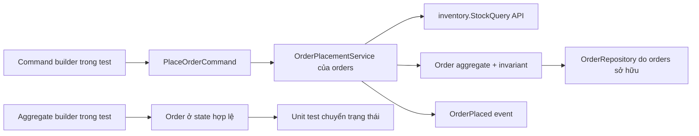
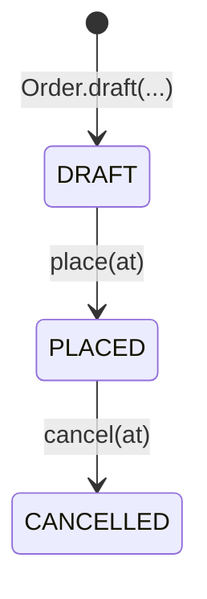
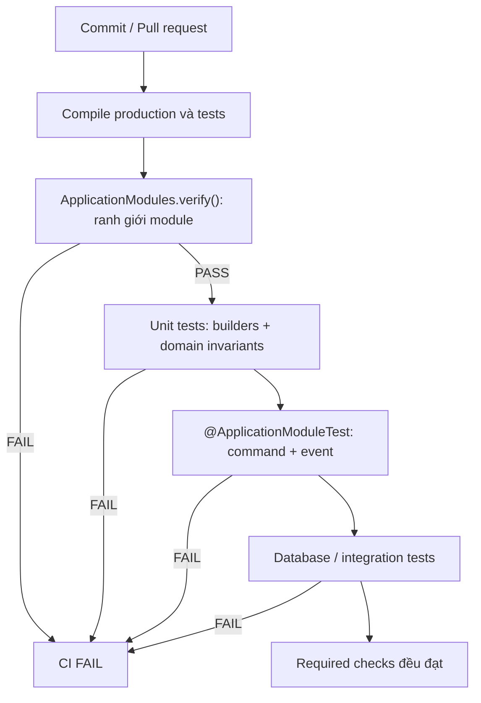

# Builder cho aggregate và command

> **Chương:** Test data  
> **Module học:** `SPRING_MODULITH_VERIFICATION_TESTING` — kiểm chứng ranh giới kiến trúc bằng `ApplicationModules`, kiểm thử module với `@ApplicationModuleTest`, sự kiện, database và tích hợp; duy trì quality gate CI chống phụ thuộc sai và hồi quy.

## 1. Vì sao cần hai loại builder?

Trong ứng dụng Spring Modulith, một ca kiểm thử đặt hàng thường có **hai đối tượng ở hai phía của một ranh giới**:

- **Command** biểu diễn ý định của bên gọi: “Đặt 2 đơn vị SKU-001 cho khách hàng C-001”.
- **Aggregate** biểu diễn trạng thái và quy tắc nhất quán của module `orders`: đơn hàng tồn tại, có số lượng hợp lệ, đang `DRAFT` hay `PLACED`, thời điểm chuyển trạng thái có đúng không.

Nếu test tạo cả hai bằng một builder chung có hàng chục setter tùy ý, rất dễ trộn lẫn **đầu vào cần kiểm tra** với **trạng thái kết quả**. Ví dụ, test “đặt hàng thành công” lại khởi tạo aggregate đã `PLACED` rồi chỉ xác nhận getter; test vẫn xanh dù application service không bao giờ xử lý command hoặc phát event.

Builder tốt giúp tạo dữ liệu ngắn gọn, đọc được và lặp lại, nhưng **không được vượt qua các invariant mà production code đang bảo vệ**.

### Mục tiêu học tập

Sau bài này, bạn có thể:

1. Phân biệt *command test-data builder* và *aggregate state builder*, cả về đối tượng tạo ra lẫn mức validation.
2. Viết builder với giá trị mặc định hợp lệ, phương thức tùy chỉnh có ý nghĩa và `build()` luôn tạo đối tượng mới.
3. Dùng command builder để kiểm thử đầu vào hợp lệ, không hợp lệ và các trường hợp biên mà không vô tình sửa state nội bộ.
4. Dùng aggregate builder tạo các trạng thái hợp lệ thông qua constructor/factory và **domain transitions**.
5. Đưa builders vào unit test, `@ApplicationModuleTest`, kiểm thử event, database và luồng liên module mà vẫn giữ dependency qua API công bố.
6. Phát hiện anti-pattern: fixture dùng chung có mutable state, dữ liệu giả vô nghĩa, builder biết repository của module khác và quality gate CI bỏ sót test.

## 2. Hai builder giải quyết hai câu hỏi khác nhau

| Tiêu chí | Command builder | Aggregate builder |
| --- | --- | --- |
| Đối tượng tạo ra | `PlaceOrderCommand`, input DTO/record | `Order`, mô hình trạng thái do `orders` sở hữu |
| Câu hỏi chính | “Người gọi gửi gì?” | “Module đang ở state hợp lệ nào?” |
| Giá trị mặc định | Một command hợp lệ, đại diện nghiệp vụ | Một aggregate hợp lệ ở trạng thái xác định |
| Trường hợp sai | Có thể cần tạo input sai để kiểm validation | Không nên lách invariant để tạo state sai cho happy path |
| Hành vi khi `build()` | Tạo dữ liệu input mới | Gọi domain factory và transitions để có state đích |
| Có lưu database? | Không | Không — persistence thuộc test setup/integration |
| Có phát event? | Không | Không — event phải phát từ hành vi thật của module |
| Có gọi `inventory.internal`? | Không | Không |

**Quy tắc thiết kế:** command builder có thể được cấu hình để tạo một **đầu vào cố ý không hợp lệ**; aggregate builder thông thường chỉ nên tạo **trạng thái hợp lệ**. Nếu cần test dữ liệu lưu trữ bị hỏng, hãy xây một fixture chuyên dụng cho validation/migration thay vì biến aggregate builder chung thành công cụ phá invariant.

### Luồng dữ liệu cần bảo vệ



Trong sơ đồ, command builder giúp chuẩn bị **input để gọi service**; aggregate builder giúp chuẩn bị **Given state** khi thử một domain operation. Hai đường kiểm thử bổ sung cho nhau, không cần kết hợp thành một builder khổng lồ.

## 3. Mô hình nghiệp vụ mẫu của module `orders`

Bài học dùng ví dụ bán hàng tự chứa. `orders` phụ thuộc vào API công bố `inventory.StockQuery` để biết còn hàng hay không; không trực tiếp sử dụng `inventory.internal.StockJpaRepository`.

```text
src/
├── main/java/com/example/shop/
│   ├── ShopApplication.java
│   ├── orders/
│   │   ├── PlaceOrderCommand.java
│   │   ├── Order.java
│   │   ├── OrderStatus.java
│   │   ├── OrderRepository.java
│   │   ├── OrderPlaced.java
│   │   └── OrderPlacementService.java
│   └── inventory/
│       ├── StockQuery.java
│       └── internal/StockJpaRepository.java
└── test/java/com/example/shop/
    ├── ModuleArchitectureTest.java
    └── orders/
        ├── PlaceOrderCommandBuilder.java
        ├── OrderAggregateBuilder.java
        ├── OrderDomainTest.java
        ├── OrderPlacementServiceTest.java
        └── OrderModuleTest.java
```

Trong cấu trúc trên, `orders` và `inventory` là hai application module theo cách nhận diện mặc định từ package gốc `com.example.shop`. Các kiểu trong package con `inventory.internal` không tự động là API công bố. Project thật có thể có `@ApplicationModule`, named interface hoặc cách phát hiện module tùy chỉnh; phải kiểm tra quy tắc đang áp dụng trước khi kết luận một phụ thuộc hợp lệ.

### 3.1. Command là input; chưa phải một đơn hàng đã tồn tại

Ví dụ `src/main/java/com/example/shop/orders/PlaceOrderCommand.java`:

```java
package com.example.shop.orders;

import java.util.UUID;

public record PlaceOrderCommand(
        UUID orderId,
        String customerId,
        String sku,
        int quantity
) {}
```

Record này cố ý **chưa làm validation trong constructor**. Điều đó cho phép tạo một command với `quantity = 0` hoặc `sku = null` để kiểm tra lớp application/domain có từ chối yêu cầu hay không.

**Lưu ý:** trong hệ thống thật, validation có thể nằm ở record constructor, Bean Validation, API adapter hoặc application service. Nếu command **đã** validate ngay khi khởi tạo, negative test phải assert failure tại lúc `build()`/constructor chạy, không cố lách validation. Vị trí kiểm validation là quyết định thiết kế, không có một quy tắc chung bắt buộc cho mọi ứng dụng.

### 3.2. Aggregate bảo vệ trạng thái

Trạng thái ví dụ của `Order`:



Ví dụ `src/main/java/com/example/shop/orders/OrderStatus.java`:

```java
package com.example.shop.orders;

public enum OrderStatus {
    DRAFT, PLACED, CANCELLED
}
```

Ví dụ domain aggregate `Order.java`:

```java
package com.example.shop.orders;

import java.time.Instant;
import java.util.Objects;
import java.util.UUID;

public final class Order {

    private final UUID id;
    private final String customerId;
    private final String sku;
    private final int quantity;

    private OrderStatus status = OrderStatus.DRAFT;
    private Instant placedAt;
    private Instant cancelledAt;

    private Order(UUID id, String customerId, String sku, int quantity) {
        this.id = Objects.requireNonNull(id, "id");
        if (customerId == null || customerId.isBlank()) {
            throw new IllegalArgumentException("customerId is required");
        }
        if (sku == null || sku.isBlank()) {
            throw new IllegalArgumentException("sku is required");
        }
        if (quantity <= 0) {
            throw new IllegalArgumentException("quantity must be positive");
        }
        this.customerId = customerId;
        this.sku = sku;
        this.quantity = quantity;
    }

    public static Order draft(UUID id, String customerId,
                              String sku, int quantity) {
        return new Order(id, customerId, sku, quantity);
    }

    public void place(Instant at) {
        if (status != OrderStatus.DRAFT) {
            throw new IllegalStateException("Only DRAFT can be placed");
        }
        placedAt = Objects.requireNonNull(at, "placedAt");
        status = OrderStatus.PLACED;
    }

    public void cancel(Instant at) {
        if (status != OrderStatus.PLACED) {
            throw new IllegalStateException("Only PLACED can be cancelled");
        }
        Instant cancellation = Objects.requireNonNull(at, "cancelledAt");
        if (cancellation.isBefore(placedAt)) {
            throw new IllegalArgumentException("Cancellation before placement");
        }
        cancelledAt = cancellation;
        status = OrderStatus.CANCELLED;
    }

    public UUID id() { return id; }
    public String customerId() { return customerId; }
    public String sku() { return sku; }
    public int quantity() { return quantity; }
    public OrderStatus status() { return status; }
    public Instant placedAt() { return placedAt; }
    public Instant cancelledAt() { return cancelledAt; }
}
```

Các invariant quan trọng:

- `quantity > 0`, `customerId` và `sku` không rỗng.
- `DRAFT`: chưa có `placedAt` và `cancelledAt`.
- `PLACED`: có `placedAt`; chưa có `cancelledAt`.
- `CANCELLED`: đã có cả hai timestamp, `cancelledAt` không sớm hơn `placedAt`.

Đây là state machine **giả định của bài học**, không phải một lớp Spring Modulith cung cấp sẵn. Với nghiệp vụ khác, transitions và invariant phải theo domain thật.

## 4. Viết command builder: mặc định đúng, tùy chỉnh rõ

Đặt builder tại `src/test/java/com/example/shop/orders/PlaceOrderCommandBuilder.java` để không trở thành API production:

```java
package com.example.shop.orders;

import java.util.UUID;

final class PlaceOrderCommandBuilder {

    private UUID orderId =
            UUID.fromString("11111111-1111-1111-1111-111111111111");
    private String customerId = "C-001";
    private String sku = "SKU-001";
    private int quantity = 2;

    private PlaceOrderCommandBuilder() {}

    static PlaceOrderCommandBuilder aPlaceOrder() {
        return new PlaceOrderCommandBuilder();
    }

    PlaceOrderCommandBuilder withOrderId(UUID value) {
        this.orderId = value;
        return this;
    }

    PlaceOrderCommandBuilder withCustomerId(String value) {
        this.customerId = value;
        return this;
    }

    PlaceOrderCommandBuilder withSku(String value) {
        this.sku = value;
        return this;
    }

    PlaceOrderCommandBuilder withQuantity(int value) {
        this.quantity = value;
        return this;
    }

    PlaceOrderCommand build() {
        return new PlaceOrderCommand(
                orderId, customerId, sku, quantity
        );
    }
}
```

### 4.1. Dùng trong test

```java
PlaceOrderCommand normal =
        PlaceOrderCommandBuilder.aPlaceOrder().build();

PlaceOrderCommand manyItems =
        PlaceOrderCommandBuilder.aPlaceOrder()
                .withQuantity(5)
                .build();

PlaceOrderCommand invalidQuantity =
        PlaceOrderCommandBuilder.aPlaceOrder()
                .withQuantity(0)
                .build();
```

Builder khởi đầu ở một giá trị **có nghĩa với nghiệp vụ**; mỗi test thay đúng đầu vào mà nó muốn kiểm. `invalidQuantity` được đặt tên rõ là **input không hợp lệ có chủ đích**, không bị trộn với happy-path defaults.

### 4.2. Điều kiện để command builder không gây nhiễu

1. **Mỗi lần gọi `aPlaceOrder()` trả builder mới.** Không dùng một `static final PlaceOrderCommandBuilder` chung cho cả test suite vì các `withX` thay đổi mutable state.
2. **`build()` trả đối tượng mới.** Record bất biến theo các trường đang dùng, nên có thể truyền vào test mà không có setter.
3. **Không có side effect.** Command builder không gọi database, broker, Spring context hoặc API của module khác.
4. **Giá trị mặc định có tên miền rõ.** `SKU-001`, `C-001` và quantity 2 dễ đọc hơn chuỗi/ngẫu nhiên vô nghĩa.
5. **Không dùng random không kiểm soát.** ID cố định phù hợp unit test; nếu lưu nhiều command vào DB test song song, cần `withOrderId(UUID.randomUUID())` hoặc cơ chế cấp ID riêng, đồng thời ghi ID để có thể tái hiện lỗi.
6. **Không kiểm tra mọi thứ ngay trong builder nếu mục tiêu là validation test.** Nếu command constructor tự bảo vệ invariant, kiểm thử được thực hiện ngay tại constructor.

Builder trong ví dụ là **mutable builder dùng trong từng test**, không phải thread-safe shared factory. Nếu team muốn builder bất biến, mỗi `withX` có thể trả bản copy, đổi lại cần nhiều code hơn; điều quan trọng là không chia sẻ state mutable giữa các test.

## 5. Viết aggregate builder: tạo state bằng domain behavior

Aggregate builder không nên có dạng `withStatus(OrderStatus.CANCELLED)` rồi đặt timestamp tùy ý. Nó phải tạo state bằng **constructor/factory và chuyển trạng thái hợp lệ**.

Đặt tại `src/test/java/com/example/shop/orders/OrderAggregateBuilder.java`:

```java
package com.example.shop.orders;

import java.time.Instant;
import java.util.UUID;

final class OrderAggregateBuilder {

    private enum Target { DRAFT, PLACED, CANCELLED }

    private UUID id =
            UUID.fromString("11111111-1111-1111-1111-111111111111");
    private String customerId = "C-001";
    private String sku = "SKU-001";
    private int quantity = 2;

    private Instant placedAt = Instant.parse("2026-01-01T09:00:00Z");
    private Instant cancelledAt = Instant.parse("2026-01-01T09:05:00Z");
    private Target target = Target.DRAFT;

    private OrderAggregateBuilder() {}

    static OrderAggregateBuilder anOrder() {
        return new OrderAggregateBuilder();
    }

    OrderAggregateBuilder withId(UUID value) {
        id = value;
        return this;
    }

    OrderAggregateBuilder withSku(String value) {
        sku = value;
        return this;
    }

    OrderAggregateBuilder withQuantity(int value) {
        quantity = value;
        return this;
    }

    OrderAggregateBuilder asDraft() {
        target = Target.DRAFT;
        return this;
    }

    OrderAggregateBuilder asPlacedAt(Instant at) {
        placedAt = at;
        target = Target.PLACED;
        return this;
    }

    OrderAggregateBuilder asCancelledAt(Instant at) {
        cancelledAt = at;
        target = Target.CANCELLED;
        return this;
    }

    Order build() {
        Order order = Order.draft(id, customerId, sku, quantity);
        if (target == Target.PLACED || target == Target.CANCELLED) {
            order.place(placedAt);
        }
        if (target == Target.CANCELLED) {
            order.cancel(cancelledAt);
        }
        return order;
    }
}
```

Một số cách sử dụng:

```java
Order draft = OrderAggregateBuilder.anOrder().build();

Order placed = OrderAggregateBuilder.anOrder()
        .asPlacedAt(Instant.parse("2026-01-01T09:00:00Z"))
        .build();

Order cancelled = OrderAggregateBuilder.anOrder()
        .asCancelledAt(Instant.parse("2026-01-01T09:05:00Z"))
        .build();
```

Hành vi `asCancelledAt(...)` có ý nghĩa **tạo một đơn đã đi qua DRAFT → PLACED → CANCELLED**, không phải sửa trực tiếp enum. Nếu `cancelledAt` sớm hơn `placedAt`, `build()` sẽ nhận lỗi domain từ `Order.cancel(...)`. Nếu quantity không hợp lệ, `Order.draft(...)` sẽ từ chối.

**Phân biệt trách nhiệm:** builder chọn tình huống test muốn có; **aggregate** là nơi bảo vệ bất biến. Builder không nên chép lại toàn bộ validation của aggregate rồi để hai nơi có thể lệch nhau.

### 5.1. Test chứng minh aggregate builder tạo state đúng

```java
package com.example.shop.orders;

import static org.junit.jupiter.api.Assertions.*;

import java.time.Instant;
import org.junit.jupiter.api.Test;

class OrderDomainTest {

    @Test
    void createsPlacedOrderWithConsistentHistory() {
        Instant at = Instant.parse("2026-01-01T09:00:00Z");

        Order placed = OrderAggregateBuilder.anOrder()
                .asPlacedAt(at)
                .build();

        assertEquals(OrderStatus.PLACED, placed.status());
        assertEquals(at, placed.placedAt());
        assertNull(placed.cancelledAt());
    }

    @Test
    void createsCancelledOrderThroughTransitions() {
        Order cancelled = OrderAggregateBuilder.anOrder()
                .asCancelledAt(Instant.parse("2026-01-01T09:05:00Z"))
                .build();

        assertEquals(OrderStatus.CANCELLED, cancelled.status());
        assertNotNull(cancelled.placedAt());
        assertFalse(cancelled.cancelledAt().isBefore(cancelled.placedAt()));
    }

    @Test
    void rejectsImpossibleTimelineEvenInFixtureBuilder() {
        Instant tooEarly = Instant.parse("2026-01-01T08:59:00Z");

        assertThrows(IllegalArgumentException.class,
                () -> OrderAggregateBuilder.anOrder()
                        .asCancelledAt(tooEarly)
                        .build());
    }

    @Test
    void builderCallsProduceIndependentAggregateInstances() {
        assertNotSame(
                OrderAggregateBuilder.anOrder().build(),
                OrderAggregateBuilder.anOrder().build()
        );
    }
}
```

### 5.2. Một lưu ý về builder có state chuyển tiếp

`OrderAggregateBuilder` ở đây giữ `target` và timestamps để tạo state cuối. Nếu cần nhiều trạng thái liên tiếp phức tạp, builder có thể có các phương thức `givenPlacedOrder()`, `givenReservedOrder()` theo kịch bản. Tuy nhiên, không nên biến builder thành một workflow engine thứ hai độc lập với domain. Khi số nhánh tăng, có thể tách thành named fixtures nhỏ và dùng domain factory/method đang có.

## 6. Command builder và aggregate builder không thay thế nhau

Một ca kiểm thử application service có cấu trúc:

```text
Given:
    PlaceOrderCommandBuilder tạo input hợp lệ
    StockQuery stub cho biết còn hàng
When:
    Gọi OrderPlacementService.place(command)
Then:
    Service tạo aggregate DRAFT, đưa sang PLACED
    Repository của orders nhận aggregate hợp lệ
    OrderPlaced event được publish
```

Tại đây **không cần** tự tạo `PLACED` bằng aggregate builder rồi đưa vào service, vì service chính là thứ cần được kiểm tra có tạo trạng thái mới và phát event hay không.

Ngược lại, với unit test `Order.cancel(...)`, cần **aggregate builder `asPlacedAt(...)`** để chuẩn bị một đơn đã đặt; không cần đi qua command/application service hoặc khởi tạo Spring context.

| Ca kiểm thử | Builder thích hợp | Vì sao |
| --- | --- | --- |
| API nhận command thiếu SKU | Command builder, `withSku(null)` | Kiểm input validation |
| Đặt hàng với quantity 0 | Command builder, `withQuantity(0)` | Kiểm đường từ chối |
| Service đặt đơn thành công | Command builder mặc định | Kiểm domain state và event do service tạo |
| Hủy đơn đã đặt | Aggregate builder, `asPlacedAt(...)` | Cần trạng thái đầu vào hợp lệ |
| Hủy đơn lần hai | Aggregate builder, `asCancelledAt(...)` | Kiểm quy tắc chuyển trạng thái |
| Repository đọc đơn PLACED | Aggregate builder rồi lưu qua repository, hoặc SQL fixture | Kiểm persistence với state hợp lệ |
| Consumer nhận OrderPlaced | Event fixture riêng | Kiểm hợp đồng event, không phải service publisher |

## 7. Viết application service theo ranh giới Spring Modulith

Ở module `inventory`, công bố một interface tại package gốc:

```java
package com.example.shop.inventory;

public interface StockQuery {
    boolean available(String sku, int quantity);
}
```

Ở `orders`, định nghĩa port persistence của chính module:

```java
package com.example.shop.orders;

interface OrderRepository {
    void save(Order order);
}
```

Ví dụ service minh họa tại `src/main/java/com/example/shop/orders/OrderPlacementService.java`:

```java
package com.example.shop.orders;

import java.time.Clock;
import java.util.Objects;
import org.springframework.context.ApplicationEventPublisher;
import org.springframework.stereotype.Service;
import com.example.shop.inventory.StockQuery;

@Service
public class OrderPlacementService {

    private final StockQuery stockQuery;
    private final OrderRepository repository;
    private final ApplicationEventPublisher events;
    private final Clock clock;

    public OrderPlacementService(StockQuery stockQuery,
                                 OrderRepository repository,
                                 ApplicationEventPublisher events,
                                 Clock clock) {
        this.stockQuery = stockQuery;
        this.repository = repository;
        this.events = events;
        this.clock = clock;
    }

    public Order place(PlaceOrderCommand command) {
        Objects.requireNonNull(command, "command");

        // Domain factory kiểm invariant của input trước khi gọi inventory.
        Order draft = Order.draft(command.orderId(),
                command.customerId(), command.sku(), command.quantity());

        if (!stockQuery.available(draft.sku(), draft.quantity())) {
            throw new IllegalStateException("Out of stock");
        }

        draft.place(clock.instant());
        repository.save(draft);
        events.publishEvent(new OrderPlaced(draft.id(), draft.placedAt()));
        return draft;
    }
}
```

Sự kiện do module `orders` công bố:

```java
package com.example.shop.orders;

import java.time.Instant;
import java.util.UUID;

public record OrderPlaced(UUID orderId, Instant placedAt) {}
```

**Ranh giới quan trọng:** service phụ thuộc vào `com.example.shop.inventory.StockQuery`, không biết `inventory.internal.StockJpaRepository`. `OrderRepository` thuộc `orders`, không phải repository của module khác.

**Giới hạn ví dụ:** phần lưu repository và phát event minh họa thứ tự ở mức application service, chưa giải quyết transaction boundary, outbox/event publication registry, idempotency hay lỗi phát event sau khi lưu. Khi cần bảo đảm nguyên tử hoặc phục hồi, phải thiết kế transaction và kiểm thử tích hợp tương ứng; một builder không thể thay thế các cơ chế đó.

## 8. Unit test với builder: thay một biến, kiểm một quy tắc

Dùng một repository spy đơn giản, một `StockQuery` fake và `Clock.fixed` cho kết quả xác định:

```java
package com.example.shop.orders;

import static org.junit.jupiter.api.Assertions.*;

import java.time.Clock;
import java.time.Instant;
import java.time.ZoneOffset;
import java.util.ArrayList;
import java.util.List;
import java.util.concurrent.atomic.AtomicReference;
import org.junit.jupiter.api.Test;
import org.springframework.context.ApplicationEventPublisher;
import com.example.shop.inventory.StockQuery;

class OrderPlacementServiceTest {

    private static final Instant NOW =
            Instant.parse("2026-01-01T09:00:00Z");

    private static Clock fixedClock() {
        return Clock.fixed(NOW, ZoneOffset.UTC);
    }

    @Test
    void placesValidCommandAndPublishesEvent() {
        AtomicReference<Order> saved = new AtomicReference<>();
        OrderRepository repo = saved::set;
        StockQuery available = (sku, quantity) -> true;
        List<Object> published = new ArrayList<>();
        ApplicationEventPublisher publisher = published::add;

        OrderPlacementService service = new OrderPlacementService(
                available, repo, publisher, fixedClock()
        );
        PlaceOrderCommand cmd =
                PlaceOrderCommandBuilder.aPlaceOrder().build();

        Order result = service.place(cmd);

        assertEquals(OrderStatus.PLACED, result.status());
        assertEquals(NOW, result.placedAt());
        assertSame(result, saved.get());
        assertEquals(1, published.size());
        OrderPlaced event = assertInstanceOf(
                OrderPlaced.class, published.get(0)
        );
        assertEquals(cmd.orderId(), event.orderId());
        assertEquals(NOW, event.placedAt());
    }

    @Test
    void rejectsInvalidQuantityBeforeCallingInventory() {
        List<String> queried = new ArrayList<>();
        StockQuery stock = (sku, quantity) -> {
            queried.add(sku);
            return true;
        };
        AtomicReference<Order> saved = new AtomicReference<>();
        List<Object> published = new ArrayList<>();
        OrderPlacementService service = new OrderPlacementService(
                stock, saved::set, published::add, fixedClock()
        );
        PlaceOrderCommand invalid =
                PlaceOrderCommandBuilder.aPlaceOrder()
                        .withQuantity(0)
                        .build();

        assertThrows(IllegalArgumentException.class,
                () -> service.place(invalid));
        assertTrue(queried.isEmpty());
        assertNull(saved.get());
        assertTrue(published.isEmpty());
    }

    @Test
    void rejectsOutOfStockWithoutSavingOrPublishing() {
        StockQuery unavailable = (sku, quantity) -> false;
        AtomicReference<Order> saved = new AtomicReference<>();
        List<Object> published = new ArrayList<>();
        OrderPlacementService service = new OrderPlacementService(
                unavailable, saved::set, published::add, fixedClock()
        );

        PlaceOrderCommand cmd =
                PlaceOrderCommandBuilder.aPlaceOrder()
                        .withQuantity(5)
                        .build();

        assertThrows(IllegalStateException.class,
                () -> service.place(cmd));
        assertNull(saved.get());
        assertTrue(published.isEmpty());
    }
}
```

Trong ba test này, command builder chỉ thay đúng điều kiện đang thử. Không cần database hoặc Spring context để chứng minh logic từ chối đầu vào, từ chối hết hàng và phát một event trong cách triển khai mẫu.

### 8.1. Vì sao dùng `Clock.fixed`?

Nếu test để service gọi thời gian hệ thống rồi assert bằng một `Instant.now()` khác, kết quả dễ lệch mili giây hoặc bị ảnh hưởng tốc độ CI. `Clock.fixed` giúp timestamp trong aggregate và event thống nhất, test có thể chạy lặp lại trên local lẫn CI.

### 8.2. Đừng assert chỉ rằng “`build()` không throw”

Một test tốt không dừng tại:

```java
assertNotNull(PlaceOrderCommandBuilder.aPlaceOrder().build());
```

Test phải kiểm **hành vi của system under test**, ví dụ “quantity 0 bị từ chối trước khi truy vấn tồn kho” hoặc “một command hợp lệ tạo `OrderPlaced` có ID và timestamp tương ứng”. Builder chỉ hỗ trợ Given, không thay thế Then.

## 9. Module test với `@ApplicationModuleTest` và builders

Khi muốn kiểm chứng Spring bean wiring và sự kiện trong phạm vi module `orders`, dùng `@ApplicationModuleTest`. Test class nên nằm trong package của module được kiểm thử để Spring Modulith xác định đúng module.

### 9.1. Test-only collaborators

Ví dụ `src/test/java/com/example/shop/orders/OrderModuleFixtureConfig.java`:

```java
package com.example.shop.orders;

import java.time.Clock;
import java.time.Instant;
import java.time.ZoneOffset;
import org.springframework.boot.test.context.TestConfiguration;
import org.springframework.context.annotation.Bean;
import org.springframework.context.annotation.Primary;
import com.example.shop.inventory.StockQuery;

@TestConfiguration(proxyBeanMethods = false)
class OrderModuleFixtureConfig {

    @Bean
    @Primary
    StockQuery stockQuery() {
        return (sku, quantity) -> "SKU-001".equals(sku)
                && quantity <= 5;
    }

    @Bean
    @Primary
    OrderRepository orderRepository() {
        // Ví dụ module test kiểm state trả về và event, chưa kiểm persistence.
        return order -> {};
    }

    @Bean
    @Primary
    Clock testClock() {
        return Clock.fixed(
                Instant.parse("2026-01-01T09:00:00Z"),
                ZoneOffset.UTC
        );
    }
}
```

Đây là các bean **chỉ dùng trong test**. Ở một project đã có implementation của `StockQuery`, repository hoặc `Clock`, việc sử dụng `@Primary`/`@Import` cần xét bean definitions thực tế; ứng dụng có thể cần mock/replace bean thay vì khai báo trùng. Không đưa cấu hình giả lập này vào production chỉ để một test chạy.

### 9.2. Command builder kích hoạt hành vi; event được quan sát

```java
package com.example.shop.orders;

import static org.assertj.core.api.Assertions.assertThat;

import org.junit.jupiter.api.Test;
import org.springframework.beans.factory.annotation.Autowired;
import org.springframework.context.annotation.Import;
import org.springframework.modulith.test.ApplicationModuleTest;
import org.springframework.modulith.test.PublishedEvents;

@ApplicationModuleTest
@Import(OrderModuleFixtureConfig.class)
class OrderModuleTest {

    @Autowired
    OrderPlacementService service;

    @Test
    void placesOrderAndPublishesEvent(PublishedEvents published) {
        PlaceOrderCommand command =
                PlaceOrderCommandBuilder.aPlaceOrder()
                        .withQuantity(2)
                        .build();

        Order placed = service.place(command);

        assertThat(placed.status()).isEqualTo(OrderStatus.PLACED);
        assertThat(published.ofType(OrderPlaced.class))
                .anySatisfy(event -> {
                    assertThat(event.orderId()).isEqualTo(command.orderId());
                    assertThat(event.placedAt()).isEqualTo(placed.placedAt());
                });
    }
}
```

`PublishedEvents` thuộc Spring Modulith test support giúp quan sát sự kiện đã publish trong test. Việc assert event đã phát **không đồng nghĩa** listener bất đồng bộ ở module khác xử lý thành công; muốn kiểm side effect/transaction của consumer phải có integration test phù hợp.

**Điểm quan trọng:** aggregate builder không được dùng để tự tạo trước một `PLACED` rồi khẳng định service đã “đặt hàng”. Module test phải gọi `OrderPlacementService.place(command)` để kiểm hành vi chuyển state và publish event thật.

## 10. Aggregate builder trong test hành vi chuyển trạng thái

Nếu muốn kiểm thử hủy đơn, Given phải là một aggregate đã `PLACED`:

```java
package com.example.shop.orders;

import static org.junit.jupiter.api.Assertions.*;

import java.time.Instant;
import org.junit.jupiter.api.Test;

class OrderCancellationTest {

    @Test
    void cancelsPlacedOrder() {
        Order placed = OrderAggregateBuilder.anOrder()
                .asPlacedAt(Instant.parse("2026-01-01T09:00:00Z"))
                .build();

        Instant cancellation =
                Instant.parse("2026-01-01T09:10:00Z");
        placed.cancel(cancellation);

        assertEquals(OrderStatus.CANCELLED, placed.status());
        assertEquals(cancellation, placed.cancelledAt());
    }

    @Test
    void cannotCancelDraft() {
        Order draft = OrderAggregateBuilder.anOrder()
                .asDraft()
                .build();

        assertThrows(IllegalStateException.class,
                () -> draft.cancel(
                        Instant.parse("2026-01-01T09:10:00Z")
                ));
        assertEquals(OrderStatus.DRAFT, draft.status());
    }
}
```

Nếu hệ thống thật có chính sách hủy idempotent thay vì throw khi hủy lại, builder và assertions cần theo hợp đồng đó. Đừng sao chép nguyên state machine minh họa thành luật chung cho mọi domain.

## 11. Builder và dữ liệu sự kiện: phân biệt producer test với consumer test

Khi có `OrderPlaced`, ba bài kiểm thử khác nhau thường cần những dữ liệu khác nhau:

| Mục tiêu | Dữ liệu Given | Điều cần assert |
| --- | --- | --- |
| Service phát event | `PlaceOrderCommandBuilder` tạo command hợp lệ | Gọi service thật; quan sát `OrderPlaced` được publish |
| Listener đọc event | `OrderPlaced` fixture riêng đúng contract | Consumer xử lý payload đúng, có side effect mong muốn |
| End-to-end qua broker | Command + DB/broker fixture được thiết lập | Event được giao và xử lý trong điều kiện transaction/retry thực |

Một event fixture riêng có thể là:

```java
package com.example.shop.orders;

import java.time.Instant;
import java.util.UUID;

final class OrderEventFixtures {

    private OrderEventFixtures() {}

    static OrderPlaced orderPlaced() {
        return new OrderPlaced(
                UUID.fromString("11111111-1111-1111-1111-111111111111"),
                Instant.parse("2026-01-01T09:00:00Z")
        );
    }
}
```

**Không nên:** tạo event bằng fixture trong một publisher test rồi chỉ assert object tự tạo có đúng field; điều đó không chứng minh `OrderPlacementService` từng publish gì.

Đối với listener bất đồng bộ, đừng dựa vào `Thread.sleep(100)`. Chọn một điều kiện hoàn thành có thể quan sát và cơ chế chờ có timeout hợp lý. Khi xử lý qua message broker, cần suy xét duplicate delivery, thứ tự event, retry và idempotency theo thiết kế thật.

## 12. Builder khi gặp database: ai chịu trách nhiệm lưu?

Aggregate builder giúp tạo `Order` hợp lệ ở bộ nhớ. Nhưng **nó không tự chứng minh** JPA mapping, unique constraint, transaction, migration hoặc tính nhất quán của database.

Một integration test có thể chọn:

1. **Aggregate builder → repository.save(...):** dùng khi muốn kiểm mapping/persistence trên một aggregate hợp lệ, không yêu cầu đi qua application service.
2. **Command builder → application service → repository:** dùng khi muốn kiểm trọn luồng nghiệp vụ và persistence với ranh giới đúng.
3. **`@Sql`/dataset trực tiếp:** dùng khi kiểm query, migration, khôi phục dữ liệu legacy hoặc cố ý tạo trạng thái dữ liệu không hợp lệ để xác minh code từ chối; phải ghi rõ vì SQL có thể bypass validation domain.

Ví dụ bố trí tài nguyên:

```text
src/test/
├── java/com/example/shop/orders/
│   ├── PlaceOrderCommandBuilder.java
│   ├── OrderAggregateBuilder.java
│   └── OrderPersistenceIT.java
└── resources/test-data/orders/
    ├── placed-order.sql
    └── cleanup.sql
```

Đối với `OrderPersistenceIT`, nên kiểm rằng aggregate được lưu với `status = PLACED` và `placed_at` đúng, sau đó truy vấn lại bằng repository thực. SQL fixtures chỉ nên biểu diễn các state hợp lệ cho happy path; fixture sai invariant thuộc test validation riêng.

### 12.1. Độc lập dữ liệu giữa các test

- Tạo builder mới mỗi test; không chia sẻ một `static mutable builder` hoặc aggregate mutable.
- Khi test ghi DB, dùng UUID khác nhau giữa các ca chạy đồng thời hoặc đảm bảo rollback/cleanup đáng tin.
- Các test không nên phụ thuộc thứ tự JUnit hoặc bản ghi do test trước để lại.
- Sử dụng database engine và migration phù hợp với production khi kiểm transaction, locking, constraints.
- Tài nguyên ngoài test transaction (event bất đồng bộ, external broker) có thể **không** được rollback cùng DB test; cần cơ chế cleanup hoặc idempotency riêng.

**Không hardcode dữ liệu cá nhân thật** trong command/aggregate builders. Dùng tên khách hàng, SKU, email, địa chỉ giả hoặc đã được khử nhận dạng theo chính sách tổ chức.

## 13. Ranh giới module: builder không được làm lộ implementation

Một anti-pattern thường thấy là đặt `OrderTestBuilder` ở production source hoặc cho builder test của `orders` biết `inventory.internal.StockJpaRepository` chỉ để “đảm bảo còn hàng”.

Theo Spring Modulith, module `inventory` sở hữu internal repository và công bố API như `StockQuery`. Vì thế:

- Unit test `orders`: dùng `StockQuery` fake/stub theo public API.
- `@ApplicationModuleTest` cho `orders`: import test-only bean của `StockQuery` và những collaborator được phép.
- Integration test nhiều module: thiết lập state của mỗi module qua API/test setup có chủ đích, không biến repository nội bộ thành public API chỉ để test thuận tiện.
- Architectural test: chạy `ApplicationModules.verify()` để phát hiện quan hệ module trái quy tắc.

Tại `src/test/java/com/example/shop/ModuleArchitectureTest.java`:

```java
package com.example.shop;

import org.junit.jupiter.api.Test;
import org.springframework.modulith.core.ApplicationModules;

class ModuleArchitectureTest {

    @Test
    void boundariesRemainValid() {
        ApplicationModules.of(ShopApplication.class).verify();
    }
}
```

Kiểm thử kiến trúc xác nhận những phụ thuộc tĩnh mà Spring Modulith nhận diện, không kiểm builder tự tạo state hợp lệ. Test nghiệp vụ xác minh invariant và hành vi, không thay thế architectural verification. Cả hai cần có mặt trong chất lượng tổng thể.

### 13.1. Test-only code phải ở đúng source set

`PlaceOrderCommandBuilder`, `OrderAggregateBuilder`, `OrderEventFixtures` và `OrderModuleFixtureConfig` thuộc `src/test/java`. Nếu nhiều Maven/Gradle build modules dùng chung test helpers, có thể tổ chức Gradle `java-test-fixtures` hoặc Maven test-scoped artifact phù hợp; **production code không được phụ thuộc vào test fixture**.

Không nên tạo `com.example.shop.testing` dưới `src/main/java` chỉ để mọi module import được: theo cách phát hiện mặc định, package đó có thể bị nhận diện như application module ngoài ý muốn.

## 14. Thiết kế ma trận ca test từ builder

Thay vì sinh vô hạn dữ liệu, chọn những biến thể **bảo vệ rule thực**:

| Case | Builder | Thay đổi so với mặc định | Kỳ vọng |
| --- | --- | --- | --- |
| C-01 | Command | Không | Đơn được đặt; state `PLACED` và event đúng |
| C-02 | Command | `withQuantity(0)` | Reject trước khi gọi inventory; không lưu/event |
| C-03 | Command | `withSku(null)` | Reject do input thiếu SKU |
| C-04 | Command | `withQuantity(5)`, stock available | Place đúng quantity |
| C-05 | Command | `withQuantity(6)`, stock available tối đa 5 | Reject vì hết hàng theo stub |
| A-01 | Aggregate | `asDraft()` | `DRAFT`, hai timestamp `null` |
| A-02 | Aggregate | `asPlacedAt(t)` | `PLACED`, có `placedAt = t` |
| A-03 | Aggregate | `asCancelledAt(t2)` | `CANCELLED`, có lịch sử transition |
| A-04 | Aggregate | `asCancelledAt(tBeforePlacement)` | `build()` bị từ chối vì invariant |
| I-01 | Command hoặc aggregate | ID mới, state đã đặt | DB lưu/đọc đúng state |
| E-01 | Command + service | ID/time cố định | Publisher thực phát đúng `OrderPlaced` |

Trong C-05, stub phải được cấu hình theo **quantity threshold** để khác biệt giữa 5 và 6 có tác dụng; nếu fake luôn trả `true`, case đó không thực sự kiểm quy tắc hết hàng. Trong thực tế, ma trận nên có một số tình huống giá trị biên và negative paths có giá trị, không phải mọi hoán vị ngẫu nhiên.

### 14.1. Builder là một phần của test, nên cũng có thể sai

Một builder có defaults lỗi thời có thể khiến hàng chục test fail sau khi nghiệp vụ đổi, hoặc tệ hơn: tất cả test vẫn PASS trong một trạng thái không còn hợp lệ vì builders bypass validation.

Để hạn chế:

- Tập trung giá trị default chuẩn ở một nơi có tên rõ.
- Giữ builder nhỏ, không tạo phụ thuộc DB/HTTP/event.
- Dùng constructor/domain methods của production để validate aggregate.
- Tạo một vài unit tests nhỏ kiểm chính fixture builder, nhất là với các state phức tạp.
- Khi một invariant thay đổi, sửa builder và **assertions** theo nghiệp vụ, không chỉ đổi defaults để làm test xanh.

## 15. CI quality gate: builder hỗ trợ, không thay phép kiểm

Luồng hợp lý:



Lệnh thường dùng với Maven:

```bash
# Chạy riêng architectural test, rồi toàn bộ lifecycle đã cấu hình.
./mvnw -B -Dtest=ModuleArchitectureTest test
./mvnw -B verify
```

Hoặc Gradle:

```bash
./gradlew test --tests 'com.example.shop.ModuleArchitectureTest'
./gradlew check
```

Maven `verify` chỉ chạy Failsafe integration tests khi plugin/lifecycle đã được cấu hình; Gradle `check` chỉ chạy các custom integration tasks khi được nối vào task graph. Trong multi-project build, phải bảo đảm lệnh nhắm đúng project có test.

Đọc Surefire/Gradle reports để xác nhận **`ModuleArchitectureTest`, `OrderDomainTest`, `OrderPlacementServiceTest`, `OrderModuleTest`** và các integration tests cần thiết thật sự được thực thi. Không dùng `-DskipTests`, Gradle `-x test`, `ignoreFailures` hoặc GitHub Actions `continue-on-error` để khiến build xanh giả.

### 15.1. Negative gate test để chống hồi quy ranh giới

1. Trên một nhánh thử, cho class production của `orders` tham chiếu kiểu `public` trong `inventory.internal`.
2. Kiểm Java compile có thể PASS; `ApplicationModules.verify()` phải FAIL nếu policy/module detection như dự kiến.
3. Xác nhận CI job/required check FAIL; không merge vi phạm.
4. Sửa caller dùng `inventory.StockQuery` hoặc API phù hợp đã được review.
5. Chạy structural và behavioral suites; xác nhận PASS và builders vẫn phản ánh domain.

**Lưu ý:** một số build có thể chưa đủ test dependencies, chưa bật JUnit Jupiter hoặc scope quét module sai; nếu structural test không chạy, cần sửa discovery trước khi tuyên bố kiến trúc hợp lệ.

## 16. Anti-pattern và cách sửa

| Anti-pattern | Hệ quả | Cách xử lý |
| --- | --- | --- |
| Một builder chung có `withStatus`, `withPlacedAt`, `withCancelledAt` tùy ý | Aggregate state không thể tồn tại vẫn được tạo | Dùng domain transitions qua aggregate builder |
| Dùng aggregate builder để tạo output mong muốn, không gọi service | Không kiểm application behavior | Dùng command builder để gọi service thật |
| Builder auto-save vào DB | Unit test vô tình phụ thuộc hạ tầng | Tách object builder và persistence setup |
| Builder gửi event | Publisher test xanh dù service không phát event | Gọi service rồi assert `PublishedEvents` |
| `static mutable builder` dùng chung | Test order/race gây flakiness | Tạo builder mới mỗi test |
| Random ID/time không kiểm soát | Khó tái hiện lỗi và assert | Fixed Clock, ID có mục đích hoặc UUID mới được lưu lại |
| Aggregate builder bỏ qua validation | Test chạy trên state bất khả thi | Luôn gọi domain factory và methods |
| Chặn input invalid ngay trong builder khi đang test service validation | Không thể tới code cần kiểm | Command builder tạo input invalid có chủ đích, assert tầng validation đúng |
| Unit test của `orders` import `inventory.internal` | Coupling tới implementation module khác | Stub qua `StockQuery` |
| Đưa fixture builder vào `src/main/java` | Rò rỉ API/test data vào production | Để `src/test/java` hoặc test fixtures artifact |
| Test từ 2 builders dùng cùng ID trong DB song song | Đụng unique key/cleanup lẫn nhau | ID riêng, transaction isolation hoặc cleanup |
| Chỉ chạy structural test, bỏ unit/module/integration | Không thấy hồi quy nghiệp vụ/data | Required CI checks cho cả hai nhóm |

## 17. Bài thực hành: thiết kế builder bảo vệ cả dữ liệu lẫn module

**Bối cảnh:** ứng dụng Spring Boot `com.example.shop.ShopApplication` có `orders`, `inventory`. `orders` công bố command/event và sở hữu aggregate; `inventory` công bố `StockQuery`.

### Phần A — Thiết kế input builder

1. Tạo `PlaceOrderCommand` với các field order ID, customer ID, SKU, quantity.
2. Tạo `PlaceOrderCommandBuilder.aPlaceOrder()` với defaults hợp lệ.
3. Cho phép `withQuantity(...)`, `withSku(...)` và `withOrderId(...)`.
4. Test command hợp lệ, quantity 0, SKU null; ghi rõ validation xảy ra ở constructor hay service.
5. Bảo đảm builder không truy cập database hoặc làm thay đổi state của module.

### Phần B — Thiết kế aggregate builder

1. Tạo state machine DRAFT → PLACED → CANCELLED của ví dụ.
2. Đặt invariant trong `Order.draft`, `place` và `cancel`.
3. Tạo `OrderAggregateBuilder.anOrder()`, `asPlacedAt(...)`, `asCancelledAt(...)`.
4. Viết test kiểm lịch sử timestamp hợp lệ; thử hủy sớm hơn lúc đặt để bảo đảm builder **không bypass invariant**.
5. Kiểm hai lần build trả hai aggregate object riêng.

### Phần C — Kiểm hành vi/module/event

1. Tạo `OrderPlacementService` phụ thuộc vào `StockQuery`, `OrderRepository` và `ApplicationEventPublisher`.
2. Unit test dùng command builder và fake của `StockQuery`/repository để kiểm no-stock, validation, success.
3. Viết `@ApplicationModuleTest` thuộc package `orders`, import test-only config và truyền command từ builder.
4. Assert state `PLACED` và `OrderPlaced` do **service thật** phát ra.
5. Tách event consumer test dùng event fixture riêng nếu hệ thống có listener.

### Phần D — Kiểm persistence/CI

1. Chọn một ca DB test kiểm order state được lưu và truy vấn lại bằng repository thật hoặc `@Sql` phù hợp.
2. Thiết lập ID/cleanup hoặc transaction isolation cho test chạy song song.
3. Chạy `ApplicationModules.verify()` và đối chiếu public API của `inventory`.
4. Dựng một vi phạm dependency vào `inventory.internal` để kiểm CI thật sự FAIL.
5. Sửa dependency và chạy lại toàn bộ required checks.

### Tiêu chí nghiệm thu

- [ ] Command builder tạo input hợp lệ và negative input **có chủ đích**.
- [ ] Aggregate builder chỉ tạo state hợp lệ qua domain transitions, trừ khi test đang xác nhận chính validation failure.
- [ ] Builder mặc định nhỏ, dễ đọc, không gọi repository/event/context.
- [ ] Có unit test cho success, validation và no-stock với một biến thể input rõ ràng.
- [ ] `@ApplicationModuleTest` chạy qua service thật và quan sát event đã publish.
- [ ] DB integration test dùng schema/constraint phù hợp, có isolation và cleanup.
- [ ] `orders` không phụ thuộc trực tiếp vào `inventory.internal`.
- [ ] Architectural test `ApplicationModules.verify()` và behavioral tests đều được CI khám phá/chạy.
- [ ] Lỗi kiến trúc và lỗi hành vi đều có thể làm required check FAIL.

## 18. Câu hỏi tự đánh giá

1. Tại sao cần tách builder tạo `PlaceOrderCommand` và builder tạo `Order`?
2. Vì sao command builder có thể cho phép `quantity = 0` trong một negative test nhưng aggregate builder lại không nên tạo một đơn có quantity 0 cho happy path?
3. Lợi ích của `OrderAggregateBuilder.asCancelledAt(...)` gọi `place` rồi `cancel` so với setter trực tiếp `status = CANCELLED` là gì?
4. Trường hợp nào bạn nên dùng command builder, trường hợp nào dùng aggregate builder?
5. Vì sao một builder có method `saveToDatabase()` hoặc `publishEvent()` làm mờ ranh giới trách nhiệm kiểm thử?
6. Khi test `OrderPlacementService` từ chối đơn thiếu hàng, bạn sẽ assert điều gì ngoài exception?
7. Một test dùng event fixture rồi assert field của event có chứng minh service publish event thật không?
8. `@ApplicationModuleTest` bảo vệ khía cạnh nào, còn `ApplicationModules.verify()` bảo vệ khía cạnh nào?
9. Vì sao test fixture builder của `orders` không nên import `inventory.internal.StockJpaRepository`?
10. Nếu CI xanh nhưng không thấy `ModuleArchitectureTest` hay `OrderModuleTest` trong báo cáo, bạn cần kiểm tra gì?

**Ghi nhớ:** *Command builder* mô tả **đầu vào cần kiểm**; *aggregate builder* mô tả **trạng thái module hợp lệ** và phải đi qua domain invariants. Để builder trong test scope, dùng defaults ổn định và không tạo side effect. Với Spring Modulith, phối hợp command builder cùng `@ApplicationModuleTest`/event tests, aggregate builder cùng unit/persistence tests, giữ tương tác liên module qua API công bố và luôn chạy `ApplicationModules.verify()` trong CI.
