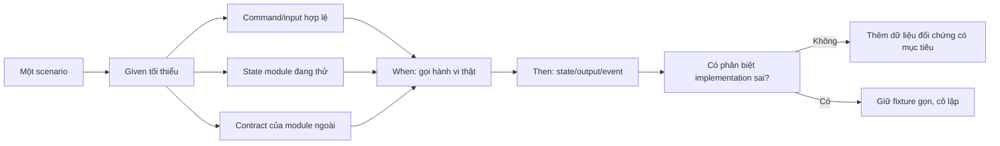
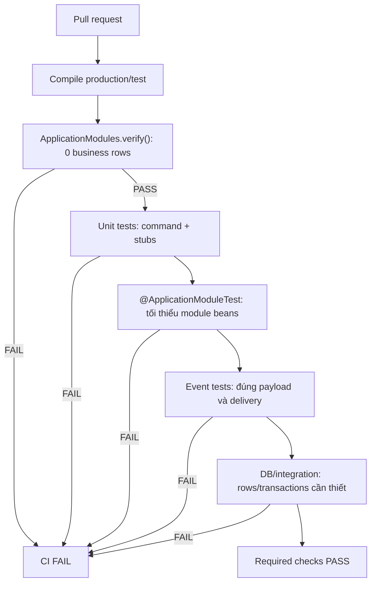

# Dữ liệu tối thiểu cho một scenario

> **Chương:** Test data  
> **Phạm vi học:** `SPRING_MODULITH_VERIFICATION_TESTING` — kiểm chứng ranh giới kiến trúc Spring Modulith bằng `ApplicationModules` và quy tắc phụ thuộc giữa module; thực hành `@ApplicationModuleTest`, sự kiện, database, integration tests và quality gate trong CI.

## 1. Vì sao test càng nhiều dữ liệu đôi khi càng kém tin cậy?

Một developer viết test “đặt một đơn hàng khi còn hàng”, nhưng phần `Given` đã tạo 10 khách hàng, 30 sản phẩm, nhiều kho, mã giảm giá, lịch sử thanh toán và năm đơn hàng cũ. Test thất bại vì một bản ghi khuyến mãi hết hạn. Người sửa phải điều tra dữ liệu không liên quan trước khi hiểu rằng kịch bản thực sự chỉ cần **một command hợp lệ và một phản hồi “còn hàng” từ module `inventory`**.

Ở chiều ngược lại, một test khác “chỉ trả đơn hàng đang hoạt động” lại chuẩn bị **duy nhất một đơn hoạt động**. Implementation sai — trả tất cả đơn, không lọc theo trạng thái — vẫn làm test PASS. Dữ liệu ở đây ít, nhưng **không đủ sức phân biệt hành vi đúng với hành vi sai**.

Vì vậy, “tối thiểu” không có nghĩa **luôn là ít bản ghi nhất**. Mục tiêu là **bộ dữ liệu nhỏ nhất đủ tái hiện điều kiện nghiệp vụ, kích hoạt nhánh muốn kiểm, và phân biệt kết quả đúng với những lỗi có khả năng xảy ra**.

Sau bài này, bạn sẽ:

1. Chuyển một yêu cầu kiểm thử thành scenario `Given–When–Then` có dữ liệu đầu vào tối thiểu nhưng đầy đủ.
2. Xác định lúc nào cần **0, 1, 2 hoặc nhiều hơn** các object/row/event dựa trên assertion và rủi ro.
3. Thiết kế builders/fixtures có giá trị mặc định có nghĩa, không kéo theo dữ liệu và dependency của module khác.
4. Chọn test data riêng cho unit test, `@ApplicationModuleTest`, kiểm thử event, database và integration.
5. Kiểm soát ID, clock, transaction, cleanup và test isolation để kết quả tái lập giữa local và CI.
6. Giữ structural verification bằng `ApplicationModules.verify()` độc lập với dữ liệu nghiệp vụ, đồng thời bảo đảm quality gate phát hiện cả lỗi kiến trúc và hồi quy hành vi.

## 2. Định nghĩa “minimal sufficient data”

Một bộ dữ liệu test **đủ tối thiểu** khi đáp ứng đồng thời bốn điều kiện:

| Điều kiện | Câu hỏi | Hệ quả |
| --- | --- | --- |
| **Đủ để thực thi** | Có thiếu entity, trường bắt buộc, liên kết khóa ngoại hay bean cộng tác viên không? | Không FAIL vì dữ liệu setup thiếu |
| **Đúng invariant** | Trạng thái, quantity, timestamp và quan hệ có hợp lệ với domain không? | Test chạy trên tình huống khả thi, trừ khi cố ý kiểm invalid data |
| **Đủ phân biệt** | Nếu implementation sai theo cách dễ mắc, assertion có phát hiện được không? | Không PASS giả nhờ dữ liệu quá đơn giản |
| **Không nhiễu** | Bỏ một record/field/setup không liên quan có làm test mất giá trị không? | Giảm nguyên nhân FAIL ngoài mục tiêu |

Có thể nghĩ theo công thức:

```text
Dữ liệu tối thiểu đủ = dữ liệu cần cho precondition hợp lệ
                     + dữ liệu đối chứng để phân biệt hành vi
                     + dữ liệu bắt buộc bởi hạ tầng thật
                     - mọi fixture không phục vụ assertion
```

Đây là **nguyên tắc thiết kế**, không phải công thức tính số hàng. Đôi khi một database test cần hai row mới có ý nghĩa; một test về concurrency thậm chí cần hai transaction và cơ chế đồng bộ rõ ràng.

### 2.1. “Đủ” được quyết định bởi assertion, không bởi độ lớn fixture

Ví dụ:

- **Kiểm xem truy vấn tìm đúng ID:** một row đúng ID có thể đủ cho happy path; nên có ca riêng “ID không tồn tại” với bảng rỗng hoặc ID khác.
- **Kiểm lọc trạng thái:** ít nhất hai row khác trạng thái giúp phát hiện code bỏ điều kiện `WHERE status = ...`.
- **Kiểm phân biệt khách hàng:** cần hai khách hàng/tenant với dữ liệu có thể nhầm lẫn để phát hiện thiếu điều kiện phân vùng.
- **Kiểm unique constraint:** một row đã tồn tại và một lệnh insert trùng khóa có ý nghĩa.
- **Kiểm event publish:** một lời gọi service cùng quan sát event do nó phát là đủ cho happy path; tự tạo event rồi assert chính event đó không kiểm được publisher.
- **Kiểm kiến trúc tĩnh:** không cần row nghiệp vụ nào, chỉ cần các class, module metadata và một JUnit test gọi `verify()`.

## 3. Scenario card: viết mục tiêu trước khi tạo dữ liệu

Trước khi khởi tạo fixture, hãy ghi một “thẻ kịch bản” ngắn:

```text
ID: ORD-PLACE-001
Mục tiêu: Một yêu cầu đặt hàng hợp lệ tạo đúng một đơn đã đặt.
Given:
  - orderId = UUID cố định cho test
  - sku = SKU-001, quantity = 2
  - inventory.StockQuery.available("SKU-001", 2) trả true
  - orders store không có bản ghi trùng ID
When:
  - Gọi OrderPlacementService.place(command)
Then:
  - Store nhận đúng một Order ở trạng thái PLACED
  - Một OrderPlaced được publish với orderId/SKU/quantity tương ứng
Không cần:
  - Dữ liệu payment, shipping, coupon, tenant khác hoặc catalog đầy đủ
```

Các phần có vai trò khác nhau:

| Phần | Nội dung phải rõ |
| --- | --- |
| `Given` | State và cộng tác viên tối thiểu để đi tới hành vi đang thử |
| `When` | Một hành động duy nhất, được gọi qua API/module phù hợp |
| `Then` | Kết quả quan sát được có thể phân biệt đúng/sai |
| `Not needed` | Những dữ liệu/hạ tầng có thể loại bỏ mà assertion không mất giá trị |
| `Boundary owner` | Module nào sở hữu state; module nào chỉ cung cấp phản hồi qua API |

**Tránh hai lỗi thường gặp:** đưa kết quả mong muốn vào `Given` (tạo sẵn đơn `PLACED` rồi “test place”), hoặc chuẩn bị nhiều record “cho giống production” dù scenario không dùng tới.

### 3.1. Một sơ đồ giúp phân loại đầu vào



## 4. Biên giới giữa dữ liệu `orders` và `inventory`

Ví dụ hệ thống có cấu trúc:

```text
src/main/java/com/example/shop/
├── ShopApplication.java
├── orders/
│   ├── PlaceOrderCommand.java
│   ├── Order.java
│   ├── OrderPlaced.java
│   └── OrderPlacementService.java
└── inventory/
    ├── StockQuery.java
    └── internal/
        └── StockJpaRepository.java

src/test/java/com/example/shop/
├── ModuleArchitectureTest.java
└── orders/
    ├── OrderScenarioFixtures.java
    ├── OrderPlacementServiceTest.java
    └── OrderModuleTest.java
```

Với quy ước mặc định của Spring Modulith, `orders` và `inventory` là các application module trực tiếp dưới package gốc. `orders` được phép sử dụng API `inventory.StockQuery` nếu chính sách dependency cho phép; không nên import trực tiếp repository trong `inventory.internal` chỉ để chuẩn bị fixture.

**Nguyên tắc sở hữu dữ liệu:** scenario của `orders` cần kiểm việc hỏi tồn kho thì dùng phản hồi `StockQuery`; nó không cần tự chèn 20 bản ghi vào database nội bộ của `inventory`. Nếu mục tiêu là kiểm tích hợp thật giữa hai module, khi đó test cần setup state trong từng module một cách có chủ đích, thông qua API, fixture thuộc module sở hữu hoặc test infrastructure riêng.

| Cấp kiểm thử | Data setup cho `inventory` trong test `orders` |
| --- | --- |
| Unit test service | Một `StockQuery` fake trả true/false theo input |
| `@ApplicationModuleTest` của `orders` | Test-only bean của `StockQuery`, không cần inventory repository |
| Integration liên module | State tồn kho thật đủ để thỏa/mất một reservation, có transaction và cleanup |
| Structural verification | Không cần seed tồn kho; phân tích dependency giữa class/module |

## 5. Mô hình production nhỏ để minh họa scenario

Các ví dụ sau cố ý giữ domain **nhỏ vừa đủ** để tập trung vào dữ liệu test. Trong hệ thống thật, domain có thể bổ sung persistence mapping, transaction, payment và idempotency.

Ở module `inventory`, API công bố:

```java
package com.example.shop.inventory;

public interface StockQuery {
    boolean available(String sku, int quantity);
}
```

Ở module `orders`, command và sự kiện:

```java
package com.example.shop.orders;

import java.util.UUID;

public record PlaceOrderCommand(
        UUID orderId, String sku, int quantity
) {}
```

```java
package com.example.shop.orders;

import java.util.UUID;

public record OrderPlaced(
        UUID orderId, String sku, int quantity
) {}
```

Aggregate trạng thái tối thiểu:

```java
package com.example.shop.orders;

import java.util.Objects;
import java.util.UUID;

public record Order(UUID id, String sku, int quantity, OrderStatus status) {

    public Order {
        Objects.requireNonNull(id, "id");
        if (sku == null || sku.isBlank()) {
            throw new IllegalArgumentException("sku is required");
        }
        if (quantity <= 0) {
            throw new IllegalArgumentException("quantity must be positive");
        }
        Objects.requireNonNull(status, "status");
    }
}
```

```java
package com.example.shop.orders;

public enum OrderStatus {
    PLACED, CANCELLED
}
```

Một port lưu đơn thuộc module `orders`:

```java
package com.example.shop.orders;

interface OrderStore {
    void save(Order order);
}
```

Service phối hợp module qua API:

```java
package com.example.shop.orders;

import java.util.Objects;
import org.springframework.context.ApplicationEventPublisher;
import org.springframework.stereotype.Service;
import com.example.shop.inventory.StockQuery;

@Service
public class OrderPlacementService {

    private final StockQuery stock;
    private final OrderStore orders;
    private final ApplicationEventPublisher events;

    public OrderPlacementService(StockQuery stock, OrderStore orders,
                                 ApplicationEventPublisher events) {
        this.stock = stock;
        this.orders = orders;
        this.events = events;
    }

    public Order place(PlaceOrderCommand command) {
        Objects.requireNonNull(command, "command");
        if (command.orderId() == null
                || command.sku() == null
                || command.sku().isBlank()
                || command.quantity() <= 0) {
            throw new IllegalArgumentException("Invalid order command");
        }

        if (!stock.available(command.sku(), command.quantity())) {
            throw new IllegalStateException("Out of stock");
        }

        Order placed = new Order(command.orderId(),
                command.sku(), command.quantity(), OrderStatus.PLACED);
        orders.save(placed);
        events.publishEvent(new OrderPlaced(
                placed.id(), placed.sku(), placed.quantity()));
        return placed;
    }
}
```

Service trên chỉ phục vụ ví dụ về **đầu vào, data setup và side effect quan sát được**. Nó chưa giải quyết việc đặt hàng trùng ID, transaction atomicity giữa lưu và publish, tồn kho thay đổi đồng thời, hay đảm bảo giao hàng event. Những quy tắc đó cần scenario và thiết kế riêng; không nên tự giả định chúng đã được kiểm bằng các ví dụ cơ bản.

## 6. Tạo một command fixture nhỏ và có ý nghĩa

Ở `src/test/java/com/example/shop/orders/OrderScenarioFixtures.java`:

```java
package com.example.shop.orders;

import java.util.UUID;

final class OrderScenarioFixtures {

    static final UUID ORDER_ID = UUID.fromString(
            "11111111-1111-1111-1111-111111111111");

    private OrderScenarioFixtures() {}

    static PlaceOrderCommand validCommand() {
        return new PlaceOrderCommand(ORDER_ID, "SKU-001", 2);
    }

    static PlaceOrderCommand withQuantity(int quantity) {
        return new PlaceOrderCommand(ORDER_ID, "SKU-001", quantity);
    }
}
```

Tại sao chỉ có hai factory methods?

- `validCommand()` thể hiện **happy path** được dùng nhiều nhất.
- `withQuantity(...)` tạo thay đổi duy nhất cần cho các trường hợp quantity biên.
- Không tạo sẵn Customer, Product, Coupon, Warehouse, Payment khi service chỉ cần `orderId`, `sku`, `quantity`.
- Không đặt fixture vào `src/main/java`; đây là **test-only code**.
- Mỗi lần gọi trả một record mới; tránh chia sẻ object mutable giữa test.

ID cố định giúp unit test dễ đọc và tái hiện. Khi cùng fixture được ghi vào database chung bởi nhiều test, phải cung cấp ID riêng cho từng ca hoặc dùng isolation/cleanup tương ứng.

### 6.1. Không nhầm dữ liệu mặc định với dữ liệu “đúng cho mọi test”

`validCommand()` là một **điểm khởi đầu**, không phải “siêu fixture” đủ cho mọi scenario. Nếu test có nhiều kho, nhiều khách hàng hoặc replay request, nó cần thêm đúng input liên quan. Cách mở rộng tốt là thêm factory theo **ý định nghiệp vụ** thay vì thêm 20 trường cấu hình vô nghĩa vào mọi test.

Ví dụ test yêu cầu kiểm tồn kho của SKU khác, tạo command riêng có `sku = "SKU-OUT"`. Không đổi toàn bộ default SKU chỉ để phục vụ một negative case.

## 7. Unit test scenario: 0 record có thể là đủ

Test service không cần DB nếu chỉ kiểm điều kiện từ chối do hết hàng. Trạng thái tối thiểu:

- Một command hợp lệ.
- Một `StockQuery` fake trả false.
- Một store giả ghi nhận số lần `save`.
- Một event publisher giả ghi nhận số event.
- **0** bản ghi database và **0** bean Spring context.

```java
package com.example.shop.orders;

import static org.junit.jupiter.api.Assertions.*;

import java.util.ArrayList;
import java.util.List;
import org.junit.jupiter.api.Test;
import org.springframework.context.ApplicationEventPublisher;
import com.example.shop.inventory.StockQuery;

class OrderPlacementServiceTest {

    @Test
    void outOfStockDoesNotPersistOrPublish() {
        StockQuery noStock = (sku, quantity) -> false;
        List<Order> saved = new ArrayList<>();
        OrderStore store = saved::add;
        List<Object> published = new ArrayList<>();
        ApplicationEventPublisher publisher = published::add;

        OrderPlacementService service =
                new OrderPlacementService(noStock, store, publisher);

        assertThrows(IllegalStateException.class,
                () -> service.place(OrderScenarioFixtures.validCommand()));

        assertTrue(saved.isEmpty());
        assertTrue(published.isEmpty());
    }
}
```

**Kết quả cần kiểm:** không chỉ có exception; **không lưu** và **không phát event**. Thêm một bảng tồn kho giả hay nhiều đơn hàng cũ không làm tăng sức mạnh của assertion ở test này.

### 7.1. Invalid command: thậm chí không cần hỏi module khác

Giữ fake có khả năng ghi nhận:

```java
@Test
void zeroQuantityIsRejectedBeforeStockLookup() {
    List<String> lookedUp = new ArrayList<>();
    StockQuery stock = (sku, quantity) -> {
        lookedUp.add(sku);
        return true;
    };
    List<Order> saved = new ArrayList<>();
    List<Object> published = new ArrayList<>();
    OrderPlacementService service = new OrderPlacementService(
            stock, saved::add, published::add);

    assertThrows(IllegalArgumentException.class,
            () -> service.place(OrderScenarioFixtures.withQuantity(0)));
    assertTrue(lookedUp.isEmpty());
    assertTrue(saved.isEmpty());
    assertTrue(published.isEmpty());
}
```

Đây là **một phương thức test bổ sung bên trong `OrderPlacementServiceTest`**; imports và package giữ như ví dụ trước. Dataset không có một order persisted nào: mục tiêu là bảo đảm validation chặn command sai trước các side effects.

### 7.2. Happy path: một command + một phản hồi là đủ

```java
@Test
void oneValidCommandProducesOneOrderAndOneEvent() {
    StockQuery hasStock = (sku, quantity) -> true;
    List<Order> saved = new ArrayList<>();
    List<Object> published = new ArrayList<>();
    OrderPlacementService service = new OrderPlacementService(
            hasStock, saved::add, published::add);

    PlaceOrderCommand command = OrderScenarioFixtures.validCommand();
    Order result = service.place(command);

    assertEquals(OrderStatus.PLACED, result.status());
    assertEquals(1, saved.size());
    assertSame(result, saved.get(0));
    assertEquals(1, published.size());
    OrderPlaced event = assertInstanceOf(
            OrderPlaced.class, published.get(0));
    assertEquals(command.orderId(), event.orderId());
    assertEquals(command.sku(), event.sku());
    assertEquals(command.quantity(), event.quantity());
}
```

**Vì sao đủ?** Các assertions kiểm trạng thái cuối, số lần lưu và dữ liệu event được phát từ service thật. Không có yêu cầu nghiệp vụ nào trong test cần bản ghi khách hàng, hóa đơn, địa chỉ giao hàng hay cache tồn kho.

**Giới hạn:** test này chưa kiểm transaction và database thật. `orders.save` trong unit test là một spy, nên không thể kết luận dữ liệu đã commit hoặc event đã đến listener của module khác.

## 8. Một scenario cần hai row — vì một row tạo ra false positive

Giả sử module `orders` cần query “trả danh sách đơn đã đặt, không trả đơn đã hủy”.

Một test với **chỉ đơn `PLACED`**:

```text
Given: [Order A (PLACED)]
When:  findPlacedOrders()
Then:  [Order A]
```

Implementation sai `SELECT * FROM customer_orders` vẫn PASS, vì mọi đơn hiện có đều ở trạng thái `PLACED`. Muốn test **phát hiện thiếu điều kiện lọc**, cần tối thiểu một đối chứng:

```text
Given: [Order A (PLACED), Order B (CANCELLED)]
When:  findPlacedOrders()
Then:  [Order A] và không chứa Order B
```

Từ đây rút ra quy tắc: **đối với filter, sorting, tenant isolation, uniqueness hoặc loại trừ dữ liệu, test data thường cần ít nhất một phần tử “nên có” và một phần tử “không nên có”.**

### 8.1. Dataset SQL tối thiểu để kiểm filter

Giả sử migration của ứng dụng có bảng `customer_orders` với các trường `id`, `sku`, `quantity`, `status`. SQL fixture minh họa:

```sql
INSERT INTO customer_orders(id, sku, quantity, status)
VALUES
  ('11111111-1111-1111-1111-111111111111', 'SKU-001', 2, 'PLACED'),
  ('22222222-2222-2222-2222-222222222222', 'SKU-002', 1, 'CANCELLED');
```

Đây là hai row đủ để **phân biệt truy vấn có lọc trạng thái với truy vấn không lọc**. Chúng không đại diện cho toàn bộ dữ liệu production. Dự án thực phải bổ sung các cột bắt buộc, khóa ngoại và migration phù hợp.

### 8.2. Test persistence dùng hai row có chủ đích

Giả định dự án có `DataSource`, Spring JDBC và migration tạo bảng. Trước hết, đây là **code production** chứa logic truy vấn cần được test, nằm tại `src/main/java/com/example/shop/orders/PlacedOrderQuery.java`:

```java
package com.example.shop.orders;

import java.util.List;
import java.util.UUID;
import org.springframework.jdbc.core.JdbcTemplate;
import org.springframework.stereotype.Repository;

@Repository
class PlacedOrderQuery {

    private final JdbcTemplate jdbc;

    PlacedOrderQuery(JdbcTemplate jdbc) {
        this.jdbc = jdbc;
    }

    List<UUID> findPlacedIds() {
        return jdbc.query(
            "SELECT id FROM customer_orders WHERE status = ? ORDER BY id",
            (rs, rowNum) -> rs.getObject("id", UUID.class),
            "PLACED"
        );
    }
}
```

Sau đó bài test **gọi chính method production** thay vì tự viết một câu SQL lọc trạng thái trong test:

```java
package com.example.shop.orders;

import static org.junit.jupiter.api.Assertions.assertEquals;

import java.util.List;
import java.util.UUID;
import org.junit.jupiter.api.Test;
import org.springframework.beans.factory.annotation.Autowired;
import org.springframework.modulith.test.ApplicationModuleTest;
import org.springframework.test.context.jdbc.Sql;

@ApplicationModuleTest
@Sql(scripts = "/test-data/orders/two-orders.sql",
     executionPhase = Sql.ExecutionPhase.BEFORE_TEST_METHOD)
@Sql(scripts = "/test-data/orders/cleanup.sql",
     executionPhase = Sql.ExecutionPhase.AFTER_TEST_METHOD)
class PlacedOrderQueryModuleTest {

    @Autowired
    PlacedOrderQuery query;

    @Test
    void returnsOnlyPlacedOrders() {
        List<UUID> ids = query.findPlacedIds();

        assertEquals(List.of(UUID.fromString(
            "11111111-1111-1111-1111-111111111111")), ids);
    }
}
```

**Vì sao hai row đủ?** Nếu developer vô tình bỏ `WHERE status = ?` trong `PlacedOrderQuery`, row `CANCELLED` xuất hiện trong kết quả và assertion FAIL. Với chỉ một row `PLACED`, lỗi này có thể bị bỏ sót.

Đoạn ví dụ sử dụng `UUID` và phép lấy giá trị JDBC kiểu `UUID.class`; nó phù hợp với database/driver hỗ trợ cột UUID (ví dụ PostgreSQL). Project dùng kiểu ID khác phải điều chỉnh mapping. Test chỉ chạy khi Spring context đã cấu hình JDBC, DataSource và migration. Nếu mục tiêu chỉ là kiểm query, có thể dùng một slice/integration test phù hợp thay cho `@ApplicationModuleTest`.

### 8.3. Không viết lại logic production trong assertion

Một anti-pattern là test tự chạy `SELECT ... WHERE status = 'PLACED'` rồi so kết quả, nhưng **không gọi** `PlacedOrderQuery.findPlacedIds()`. Khi đó test chỉ chứng minh rằng SQL trong test đúng, không chứng minh code production đã lọc đúng. Dùng dữ liệu đối chứng trong `Given`, gọi method thật trong `When` và assert kết quả trong `Then`.

## 9. Khi scenario thật sự cần nhiều hơn hai record

Đừng đặt quy tắc cứng “mỗi test chỉ dùng một row”. Hãy hỏi lỗi nào mình muốn phát hiện:

| Scenario | Bộ data tối thiểu có ý nghĩa | Lý do |
| --- | --- | --- |
| Empty result | **0** row phù hợp | Kiểm xử lý tập rỗng, không trả dữ liệu ma |
| Tìm một ID tồn tại | **1** row đúng ID | Kiểm mapping/lookup happy path |
| Không tìm thấy ID | **0** row hoặc một row khác ID | Phát hiện trả nhầm |
| Filter `PLACED` | **2** row: PLACED và CANCELLED | Phát hiện bỏ điều kiện lọc |
| Tenant isolation | **2** row cùng đặc tính nhưng khác tenant | Phát hiện thiếu tenant predicate |
| Sort tăng dần | **2** row cố tình ngược thứ tự đầu vào | Phát hiện không sort |
| Pagination vượt một trang | Ít nhất `pageSize + 1` row | Phát hiện ranh giới trang và row bị bỏ sót |
| Unique constraint | Một row có khóa đã tồn tại + insert trùng | Kích hoạt conflict |
| Aggregate sum/count | Số row đủ để kết quả không thể “hardcode” bằng một phần tử | Phân biệt cộng gộp với trả một item |
| Event duplicate | Hai lần nhận cùng event ID | Kiểm idempotency theo contract |
| Event ordering | Ít nhất hai event có trình tự khác nhau | Kiểm thứ tự nếu nghiệp vụ yêu cầu |
| Concurrency | Tối thiểu hai hoạt động/transaction tranh chấp | Kiểm isolation/locking, không chỉ số row |

Chẳng hạn, để kiểm phân trang kích thước 10, dữ liệu **11 row** có ý nghĩa hơn 1 row; song để test “không có đơn nào”, thêm 11 row chỉ tăng nhiễu. Đặt kích thước fixture theo **ranh giới của hành vi**, không theo một “chuẩn” cố định.

## 10. `@ApplicationModuleTest`: tối thiểu cả dữ liệu lẫn Spring context

Unit test ở mục 7 kiểm service trực tiếp. Khi cần xác nhận bean wiring và event publication của module `orders`, sử dụng `@ApplicationModuleTest`. Không cần khởi động database của `inventory` nếu phụ thuộc của `orders` chỉ là `StockQuery`.

### 10.1. Test configuration cho một scenario duy nhất

Trong `src/test/java/com/example/shop/orders/OrderScenarioConfig.java`:

```java
package com.example.shop.orders;

import org.springframework.boot.test.context.TestConfiguration;
import org.springframework.context.annotation.Bean;
import org.springframework.context.annotation.Primary;
import com.example.shop.inventory.StockQuery;

@TestConfiguration(proxyBeanMethods = false)
class OrderScenarioConfig {

    @Bean
    @Primary
    StockQuery stockQuery() {
        return (sku, quantity) ->
            "SKU-001".equals(sku) && quantity <= 3;
    }

    @Bean
    @Primary
    OrderStore orderStore() {
        // Module test này tập trung vào state trả về và event.
        return order -> {};
    }
}
```

Stub chỉ mang **một quy tắc**: SKU-001 khả dụng đến 3 đơn vị. Không thiết lập nhiều sản phẩm, giá và kho vì scenario chưa cần. Nếu Spring context có sẵn nhiều bean cùng loại hoặc cơ chế replace khác, phải điều chỉnh `@Primary`/test configuration theo project thực tế; đừng đưa stub vào code production.

### 10.2. Dùng `PublishedEvents` để assert sự kiện thật

```java
package com.example.shop.orders;

import static org.assertj.core.api.Assertions.assertThat;

import org.junit.jupiter.api.Test;
import org.springframework.beans.factory.annotation.Autowired;
import org.springframework.context.annotation.Import;
import org.springframework.modulith.test.ApplicationModuleTest;
import org.springframework.modulith.test.PublishedEvents;

@ApplicationModuleTest
@Import(OrderScenarioConfig.class)
class OrderModuleTest {

    @Autowired
    OrderPlacementService service;

    @Test
    void publishesAnEventMatchingThisCommand(PublishedEvents events) {
        PlaceOrderCommand command = OrderScenarioFixtures.validCommand();

        Order order = service.place(command);

        assertThat(order.status()).isEqualTo(OrderStatus.PLACED);
        assertThat(events.ofType(OrderPlaced.class))
                .anySatisfy(event -> {
                    assertThat(event.orderId()).isEqualTo(command.orderId());
                    assertThat(event.sku()).isEqualTo(command.sku());
                    assertThat(event.quantity()).isEqualTo(command.quantity());
                });
    }
}
```

Assertion `anySatisfy(...)` ở ví dụ chứng minh **có ít nhất một event khớp**. Nếu hợp đồng yêu cầu *chính xác một* event, test phải kiểm thêm số lượng `OrderPlaced` được publish bằng API đếm/iterator tương thích phiên bản Spring Modulith của project. Đừng kết luận “exactly one” chỉ từ `anySatisfy`.

Mục tiêu test này là **module context + hành vi publish**. Nó không chứng minh listener ở module ngoài đã xử lý event hay dữ liệu được commit thật. Với kịch bản đó, cần thêm integration test cấp phù hợp.

### 10.3. Một scenario không nên nhận 30 bean test giả

Nếu ứng dụng thật có nhiều dependency được inject, fixture tối thiểu không có nghĩa lách việc Spring cần tạo bean. Nó có nghĩa chỉ cung cấp **những bean bắt buộc để context được tạo và những behavior cần điều khiển cho scenario**, không thêm configuration vô dụng hoặc import toàn application khi chỉ cần module `orders`.

## 11. Kiểm thử event: một event, hay hai event?

Giả sử module `billing` lắng nghe `OrderPlaced`. Nhiều kiểu test đòi hỏi dataset khác nhau:

| Mục tiêu | Fixture event tối thiểu | Kết quả cần quan sát |
| --- | --- | --- |
| Producer publish event | Không tự tạo event; gọi command qua service | Event thật được phát với payload đúng |
| Consumer xử lý một event | **1** event hợp lệ | Side effect của listener đúng |
| Consumer idempotent | **2 lần gửi cùng event ID** | Chỉ áp dụng side effect theo hợp đồng idempotency |
| Consumer phân biệt loại event | Event được chấp nhận + event khác cần bỏ qua | Không xử lý sai loại |
| Out-of-order handling | Ít nhất **2** event có version/thứ tự | Xử lý theo chiến lược version/sequence của hệ thống |

Event fixture có thể đơn giản:

```java
package com.example.shop.orders;

final class OrderEventFixtures {

    private OrderEventFixtures() {}

    static OrderPlaced placed() {
        PlaceOrderCommand command = OrderScenarioFixtures.validCommand();
        return new OrderPlaced(
                command.orderId(), command.sku(), command.quantity());
    }
}
```

Test producer không được **tự gọi `OrderEventFixtures.placed()` rồi assert object vừa tạo**; nó phải gọi publisher thật. Consumer test có thể dùng fixture event để cung cấp đầu vào trực tiếp. Hai hướng test khác nhau và không thay thế lẫn nhau.

### 11.1. Bất đồng bộ và transaction boundary

Trong ứng dụng có `@ApplicationModuleListener` hoặc delivery bất đồng bộ, test “publish rồi ngủ 100 ms” thường không ổn định. Dùng điều kiện quan sát được (bản ghi trạng thái, event marker, latch hoặc công cụ test phù hợp) với timeout hợp lý. Phải phân biệt:

- Sự kiện đã **publish** ở module nguồn.
- Listener đã **nhận** event.
- Side effect/database transaction của listener đã **commit**.

Một fixture event đúng payload không tự bảo đảm cả ba bước này.

## 12. Minimal dataset cho database integration tests

Database test chỉ nên thêm những row, schema và dependency thật mà điều kiện cần. Tuy nhiên, **tối thiểu không đồng nghĩa với bỏ migration hoặc constraint**. Nếu test định kiểm mapping, khóa ngoại, transaction hay query PostgreSQL, cần database/test infrastructure phản ánh hành vi đó.

### 12.1. Setup và cleanup có phạm vi

Ví dụ test filter ở mục 8 có hai row:

```text
src/test/resources/
└── test-data/orders/
    ├── two-orders.sql
    └── cleanup.sql
```

`two-orders.sql` chỉ chứa hai đơn khác trạng thái. `cleanup.sql` nên xóa **đúng các ID do test tạo**, tránh `DELETE FROM customer_orders` xóa dữ liệu dùng chung của test khác khi chạy song song.

```sql
DELETE FROM customer_orders
WHERE id IN (
  '11111111-1111-1111-1111-111111111111',
  '22222222-2222-2222-2222-222222222222'
);
```

Khi chạy test song song trên cùng database, hai test dùng cùng ID vẫn có thể xung đột dù có cleanup. Cần dùng transaction isolation, schema riêng, container riêng hoặc ID không trùng; chọn cơ chế phù hợp với phạm vi test.

### 12.2. Đừng để fixture vượt invariant domain

Khi production có state machine `DRAFT → PLACED → CANCELLED` và timestamp bắt buộc cho `PLACED`, SQL fixture `status = PLACED` nhưng thiếu `placed_at` có thể là trạng thái bất khả thi. Một integration test happy path nên tạo bản ghi phù hợp schema và invariant, qua domain/repository hoặc SQL có chủ đích.

Chỉ dùng fixture vi phạm invariant nếu đang kiểm:

- Validator nhận diện dữ liệu legacy bị hỏng.
- Migration sửa dữ liệu không hợp lệ.
- Constraint từ chối insertion sai.

Những trường hợp này cần **tên test riêng** và assertion từ chối/sửa lỗi; không được trộn với fixture chuẩn.

### 12.3. Đo hiệu quả theo lỗi muốn phát hiện

Với test `findPlacedOrders`, hai row là đủ vì phân biệt được query có lọc và không lọc. Với test foreign key, phải có row cha hoặc một key không tồn tại tùy case. Với test optimistic locking, cần tạo xung đột version thực bằng nhiều transaction; chỉ seed hàng chục row mà không có cạnh tranh cũng không kiểm được locking.

## 13. Định danh và thời gian: làm dữ liệu ít nhưng tái lập được

Một bộ fixture gọn có thể vẫn flaky nếu ID trùng hoặc kết quả phụ thuộc giờ hệ thống.

### 13.1. ID cố định cho unit, ID riêng cho integration song song

- Unit test độc lập: một UUID cố định như `1111...` giúp assertion và log dễ đọc.
- DB test song song: nên dùng ID riêng cho mỗi test hoặc database/schema riêng.
- Scenario replay/idempotency: phải **cố ý dùng cùng ID** ở hai request để kích hoạt điều kiện trùng; random ID sẽ làm test mất ý nghĩa.

### 13.2. Thời gian cố định theo use case

Nếu domain dùng thời điểm tạo đơn hoặc hết hạn, hãy inject `Clock` rồi dùng `Clock.fixed(...)` trong test:

```java
import java.time.Clock;
import java.time.Instant;
import java.time.ZoneOffset;

Clock fixedClock = Clock.fixed(
        Instant.parse("2026-01-01T09:00:00Z"),
        ZoneOffset.UTC);
```

Điều này tốt hơn việc tạo 15 timestamp ngẫu nhiên, vì assertion có thể nói rõ ranh giới `issuedAt`, `expiresAt` hoặc `cancelledAt`. Nếu mục tiêu là timezone, dùng ít nhất hai múi giờ có ý nghĩa và expected result rõ ràng, không phụ thuộc timezone mặc định của runner.

### 13.3. Data minimization cũng là yêu cầu bảo mật

Không mang dump production hoặc thông tin khách hàng thật vào test chỉ để có dataset “giống thực tế”. Dùng dữ liệu giả hoặc đã khử nhận dạng theo quy định, số lượng nhỏ và chỉ các trường cần thiết. Secrets, địa chỉ giao hàng thật, token và tài khoản cá nhân không thuộc fixture trong repository.

## 14. Một checklist cắt bớt fixture trước khi review PR

Khi một test phải setup nhiều dữ liệu, dùng quy trình sau:

1. **Gạch chân assertion quan trọng nhất.** Test muốn phát hiện lỗi gì?
2. Liệt kê **fields/records/beans thật sự được truy cập** trên đường đi đến assertion.
3. Xác định **invariant và quan hệ bắt buộc**: khóa ngoại, trạng thái, quantity, authorization.
4. Bỏ một fixture phụ, chạy lại test: nếu assertions vẫn có sức phân biệt, có thể bỏ.
5. Thử **phản ví dụ**: implementation sai theo một cách hợp lý có làm test FAIL không? Nếu không, thêm đúng một đối chứng.
6. Kiểm state thuộc module nào; không gọi repository nội bộ module khác chỉ để thuận tiện.
7. Kiểm dữ liệu cleanup/idempotency nếu test ghi DB hoặc gửi event.
8. Đảm bảo test vẫn dễ đọc: chỉ cần nhìn `Given` biết scenario đang tạo trạng thái gì.

Ví dụ một test filter đang dùng 20 row. Nếu mục tiêu chỉ là không trả đơn `CANCELLED`, hãy rút xuống 1 `PLACED` + 1 `CANCELLED` và giữ assertion “chỉ A”. Nếu mục tiêu là paging qua nhiều trang, không thể giảm còn 2 row; cần `pageSize + 1` hoặc số row đủ để chạm điểm biên.

### Ma trận triệu chứng

| Triệu chứng | Vấn đề | Cách xử lý |
| --- | --- | --- |
| Test PASS với chỉ một row `PLACED` dù query thiếu `WHERE` | Dữ liệu không có đối chứng | Thêm một row `CANCELLED` |
| Test hủy đơn tạo trước `CANCELLED` | `Given` đã là trạng thái `Then` | Tạo đơn `PLACED` rồi gọi hành vi cancel |
| Test đặt đơn chuẩn bị payment/shipping/coupon không dùng | Noise và coupling | Xóa setup ngoài đường code đang kiểm |
| Unit test dựng Spring context/DB chỉ để kiểm quantity | Không đúng mức test | Dùng constructor/service thuần + stub |
| Test `orders` ghi thẳng `inventory.internal` | Vượt sở hữu module | Dùng `StockQuery` hoặc integration setup đúng cấp |
| Test dùng `Thread.sleep(...)` chờ event | Timing flaky | Dùng điều kiện/timeout quan sát được |
| SQL fixture xóa toàn bảng sau test | Có thể phá test khác | Dọn đúng ID hoặc isolate database |
| Test tự viết SQL filter trong assertion | Chỉ test câu SQL do test tự viết | Gọi repository/query method production |
| Event test tự tạo event rồi assert event đó | Không kiểm service publish | Gọi service rồi quan sát event |
| CI xanh nhưng test quan trọng không được chạy | Test discovery/gate thiếu | Kiểm reports, JUnit engine và build task |

## 15. Spring Modulith: structural gate không cần business fixtures

Đặt một structural test tại `src/test/java/com/example/shop/ModuleArchitectureTest.java`:

```java
package com.example.shop;

import org.junit.jupiter.api.Test;
import org.springframework.modulith.core.ApplicationModules;

class ModuleArchitectureTest {

    @Test
    void moduleBoundariesRemainValid() {
        ApplicationModules.of(ShopApplication.class).verify();
    }
}
```

Đây là một trong những test có **dữ liệu nghiệp vụ tối thiểu bằng 0**. `verify()` phân tích các quan hệ module và quy tắc kiến trúc trên lớp/code; không cần seed orders, inventory hay mở database để kiểm tra tĩnh.

Tuy nhiên, để PASS có ý nghĩa cần chắc:

- JUnit Jupiter đã thực thi `ModuleArchitectureTest`, không bị skip/filter.
- `ShopApplication.class` nằm ở package root bao phủ các module cần bảo vệ.
- Classpath và metadata `@ApplicationModule`, `@NamedInterface`, `allowedDependencies` phản ánh dự án thực.
- Một dependency sai cố ý từ `orders` sang `inventory.internal` bị phát hiện và làm test FAIL.

**Hai câu hỏi khác nhau:** “Ranh giới module đúng không?” thuộc structural test; “fixture này đủ để phân biệt truy vấn sai không?” thuộc behavioral/integration test. Không thay cái này bằng cái kia.

## 16. CI: từ minimal fixture đến quality gate đáng tin

Một pipeline nên chạy **đúng tầng kiểm thử với đúng lượng dữ liệu**, không nạp toàn bộ DB trước mọi structural/unit tests:



Với dự án dùng Maven Wrapper:

```bash
# Structural test riêng để fail fast và xác minh test discovery.
./mvnw -B -Dtest=ModuleArchitectureTest test

# Bộ test trong lifecycle đã cấu hình.
./mvnw -B verify
```

Với Gradle Wrapper đã bật `useJUnitPlatform()`:

```bash
./gradlew test --tests 'com.example.shop.ModuleArchitectureTest'
./gradlew check
```

Những lệnh trên là **hai lựa chọn theo build tool**, không yêu cầu chạy cả hai. Maven `verify` chỉ chạy Failsafe integration tests nếu plugin đã cấu hình; Gradle `check` cần nối các custom `integrationTest`/`architectureTest` tasks thì mới bao phủ chúng. Trong multi-project build, chọn đúng module chứa test.

### 16.1. Đọc report, không chỉ đọc `BUILD SUCCESS`

Kiểm tra:

- Có lớp `ModuleArchitectureTest` và test đã thực thi, không skipped.
- Có các unit tests với dữ liệu tối thiểu nhưng đủ đối chứng.
- `@ApplicationModuleTest` thực sự chạy nếu nó là một gate bắt buộc.
- Event/DB/integration tests có report và hạ tầng phù hợp.
- Không dùng `-DskipTests`, Gradle `-x test`, `ignoreFailures` hoặc CI `continue-on-error: true`.
- Required job/check trong branch protection/ruleset chặn merge khi một gate quan trọng FAIL.

Một build xanh chỉ chứng minh **những việc được thực thi** đã hoàn thành. Nó không chứng minh dataset đủ khả năng bắt lỗi nếu không có test đối chứng và assertions phù hợp.

## 17. Bài thực hành: từ scenario dài thành dữ liệu đủ tối thiểu

**Bối cảnh:** Spring Boot app `ShopApplication` có module `orders` và `inventory` như mục 4–5. Chọn Maven hoặc Gradle theo repository đang học.

### Phần A — Rút gọn unit test đặt hàng

1. Viết scenario “đặt đơn khi còn hàng” dạng `Given–When–Then`.
2. Bỏ hết dữ liệu payment, shipping, coupon và sản phẩm không được service sử dụng.
3. Dùng `OrderScenarioFixtures.validCommand()` và `StockQuery` fake trả true.
4. Assert đúng **một** order được lưu vào spy và **một** `OrderPlaced` được publish với ID, SKU, quantity đúng.
5. Thêm negative test với stock false và dữ liệu database bằng 0; assert không save/event.

### Phần B — Tìm ví dụ “ít nhưng chưa đủ”

1. Giả sử repository có method `findPlacedOrders()`.
2. Chuẩn bị **một row `PLACED`**, thử nghĩ xem implementation không lọc sẽ PASS hay FAIL.
3. Bổ sung **một row `CANCELLED`** làm đối chứng.
4. Assert repository production trả đúng `PLACED_ID` và loại `CANCELLED_ID`.
5. Nếu chỉ sửa SQL của chính test mà không gọi method production, giải thích vì sao test chưa có giá trị.

### Phần C — Module, event và DB test đúng cấp

1. Tạo `@ApplicationModuleTest` trong package `orders`, dùng `StockQuery` test bean.
2. Gọi service với một command hợp lệ; kiểm state và `PublishedEvents`.
3. Phân biệt producer test (gọi service) với listener test (đưa event fixture hợp lệ).
4. Với database, chuẩn bị đúng số row theo query/invariant; chạy migration, isolate ID và cleanup.
5. Nếu kiểm transaction/concurrency, tổ chức thêm transaction hoặc dữ liệu cần thiết cho **rủi ro cụ thể**, không dùng một seed dataset khổng lồ.

### Phần D — Nối với architectural gate

1. Chạy `ModuleArchitectureTest` không cần seed database; xác nhận hai module nằm trong phạm vi kiểm.
2. Trên branch thử, thêm dependency từ `orders` sang kiểu `public` thuộc `inventory.internal`.
3. Xác nhận compile có thể PASS nhưng `ApplicationModules.verify()` FAIL, CI required check cũng FAIL.
4. Sửa qua API `StockQuery`, chạy lại unit/module/event/DB tests liên quan.
5. Kiểm CI PASS; lưu một bảng tóm tắt fixture nào chứng minh rule nào.

### Checklist nghiệm thu

- [ ] Mỗi scenario có `Given–When–Then`, assertion và lỗi mục tiêu rõ ràng.
- [ ] Dữ liệu gồm những trường/record/bean cần cho invariant và assertion, không kéo setup vô dụng.
- [ ] Có dữ liệu đối chứng khi cần phân biệt filter, tenant, sorting, unique hoặc pagination.
- [ ] Fixture sai invariant chỉ tồn tại trong các negative tests có tên và kỳ vọng rõ.
- [ ] Unit test dùng command + stub, không cần database nếu không kiểm persistence.
- [ ] `@ApplicationModuleTest` chỉ nạp những test collaborators cần thiết và kiểm event thật được publish.
- [ ] DB fixtures có migration/schema phù hợp, cleanup/isolation, không dùng thông tin production nhạy cảm.
- [ ] `ApplicationModules.verify()` được thực thi độc lập với business seed, phát hiện dependency sai.
- [ ] CI required checks bao phủ structural và behavioral tests cần thiết, không nuốt lỗi.

## 18. Câu hỏi tự đánh giá

1. Vì sao “ít dữ liệu nhất” và “dữ liệu tối thiểu đủ” không phải một?
2. Khi test `findPlacedOrders()` chỉ có một row `PLACED`, loại implementation sai nào vẫn có thể PASS?
3. Một unit test từ chối đơn hết hàng cần bao nhiêu bản ghi DB nếu dùng fake `StockQuery`? Vì sao?
4. Khi kiểm tenant isolation hoặc sorting, lý do cần thêm dữ liệu đối chứng là gì?
5. Sự khác biệt giữa fixture event trong consumer test và event thực sự được service publish là gì?
6. Khi `@ApplicationModuleTest` có dependency ngoài module, nên dùng API stub hay truy cập thẳng repository nội bộ của module khác?
7. Vì sao một SQL test tự viết câu `WHERE` rồi assert đúng không chứng minh method repository production hoạt động đúng?
8. Scenario optimistic locking cần điều gì ngoài “nhiều row database”?
9. `ApplicationModules.verify()` có cần seed orders/inventory không? Nó có chứng minh query nghiệp vụ đúng không?
10. Làm sao biết một dữ liệu fixture đang **thừa** so với mục tiêu test?
11. Những bằng chứng nào cho thấy CI đã thực thi cả structural gate và các behavioral tests liên quan?

**Ghi nhớ:** Dữ liệu tối thiểu cho một scenario là **nhỏ nhất nhưng vẫn đủ precondition, invariant và sức phân biệt hành vi sai**. Một command và một stub có thể đủ cho unit test; filter/tenant/sorting thường cần dữ liệu đối chứng; DB concurrency cần transaction thật; architectural verification không cần business fixtures. Giữ dữ liệu theo quyền sở hữu module, test độc lập và deterministic, đồng thời chạy `ApplicationModules.verify()` cùng behavioral tests trong CI để bắt cả phụ thuộc sai và hồi quy.
