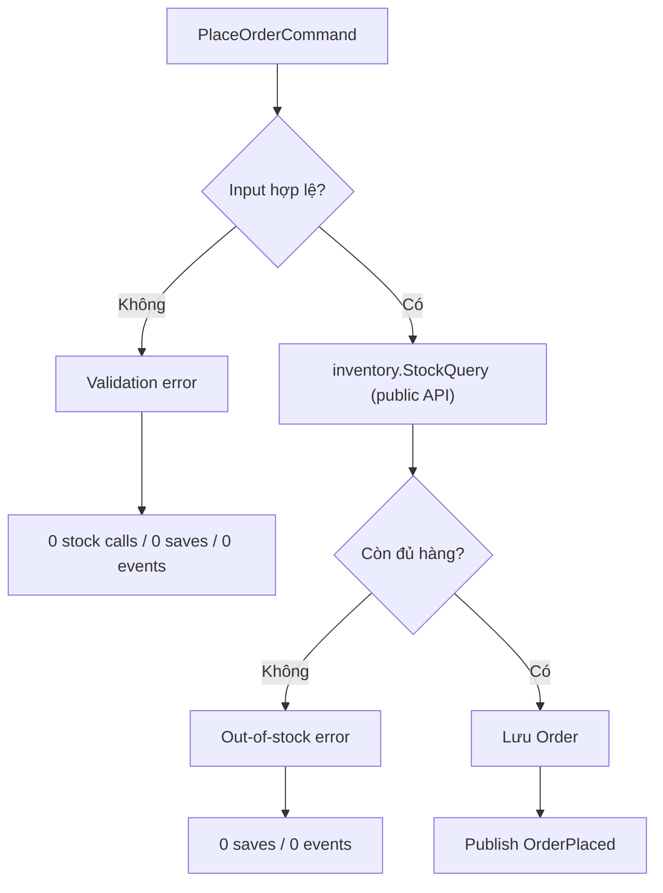
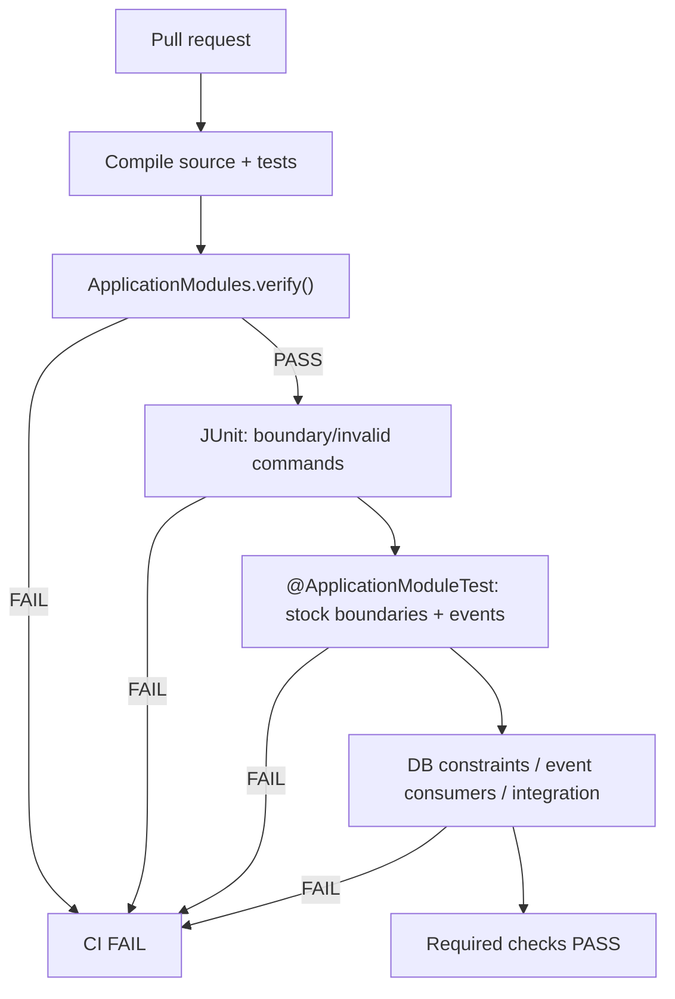

# Dữ liệu biên và dữ liệu không hợp lệ

> **Chương:** Test data  
> **Module học:** `SPRING_MODULITH_VERIFICATION_TESTING` — rèn kỹ năng kiểm chứng ranh giới ứng dụng Spring Modulith bằng `ApplicationModules`, các quy tắc phụ thuộc module, `@ApplicationModuleTest`, kiểm thử sự kiện, cơ sở dữ liệu, tích hợp và quality gate trong CI.

## 1. Vấn đề: happy path xanh nhưng lỗi xuất hiện ngay tại ranh giới

Module `orders` tiếp nhận yêu cầu đặt hàng. Unit test với số lượng 2 luôn PASS. Khi triển khai, API lại chấp nhận `quantity = 0` hoặc `quantity = 11` dù nghiệp vụ chỉ cho phép từ 1 đến 10; một yêu cầu chứa SKU toàn khoảng trắng được đưa tới module `inventory`; hoặc một bản tin `OrderPlaced` thiếu mã đơn khiến listener ghi dữ liệu sai.

Những tình huống này không được phát hiện bằng cách chỉ nhân bản happy-path fixture thành nhiều phiên bản ngẫu nhiên. Cần chủ động chọn **dữ liệu biên** và **dữ liệu không hợp lệ** để kiểm:

- Điều kiện tối thiểu/tối đa và lỗi lệch một đơn vị (*off-by-one*).
- Giá trị `null`, rỗng, toàn khoảng trắng, trùng định danh hoặc thiếu trường bắt buộc.
- Trạng thái aggregate không thể tồn tại và chuyển trạng thái không hợp lệ.
- Hợp đồng giữa các application module: điều gì phải bị từ chối tại ranh giới, điều gì không được làm sau khi bị từ chối?
- Ràng buộc database và dữ liệu/event không đáng tin đi vào từ hệ thống ngoài.

**Mục tiêu quan trọng:** một *negative test* thường phải **PASS** khi hệ thống từ chối dữ liệu sai đúng cách. Không nhầm “đầu vào không hợp lệ” với “test phải đỏ”. Test phải FAIL khi hệ thống chấp nhận dữ liệu sai, phát side effect trái phép hoặc trả lỗi không đúng hợp đồng.

Sau bài này, bạn có thể:

1. Chia miền dữ liệu thành các **lớp tương đương** (*equivalence partitions*) và chọn điểm biên có mục đích.
2. Phân biệt invalid command, invalid aggregate, invalid event payload và invalid database row.
3. Viết JUnit 5 parameterized tests bằng `@ParameterizedTest`, `@ValueSource`, `@NullAndEmptySource` hoặc `@MethodSource`.
4. Kiểm cả **exception** và **không có side effect**: không gọi tồn kho, không lưu đơn, không phát sự kiện khi input bị từ chối.
5. Kiểm lỗi tại `@ApplicationModuleTest`, database constraint và event consumer mà vẫn tôn trọng API module.
6. Ghép các behavioral tests này với `ApplicationModules.verify()` và quality gate CI để phát hiện hồi quy lẫn phụ thuộc kiến trúc sai.

## 2. Phân loại: dữ liệu biên khác dữ liệu không hợp lệ thế nào?

Giả sử một lệnh đặt hàng cho phép số lượng **từ 1 đến 10, bao gồm cả hai đầu**.

| Giá trị | Phân loại | Kết quả mong muốn |
| --- | --- | --- |
| `1` | Biên dưới **hợp lệ** | Cho phép tiếp tục kiểm tồn kho |
| `2` | Hợp lệ đại diện bên trong | Cho phép tiếp tục |
| `10` | Biên trên **hợp lệ** | Cho phép tiếp tục |
| `0` | Ngay dưới biên dưới, **không hợp lệ** | Từ chối trước side effect |
| `-1` | Không hợp lệ, phía dưới | Từ chối |
| `11` | Ngay trên biên trên, **không hợp lệ** | Từ chối |
| `Integer.MAX_VALUE` | Không hợp lệ, giá trị cực trị | Từ chối, không tính toán tràn số |

Với số lượng nguyên, bộ `0, 1, 10, 11` đã chạm cả hai cặp điểm biên quan trọng. `-1` và cực trị có thể cần thêm khi code có phép tính, ép kiểu hoặc nguy cơ overflow. Không cần chạy mọi số từ -1.000 đến 1.000 để phát hiện lỗi điều kiện `quantity <= 10`.

### 2.1. Lớp tương đương (*equivalence partitioning*)

Một lớp tương đương là nhóm đầu vào mà ta **kỳ vọng** code xử lý theo cùng một nhánh hoặc quy tắc. Với số lượng:

```text
                Invalid       Valid        Invalid
... -2  -1  0 | 1  2 ... 9  10 | 11  12 ...
              ^ ^          ^  ^
              0 1         10 11
```

Chọn đại diện trong mỗi vùng và cả điểm sát ranh giới. Cần phân vùng thêm nếu quy tắc nghiệp vụ có ngưỡng khác, ví dụ:

- Tồn kho khả dụng 5: `quantity = 5` và `6` phân biệt “đủ” với “thiếu hàng”.
- Đơn hàng được miễn phí vận chuyển từ 500.000 đồng: giá trị ngay dưới, bằng và trên ngưỡng.
- Yêu cầu hết hạn sau 30 phút: thời điểm ngay trước, đúng bằng và sau cutoff.

**Đừng suy ra các ngưỡng từ framework.** Các số 1, 10, 5 và 30 phút trong bài là **hợp đồng giả định của ví dụ**; khi áp dụng dự án thật, lấy quy tắc từ nghiệp vụ hoặc tài liệu API của hệ thống.

### 2.2. Ma trận các nhóm dữ liệu thường gặp

| Kiểu đầu vào | Dữ liệu hợp lệ/biên cần cân nhắc | Dữ liệu không hợp lệ cần cân nhắc |
| --- | --- | --- |
| Số nguyên | Minimum, maximum, một giá trị bên trong | Minimum-1, maximum+1, âm, cực trị, tràn số khi tính |
| Chuỗi bắt buộc | Một ký tự hợp lệ, độ dài lớn nhất cho phép | `null`, `""`, khoảng trắng, quá dài, sai format |
| UUID/ID | ID tồn tại, ID không tồn tại | `null`, malformed string ở HTTP boundary, ID trùng |
| Tập hợp | Rỗng nếu cho phép, một phần tử, max size | `null` nếu cấm, vượt giới hạn, phần tử trùng |
| Enum/trạng thái | Giá trị được hỗ trợ và transition hợp lệ | Giá trị lạ trong payload, transition trái state machine |
| Thời gian | Trước cutoff, đúng cutoff, sau cutoff | Đảo mốc thời gian, timezone/precision sai |
| Số tiền | 0 nếu cho phép, minimum, maximum, scale | Âm, vượt giới hạn, scale/rounding không hợp đồng |
| Event/message | Payload đủ trường, schema/version hợp lệ | Thiếu ID, quantity sai, sai schema, duplicate/out-of-order |
| Dữ liệu DB | Row thỏa NOT NULL, CHECK, FK, UNIQUE | Row vi phạm từng constraint cụ thể |

Không phải mọi trường đều cần kiểm toàn bộ bảng. Chỉ lấy những phân vùng thực sự liên quan đến **scenario và rủi ro** cần bảo vệ.

## 3. Đặt câu hỏi theo Given–When–Then

Trước khi viết fixture sai, hãy ghi kỳ vọng:

```text
Scenario: từ chối quantity = 0 ở orders

Given:
  PlaceOrderCommand(orderId hợp lệ, "SKU-001", quantity = 0)
  StockQuery fake có khả năng ghi nhận lời gọi
  OrderStore fake có khả năng ghi nhận bản ghi được lưu
  Event publisher fake có khả năng ghi nhận event
When:
  OrderPlacementService.place(command)
Then:
  Trả lỗi validation theo hợp đồng
  StockQuery không bị gọi
  Không có Order được lưu
  Không có OrderPlaced nào được publish
```

Đặt cạnh một scenario khác:

```text
Scenario: quantity = 10 hợp lệ nhưng inventory chỉ có 9

Given:
  Command hợp lệ với quantity = 10
  StockQuery trả false
When:
  OrderPlacementService.place(command)
Then:
  Trả lỗi "out of stock", không phải lỗi validation
  StockQuery được gọi một lần
  Không lưu order và không publish event
```

**Hai lỗi này cần kết quả phân biệt:** đầu vào sai phải dừng **trước khi gọi module ngoài**; đầu vào hợp lệ nhưng điều kiện nghiệp vụ chưa thỏa phải đi đến hợp đồng `StockQuery` rồi mới bị từ chối.



## 4. Mô hình Java nhỏ để thực hành

Giả sử ứng dụng Spring Boot có `com.example.shop.ShopApplication` và hai application module theo package `orders`, `inventory`:

```text
src/
├── main/java/com/example/shop/
│   ├── ShopApplication.java
│   ├── orders/
│   │   ├── PlaceOrderCommand.java
│   │   ├── Order.java
│   │   ├── OrderStatus.java
│   │   ├── OrderStore.java
│   │   ├── OrderPlaced.java
│   │   └── OrderPlacementService.java
│   └── inventory/
│       ├── StockQuery.java
│       └── internal/StockJpaRepository.java
└── test/java/com/example/shop/
    ├── ModuleArchitectureTest.java
    └── orders/
        ├── OrderBoundaryTest.java
        ├── OrderModuleBoundaryTest.java
        └── OrderBoundaryTestConfig.java
```

Đây là mô hình minh họa, không phải classes do Spring Modulith tạo sẵn. Theo cách nhận diện application module mặc định, package `inventory.internal` là implementation phía trong module `inventory`, còn `inventory.StockQuery` là API public cho module khác sử dụng nếu chính sách dependency cho phép.

### 4.1. Input command có thể mang dữ liệu chưa được kiểm

Trong `src/main/java/com/example/shop/orders/PlaceOrderCommand.java`:

```java
package com.example.shop.orders;

import java.util.UUID;

public record PlaceOrderCommand(
        UUID orderId,
        String sku,
        int quantity
) {}
```

Record này cố ý **không validate trong constructor** để minh họa việc application service kiểm dữ liệu từ một ranh giới đầu vào. Trong hệ thống thực, validation có thể đặt ở controller/Bean Validation, record constructor hoặc domain factory. Nếu constructor đã từ chối dữ liệu sai, negative test cần assert tại **nơi từ chối thực tế**, không tìm cách bỏ qua validation để ép test tới service.

### 4.2. Aggregate vẫn giữ invariant của chính nó

Trong `OrderStatus.java`:

```java
package com.example.shop.orders;

public enum OrderStatus {
    PLACED, CANCELLED
}
```

Trong `Order.java`:

```java
package com.example.shop.orders;

import java.util.UUID;

public record Order(UUID id, String sku, int quantity, OrderStatus status) {

    public Order {
        if (id == null) {
            throw new IllegalArgumentException("orderId is required");
        }
        if (sku == null || sku.isBlank()) {
            throw new IllegalArgumentException("sku is required");
        }
        if (quantity < 1 || quantity > 10) {
            throw new IllegalArgumentException("quantity must be 1..10");
        }
        if (status == null) {
            throw new IllegalArgumentException("status is required");
        }
    }
}
```

Mọi nơi tạo `Order` qua constructor này đều phải tuân thủ invariant. Điều đó quan trọng vì một command đến từ API có thể không hợp lệ, nhưng **aggregate đã được chấp nhận vào domain không nên tồn tại ở state sai**.

Các kiểu khác của `orders`:

```java
package com.example.shop.orders;

interface OrderStore {
    void save(Order order);
}
```

```java
package com.example.shop.orders;

import java.util.UUID;

public record OrderPlaced(
        UUID orderId,
        String sku,
        int quantity
) {}
```

`OrderPlaced` không tự validate trong ví dụ để còn minh họa một payload event bị lỗi đến từ nguồn ngoài/legacy. Trong luồng publish chuẩn, chỉ service đã validate mới tạo sự kiện này; listener/adapter nhận payload không đáng tin vẫn cần có chiến lược từ chối phù hợp.

API của `inventory`:

```java
package com.example.shop.inventory;

public interface StockQuery {
    boolean available(String sku, int quantity);
}
```

### 4.3. Application service kiểm input trước mọi side effect

```java
package com.example.shop.orders;

import org.springframework.context.ApplicationEventPublisher;
import org.springframework.stereotype.Service;
import com.example.shop.inventory.StockQuery;

@Service
public class OrderPlacementService {

    private final StockQuery stock;
    private final OrderStore store;
    private final ApplicationEventPublisher events;

    public OrderPlacementService(StockQuery stock, OrderStore store,
                                 ApplicationEventPublisher events) {
        this.stock = stock;
        this.store = store;
        this.events = events;
    }

    public Order place(PlaceOrderCommand command) {
        if (command == null) {
            throw new IllegalArgumentException("command is required");
        }

        // Domain constructor kiểm đầy đủ id, sku, quantity.
        Order order = new Order(
                command.orderId(), command.sku(),
                command.quantity(), OrderStatus.PLACED
        );

        if (!stock.available(order.sku(), order.quantity())) {
            throw new IllegalStateException("Out of stock");
        }

        store.save(order);
        events.publishEvent(new OrderPlaced(
                order.id(), order.sku(), order.quantity()
        ));
        return order;
    }
}
```

Trình tự được lựa chọn có chủ đích: **validate → hỏi tồn kho → lưu → publish**. Nếu `Order` constructor ném `IllegalArgumentException`, `StockQuery` chưa bị gọi. Ví dụ chưa có transaction, idempotency, outbox hay xử lý việc lưu thành công nhưng publish thất bại; những rủi ro đó thuộc các scenario tích hợp riêng và phải có design/test tương ứng.

## 5. JUnit 5: kiểm bốn điểm biên bằng parameterized tests

Tạo `src/test/java/com/example/shop/orders/OrderBoundaryTest.java`. Một harness giúp ghi lại những side effect không nên xảy ra:

```java
package com.example.shop.orders;

import static org.junit.jupiter.api.Assertions.*;

import java.util.ArrayList;
import java.util.List;
import java.util.UUID;
import java.util.concurrent.atomic.AtomicInteger;
import org.junit.jupiter.api.Test;
import org.junit.jupiter.params.ParameterizedTest;
import org.junit.jupiter.params.provider.NullAndEmptySource;
import org.junit.jupiter.params.provider.ValueSource;
import org.springframework.context.ApplicationEventPublisher;
import com.example.shop.inventory.StockQuery;

class OrderBoundaryTest {

    private static final UUID ORDER_ID = UUID.fromString(
            "11111111-1111-1111-1111-111111111111");

    private record Harness(
            OrderPlacementService service,
            AtomicInteger stockCalls,
            List<Order> saved,
            List<Object> published
    ) {}

    private Harness harness(boolean stockAvailable) {
        AtomicInteger stockCalls = new AtomicInteger();
        List<Order> saved = new ArrayList<>();
        List<Object> published = new ArrayList<>();

        StockQuery stock = (sku, quantity) -> {
            stockCalls.incrementAndGet();
            return stockAvailable;
        };
        OrderStore store = saved::add;
        ApplicationEventPublisher events = published::add;

        return new Harness(
                new OrderPlacementService(stock, store, events),
                stockCalls, saved, published
        );
    }

    @ParameterizedTest
    @ValueSource(ints = {1, 10})
    void acceptsBothValidQuantityBoundaries(int quantity) {
        Harness h = harness(true);
        PlaceOrderCommand command =
                new PlaceOrderCommand(ORDER_ID, "SKU-001", quantity);

        Order result = h.service().place(command);

        assertEquals(quantity, result.quantity());
        assertEquals(1, h.stockCalls().get());
        assertEquals(1, h.saved().size());
        assertEquals(1, h.published().size());
    }

    @ParameterizedTest
    @ValueSource(ints = {0, -1, 11, Integer.MAX_VALUE})
    void rejectsQuantityOutsideTheAllowedRange(int quantity) {
        Harness h = harness(true);
        PlaceOrderCommand command =
                new PlaceOrderCommand(ORDER_ID, "SKU-001", quantity);

        assertThrows(IllegalArgumentException.class,
                () -> h.service().place(command));

        assertEquals(0, h.stockCalls().get());
        assertTrue(h.saved().isEmpty());
        assertTrue(h.published().isEmpty());
    }

    @ParameterizedTest
    @NullAndEmptySource
    @ValueSource(strings = {" ", "\t"})
    void rejectsMissingOrBlankSku(String sku) {
        Harness h = harness(true);

        assertThrows(IllegalArgumentException.class,
                () -> h.service().place(
                        new PlaceOrderCommand(ORDER_ID, sku, 2)));

        assertEquals(0, h.stockCalls().get());
        assertTrue(h.saved().isEmpty());
        assertTrue(h.published().isEmpty());
    }

    @Test
    void rejectsMissingIdBeforeLookingUpStock() {
        Harness h = harness(true);

        assertThrows(IllegalArgumentException.class,
                () -> h.service().place(
                        new PlaceOrderCommand(null, "SKU-001", 2)));

        assertEquals(0, h.stockCalls().get());
        assertTrue(h.saved().isEmpty());
        assertTrue(h.published().isEmpty());
    }

    @Test
    void rejectsNullCommand() {
        Harness h = harness(true);
        assertThrows(IllegalArgumentException.class,
                () -> h.service().place(null));
        assertEquals(0, h.stockCalls().get());
        assertTrue(h.saved().isEmpty());
        assertTrue(h.published().isEmpty());
    }

    @Test
    void insufficientStockIsNotAnInputValidationError() {
        Harness h = harness(false);

        assertThrows(IllegalStateException.class,
                () -> h.service().place(
                        new PlaceOrderCommand(ORDER_ID, "SKU-001", 10)));

        assertEquals(1, h.stockCalls().get());
        assertTrue(h.saved().isEmpty());
        assertTrue(h.published().isEmpty());
    }
}
```

**Cách đọc test:**

- `@ValueSource(ints = {1, 10})` kiểm hai phía **hợp lệ** của khoảng.
- `{0, -1, 11, Integer.MAX_VALUE}` kiểm những vùng **không hợp lệ** mà code phải loại trước khi hỏi tồn kho.
- `@NullAndEmptySource` cùng `@ValueSource(strings = {" ", "\t"})` bao phủ `null`, rỗng và whitespace-only cho SKU.
- Test thiếu ID hoặc command `null` bao phủ hai ranh giới khác nhau.
- Hết hàng là **business rejection** của input hợp lệ: `stockCalls = 1`, khác `stockCalls = 0` khi validation từ chối.
- `saved.isEmpty()` và `published.isEmpty()` kiểm **không có side effect**, tránh một test chỉ assert exception nhưng service đã lưu đơn trước đó.

### 5.1. Khi nào cần `@MethodSource`?

Nếu một scenario có nhiều field tương tác, một `@MethodSource` mang tên rõ có thể dễ bảo trì hơn nhiều `@ValueSource` độc lập. Ví dụ:

```java
// Đặt bên trong OrderBoundaryTest, thêm imports:
// import java.util.stream.Stream;
// import org.junit.jupiter.params.provider.Arguments;
// import org.junit.jupiter.params.provider.MethodSource;

static Stream<Arguments> invalidCommands() {
    return Stream.of(
        Arguments.of("missing id",
            new PlaceOrderCommand(null, "SKU-001", 2)),
        Arguments.of("blank sku",
            new PlaceOrderCommand(ORDER_ID, " ", 2)),
        Arguments.of("zero quantity",
            new PlaceOrderCommand(ORDER_ID, "SKU-001", 0)),
        Arguments.of("above maximum",
            new PlaceOrderCommand(ORDER_ID, "SKU-001", 11))
    );
}

@ParameterizedTest(name = "{0}")
@MethodSource("invalidCommands")
void rejectsInvalidCommandWithoutSideEffects(
        String reason, PlaceOrderCommand command) {
    Harness h = harness(true);
    assertThrows(IllegalArgumentException.class,
            () -> h.service().place(command));
    assertEquals(0, h.stockCalls().get());
    assertTrue(h.saved().isEmpty());
    assertTrue(h.published().isEmpty());
}
```

Đây là **đoạn mở rộng trong class test ở trên**, không phải file Java độc lập; khi áp dụng cần thêm các imports đã ghi chú. Tên case như “missing id” giúp CI report nói rõ **phân vùng dữ liệu nào** thất bại, thay vì chỉ hiển thị một chỉ số chạy test.

### 5.2. Biên hợp lệ phải tạo hành vi đúng, không chỉ “không throw”

Một test yếu có dạng:

```java
assertDoesNotThrow(() -> service.place(validCommand));
```

Nó chỉ chứng minh không có exception; chưa xác nhận trạng thái, số lần lưu và event. Khi kiểm `quantity = 1` và `10`, cần assert lượng được giữ nguyên và side effect theo hợp đồng. Ngược lại, với dữ liệu sai, không chỉ assert exception; phải kiểm **không có tác động phụ**.

## 6. Validation ở đâu? API, command, aggregate và database

Cùng một điều kiện `quantity` có thể được bảo vệ tại nhiều tầng, nhưng mục tiêu và loại lỗi khác nhau:

| Tầng | Đầu vào | Trách nhiệm | Test phù hợp |
| --- | --- | --- | --- |
| HTTP/API adapter | JSON, path/query params, body | Kiểm cú pháp, format, Bean Validation, response 4xx | Controller/API test |
| Application service | Command đã chuyển kiểu Java | Từ chối lệnh không hợp lệ trước khi gọi module ngoài/lưu/event | Unit/`@ApplicationModuleTest` |
| Aggregate/value object | Constructor, factory, transition | Giữ domain invariant kể cả khi caller không đi qua HTTP | Unit domain test |
| Database | SQL insert/update, schema | Ràng buộc `NOT NULL`, `CHECK`, `UNIQUE`, `FK` và tính nhất quán lưu trữ | DB integration test |
| Event/message consumer | Payload từ module hoặc hệ thống ngoài | Kiểm schema/version/semantic, không xử lý payload sai | Consumer/integration test |

Không nên dùng một tầng làm lý do xóa hoàn toàn các tầng khác. Ví dụ chỉ có `@NotBlank` trên HTTP DTO không đủ nếu service còn được gọi từ scheduler hoặc event listener.

### 6.1. Bean Validation không tự chạy khi chỉ tạo record

Một DTO ở API boundary có thể khai báo:

```java
package com.example.shop.orders;

import java.util.UUID;
import jakarta.validation.constraints.Max;
import jakarta.validation.constraints.Min;
import jakarta.validation.constraints.NotBlank;
import jakarta.validation.constraints.NotNull;

public record PlaceOrderRequest(
        @NotNull UUID orderId,
        @NotBlank String sku,
        @Min(1) @Max(10) int quantity
) {}
```

Các annotation chỉ khai báo constraint. `new PlaceOrderRequest(null, "", 0)` **không tự động throw** vì annotation; phải có Validator được gọi hoặc adapter/framework kích hoạt validation (ví dụ `@Valid` ở tham số controller và cấu hình Spring Validation thích hợp).

Một unit test thuần Bean Validation có thể dùng `jakarta.validation.Validator`:

```java
package com.example.shop.orders;

import static org.junit.jupiter.api.Assertions.assertEquals;

import jakarta.validation.Validation;
import jakarta.validation.Validator;
import org.junit.jupiter.api.Test;

class PlaceOrderRequestValidationTest {

    @Test
    void invalidRequestHasThreeConstraintViolations() {
        try (var factory = Validation.buildDefaultValidatorFactory()) {
            Validator validator = factory.getValidator();
            var violations = validator.validate(
                    new PlaceOrderRequest(null, " ", 0));

            assertEquals(3, violations.size());
        }
    }
}
```

Ví dụ yêu cầu một Bean Validation provider (như Hibernate Validator) trên test runtime classpath. Thông điệp lỗi, nhóm validation và thứ tự violations có thể khác theo provider/config; test ưu tiên xác nhận **field và loại vi phạm** nếu hợp đồng API cần chính xác hơn số lượng. Nếu project dùng validation groups hoặc custom constraints, điều kiện “3 violations” phải điều chỉnh.

### 6.2. Không biến test lỗi cú pháp thành test lỗi nghiệp vụ

Với JSON `{"quantity":"not-a-number"}`, lỗi có thể xảy ra ở **deserialization** trước Bean Validation. Với `quantity = 0` sau khi parse thành công, lỗi đến từ **constraint/domain validation**. Hai trường hợp có thể đều trả 4xx nhưng cần diagnostic và assertion khác nhau.

API test cần kiểm mã phản hồi/hình dạng lỗi theo hợp đồng HTTP của dự án. Không mặc định rằng mọi ứng dụng đều trả `400` cho mọi lỗi nghiệp vụ: mã HTTP và error format phải được quyết định ở adapter/controller.

## 7. Aggregate state không hợp lệ: đừng dùng fixture hợp lệ để lách invariant

Một aggregate ở trạng thái `PLACED` với `quantity = 0` là dữ liệu không hợp lệ trong ví dụ. Test aggregate nên kiểm constructor/domain method từ chối trạng thái đó:

```java
package com.example.shop.orders;

import static org.junit.jupiter.api.Assertions.*;

import java.util.UUID;
import org.junit.jupiter.api.Test;

class OrderInvariantTest {

    @Test
    void orderCannotExistWithZeroQuantity() {
        UUID id = UUID.fromString(
            "11111111-1111-1111-1111-111111111111");

        assertThrows(IllegalArgumentException.class,
                () -> new Order(id, "SKU-001", 0, OrderStatus.PLACED));
    }

    @Test
    void orderAcceptsUpperBoundary() {
        Order order = new Order(
                UUID.randomUUID(), "SKU-001", 10, OrderStatus.PLACED);
        assertEquals(10, order.quantity());
    }
}
```

Các test này kiểm **domain invariant**, còn `OrderBoundaryTest` ở mục 5 kiểm **đường đi của command và side effects**. Hai mức test không trùng hoàn toàn.

### 7.1. Invalid fixture phải được đặt tên và dùng đúng mục đích

Một builder test có thể tạo input sai:

```java
static PlaceOrderCommand invalidZeroQuantity() {
    return new PlaceOrderCommand(
            UUID.fromString("11111111-1111-1111-1111-111111111111"),
            "SKU-001", 0);
}
```

Đây là input fixture hợp lý cho **negative command test**, nhưng không nên có phương thức `OrderAggregateBuilder.asPlacedWithQuantityZero()` dùng reflection/setter để tạo `Order` mà constructor không cho phép. Khi cần kiểm dữ liệu legacy bị hỏng, dùng một dataset test riêng ở persistence/migration layer và assert quá trình phát hiện/từ chối/khôi phục theo yêu cầu.

## 8. Biên thời gian: chính xác tại cutoff

Biên dữ liệu không chỉ là số nguyên. Giả sử **quy tắc giả định**: đơn `PLACED` được phép hủy trong **30 phút tính từ `placedAt`**, bao gồm đúng thời điểm cutoff.

| Thời gian yêu cầu hủy | Expected |
| --- | --- |
| `placedAt + 30 phút - 1 nano giây` | Cho phép |
| `placedAt + 30 phút` | Cho phép, nếu hợp đồng là inclusive |
| `placedAt + 30 phút + 1 nano giây` | Từ chối |
| Trước `placedAt` | Có thể phải từ chối như dữ liệu thời gian bất hợp lệ |

Một value/policy class minh họa:

```java
package com.example.shop.orders;

import java.time.Duration;
import java.time.Instant;

public final class CancellationWindow {

    private static final Duration WINDOW = Duration.ofMinutes(30);

    private CancellationWindow() {}

    public static boolean allows(Instant placedAt, Instant requestedAt) {
        if (placedAt == null || requestedAt == null) {
            throw new IllegalArgumentException("timestamps are required");
        }
        if (requestedAt.isBefore(placedAt)) {
            return false;
        }
        return !requestedAt.isAfter(placedAt.plus(WINDOW));
    }
}
```

Unit test:

```java
package com.example.shop.orders;

import static org.junit.jupiter.api.Assertions.*;

import java.time.Duration;
import java.time.Instant;
import org.junit.jupiter.api.Test;

class CancellationWindowTest {

    private static final Instant PLACED_AT =
            Instant.parse("2026-01-01T09:00:00Z");

    @Test
    void exactCutoffIsStillAllowed() {
        assertTrue(CancellationWindow.allows(
                PLACED_AT, PLACED_AT.plus(Duration.ofMinutes(30))));
    }

    @Test
    void oneNanosecondAfterCutoffIsRejected() {
        Instant after = PLACED_AT
                .plus(Duration.ofMinutes(30))
                .plusNanos(1);
        assertFalse(CancellationWindow.allows(PLACED_AT, after));
    }

    @Test
    void timeBeforePlacementIsRejected() {
        assertFalse(CancellationWindow.allows(
                PLACED_AT, PLACED_AT.minusSeconds(1)));
    }
}
```

Tại unit level, dùng `Instant` cố định và không gọi `Instant.now()`. Nếu policy dựa vào “hiện tại”, inject `Clock` để test dùng `Clock.fixed(...)`. Với DB, precision của cột timestamp có thể chỉ đến microsecond/millisecond; đừng khẳng định một nano giây sẽ được lưu/truy vấn nguyên vẹn nếu schema và driver không hỗ trợ. Hãy test precision thực tế ở integration level.

## 9. `@ApplicationModuleTest`: dữ liệu biên trong phạm vi module

Một unit test kiểm code trực tiếp. Khi cần xác nhận Spring bean wiring của `orders` và sự kiện được publish qua infrastructure Spring, dùng `@ApplicationModuleTest`. Test class nên đặt trong package `com.example.shop.orders` để Spring Modulith xác định module đích.

### 9.1. Test-only collaborator không cần database thật

`src/test/java/com/example/shop/orders/OrderBoundaryTestConfig.java`:

```java
package com.example.shop.orders;

import org.springframework.boot.test.context.TestConfiguration;
import org.springframework.context.annotation.Bean;
import org.springframework.context.annotation.Primary;
import com.example.shop.inventory.StockQuery;

@TestConfiguration(proxyBeanMethods = false)
class OrderBoundaryTestConfig {

    @Bean
    @Primary
    StockQuery stockQuery() {
        // Biên tồn kho trong scenario: tối đa 5 đơn vị của SKU-001.
        return (sku, quantity) ->
                "SKU-001".equals(sku) && quantity <= 5;
    }

    @Bean
    @Primary
    OrderStore orderStore() {
        // Test này quan sát service/event, chưa kiểm persistence.
        return order -> {};
    }
}
```

Vì đây là `@TestConfiguration` ở test source set, nó không phải một module production hay một cách để `orders` gọi `inventory.internal`. Khi project có sẵn các bean tương ứng, cần kiểm bean replacement/`@Primary` theo phiên bản Spring Boot và thiết kế test context thực tế, tránh xung đột cấu hình.

### 9.2. Kiểm hai phía của ngưỡng tồn kho

`src/test/java/com/example/shop/orders/OrderModuleBoundaryTest.java`:

```java
package com.example.shop.orders;

import static org.assertj.core.api.Assertions.assertThat;
import static org.junit.jupiter.api.Assertions.assertThrows;

import java.util.UUID;
import org.junit.jupiter.api.Test;
import org.springframework.beans.factory.annotation.Autowired;
import org.springframework.context.annotation.Import;
import org.springframework.modulith.test.ApplicationModuleTest;
import org.springframework.modulith.test.PublishedEvents;

@ApplicationModuleTest
@Import(OrderBoundaryTestConfig.class)
class OrderModuleBoundaryTest {

    private static final UUID ORDER_ID = UUID.fromString(
            "11111111-1111-1111-1111-111111111111");

    @Autowired
    OrderPlacementService service;

    @Test
    void fiveItemsCanBePlacedAndPublishAnEvent(
            PublishedEvents published) {
        Order order = service.place(
                new PlaceOrderCommand(ORDER_ID, "SKU-001", 5));

        assertThat(order.quantity()).isEqualTo(5);
        assertThat(published.ofType(OrderPlaced.class))
                .anySatisfy(event -> {
                    assertThat(event.orderId()).isEqualTo(ORDER_ID);
                    assertThat(event.quantity()).isEqualTo(5);
                });
    }

    @Test
    void sixItemsAreOutOfStockAndPublishNoPlacementEvent(
            PublishedEvents published) {
        assertThrows(IllegalStateException.class,
                () -> service.place(
                        new PlaceOrderCommand(ORDER_ID, "SKU-001", 6)));

        assertThat(published.ofType(OrderPlaced.class)).isEmpty();
    }
}
```

Trong ví dụ, `5` và `6` **đều là quantity hợp lệ ở module `orders`** (vì giới hạn là 1..10), nhưng phản hồi `inventory.StockQuery` thay đổi tại ngưỡng 5. Vì vậy:

- `5` → service có thể đặt hàng, event được phát.
- `6` → application service từ chối do thiếu hàng, không phát `OrderPlaced`.
- `11` → bị từ chối **trước khi gọi StockQuery**, vì sai quy tắc quantity của `orders`.

**Điểm cần lưu ý:** `PublishedEvents` kiểm các event thực sự được publish trong phạm vi test; nó không chứng minh listener bất đồng bộ của module khác đã xử lý hoặc database đã commit. Trong ví dụ negative, `isEmpty()` chứng minh không có `OrderPlaced` theo quan sát của test; nếu còn nhiều loại event khác, cần xác định loại event nào hợp đồng cấm/cho phép.

## 10. Event payload không hợp lệ: producer và consumer có trách nhiệm khác nhau

Một producer `orders` chuẩn có thể không bao giờ tạo `OrderPlaced(quantity = 0)` vì đã validate. Tuy nhiên, message broker/HTTP adapter có thể nhận dữ liệu từ phiên bản cũ, hệ thống ngoài hoặc payload hỏng. **Consumer boundary** cần có chiến lược ứng xử riêng:

| Input event | Khi nào thử? | Kỳ vọng cần định nghĩa |
| --- | --- | --- |
| `quantity = 1` | Hợp đồng hợp lệ ở biên dưới | Consumer xử lý bình thường |
| `quantity = 10` | Hợp đồng hợp lệ ở biên trên | Xử lý bình thường nếu policy áp dụng |
| `quantity = 0` | Payload sai semantics | Reject/quarantine/dead-letter theo chính sách; không ghi sai |
| `orderId = null` | Thiếu định danh | Không tạo side effect sai |
| Event trùng ID | Hệ thống có at-least-once delivery | Idempotency theo hợp đồng |
| Event không theo thứ tự | Luồng có version/sequence | Không ghi đè state mới bằng state cũ |
| Schema version không hỗ trợ | Tương thích tiến/lùi | Trả lỗi hoặc chuyển qua xử lý riêng theo policy |

Một fixture event sai có thể tạo ngay trong **consumer test**:

```java
package com.example.shop.billing;

import java.util.UUID;
import com.example.shop.orders.OrderPlaced;

final class BillingEventFixtures {

    private BillingEventFixtures() {}

    static OrderPlaced invalidZeroQuantity() {
        return new OrderPlaced(
                UUID.fromString("11111111-1111-1111-1111-111111111111"),
                "SKU-001",
                0
        );
    }
}
```

Test gọi consumer thật và assert **không ghi** khi nhận dữ liệu sai. Ví dụ một consumer thuần Java:

```java
package com.example.shop.billing;

import com.example.shop.orders.OrderPlaced;

final class BillingOrderHandler {

    private final BillingSink sink;

    BillingOrderHandler(BillingSink sink) {
        this.sink = sink;
    }

    void handle(OrderPlaced event) {
        if (event == null || event.orderId() == null
                || event.sku() == null || event.sku().isBlank()
                || event.quantity() < 1 || event.quantity() > 10) {
            throw new IllegalArgumentException("Invalid OrderPlaced");
        }
        sink.record(event.orderId());
    }
}

interface BillingSink {
    void record(java.util.UUID orderId);
}
```

```java
package com.example.shop.billing;

import static org.junit.jupiter.api.Assertions.*;

import java.util.ArrayList;
import java.util.List;
import java.util.UUID;
import org.junit.jupiter.api.Test;

class BillingOrderHandlerTest {

    @Test
    void rejectsInvalidEventWithoutRecordingBilling() {
        List<UUID> recorded = new ArrayList<>();
        BillingOrderHandler handler =
                new BillingOrderHandler(recorded::add);

        assertThrows(IllegalArgumentException.class,
                () -> handler.handle(
                        BillingEventFixtures.invalidZeroQuantity()));

        assertTrue(recorded.isEmpty());
    }
}
```

Đây là consumer **unit test**, chưa phải một `@ApplicationModuleListener`/message-broker integration test. Trong Spring Modulith, khi sử dụng `@ApplicationModuleListener` hoặc cơ chế phát sau transaction/bất đồng bộ, phải kiểm thêm retry, transaction boundary, trạng thái đã commit và lựa chọn dead-letter hoặc không retry dữ liệu cố ý sai. Đừng dùng `Thread.sleep(100)` để “đoán” listener đã xong.

**Ranh giới module:** `billing` có thể tham chiếu `orders.OrderPlaced` vì đây là hợp đồng sự kiện được công bố, nếu policy dependency cho phép. Nó không được import `orders.internal.OrderJpaRepository` để tự sửa dữ liệu của `orders`.

## 11. Database constraints: invalid row phải bị từ chối ở tầng lưu trữ

Ngay cả khi service validate tốt, một script migration, batch job hoặc integration legacy có thể ghi trực tiếp vào database. Cần test ràng buộc persistence cho những invariant quan trọng.

Ví dụ schema PostgreSQL **minh họa**:

```sql
CREATE TABLE customer_orders (
    id UUID PRIMARY KEY,
    sku VARCHAR(64) NOT NULL,
    quantity INTEGER NOT NULL,
    status VARCHAR(16) NOT NULL,
    CONSTRAINT ck_orders_sku_nonblank CHECK (length(trim(sku)) > 0),
    CONSTRAINT ck_orders_quantity CHECK (quantity BETWEEN 1 AND 10),
    CONSTRAINT ck_orders_status CHECK (status IN ('PLACED', 'CANCELLED'))
);
```

Schema này khác với các ví dụ domain có timestamp; mục tiêu ở đây là kiểm **sku, quantity, status và ID**. Dự án thật phải dùng migration/schema đang áp dụng, không tạo một bảng test thay thế không phản ánh production.

### 11.1. Test constraint quantity bằng một row không hợp lệ

Giả sử `DataSource`, Spring JDBC và migration đã được cấu hình trong test environment:

```java
package com.example.shop.orders;

import static org.junit.jupiter.api.Assertions.assertThrows;

import java.util.UUID;
import org.junit.jupiter.api.Test;
import org.springframework.beans.factory.annotation.Autowired;
import org.springframework.boot.test.context.SpringBootTest;
import org.springframework.dao.DataIntegrityViolationException;
import org.springframework.jdbc.core.JdbcTemplate;

@SpringBootTest
class OrderDatabaseConstraintIT {

    @Autowired
    JdbcTemplate jdbc;

    @Test
    void databaseRejectsZeroQuantity() {
        UUID uniqueId = UUID.randomUUID();

        assertThrows(DataIntegrityViolationException.class,
                () -> jdbc.update(
                    "INSERT INTO customer_orders "
                    + "(id, sku, quantity, status) VALUES (?, ?, ?, ?)",
                    uniqueId, "SKU-001", 0, "PLACED"
                ));
    }
}
```

Test này chỉ có ý nghĩa khi các cột khác đều hợp lệ, ID không trùng và database thực sự có `ck_orders_quantity`. `DataIntegrityViolationException` là nhóm lỗi rộng: trong dự án thật nên xác nhận nguyên nhân gốc là **constraint số lượng** (ví dụ tên constraint hoặc SQLState từ database đang dùng), để tránh test PASS vì một lỗi unique/not-null không liên quan.

Tên `*IT` có thể **không được Maven Surefire phát hiện mặc định**. Nếu dùng Maven Failsafe, cần cấu hình `integration-test`/`verify` và báo cáo tương ứng; với Gradle cần task/source set integration test được nối vào `check` hoặc workflow. Có thể đổi tên `*Test` nếu cố ý chạy test database trong tập Surefire. Đừng tuyên bố đã kiểm DB constraint khi test không được runner thực thi.

### 11.2. Các ca database biên khác

| Constraint | Dữ liệu tối thiểu | Assertion |
| --- | --- | --- |
| `NOT NULL` cho `sku` | Một row có `sku = NULL`, các field khác đúng | Insert bị từ chối đúng constraint |
| `CHECK quantity BETWEEN 1 AND 10` | Quantity 0 và 11, mỗi ca một insert độc lập | DB từ chối cả hai; 1 và 10 được chấp nhận |
| `CHECK trim(sku) nonblank` | `sku = '   '` | DB từ chối |
| `UNIQUE/PRIMARY KEY` | Một row đã tồn tại, insert cùng ID | Bị từ chối trùng khóa |
| `FOREIGN KEY` | Row con tham chiếu ID cha không tồn tại | DB từ chối |
| Status enumeration | `status = 'UNKNOWN'` | DB từ chối theo constraint |
| Timestamp ordering | `cancelled_at < placed_at` nếu schema có CHECK tương ứng | DB từ chối theo quy tắc thực |

Một DB test chấp nhận giá trị biên hợp lệ cần cleanup/rollback có kiểm soát. Với test dùng PostgreSQL, một statement lỗi có thể khiến transaction hiện tại ở trạng thái abort; không chạy hàng loạt các insert invalid rồi cố tiếp tục trên cùng transaction mà chưa rollback/reset. Giữ từng trường hợp đủ độc lập để xác định constraint gây lỗi.

### 11.3. Không đánh đồng H2 với PostgreSQL

Nếu production dùng PostgreSQL, test constraint, case sensitivity, timestamp precision, lock hoặc SQL dialect nên chạy trên môi trường phù hợp, ví dụ database test container được quản lý. In-memory DB khác có thể hữu ích cho một số test nhanh nhưng không tự bảo đảm tương đương production.

## 12. Dữ liệu trùng, tương tranh và idempotency cũng là biên

Không phải invalid data nào cũng là một giá trị âm hoặc `null`. Trùng định danh và race condition làm phát sinh tình huống khó hơn:

### 12.1. Cùng request ID gửi hai lần

Khi hệ thống quy định idempotency:

```text
Given: orderId = A, cùng command hợp lệ
When:  gửi command A hai lần
Then:  hệ thống xử lý theo policy:
       không tạo hai đơn/không ghi nhận side effect hai lần
```

Dataset tối thiểu có thể là **hai lời gọi với cùng ID**, không phải hai bản ghi tùy ý có ID khác. Tuy nhiên, service mẫu `OrderPlacementService` của mục 4 **chưa triển khai idempotency**, nên không được xem test này sẽ PASS nếu chưa thiết kế repository/constraint và cơ chế xử lý trùng tương ứng.

### 12.2. Hai transaction tranh chấp cùng tồn kho

```text
Stock còn 1
Transaction T1 đặt 1
Transaction T2 đặt 1
Kỳ vọng theo policy: không bán vượt số lượng tồn
```

Chỉ dùng `StockQuery` fake trả true cho cả hai không thể chứng minh khả năng đồng thời của inventory. Cần integration test với transaction isolation/locking/reservation logic thật và cách điều phối hai transaction xác định. Dữ liệu biên ở đây là **state tồn kho cuối cùng và lịch thực thi cạnh tranh**, không chỉ số lượng đầu vào.

### 12.3. Phân biệt dữ liệu sai và điều kiện nghiệp vụ không thỏa

`quantity = 11` là **input không hợp lệ** theo giới hạn `orders`. `quantity = 10` khi kho chỉ còn 9 là **input hợp lệ nhưng không đủ điều kiện nghiệp vụ**. Một test tốt phải phân biệt chúng bằng loại lỗi, thứ tự lời gọi và side effects.

## 13. Bảo đảm fixture sai không gây test flaky

Fixture không hợp lệ cần **độc lập, có chủ đích và tái lập**, thay vì tạo data ngẫu nhiên rồi hy vọng nó rơi vào nhánh lỗi.

### 13.1. Tạo đầu vào sai theo một chiều

Thay vì tạo một command với `id = null`, `sku = ""`, `quantity = -10` rồi chỉ assert “có lỗi”, mỗi test validation nên thay **một field** khi muốn chứng minh quy tắc riêng. Một test tổng hợp nhiều invalid fields hữu ích cho API báo nhiều lỗi cùng lúc, nhưng không thay thế các tests chỉ rõ từng rule.

### 13.2. Object/record factory không có side effect

```java
package com.example.shop.orders;

import java.util.UUID;

final class InvalidOrderCommands {

    private static final UUID ID = UUID.fromString(
            "11111111-1111-1111-1111-111111111111");

    private InvalidOrderCommands() {}

    static PlaceOrderCommand zeroQuantity() {
        return new PlaceOrderCommand(ID, "SKU-001", 0);
    }

    static PlaceOrderCommand missingSku() {
        return new PlaceOrderCommand(ID, null, 2);
    }

    static PlaceOrderCommand aboveMaxQuantity() {
        return new PlaceOrderCommand(ID, "SKU-001", 11);
    }
}
```

Tên factory phản ánh **lỗi muốn kích hoạt**. Không nhúng DB insert, HTTP call hoặc publish event vào factory: side effect thuộc `When` hoặc test setup có kiểm soát. Giữ fixture ở `src/test/java`, không chuyển vào main chỉ để các module khác cùng dùng.

### 13.3. UUID, clock, cleanup

- Unit test thuần có thể dùng UUID cố định cho assertion rõ ràng.
- Database test đồng thời cần ID riêng hoặc schema/transaction isolation phù hợp; dùng cùng UUID cố định có thể gây lỗi unique **không liên quan** tới invalid input đang thử.
- Với thời gian, dùng `Instant.parse(...)`, `Clock.fixed(...)` và timezone rõ thay vì giờ hiện tại.
- Cleanup nên xóa đúng ID do test tạo; không `DELETE` toàn bảng trong DB chia sẻ.
- Test events/broker có thể để lại side effects ngoài transaction của test; cần cleanup/idempotency riêng.
- Không dùng thông tin khách hàng, token hoặc dữ liệu production nhạy cảm trong invalid fixtures.

## 14. Kiểm chứng ranh giới module vẫn là một gate riêng

Input validation, aggregate invariant và DB constraints **không** thay thế kiểm tra kiến trúc Spring Modulith.

Đặt `src/test/java/com/example/shop/ModuleArchitectureTest.java`:

```java
package com.example.shop;

import org.junit.jupiter.api.Test;
import org.springframework.modulith.core.ApplicationModules;

class ModuleArchitectureTest {

    @Test
    void architecturalBoundariesRemainValid() {
        ApplicationModules.of(ShopApplication.class).verify();
    }
}
```

Đối với structural verification:

- **Không cần seed** đơn hàng hay tồn kho: `verify()` xem các quan hệ code/module, không xử lý command runtime.
- `orders` dùng API `inventory.StockQuery` thay vì `inventory.internal.StockJpaRepository`.
- Phải xác nhận JUnit thực sự chạy `ModuleArchitectureTest` và `ApplicationModules` thấy đúng các module mục tiêu.
- Một phụ thuộc cố ý vào kiểu `public` trong `inventory.internal` nên làm test FAIL nếu chính sách module mặc định như ví dụ.

Ngược lại, `verify()` PASS không chứng minh quantity 0 bị từ chối, event sai không được ghi hay DB constraint hoạt động. Vì vậy luôn cần **cả structural và behavioral/integration tests**.

### 14.1. Phép thử âm tính khác bản chất với invalid input test

| Thử nghiệm | Đầu vào sai là gì? | Gate nào phải báo lỗi? |
| --- | --- | --- |
| Validation negative test | `PlaceOrderCommand(quantity = 0)` | **Test PASS** nếu service từ chối đúng |
| Aggregate invariant test | `new Order(..., quantity = 0)` | **Test PASS** nếu constructor từ chối |
| DB constraint test | SQL insert row quantity 0 | **Test PASS** nếu database từ chối đúng constraint |
| Event consumer test | `OrderPlaced(quantity = 0)` | **Test PASS** nếu consumer xử lý sai payload đúng policy |
| Architectural negative probe | Code `orders` tham chiếu `inventory.internal` | **`ModuleArchitectureTest` FAIL**; build/CI phải FAIL |

Đây là chỗ rất dễ nhầm trong review: **negative data test thành công** và **negative architectural probe thành công** có hai màu kết quả khác nhau theo mục tiêu.

## 15. CI: kiểm những gì khi thêm dữ liệu biên?

Một quality gate đáng tin nên phân lớp như sau:



Với Maven Wrapper và Surefire/JUnit Platform phù hợp:

```bash
# Kiểm architectural test được khám phá.
./mvnw -B -Dtest=ModuleArchitectureTest test

# Chạy các test thông thường theo lifecycle cấu hình.
./mvnw -B verify
```

Với Gradle Wrapper, task `test` cần `useJUnitPlatform()`:

```bash
./gradlew test --tests 'com.example.shop.ModuleArchitectureTest'
./gradlew check
```

**Lưu ý:** Maven `verify` không tự chạy class `*IT` nếu chưa cấu hình Failsafe/plugin phù hợp; Gradle `check` không tự chạy custom integration task trừ khi đã nối dependency. Với multi-project, đảm bảo chạy project chứa `ModuleArchitectureTest`, boundary tests và integration tests liên quan.

### 15.1. Cần đọc report, không chỉ `BUILD SUCCESS`

Trên Maven, xem `target/surefire-reports` và `target/failsafe-reports` nếu plugin tương ứng có cấu hình. Trên Gradle, xem `build/test-results/<task>` và `build/reports/tests/<task>` theo task. Xác nhận:

1. `OrderBoundaryTest` và các parameterized invocations có mặt, không bị skip.
2. `OrderModuleBoundaryTest` thực sự chạy nếu bắt buộc.
3. Database/integration tests được discover đúng qua Surefire/Failsafe/Gradle task.
4. `ModuleArchitectureTest` được thực thi; có phép thử cố ý sai để xác minh failure propagation.
5. Không dùng `-DskipTests`, `-x test`, `ignoreFailures`, `continue-on-error: true` hoặc shell nuốt exit code.
6. Job chứa các gates cần thiết được đánh dấu required trong branch protection/ruleset.

### 15.2. Đánh giá độ mạnh của test bằng phản ví dụ

Khi viết test quantity ≤ 10, hãy hỏi: “Nếu developer đổi điều kiện thành `quantity < 10` thì test nào FAIL?” `quantity = 10` là test bắt lỗi. Nếu đổi thành `quantity <= 11` thì `quantity = 11` là test bắt lỗi. Với validation null/blank, nếu developer chỉ kiểm `isEmpty()` thay vì `isBlank()`, trường hợp `"   "` phải FAIL.

Đây là tư duy **mutation-oriented testing**: lựa chọn dữ liệu dựa trên lỗi code có thể mắc. Không cần cài thêm công cụ mutation testing để thực hành cách suy nghĩ này, dù dự án có thể dùng công cụ chuyên dụng ở bước nâng cao.

## 16. Những anti-pattern nên tránh

| Anti-pattern | Vì sao nguy hiểm | Cách sửa |
| --- | --- | --- |
| Chỉ test quantity = 2 | Bỏ sót điều kiện biên 0/1/10/11 | Dùng partitions và boundary values |
| Negative test chỉ assert exception | Service có thể đã lưu/phát event trước khi throw | Assert 0 external calls/saves/events đúng trường hợp |
| Command invalid gồm 5 trường sai trong một test | Khó biết rule nào thực sự được kiểm | Thay một field mỗi ca; giữ test tổng hợp riêng nếu cần |
| Aggregate builder dùng reflection gán quantity = 0 | Phá invariant không giống đường production | Test constructor/factory từ chối hoặc SQL legacy case riêng |
| Test `out of stock` dùng quantity = 11 | Bị validation chặn trước stock; không test đủ hàng | Chọn quantity hợp lệ nhưng vượt stock threshold |
| Event producer test tự tạo event rồi assert | Không kiểm producer đã publish | Gọi hành vi thật và quan sát `PublishedEvents` |
| Event consumer xử lý invalid payload như bình thường | Ghi trạng thái sai, có thể retry vô hạn | Thiết lập validation và retry/quarantine policy |
| DB test PASS nhờ lỗi unique khác với CHECK cần kiểm | False positive cho constraint | Dùng ID duy nhất, kiểm constraint gốc |
| Dùng H2 để suy kết quả PostgreSQL constraint/lock | SQL semantics có thể khác | Dùng DB/test container phù hợp |
| Test thời gian gọi `Instant.now()` tùy tiện | Flaky ở cutoff | Inject Clock, dùng thời gian cố định |
| Test `orders` import `inventory.internal` để setup | Vượt ranh giới module, coupling implementation | Dùng `StockQuery` stub hoặc integration setup đúng module |
| CI có test nhưng job cho phép bỏ lỗi | Pull request vẫn xanh khi validation hỏng | Giữ exit code FAIL và required checks |

## 17. Bài thực hành: thiết kế bộ dữ liệu biên có sức phát hiện lỗi

**Bối cảnh:** `ShopApplication` có `orders` và `inventory` như mục 4, giới hạn số lượng mỗi đơn `1..10` và tồn kho mẫu `5`. Dùng Maven **hoặc** Gradle theo project đang học.

### Phần A — Lập ma trận phân vùng

1. Viết contract `quantity` từ 1 đến 10.
2. Chọn `0, 1, 2, 10, 11, Integer.MAX_VALUE` và đánh dấu hợp lệ/không hợp lệ.
3. Chọn `null`, `""`, `"   "`, `"SKU-001"` cho SKU; quyết định rõ có chấp nhận khoảng trắng đầu/cuối hay không.
4. Tách ca missing ID, null command và identifier không tồn tại (nếu nghiệp vụ có lookup).
5. Ghi từng kỳ vọng theo Given–When–Then trước khi viết test.

### Phần B — Viết unit tests và kiểm side effects

1. Dùng `OrderBoundaryTest` và fake `StockQuery` ghi nhận số lời gọi.
2. Kiểm `quantity = 1` và `10` được chấp nhận nếu inventory trả true.
3. Kiểm `0` và `11` bị từ chối trước khi gọi inventory.
4. Kiểm SKU blank và ID null không lưu đơn/phát event.
5. Kiểm quantity hợp lệ `10` nhưng inventory trả false bị từ chối như **business failure**, không phải validation failure.
6. Thử bỏ điều kiện `quantity > 10` trong code trên nhánh thử và xác nhận test `11` phát hiện lỗi; khôi phục implementation.

### Phần C — Kiểm module boundary và event

1. Tạo `OrderBoundaryTestConfig` cho `@ApplicationModuleTest`, trả true đến quantity 5.
2. Dùng input `5` và `6`; assert event được publish hoặc không tùy stock.
3. Tạo event payload sai quantity 0 ở consumer test; assert không ghi side effect.
4. Nếu listener thật dùng `@ApplicationModuleListener`/broker, bổ sung scenario xử lý lỗi, retry, dead-letter và transaction theo chính sách.
5. Không import bất kỳ repository `inventory.internal` nào từ `orders`.

### Phần D — Kiểm database và CI

1. Tạo migration có `NOT NULL`, `CHECK quantity 1..10` và constraint phù hợp.
2. Chạy test DB với ID riêng: quantity 0 bị từ chối vì đúng CHECK; quantity 1 được chấp nhận và cleanup.
3. Chạy structural `ModuleArchitectureTest`; xác nhận hai module được nhận diện.
4. Trên branch thử khác, cố tình tham chiếu một kiểu `public` trong `inventory.internal` từ production `orders`.
5. Xác nhận Java compile có thể PASS nhưng architectural test FAIL và CI required check FAIL; sau đó sửa qua public API `StockQuery`.
6. Chạy full suite và kiểm báo cáo JUnit/DB/integration tests không bị bỏ sót.

### Checklist nghiệm thu

- [ ] Miền dữ liệu đã được chia thành các equivalence partitions rõ ràng.
- [ ] Các cặp biên `0/1` và `10/11` được kiểm, gồm cả biên hợp lệ.
- [ ] Missing/blank SKU và missing ID được kiểm đúng tầng validation.
- [ ] Negative command tests kiểm loại lỗi **và** không có side effect.
- [ ] Out-of-stock test dùng input hợp lệ và xác nhận có gọi `StockQuery`.
- [ ] Aggregate invariant từ chối state sai; invalid fixtures không được tái sử dụng cho happy path.
- [ ] `@ApplicationModuleTest` xác minh ngưỡng inventory qua API công bố, event được quan sát.
- [ ] Event consumer có policy xử lý payload sai/duplicate theo hợp đồng thực.
- [ ] DB integration test kiểm constraint thực, cô lập ID/transaction và không false positive.
- [ ] Structural `ApplicationModules.verify()` chạy riêng, bắt được import trái ranh giới.
- [ ] CI required checks bao phủ structural và behavioral tests mà không suppress lỗi.

## 18. Câu hỏi tự đánh giá

1. Tại sao kiểm quantity = 2 không đủ để bắt lỗi ở hai đầu của khoảng 1..10?
2. Một negative test với quantity = 0 nên PASS hay FAIL khi service từ chối dữ liệu đúng cách?
3. Khi quantity = 11, vì sao `StockQuery` không nên bị gọi trong ví dụ?
4. Tại sao test hết hàng dùng quantity = 11 không kiểm được nhánh hết hàng?
5. Khác biệt giữa `@NotBlank` trên DTO và kiểm invariant trong `Order` constructor là gì?
6. Vì sao `new PlaceOrderRequest(null, "", 0)` không tự động throw dù record có Bean Validation annotations?
7. Vì sao cần kiểm trạng thái không lưu và không phát event sau khi validation thất bại?
8. Khi kiểm cutoff thời gian, test ở thời điểm **bằng** cutoff quan trọng như thế nào?
9. DB test báo `DataIntegrityViolationException` có đủ chứng minh đã trúng `ck_orders_quantity` không?
10. Event producer test và invalid event consumer test có những Given/Then khác nhau như thế nào?
11. Vì sao một API command sai và một dependency `orders → inventory.internal` phải được kiểm bằng hai nhóm test khác nhau?
12. Một phép thử âm tính về dữ liệu khác phép thử âm tính về architectural quality gate ở trạng thái JUnit PASS/FAIL ra sao?

**Ghi nhớ:** Dữ liệu biên và dữ liệu không hợp lệ phải được chọn theo **quy tắc, ngưỡng và điểm từ chối của từng module**. Dùng `@ParameterizedTest` để kiểm cả biên hợp lệ lẫn không hợp lệ; assert không có side effect ở negative paths; dùng `@ApplicationModuleTest`, event và database tests để kiểm các ranh giới runtime. Luôn giữ `ApplicationModules.verify()` như structural gate độc lập và truyền mọi lỗi thật tới CI required checks.
