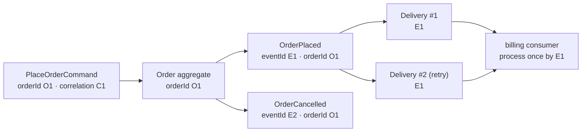
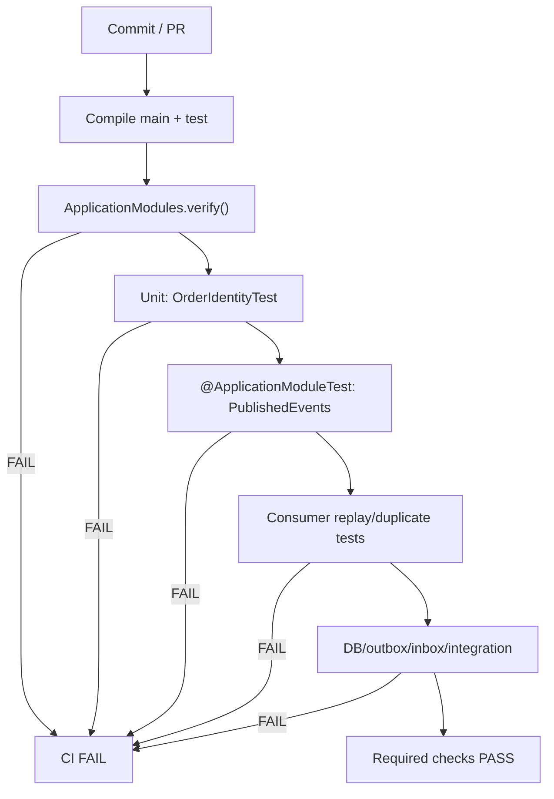

# Định danh ổn định cho event và entity

> **Chương:** Test data  
> **Module học:** `SPRING_MODULITH_VERIFICATION_TESTING` — kiểm chứng ranh giới kiến trúc Spring Modulith bằng `ApplicationModules` và quy tắc phụ thuộc module; thực hành `@ApplicationModuleTest`, kiểm thử sự kiện, cơ sở dữ liệu, tích hợp và CI quality gate để tránh phụ thuộc sai, hồi quy.

## 1. Vấn đề: cùng một đơn, nhiều ID — ID nào cần giữ ổn định?

Một đơn hàng `orders` có `orderId = A`. Khi đặt thành công, module phát `OrderPlaced` với `eventId = E1`. Broker gửi sự kiện cho `billing` hai lần vì lần giao đầu chưa được xác nhận. Nếu consumer dựa vào **eventId ổn định** của cùng sự kiện, nó có thể nhận diện lần giao thứ hai là bản lặp và không ghi hai khoản thanh toán.

Nhưng nếu bên gửi tạo `UUID.randomUUID()` **mỗi lần gửi lại** cùng sự kiện, bản giao lại có thể mang `eventId = E2`. Consumer tưởng đó là một sự kiện khác và dễ tạo side effect trùng. Ngược lại, nếu toàn bộ sự kiện của một đơn đều dùng `eventId = orderId`, hệ thống có thể nhầm `OrderPlaced` với `OrderCancelled` — hai sự kiện nghiệp vụ khác nhau, cùng thuộc một entity.

Trong test cũng có sai lầm tương tự:

- Mỗi lần gọi fixture lại sinh `UUID.randomUUID()`, khiến `expectedEventId` không khớp event thực sự và log khó tái hiện.
- Cả suite chia sẻ một UUID cố định cho mọi bản ghi trong cùng database, gây xung đột khóa khi chạy song song.
- Test so sánh hai instance entity bằng toàn bộ field rồi kết luận chúng có cùng identity, trong khi state đã thay đổi.
- Consumer test gửi “duplicate event” nhưng lại tạo eventId mới nên không thực sự kiểm idempotency.
- `@ApplicationModuleTest` chỉ assert “đã phát event”, không đối chiếu `eventId`, `orderId` và correlation giữa input với output.

**Mục tiêu học tập:** xác định rõ **định danh nào phải giống nhau và định danh nào phải khác nhau** giữa các entity, command, event, lần gửi lại và test scenarios.

Sau bài này, bạn có thể:

1. Phân biệt `entity/aggregate ID`, `event ID`, `correlation ID`, `causation ID`, `idempotency key` và transport message ID.
2. Tạo fixture có ID ổn định để assertions và báo cáo CI có thể tái hiện, nhưng không gây collision giữa các test DB.
3. Viết Java/JUnit tests chứng minh ID của entity được giữ nguyên, event có identity riêng và payload của cùng logical event không đổi khi redelivery.
4. Thử consumer chống duplicate delivery; hiểu vì sao dedup in-memory khác với unique constraint và transaction trong production.
5. Dùng `@ApplicationModuleTest` và `PublishedEvents` kiểm event ID, entity ID và correlation đúng hợp đồng module.
6. Đưa kiểm thử định danh vào unit, event, DB/integration và architectural quality gates mà không truy cập package `internal` của module khác.

## 2. Bản đồ các loại định danh

Các loại ID thường xuất hiện đồng thời trong hệ thống event-driven:

| Định danh | Đối tượng sở hữu | Khi nào giữ nguyên? | Khi nào cần ID mới? |
| --- | --- | --- | --- |
| **Entity/aggregate ID** (`orderId`) | Aggregate `Order` của `orders` | Xuyên suốt vòng đời của **cùng một đơn** | Khi tạo một đơn hàng **khác** |
| **Domain event ID** (`eventId`) | Một **logical event occurrence**, ví dụ `OrderPlaced` | Khi lưu, phát lại, giao lại **chính cùng sự kiện** | Khi phát sinh **sự kiện nghiệp vụ mới** |
| **Correlation ID** (`correlationId`) | Một luồng/request/business workflow được theo dõi | Có thể giống nhau trong nhiều message của cùng luồng | Khi bắt đầu luồng mới theo quy ước trace |
| **Causation ID** (`causationId`) | Liên kết sự kiện/hành động trực tiếp gây ra message hiện tại | Giữ dấu vết nguyên nhân của một event | Khi một event mới có nguyên nhân khác |
| **Idempotency key** | Lệnh nghiệp vụ được caller yêu cầu thực hiện tối đa một lần về hiệu ứng | Khi **retry cùng một command** theo hợp đồng | Khi caller thật sự yêu cầu hành động mới |
| **Transport message ID** | Broker hoặc tầng vận chuyển | Tùy broker; có thể không ổn định qua publish lại | Có thể khác với mỗi envelope/delivery |
| **Publication/registry ID** | Hạ tầng theo dõi việc phát sự kiện, nếu có | Theo hợp đồng của registry | Không nên tự đồng nhất với `eventId` nghiệp vụ |

**Không coi các ID này tương đương chỉ vì cùng kiểu `UUID`.** Hai giá trị có thể tình cờ giống nhau trong một fixture nhưng mang ý nghĩa khác hẳn.

### 2.1. Một timeline minh họa

```text
Client command:
  orderId = O1, correlationId = C1, idempotencyKey = K1

orders tạo đơn:
  Entity Order(id = O1)

orders phát OrderPlaced:
  eventId = E1, orderId = O1, correlationId = C1

Broker giao OrderPlaced lần 1:
  eventId = E1, orderId = O1

Broker giao lại đúng event:
  eventId = E1, orderId = O1       <- không tạo E2

orders xử lý yêu cầu hủy trong một workflow:
  OrderCancelled(eventId = E2, orderId = O1, correlationId = C2)

Một đơn mới:
  Order(id = O2)                   <- khác O1
```

`E1` và `E2` khác nhau vì chúng đại diện **hai sự kiện**. `O1` được giữ nguyên vì cả hai sự kiện đều nói về **cùng một đơn**. `C1` và `C2` có thể giống hoặc khác nhau tùy cách định nghĩa workflow; không sử dụng correlation ID làm khóa duy nhất của event.



## 3. Ổn định trong test khác với duy nhất trong production

Cần phân biệt hai mục tiêu:

- **Determinism của test:** cùng scenario, cùng input, cùng generator giả lập → cùng ID dự kiến, để test dễ đọc và lỗi có thể tái hiện.
- **Uniqueness của production:** hai entity/event mới không bị cấp trùng ID trong phạm vi nghiệp vụ, database hoặc messaging contract.

Một bộ UUID hằng trong **unit test độc lập** thường phù hợp:

```java
static final UUID ORDER_ID = UUID.fromString(
        "11111111-1111-1111-1111-111111111111");
static final UUID EVENT_ID = UUID.fromString(
        "22222222-2222-2222-2222-222222222222");
static final UUID CORRELATION_ID = UUID.fromString(
        "33333333-3333-3333-3333-333333333333");
```

Nhưng không dùng `EVENT_ID` đó cho **mọi logical event** được ghi vào cùng bảng dedup/outbox; khi đó các sự kiện thật khác nhau sẽ bị coi là trùng.

### 3.1. Chọn ID theo loại test

| Loại test | Chiến lược ID nên cân nhắc | Lý do |
| --- | --- | --- |
| Unit test thuần | UUID hằng có tên ý nghĩa | Assertions rõ, không có xung đột DB |
| Unit test nhiều sự kiện | Một UUID **riêng cho mỗi logical event** | Chứng minh phân biệt event occurrences |
| `@ApplicationModuleTest` một event | Generator giả lập trả `EVENT_ID` cố định | Kiểm event do service thật phát có ID mong đợi |
| Consumer duplicate test | **Cùng eventId và cùng payload** cho hai lần giao | Thực sự kiểm replay/dedup |
| Consumer nhiều event hợp lệ | ID khác cho mỗi event, có thể cùng correlation | Không nhầm cùng workflow với cùng event |
| DB integration test chạy song song | ID dành riêng từng test, hoặc schema/container tách biệt | Tránh va chạm khóa chính/cleanup |
| Event publication registry/outbox test | ID và trạng thái publication theo contract thực | Kiểm transaction/retry, không tự áp đặt ID framework |
| Property-based test | Generator/seed có thể tái hiện hoặc lưu input lỗi | Điều tra được một counterexample |

**Một ID cố định không sai.** Sai là dùng nó ở **phạm vi quá rộng** hoặc cho đối tượng mà nó không đại diện.

### 3.2. Định danh có nghĩa không đồng nghĩa business key

`orderId` là identity của entity; `sku` là mã sản phẩm, `customerId` là identity của khách hàng, `requestId` có thể là ID của một attempt. Dùng `sku` làm khóa dedup event là sai vì nhiều đơn có thể mua cùng SKU.

Đối với aggregate, hai lần đọc cùng đơn có thể trả object Java khác địa chỉ bộ nhớ hoặc khác một số field theo version. Chúng vẫn nói về cùng entity khi có cùng `orderId`. Ngược lại, hai đơn có cùng SKU và quantity không phải cùng một entity nếu `orderId` khác nhau.

## 4. Thiết kế API/event mẫu với identity rõ ràng

Giả sử Spring Boot app ở package `com.example.shop`, gồm:

```text
src/main/java/com/example/shop/
├── ShopApplication.java
├── orders/
│   ├── Order.java
│   ├── PlaceOrderCommand.java
│   ├── OrderPlaced.java
│   ├── OrderPlacementService.java
│   ├── OrderStore.java
│   ├── EventIdGenerator.java
│   └── OrdersRuntimeConfiguration.java
├── inventory/
│   ├── StockQuery.java
│   └── internal/StockJpaRepository.java
└── billing/
    └── BillingOrderConsumer.java

src/test/java/com/example/shop/
├── ModuleArchitectureTest.java
├── orders/
│   ├── OrderIdentityFixtures.java
│   ├── OrderIdentityTest.java
│   └── OrderModuleEventIdentityTest.java
└── billing/BillingOrderConsumerTest.java
```

Theo quy ước thông thường của Spring Modulith, `orders`, `inventory` và `billing` là các application module từ các package con trực tiếp của ứng dụng. `inventory.StockQuery` và `orders.OrderPlaced` là API module được công bố nếu chính sách dependency cho phép; không đi qua `inventory.internal` chỉ để setup dữ liệu test.

### 4.1. Command mang identity của đơn và correlation

`src/main/java/com/example/shop/orders/PlaceOrderCommand.java`:

```java
package com.example.shop.orders;

import java.util.UUID;

public record PlaceOrderCommand(
        UUID orderId,
        UUID correlationId,
        String sku,
        int quantity
) {}
```

`orderId` ở đây được caller gán theo hợp đồng minh họa; ở project khác, server có thể cấp ID sau khi nhận command. `correlationId` dùng để theo dõi một luồng, **chưa phải idempotency key**. Ví dụ record chưa tự validate để application service kiểm input trước mọi side effect.

### 4.2. Entity/aggregate giữ identity riêng

`src/main/java/com/example/shop/orders/Order.java`:

```java
package com.example.shop.orders;

import java.util.Objects;
import java.util.UUID;

public record Order(UUID id, String sku, int quantity) {

    public Order {
        Objects.requireNonNull(id, "order id");
        if (sku == null || sku.isBlank()) {
            throw new IllegalArgumentException("sku is required");
        }
        if (quantity <= 0) {
            throw new IllegalArgumentException("quantity must be positive");
        }
    }
}
```

Để giữ ví dụ ngắn, `Order` ở đây là một **immutable domain snapshot**. Trong ứng dụng thật, aggregate có thể là class mutable, chứa state machine, aggregate version, repository/JPA mapping và business methods. Định danh nghiệp vụ vẫn là `id`; không nên suy rằng `record.equals(...)` (so toàn bộ components) chính là định nghĩa identity của một entity khi state thay đổi.

### 4.3. Event có ID riêng và tham chiếu orderId

`src/main/java/com/example/shop/orders/OrderPlaced.java`:

```java
package com.example.shop.orders;

import java.time.Instant;
import java.util.Objects;
import java.util.UUID;

public record OrderPlaced(
        UUID eventId,
        UUID orderId,
        UUID correlationId,
        String sku,
        int quantity,
        Instant occurredAt
) {
    public OrderPlaced {
        Objects.requireNonNull(eventId, "event id");
        Objects.requireNonNull(orderId, "order id");
        Objects.requireNonNull(correlationId, "correlation id");
        Objects.requireNonNull(occurredAt, "occurredAt");
        if (sku == null || sku.isBlank() || quantity <= 0) {
            throw new IllegalArgumentException("Invalid OrderPlaced");
        }
    }
}
```

Ý nghĩa các trường:

- `eventId` nhận diện **một lần phát sinh sự kiện nghiệp vụ**, không phải đơn hàng.
- `orderId` xác định aggregate có trạng thái liên quan đến event.
- `correlationId` giúp liên kết những hoạt động thuộc cùng workflow/tracing.
- `occurredAt` biểu diễn thời điểm nghiệp vụ/hành động tạo sự kiện. Khi redelivery, **không tự thay timestamp** vì đó vẫn là cùng logical event.

Đoạn event immutable giúp hạn chế thay payload sau khi publish, nhưng nó không tự xử lý transaction, retry hoặc schema evolution.

### 4.4. Giao thức module ngoài thông qua API

`src/main/java/com/example/shop/inventory/StockQuery.java`:

```java
package com.example.shop.inventory;

public interface StockQuery {
    boolean available(String sku, int quantity);
}
```

`orders` chỉ cần hỏi “còn hàng không?”; identity của bản ghi tồn kho, table/JPA implementation trong `inventory.internal` không cần xuất hiện ở command hoặc event `OrderPlaced`.

## 5. Tách trách nhiệm cấp event ID khỏi service

Một lỗi thường gặp là tạo UUID trực tiếp ở nhiều nơi, khiến unit test phải dự đoán random value hoặc mock static call. Cách thiết kế dễ kiểm thử hơn là **inject generator**.

`src/main/java/com/example/shop/orders/EventIdGenerator.java`:

```java
package com.example.shop.orders;

import java.util.UUID;

@FunctionalInterface
interface EventIdGenerator {
    UUID nextEventId();
}
```

Port lưu đơn do `orders` sở hữu:

```java
package com.example.shop.orders;

interface OrderStore {
    void save(Order order);
}
```

Application service:

```java
package com.example.shop.orders;

import java.time.Clock;
import java.time.Instant;
import java.util.Objects;
import org.springframework.context.ApplicationEventPublisher;
import org.springframework.stereotype.Service;
import com.example.shop.inventory.StockQuery;

@Service
public class OrderPlacementService {

    private final StockQuery stock;
    private final OrderStore store;
    private final EventIdGenerator eventIds;
    private final Clock clock;
    private final ApplicationEventPublisher publisher;

    public OrderPlacementService(StockQuery stock, OrderStore store,
                                 EventIdGenerator eventIds, Clock clock,
                                 ApplicationEventPublisher publisher) {
        this.stock = stock;
        this.store = store;
        this.eventIds = eventIds;
        this.clock = clock;
        this.publisher = publisher;
    }

    public OrderPlaced place(PlaceOrderCommand command) {
        Objects.requireNonNull(command, "command");
        Objects.requireNonNull(command.correlationId(), "correlationId");

        // Constructor kiểm orderId, sku và quantity trước external call.
        Order order = new Order(
                command.orderId(), command.sku(), command.quantity());

        if (!stock.available(order.sku(), order.quantity())) {
            throw new IllegalStateException("Out of stock");
        }

        store.save(order);

        OrderPlaced event = new OrderPlaced(
                eventIds.nextEventId(),
                order.id(),
                command.correlationId(),
                order.sku(),
                order.quantity(),
                Instant.now(clock)
        );
        publisher.publishEvent(event);
        return event;
    }
}
```

Service này minh họa **identity và đường đi của event**, không phải một production implementation hoàn chỉnh. Việc lưu thành công nhưng publish thất bại có thể gây mất event; transaction/outbox/event publication registry cần được thiết kế nếu hệ thống yêu cầu đảm bảo giao sự kiện. Cũng **chưa có idempotency khi caller gửi cùng command hai lần**: nếu cần, phải xây cơ chế chống trùng command và giữ/reuse logical event đã tạo.

### 5.1. Production generator và clock

Ví dụ cấu hình ở module `orders`:

```java
package com.example.shop.orders;

import java.time.Clock;
import java.util.UUID;
import org.springframework.context.annotation.Bean;
import org.springframework.context.annotation.Configuration;

@Configuration(proxyBeanMethods = false)
class OrdersRuntimeConfiguration {

    @Bean
    EventIdGenerator eventIdGenerator() {
        return UUID::randomUUID;
    }

    @Bean
    Clock orderClock() {
        return Clock.systemUTC();
    }
}
```

Trong production, mỗi **logical event mới** gọi generator để nhận ID mới. Nhưng khi một event đã được tạo và lưu/publish, **retry phải dùng lại sự kiện cùng `eventId`**, không gọi generator để thay ID của nó. UUID random là một chiến lược thông dụng, không bảo đảm tuyệt đối về mặt toán học hay giải quyết idempotency nghiệp vụ; uniqueness cần ràng buộc ở nơi lưu trữ tương ứng.

## 6. Test fixture: ID cố định có tên, không ghép sai semantics

`src/test/java/com/example/shop/orders/OrderIdentityFixtures.java`:

```java
package com.example.shop.orders;

import java.time.Instant;
import java.util.UUID;

final class OrderIdentityFixtures {

    static final UUID ORDER_ID = UUID.fromString(
            "11111111-1111-1111-1111-111111111111");
    static final UUID EVENT_ID = UUID.fromString(
            "22222222-2222-2222-2222-222222222222");
    static final UUID CORRELATION_ID = UUID.fromString(
            "33333333-3333-3333-3333-333333333333");
    static final Instant OCCURRED_AT =
            Instant.parse("2026-01-01T09:00:00Z");

    private OrderIdentityFixtures() {}

    static PlaceOrderCommand command() {
        return new PlaceOrderCommand(
                ORDER_ID, CORRELATION_ID, "SKU-001", 2);
    }

    static OrderPlaced placedEvent() {
        return new OrderPlaced(
                EVENT_ID, ORDER_ID, CORRELATION_ID,
                "SKU-001", 2, OCCURRED_AT);
    }
}
```

Đặc điểm của fixture:

1. Tên constants làm rõ **loại ID**, không chỉ ghi `ID1`/`ID2`.
2. `ORDER_ID`, `EVENT_ID`, `CORRELATION_ID` khác nhau để một assert sai field bị phát hiện.
3. Fixture mang một payload event nhất quán với command và thời gian đã chọn.
4. Mỗi lần gọi `placedEvent()` tạo object mới nhưng biểu diễn **cùng logical event** — điều này thích hợp cho test redelivery.
5. Các constants này phù hợp với test thuần hoặc test một event. Không sử dụng `EVENT_ID` cho tất cả sự kiện riêng biệt trong cùng database.

### 6.1. Có nên tạo UUID deterministic từ tên scenario?

Khi có nhiều ca test nhưng vẫn muốn dữ liệu dễ tái hiện:

```java
import java.nio.charset.StandardCharsets;
import java.util.UUID;

static UUID stableIdFor(String scenarioKey) {
    return UUID.nameUUIDFromBytes(
            scenarioKey.getBytes(StandardCharsets.UTF_8)
    );
}
```

Ví dụ `stableIdFor("ORD-PLACED-001:event")` khác `stableIdFor("ORD-PLACED-002:event")` nếu keys khác và không bị collision. Đây là cách tạo **fixture IDs deterministic**, không mặc định là chiến lược identity production. Team phải bảo đảm namespace/scenario keys là duy nhất trong phạm vi test; hàm này không xử lý việc một logical event thực sự được tạo lại khi retry.

Nếu test dùng random IDs, hãy lưu chúng trong biến và log khi lỗi:

```java
UUID orderId = UUID.randomUUID();
UUID eventId = UUID.randomUUID();
// Dùng cùng các biến này xuyên suốt Given, When, Then.
```

Không gọi `UUID.randomUUID()` lần thứ hai trong phần `Then` để so sánh với ID đã tạo ở `When`.

## 7. JUnit unit test: chứng minh ba loại ID không bị đánh tráo

`src/test/java/com/example/shop/orders/OrderIdentityTest.java`:

```java
package com.example.shop.orders;

import static org.junit.jupiter.api.Assertions.*;

import java.time.Clock;
import java.time.ZoneOffset;
import java.util.ArrayList;
import java.util.List;
import java.util.concurrent.atomic.AtomicReference;
import org.junit.jupiter.api.Test;
import org.springframework.context.ApplicationEventPublisher;
import com.example.shop.inventory.StockQuery;

class OrderIdentityTest {

    @Test
    void keepsEntityIdentityAndAssignsSeparateEventIdentity() {
        AtomicReference<Order> persisted = new AtomicReference<>();
        OrderStore store = persisted::set;
        List<Object> emitted = new ArrayList<>();
        ApplicationEventPublisher publisher = emitted::add;
        StockQuery available = (sku, quantity) -> true;
        EventIdGenerator eventIds = () -> OrderIdentityFixtures.EVENT_ID;

        Clock fixedClock = Clock.fixed(
                OrderIdentityFixtures.OCCURRED_AT, ZoneOffset.UTC);
        OrderPlacementService service = new OrderPlacementService(
                available, store, eventIds, fixedClock, publisher);

        PlaceOrderCommand command = OrderIdentityFixtures.command();
        OrderPlaced event = service.place(command);

        assertNotNull(persisted.get());
        assertEquals(command.orderId(), persisted.get().id());
        assertEquals(command.orderId(), event.orderId());
        assertEquals(OrderIdentityFixtures.EVENT_ID, event.eventId());
        assertEquals(command.correlationId(), event.correlationId());
        assertEquals(OrderIdentityFixtures.OCCURRED_AT, event.occurredAt());
        assertNotEquals(event.orderId(), event.eventId());
        assertNotEquals(event.eventId(), event.correlationId());

        assertEquals(1, emitted.size());
        assertSame(event, emitted.get(0));
    }
}
```

Test xác minh:

- `orderId` của entity được lưu bằng `orderId` từ command.
- `OrderPlaced.orderId` tham chiếu entity đó, **không** bị dùng nhầm `eventId`.
- `eventId` do generator cấp, khác orderId và correlationId.
- `occurredAt` lấy từ `Clock.fixed`; không phụ thuộc tốc độ máy local/CI.
- Object mà service trả về chính là event đã publish trong ví dụ đơn giản này.

**Không test điều ngẫu nhiên như `assertNotEquals(UUID.randomUUID(), event.eventId())`.** Nó không chứng minh generator tuân theo contract và khiến test khó giải thích.

### 7.1. Kiểm việc tạo event mới cấp ID mới

Một generator test có thể trả chuỗi ID dự kiến:

```java
UUID firstId = UUID.fromString(
        "aaaaaaaa-aaaa-aaaa-aaaa-aaaaaaaaaaaa");
UUID secondId = UUID.fromString(
        "bbbbbbbb-bbbb-bbbb-bbbb-bbbbbbbbbbbb");

var ids = new java.util.ArrayDeque<>(List.of(firstId, secondId));
EventIdGenerator eventIds = ids::removeFirst;
```

Khi có **hai hành động nghiệp vụ mới hợp lệ** và hai entity khác nhau, test có thể assert event thứ nhất nhận `firstId`, event thứ hai nhận `secondId`; cả hai có thể chia sẻ một correlationId nếu thuộc cùng workflow. Không dùng test này để suy rằng gọi lại cùng command phải phát event mới — **retry command** là một yêu cầu idempotency riêng.

### 7.2. Event ID không đổi trong redelivery

Một test đơn giản về semantics:

```java
@Test
void replayOfTheSameLogicalEventKeepsItsIdentity() {
    OrderPlaced firstDelivery = OrderIdentityFixtures.placedEvent();
    OrderPlaced secondDelivery = OrderIdentityFixtures.placedEvent();

    assertNotSame(firstDelivery, secondDelivery);
    assertEquals(firstDelivery, secondDelivery);
    assertEquals(firstDelivery.eventId(), secondDelivery.eventId());
    assertEquals(firstDelivery.occurredAt(), secondDelivery.occurredAt());
}
```

Đoạn trên là **một phương thức bổ sung trong `OrderIdentityTest`**, dùng cùng imports JUnit. Nó chỉ chứng minh fixture biểu diễn hai bản giao của cùng event. Nó **chưa chứng minh consumer chống side effect trùng** — cần test ở mục tiếp theo.

## 8. Consumer dedup: ID ổn định phải đi cùng một hiệu ứng ổn định

Giả sử `billing` phản ứng với `orders.OrderPlaced`. Vì `OrderPlaced` là kiểu công bố trong package gốc của `orders`, module `billing` có thể dùng qua hợp đồng nếu policy cho phép.

**Yêu cầu:** cùng một event được giao lại có thể được xử lý nhiều lần về mặt nhận message, nhưng **side effect nghiệp vụ không được ghi lặp**.

### 8.1. Một port mô tả hiệu ứng idempotent

Code production tối giản của `billing`:

```java
package com.example.shop.billing;

import com.example.shop.orders.OrderPlaced;

interface BillingEffects {
    void applyOnce(OrderPlaced event);
}

final class BillingOrderConsumer {

    private final BillingEffects effects;

    BillingOrderConsumer(BillingEffects effects) {
        this.effects = effects;
    }

    void on(OrderPlaced event) {
        effects.applyOnce(event);
    }
}
```

`BillingEffects` là một **hợp đồng**: implementation production phải thực hiện dedup và side effect an toàn. Đoạn trên là consumer thuần Java, **chưa phải** listener Spring được đăng ký bằng `@ApplicationModuleListener` hay broker; phần wiring và transaction tùy thiết kế thực tế.

### 8.2. Fake in-memory đủ kiểm semantics trong unit test

`src/test/java/com/example/shop/billing/BillingOrderConsumerTest.java`:

```java
package com.example.shop.billing;

import static org.junit.jupiter.api.Assertions.*;

import java.time.Instant;
import java.util.ArrayList;
import java.util.HashMap;
import java.util.List;
import java.util.Map;
import java.util.UUID;
import org.junit.jupiter.api.Test;
import com.example.shop.orders.OrderPlaced;

class BillingOrderConsumerTest {

    private static final UUID ORDER_ID = UUID.fromString(
            "11111111-1111-1111-1111-111111111111");
    private static final UUID EVENT_ID = UUID.fromString(
            "22222222-2222-2222-2222-222222222222");
    private static final UUID CORRELATION_ID = UUID.fromString(
            "33333333-3333-3333-3333-333333333333");

    private static OrderPlaced placedEvent() {
        return new OrderPlaced(
                EVENT_ID, ORDER_ID, CORRELATION_ID,
                "SKU-001", 2,
                Instant.parse("2026-01-01T09:00:00Z")
        );
    }

    private static final class RecordingEffects
            implements BillingEffects {

        private final Map<UUID, OrderPlaced> seen = new HashMap<>();
        private final List<UUID> billedOrders = new ArrayList<>();

        @Override
        public void applyOnce(OrderPlaced event) {
            OrderPlaced previous =
                    seen.putIfAbsent(event.eventId(), event);

            if (previous == null) {
                billedOrders.add(event.orderId());
            } else if (!previous.equals(event)) {
                throw new IllegalArgumentException(
                        "Same eventId with conflicting payload");
            }
        }
    }

    @Test
    void duplicateDeliveryDoesNotDuplicateBilling() {
        RecordingEffects effects = new RecordingEffects();
        BillingOrderConsumer consumer = new BillingOrderConsumer(effects);

        consumer.on(placedEvent());
        consumer.on(placedEvent());

        assertEquals(1, effects.billedOrders.size());
        assertEquals(List.of(ORDER_ID), effects.billedOrders);
        assertEquals(1, effects.seen.size());
    }

    @Test
    void sameEventIdWithChangedPayloadIsRejected() {
        RecordingEffects effects = new RecordingEffects();
        BillingOrderConsumer consumer = new BillingOrderConsumer(effects);
        consumer.on(placedEvent());

        OrderPlaced conflicting = new OrderPlaced(
                EVENT_ID, ORDER_ID, CORRELATION_ID,
                "SKU-001", 99,
                Instant.parse("2026-01-01T09:00:00Z"));

        assertThrows(IllegalArgumentException.class,
                () -> consumer.on(conflicting));
        assertEquals(1, effects.billedOrders.size());
    }
}
```

Test thứ nhất dùng **hai object mang cùng eventId và cùng payload**; đây mới là duplicate delivery. Test thứ hai phát hiện sự cố **cùng ID nhưng payload thay đổi**, một tình huống nguy hiểm nếu retry tự tạo event mới hoặc đường serialization/migration không giữ được hợp đồng.

**Giới hạn quan trọng:** `RecordingEffects` chỉ dùng `HashMap` và `ArrayList`, không thread-safe, không chống race giữa nhiều instance và không giải quyết crash recovery. Nó chỉ minh họa **ý nghĩa identity trong test**. Không lấy fake này làm giải pháp exactly-once production.

### 8.3. Đừng dùng orderId thay eventId để dedup mọi event

Một đơn có thể phát nhiều event hợp lệ: `OrderPlaced(E1, O1)`, `OrderCancelled(E2, O1)`. Dedup theo `orderId` sẽ có nguy cơ chặn nhầm `OrderCancelled`. Ngược lại, nếu có **hai `OrderPlaced` khác `eventId` nhưng cùng `orderId`**, consumer event-level dedup sẽ xem là **hai sự kiện khác nhau**. Quy tắc “mỗi đơn chỉ đặt một lần” phải được bảo vệ bằng **business/idempotency constraint**, không chỉ bằng event dedup.

## 9. Production dedup cần database và transaction

Trong hệ thống có nhiều consumer instances hoặc broker giao lại message, một `Set<UUID>` trong bộ nhớ không đủ. Một phương án thường gặp là dùng bảng `processed_events` có unique key theo **consumer name + event ID**.

Ví dụ PostgreSQL:

```sql
CREATE TABLE processed_events (
    consumer_name VARCHAR(100) NOT NULL,
    event_id UUID NOT NULL,
    payload_digest VARCHAR(64) NOT NULL,
    processed_at TIMESTAMPTZ NOT NULL,
    PRIMARY KEY (consumer_name, event_id)
);
```

Nếu nhiều consumer khác nhau dùng cùng event, `consumer_name` giúp mỗi consumer có tập receipt riêng. `payload_digest` là một tùy chọn để kiểm tra retry với cùng eventId nhưng nội dung khác. Dự án cần định nghĩa thuật toán canonicalization/hash và contract versioning rõ ràng; không tự so hash của dữ liệu serialization không ổn định rồi coi là chuẩn.

### 9.1. Atomic operation, không phải hai thao tác rời

Quy trình khái niệm:

```text
BEGIN TRANSACTION
  1. Thử ghi receipt (consumer, eventId) với unique constraint.
  2. Nếu receipt mới:
       thực hiện business side effect của event.
     Nếu receipt đã tồn tại:
       đối chiếu payload theo policy, không ghi side effect lần nữa.
COMMIT

Nếu side effect thất bại:
  ROLLBACK receipt cùng side effect trong một transaction.
```

Đây là **pseudocode giao dịch**, không phải đoạn SQL thực thi trực tiếp. Cách xử lý unique conflict và trạng thái transaction phụ thuộc driver/database/ORM. Quan trọng là receipt và side effect **phải cùng ranh giới atomicity thích hợp**. Nếu đánh dấu đã xử lý rồi commit trước khi thực hiện side effect, một crash ở giữa có thể khiến message bị bỏ vĩnh viễn.

Ví dụ thao tác insert có điều kiện trên PostgreSQL:

```sql
INSERT INTO processed_events (
    consumer_name, event_id, payload_digest, processed_at
) VALUES (
    'billing', :event_id, :payload_digest, :processed_at
)
ON CONFLICT (consumer_name, event_id) DO NOTHING;
```

Ứng dụng phải kiểm số row được insert, xem trường hợp `0` là duplicate, và thực hiện side effect trong **cùng transaction**. Không gọi logic thanh toán hai lần chỉ vì có hai message envelopes. Với side effect bên ngoài DB (ví dụ gọi payment gateway), cần hợp đồng idempotency của hệ thống ngoài, outbox/inbox hoặc một workflow đáng tin; transaction DB đơn lẻ không làm một HTTP call trở nên atomic.

### 9.2. Không đồng nhất “được giao ít nhất một lần” với “hiệu ứng đúng một lần”

Broker có thể giao một message nhiều lần trong mô hình at-least-once. Mục tiêu thực tế thường là **effectively-once business effect** bằng dedup/idempotency, không khẳng định network có exactly-once delivery. Test cần kiểm:

1. Giao cùng event hai lần vẫn chỉ áp dụng một side effect.
2. Một sự kiện khác có eventId khác vẫn được xử lý.
3. Trường hợp xử lý lỗi được retry và không bị đánh dấu hoàn tất sai thời điểm.
4. Hai consumer cạnh tranh cùng event không vượt unique/transaction boundary.
5. Payload cùng eventId bị thay đổi được xử lý theo chính sách rõ, không bị nuốt im lặng.

## 10. Idempotency của command là một bài toán khác

`correlationId` thường giúp trace nhiều hoạt động. Nó **không tự làm lệnh idempotent**. Nếu API cần chống client retry đặt hàng hai lần, hãy định nghĩa `idempotencyKey` tách biệt.

Ví dụ conceptual request:

```text
POST /orders
Idempotency-Key: K1
Correlation-ID: C1
Body: { orderId: O1, sku: SKU-001, quantity: 2 }

Retry cùng yêu cầu:
Idempotency-Key: K1   <- giữ nguyên
Body: { orderId: O1, sku: SKU-001, quantity: 2 }
```

Điều cần bảo vệ:

- Hai request **cùng key, cùng nội dung** được xử lý như cùng logical command theo policy; không tạo hai Order hoặc hai OrderPlaced mới.
- Nếu **cùng key nhưng payload khác**, phải có chính sách từ chối xung đột hoặc xác nhận hợp lệ, không lặng lẽ coi như request cũ.
- Nếu caller gửi yêu cầu nghiệp vụ **mới**, cần key mới, kể cả có chung correlation/workflow.
- Sau crash/retry, phải có trạng thái bền vững để trả lại hoặc khôi phục kết quả cũ. Một local `HashMap` không đủ.

Service `OrderPlacementService` ở mục 5 **không có lớp idempotency**: gọi `place(command)` hai lần không mặc định an toàn. Để test idempotency command, bổ sung một port/service/DB unique key và test double/repository thật theo business contract. Không nên sửa fixture để hai lần gọi tình cờ tạo cùng `eventId` rồi coi như đã giải quyết.

| Tình huống lặp | Khóa phù hợp để nhận diện | Phép kiểm chính |
| --- | --- | --- |
| Retry cùng HTTP command | `idempotencyKey` (và payload fingerprint theo policy) | Không tạo business effect hai lần |
| Broker giao lại cùng logical event | `eventId` + consumer scope | Consumer side effect không nhân đôi |
| Hai event khác cùng một đơn | **Hai event IDs riêng** cùng `orderId` | Không bị gộp sai thành một event |
| Nhiều event trong cùng workflow | `correlationId` có thể chung | Theo dõi luồng, không dùng để dedup |
| Đọc entity sau khi state đổi | `orderId` giữ nguyên | Cùng entity qua các version |

## 11. `@ApplicationModuleTest`: assert ID trên event do service thật publish

Unit test đã kiểm trực tiếp service. Với Spring Modulith, dùng `@ApplicationModuleTest` để xác minh Spring context, dependency wiring và event publication trong phạm vi module `orders`.

### 11.1. Test-only beans có generator và clock cố định

`src/test/java/com/example/shop/orders/OrderEventIdentityTestConfig.java`:

```java
package com.example.shop.orders;

import java.time.Clock;
import java.time.ZoneOffset;
import org.springframework.boot.test.context.TestConfiguration;
import org.springframework.context.annotation.Bean;
import org.springframework.context.annotation.Primary;
import com.example.shop.inventory.StockQuery;

@TestConfiguration(proxyBeanMethods = false)
class OrderEventIdentityTestConfig {

    @Bean
    @Primary
    StockQuery availableStock() {
        return (sku, quantity) -> true;
    }

    @Bean
    @Primary
    OrderStore orderStore() {
        return order -> {};
    }

    @Bean
    @Primary
    EventIdGenerator fixedEventIds() {
        return () -> OrderIdentityFixtures.EVENT_ID;
    }

    @Bean
    @Primary
    Clock testClock() {
        return Clock.fixed(
                OrderIdentityFixtures.OCCURRED_AT,
                ZoneOffset.UTC
        );
    }
}
```

Các bean này chỉ dùng trong test scope. Khi dự án có sẵn nhiều beans, mock definitions hoặc cấu hình theo profile, cần chọn cách replace/`@Primary` phù hợp phiên bản Spring Boot và tránh ambiguity. Generator cố định này **chỉ hợp với scenario tạo một event**; test nhiều event cần generator tạo danh sách IDs khác nhau.

### 11.2. Module test sử dụng `PublishedEvents`

`src/test/java/com/example/shop/orders/OrderModuleEventIdentityTest.java`:

```java
package com.example.shop.orders;

import static org.assertj.core.api.Assertions.assertThat;

import org.junit.jupiter.api.Test;
import org.springframework.beans.factory.annotation.Autowired;
import org.springframework.context.annotation.Import;
import org.springframework.modulith.test.ApplicationModuleTest;
import org.springframework.modulith.test.PublishedEvents;

@ApplicationModuleTest
@Import(OrderEventIdentityTestConfig.class)
class OrderModuleEventIdentityTest {

    @Autowired
    OrderPlacementService service;

    @Test
    void publishesEventWithStableBusinessIdentity(PublishedEvents published) {
        PlaceOrderCommand command = OrderIdentityFixtures.command();

        service.place(command);

        assertThat(published.ofType(OrderPlaced.class))
                .anySatisfy(event -> {
                    assertThat(event.eventId())
                            .isEqualTo(OrderIdentityFixtures.EVENT_ID);
                    assertThat(event.orderId())
                            .isEqualTo(command.orderId());
                    assertThat(event.correlationId())
                            .isEqualTo(command.correlationId());
                    assertThat(event.occurredAt())
                            .isEqualTo(OrderIdentityFixtures.OCCURRED_AT);
                });
    }
}
```

`PublishedEvents` là công cụ test của Spring Modulith để quan sát event do application phát ra. `anySatisfy` ở đây chứng minh **tồn tại một event đúng identity/payload**, chưa chứng minh chỉ có duy nhất một event. Nếu business contract yêu cầu **đúng một** event, phải thêm assertion đếm events theo API phù hợp phiên bản thư viện.

**Quan trọng:** tạo `OrderIdentityFixtures.placedEvent()` rồi assert event đó có ID đúng **không chứng minh service đã phát sự kiện**. Test trên gọi `OrderPlacementService.place(...)` trước, sau đó kiểm events được framework thu thập.

### 11.3. Khi listener dùng `@ApplicationModuleListener`

Spring Modulith có `@ApplicationModuleListener` cho việc xử lý sự kiện theo module, thường gắn với xử lý bất đồng bộ và transaction event publication. Điều này làm phát sinh một số khác biệt:

- Test publisher chỉ chứng minh event đã được **phát**, không chứng minh listener đã **commit side effect**.
- Nếu listener xử lý sau commit, test chạy trong transaction chưa commit có thể chưa kích hoạt thời điểm mong đợi.
- Retry publication trong cơ chế tin cậy cần giữ identity nghiệp vụ của cùng logical event, nhưng ID nội bộ của publication registry không mặc nhiên là `eventId` trong payload.
- Test delivery/consumer cần một điều kiện hoàn thành quan sát được với timeout, không dựa vào `Thread.sleep(...)` cố định.

Với tích hợp có database, broker hoặc listener transactional, bổ sung integration tests theo semantics thực tế của Spring Modulith/DB dùng trong project.

## 12. DB identity: JPA-generated và application-assigned không như nhau

Định danh entity có thể được cấp ở nhiều nơi:

| Cách cấp ID | Điểm cần nhớ khi test |
| --- | --- |
| Caller tạo `orderId` trước khi gửi command | Có thể assert đúng ID trước/sau persistence; backend phải enforce uniqueness |
| Service tạo UUID khi tạo entity | Inject generator hoặc lấy ID từ kết quả rồi dùng lại trong assertions |
| JPA `@GeneratedValue` từ DB | ID có thể chỉ có sau persist/flush; không giả định bằng UUID fixture đã chọn |
| Business key như `orderNumber` | Có thể có constraint duy nhất nhưng không nhất thiết là primary/entity ID |
| Composite key | Cần giữ ổn định toàn bộ thành phần identity và kiểm tenant/scope |

Nếu JPA cấp ID, test kiểu này thường sai về ý nghĩa:

```java
// Không nên với ID do DB thực sự sinh ngẫu nhiên/sequence.
assertEquals(FIXED_ORDER_ID, savedEntity.getId());
```

Thay vào đó kiểm `getId()` đã được cấp và dùng **chính ID đó** đọc lại entity, hoặc mock/inject đúng generator nếu contract yêu cầu ID biết trước. Với JPA, chú ý trạng thái managed/detached, flush và transaction; hai instance cùng ID không đồng nghĩa `==` hoặc mọi field đều giống nhau.

### 12.1. Bảng thử unique event ID

Ví dụ schema PostgreSQL minh họa:

```sql
CREATE TABLE orders (
    id UUID PRIMARY KEY,
    sku VARCHAR(64) NOT NULL,
    quantity INTEGER NOT NULL
);

CREATE TABLE order_outbox (
    event_id UUID PRIMARY KEY,
    order_id UUID NOT NULL REFERENCES orders(id),
    event_type VARCHAR(100) NOT NULL,
    payload JSONB NOT NULL,
    occurred_at TIMESTAMPTZ NOT NULL
);
```

`orders.id` và `order_outbox.event_id` là **hai không gian định danh khác nhau**. Một đơn có thể có nhiều sự kiện/outbox rows; không đặt unique constraint đơn thuần trên `order_id` ở bảng outbox nếu nghiệp vụ cho phép nhiều loại event cho cùng order.

Một DB test cần kiểm:

1. Insert event mới `E1` cho order `O1` thành công.
2. Insert lần thứ hai cùng `E1` bị từ chối bởi unique constraint hoặc được xử lý bằng logic upsert/idempotency đúng hợp đồng.
3. Event hợp lệ khác `E2` cho cùng `O1` được chấp nhận nếu business rules cho phép.
4. Đọc lại payload của `E1` thấy cùng `orderId`, event type và thời gian như lúc tạo.
5. Các row của test khác không bị ảnh hưởng bởi cleanup.

Đây là **schema ví dụ**: thiết kế thực tế có thể dùng event publication registry của Spring Modulith, một outbox riêng, event store hoặc broker, với database/migration khác. Không tạo bảng minh họa chỉ để “thay thế” hạ tầng tin cậy đã có trong project.

### 12.2. Test database duplicate với một key có chủ đích

Đối với `processed_events`, dữ liệu tối thiểu để kiểm duplicate là **cùng consumer_name và cùng event_id** được insert hai lần. Để kiểm hai consumer độc lập, dùng **cùng event_id nhưng consumer_name khác nhau**; primary key kép trong ví dụ cho phép mỗi consumer nhận event một lần.

Đừng dùng hai UUID random khác nhau trong negative duplicate test — điều đó không đi vào nhánh unique conflict. Ngược lại, khi test hai event khác nhau, không dùng cùng eventId vì sẽ kích hoạt lỗi ngoài mục tiêu.

### 12.3. Cleanup và chạy song song

Nếu nhiều integration tests chia sẻ DB và đều dùng `EVENT_ID` hằng, chúng có thể FAIL do duplicate dù code production đúng. Giải pháp tùy phạm vi:

- Mỗi test có ID riêng hoặc namespace riêng; lưu ID thật để assertions dùng nhất quán.
- Dùng transaction rollback hoặc cleanup theo đúng các ID đã tạo.
- Dùng schema/container riêng khi cần isolation mạnh.
- Không cho test A phụ thuộc vào bản ghi event/receipt do test B tạo.
- Đừng `DELETE FROM processed_events` toàn bảng khi có test khác đang chạy đồng thời.

Nếu việc test idempotency yêu cầu **cố ý lặp ID**, chỉ lặp trong **cùng scenario đã được cô lập**, không chia sẻ tùy tiện giữa các scenarios.

## 13. Mối quan hệ giữa event ID, timestamp, version và ordering

Định danh và thứ tự là hai khái niệm khác nhau. UUID không mặc định cho biết event nào xảy ra trước:

- `eventId` nhận diện sự kiện.
- `occurredAt` ghi thời điểm được tạo theo đồng hồ nghiệp vụ; hai event có thể có cùng timestamp hoặc clock lệch.
- `aggregateVersion` (nếu dự án dùng) có thể mô tả thứ tự cập nhật **trong phạm vi một aggregate**.
- Sequence/offset của broker có thể mô tả thứ tự ở partition hoặc subscription cụ thể, không thay thế entity identity.

Khi test ordering, hãy dùng dữ liệu có **thứ tự rõ** và assertion tương ứng, ví dụ cùng orderId `O1` nhưng version 3 và 4, không chỉ dựa vào UUID lớn/nhỏ hoặc thứ tự phần tử trong `HashMap`.

### 13.1. Test payload không được thay khi retry

Nếu cùng `eventId` được gửi lại nhưng `occurredAt` mới hoặc quantity bị đổi, đó không còn là một bản sao nguyên vẹn của event ban đầu. Một consumer có thể cần phát hiện xung đột payload để điều tra thay vì âm thầm coi là duplicate hợp lệ.

Với sự kiện immutable/serialized, hãy phân biệt:

1. **Redelivery:** cùng logical event, giữ ID và dữ liệu nghiệp vụ.
2. **Schema evolution:** một representation mới của cùng event có thể thêm field optional/version; policy so sánh cần có canonicalization/compatibility rõ.
3. **Correction event:** một sự kiện nghiệp vụ mới sửa kết quả cũ, có **eventId mới** và quan hệ causation/correlation thích hợp.

Đừng phát lại một event bằng cách tạo `new OrderPlaced(UUID.randomUUID(), ..., Instant.now())` nếu mục tiêu là retry sự kiện cũ.

## 14. Những lỗi identity dễ gặp trong test data

| Triệu chứng | Sai ở đâu? | Cách sửa |
| --- | --- | --- |
| Assert dùng `UUID.randomUUID()` mới trong phần Then | Expected ID khác ID đã tạo | Lưu ID vào fixture/biến và dùng lại |
| Mọi OrderPlaced có `eventId = orderId` | Trộn event identity và entity identity | Cấp eventId riêng cho mỗi logical event |
| Retry cùng event lại tạo eventId mới | Consumer không phát hiện duplicate | Lưu/reuse event object hoặc payload/ID gốc |
| Consumer dedup bằng correlationId | Nhiều event cùng workflow bị bỏ nhầm | Dedup theo eventId + consumer scope |
| Consumer dedup bằng orderId cho mọi loại event | Event sau của cùng order bị bỏ | Dùng eventId; business uniqueness quản lý riêng |
| Hai logical events khác nhau dùng chung fixture EVENT_ID trong một DB test | Unique conflict ngoài mục tiêu | Cấp hai IDs riêng, deterministic theo scenario |
| Test duplicate dùng hai IDs random | Không thật sự kiểm redelivery | Dùng cùng ID và cùng payload |
| `assertSame` cho entity sau khi query từ DB | Hai Java instances có thể khác | So `orderId`/business state cần thiết |
| So event timestamp với `Instant.now()` lần hai | Không deterministic | Inject `Clock.fixed` và lưu expected instant |
| Test xử lý event trùng với một `HashSet` rồi gọi đó là exactly once production | Chưa kiểm concurrency/crash/DB | Unique receipt + transaction + integration tests |
| Test JPA tự gán fixed ID khi DB dùng `@GeneratedValue` | Không theo contract persistence | Assert ID được cấp rồi dùng chính ID đó |
| Không xét hai message cùng ID nhưng payload khác | Duplicate suppression che dữ liệu lỗi | Xác định collision/conflicting payload policy |
| SQL cleanup xóa toàn bộ outbox/processed events | Gây ảnh hưởng test khác | Cleanup theo IDs của scenario/isolation |
| Event fixture import entity JPA nội bộ module khác | Coupling và lộ implementation | Dùng hợp đồng event/DTO công bố |

## 15. Tôn trọng kiến trúc Spring Modulith trong thiết kế identity

`orders` sở hữu `Order`, `OrderPlaced` và quy tắc gán `orderId`/`eventId` của mình. `billing` có thể nhận `OrderPlaced` qua public API của `orders`, nhưng **không cần** truy cập `orders.internal.OrderJpaRepository` để xác nhận một sự kiện đã được xử lý.

Structural test:

```java
package com.example.shop;

import org.junit.jupiter.api.Test;
import org.springframework.modulith.core.ApplicationModules;

class ModuleArchitectureTest {

    @Test
    void verifiesModuleBoundaries() {
        ApplicationModules.of(ShopApplication.class).verify();
    }
}
```

Kiểm chứng này khác hoàn toàn với test ID:

- `ApplicationModules.verify()` kiểm **quan hệ dependency/module API** ở mức tĩnh, không cần seed `Order` hay event payload.
- `OrderIdentityTest` kiểm **identity semantics** của service và test fixtures.
- `@ApplicationModuleTest` kiểm Spring wiring và việc **publish event** qua module.
- Consumer test kiểm **duplicate delivery → không duplicate side effect**.
- Database/integration tests kiểm uniqueness, transaction, outbox/inbox và concurrency thực.

Không mở rộng `@NamedInterface` cho cả package JPA nội bộ hoặc thay `@ApplicationModule(allowedDependencies = ...)` chỉ để test truy cập repository dễ hơn. Nếu cần chung data fixtures giữa build subprojects, tổ chức chúng ở **test source set/test-scoped artifact**, không biến chúng thành API production.

### 15.1. Một negative architectural probe

Trên branch thử nghiệm, tạo kiểu `public` ở `orders.internal` và để production code của `billing` import trực tiếp. Với default module API policy, Java có thể compile nhưng `ApplicationModules.verify()` phải FAIL nếu các module đều được phát hiện đúng.

Sửa lại qua event contract `orders.OrderPlaced` hoặc một public API nhỏ đã được review. **Không merge mã vi phạm**. Phép thử này chứng minh architectural gate hoạt động, còn test duplicate delivery chứng minh identity/runtimes behavior hoạt động — hai mục tiêu khác nhau.

## 16. CI: identity tests là behavioral gate bên cạnh structural gate

Một pipeline đáng tin không chỉ chạy `verify()`, mà phải thực thi những test về ID và khả năng redelivery:



Với dự án **Maven Wrapper**:

```bash
# Kiểm riêng architectural test.
./mvnw -B -Dtest=ModuleArchitectureTest test

# Chạy JUnit suite trong vòng đời dự án.
./mvnw -B verify
```

Với dự án **Gradle Wrapper** có `useJUnitPlatform()`:

```bash
./gradlew test --tests 'com.example.shop.ModuleArchitectureTest'
./gradlew check
```

`mvn verify` chỉ chạy integration tests `*IT` nếu Maven Failsafe/lifecycle tương ứng đã được cấu hình; Gradle `check` cần được nối với custom `integrationTest` task nếu có. Chọn đúng project chứa tests trong dự án nhiều Maven/Gradle build modules.

### 16.1. Khi test fail, báo cáo phải giúp tái hiện identity

Giữ JUnit XML/HTML reports và log có kiểm soát. Với mỗi failure nên ghi:

- Tên scenario, test class, commit/version và JDK/build tool.
- `orderId`, `eventId`, `correlationId` **của fixture test**, khi không chứa thông tin nhạy cảm.
- Sự kiện nào là **logical event mới** và message nào là **duplicate delivery**.
- Expected vs actual payload/IDs, số side effects.
- Database constraint, transaction hoặc retry policy liên quan.
- Lệnh tái hiện và kết quả sau sửa.

Không cần log toàn bộ payload chứa thông tin khách hàng, secrets hoặc event cá nhân thật. Test IDs giả có tên ý nghĩa và report theo scenario giúp chẩn đoán mà không làm lộ dữ liệu nhạy cảm.

### 16.2. Kiểm hai loại “âm tính” không giống nhau

| Phép thử | Khi thiết kế đúng, JUnit ra sao? |
| --- | --- |
| Giao cùng event hai lần, assert billing chỉ ghi một lần | **PASS** |
| Cùng eventId nhưng payload khác, assert consumer từ chối | **PASS** |
| Hai event khác ID, assert hai side effects hợp lệ | **PASS** nếu business contract yêu cầu |
| Cố ý thêm dependency từ `billing` tới `orders.internal` | **`ModuleArchitectureTest` FAIL**, CI FAIL |
| Consumer bỏ dedup và ghi billing hai lần | **`BillingOrderConsumerTest` FAIL**, CI FAIL |

Đừng nhầm “negative input test PASS khi từ chối đúng” với “cố ý tạo architectural violation để xác nhận gate FAIL”.

## 17. Bài thực hành: thiết kế ID ổn định từ producer đến consumer

**Bối cảnh:** `ShopApplication` có các module `orders`, `inventory`, `billing`; `orders` phát `OrderPlaced` như ví dụ. Dùng Maven hoặc Gradle theo project thật.

### Phần A — Lập ma trận identity

1. Ghi rõ định nghĩa và chủ sở hữu của `orderId`, `eventId`, `correlationId`.
2. Bổ sung `idempotencyKey` cho command nếu API nghiệp vụ yêu cầu chống retry; không dùng correlationId thay thế.
3. Vẽ hai lần delivery của **cùng event**: ID/payload nào giữ nguyên?
4. Vẽ event `OrderCancelled` cho **cùng order**: ID nào phải khác?
5. Ghi một quy tắc rõ: identity của entity không được suy từ eventId, correlationId không dùng làm khóa dedup.

### Phần B — Xây unit fixture deterministic

1. Tạo constants `ORDER_ID`, `EVENT_ID`, `CORRELATION_ID` khác nhau.
2. Tạo `PlaceOrderCommand` và `OrderPlaced` fixtures nhất quán.
3. Inject `EventIdGenerator` trả ID cố định và `Clock.fixed` vào `OrderPlacementService`.
4. Assert ID của Order được lưu trùng command ID; event ID khác order ID và correlation ID.
5. Gọi fixture event hai lần; assert hai object là hai instances nhưng có cùng logical event identity và payload.

### Phần C — Test module/event và duplicate delivery

1. Viết `@ApplicationModuleTest` trong package `orders`; import test-only config có `StockQuery` stub và generator/clock.
2. Gọi service thật; dùng `PublishedEvents` kiểm `eventId`, `orderId`, `correlationId` và timestamp.
3. Tạo consumer `billing` hoặc fake `BillingEffects`; gửi **cùng event** hai lần.
4. Assert một side effect; tạo cùng eventId nhưng thay quantity và kiểm chính sách phát hiện conflict.
5. Bổ sung một **event khác** có eventId khác; xác nhận không bị bỏ nhầm chỉ vì cùng correlation.

### Phần D — Database/CI quality gates

1. Tạo migration/test database phù hợp có unique key cho `processed_events(consumer_name, event_id)` hoặc cơ chế đang dùng.
2. Test insert duplicate, hai consumer scopes, đồng thời và rollback side effect cùng receipt nếu công nghệ hỗ trợ.
3. Dùng ID riêng hoặc transaction/schema isolation cho các integration tests độc lập.
4. Chạy `ApplicationModules.verify()`; tạo một import trái phép vào package `internal` trên branch thử để xác nhận CI architectural gate FAIL.
5. Khôi phục ranh giới, chạy unit/module/event/database suites; xác nhận CI required checks PASS.

### Checklist nghiệm thu

- [ ] Có bảng phân biệt `orderId`, `eventId`, `correlationId`, `idempotencyKey` và transport ID.
- [ ] Một entity giữ nguyên ID qua những thay đổi trạng thái, nhưng những entity mới có ID khác.
- [ ] Một logical event giữ cùng eventId khi redelivery; event mới nhận ID khác.
- [ ] Test fixtures deterministic và không dùng ID hằng gây collision giữa integration tests.
- [ ] Generator và Clock được inject, có unit tests xác nhận event/aggregate identity.
- [ ] `@ApplicationModuleTest` quan sát event thực sự được publish, không chỉ tự tạo event fixture.
- [ ] Consumer replay test chứng minh không ghi side effect trùng và phát hiện payload conflict.
- [ ] Dedupe production được xem xét bằng unique constraints và transaction, không chỉ `HashSet` trong bộ nhớ.
- [ ] Test database phân biệt ID sinh bởi application với ID sinh bởi JPA/DB.
- [ ] Architectural test phát hiện dependency trái package API và CI required check phản ánh FAIL.

## 18. Câu hỏi tự đánh giá

1. Tại sao `orderId` và `eventId` không nên bị đồng nhất trong các fixtures?
2. Nếu broker giao cùng `OrderPlaced` hai lần, trường nào cần giữ nguyên để consumer nhận diện duplicate?
3. Vì sao `correlationId` không phù hợp làm khóa duy nhất để dedup mọi event của một workflow?
4. Test replay dùng hai lần `UUID.randomUUID()` có thực sự kiểm duplicate không?
5. Khi hai Orders có cùng SKU và quantity, chúng có nhất thiết là cùng entity không?
6. Khi event bị publish lại sau lỗi mạng, vì sao không nên thay `occurredAt` và `eventId` tùy ý?
7. `@ApplicationModuleTest` với `PublishedEvents` xác minh được gì và không xác minh được gì về listener/DB commit?
8. Vì sao consumer fake dùng `HashMap` không đủ chứng minh idempotency trong production có nhiều instances?
9. Để DB bảo vệ hiệu ứng một lần, receipt dedup và side effect phải có quan hệ transaction thế nào?
10. Khi JPA dùng `@GeneratedValue`, vì sao assert ID sau save khác với hardcode ID trước save?
11. Nếu cùng `eventId` xuất hiện với payload khác, nên xem đó là duplicate bình thường hay một xung đột cần policy?
12. Tại sao chỉ chạy `ApplicationModules.verify()` chưa chứng minh broker redelivery không ghi side effect hai lần?
13. Nếu test chuyển `billing` sang import `orders.internal` và `verify()` vẫn PASS, bạn sẽ kiểm gì về test discovery/module detection và named interface?

**Ghi nhớ:** **Entity ID** theo một thực thể xuyên suốt vòng đời; **event ID** theo một sự kiện nghiệp vụ cụ thể và không đổi qua redelivery; **correlation ID** nối các hoạt động cùng luồng; **idempotency key** bảo vệ retry của command theo hợp đồng. Trong test, hãy dùng ID deterministic có phạm vi, clock cố định, cùng payload cho duplicate delivery và unique IDs cho các logical events khác nhau. Ghép `@ApplicationModuleTest`/event/DB tests với `ApplicationModules.verify()` và CI quality gate để bảo vệ cả tính đúng của identity lẫn ranh giới giữa các module.
