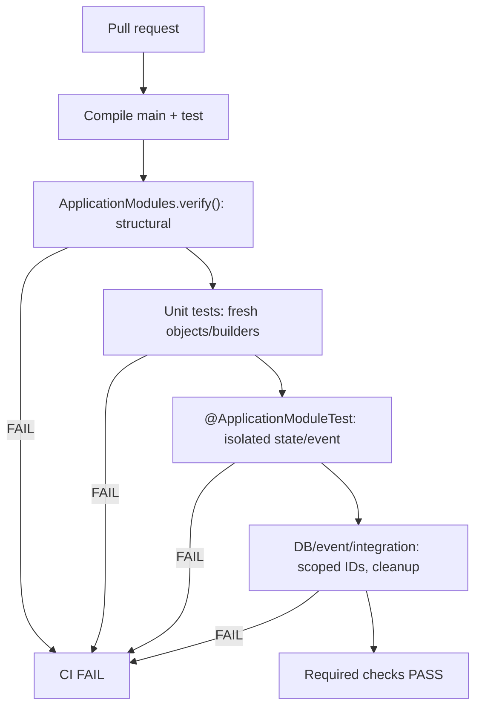

# Không dùng fixture chia sẻ có thể bị sửa

> **Chương:** Test data  
> **Module học:** `SPRING_MODULITH_VERIFICATION_TESTING` — kiểm chứng ranh giới Spring Modulith bằng `ApplicationModules` và quy tắc phụ thuộc module; thực hành `@ApplicationModuleTest`, kiểm thử sự kiện, cơ sở dữ liệu, tích hợp và CI quality gate để ngăn phụ thuộc sai, hồi quy.

## 1. Vấn đề: test chạy riêng PASS nhưng cả suite lại FAIL

Giả sử module `orders` có hai bài test:

- Test A hủy một đơn đã đặt.
- Test B xác nhận một đơn mới ở trạng thái `PLACED`.

Người viết test tiết kiệm vài dòng bằng cách khai báo `static final Order PLACED_ORDER` rồi dùng cùng object trong cả hai test. Test A gọi `cancel()` làm đổi trạng thái object. Test B được chạy sau đó và thấy `CANCELLED` thay vì `PLACED`. Khi chạy test B riêng lẻ, biến static được khởi tạo từ đầu và test lại PASS.

Đây là lỗi **test fixture chia sẻ có thể bị sửa** (*shared mutable fixture*). Nó nguy hiểm vì:

1. Một test có thể để lại state làm ảnh hưởng test khác.
2. Kết quả phụ thuộc **thứ tự chạy** hoặc cách JUnit phân phối test lên threads.
3. Test dễ xanh trên laptop nhưng đỏ trên CI, hoặc ngược lại.
4. Người phát triển có thể đổ lỗi cho logic domain, Spring context hoặc database trong khi **test setup** mới là nguyên nhân.
5. Những kết quả không ổn định gây áp lực tắt `@ApplicationModuleTest`, bỏ qua integration tests hoặc làm yếu quality gate.

**Bài học cốt lõi:** Có thể **chia sẻ dữ liệu bất biến**, nhưng không nên chia sẻ **trạng thái có thể sửa** giữa các test mà không có ranh giới cô lập rõ ràng.

### Mục tiêu

Sau bài này, bạn có thể:

1. Nhận diện shared mutable fixtures trong Java object, builder, collection, Spring singleton bean, event recorder và database.
2. Phân biệt `static final` (tham chiếu không đổi) với **object thật sự bất biến**.
3. Thiết kế test-data factory/builder luôn tạo instance mới cho mỗi test; dùng defensive copy khi cần.
4. Hiểu phạm vi của JUnit `@TestInstance`, `@BeforeEach`, parallel execution và Spring Test ApplicationContext cache.
5. Kiểm tra `@ApplicationModuleTest` và `PublishedEvents` mà không phụ thuộc state rò rỉ từ bài test khác.
6. Thiết lập isolation cho database, ID, event listener, file và external resources.
7. Giữ `ApplicationModules.verify()` cùng behavioral quality gates hoạt động ổn định trên CI.

## 2. “Chia sẻ” và “có thể sửa” là hai trục khác nhau

Không phải mọi `static` đều xấu và không phải mọi object được tạo lại đều an toàn.

| Dữ liệu | Chia sẻ giữa các test? | Có thể sửa? | Đánh giá |
| --- | --- | --- | --- |
| `static final UUID ORDER_ID` | Có | Không, vì `UUID` bất biến | Thường an toàn cho **unit test in-memory** |
| `static final Instant FIXED_TIME` | Có | Không | An toàn cho assertions |
| `static final String SKU` | Có | Không | An toàn |
| `static final Order PLACED_ORDER`, `Order.cancel()` đổi state | Có | Có | **Nguy hiểm** |
| `static final List<Order> ORDERS = new ArrayList<>()` | Có | Có | **Nguy hiểm** |
| `List.of(...)` chứa các phần tử bất biến | Có | Không theo API của list/phần tử | Có thể dùng chung |
| `List.of(mutableOrder)` | Có | Phần tử vẫn mutable | Không được coi là deep immutable |
| `new OrderFixtures.placed()` trong mỗi test | Không | Có, nhưng chỉ test đó sở hữu | Thường an toàn |
| Spring `@Bean` singleton là `ArrayList`/`HashMap` mutable | Có trong context được tái sử dụng | Có | Dễ rò trạng thái |
| Database container chung | Có | Có thể ghi | Chỉ an toàn nếu state được cô lập |

### 2.1. `final` không làm object bất biến

Java:

```java
final List<String> names = new ArrayList<>();
names.add("first");  // Hợp lệ: chỉ cấm gán lại biến names.
```

Tương tự:

```java
static final Order ORDER = OrderFixtures.placed();
ORDER.cancel(Instant.parse("2026-01-01T09:10:00Z")); // Vẫn thay đổi.
```

`final` ở đây khóa **tham chiếu**, không khóa các field hoặc object mà tham chiếu trỏ tới.

### 2.2. Bất biến nông và bất biến sâu

Một Java `record` với field `List` không tự động trở nên bất biến sâu:

```java
record CartSnapshot(List<String> skus) {}

List<String> source = new ArrayList<>();
source.add("SKU-001");
CartSnapshot snapshot = new CartSnapshot(source);
source.add("SKU-002");  // snapshot.skus() cũng thấy thay đổi.
```

Nếu cần snapshot dữ liệu test ổn định, hãy sao chép phòng vệ trong constructor:

```java
import java.util.List;

record CartSnapshot(List<String> skus) {
    CartSnapshot {
        skus = List.copyOf(skus);
    }
}
```

`List.copyOf` chặn thêm/xóa phần tử và tách list khỏi nguồn, nhưng **không tự đóng băng object mutable nằm trong list**. Ví dụ `List<Order>` vẫn chứa các `Order` có thể `cancel()`. Giải pháp là dùng phần tử bất biến/DTO snapshot hoặc tạo bản sao domain thích hợp.

## 3. Ví dụ domain có trạng thái để thấy lỗi rò rỉ

Ứng dụng minh họa đặt tại `com.example.shop`:

```text
src/main/java/com/example/shop/
├── ShopApplication.java
├── orders/
│   ├── Order.java
│   ├── OrderStatus.java
│   └── OrderPlacementService.java
├── inventory/
│   ├── StockQuery.java
│   └── internal/StockJpaRepository.java
└── billing/
    └── ...

src/test/java/com/example/shop/
├── ModuleArchitectureTest.java
└── orders/
    ├── OrderFixtures.java
    ├── OrderFixtureIsolationTest.java
    └── OrderModuleTest.java
```

Theo cách phát hiện module mặc định của Spring Modulith, `orders`, `inventory` và `billing` là những application modules trực tiếp dưới package gốc. `orders` được phép tương tác với `inventory` qua API công bố `StockQuery` nếu policy cho phép; nó không cần biết `inventory.internal.StockJpaRepository`.

### 3.1. Enum trạng thái

`src/main/java/com/example/shop/orders/OrderStatus.java`:

```java
package com.example.shop.orders;

public enum OrderStatus {
    DRAFT, PLACED, CANCELLED
}
```

### 3.2. Aggregate mutable nhưng bảo vệ invariant

`src/main/java/com/example/shop/orders/Order.java`:

```java
package com.example.shop.orders;

import java.time.Instant;
import java.util.Objects;
import java.util.UUID;

public final class Order {

    private final UUID id;
    private final String sku;
    private final int quantity;
    private OrderStatus status = OrderStatus.DRAFT;
    private Instant placedAt;
    private Instant cancelledAt;

    private Order(UUID id, String sku, int quantity) {
        this.id = Objects.requireNonNull(id, "id");
        if (sku == null || sku.isBlank()) {
            throw new IllegalArgumentException("sku is required");
        }
        if (quantity <= 0) {
            throw new IllegalArgumentException("quantity must be positive");
        }
        this.sku = sku;
        this.quantity = quantity;
    }

    public static Order draft(UUID id, String sku, int quantity) {
        return new Order(id, sku, quantity);
    }

    public void place(Instant at) {
        if (status != OrderStatus.DRAFT) {
            throw new IllegalStateException("Only DRAFT may be placed");
        }
        placedAt = Objects.requireNonNull(at, "placedAt");
        status = OrderStatus.PLACED;
    }

    public void cancel(Instant at) {
        if (status != OrderStatus.PLACED) {
            throw new IllegalStateException("Only PLACED may be cancelled");
        }
        Instant when = Objects.requireNonNull(at, "cancelledAt");
        if (when.isBefore(placedAt)) {
            throw new IllegalArgumentException("Cancellation before placement");
        }
        cancelledAt = when;
        status = OrderStatus.CANCELLED;
    }

    public UUID id() { return id; }
    public String sku() { return sku; }
    public int quantity() { return quantity; }
    public OrderStatus status() { return status; }
    public Instant placedAt() { return placedAt; }
    public Instant cancelledAt() { return cancelledAt; }
}
```

Mô hình này có state machine `DRAFT → PLACED → CANCELLED`. Đây là **domain giả định của bài học**, không phải state machine Spring Modulith áp đặt. Trong codebase thật, state chuyển tiếp và quy tắc hủy phải theo nghiệp vụ thực.

## 4. Anti-pattern: cùng một aggregate mutable cho nhiều test

### 4.1. Ví dụ sai để nhận diện

Đoạn sau là **anti-pattern**, không chép vào test suite chính:

```java
package com.example.shop.orders;

import static org.junit.jupiter.api.Assertions.assertEquals;

import java.time.Instant;
import java.util.UUID;
import org.junit.jupiter.api.Test;

class BadSharedOrderTest {

    // Sai: final chỉ khóa tham chiếu; instance Order vẫn mutable.
    private static final Order SHARED_PLACED = placedOrder();

    private static Order placedOrder() {
        Order order = Order.draft(
                UUID.fromString("11111111-1111-1111-1111-111111111111"),
                "SKU-001", 2);
        order.place(Instant.parse("2026-01-01T09:00:00Z"));
        return order;
    }

    @Test
    void cancellationChangesTheSharedFixture() {
        SHARED_PLACED.cancel(Instant.parse("2026-01-01T09:10:00Z"));
        assertEquals(OrderStatus.CANCELLED, SHARED_PLACED.status());
    }

    @Test
    void expectsFixtureStillPlaced() {
        // Có thể PASS khi chạy riêng và FAIL khi test hủy đã chạy trước.
        assertEquals(OrderStatus.PLACED, SHARED_PLACED.status());
    }
}
```

**Không nên lấy kết quả của ví dụ này làm điều chắc chắn theo thứ tự.** JUnit Jupiter không bảo đảm thứ tự mặc định giữa các test methods; chính **sự phụ thuộc thứ tự** là lỗi cần sửa. Nếu hai test chạy song song, còn có thể xuất hiện race.

Vấn đề không nằm ở tên class, assertion hay `Instant`. Nó là **một object mutable có nhiều test cùng nắm giữ tham chiếu**.

### 4.2. Vì sao “reset lại sau mỗi test” chưa phải giải pháp tốt?

Nếu dùng `@AfterEach` đổi state về `PLACED` qua setter test-only, nhóm đã mở một đường bypass domain invariant và phải chắc cleanup luôn chạy trong mọi trường hợp.

Trong trường hợp chạy song song, hai test có thể **đang sử dụng cùng object** trước khi cleanup xảy ra. Reset ở `@BeforeEach` cũng không đủ nếu chúng cùng tham chiếu một static object.

Với domain object nhỏ và rẻ, giải pháp đơn giản hơn là **không chia sẻ object**.

## 5. Giải pháp: factory trả aggregate mới cho mỗi lần gọi

`src/test/java/com/example/shop/orders/OrderFixtures.java`:

```java
package com.example.shop.orders;

import java.time.Instant;
import java.util.UUID;

final class OrderFixtures {

    static final UUID ORDER_ID = UUID.fromString(
            "11111111-1111-1111-1111-111111111111");
    static final Instant PLACED_AT =
            Instant.parse("2026-01-01T09:00:00Z");
    static final Instant CANCELLED_AT =
            Instant.parse("2026-01-01T09:10:00Z");

    private OrderFixtures() {}

    static Order draft() {
        return Order.draft(ORDER_ID, "SKU-001", 2);
    }

    static Order placed() {
        Order order = draft();
        order.place(PLACED_AT);
        return order;
    }

    static Order cancelled() {
        Order order = placed();
        order.cancel(CANCELLED_AT);
        return order;
    }

    static Order draftWithId(UUID id) {
        return Order.draft(id, "SKU-001", 2);
    }
}
```

Điểm quan trọng:

- `ORDER_ID` và timestamps có thể chia sẻ vì `UUID` và `Instant` bất biến.
- `draft()`, `placed()`, `cancelled()` **tạo object mới** ở mỗi lần gọi.
- Fixture đi qua `Order.place()`, `Order.cancel()` nên tuân thủ domain transition, không gán status qua reflection/setter.
- Định danh cố định dùng được cho **unit tests chỉ làm việc trong bộ nhớ**. Khi ghi nhiều đơn vào một DB chia sẻ, phải truyền ID riêng hoặc cách isolation tương ứng.
- Các phương thức chỉ **tạo dữ liệu**, không mở Spring context, gọi repository, gửi event hoặc kết nối database.

### 5.1. Unit tests không phụ thuộc thứ tự

`src/test/java/com/example/shop/orders/OrderFixtureIsolationTest.java`:

```java
package com.example.shop.orders;

import static org.junit.jupiter.api.Assertions.*;

import org.junit.jupiter.api.Test;

class OrderFixtureIsolationTest {

    @Test
    void cancellationOnlyChangesThisTestsOrder() {
        Order order = OrderFixtures.placed();

        order.cancel(OrderFixtures.CANCELLED_AT);

        assertEquals(OrderStatus.CANCELLED, order.status());
        assertEquals(OrderFixtures.CANCELLED_AT, order.cancelledAt());
    }

    @Test
    void aNewPlacedFixtureHasItsOriginalState() {
        Order order = OrderFixtures.placed();

        assertEquals(OrderStatus.PLACED, order.status());
        assertEquals(OrderFixtures.PLACED_AT, order.placedAt());
        assertNull(order.cancelledAt());
    }

    @Test
    void twoCallsCreateIndependentInstances() {
        Order first = OrderFixtures.placed();
        Order second = OrderFixtures.placed();

        assertNotSame(first, second);
        assertEquals(first.id(), second.id());

        first.cancel(OrderFixtures.CANCELLED_AT);
        assertEquals(OrderStatus.CANCELLED, first.status());
        assertEquals(OrderStatus.PLACED, second.status());
    }
}
```

Hai instance ở test cuối có **cùng ID** nhưng là **hai bản dựng in-memory độc lập của cùng scenario**. Điều này phù hợp để chứng minh state không bị dùng chung. Nếu đem cả hai đi `INSERT` vào bảng có primary key theo ID, việc dùng cùng ID sẽ không còn hợp lệ. Cần chọn ID dựa trên tầng kiểm thử.

### 5.2. Thay một biến, không nhân bản mọi fixture

Khi cần SKU/quantity khác, có thể viết factory nhận đúng tham số:

```java
static Order draft(UUID id, String sku, int quantity) {
    return Order.draft(id, sku, quantity);
}
```

Đây là **phương thức có thể bổ sung vào `OrderFixtures`**, không phải đoạn Java độc lập. Không cần tạo một `Order` singleton rồi thay đổi field của nó giữa các test để tiết kiệm object allocations.

## 6. Builder có state: đừng tái sử dụng builder mutable giữa test

Không chỉ aggregate mới mutable. Một test-data builder điển hình dùng các `withX(...)` thay field nội bộ:

```java
final class OrderDraftBuilder {

    private java.util.UUID id = OrderFixtures.ORDER_ID;
    private String sku = "SKU-001";
    private int quantity = 2;

    static OrderDraftBuilder anOrder() {
        return new OrderDraftBuilder();
    }

    OrderDraftBuilder withQuantity(int value) {
        quantity = value;
        return this;
    }

    OrderDraftBuilder withId(java.util.UUID value) {
        id = value;
        return this;
    }

    Order build() {
        return Order.draft(id, sku, quantity);
    }
}
```

Ví dụ dùng đúng:

```java
Order small = OrderDraftBuilder.anOrder()
        .withQuantity(1)
        .build();

Order large = OrderDraftBuilder.anOrder()
        .withQuantity(10)
        .build();
```

**Không nên** tạo `static final OrderDraftBuilder COMMON_BUILDER` rồi test A gọi `withQuantity(10)`, test B giả định quantity mặc định vẫn bằng 2. Builder đã bị thay đổi và có thể gây lỗi phụ thuộc thứ tự.

Ngay cả khi `build()` luôn trả một object mới, **nếu builder chia sẻ mutable fields**, các object được tạo sau đó vẫn có thể mang defaults bị test trước làm đổi.

### 6.1. Khi nào builder bất biến phù hợp?

Một immutable builder trả bản builder mới mỗi `withX` cũng có thể giúp tránh mutation xuyên test. Tuy nhiên, nếu builder chứa tham chiếu tới `List`/`Map` mutable hoặc một aggregate mutable, nó vẫn cần defensive copy.

Với đa số unit tests, cách dễ đọc nhất là:

```java
Order order = OrderDraftBuilder.anOrder()
        .withQuantity(3)
        .build();
```

Mỗi test gọi `anOrder()` ngay trong `Given`. Không biến test-data builder thành registry toàn cục.

## 7. Collection fixture: chia sẻ cấu trúc được, không chia sẻ phần tử mutable

### 7.1. Anti-pattern với danh sách đơn

```java
// Sai: static List và Order trong list đều có thể bị sửa.
static final List<Order> ALL_ORDERS =
        new ArrayList<>(List.of(OrderFixtures.placed()));
```

Một test có thể gọi `ALL_ORDERS.clear()`. Test khác lại tưởng danh sách có một phần tử. Hoặc một test không thay list nhưng gọi `ALL_ORDERS.get(0).cancel(...)` — trường hợp này **ngay cả `List.copyOf` cũng không cứu được**, vì phần tử vẫn mutable.

### 7.2. Factory cho collection mới mỗi lần

```java
static List<Order> placedOrders() {
    return new ArrayList<>(List.of(
            OrderFixtures.placed(),
            OrderFixtures.placed()
    ));
}
```

Đây là phương thức minh họa có thể đặt trong test fixture class. Nó trả list mới và các phần tử mới. Hai object có cùng `ORDER_ID` mẫu nên **chỉ dùng** cho unit tests không coi đó là hai entity khác nhau trong cùng repository/DB. Nếu bài test phân trang, lọc theo ID hoặc unique constraint, cần truyền **ID khác nhau** cho mỗi item.

### 7.3. Snapshot bất biến cho dữ liệu quan sát

Với tập dữ liệu chỉ để đọc, dùng immutable DTO chứa bất biến:

```java
import java.util.List;
import java.util.UUID;

record OrderLine(String sku, int quantity) {}

record OrderView(UUID id, List<OrderLine> lines) {
    OrderView {
        lines = List.copyOf(lines);
    }
}
```

Vì `OrderLine` chứa `String` và `int` (bất biến theo cách sử dụng), `OrderView` có thể làm shared read-only reference an toàn hơn một list gồm các aggregate mutable. Nhưng nếu thêm field kiểu `Date` hay `ArrayList` vào `OrderLine`, cần xem lại tính bất biến sâu.

## 8. JUnit lifecycle: mặc định tạo test instance mới, nhưng không cô lập mọi thứ

JUnit Jupiter mặc định dùng lifecycle `PER_METHOD`: mỗi test method có một instance test class riêng. Điều này hỗ trợ isolation **cho instance fields** được tạo cùng test object. Nhưng:

- `static` fields vẫn dùng chung trong JVM.
- Spring beans singleton có thể dùng chung khi context được cache.
- File, database, broker, queue, container và system properties vẫn là tài nguyên toàn cục hoặc bên ngoài test instance.
- `@TestInstance(PER_CLASS)` cho phép instance fields sống xuyên nhiều test methods.
- Parallel execution có thể làm các lỗi shared state xuất hiện thường xuyên hơn.

### 8.1. `@BeforeEach` tạo dữ liệu mới là hợp lý

```java
package com.example.shop.orders;

import static org.junit.jupiter.api.Assertions.assertEquals;

import org.junit.jupiter.api.BeforeEach;
import org.junit.jupiter.api.Test;

class OrderBeforeEachTest {

    private Order placedOrder;

    @BeforeEach
    void setUp() {
        placedOrder = OrderFixtures.placed();
    }

    @Test
    void startsInPlacedState() {
        assertEquals(OrderStatus.PLACED, placedOrder.status());
    }
}
```

Với lifecycle `PER_METHOD` mặc định, mỗi test instance có `placedOrder` riêng và `@BeforeEach` tạo object mới. Nếu chỉ một test dùng fixture, đặt `OrderFixtures.placed()` trực tiếp trong method thường còn rõ ràng hơn.

### 8.2. `PER_CLASS` và `@BeforeEach` không phải khóa chống race

Khi dùng:

```java
@TestInstance(TestInstance.Lifecycle.PER_CLASS)
class SomeTest {
    private Order order;
    // Nhiều test methods dùng cùng instance field "order".
}
```

Instance fields được chia sẻ giữa methods. JUnit có những quy tắc riêng về khả năng chạy song song của `PER_CLASS`; nhưng nếu cấu hình cho phép concurrent execution hoặc có callback/asynchronous task ngoài JUnit, việc thay cùng field vẫn có thể gây race. Đừng dựa vào `@BeforeEach` để reset một field dùng chung trong khi test khác đang sử dụng.

Nếu không thật sự cần `PER_CLASS` (ví dụ lifecycle đặc biệt của một expensive non-thread-safe resource), nên giữ mặc định `PER_METHOD` và đặt mutable data trong local variables.

### 8.3. Parallel execution: thread-safe không đồng nghĩa test-independent

Giả sử thay `HashMap` thành `ConcurrentHashMap` cho một fake repository singleton. Race về cấu trúc map có thể giảm, nhưng test A vẫn để lại bản ghi khiến test B đọc thấy dữ liệu không thuộc Given của nó.

**Thread safety** bảo vệ việc truy cập đồng thời vào cấu trúc dữ liệu. **Test isolation** bảo vệ việc một test không bị ảnh hưởng bởi hành động của test khác. Cần cả hai nếu resource được chia sẻ có chủ đích; tốt hơn là tránh chia sẻ mutable state khi có thể.

## 9. Spring `@ApplicationModuleTest`: context cache có thể làm state sống lâu hơn test

Spring Test Framework có cơ chế **cache ApplicationContext** giữa các test có cấu hình context phù hợp. Khi Spring Modulith `@ApplicationModuleTest` dùng Spring Test context, các singleton beans nằm trong context có thể được tái sử dụng.

Điều đó rất hữu ích về hiệu năng nhưng tạo rủi ro nếu test bean chứa mutable state:

```java
@TestConfiguration(proxyBeanMethods = false)
class BadSharedStateConfig {

    @Bean
    RecordingOrderStore recordingOrderStore() {
        return new RecordingOrderStore(); // Singleton mặc định.
    }
}
```

Nếu `RecordingOrderStore` giữ một `ArrayList<Order>` rồi các test cùng autowire và append vào đó, test tiếp theo có thể nhìn thấy dữ liệu test trước, kể cả khi test class được JUnit tạo mới.

### 9.1. Cách tốt hơn: dùng stateless collaborators cho test không cần persistence

Giả sử `orders` có application service chỉ cần lưu, kiểm tồn kho và phát event. Định nghĩa API của module `inventory`:

```java
package com.example.shop.inventory;

public interface StockQuery {
    boolean available(String sku, int quantity);
}
```

Port persistence thuộc module `orders`:

```java
package com.example.shop.orders;

interface OrderStore {
    void save(Order order);
}
```

Command và event:

```java
package com.example.shop.orders;

import java.util.UUID;

public record PlaceOrderCommand(UUID orderId, String sku, int quantity) {}
```

```java
package com.example.shop.orders;

import java.time.Instant;
import java.util.UUID;

public record OrderPlaced(UUID orderId, Instant placedAt) {}
```

Application service (mô hình tối giản):

```java
package com.example.shop.orders;

import java.time.Clock;
import org.springframework.context.ApplicationEventPublisher;
import org.springframework.stereotype.Service;
import com.example.shop.inventory.StockQuery;

@Service
public class OrderPlacementService {

    private final StockQuery stock;
    private final OrderStore store;
    private final ApplicationEventPublisher events;
    private final Clock clock;

    public OrderPlacementService(StockQuery stock, OrderStore store,
                                 ApplicationEventPublisher events, Clock clock) {
        this.stock = stock;
        this.store = store;
        this.events = events;
        this.clock = clock;
    }

    public Order place(PlaceOrderCommand command) {
        if (command == null) {
            throw new IllegalArgumentException("command is required");
        }
        Order order = Order.draft(
                command.orderId(), command.sku(), command.quantity());

        if (!stock.available(order.sku(), order.quantity())) {
            throw new IllegalStateException("Out of stock");
        }

        order.place(clock.instant());
        store.save(order);
        events.publishEvent(new OrderPlaced(order.id(), order.placedAt()));
        return order;
    }
}
```

Trong ví dụ, `orders` chỉ biết `inventory.StockQuery`, không truy cập `inventory.internal`. Phần transaction, database và bảo đảm event delivery cần thiết kế/test riêng; service chỉ minh họa isolation ở mức module test.

### 9.2. Test-only config không giữ collection mutable

`src/test/java/com/example/shop/orders/OrderModuleFixtureConfig.java`:

```java
package com.example.shop.orders;

import java.time.Clock;
import java.time.ZoneOffset;
import org.springframework.boot.test.context.TestConfiguration;
import org.springframework.context.annotation.Bean;
import org.springframework.context.annotation.Primary;
import com.example.shop.inventory.StockQuery;

@TestConfiguration(proxyBeanMethods = false)
class OrderModuleFixtureConfig {

    @Bean
    @Primary
    StockQuery stockQuery() {
        // Stateless stub: cùng input -> cùng output, không lưu state.
        return (sku, quantity) ->
                "SKU-001".equals(sku) && quantity <= 5;
    }

    @Bean
    @Primary
    OrderStore orderStore() {
        // Khi test không kiểm persistence, không giữ shared memory.
        return order -> {};
    }

    @Bean
    @Primary
    Clock testClock() {
        return Clock.fixed(OrderFixtures.PLACED_AT, ZoneOffset.UTC);
    }
}
```

`@Primary` giúp ưu tiên bean trong một số cấu hình; nếu project đã có bean definitions khác hoặc gặp xung đột tên bean, cần chọn cơ chế test bean replacement theo phiên bản Spring Boot và context thực tế. Không đưa test config này vào `src/main/java`.

### 9.3. `@ApplicationModuleTest` với object được tạo tại chỗ

`src/test/java/com/example/shop/orders/OrderModuleTest.java`:

```java
package com.example.shop.orders;

import static org.assertj.core.api.Assertions.assertThat;
import static org.junit.jupiter.api.Assertions.assertThrows;

import java.util.UUID;
import org.junit.jupiter.api.Test;
import org.springframework.beans.factory.annotation.Autowired;
import org.springframework.context.annotation.Import;
import org.springframework.modulith.test.ApplicationModuleTest;
import org.springframework.modulith.test.PublishedEvents;

@ApplicationModuleTest
@Import(OrderModuleFixtureConfig.class)
class OrderModuleTest {

    @Autowired
    OrderPlacementService service;

    @Test
    void publishesEventForThisTestsOrder(PublishedEvents published) {
        UUID id = UUID.fromString(
                "11111111-1111-1111-1111-111111111111");
        PlaceOrderCommand command =
                new PlaceOrderCommand(id, "SKU-001", 2);

        Order placed = service.place(command);

        assertThat(placed.status()).isEqualTo(OrderStatus.PLACED);
        assertThat(published.ofType(OrderPlaced.class))
                .anySatisfy(event -> {
                    assertThat(event.orderId()).isEqualTo(id);
                    assertThat(event.placedAt())
                            .isEqualTo(OrderFixtures.PLACED_AT);
                });
    }

    @Test
    void outOfStockDoesNotPublishPlacement(PublishedEvents published) {
        PlaceOrderCommand command = new PlaceOrderCommand(
                UUID.fromString("22222222-2222-2222-2222-222222222222"),
                "SKU-001", 6);

        assertThrows(IllegalStateException.class,
                () -> service.place(command));

        assertThat(published.ofType(OrderPlaced.class)).isEmpty();
    }
}
```

Các test tạo command riêng; test config cung cấp collaborators **stateless**, không giữ `List<Order>` toàn cục. `PublishedEvents` quan sát sự kiện trong test (theo semantics framework và phiên bản tương ứng); nó không phải một `static List<Object>` do developer tự giữ giữa test methods.

`anySatisfy` chỉ chứng minh **ít nhất một event** khớp, chưa chứng minh đúng **một event**. Nếu contract đòi hỏi exact count, phải thêm assertion đếm theo API phù hợp phiên bản Spring Modulith.

**Điều kiện:** Project cần Spring Modulith test support, JUnit Jupiter, Spring Boot context và các bean được cấu hình hợp lệ. Ví dụ không kiểm side effect database thật vì `OrderStore` là no-op; muốn kiểm persistence, viết integration test riêng.

### 9.4. Khi thật sự cần fake repository có state?

Nếu test cần xem dữ liệu được lưu, có ba lựa chọn tùy mục tiêu:

1. **Unit test thuần:** tạo fake `OrderStore` mới như một biến local cho mỗi method; đây thường là cách đơn giản nhất.
2. **Module test:** dùng test double được quản lý đúng lifecycle/được reset và **không chạy song song với những test dùng cùng state**, hoặc dùng context isolation nếu thực sự cần.
3. **Persistence/integration test:** dùng repository/database thật với transaction/schema/ID isolation.

Đừng mặc định `@DirtiesContext` cho mọi test để chữa fake singleton có state. Annotation này có thể buộc đóng/tạo lại context, làm suite chậm; nó cũng **không reset static variables, dữ liệu database ngoài transaction, broker hoặc file**. Hãy giảm mutable shared state trước.

## 10. Event fixtures: payload có thể immutable, nhưng recorder/consumer state thì không

Một domain event immutable:

```java
package com.example.shop.orders;

import java.time.Instant;
import java.util.UUID;

public record OrderPlaced(UUID orderId, Instant placedAt) {}
```

Hai test có thể dùng chung `ORDER_ID`/`PLACED_AT` là constants bất biến, nhưng nên tạo event mới khi muốn mô phỏng **event mới**:

```java
static OrderPlaced placedEvent() {
    return new OrderPlaced(
            OrderFixtures.ORDER_ID,
            OrderFixtures.PLACED_AT
    );
}
```

**Bối cảnh quan trọng:** Record chỉ shallow immutable khi các component types cũng bất biến; `UUID` và `Instant` phù hợp. Nếu event chứa `List<MutableLineItem>`, phải xem lại defensive copy và object ownership.

### 10.1. Không dùng static event recorder cho nhiều tests

Ví dụ sai:

```java
static final List<Object> PUBLISHED = new ArrayList<>();
ApplicationEventPublisher publisher = PUBLISHED::add;
```

Test A publish event, test B assert “không có event” rồi FAIL do dữ liệu cũ. Nếu listener bất đồng bộ tiếp tục chạy khi test A đã kết thúc, cleanup bằng `PUBLISHED.clear()` cũng có thể race.

Nên:

- Trong **unit test**, tạo `List<Object> published = new ArrayList<>()` bên trong mỗi method và inject publisher dùng list đó.
- Trong `@ApplicationModuleTest`, dùng `PublishedEvents` được framework cung cấp thay vì tự quản lý một static collector.
- Với broker/integration, dùng correlation/consumer group/queue hoặc event ID riêng cho scenario, kết hợp cơ chế xác nhận trạng thái cuối.
- Khi cần consumer idempotency, tạo **cùng logical event ID** trong hai lần giao lại của **cùng một test**; không vô tình chia sẻ receipt/dedup store giữa các test.

### 10.2. Event dedup tests và state

Nếu consumer có state như `Set<UUID> processedEventIds`, test A xử lý event ID E1 sẽ ảnh hưởng test B nếu hai test dùng chung set E1. Hậu quả là event ở B bị coi như duplicate dù kịch bản B cần “nhận lần đầu”.

Thiết kế tốt là mỗi consumer test có store/dedup state mới, hoặc database test có receipt rows riêng với cleanup/transaction. Production dedup vẫn cần ràng buộc bền vững và atomicity phù hợp — việc fake có `HashSet` riêng cho test **không** chứng minh chống trùng khi nhiều instances cùng xử lý.

## 11. Database fixtures: cùng container không đồng nghĩa cùng trạng thái

Testcontainers hoặc một `DataSource` dùng chung có thể hợp lý về hiệu năng. Tuy nhiên, database bên trong **vẫn là state mutable**:

- Test A insert `orders.id = O1` rồi không cleanup.
- Test B sử dụng `O1` do fixture hằng, gặp lỗi primary key.
- Test C đếm toàn bộ rows thay vì chỉ rows của scenario, nên kết quả phụ thuộc những test đã chạy.
- Hai tests ghi cùng `O1` song song có thể tạo race/rollback conflict.

Đây là lỗi isolation của test data, không tự động là lỗi transaction/JPA của application.

### 11.1. Những chiến lược cô lập phổ biến

| Chiến lược | Phù hợp khi | Điều phải kiểm |
| --- | --- | --- |
| Mỗi test có ID riêng | Cùng DB/schema nhưng dataset không chồng | Cleanup đúng IDs; không query toàn bảng vô tình |
| `@Transactional` rollback trong test | Side effects nằm trong cùng test transaction | Async listeners/`REQUIRES_NEW`/external calls có thể không rollback cùng |
| `@Sql` setup/cleanup | Dataset SQL nhỏ, ổn định theo scenario | Đúng execution phase, transaction mode, không đụng dữ liệu test khác |
| Schema/database riêng từng test hoặc class | Isolation mạnh cho concurrent integration tests | Migration được áp dụng, chi phí khởi tạo |
| Testcontainers dùng chung infrastructure | Tiết kiệm thời gian khởi động DB | **Data isolation vẫn phải tự thiết kế** |
| Truncate bảng trước mỗi test | Chỉ trong DB test độc quyền | Không an toàn khi nhiều tests song song dùng cùng schema |

Không nên “chữa” collision bằng cách vô điều kiện `DELETE FROM customer_orders` trước mọi test. Nếu có test đang chạy song song, lệnh xóa toàn bảng có thể phá Given của test kia.

### 11.2. Ví dụ JDBC test dùng ID riêng và cleanup theo ID

Giả sử dự án có PostgreSQL schema từ migration:

```sql
CREATE TABLE customer_orders (
    id UUID PRIMARY KEY,
    sku VARCHAR(64) NOT NULL,
    quantity INTEGER NOT NULL,
    status VARCHAR(16) NOT NULL
);
```

Integration test minh họa:

```java
package com.example.shop.orders;

import static org.junit.jupiter.api.Assertions.assertEquals;

import java.util.UUID;
import org.junit.jupiter.api.Test;
import org.springframework.beans.factory.annotation.Autowired;
import org.springframework.boot.test.context.SpringBootTest;
import org.springframework.jdbc.core.JdbcTemplate;

@SpringBootTest
class OrderJdbcIsolationTest {

    @Autowired
    JdbcTemplate jdbc;

    @Test
    void onlyUsesItsOwnOrderRow() {
        UUID id = UUID.randomUUID();

        try {
            jdbc.update(
                "INSERT INTO customer_orders(id, sku, quantity, status) "
                        + "VALUES (?, ?, ?, ?)",
                id, "SKU-001", 2, "PLACED"
            );

            Integer count = jdbc.queryForObject(
                "SELECT count(*) FROM customer_orders WHERE id = ?",
                Integer.class, id
            );
            assertEquals(1, count);
        } finally {
            jdbc.update("DELETE FROM customer_orders WHERE id = ?", id);
        }
    }
}
```

**Điều kiện:** Test này cần Spring JDBC, `DataSource` và migration tạo bảng. Nó minh họa **ID riêng/cleanup phạm vi nhỏ**, chưa chứng minh repository production query đúng vì câu SQL nằm trong test. Khi kiểm repository behavior, phải gọi method production với dữ liệu có đối chứng.

Việc dùng `UUID.randomUUID()` ở đây nhằm tránh collision khi cùng DB có nhiều test; khác với unit test thuần, việc biết trước từng UUID không cần thiết miễn cùng biến `id` được dùng xuyên `Given–When–Then`. Khi lỗi, log ID test theo chính sách bảo mật để tái hiện. Nếu database transaction bị đánh dấu lỗi, cleanup trong `finally` cũng có thể lỗi; chọn rollback hoặc cleanup transaction riêng phù hợp database/test harness.

### 11.3. Nếu cần ID deterministic, hãy cô lập phạm vi sử dụng

Một `static final UUID ORDER_ID` an toàn trong unit test không có persistence. Trong DB test, chỉ dùng hằng khi **một scenario chiếm quyền sở hữu dataset đó** và mỗi lần chạy có isolation rõ ràng; ví dụ một schema riêng hoặc rollback hiệu quả. Với data shared across methods, ưu tiên ID theo method/scenario hoặc cấp phát mới.

## 12. Event listener, transaction và hoạt động bất đồng bộ

Với `@ApplicationModuleListener` hoặc bất kỳ listener bất đồng bộ nào, state có thể thay đổi **sau khi test method phát event**. Các trường hợp rủi ro:

1. Test A publish event và kết thúc trước khi listener hoàn tất.
2. Test B bắt đầu, xóa cùng bảng hoặc reset fake consumer.
3. Listener từ A ghi vào state mà B đang assert.
4. CI FAIL không ổn định vì scheduling khác local.

Đừng giải quyết bằng `Thread.sleep(100)` cố định: con số này có thể đủ trên máy nhanh nhưng thiếu trên CI tải cao.

### 12.1. Ranh giới hoàn thành cần quan sát

Với event test, phân biệt ba kết quả:

| Câu hỏi test | Bằng chứng phù hợp |
| --- | --- |
| Module `orders` đã publish event? | `PublishedEvents` hoặc capture publisher trong test |
| Listener `billing` đã nhận và xử lý event? | Consumer assertion/receipt/logical state theo event ID |
| Side effect đã commit trong database? | Query DB/state thực sau điều kiện hoàn thành |

Nếu consumer chạy bất đồng bộ, dùng cơ chế chờ **điều kiện cuối** với timeout (ví dụ latch dành riêng test, polling có giới hạn, hoặc test utility phù hợp). Một event ID/correlation ID riêng giúp lọc đúng dữ liệu của scenario.

### 12.2. Không dùng global test state để “đợi” sự kiện

Một `static volatile boolean handled` giúp test biết “có listener chạy” nhưng dễ bị giữ từ lần trước. Ngay cả khi reset ở đầu test, listener cũ có thể set lại nó sau thời điểm reset.

Cách tốt hơn:

- Mỗi test có expected event ID hoặc correlation riêng.
- Quan sát receipt/result gắn với ID đó.
- Đảm bảo listener completion/transaction boundary trước khi cleanup.
- Nếu test chạy song song với broker/shared DB, tách destination/consumer group/namespace hoặc thiết lập isolation được hỗ trợ.

Đây là bài toán runtime. `ApplicationModules.verify()` không thể chứng minh listener không rò trạng thái; nó kiểm các quan hệ dependency tĩnh.

## 13. Thư mục tạm, cache, clock và system properties cũng là fixtures

Shared mutable fixture không chỉ là object Java.

### 13.1. File và thư mục tạm

Không dùng một đường dẫn cố định như `/tmp/orders-test.json` cho mọi test chạy song song. Một test có thể ghi đè file test khác hoặc xóa trước khi test kia đọc.

JUnit Jupiter có `@TempDir`:

```java
import static org.junit.jupiter.api.Assertions.assertEquals;

import java.nio.file.Files;
import java.nio.file.Path;
import org.junit.jupiter.api.Test;
import org.junit.jupiter.api.io.TempDir;

class OrderFileFixtureTest {

    @TempDir
    Path directory;

    @Test
    void writesOnlyItsOwnFixture() throws Exception {
        Path file = directory.resolve("order.txt");
        Files.writeString(file, "SKU-001");
        assertEquals("SKU-001", Files.readString(file));
    }
}
```

Test tự tạo file trong temporary directory do extension quản lý, tránh tên file global. Khi test phụ thuộc external filesystem hoặc cleanup đặc biệt, cần kiểm lifetime của resource theo JUnit và nền tảng chạy.

### 13.2. Clock và timezone

Chia sẻ `static final Instant FIXED_AT` hoặc `Clock.fixed(...)` là hợp lý vì giá trị thời gian không thay đổi. Không nên thay `TimeZone.setDefault(...)`/system property timezone toàn JVM trong một test rồi để test khác chịu ảnh hưởng.

Khi production code cần “hiện tại”, inject `Clock`:

```java
Clock clock = Clock.fixed(
        Instant.parse("2026-01-01T09:00:00Z"),
        ZoneOffset.UTC
);
```

Trong test, dùng explicit `ZoneId`/`Locale` nếu format hoặc cutoff phụ thuộc địa phương. Một thay đổi global timezone cần cleanup và quản trị không chạy song song, không phải cách mặc định để kiểm thời gian.

### 13.3. Cache và external services

Redis key, HTTP stub state, fake broker queue và cache singleton đều có thể là shared mutable fixtures. Khi test cần kiểm logic với cache/queue:

- Gắn namespace/key theo scenario.
- Reset/cleanup chính xác keys hoặc dùng instance riêng.
- Không phụ thuộc vào dữ liệu tồn tại từ test trước hoặc lần chạy CI trước.
- Tránh flush toàn bộ Redis/broker chia sẻ giữa các tests hoặc với môi trường khác.
- Đặt môi trường test tách biệt production, không dùng thông tin thật có dữ liệu nhạy cảm.

## 14. Cách tìm shared-state leak khi suite flaky

Triệu chứng phổ biến là “chạy riêng PASS, chạy cả nhóm FAIL”. Thực hiện theo thứ tự:

1. **Ghi lại test và assertion đầu tiên FAIL** cùng lệnh, JDK, resolved versions và test report.
2. **Chạy riêng** test lỗi để so với khi chạy cả suite; xem nó có khác trạng thái không.
3. Tìm `static` mutable, builder singleton, collections dùng chung, Spring test beans có fields mutable.
4. Kiểm `@TestInstance(PER_CLASS)` và cách `@BeforeEach`/`@AfterEach` tạo/reset state.
5. Xem database, event listener, file, cache, system properties và các đối tượng ngoài test instance.
6. Kiểm JUnit parallel settings và task/CI parallel execution — không đổ lỗi cho parallelism nếu root cause là state bị chia sẻ.
7. **Tạo fixture fresh/isolated** và chạy lại nhiều lần, nhiều thứ tự hoặc với parallelism bật ở môi trường phù hợp.
8. Chạy full suite và structural test; bảo đảm các gates vẫn được khám phá và truyền failure tới CI.

### 14.1. Ma trận triệu chứng

| Triệu chứng | Nguyên nhân khả dĩ | Bằng chứng/giải pháp |
| --- | --- | --- |
| Test B chỉ FAIL sau test A | Static aggregate, static list, bean state | Xem object identity/mutation; tạo factory fresh |
| Test PASS ở class đơn, FAIL cả module suite | Spring singleton/context cache hoặc DB row cũ | Xem bean lifecycle, transaction và cleanup |
| Test FAIL ngẫu nhiên khi chạy song song | Shared builder, map/list, database rows, file | Isolate từng test; đừng chỉ thêm lock toàn cục |
| Test event nhận “thừa” một event | Static recorder/broker message từ test khác | Filter theo event/correlation ID, cleanup đúng scope |
| Test DB báo unique violation với cùng UUID | Fixture ID hằng dùng trên DB chung | ID khác cho từng scenario hoặc schema/rollback |
| Test sau `@DirtiesContext` vẫn FAIL | State nằm ngoài context | Xem static, DB, broker, files |
| Test lệch thời điểm/hết hạn | Global clock/timezone/`Instant.now()` | Inject `Clock.fixed`, tránh global mutation |
| Test chỉ xanh khi xóa toàn bộ DB trước suite | Setup/cleanup phụ thuộc trạng thái ngoài | Dùng per-test transaction/schema/IDs |
| Gradle cache test result thành công nhưng rerun FAIL | Inputs/state bên ngoài chưa được cô lập hoặc cache sai | Chẩn đoán với `--rerun-tasks`, kiểm state/cache inputs |
| CI xanh dù test quan trọng bị skip | Filter/task thiếu, fail ignored | Đọc test reports, sửa required gate |

### 14.2. Không “chữa” bằng ép thứ tự test

JUnit có `@TestMethodOrder` và các cấu hình execution order, nhưng dùng chúng để che việc test B cần dữ liệu do test A tạo là **test coupling**. Với một workflow thực sự gồm nhiều bước phụ thuộc nhau, hãy viết **một scenario test** tự thực hiện Given → When → Then, hoặc dùng integration test workflow rõ ràng.

Tương tự, tắt parallel execution có thể giúp khoanh vùng lỗi nhưng không chứng minh fixture đã an toàn. Khi state rò rỉ, test vẫn có thể fail với thứ tự thực thi khác.

## 15. Gắn với Spring Modulith: hai hàng rào không thay thế nhau

Structural verification dùng `ApplicationModules`:

```java
package com.example.shop;

import org.junit.jupiter.api.Test;
import org.springframework.modulith.core.ApplicationModules;

class ModuleArchitectureTest {

    @Test
    void moduleBoundariesRemainValid() {
        ApplicationModules.of(ShopApplication.class).verify();
    }
}
```

Test này không cần business fixtures `Order`/`OrderPlaced`/database. Nó phân tích các module và phụ thuộc tĩnh, ví dụ:

- `orders` import API `inventory.StockQuery` có được policy cho phép không?
- `orders` có truy cập kiểu `inventory.internal` không được công bố không?
- Có chu trình module hoặc vi phạm `allowedDependencies` không?

Nó **không** phát hiện việc một `static Order` bị test A sửa trước test B, dữ liệu DB bị bỏ lại hoặc listener chạy quá muộn. Ngược lại, việc unit/module tests dùng fixture riêng và PASS **không** chứng minh ranh giới module đúng. Cần cả hai:

| Hàng rào | Cái được kiểm | Ví dụ lỗi |
| --- | --- | --- |
| `ApplicationModules.verify()` | Dependency/static module boundaries | `orders → inventory.internal.StockJpaRepository` |
| Unit fixture tests | State isolation, invariants, state transitions | Hai test dùng chung mutable `Order` |
| `@ApplicationModuleTest` | Bean wiring và hành vi ở phạm vi module | Fake singleton lưu event/order qua test |
| Event integration tests | Listener, redelivery, transaction và state cuối | Event cũ ghi vào scenario mới |
| Database integration tests | Persistence isolation, constraints, rollback | Dùng chung row ID/cleanup toàn bảng |
| CI required checks | Các gate thật sự chạy và lỗi không bị nuốt | Test bị skip hoặc job cho phép FAIL |

### 15.1. Test fixture helper không nên làm lộ module internals

Không chuyển `OrderFixtures` vào production `src/main/java` chỉ để các module khác tái sử dụng, hoặc mở `inventory.internal` qua named interface cho test setup. Với nhiều build subprojects, chọn `src/test/java`, Gradle `java-test-fixtures` hoặc test-scoped artifact phù hợp, đồng thời kiểm đúng dependency direction.

Trong test `orders`, cần điều khiển tồn kho thì stub `StockQuery` API. Nếu test tích hợp `inventory` thực, thiết lập state theo hợp đồng/module ownership hoặc test infrastructure rõ, không lén import repository nội bộ.

### 15.2. Negative architectural probe

Trên một nhánh thử nghiệm, cho class production `orders` tham chiếu một kiểu `public` nằm trong `inventory.internal`. Nếu module detection/policy mặc định đúng, Java có thể compile nhưng `ApplicationModules.verify()` phải báo vi phạm và build FAIL.

**Không merge dependency sai.** Sau khi xác minh gate, sửa qua API công bố rồi chạy structural test và full behavioral suite. Phép thử này độc lập với bài test chủ đề fixture sharing.

## 16. CI: ngăn “flaky nên bỏ test” biến thành chính sách

Trong CI, các test nên có **trạng thái ban đầu tự tạo**, không lệ thuộc thứ tự, local machine state hay một database snapshot bí mật. Cấu hình build phải thực thi và không nuốt lỗi của structural lẫn behavioral tests.



### 16.1. Lệnh Maven và Gradle thường dùng

Với Maven Wrapper, dự án phải cấu hình Surefire/JUnit Jupiter phù hợp:

```bash
# Chạy architectural test riêng để xác nhận nó được phát hiện.
./mvnw -B -Dtest=ModuleArchitectureTest test

# Chạy vòng đời kiểm chứng đã cấu hình.
./mvnw -B verify
```

Với Gradle Wrapper có `useJUnitPlatform()`:

```bash
./gradlew test --tests 'com.example.shop.ModuleArchitectureTest'
./gradlew check
```

`mvn verify` không tự thực thi integration tests `*IT` nếu Failsafe/lifecycle chưa được cấu hình. `gradle check` không tự nối custom `integrationTest` task nếu build script chưa khai báo. Trong multi-project build phải chọn project chứa các test này.

### 16.2. Cách xác minh test thực sự được chạy

- Maven: xem `target/surefire-reports`; nếu Failsafe được cấu hình, xem cả `target/failsafe-reports`.
- Gradle: xem `build/test-results/<task>` và `build/reports/tests/<task>` theo task/project.
- Tìm `ModuleArchitectureTest`, `OrderFixtureIsolationTest`, `OrderModuleTest` và database/event tests bắt buộc.
- Bảo đảm test không chỉ có `skipped` hoặc task `NO-SOURCE`.
- Không dùng `-DskipTests`, `-x test`, `ignoreFailures`, `continue-on-error: true` hoặc `|| true` để làm xanh giả.
- Required status check trong branch protection/ruleset phải phản ánh lỗi thực của test.

### 16.3. Chẩn đoán độ ổn định có mục tiêu

Khi nghi ngờ shared state:

```bash
# Maven: chạy đúng một lớp, rồi full suite để so sánh.
./mvnw -Dtest=OrderFixtureIsolationTest test
./mvnw -B test

# Hoặc Gradle: chọn một lớp test, rồi chạy lại test tasks khi cần.
./gradlew test --tests 'com.example.shop.orders.OrderFixtureIsolationTest'
./gradlew test --rerun-tasks
```

Việc rerun hoặc tạm giảm parallelism là **biện pháp khoanh vùng**, không phải thay thế cho isolation. Nếu kết quả khác nhau, quay lại kiểm object, context, DB, event và file state chứ đừng chỉ tăng timeout.

## 17. Bài thực hành: từ test phụ thuộc thứ tự đến suite độc lập

**Bối cảnh:** `ShopApplication` có `orders` và `inventory`, `Order` mutable nhưng bảo vệ domain transitions, và một bài `ModuleArchitectureTest`.

### Phần A — Tái hiện shared fixture anti-pattern trên nhánh thử

1. Tạo một class test mẫu `BadSharedOrderTest` với `static final Order SHARED_PLACED`.
2. Viết test A gọi `cancel(...)`; test B mong đơn vẫn `PLACED`.
3. Chạy hai test riêng và cùng class. Quan sát **khả năng kết quả phụ thuộc thứ tự**, không cố suy diễn rằng JUnit luôn chạy theo thứ tự source.
4. Kiểm logs/report để chỉ ra **cùng object identity** là nguyên nhân, không phải lỗi module architecture.
5. Không commit bài test flaky cố ý vào suite bắt buộc.

### Phần B — Refactor thành fixture factory fresh

1. Tạo `OrderFixtures.draft()`, `placed()`, `cancelled()` và các hằng `UUID`/`Instant` bất biến.
2. Thay `SHARED_PLACED` bằng một biến local khởi tạo `OrderFixtures.placed()` trong từng test.
3. Thêm test gọi factory hai lần, cancel object thứ nhất, assert object thứ hai không đổi.
4. Với collection, trả list mới **và** các elements mới; phân biệt `List.copyOf` với deep immutability.
5. Nếu dùng builder, gọi `anOrder()` mới ở mỗi Given, không tái sử dụng builder singleton.

### Phần C — Kiểm context và event trong `@ApplicationModuleTest`

1. Tạo `OrderPlacementService` gọi `StockQuery` API.
2. Cấu hình test-only collaborators **stateless**; không tạo một static recorder list.
3. Gọi service bằng command mới trong mỗi module test.
4. Dùng `PublishedEvents` assert event của chính scenario.
5. Kiểm case hết hàng không publish event; nếu cần persistence assertions, chuyển sang integration test với DB state độc lập.
6. Thử quan sát hành vi khi context được cache, không suy rằng mỗi test có Spring context riêng.

### Phần D — Database và external-state isolation

1. Với database test, chọn một chiến lược: ID riêng, rollback, `@Sql` cleanup có phạm vi hoặc schema riêng.
2. Chạy hai scenarios dùng hai IDs khác nhau, khẳng định chúng không xóa/đọc nhầm dữ liệu nhau.
3. Nếu có listener bất đồng bộ, quan sát side effect theo event/correlation ID và chờ hoàn thành trước cleanup.
4. Với file fixtures, dùng `@TempDir`; với Clock, dùng `Clock.fixed` thay cho global timezone mutation.
5. Không sử dụng dữ liệu production nhạy cảm trong fixtures.

### Phần E — Xác nhận structural và CI quality gates

1. Chạy `ApplicationModules.of(ShopApplication.class).verify()` trong JUnit architectural test.
2. Thử dependency trái phép vào `inventory.internal` trên branch thử để xác nhận test kiến trúc và CI FAIL.
3. Khôi phục dependency đúng `StockQuery`; chạy lại unit/module/event/database tests.
4. Xem test reports bảo đảm các test được phát hiện và không skipped.
5. Ghi rõ trong pull request: nguồn shared state đã được loại bỏ, chiến lược isolation được áp dụng và bằng chứng test PASS lặp lại.

### Checklist nghiệm thu

- [ ] Không có `static mutable Order/List/Builder` dùng chung giữa các test độc lập.
- [ ] Các hằng được chia sẻ thực sự bất biến, không chỉ có từ khóa `final`.
- [ ] Factory/builder tạo instance mới theo mỗi scenario; aggregate giữ invariant qua domain methods.
- [ ] Collections chứa phần tử mutable được sao chép hoặc cô lập đúng mức.
- [ ] Hiểu JUnit `PER_METHOD` không cô lập static/Spring singleton/DB.
- [ ] `@ApplicationModuleTest` không phụ thuộc fake singleton mang dữ liệu test trước.
- [ ] `PublishedEvents`/event tests không dùng shared recorder thiếu isolation.
- [ ] Database tests có ID/transaction/schema/cleanup phù hợp khi chạy song song.
- [ ] Listener bất đồng bộ được kiểm theo trạng thái hoàn thành và ID của scenario.
- [ ] File/clock/system property fixtures không thay đổi global state ngoài phạm vi test.
- [ ] `ApplicationModules.verify()` và behavioral tests đều thực thi qua CI required checks.
- [ ] Kết quả ổn định khi chạy riêng, chạy suite và chạy lặp lại trong điều kiện tương đương.

## 18. Câu hỏi tự đánh giá

1. Vì sao `static final Order PLACED` vẫn nguy hiểm khi `Order.cancel()` có thể sửa status?
2. Sự khác nhau giữa một `static final UUID` và một `static final ArrayList` trong test là gì?
3. Vì sao `List.copyOf(List<Order>)` chưa bảo đảm deep immutability nếu `Order` mutable?
4. JUnit `PER_METHOD` có tự reset database hoặc Spring singleton beans giữa hai test không?
5. Khi nào `@BeforeEach` là đủ, và vì sao nó chưa bảo vệ một static object bị hai test sử dụng song song?
6. Vì sao dùng `ConcurrentHashMap` có thể thread-safe nhưng vẫn gây test coupling?
7. Một `@TestConfiguration` định nghĩa `@Bean` có `ArrayList` mutable có thể rò state như thế nào khi Spring cache context?
8. Cách tốt hơn để kiểm event publication của module `orders` là static recorder hay `PublishedEvents`?
9. Khi test B chỉ FAIL sau test A, những phạm vi state nào nên điều tra trước?
10. Một database container dùng chung có đồng nghĩa datasets của các tests đã được cô lập không?
11. Vì sao `@DirtiesContext` có thể chưa giải quyết được dữ liệu broker/DB/static bị rò?
12. Với listener bất đồng bộ, làm sao phân biệt event đã publish, listener đã xử lý và transaction đã commit?
13. Vì sao `ApplicationModules.verify()` PASS chưa chứng minh fixtures độc lập, và unit tests PASS chưa chứng minh module boundaries đúng?
14. Một lần run `BUILD SUCCESS` nhưng thiếu `OrderModuleTest` trong report có đủ chứng minh chất lượng module không?

**Ghi nhớ:** Chia sẻ **hằng số bất biến** thường an toàn; chia sẻ **aggregate, builder, collection, test bean hoặc dữ liệu ngoài có thể sửa** dễ làm test phụ thuộc thứ tự và flaky. Mỗi scenario nên tự sở hữu state, nhận object mới từ factory, có ID/transaction/cleanup đúng phạm vi và quan sát event theo điều kiện hoàn thành. Kết hợp isolation của unit/`@ApplicationModuleTest`/event/DB tests với `ApplicationModules.verify()` và CI required checks để bảo vệ đồng thời hành vi nghiệp vụ và ranh giới kiến trúc.
