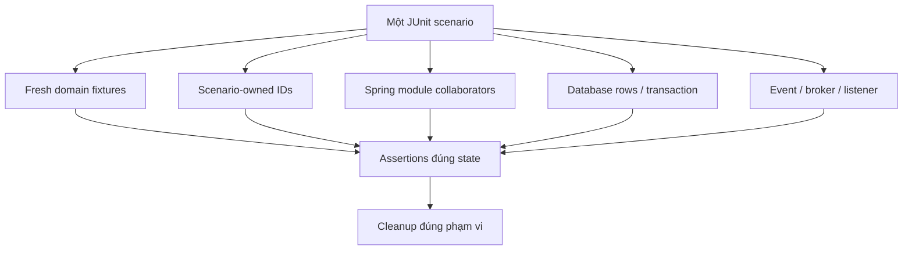
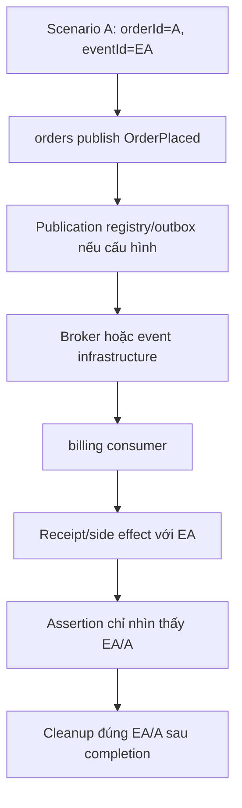
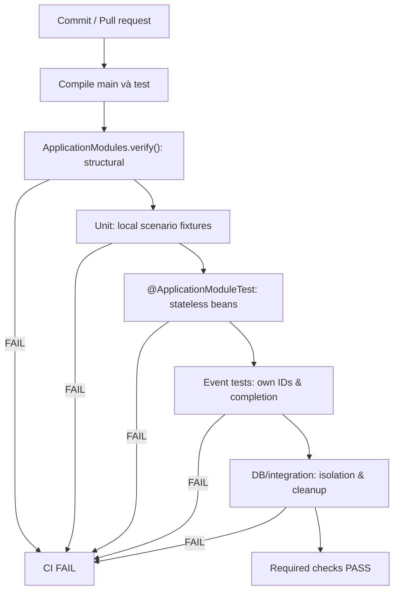

# Tạo dữ liệu cô lập giữa các scenario

> **Chương:** Test data  
> **Module học:** `SPRING_MODULITH_VERIFICATION_TESTING` — kiểm chứng ranh giới kiến trúc Spring Modulith bằng `ApplicationModules` và quy tắc phụ thuộc module; dùng `@ApplicationModuleTest`, event, database, integration tests và CI quality gate để ngăn phụ thuộc sai và hồi quy.

## 1. Hai scenario đúng riêng lẻ vẫn có thể làm hỏng nhau

Trong ứng dụng bán hàng, test A tạo đơn hàng `O-1` rồi phát `OrderPlaced`; test B kiểm rằng một yêu cầu đặt hàng hết tồn kho **không** tạo đơn hoặc event mới. Cả hai test chạy riêng đều PASS. Khi chạy cùng suite trên CI, test B phát hiện có một `OrderPlaced` và FAIL. Nguyên nhân không nằm trong nghiệp vụ hết hàng: event từ test A còn trong một recorder hoặc message broker được dùng chung.

Một biến thể khác xuất hiện khi:

- Hai test ghi cùng `orderId` vào database và gặp lỗi unique key.
- Test B xóa toàn bộ bảng `orders` trong cleanup, vô tình xóa dữ liệu test A đang sử dụng.
- Hai `@ApplicationModuleTest` dùng chung Spring context có một test bean lưu danh sách mutable.
- Test A phát event bất đồng bộ; listener chỉ ghi kết quả khi test B đã bắt đầu.
- Một test trông đợi DB rỗng nhưng runner đã chạy test trước đó và để lại bản ghi.

Đây là lỗi **không cô lập dữ liệu giữa các scenario**. Nó rộng hơn việc tránh một `static Order` dùng chung: dù mỗi test tạo Java object mới, chúng vẫn có thể tranh chấp **database, broker, cache, file, Spring singleton và các tài nguyên bên ngoài**.

Sau bài này, bạn sẽ:

1. Định nghĩa một hợp đồng cô lập dữ liệu ở **mức scenario**, không chỉ ở mức object.
2. Tạo fixture, định danh và expected results do mỗi scenario sở hữu; phân biệt dữ liệu bất biến chia sẻ được với state mutable phải cô lập.
3. Chọn giữa rollback, cleanup theo ID, schema/container riêng và namespace của hệ thống ngoài.
4. Kiểm `@ApplicationModuleTest`, event và database/integration tests mà không giả định mỗi test có Spring context/DB riêng.
5. Giải thích giới hạn của `@Transactional`, `@DirtiesContext`, `@Sql`, JUnit parallel execution và Testcontainers.
6. Giữ ranh giới module thông qua API công bố, kết hợp behavioral tests với `ApplicationModules.verify()` và CI required checks.

## 2. Hợp đồng cô lập: mỗi scenario có Given–When–Then tự đủ

Một scenario độc lập có thể chạy một mình, chạy trước/sau test khác hoặc chạy song song (khi hạ tầng cho phép) mà **kết luận không thay đổi vì dữ liệu của test khác**.

```text
Scenario A:
  Given: chỉ những order/stock/event cần cho A
  When:  hành động nghiệp vụ của A
  Then:  chỉ quan sát kết quả gắn với A
  Cleanup: chỉ tài nguyên A sở hữu

Scenario B:
  Given: chỉ những order/stock/event cần cho B
  When:  hành động nghiệp vụ của B
  Then:  chỉ quan sát kết quả gắn với B
  Cleanup: chỉ tài nguyên B sở hữu
```

**Cô lập không có nghĩa mỗi test phải khởi động một JVM hoặc một container.** Một database instance có thể được dùng chung để tiết kiệm chi phí, miễn dữ liệu/transaction/cleanup của từng scenario được quản lý rõ. Ngược lại, “dùng container riêng” vẫn chưa đủ nếu tests vô tình truy cập cùng một service bên ngoài hoặc một static recorder.

### 2.1. Bốn điều kiện của một scenario tự đủ

| Điều kiện | Câu hỏi kiểm tra | Ví dụ |
| --- | --- | --- |
| **Ownership** | Ai tạo và chịu trách nhiệm xóa/rollback state? | Test A tạo orderId `A`, không xóa orderId `B` |
| **Identity/namespace** | Làm sao phân biệt dữ liệu scenario này với scenario khác? | UUID riêng, eventId/correlationId hoặc schema riêng |
| **Lifecycle** | State tồn tại từ khi nào đến khi nào? | Setup → hành động → quan sát kết quả → cleanup |
| **Observability** | Assertion có lọc đúng dữ liệu của scenario không? | Query `WHERE order_id = :id`, không đếm cả bảng |

Thêm một điều kiện nền tảng: **Given phải hợp lệ theo domain**. Việc mỗi test có ID riêng không cứu được một `Order` đã `CANCELLED` nhưng thiếu lịch sử chuyển trạng thái cần thiết.

### 2.2. So sánh ba khái niệm dễ nhầm

| Khái niệm | Trả lời câu hỏi | Không đảm bảo |
| --- | --- | --- |
| Fresh object fixture | Test có object `Order` mới không? | DB/broker state riêng |
| Thread safety | Collection/bean có chịu được truy cập đồng thời không? | Test B không đọc nhầm dữ liệu của A |
| Scenario data isolation | Mỗi test có Given, observed state và cleanup đúng phạm vi không? | Code production không có race hoặc deadlock |

Một `ConcurrentHashMap` shared có thể thread-safe, nhưng nếu key `"default"` được mọi test dùng, kết quả vẫn lẫn nhau. Cần namespace/identity theo scenario, không chỉ thêm khóa đồng bộ.

## 3. Lập bản đồ tài nguyên trước khi viết fixture

Khi viết test module `orders`, đánh dấu nguồn state có thể tồn tại bên ngoài method:

| Tài nguyên | Có thể chia sẻ thế nào? | Biện pháp cô lập phổ biến |
| --- | --- | --- |
| Java aggregate/builder | `static` field, object nằm trong collection dùng chung | Factory tạo object mới cho mỗi test |
| Spring singleton bean | `ApplicationContext` được cache | Stub stateless; fake có state riêng/reset đúng lifecycle |
| JPA persistence context | Entity managed/first-level cache theo transaction | Transaction rõ, `flush`/`clear` khi kiểm persistence thực |
| Database table | Nhiều tests cùng DataSource/schema | ID riêng, rollback, cleanup theo ID, schema/container riêng |
| Outbox/event publication | Bản ghi chưa xử lý hoặc retry từ test trước | EventId riêng, quan sát theo scenario, dọn receipt/publication phù hợp |
| Message broker | Cùng topic, consumer group, queue | Namespace/consumer isolation, event correlation và hoàn tất trước cleanup |
| Redis/cache | Key dùng chung | Prefix/key riêng, xóa đúng key |
| File system | Cùng đường dẫn tạm | `@TempDir` hoặc thư mục theo scenario |
| System clock/property | Time zone hoặc global flag thay đổi toàn JVM | Inject `Clock`; tránh mutation global |
| External HTTP/service | Stub server hoặc dữ liệu môi trường dùng chung | Stub scenario-scoped, server/reset theo quy trình phù hợp |



**Quy tắc thiết kế:** Chỉ thêm tài nguyên vào một test khi nó cần thiết để chứng minh một rủi ro. Unit test từ chối quantity sai không cần database hay broker; integration test về transaction thì không thể thay thế DB bằng một `List<Order>` trong bộ nhớ.

## 4. Ví dụ xuyên suốt: `orders` và `inventory`

Giả sử Spring Boot application ở package `com.example.shop`:

```text
src/
├── main/java/com/example/shop/
│   ├── ShopApplication.java
│   ├── orders/
│   │   ├── PlaceOrderCommand.java
│   │   ├── Order.java
│   │   ├── OrderStore.java
│   │   ├── OrderPlaced.java
│   │   └── OrderPlacementService.java
│   └── inventory/
│       ├── StockQuery.java
│       └── internal/
│           └── StockJpaRepository.java
└── test/java/com/example/shop/
    ├── ModuleArchitectureTest.java
    └── orders/
        ├── ScenarioData.java
        ├── OrderPlacementServiceTest.java
        ├── OrderModuleScenarioTest.java
        └── OrderDatabaseIsolationIT.java
```

Theo cách phát hiện module mặc định, `orders` và `inventory` là application modules trực tiếp dưới package ứng dụng. Module `orders` có thể hỏi tồn kho qua API `inventory.StockQuery` khi chính sách dependency cho phép; không cần truy cập `inventory.internal.StockJpaRepository` để tạo data cho test.

### 4.1. Production contracts tối giản

API của `inventory`:

```java
package com.example.shop.inventory;

public interface StockQuery {
    boolean available(String sku, int quantity);
}
```

Command gửi đến `orders`:

```java
package com.example.shop.orders;

import java.util.UUID;

public record PlaceOrderCommand(
        UUID orderId, String sku, int quantity
) {}
```

Aggregate snapshot minh họa:

```java
package com.example.shop.orders;

import java.time.Instant;
import java.util.Objects;
import java.util.UUID;

public record Order(
        UUID id, String sku, int quantity, Instant placedAt
) {
    public Order {
        Objects.requireNonNull(id, "orderId");
        Objects.requireNonNull(placedAt, "placedAt");
        if (sku == null || sku.isBlank()) {
            throw new IllegalArgumentException("sku is required");
        }
        if (quantity <= 0) {
            throw new IllegalArgumentException("quantity must be positive");
        }
    }
}
```

Port persistence do `orders` sở hữu:

```java
package com.example.shop.orders;

interface OrderStore {
    void save(Order order);
}
```

Sự kiện từ `orders`:

```java
package com.example.shop.orders;

import java.time.Instant;
import java.util.UUID;

public record OrderPlaced(UUID orderId, Instant placedAt) {}
```

Service được kiểm thử:

```java
package com.example.shop.orders;

import java.time.Clock;
import java.util.Objects;
import org.springframework.context.ApplicationEventPublisher;
import org.springframework.stereotype.Service;
import com.example.shop.inventory.StockQuery;

@Service
public class OrderPlacementService {

    private final StockQuery stock;
    private final OrderStore orders;
    private final ApplicationEventPublisher events;
    private final Clock clock;

    public OrderPlacementService(
            StockQuery stock,
            OrderStore orders,
            ApplicationEventPublisher events,
            Clock clock) {
        this.stock = stock;
        this.orders = orders;
        this.events = events;
        this.clock = clock;
    }

    public Order place(PlaceOrderCommand command) {
        Objects.requireNonNull(command, "command");
        // Validate trước khi hỏi module ngoài hoặc tạo side effect.
        if (command.orderId() == null
                || command.sku() == null
                || command.sku().isBlank()
                || command.quantity() <= 0) {
            throw new IllegalArgumentException("invalid command");
        }

        if (!stock.available(command.sku(), command.quantity())) {
            throw new IllegalStateException("out of stock");
        }

        Order placed = new Order(
                command.orderId(),
                command.sku(),
                command.quantity(),
                clock.instant()
        );
        orders.save(placed);
        events.publishEvent(
                new OrderPlaced(placed.id(), placed.placedAt())
        );
        return placed;
    }
}
```

**Giới hạn ví dụ:** Service chưa giải quyết transaction atomicity giữa lưu và publish, duplicate command, reservation tồn kho, event delivery/retry hay idempotency. Chúng cần thiết kế production và integration tests riêng. Bài học chỉ dùng service nhỏ này để minh họa **phạm vi dữ liệu của từng scenario**.

## 5. Tạo một đối tượng `ScenarioData` cho mỗi test

Mỗi test cần dữ liệu có thể nhận diện là của **chính test đó**. Không dùng `static mutable fixture` hay tạo UUID mới mỗi lần cần so expected với actual.

`src/test/java/com/example/shop/orders/ScenarioData.java`:

```java
package com.example.shop.orders;

import java.util.UUID;

final class ScenarioData {

    private final UUID orderId;
    private final String sku;
    private final int quantity;

    private ScenarioData(UUID orderId, String sku, int quantity) {
        this.orderId = orderId;
        this.sku = sku;
        this.quantity = quantity;
    }

    static ScenarioData newOrder() {
        return new ScenarioData(UUID.randomUUID(), "SKU-001", 2);
    }

    ScenarioData withQuantity(int value) {
        return new ScenarioData(orderId, sku, value);
    }

    PlaceOrderCommand command() {
        return new PlaceOrderCommand(orderId, sku, quantity);
    }

    UUID orderId() {
        return orderId;
    }
}
```

Đây là **immutable test helper**:

- `newOrder()` cấp một ID mới **một lần cho scenario**.
- `withQuantity(...)` tạo helper mới nhưng giữ cùng `orderId` vì đang thay đổi đầu vào **trong cùng scenario**.
- `command()` trả record command mới, luôn dùng cùng ID đã định nghĩa.
- Test tạo `ScenarioData` bên trong method; không có một instance mutable dùng chung giữa các tests.

### 5.1. Dùng ID cố định hay random?

| Mục đích | Lựa chọn phù hợp |
| --- | --- |
| Unit test thuần, không lưu dữ liệu | UUID cố định có tên, dễ đọc và tái hiện |
| Nhiều test cùng DB/schema | ID riêng mỗi scenario, hoặc schema/transaction isolation đáng tin |
| Test duplicate command/event | **Cố ý dùng lại chính ID** trong cùng scenario |
| Test hai entity độc lập | Hai ID khác nhau |
| Test cần kết quả deterministic | Có thể tạo ID từ scenario key; bảo đảm key không va chạm trong phạm vi dữ liệu |

`UUID.randomUUID()` giúp giảm nguy cơ trùng ID trên DB dùng chung nhưng **không thay thế cleanup**. Nó cũng không tự tạo test determinism tuyệt đối: khi fail cần log/ghi lại ID và dùng **một biến ID xuyên suốt Given–When–Then**.

### 5.2. Đừng dùng tenant ID giả để né cách ly

Trong ứng dụng đa tenant, tenant ID là **ranh giới bảo mật/nghiệp vụ**, không đơn thuần là một nhãn test. Có thể cấp tenant riêng cho scenario khi có hạ tầng kiểm thử hỗ trợ, nhưng phải kiểm đúng authorization và tenant filtering. Đừng tự thêm `tenantId = testName` vào production object chỉ để test dễ dọn dữ liệu; dùng business schema thật hoặc hạ tầng cô lập ở test layer.

## 6. Unit test: cô lập object, spy và kết quả theo method

Unit test của `OrderPlacementService` có thể tạo các collaborator **bên trong method**, không dùng DB hay Spring context.

`src/test/java/com/example/shop/orders/OrderPlacementServiceTest.java`:

```java
package com.example.shop.orders;

import static org.junit.jupiter.api.Assertions.*;

import java.time.Clock;
import java.time.Instant;
import java.time.ZoneOffset;
import java.util.ArrayList;
import java.util.List;
import org.junit.jupiter.api.Test;
import org.springframework.context.ApplicationEventPublisher;
import com.example.shop.inventory.StockQuery;

class OrderPlacementServiceTest {

    private static final Instant FIXED_AT =
            Instant.parse("2026-01-01T09:00:00Z");

    private static Clock testClock() {
        return Clock.fixed(FIXED_AT, ZoneOffset.UTC);
    }

    @Test
    void scenarioAPlacesOnlyItsOwnOrder() {
        ScenarioData scenario = ScenarioData.newOrder();
        List<Order> saved = new ArrayList<>();
        List<Object> published = new ArrayList<>();
        StockQuery hasStock = (sku, quantity) -> true;
        OrderStore repo = saved::add;
        ApplicationEventPublisher events = published::add;
        OrderPlacementService service = new OrderPlacementService(
                hasStock, repo, events, testClock());

        Order placed = service.place(scenario.command());

        assertEquals(scenario.orderId(), placed.id());
        assertEquals(FIXED_AT, placed.placedAt());
        assertEquals(1, saved.size());
        assertEquals(scenario.orderId(), saved.get(0).id());
        assertEquals(1, published.size());
        OrderPlaced event = assertInstanceOf(
                OrderPlaced.class, published.get(0));
        assertEquals(scenario.orderId(), event.orderId());
    }

    @Test
    void scenarioBOutOfStockHasNoOwnSideEffects() {
        ScenarioData scenario = ScenarioData.newOrder()
                .withQuantity(6);
        List<Order> saved = new ArrayList<>();
        List<Object> published = new ArrayList<>();
        StockQuery noStock = (sku, quantity) -> false;
        OrderPlacementService service = new OrderPlacementService(
                noStock, saved::add, published::add, testClock());

        assertThrows(IllegalStateException.class,
                () -> service.place(scenario.command()));

        assertTrue(saved.isEmpty());
        assertTrue(published.isEmpty());
    }
}
```

Hai tests không thể nhìn thấy `saved` hoặc `published` của nhau, vì mỗi lần gọi có **hai list riêng và hai service instances riêng**. `FIXED_AT` là `Instant` bất biến nên dùng chung an toàn.

### 6.1. Vì sao không dùng một `static List<Order>` rồi `clear()`?

Nếu list dùng chung, test A có thể thêm dữ liệu sau khi test B vừa `clear()`; khi chạy song song sẽ có race. Ngay cả khi chạy tuần tự, một lần test bị dừng bất thường cũng có thể để lại state. Giải pháp tốt hơn là **không chia sẻ mutable recorder**.

### 6.2. Không đưa kết quả từ scenario khác vào assertion

Một test yếu:

```java
// Sai nếu repository hoặc fake store có dữ liệu chung:
assertEquals(1, allOrders.size());
```

Trong test có storage chung, hãy đối chiếu theo `scenario.orderId()` hoặc test-owned namespace. Nếu muốn kiểm “toàn hệ thống chỉ có một đơn”, đó là một giả định mạnh, cần môi trường hoàn toàn sạch và cô lập — không nên suy ra từ fixture của một test trong suite dùng DB chung.

## 7. `@ApplicationModuleTest`: Spring context có thể được cache

JUnit Jupiter mặc định dùng test instance mới cho mỗi test method, nhưng Spring Test thường **cache ApplicationContext** giữa các test có cấu hình tương đương. Những bean singleton có field mutable vẫn sống xuyên test methods.

Trong `@ApplicationModuleTest` của `orders`, hãy ưu tiên collaborators stateless nếu mục tiêu chỉ là kiểm Spring wiring và event publication.

### 7.1. Test-only config không giữ recorder toàn cục

`src/test/java/com/example/shop/orders/OrderModuleScenarioConfig.java`:

```java
package com.example.shop.orders;

import java.time.Clock;
import java.time.Instant;
import java.time.ZoneOffset;
import org.springframework.boot.test.context.TestConfiguration;
import org.springframework.context.annotation.Bean;
import org.springframework.context.annotation.Primary;
import com.example.shop.inventory.StockQuery;

@TestConfiguration(proxyBeanMethods = false)
class OrderModuleScenarioConfig {

    @Bean
    @Primary
    StockQuery stockQuery() {
        return (sku, quantity) ->
                "SKU-001".equals(sku) && quantity <= 5;
    }

    @Bean
    @Primary
    OrderStore orderStore() {
        // Không lưu Order giữa các test:
        // mục tiêu suite này là wiring/event, không phải DB persistence.
        return order -> {};
    }

    @Bean
    @Primary
    Clock fixedClock() {
        return Clock.fixed(
                Instant.parse("2026-01-01T09:00:00Z"),
                ZoneOffset.UTC
        );
    }
}
```

`StockQuery` là API công bố của `inventory`. Test không import `inventory.internal.StockJpaRepository` hoặc thay đổi state của module ngoài. Các bean trong `@TestConfiguration` chỉ thuộc test scope; khi project có các bean names/implementations sẵn, cần cấu hình replacement/`@Primary` phù hợp để tránh ambiguity.

### 7.2. Dữ liệu riêng cho từng module scenario

`src/test/java/com/example/shop/orders/OrderModuleScenarioTest.java`:

```java
package com.example.shop.orders;

import static org.assertj.core.api.Assertions.assertThat;
import static org.junit.jupiter.api.Assertions.assertThrows;

import org.junit.jupiter.api.Test;
import org.springframework.beans.factory.annotation.Autowired;
import org.springframework.context.annotation.Import;
import org.springframework.modulith.test.ApplicationModuleTest;
import org.springframework.modulith.test.PublishedEvents;

@ApplicationModuleTest
@Import(OrderModuleScenarioConfig.class)
class OrderModuleScenarioTest {

    @Autowired
    OrderPlacementService service;

    @Test
    void acceptedScenarioPublishesItsOrderId(
            PublishedEvents published) {
        ScenarioData scenario = ScenarioData.newOrder();

        Order result = service.place(scenario.command());

        assertThat(result.id()).isEqualTo(scenario.orderId());
        assertThat(published.ofType(OrderPlaced.class))
                .anySatisfy(event ->
                    assertThat(event.orderId())
                            .isEqualTo(scenario.orderId()));
    }

    @Test
    void rejectedScenarioDoesNotPublishOrderPlaced(
            PublishedEvents published) {
        ScenarioData scenario = ScenarioData.newOrder()
                .withQuantity(6);

        assertThrows(IllegalStateException.class,
                () -> service.place(scenario.command()));

        assertThat(published.ofType(OrderPlaced.class)).isEmpty();
    }
}
```

Hai scenarios có **orderId khác** và không giữ mutable order/event recorder trong singleton test config. `PublishedEvents` của Spring Modulith giúp quan sát events do framework thu thập cho test; không dùng `static List<Object>` để cộng dồn event giữa methods.

Lưu ý `anySatisfy` chỉ chứng minh **ít nhất một event phù hợp**, chưa chứng minh số lượng event chính xác bằng một. Nếu yêu cầu exact-once publication, hãy thêm phép kiểm đếm trên API của phiên bản Spring Modulith đang dùng.

### 7.3. Khi bắt buộc kiểm state của Spring bean giả

Nếu module test cần xác nhận `OrderStore.save(...)` đã gọi, không nên thay no-op repo bằng một singleton `ArrayList<Order>` rồi cho mọi test dùng chung không kiểm soát.

Các lựa chọn:

1. **Unit test riêng:** tạo fake `OrderStore` local trong từng method, dễ cô lập và đọc nhất.
2. **Spring module test:** dùng mock/test double có lifecycle và reset được bảo đảm bởi test framework, kiểm song song trước khi bật.
3. **Persistence test:** dùng repository thật và cô lập transaction/rows.

`@DirtiesContext` có thể được dùng trong trường hợp thật sự cần tái tạo context vì state cấu hình đặc biệt, nhưng khá tốn chi phí. Nó **không tự xóa database, broker, static variables, cache ngoài hay file**. Đừng dùng nó như cách mặc định để che fixture leak.

## 8. Database: namespace bằng ID, hoặc isolation bằng transaction/schema

### 8.1. Một database chung không có nghĩa data scenario chung

Giả sử các test dùng một PostgreSQL instance từ Testcontainers. Về **infrastructure**, container có thể dùng chung; về **data**, mỗi scenario cần quyền sở hữu các row riêng.

Ví dụ migration minh họa:

```sql
CREATE TABLE customer_orders (
    id UUID PRIMARY KEY,
    sku VARCHAR(64) NOT NULL,
    quantity INTEGER NOT NULL CHECK (quantity > 0),
    placed_at TIMESTAMPTZ NOT NULL
);
```

Một case kiểm lưu/đọc có thể dùng một orderId mới, ghi row của chính nó rồi xóa đúng ID:

```java
package com.example.shop.orders;

import static org.junit.jupiter.api.Assertions.assertEquals;

import java.sql.Timestamp;
import java.time.Instant;
import java.util.UUID;
import org.junit.jupiter.api.Test;
import org.springframework.beans.factory.annotation.Autowired;
import org.springframework.boot.test.context.SpringBootTest;
import org.springframework.jdbc.core.JdbcTemplate;

@SpringBootTest
class OrderDatabaseIsolationIT {

    @Autowired
    JdbcTemplate jdbc;

    @Test
    void createsAndReadsOnlyItsOwnRow() {
        UUID orderId = UUID.randomUUID();
        Instant at = Instant.parse("2026-01-01T09:00:00Z");

        try {
            jdbc.update(
                "INSERT INTO customer_orders "
                + "(id, sku, quantity, placed_at) VALUES (?, ?, ?, ?)",
                orderId, "SKU-001", 2, Timestamp.from(at)
            );

            Integer count = jdbc.queryForObject(
                "SELECT COUNT(*) FROM customer_orders WHERE id = ?",
                Integer.class,
                orderId
            );
            assertEquals(1, count);
        } finally {
            jdbc.update(
                "DELETE FROM customer_orders WHERE id = ?", orderId);
        }
    }
}
```

**Điều kiện của ví dụ:** Project phải có `DataSource`, Spring JDBC, migration và database driver hỗ trợ kiểu `UUID` và timestamp. Test trên minh họa ownership/cleanup, **không chứng minh repository/query production đúng** vì SQL đọc nằm trong test. Khi kiểm repository, phải gọi đúng method production và chuẩn bị dữ liệu đối chứng phù hợp.

`try/finally` giảm rủi ro để lại row, nhưng không bảo đảm cleanup luôn thành công khi connection/transaction đã thất bại hoặc tiến trình bị dừng đột ngột. CI vẫn cần môi trường DB test có khả năng khởi tạo lại nếu bị bỏ dở.

### 8.2. Chọn một chiến lược cô lập phù hợp

| Chiến lược | Cách làm | Giới hạn cần biết |
| --- | --- | --- |
| ID riêng theo scenario | `UUID.randomUUID()` hoặc ID deterministic có namespace | Vẫn cần cleanup; assertion phải lọc theo ID |
| Rollback test transaction | `@Transactional` ở test Spring, khi thao tác cùng transaction | Side effect của `REQUIRES_NEW`, async listener hoặc external service có thể không rollback |
| `@Sql` trước/sau test | Setup/cleanup đúng hàng/đối tượng | SQL script tĩnh có thể dùng chung ID gây collision nếu chạy song song |
| Schema riêng | Mỗi test class/scenario có schema | Phải áp dụng migration, cấu hình schema/search path |
| Container/database riêng | Tài nguyên database thực sự tách biệt | Chi phí khởi động; không tách broker/cache ngoài |
| Snapshot/restore DB | Khởi tạo lại trạng thái giữa tests | Đắt và có thể race nếu các tests dùng chung DB |

Nếu test cần xác nhận **commit thật**, một test `@Transactional` mặc định rollback cuối method có thể che điều kiện bạn muốn kiểm. Khi đó dùng test có commit/đọc qua transaction mới và cleanup rõ ràng. Ngược lại, nếu kiểm repository logic trong một transaction, rollback test thường tiện và đủ.

### 8.3. `@Transactional` không phải cơ chế cách ly toàn bộ hệ thống

Trong Spring Test, giao dịch được quản lý cho test method có `@Transactional` thường rollback khi test kết thúc (trừ khi cấu hình commit). Nhưng:

- Code gọi `REQUIRES_NEW` có thể commit độc lập.
- Async listener chạy thread khác không nhất thiết tham gia test-managed transaction.
- HTTP/broker/Redis/file không thuộc database transaction đó.
- Test truy vấn DB bằng thread/connection khác có thể không thấy dữ liệu chưa commit.
- Một test muốn kiểm trạng thái **sau commit** cần chiến lược khác với test rollback.

Không nên thêm `@Transactional` vào mọi integration test rồi mặc định rằng mọi state đã được cô lập.

### 8.4. `@Sql` và tập dữ liệu theo scenario

`@Sql` hữu ích khi cần state DB ổn định như “một đơn đã đặt và một đơn đã hủy”. Tuy nhiên, hai SQL scripts cố định chạy trong hai tests song song có thể xung đột primary key.

Nếu dùng `@Sql` trong một test class:

```java
@Sql(
    scripts = "/test-data/orders/scenario-placed.sql",
    executionPhase = Sql.ExecutionPhase.BEFORE_TEST_METHOD
)
@Sql(
    scripts = "/test-data/orders/scenario-cleanup.sql",
    executionPhase = Sql.ExecutionPhase.AFTER_TEST_METHOD
)
```

Đây là đoạn annotation minh họa cần import `org.springframework.test.context.jdbc.Sql` và đặt lên class/method test thực. Script cleanup nên xóa **đúng IDs do script setup tạo**, không `DELETE FROM customer_orders` toàn bảng. Với tests parallel và script dùng cùng ID, cần schema/transaction riêng hoặc thay bằng setup động cấp ID per scenario.

### 8.5. Testcontainers chỉ cung cấp hạ tầng

Testcontainers giúp chạy DB/broker với image/version cụ thể trong môi trường test, nhưng **không tự dọn mọi row, topic, queue hoặc cache giữa các scenarios**. Dù container được chia sẻ theo class/suite, phải quản lý fixtures theo ID, schema/namespace hoặc rollback phù hợp.

Khi cần DB engine behavior giống production (constraint, locking, isolation, SQL dialect), nên dùng engine/version tương thích thay vì suy rằng in-memory DB luôn tương đương.

## 9. Hai scenario với DB dùng chung: cách tránh đọc nhầm

Giả sử test A lưu order `A` ở trạng thái `PLACED`, test B lưu order `B` ở trạng thái `CANCELLED`. Một assertion kiểu:

```java
// Có thể sai trong test suite dùng DB chung:
assertEquals(1, jdbc.queryForObject(
    "SELECT COUNT(*) FROM customer_orders",
    Integer.class));
```

Giá trị tổng có thể thay đổi do test khác. Câu hỏi đúng là:

```java
Integer ownRows = jdbc.queryForObject(
    "SELECT COUNT(*) FROM customer_orders WHERE id = ?",
    Integer.class,
    myScenarioOrderId);
assertEquals(1, ownRows);
```

**Lưu ý:** Đây là assertion kiểm state thuộc scenario, không phải test repository production. Đối với chức năng “trả mọi đơn `PLACED`”, cần dùng repository thật và bộ dữ liệu đủ đối chứng. Không nên chỉ đổi query thành `WHERE id = ?` nếu mục tiêu test là kiểm một truy vấn *toàn cục*.

### 9.1. Isolation không được làm test mất khả năng bắt lỗi

Đôi khi test cần **hai record khác nhau trong cùng một scenario** để phát hiện query thiếu filter:

```text
Scenario FIND-PLACED:
  Row A: status=PLACED
  Row B: status=CANCELLED
  When: OrderQuery.findPlacedOrders()
  Then: chỉ A, không có B
```

Hai row này nên **cùng thuộc ownership của scenario**, với IDs riêng và cleanup cùng nhau. Cô lập không có nghĩa chỉ tạo một row: dữ liệu phải **tối thiểu nhưng đủ phân biệt behavior đúng/sai**.

### 9.2. Phân biệt ID của scenario với ID nghiệp vụ

Không nên thêm field `testScenarioId` vào bảng production chỉ để dễ cleanup nếu domain không cần field này. Thay vào đó:

- Tạo business IDs riêng cho dữ liệu của test.
- Dùng schema/database test riêng nếu cần nhiều row và joins phức tạp.
- Dùng temporary test tables hoặc test harness metadata nếu kiến trúc test cho phép.
- Với tenant security, không dùng “tenant giả” để lách policy truy cập thực.

## 10. Event: dữ liệu cô lập cả ở producer, broker và consumer

Một event có thể đi qua nhiều bước:



Với `@ApplicationModuleTest` của producer, thường chỉ cần kiểm `PublishedEvents` có event gắn `orderId` của scenario. Nhưng với integration test của listener, test phải kiểm **event đã được xử lý xong và side effect đúng ID**, không chỉ “đã publish”.

### 10.1. Event identity và correlation

Một logical event có `eventId` ổn định:

- Khi broker giao lại cùng event, **giữ eventId**, để consumer nhận diện duplicate.
- Khi scenario B tạo logical event mới, dùng **eventId khác**.
- Correlation ID gắn luồng nghiệp vụ giúp lọc log/đầu ra theo test.
- Không dùng correlation ID làm khóa dedup cho mọi event thuộc cùng workflow.

Nếu event contract hiện tại chỉ có `orderId`, có thể theo dõi scenario bằng orderId như `OrderPlaced` ví dụ. Khi thêm eventId/correlation vào contract, phải review backward compatibility và cách publication registry/broker gán ID; không đồng nhất các ID này chỉ vì đều là UUID.

### 10.2. Dọn đúng event của scenario

Ví dụ các chiến lược:

| Bối cảnh | Isolation hợp lý | Điều cần tránh |
| --- | --- | --- |
| Unit publisher | `List<Object>` local trong mỗi method | `static List<Object> PUBLISHED` |
| `@ApplicationModuleTest` | `PublishedEvents` và input ID riêng | Suy từ event của test trước |
| Consumer unit test | Dedup/receipt fake mới cho mỗi test | Set processed IDs singleton giữa tests |
| Broker integration | Topic/queue/group/namespace test hoặc correlation filtering | Dùng chung consumer state rồi assert “queue rỗng toàn cục” |
| Event DB/outbox | Event IDs/receipt rows riêng, cleanup đúng scope | Xóa toàn bộ publication state khi tests khác chạy |

### 10.3. Async listener: đợi **điều kiện hoàn thành**, không đợi thời gian cố định

Khi sử dụng `@ApplicationModuleListener` hoặc listener xử lý sau commit, test A có thể kết thúc trước khi consumer ghi DB. Nếu test B bắt đầu và xóa data A, side effect từ A có thể xuất hiện muộn trong B.

Test nên:

1. Phát sự kiện có ID thuộc scenario.
2. Chờ một điều kiện quan sát được gắn ID đó: receipt, row, trạng thái nghiệp vụ.
3. Đặt timeout hữu hạn và báo lỗi rõ nếu điều kiện không xảy ra.
4. Chỉ cleanup sau khi trạng thái cuối đã được xác định.
5. Cân nhắc redelivery/trễ/cạnh tranh theo contract thực tế.

Thay `Thread.sleep(100)` bằng polling có giới hạn hoặc test utility như Awaitility **nếu dependency đã có**; timeout không phải cơ chế sửa listener lỗi. Nếu test cần chứng minh rollback/retry của publication registry, phải chạy hạ tầng/transaction tương ứng chứ không chỉ dùng fake event publisher.

### 10.4. Idempotency tests: cố ý chia sẻ ID *bên trong một scenario*

Một test duplicate delivery phải dùng cùng eventId **hai lần**, vì chính điều đó kích hoạt dedup. Đây không mâu thuẫn với isolation:

```text
Scenario DUPLICATE-EVENT-001:
  Given: receipt store chưa có EA
  When: deliver EA, rồi deliver EA lần nữa
  Then: business side effect xuất hiện đúng một lần

Scenario NEW-EVENT-002:
  Given: receipt store riêng, chưa có EB
  When: deliver EB
  Then: event EB được xử lý độc lập
```

Sai lầm là dùng cùng receipt store đã có EA từ **scenario trước**, khiến test mới tưởng một event vừa tạo là duplicate.

## 11. JUnit lifecycle và parallel tests: giới hạn của từng cơ chế

JUnit Jupiter mặc định tạo **một test class instance mỗi test method** (`PER_METHOD`). Điều này hỗ trợ isolation của instance fields nhưng không tự cô lập:

- Static fields.
- Spring singletons/context cache.
- Database schema, broker, Redis, file, system properties.
- External process hoặc một backend dùng chung.

### 11.1. Khi nào `@BeforeEach` là đủ?

Ví dụ:

```java
package com.example.shop.orders;

import org.junit.jupiter.api.BeforeEach;
import org.junit.jupiter.api.Test;
import static org.junit.jupiter.api.Assertions.assertNotNull;

class FreshScenarioPerMethodTest {

    private ScenarioData scenario;

    @BeforeEach
    void setUp() {
        scenario = ScenarioData.newOrder();
    }

    @Test
    void receivesItsOwnScenarioId() {
        assertNotNull(scenario.orderId());
    }
}
```

Với mặc định `PER_METHOD`, field này thuộc instance của method. Tuy vậy, nhiều tests có thể cùng DB/queue nên vẫn cần isolation ở các tài nguyên đó. Nếu chỉ một method dùng scenario, tạo biến local ngay trong test thường rõ ràng hơn.

### 11.2. `PER_CLASS` và parallel execution

`@TestInstance(TestInstance.Lifecycle.PER_CLASS)` chia sẻ test instance giữa nhiều methods. Nếu có mutable fields, cần đặc biệt chú ý việc reset và concurrency. Ngay cả khi test methods mặc định không chạy song song trong một số lifecycle/configurations, **không nên dựa vào thứ tự** để chia sẻ Given giữa tests.

`@Execution(SAME_THREAD)` hoặc `@ResourceLock` có thể giúp kiểm soát concurrency trong một JUnit engine, nhưng không tạo isolation với **process CI khác**, container bên ngoài hoặc application listener chạy trên thread riêng. Đây là công cụ giảm xung đột khi resource bất khả tránh phải chia sẻ, không phải thay thế cleanup và namespace.

### 11.3. Chạy tuần tự không chữa dữ liệu bị rò

Giảm parallelism là cách chẩn đoán: nếu lỗi biến mất khi chạy tuần tự, nhiều khả năng có tranh chấp. Nhưng một DB row bỏ lại từ test trước vẫn có thể làm test sau FAIL dù không có hai threads chạy cùng lúc.

**Tiêu chí mạnh hơn:** từng scenario có Given tự chuẩn bị và assert theo ownership, có thể chạy lặp lại với thứ tự thay đổi mà không cần một test trước đó thiết lập nền.

## 12. File, cache và HTTP fixtures cũng cần identity riêng

### 12.1. `@TempDir` cho file

Không viết tất cả test vào `/tmp/order-result.json` vì có thể ghi đè/xóa nhầm. Dùng `@TempDir`:

```java
package com.example.shop.orders;

import static org.junit.jupiter.api.Assertions.assertEquals;

import java.nio.file.Files;
import java.nio.file.Path;
import org.junit.jupiter.api.Test;
import org.junit.jupiter.api.io.TempDir;

class OrderExportTest {

    @TempDir
    Path outputDir;

    @Test
    void fileBelongsOnlyToThisTest() throws Exception {
        Path file = outputDir.resolve("order.csv");
        Files.writeString(file, "orderId,sku\nA,SKU-001\n");
        assertEquals(
                "orderId,sku\nA,SKU-001\n",
                Files.readString(file)
        );
    }
}
```

Test này cô lập đường dẫn file, không dùng tên file toàn cục. Nếu kiểm một service ghi file thật, phải inject output directory hoặc cấu hình test hợp lệ thay vì chỉ assert nội dung do chính test tự ghi.

### 12.2. Redis/cache

Nếu module dùng cache, key nên có phạm vi nghiệp vụ đúng. Trong test:

- Dùng prefix/namespace test riêng nếu hạ tầng cho phép.
- Chỉ xóa keys do scenario tạo.
- Không gọi `FLUSHALL` trên Redis dùng chung.
- Khi kiểm cache invalidation, hãy gọi method production và đo kết quả qua API/cache đúng scope.

### 12.3. Mock HTTP server

Một HTTP stub server có thể giữ trạng thái request counts hoặc mapping từ test trước. Các tests cần server/stub lifecycle rõ, request matching bằng ID của scenario, và reset khi không có tests khác đang dùng. Không reset server global trong lúc test khác đang chờ response.

### 12.4. Clock và system properties

`Instant` hằng và `Clock.fixed(...)` là những fixture bất biến có thể dùng chung. Nhưng `TimeZone.setDefault(...)` hoặc `System.setProperty(...)` làm thay đổi global JVM state: một test có thể thay điều kiện của test khác. Ưu tiên inject Clock/config vào component thay vì sửa global settings; nếu buộc phải thay, phải quản lý restore và điều kiện không chạy đồng thời.

## 13. Thiết kế dữ liệu theo **mục tiêu test**, không đơn thuần theo tài nguyên

Isolation không nên làm test quá nông:

| Scenario | Given cần tạo | Điều cần quan sát | Isolation phù hợp |
| --- | --- | --- | --- |
| Invalid quantity | Một command sai + local fakes | Không gọi StockQuery, không save/event | Unit method scope |
| Đặt hàng thành công | Một command hợp lệ + StockQuery true | Order/event đúng ID | Local fakes hoặc module test stateless |
| Hết hàng | Command hợp lệ + StockQuery false | Không save/event | Local fakes hoặc module test |
| Lọc trạng thái DB | Một `PLACED` và một `CANCELLED` | Query production không trả CANCELLED | Hai rows cùng scenario, IDs riêng |
| Cấp phát ID entity | Một command + repository thật | ID được lưu/đọc lại | Transaction/DB namespace |
| Event consumer duplicate | Cùng eventId giao hai lần | Một side effect | Receipt state riêng scenario |
| Event listener async | Một event/correlation riêng | Side effect hoàn tất đúng ID | Broker/DB scope + điều kiện chờ |
| Transaction concurrency | Hai operations tranh chấp state | Không vi phạm invariant | Two transactions, isolation/lock thật |
| Architectural verification | Không cần business data | Dependency/module rules PASS | JUnit structural test độc lập |

Một test “lọc đơn `PLACED`” cần **hai records đối chứng trong chính scenario**. Nếu tạo DB sạch rồi chỉ insert `PLACED`, một implementation sai bỏ filter vẫn có thể PASS. Cô lập dữ liệu không được đánh đổi khả năng phát hiện lỗi.

## 14. Structural verification là một gate độc lập với business data

Trong Spring Modulith, kiểm chứng ranh giới:

```java
package com.example.shop;

import org.junit.jupiter.api.Test;
import org.springframework.modulith.core.ApplicationModules;

class ModuleArchitectureTest {

    @Test
    void moduleBoundariesRemainValid() {
        ApplicationModules.of(ShopApplication.class).verify();
    }
}
```

Test này không cần một `Order` hay database fixture. Nó phân tích dependency tĩnh, chẳng hạn `orders` có truy cập `inventory.internal.StockJpaRepository` hay vi phạm `allowedDependencies` không.

**Hai tầng khác nhau:**

- `ApplicationModules.verify()` bảo vệ **ranh giới kiến trúc tĩnh**.
- Unit/module/event/database tests bảo vệ **hành vi và state**, bao gồm isolation giữa scenarios.

Nếu test về event/database PASS nhưng structural test bị bỏ qua, không thể khẳng định ranh giới module đúng. Nếu structural test PASS nhưng hai scenarios dùng cùng DB rows rồi chồng chéo nhau, đó vẫn là lỗi test data.

### 14.1. Không vượt module boundary để tạo fixture

Module `orders` không nên import `inventory.internal.StockJpaRepository` chỉ để seed dữ liệu cho unit/module test. Dùng `StockQuery` fake thông qua API công bố. Khi cần integration thật với inventory, phải thiết lập state qua public contract hoặc một test infrastructure thuộc trách nhiệm module `inventory` và có isolation rõ ràng.

Không công bố toàn bộ package `inventory.internal` bằng `@NamedInterface` hoặc nới `@ApplicationModule(allowedDependencies = ...)` chỉ để test tiện setup.

### 14.2. Negative architectural probe

Trên nhánh thử, thêm import trái phép từ production code `orders` tới một kiểu `public` thuộc `inventory.internal`. Nếu package detection/policy đúng, Java có thể compile nhưng `ApplicationModules.verify()` phải FAIL và CI required check phải FAIL.

Khôi phục code qua `inventory.StockQuery`, chạy lại structural và behavioral suites. Không merge dependency sai. Phép thử này chứng minh architectural gate, **khác với** test cô lập data giữa scenarios.

## 15. CI: kiểm isolation trong điều kiện thực tế

Một pipeline cần cho phép phát hiện lỗi isolation thay vì né bằng skip test hoặc làm mọi thứ chạy tuần tự vĩnh viễn mà không điều tra nguyên nhân.



### 15.1. Maven và Gradle commands

Với Maven Wrapper và JUnit Jupiter/Surefire được cấu hình:

```bash
# Xác nhận structural test thực thi.
./mvnw -B -Dtest=ModuleArchitectureTest test

# Chạy vòng đời được cấu hình cho các tests của project.
./mvnw -B verify
```

Với Gradle Wrapper, task `test` có `useJUnitPlatform()`:

```bash
./gradlew test --tests 'com.example.shop.ModuleArchitectureTest'
./gradlew check
```

Lệnh Maven và Gradle là **hai lựa chọn theo build tool**. `mvn verify` chỉ chạy `*IT` khi Maven Failsafe/lifecycle liên quan đã được cấu hình. `gradle check` chỉ chạy custom `integrationTest` tasks khi chúng được nối vào task graph; multi-project build phải chọn đúng subproject chứa test.

### 15.2. Chạy lại để chẩn đoán, không dùng làm tiêu chuẩn duy nhất

```bash
# Maven: chạy test riêng rồi full suite.
./mvnw -Dtest=OrderPlacementServiceTest test
./mvnw -B test

# Hoặc Gradle:
./gradlew test --tests 'com.example.shop.orders.OrderPlacementServiceTest'
./gradlew test --rerun-tasks
```

Nếu test riêng PASS nhưng full suite FAIL, điều tra dữ liệu tồn dư trước khi tăng timeout. Có thể chạy lặp hoặc bật parallelism trong môi trường test có kiểm soát để phát hiện race. Không bắt buộc mọi integration test chạy song song: có những bài về một resource độc quyền cần serialize và giải thích rõ ràng.

### 15.3. Báo cáo CI phải cho thấy những gì?

- `ModuleArchitectureTest` thực sự chạy, không skipped.
- Các unit tests tạo state riêng, không phụ thuộc thứ tự thực thi.
- `@ApplicationModuleTest` có event assertions theo scenario ID.
- DB/integration tests có logs, migration/schema đúng và cleanup/rollback strategy.
- Failure trả exit code khác 0, required check chặn merge.
- Không dùng `-DskipTests`, Gradle `-x test`, `ignoreFailures`, `continue-on-error: true` hoặc shell nuốt lỗi.

Test reports trên Maven thường ở `target/surefire-reports`; nếu có Failsafe, xem thêm `target/failsafe-reports`. Với Gradle, xem `build/test-results/<task>` và `build/reports/tests/<task>`. Đường dẫn cụ thể tùy multi-project/custom task.

## 16. Khi test vẫn flaky: ma trận chẩn đoán

| Triệu chứng | Nguồn chia sẻ có thể gây lỗi | Cách khoanh vùng |
| --- | --- | --- |
| Test B chỉ FAIL sau test A | Static fixture, fake singleton, DB row cũ | So test riêng/cả suite; tìm state ngoài B |
| Test module nhận event thừa | Recorder chung, listener bất đồng bộ, publication chưa xử lý | Dùng event/order ID riêng, xem lifecycle |
| Hai tests DB cùng báo duplicate key | Fixed ID dùng chung, cleanup không đúng | Unique per-scenario IDs/schema, kiểm test ownership |
| Test xóa dữ liệu của test khác | `TRUNCATE`/`DELETE` toàn bảng trên DB chung | Cleanup theo ID, isolation mạnh hơn |
| Test chỉ FAIL khi chạy parallel | Hai flows sửa cùng resource | Kiểm transaction/consumer/resource namespace |
| Test PASS khi `@DirtiesContext` nhưng FAIL lại sau này | State bean không được cô lập hoặc external state còn | Xem DB/broker/static/cache thay vì dựa hoàn toàn vào context refresh |
| Listener từ test trước ghi muộn | Async completion không được chờ | Đợi trạng thái/receipt theo event ID trước cleanup |
| Redis/HTTP test lẫn response | Key/stub mapping dùng chung | Namespace và reset đúng scope |
| Test khác timezone khi CI | Global JVM timezone/state | Inject `Clock`/ZoneId/Locale rõ ràng |
| Test luôn xanh dù repository bỏ filter | Thiếu dữ liệu đối chứng | Tạo cả row cần có và row cần loại |
| CI build xanh nhưng integration test không chạy | Task/engine/filter bỏ sót | Đọc test report, sửa quality gate |

**Trình tự chẩn đoán:** xác nhận đúng test đã chạy → xác định Given và tài nguyên test sở hữu → tìm state sống lâu hơn method → kiểm các hành động bất đồng bộ/transaction → sửa isolation → chạy lại các test liên quan và full suite.

## 17. Bài thực hành: cô lập ba scenario dùng chung hạ tầng

**Bối cảnh:** `ShopApplication` có module `orders` và `inventory`. Hai scenarios đặt hàng dùng cùng Spring Test context; một DB integration test dùng cùng DB container với các test khác. Tên trường/entity có thể điều chỉnh theo project thật.

### Phần A — Vẽ ownership của từng scenario

1. Liệt kê tất cả inputs và mutable resources: command, repository, event recorder, DB row, broker, cache.
2. Đặt tên scenario `PLACE-A`, `OUT-OF-STOCK-B`, `READ-DB-C`.
3. Xác định ID riêng của từng scenario và nơi state có thể lưu/được xóa.
4. Chỉ rõ hạ tầng nào được dùng chung (**Spring context/DB container**) và dữ liệu nào phải tách.
5. Viết Given–When–Then và ownership/cleanup cho từng scenario.

### Phần B — Unit tests với fixture local

1. Tạo `ScenarioData.newOrder()` trong mỗi test.
2. Tạo `List<Order> saved`, `List<Object> published` và service mới bên trong method.
3. Test A assert một order/event đúng `orderId`.
4. Test B dùng StockQuery false, assert không save và không event.
5. Hoán đổi thứ tự/lặp lại các tests; xác nhận không có mutable state dùng chung.

### Phần C — Module tests với Spring context cache

1. Tạo `OrderModuleScenarioConfig` với `StockQuery`/`OrderStore` stateless và `Clock.fixed`.
2. Mỗi `@ApplicationModuleTest` tạo command có ID riêng, gọi service thật.
3. Dùng `PublishedEvents` kiểm event đúng ID của từng test.
4. Đảm bảo test hết hàng không nhận sự kiện từ test thành công.
5. Nếu dùng mock/fake có state, ghi rõ lifecycle/reset và thử tương tác khi Spring context được cache.

### Phần D — Database và event integration

1. Tạo schema/migration có primary key rõ.
2. Test C insert row với UUID mới, query đúng ID và cleanup đúng row.
3. Tạo một test khác cùng DB container nhưng ID khác; xác nhận không ảnh hưởng test C.
4. Với listener, phát event có ID/correlation riêng và chờ side effect hoàn tất theo ID trước cleanup.
5. Nếu cần kiểm duplicate delivery, gửi cùng **logical event ID hai lần trong một scenario riêng**, không tái sử dụng dedup state từ scenario khác.
6. Nếu test rollback không quan sát được commit, chọn transaction/isolation phù hợp mục tiêu.

### Phần E — Kiến trúc và CI

1. Chạy `ModuleArchitectureTest` gọi `ApplicationModules.of(ShopApplication.class).verify()`.
2. Thử một dependency production sai vào `inventory.internal` trên nhánh thử, xác nhận architectural test FAIL và CI FAIL.
3. Sửa qua `StockQuery`, chạy lại full unit/module/event/DB suite.
4. Đọc báo cáo xác nhận tests không skipped và không có gate nuốt lỗi.
5. Ghi rõ trong PR cách isolation từng loại resource và test reproduction khi gặp lỗi.

### Checklist nghiệm thu

- [ ] Từng scenario có Given–When–Then tự đủ, không phụ thuộc test khác.
- [ ] Mỗi test sở hữu ID và mutable fixtures của chính nó; expected IDs được dùng nhất quán.
- [ ] Có phương án cleanup/rollback đúng phạm vi, không xóa dữ liệu của test song song.
- [ ] Fresh object/Thread safety không bị nhầm với isolation của DB/broker/cache.
- [ ] `@ApplicationModuleTest` không dùng mutable singleton test bean rò state.
- [ ] `PublishedEvents` hoặc event consumer assertions lọc đúng scenario ID.
- [ ] Async listener đã hoàn tất hoặc có trạng thái quan sát được trước cleanup.
- [ ] Test DB/integration sử dụng engine/schema phù hợp, có transaction strategy rõ.
- [ ] Dataset có đủ positive/negative rows để phát hiện sai logic, không chỉ tối giản máy móc.
- [ ] Test `orders` không import `inventory.internal` để seed dữ liệu.
- [ ] Structural `ApplicationModules.verify()` và behavioral tests đều được CI thực thi.
- [ ] Kết quả không phụ thuộc thứ tự chạy trong các môi trường có cùng đầu vào.

## 18. Câu hỏi tự đánh giá

1. Một test tạo `new Order` mỗi lần đã đủ đảm bảo dữ liệu không rò sang test khác chưa? Vì sao?
2. Vì sao một `ConcurrentHashMap` dùng chung vẫn có thể gây test coupling dù thread-safe?
3. Định danh riêng cho scenario giúp isolation trong database và event tests như thế nào?
4. Khi nào dùng UUID hằng, khi nào cần UUID mới hoặc schema riêng?
5. `@ApplicationModuleTest` và JUnit mặc định tạo test instance mới có đảm bảo singleton test bean được tạo lại mỗi method không?
6. Một `@Transactional` test có rollback được side effect ở thread của `@ApplicationModuleListener` hoặc HTTP service bên ngoài không?
7. Vì sao `@Sql` dùng static ID trong các tests chạy song song có thể gặp unique constraint?
8. Testcontainers dùng một DB chung có làm mọi test data tự động sạch không?
9. Khi một event đến muộn sau test A, dữ liệu của test B có thể bị ảnh hưởng như thế nào?
10. Cách phân biệt publisher đã phát event với listener đã commit side effect trong integration test?
11. Vì sao lọc query theo ID của scenario không thay thế test chức năng “find all placed orders” với hai row đối chứng?
12. Tại sao `ApplicationModules.verify()` PASS không chứng minh database tests đã cô lập?
13. Khi test B chỉ FAIL sau A, bạn cần điều tra những tài nguyên nào trước khi dùng `@DirtiesContext` hoặc tắt parallelism?
14. Một CI `BUILD SUCCESS` nhưng thiếu `OrderModuleScenarioTest` trong report có được coi là quality gate đầy đủ không?

**Ghi nhớ:** Cô lập dữ liệu giữa các scenario là làm cho **mỗi test sở hữu Given, identifiers, mutable state, quan sát kết quả và cleanup của riêng nó**. Có thể dùng chung Spring context hay database infrastructure nếu state không bị lẫn; phải kiểm transaction, event timing, broker, cache và parallel execution theo đúng phạm vi. Kết hợp unit/`@ApplicationModuleTest`/event/DB integration tests với `ApplicationModules.verify()` và CI required checks để bảo vệ cả hành vi nghiệp vụ lẫn ranh giới kiến trúc.
