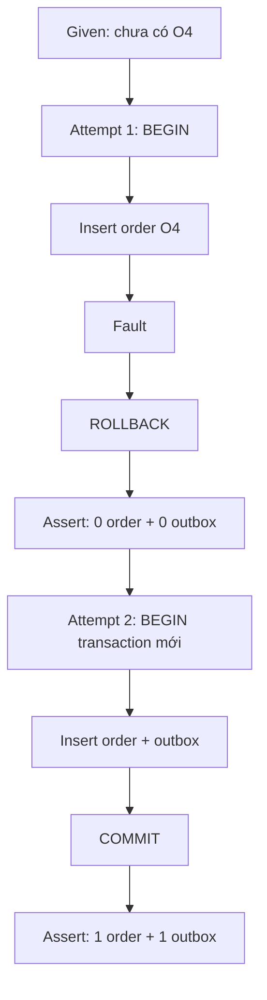
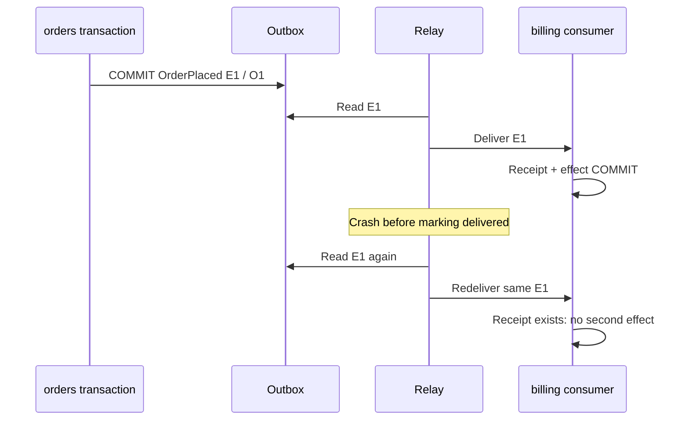
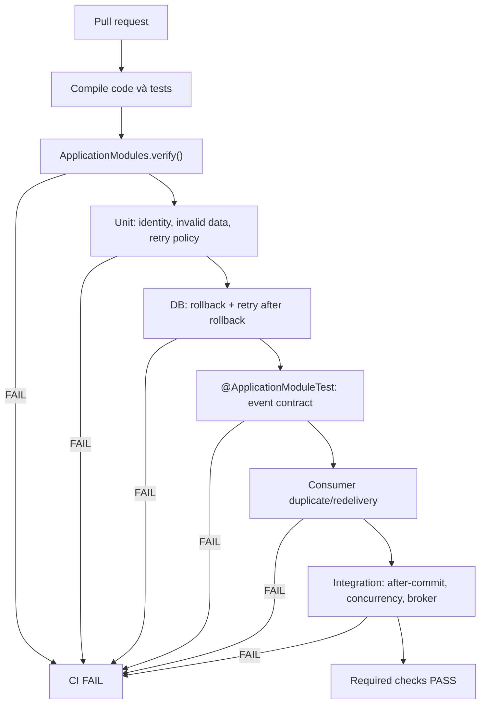

# Test data cho rollback và retry

> **Chương:** Test data  
> **Module học:** `SPRING_MODULITH_VERIFICATION_TESTING` — rèn kỹ năng kiểm chứng ranh giới kiến trúc ứng dụng Spring Modulith bằng `ApplicationModules` và quy tắc phụ thuộc module; thực hành `@ApplicationModuleTest`, kiểm thử sự kiện, cơ sở dữ liệu, tích hợp và quality gate trong CI nhằm ngăn phụ thuộc sai và hồi quy.

## 1. Vì sao rollback và retry đòi hỏi test data có lịch sử?

Module `orders` nhận yêu cầu đặt hàng. Trong một transaction, nó ghi đơn rồi ghi một sự kiện `OrderPlaced` vào outbox. Nếu ghi outbox thất bại, trạng thái đúng là **cả đơn và outbox đều không được commit**. Khi lỗi tạm thời qua đi, retry có thể tạo **một** đơn và **một** outbox record.

Nhưng khi đơn đã commit và response bị mất, client retry cùng command có thể tạo hiệu ứng kép nếu thiếu idempotency. Ở tầng sự kiện, broker giao cùng `OrderPlaced` hai lần thì consumer `billing` cũng phải tránh ghi hai khoản phí.

Ba tình huống đều có chữ “retry”, nhưng test data khác nhau:

- **Rollback của attempt đang chạy:** kiểm không còn partial state đã commit.
- **Retry một command:** phân biệt attempt chưa commit với yêu cầu đã commit nhưng response bị mất.
- **Redelivery một event:** giữ cùng `eventId` và payload, kiểm consumer áp dụng side effect theo chính sách chống trùng.

Một test chỉ gọi service hai lần rồi assert “không throw” là yếu. Cần chỉ ra **trạng thái ban đầu**, **điểm gây lỗi**, **trạng thái sau rollback**, **định danh giữ nguyên khi retry** và **số side effects cuối cùng**.

### Mục tiêu học tập

Sau bài này, bạn có thể:

1. Lập ma trận `Given–When–Then` cho rollback, retry thành công, retry hết lần và event redelivery.
2. Tạo fixture với `orderId`, `requestId/idempotencyKey`, `eventId`, outbox và receipt rõ semantics.
3. Kiểm atomic rollback của **hai thao tác ghi cùng transaction** bằng database integration test, không chỉ assert exception.
4. Dùng fault injection xác định để một attempt FAIL và attempt sau PASS mà không phụ thuộc mạng hay `Thread.sleep`.
5. Phân biệt retry sau rollback với retry sau command **đã commit**.
6. Thiết kế consumer receipt + side effect chung transaction, kiểm duplicate và crash recovery.
7. Kết hợp `@ApplicationModuleTest`, `PublishedEvents`, `ApplicationModules.verify()` và CI quality gate đúng phạm vi.

## 2. Phân biệt các ranh giới lỗi trước khi chuẩn bị dữ liệu

| Tình huống | Ranh giới | ID giữ nguyên và thay đổi | Bằng chứng cần assert |
| --- | --- | --- | --- |
| DB rollback | Những ghi trong **một transaction** | Giữ identity của attempt để đối chiếu | Không có partial rows sau lỗi |
| Retry sau rollback | Một logical command, transaction mới | Giữ `orderId`/`requestId`; event chưa commit có thể cấp lại | Sau retry chỉ một order/outbox |
| Retry sau commit | Cùng command đã thành công nhưng mất response | Cùng idempotency key và payload | Không tạo order/event thứ hai |
| Outbox relay retry | Cùng sự kiện **đã lưu** | **Cùng eventId và semantic payload** | Relay không biến thành event mới |
| Consumer redelivery | Một logical event được giao nhiều lần | Cùng eventId theo consumer scope | Một committed business effect |
| Listener rollback | Receipt và business effect | Retry **cùng event ID** | Receipt không bị commit trước effect |
| Retry quá giới hạn | Lỗi vẫn tồn tại | Giữ identity theo contract | Terminal outcome; không partial commit |

### 2.1. Lỗi nào nên và không nên retry?

| Loại lỗi | Chính sách cần cân nhắc | Lý do |
| --- | --- | --- |
| Deadlock, serialization conflict, mất kết nối thật sự tạm thời | Retry **có giới hạn** nếu thao tác an toàn | Điều kiện bên ngoài có thể thay đổi |
| Timeout, chưa rõ lần trước đã commit hay chưa | Cần idempotency/reconciliation trước retry an toàn | Không thể mặc định rollback |
| Quantity = 0, SKU rỗng | Không retry tự động | Đầu vào không đổi vẫn sai |
| Unique/foreign-key conflict permanent | Xử lý theo contract, không blind retry | Retry không giải quyết mâu thuẫn dữ liệu |
| Event schema lỗi hoặc payload hỏng | Reject/quarantine/dead-letter theo policy | Tránh poison-message loop |
| Listener lỗi mạng tạm thời | Retry có timeout/backoff theo hạ tầng | Cần chống side effect kép |

`@Transactional` của Spring chỉ bảo vệ các thao tác tham gia transaction khi lời gọi **đi qua Spring proxy hoặc cơ chế transaction tương ứng**. Test tự `new` service có annotation rồi gọi method không chứng minh DB đã rollback. Một test tự throw bên ngoài service cũng chưa đủ chứng minh transaction của service đúng.

## 3. Ma trận test data trước và sau lỗi

| ID | Given tối thiểu | Fault/When | Then |
| --- | --- | --- | --- |
| R-01 | `O1` chưa tồn tại | Insert order lỗi | Không có `O1` hoặc outbox |
| R-02 | `O2` chưa tồn tại | Lỗi sau order insert, trước outbox | Rollback `O2`, 0 outbox |
| R-03 | Outbox có `E_USED` của đơn khác | Insert order `O3` rồi outbox trùng `E_USED` | Rollback `O3`; event cũ không đổi |
| R-04 | `O4` chưa có, fault xảy ra đúng lần 1 | Attempt 1 FAIL, attempt 2 PASS | 1 order, 1 outbox cho `O4` |
| R-05 | `K5`/payload đã commit | Client retry `K5` và cùng payload | Không sinh effect mới, trả kết quả cũ |
| R-06 | `K5` gắn payload `P1` | Gửi `K5` với `P2 != P1` | Conflict, không âm thầm dùng kết quả cũ |
| R-07 | Event `E7` đã xử lý, receipt tồn tại | Broker giao lại `E7` | 1 receipt, 1 effect |
| R-08 | Receipt `E8` chưa có | Lỗi sau receipt insert, trước commit effect | Receipt/effect cùng rollback, retry có thể xử lý |
| R-09 | Một event `E9` | Hai consumers nhận đồng thời | Unique + transaction giữ một effect |
| R-10 | Fault tồn tại | Đạt max attempts | Terminal failure, không partial commit |

Một scenario nên có **một điểm fault chính** và một bộ dữ liệu sở hữu riêng, không gom cả R-01 đến R-10 vào một integration test khó chẩn đoán.

### 3.1. Ba trạng thái của R-04

```text
Trước attempt 1:
  customer_orders[O4] = absent
  order_outbox[orderId=O4] = empty

Sau attempt 1 FAIL và rollback:
  customer_orders[O4] = absent
  order_outbox[orderId=O4] = empty

Sau attempt 2 COMMIT:
  customer_orders[O4] = một order đã đặt
  order_outbox[orderId=O4] = đúng một OrderPlaced
```



Nếu test chỉ kiểm attempt thứ hai PASS mà không xem state ngay **sau rollback**, một row partial từ attempt trước có thể bị bỏ sót hoặc gây duplicate ở những scenario khác.

## 4. Bộ ba định danh: request, aggregate, event

- `orderId`: identity của `Order`; một logical command đặt đơn nên dùng ID theo hợp đồng nghiệp vụ.
- `requestId`: định danh logical request; chỉ trở thành **idempotency key** khi có cơ chế bền vững, unique constraint và contract tương ứng.
- `eventId`: identity của **một sự kiện nghiệp vụ**. Một event đã commit phải giữ eventId khi relay gửi lại.

| Hai thao tác | `orderId` | `requestId` | `eventId` |
| --- | --- | --- | --- |
| Attempt rollback rồi retry cùng command | Giữ | Giữ | Có thể tạo mới nếu event attempt đầu **chưa commit/chưa ra ngoài** |
| Client retry sau khi command đã commit | Giữ theo contract | Giữ | Không tạo logical event mới |
| Relay giao lại outbox event | Giữ | Giữ | **Giữ** |
| Tạo một đơn mới | ID mới | Key mới | ID mới |
| Event `OrderCancelled` của cùng đơn | Giữ | Theo luồng nghiệp vụ | **ID mới** |

**Sai lầm quan trọng:** test redelivery dùng `UUID.randomUUID()` ở mỗi lần tạo event sẽ mô phỏng **hai logical events khác nhau**, không phải một sự kiện được giao hai lần.

## 5. Ví dụ ứng dụng và phạm vi module

Giả sử Spring Boot application tại `com.example.shop`:

```text
src/main/java/com/example/shop/
├── ShopApplication.java
├── orders/
│   ├── PlaceOrderCommand.java
│   ├── OrderPlaced.java
│   ├── EventIdGenerator.java
│   ├── OrderPlacementService.java
│   └── OrdersRuntimeConfig.java
├── inventory/
│   ├── StockQuery.java
│   └── internal/StockJpaRepository.java
└── billing/
    ├── BillingOrderListener.java
    └── internal/BillingJdbcRepository.java

src/test/java/com/example/shop/
├── ModuleArchitectureTest.java
├── orders/
│   ├── FailOnceEventIds.java
│   ├── RollbackRetryIntegrationTest.java
│   └── OrderEventModuleTest.java
└── billing/
    └── BillingRedeliveryIntegrationTest.java
```

Theo cách phát hiện module mặc định của Spring Modulith, `orders`, `inventory`, `billing` là các application modules trực tiếp dưới package gốc. `orders` sở hữu đơn và outbox; `inventory` sở hữu dữ liệu tồn kho; `billing` sở hữu receipt và bút toán. Module `orders` nên dùng API `inventory.StockQuery`, không import `inventory.internal.StockJpaRepository` để chuẩn bị fixture.

**Phạm vi ví dụ:** Các class và bảng dưới đây chỉ minh họa kỹ thuật, không phải cấu trúc bắt buộc hay schema do Spring Modulith tự tạo. Nếu dự án sử dụng Spring Modulith Event Publication Registry, outbox framework hoặc event store, test chính cơ chế đó thay vì tạo một outbox thứ hai để giống bài học.

### 5.1. Public API của `inventory`

```java
package com.example.shop.inventory;

public interface StockQuery {
    boolean available(String sku, int quantity);
}
```

`StockQuery` là truy vấn, **không phải** thao tác reservation. Khi kiểm concurrency/overselling thật, cần integration test trên transaction/reservation của `inventory`; fake luôn trả `true` không chứng minh tồn kho được bảo toàn.

### 5.2. Command và event của `orders`

```java
package com.example.shop.orders;

import java.util.UUID;

public record PlaceOrderCommand(
        UUID orderId, UUID requestId, String sku, int quantity
) {}
```

```java
package com.example.shop.orders;

import java.time.Instant;
import java.util.UUID;

public record OrderPlaced(
        UUID eventId,
        UUID orderId,
        UUID requestId,
        String sku,
        int quantity,
        Instant occurredAt
) {}
```

Event record dùng để minh họa identity/payload. Luồng chuẩn sẽ validate trước khi tạo event; consumer của một payload không đáng tin cần có validation theo contract riêng.

### 5.3. Injectable event ID generator

```java
package com.example.shop.orders;

import java.util.UUID;

@FunctionalInterface
interface EventIdGenerator {
    UUID nextEventId();
}
```

Generator được inject giúp test gán event ID có chủ đích và tạo fault sau bước insert order. Production generator chỉ cấp ID mới khi tạo **logical event mới**; relay retry sự kiện đã commit sẽ dùng ID từ bản ghi lưu trữ.

## 6. Schema database đủ nhỏ để kiểm rollback hai bảng

Ví dụ PostgreSQL, được tạo qua migration trong test database:

```sql
CREATE TABLE customer_orders (
    id UUID PRIMARY KEY,
    request_id UUID NOT NULL,
    sku VARCHAR(64) NOT NULL,
    quantity INTEGER NOT NULL CHECK (quantity > 0),
    placed_at TIMESTAMPTZ NOT NULL
);

CREATE TABLE order_outbox (
    event_id UUID PRIMARY KEY,
    order_id UUID NOT NULL REFERENCES customer_orders(id),
    request_id UUID NOT NULL,
    sku VARCHAR(64) NOT NULL,
    quantity INTEGER NOT NULL,
    occurred_at TIMESTAMPTZ NOT NULL,
    published_at TIMESTAMPTZ NULL
);
```

Hai bảng thuộc **module `orders`** và dùng **cùng DataSource/transaction manager**. Nếu transaction ghi order commit nhưng outbox không được commit, hệ thống có nguy cơ “đơn đã đặt nhưng không có sự kiện bền vững”.

| Trạng thái outbox | Ý nghĩa |
| --- | --- |
| Không có row | Chưa ghi hoặc transaction rollback |
| Có row, `published_at = NULL` | Event đã commit, relay có thể cần giao |
| Có row, `published_at != NULL` | Được đánh dấu đã gửi theo relay contract; không chứng minh consumer đã commit |
| Giao lại row đó | Vẫn **cùng `event_id` và payload** |

Không đồng nhất “outbox marked delivered” với “mọi listener đã xử lý xong”. Relay có thể gửi rồi crash trước khi cập nhật trạng thái, sau đó cần gửi lại cùng event.

## 7. Service có transaction thật ở module `orders`

`src/main/java/com/example/shop/orders/OrderPlacementService.java`:

```java
package com.example.shop.orders;

import java.sql.Timestamp;
import java.time.Clock;
import java.time.Instant;
import java.util.UUID;
import org.springframework.jdbc.core.JdbcTemplate;
import org.springframework.stereotype.Service;
import org.springframework.transaction.annotation.Transactional;
import com.example.shop.inventory.StockQuery;

@Service
public class OrderPlacementService {

    private final JdbcTemplate jdbc;
    private final StockQuery stock;
    private final EventIdGenerator eventIds;
    private final Clock clock;

    public OrderPlacementService(JdbcTemplate jdbc, StockQuery stock,
                                 EventIdGenerator eventIds, Clock clock) {
        this.jdbc = jdbc;
        this.stock = stock;
        this.eventIds = eventIds;
        this.clock = clock;
    }

    @Transactional
    public OrderPlaced place(PlaceOrderCommand command) {
        if (command == null
                || command.orderId() == null
                || command.requestId() == null
                || command.sku() == null
                || command.sku().isBlank()
                || command.quantity() <= 0) {
            throw new IllegalArgumentException("Invalid command");
        }

        if (!stock.available(command.sku(), command.quantity())) {
            throw new IllegalStateException("Out of stock");
        }

        Instant at = clock.instant();
        jdbc.update(
            "INSERT INTO customer_orders "
                + "(id, request_id, sku, quantity, placed_at) "
                + "VALUES (?, ?, ?, ?, ?)",
            command.orderId(), command.requestId(), command.sku(),
            command.quantity(), Timestamp.from(at)
        );

        // Sau insert order: lỗi ở đây phải rollback cả row order.
        UUID eventId = eventIds.nextEventId();
        OrderPlaced event = new OrderPlaced(
            eventId, command.orderId(), command.requestId(),
            command.sku(), command.quantity(), at
        );

        jdbc.update(
            "INSERT INTO order_outbox "
                + "(event_id, order_id, request_id, sku, quantity, occurred_at) "
                + "VALUES (?, ?, ?, ?, ?, ?)",
            event.eventId(), event.orderId(), event.requestId(),
            event.sku(), event.quantity(), Timestamp.from(event.occurredAt())
        );
        return event;
    }
}
```

Nếu `nextEventId()` hoặc insert outbox ném unchecked exception, Spring-managed transaction của `place()` phải rollback **cả order insert** khi các thao tác JDBC cùng transaction. Đây là demo tập trung vào **atomic rollback**, không bắt buộc production phải đặt SQL trực tiếp trong service; repository/outbox writer có thể được tách và vẫn tham gia chung transaction.

### 7.1. Runtime configuration

```java
package com.example.shop.orders;

import java.time.Clock;
import java.util.UUID;
import org.springframework.context.annotation.Bean;
import org.springframework.context.annotation.Configuration;

@Configuration(proxyBeanMethods = false)
class OrdersRuntimeConfig {

    @Bean
    EventIdGenerator eventIdGenerator() {
        return UUID::randomUUID;
    }

    @Bean
    Clock clock() {
        return Clock.systemUTC();
    }
}
```

### 7.2. Giới hạn của service mẫu

- `request_id` chưa có unique constraint và **không tự cung cấp idempotency**.
- Chưa có relay/broker, retry policy/backoff, publication registry.
- Chưa có stock reservation, concurrency protection.
- `@Transactional` không rollback một HTTP call/payment gateway ngoài database.

Do đó test tiếp theo chứng minh rollback của order/outbox khi một lần gọi service lỗi, và có thể gọi lại sau rollback; nó **chưa** chứng minh retry command sau commit hoặc đảm bảo delivery toàn hệ thống.

## 8. Fault injection: lỗi đúng lần thứ nhất, không cần mất mạng thật

`src/test/java/com/example/shop/orders/FailOnceEventIds.java`:

```java
package com.example.shop.orders;

import java.util.UUID;
import java.util.concurrent.atomic.AtomicBoolean;
import org.springframework.dao.TransientDataAccessResourceException;

final class FailOnceEventIds implements EventIdGenerator {

    private final AtomicBoolean failNext = new AtomicBoolean(true);
    private volatile UUID nextId;

    void startScenario(UUID eventIdAfterRetry) {
        nextId = eventIdAfterRetry;
        failNext.set(true);
    }

    @Override
    public UUID nextEventId() {
        if (failNext.compareAndSet(true, false)) {
            throw new TransientDataAccessResourceException(
                "Simulated transient fault after order insert"
            );
        }
        return nextId;
    }
}
```

Đây là test double giả lỗi tại **một điểm đã biết** sau order insert. Nó không mô phỏng đầy đủ lỗi network/driver và không biến mọi `TransientDataAccessResourceException` thành lỗi luôn retry an toàn. Test phải reset `startScenario(...)`, không chia sẻ cùng instance qua các test chạy song song; ví dụ sau chỉ có một test method sử dụng bean có state này.

## 9. Integration test: một transaction rollback, transaction sau commit

Muốn kiểm `@Transactional`, phải gọi Spring-managed service với transaction manager và database thật. `src/test/java/com/example/shop/orders/RollbackRetryIntegrationTest.java`:

```java
package com.example.shop.orders;

import static org.junit.jupiter.api.Assertions.*;

import java.time.Clock;
import java.time.Instant;
import java.time.ZoneOffset;
import java.util.UUID;
import org.junit.jupiter.api.Test;
import org.springframework.beans.factory.annotation.Autowired;
import org.springframework.boot.test.context.SpringBootTest;
import org.springframework.boot.test.context.TestConfiguration;
import org.springframework.context.annotation.Bean;
import org.springframework.context.annotation.Import;
import org.springframework.context.annotation.Primary;
import org.springframework.dao.TransientDataAccessResourceException;
import org.springframework.jdbc.core.JdbcTemplate;
import com.example.shop.inventory.StockQuery;

@SpringBootTest
@Import(RollbackRetryIntegrationTest.ScenarioConfig.class)
class RollbackRetryIntegrationTest {

    @TestConfiguration(proxyBeanMethods = false)
    static class ScenarioConfig {

        @Bean
        @Primary
        FailOnceEventIds failOnceEventIds() {
            return new FailOnceEventIds();
        }

        @Bean
        @Primary
        StockQuery availableStock() {
            return (sku, quantity) -> true;
        }

        @Bean
        @Primary
        Clock testClock() {
            return Clock.fixed(
                Instant.parse("2026-01-01T09:00:00Z"),
                ZoneOffset.UTC
            );
        }
    }

    @Autowired OrderPlacementService service;
    @Autowired FailOnceEventIds ids;
    @Autowired JdbcTemplate jdbc;

    private int orderCount(UUID orderId) {
        return jdbc.queryForObject(
            "SELECT COUNT(*) FROM customer_orders WHERE id = ?",
            Integer.class, orderId);
    }

    private int outboxCount(UUID orderId) {
        return jdbc.queryForObject(
            "SELECT COUNT(*) FROM order_outbox WHERE order_id = ?",
            Integer.class, orderId);
    }

    @Test
    void rollbackThenRetryCommitsExactlyOneOrderAndOutbox() {
        UUID orderId = UUID.randomUUID();
        UUID requestId = UUID.randomUUID();
        UUID eventId = UUID.randomUUID();
        ids.startScenario(eventId);
        PlaceOrderCommand command =
            new PlaceOrderCommand(orderId, requestId, "SKU-001", 2);

        try {
            assertEquals(0, orderCount(orderId));
            assertEquals(0, outboxCount(orderId));

            assertThrows(TransientDataAccessResourceException.class,
                () -> service.place(command));

            // Sau khi Spring service transaction đã rollback.
            assertEquals(0, orderCount(orderId));
            assertEquals(0, outboxCount(orderId));

            // Lời gọi MỚI qua proxy: transaction mới.
            OrderPlaced result = service.place(command);
            assertEquals(orderId, result.orderId());
            assertEquals(requestId, result.requestId());
            assertEquals(eventId, result.eventId());
            assertEquals(1, orderCount(orderId));
            assertEquals(1, outboxCount(orderId));
        } finally {
            jdbc.update(
                "DELETE FROM order_outbox WHERE order_id = ?", orderId);
            jdbc.update(
                "DELETE FROM customer_orders WHERE id = ?", orderId);
        }
    }
}
```

### 9.1. Điều kiện để test có giá trị

- Project có `DataSource`, JDBC, Spring-managed transaction manager, migrations và DB hỗ trợ schema.
- Service được gọi **qua Spring proxy**, không tự khởi tạo bằng `new`.
- **Không gắn `@Transactional` trên test method** ở ví dụ này: hai lần gọi service phải có transactions riêng để quan sát rollback/commit.
- Các writes cùng DataSource/transaction manager; lỗi unchecked làm rollback theo Spring default rules.
- Event ID generator giả chỉ được dùng cho scenario hiện tại; không chạy những tests cùng bean mutable song song.
- Test method cần được runner phát hiện. Tên `*IntegrationTest` thường được Surefire nhận vì kết thúc bằng `Test`, nhưng build tùy cấu hình vẫn phải xác minh report.

Đây là **manual retry trong test harness**, chưa kiểm retry policy tự động. Để test Spring Retry/Resilience4j/broker policy cần thêm tests về số attempts, backoff, exception classification và thứ tự transaction interceptors.

### 9.2. Vì sao phải assert **giữa** hai lần gọi?

Nếu order của attempt đầu vẫn tồn tại, lần hai có thể đụng primary key; nếu test chỉ kiểm exception rồi không query DB, lỗi partial commit có thể bị che. Ngược lại, test bọc cả hai attempts trong một transaction ngoài có thể tạo cảm giác rollback đúng dù production service transaction thực sự sai.

## 10. Lỗi ngay khi ghi outbox: test cần một row đối chứng

R-03 kiểm điểm lỗi **sau order insert**, khi `INSERT INTO order_outbox` gặp event ID đã được sử dụng. Dataset:

```text
Given:
  EXISTING_ORDER và outbox E_USED đã tồn tại
  NEW_ORDER chưa tồn tại
  Test EventIdGenerator trả E_USED khi tạo event cho NEW_ORDER

When:
  service.place(command với NEW_ORDER)

Then:
  Outbox unique key từ chối E_USED
  customer_orders[NEW_ORDER] = absent (rollback)
  order_outbox[NEW_ORDER] = empty
  outbox row E_USED của EXISTING_ORDER không đổi
```

`NEW_ORDER` phải **khác ID** với `EXISTING_ORDER`. Nếu vô tình dùng trùng order ID, insert order có thể FAIL **trước** khi đến outbox, và test không kiểm đúng điểm lỗi cần chứng minh.

Đây là cách thử atomicity bằng **database constraint thật**. Nhưng unique conflict thường là permanent integrity error, **không phải** lỗi nên blind retry vô hạn. R-03 kiểm rollback, R-04 ở mục 9 kiểm recovery sau fault một lần.

### 10.1. Đảm bảo exception đến từ đúng constraint

`DataIntegrityViolationException` có thể bao gồm lỗi NOT NULL, FK hoặc unique không liên quan. Preseed `E_USED` hợp lệ, dùng order ID riêng và khi cần kiểm root cause/constraint name/SQLState theo database driver. Trên PostgreSQL, một statement lỗi có thể khiến transaction hiện tại ở trạng thái abort: phải để transaction của service rollback rồi mới query DB ở transaction khác.

## 11. Retry policy nên mở transaction **mới** cho mỗi attempt

Một cấu hình mong muốn về mặt kiến trúc:

```text
Retry wrapper / caller
  Attempt 1:
    BEGIN TX
      service.place(command)
    ROLLBACK on retryable error

  Attempt 2:
    BEGIN TX MỚI
      service.place(command)
    COMMIT
```

Nếu vòng lặp retry nằm **trong cùng transaction đã bị đánh dấu rollback-only**, lần thử sau cũng có thể không commit được. Với Spring AOP, thứ tự các interceptor retry và transaction phải được kiểm chứng theo cấu hình thực; không suy rằng thêm `@Retryable` và `@Transactional` lên một method bất kỳ luôn cho ra đúng transaction boundaries.

### 11.1. Test chính sách retry khác test rollback

R-04 ở mục 9 chỉ gọi thủ công hai lần để kiểm state. Để xác minh **policy tự động**, cần test riêng số lần gọi, loại lỗi được retry và scheduling/backoff:

| Test policy | Fault giả lập | Kỳ vọng |
| --- | --- | --- |
| Một lỗi transient | Lần 1 FAIL, lần 2 PASS | Hai attempts; chỉ một kết quả cuối |
| Lỗi vẫn còn | Lần 1..`maxAttempts` FAIL | Không vượt giới hạn, terminal failure rõ |
| Validation error | Quantity 0 | Chỉ một attempt, không retry |
| Permanent integrity error | Unique conflict thực | Không thử lại vô ích |
| Backoff | Lỗi retryable liên tiếp | Kiểm scheduler/duration theo policy, không dùng sleep ngẫu nhiên |
| Outcome không rõ | Connection đứt sau khi server có thể commit | Idempotency/reconciliation, không tự tạo command mới |

Tùy dự án có thể dùng Spring Retry, Resilience4j hoặc retry hạ tầng messaging. Các thư viện và cấu hình có version/behavior khác nhau, nên test phải dùng **API của thư viện đang có**, không chỉ kiểm đường manual retry như mục 9.

### 11.2. Inject clock/scheduler thay vì đợi thời gian thật

Nếu policy backoff 500 ms, test không nhất thiết phải thực sự `Thread.sleep(500)`. Có thể inject một scheduler/sleeper giả hoặc virtual-time test support rồi assert **số lần và lịch trì hoãn**. Timeouts cho integration tests phải hữu hạn, nhưng không nên dùng delay cố định làm bằng chứng listener đã chạy.

### 11.3. Retry không thể bù cho idempotency bị thiếu

Khi request timeout, client **không nhất thiết biết** transaction phía server đã rollback. Nếu server đã commit, retry mù quáng có thể tạo effect mới. Một lớp retry an toàn cần biết cách phân biệt **attempt rollback chắc chắn** với **commit outcome không rõ** và dùng idempotency contract phù hợp.

## 12. Retry sau COMMIT: test data cho command idempotency

Giả sử client gửi:

```text
requestId = K1
orderId   = O1
sku       = SKU-001
quantity  = 2
```

Server commit đơn `O1` và outbox `E1`, nhưng response bị mất. Client gửi lại **cùng `K1` và cùng payload**. Khi hỗ trợ idempotency, hệ thống cần trả lại/khôi phục kết quả theo contract mà không sinh thêm đơn hoặc event.

**Giới hạn rõ ràng:** Service `OrderPlacementService` ở mục 7 chỉ lưu `request_id`; nó **chưa hỗ trợ idempotency**. Thêm test R-05 mà không bổ sung cơ chế bền vững sẽ không tự nhiên PASS. Không chữa bằng việc bắt tất cả `duplicate key` rồi trả “thành công” vì có thể che lỗi payload khác hoặc một transaction trước chưa hoàn tất.

### 12.1. Mô hình lưu kết quả command để replay

Một schema tham khảo:

```sql
CREATE TABLE order_requests (
    request_id UUID PRIMARY KEY,
    payload_digest VARCHAR(64) NOT NULL,
    order_id UUID NOT NULL,
    outcome_event_id UUID,
    status VARCHAR(20) NOT NULL
);
```

Mô hình có thể lưu `IN_PROGRESS`, `COMPLETED`, kết quả hoặc error classification. Dự án phải thiết kế transaction và xử lý hai requests đồng thời dùng một key, tình huống process crash giữa chừng và thời hạn giữ key. Schema này **không phải** migration bắt buộc hoặc implementation hoàn chỉnh.

### 12.2. Ma trận request replay

| Scenario | Request key | Nội dung | Kỳ vọng |
| --- | --- | --- | --- |
| Gửi lần đầu | `K1` | `P1` | Tạo kết quả cho `O1` và `E1` |
| Retry sau commit | **`K1`** | **`P1`** | Dùng lại kết quả, không tạo effect mới |
| Cùng key, payload khác | **`K1`** | `P2 != P1` | Conflict theo policy |
| Command mới | `K2 != K1` | `P1` hoặc payload mới | Xử lý như request mới nếu hợp lệ |
| Hai callers đồng thời | Cùng `K3` | Cùng `P3` | Unique/locking ngăn hai commits |

Giữ `requestId` trong **hai attempts** không có nghĩa hệ thống đã có idempotency. Cần unique index/receipt bền vững, payload fingerprint và logic trả kết quả cũ. Nếu dùng `orderId` primary key duy nhất, hệ thống có thể từ chối duplicate row nhưng chưa đáp ứng contract “retry trả kết quả trước” hay xử lý key conflict.

### 12.3. Khi nào cấp event ID mới?

- Nếu attempt trước **rollback** và không có event đã commit/publish bên ngoài, transaction mới có thể tạo event ID mới theo thiết kế vì logical event thành công thực sự mới xuất hiện.
- Nếu event `E1` **đã commit trong outbox**, việc relay thử gửi lại phải giữ **`E1` và payload**, không gọi generator để cấp `E2`.
- Nếu command `K1` **đã commit thành công**, replay idempotent không được vô tình tạo thêm `OrderPlaced(E2, O1)`.

Khi hệ thống đã publish trực tiếp tới broker trước DB commit, rollback DB không thể “rút lại” event từ broker. Test phải phát hiện và buộc thay đổi thiết kế publication/transaction phù hợp, thay vì giả định mọi external side effect sẽ rollback tự động.

## 13. Outbox retry và event redelivery giữ nguyên logical identity

Sau khi `OrderPlaced(eventId=E1)` được commit trong outbox:

1. Relay đọc `E1` và gửi tới broker/consumer.
2. Relay có thể crash trước khi cập nhật `published_at`.
3. Khi chạy lại, relay đọc cùng row `E1`.
4. Relay gửi lại **`E1`**, không tạo event ID mới.
5. Consumer nhận diện duplicate theo receipt/processing state.



Nếu ứng dụng dùng **Spring Modulith Event Publication Registry**, framework có metadata và cơ chế resubmission riêng. **Không mặc định** ID publication nội bộ của registry giống `eventId` nghiệp vụ; chỉ đưa ra assertions theo hợp đồng identity mà dự án đã công bố.

### 13.1. Test data theo mục tiêu event retry

| Mục tiêu | Given | When | Then |
| --- | --- | --- | --- |
| Relay lần đầu | Một outbox row `E1` pending | Relay xử lý | Gửi event `E1` |
| Relay gửi lại | Vẫn một row `E1`, ack bị mất | Relay chạy tiếp | Event vẫn mang `E1` |
| Consumer dedup | Chưa có receipt `E1` | Deliver `E1` hai lần | Một receipt, một effect |
| Payload conflict | Đã xử lý `E1` với `P1` | Nhận `E1` nhưng payload `P2` | Policy conflict/quarantine rõ |
| Sự kiện khác | `E1 != E2`, có thể cùng order | Giao cả hai | Không gộp sai vì trùng orderId |

Một duplicate-event test phải dùng **cùng eventId và cùng semantic payload** qua hai lần giao. Dùng hai event IDs random khác nhau chỉ kiểm hai events mới. Ngược lại, dedup theo `orderId` cho mọi loại event có thể làm bỏ nhầm `OrderCancelled` sau `OrderPlaced` của cùng aggregate.

## 14. Consumer retry: receipt và business effect phải chung transaction

Module `billing` nhận `orders.OrderPlaced` và ghi một bút toán. Nếu nó:

1. Commit receipt “`E1` đã xử lý”.
2. Sau đó mới ghi bút toán và bị lỗi.

thì lần retry thấy receipt tồn tại và **bỏ qua event**, dù hiệu ứng nghiệp vụ chưa có. Nếu ghi bút toán trước rồi crash trước receipt, lần giao lại có thể ghi hai lần. Khi cả hai state nằm trong **cùng database**, thiết kế thường dùng receipt và effect trong **cùng transaction**.

### 14.1. Schema của `billing`

```sql
CREATE TABLE processed_events (
    consumer_name VARCHAR(100) NOT NULL,
    event_id UUID NOT NULL,
    processed_at TIMESTAMPTZ NOT NULL,
    PRIMARY KEY (consumer_name, event_id)
);

CREATE TABLE billing_entries (
    id UUID PRIMARY KEY,
    order_id UUID NOT NULL,
    source_event_id UUID NOT NULL UNIQUE
);
```

Các bảng này do `billing` sở hữu. `orders` không ghi trực tiếp vào `billing.internal`. `order_id` là giá trị identity từ hợp đồng `OrderPlaced`, không đòi `billing` import JPA entity/repository nội bộ của `orders`. Primary key `(consumer_name, event_id)` cũng cho phép nhiều consumers có receipt riêng đối với cùng một event.

### 14.2. Consumer transaction minh họa

`src/main/java/com/example/shop/billing/BillingOrderListener.java`:

```java
package com.example.shop.billing;

import java.sql.Timestamp;
import java.time.Clock;
import java.util.UUID;
import org.springframework.jdbc.core.JdbcTemplate;
import org.springframework.stereotype.Service;
import org.springframework.transaction.annotation.Transactional;
import com.example.shop.orders.OrderPlaced;

@Service
public class BillingOrderListener {

    private final JdbcTemplate jdbc;
    private final Clock clock;

    public BillingOrderListener(JdbcTemplate jdbc, Clock clock) {
        this.jdbc = jdbc;
        this.clock = clock;
    }

    @Transactional
    public void handle(OrderPlaced event) {
        if (event == null || event.eventId() == null
                || event.orderId() == null || event.quantity() <= 0) {
            throw new IllegalArgumentException("Invalid OrderPlaced");
        }

        int claimed = jdbc.update(
            "INSERT INTO processed_events "
                + "(consumer_name, event_id, processed_at) VALUES (?, ?, ?) "
                + "ON CONFLICT (consumer_name, event_id) DO NOTHING",
            "billing", event.eventId(), Timestamp.from(clock.instant())
        );

        if (claimed == 0) {
            return; // Same event has already committed its receipt.
        }

        jdbc.update(
            "INSERT INTO billing_entries "
                + "(id, order_id, source_event_id) VALUES (?, ?, ?)",
            UUID.randomUUID(), event.orderId(), event.eventId()
        );
    }
}
```

**Điều kiện:** `processed_events` và `billing_entries` cùng database/transaction manager; lời gọi `handle` qua Spring-managed proxy. PostgreSQL `ON CONFLICT` và unique key xử lý cạnh tranh claim receipt. Nếu bút toán throw unchecked sau receipt insert, **cả hai phải rollback**. Không commit receipt trước business effect khi mục tiêu là atomicity.

**Giới hạn ví dụ:**

- `handle` chỉ là service method; việc nối với `@ApplicationModuleListener`/broker listener là một bước riêng.
- Chưa kiểm payload cùng `eventId` nhưng bị thay đổi. Nếu contract yêu cầu, bổ sung payload digest/version và chính sách xử lý xung đột.
- Nếu side effect là HTTP payment gateway ngoài DB, DB transaction không làm remote call atomic. Cần idempotency key ở gateway, saga/outbox hoặc cơ chế tin cậy khác.
- `UUID.randomUUID()` ở `billing_entries.id` phù hợp minh họa vì duplicate bị chặn trước insert; test nên đối chiếu số bản ghi theo `source_event_id`.

### 14.3. Một test redelivery phải kiểm receipt và effect

```text
Given:
  processed_events[billing,E1] = absent
  billing_entries[source_event_id=E1] = absent

When:
  listener.handle(E1)
  listener.handle(E1) lần nữa với CÙNG payload

Then:
  COUNT(processed_events for billing,E1) = 1
  COUNT(billing_entries for E1) = 1
```

Test này không dùng event ID khác ở lần hai. Nếu hai events mới có ID khác nhau nhưng cùng `orderId`, khả năng chấp nhận hai effects phụ thuộc **business contract**, không chỉ event-level dedup.

### 14.4. Integration test redelivery qua Spring transaction

Giả định Boot context có JDBC, migrations và các beans cho những application modules được khởi động. Một `@TestConfiguration` thêm API `StockQuery` của module `inventory` và Clock cố định nếu môi trường test chưa có collaborators phù hợp.

```java
package com.example.shop.billing;

import static org.junit.jupiter.api.Assertions.assertEquals;

import java.time.Clock;
import java.time.Instant;
import java.time.ZoneOffset;
import java.util.UUID;
import org.junit.jupiter.api.Test;
import org.springframework.beans.factory.annotation.Autowired;
import org.springframework.boot.test.context.SpringBootTest;
import org.springframework.boot.test.context.TestConfiguration;
import org.springframework.context.annotation.Bean;
import org.springframework.context.annotation.Import;
import org.springframework.context.annotation.Primary;
import org.springframework.jdbc.core.JdbcTemplate;
import com.example.shop.inventory.StockQuery;
import com.example.shop.orders.OrderPlaced;

@SpringBootTest
@Import(BillingRedeliveryIntegrationTest.TestCollaborators.class)
class BillingRedeliveryIntegrationTest {

    @TestConfiguration(proxyBeanMethods = false)
    static class TestCollaborators {
        @Bean
        @Primary
        StockQuery availableStock() {
            return (sku, quantity) -> true;
        }

        @Bean
        @Primary
        Clock fixedClock() {
            return Clock.fixed(
                Instant.parse("2026-01-01T09:00:00Z"),
                ZoneOffset.UTC);
        }
    }

    @Autowired BillingOrderListener listener;
    @Autowired JdbcTemplate jdbc;

    @Test
    void redeliveryOfSameEventCreatesOnlyOneBillingEntry() {
        UUID eventId = UUID.randomUUID();
        UUID orderId = UUID.randomUUID();
        UUID requestId = UUID.randomUUID();
        OrderPlaced event = new OrderPlaced(
            eventId, orderId, requestId, "SKU-001", 2,
            Instant.parse("2026-01-01T09:00:00Z"));

        try {
            listener.handle(event);
            listener.handle(event); // Same logical event ID and payload.

            Integer receipts = jdbc.queryForObject(
                "SELECT COUNT(*) FROM processed_events "
                    + "WHERE consumer_name = ? AND event_id = ?",
                Integer.class, "billing", eventId);
            Integer effects = jdbc.queryForObject(
                "SELECT COUNT(*) FROM billing_entries "
                    + "WHERE source_event_id = ?",
                Integer.class, eventId);

            assertEquals(1, receipts);
            assertEquals(1, effects);
        } finally {
            jdbc.update(
                "DELETE FROM billing_entries WHERE source_event_id = ?",
                eventId);
            jdbc.update(
                "DELETE FROM processed_events "
                    + "WHERE consumer_name = ? AND event_id = ?",
                "billing", eventId);
        }
    }
}
```

Ở đây **không đặt `@Transactional` lên test method**, để mỗi `listener.handle(...)` chạy với transaction service riêng. Test này chỉ kiểm **gọi consumer hai lần**, chưa chứng minh broker delivery/ack hoặc retry scheduler. Nếu project khác package/component scanning, bean replacement hoặc multi-DataSource, điều chỉnh context theo kiến trúc thật trước khi chạy.

## 15. Khi listener FAIL ở giữa, receipt cũng phải rollback

R-08 cần fault **sau receipt insert, trước commit business effect**. Có thể dùng một port ghi bút toán có fault injection hoặc một database constraint cụ thể tại bước insert `billing_entries`:

```text
Given:
  receipt E8 chưa có
  billing entry E8 chưa có
  Một fault được cấu hình xảy ra khi ghi billing entry

When:
  listener.handle(E8) -> exception

Then:
  processed_events[billing,E8] = absent
  billing_entries[E8] = absent

When:
  Loại bỏ fault và deliver lại CHÍNH event E8

Then:
  receipt E8 = 1
  billing entry E8 = 1
```

Nếu test chỉ kiểm “listener ném exception” thì chưa phát hiện bug **receipt đã commit nhưng effect không có**. Dữ liệu phải đủ để query cả hai bảng sau rollback. Nên tạo fault đúng tại write thứ hai, thay vì để validation chặn event ngay ở đầu method.

### 15.1. Kiểm tranh chấp hai consumer instances

Khi hai transactions cùng claim event `E9`:

```text
TX A: INSERT receipt (billing, E9)
TX B: INSERT receipt (billing, E9)

Unique constraint và isolation của DB:
  Chỉ một transaction được claim E9 mới và commit effect.

Expected:
  1 receipt + 1 billing entry cho E9.
```

Hai lần gọi tuần tự với một `HashSet` local không chứng minh race-safety. Muốn kiểm concurrency cần DB/transaction thực, cơ chế đồng bộ hai workers và timeout hữu hạn. Với nhiều consumer instances, receipt trong RAM của từng instance không thể thay thế storage bền vững.

## 16. `@ApplicationModuleTest`: kiểm publication nhưng không đánh đồng với commit

Spring Modulith hỗ trợ `@ApplicationModuleTest` và `PublishedEvents` để kiểm hợp đồng event đã được publish trong module. Công cụ này phù hợp để xác nhận identity/payload, nhưng **không đủ** để kết luận order/outbox đã commit hoặc listener bất đồng bộ đã hoàn tất.

### 16.1. Event emitter minh họa trong module `orders`

```java
package com.example.shop.orders;

import org.springframework.context.ApplicationEventPublisher;
import org.springframework.stereotype.Component;

@Component
public class OrderEventEmitter {

    private final ApplicationEventPublisher events;

    public OrderEventEmitter(ApplicationEventPublisher events) {
        this.events = events;
    }

    public void emit(OrderPlaced event) {
        events.publishEvent(event);
    }
}
```

Adapter này không thay outbox relay thực tế và không tự cung cấp transaction/retry. Nó chỉ minh họa một component production publish event qua Spring.

### 16.2. Quan sát event thật bằng `PublishedEvents`

`src/test/java/com/example/shop/orders/OrderEventModuleTest.java`:

```java
package com.example.shop.orders;

import static org.assertj.core.api.Assertions.assertThat;

import java.time.Instant;
import java.util.UUID;
import org.junit.jupiter.api.Test;
import org.springframework.beans.factory.annotation.Autowired;
import org.springframework.modulith.test.ApplicationModuleTest;
import org.springframework.modulith.test.PublishedEvents;

@ApplicationModuleTest
class OrderEventModuleTest {

    @Autowired OrderEventEmitter emitter;

    @Test
    void publishesEventWithOriginalIdentity(PublishedEvents published) {
        UUID eventId = UUID.randomUUID();
        UUID orderId = UUID.randomUUID();
        UUID requestId = UUID.randomUUID();
        Instant at = Instant.parse("2026-01-01T09:00:00Z");
        OrderPlaced event = new OrderPlaced(
            eventId, orderId, requestId, "SKU-001", 2, at);

        emitter.emit(event);

        assertThat(published.ofType(OrderPlaced.class))
            .anySatisfy(observed -> {
                assertThat(observed.eventId()).isEqualTo(eventId);
                assertThat(observed.orderId()).isEqualTo(orderId);
                assertThat(observed.requestId()).isEqualTo(requestId);
                assertThat(observed.occurredAt()).isEqualTo(at);
            });
    }
}
```

Test gọi component thật, không chỉ tự tạo một `OrderPlaced` rồi assert getter. `anySatisfy` chứng minh có **ít nhất một event** phù hợp, chưa chứng minh chỉ có đúng một event; thêm kiểm số lượng nếu contract đòi hỏi. Module test phải có Spring context và test collaborators phù hợp (DB/StockQuery nếu service khác cần), không mặc định chỉ annotation là đủ boot một ứng dụng bất kỳ.

### 16.3. AFTER_COMMIT listener và rollback: ba kết quả không giống nhau

Với `@TransactionalEventListener(phase = AFTER_COMMIT)` hoặc Spring Modulith `@ApplicationModuleListener` theo semantics/configuration tương ứng:

1. Một event có thể đã được **publish tới Spring ApplicationEventPublisher** trong transaction.
2. Transaction nguồn **rollback**, nên callback after-commit **không** chạy.
3. Không có side effect consumer đã **commit**.

Đừng viết assertion “không có event nào được publish” chỉ vì transaction rollback, nếu hệ thống có listener synchronous quan sát event trước commit. Hãy kiểm **điều đúng theo ranh giới**:

| Test | Điều xác nhận được | Điều chưa xác nhận |
| --- | --- | --- |
| `PublishedEvents` module test | Event được publish qua Spring, ID/payload đúng | Order/outbox đã commit, listener đã xử lý |
| DB rollback integration test | Không có committed order/outbox sau lỗi | Không có synchronous callback nào từng chạy |
| AFTER_COMMIT listener test | Callback chỉ chạy theo transaction phase | Mọi broker/consumer bên ngoài đều exactly-once |
| Consumer redelivery integration test | Receipt/side effect không trùng trong DB được kiểm | Network không bao giờ gửi trùng |

Nếu test đang ở trong transaction do framework mở và cuối test rollback, listener after-commit có thể chưa bao giờ được gọi. Khi cần kiểm after-commit, hãy thiết kế commit thật ở test harness rồi quan sát side effect theo ID với timeout.

## 17. Isolation giữa rollback/retry scenarios

Các tests có nhiều attempts dễ rò state sang scenario khác hơn happy-path tests:

### 17.1. ID ổn định **trong một scenario**, khác nhau **giữa scenarios**

```java
import java.util.UUID;

UUID orderId = UUID.randomUUID();
UUID requestId = UUID.randomUUID();
UUID eventId = UUID.randomUUID();
// Giữ các biến xuyên Given, When, Then và retry theo hợp đồng.
```

`UUID.randomUUID()` giúp giảm collision ở DB dùng chung, nhưng không thay cleanup. Với test duplicate command, cố ý giữ `requestId` qua attempts; với redelivery, cố ý giữ `eventId`. Không thay ID tại phần assertion vì nó không còn trùng dữ liệu đã tạo.

### 17.2. Cleanup đúng bảng/ID và theo thứ tự foreign key

```sql
DELETE FROM order_outbox WHERE order_id = :scenario_order_id;
DELETE FROM customer_orders WHERE id = :scenario_order_id;
```

Đây là SQL bind-placeholder minh họa: test runner/JDBC phải truyền tham số tương ứng. Không xóa toàn bảng trên database dùng chung. Với `billing`, cleanup receipt và billing entries phải lọc `eventId`/consumer name của scenario. Nếu transaction đã bị abort, cần rollback hoàn toàn trước khi cleanup trên connection/transaction hợp lệ.

### 17.3. `@Transactional` trên test method không phải phép màu

Một test Spring `@Transactional` thường rollback cuối method, rất tiện cho repository tests. Nhưng:

- Nó có thể bao **cả hai attempts** trong một transaction ngoài, che transaction boundaries của production.
- Code `REQUIRES_NEW` có thể commit độc lập.
- Async listener ở thread khác không nhất thiết tham gia transaction test.
- Broker, HTTP, Redis, filesystem không rollback theo DB transaction.
- Test kiểm after-commit cần commit thật thay vì rollback mặc định.

Nếu dùng `TestTransaction`/`TransactionTemplate`, chỉ rõ lúc bắt đầu/kết thúc từng transaction. Không gắn `@Transactional` vào mọi integration tests theo quán tính.

### 17.4. Testcontainers cung cấp DB, không tự dọn data

Dù cả suite dùng một Testcontainers PostgreSQL instance để tiết kiệm thời gian, state trong database vẫn mutable. Dùng IDs riêng, rollback/cleanup theo scope hoặc schema/container tách biệt khi tests chạy song song. Khi kiểm locking, constraint và transaction semantics, nên dùng database engine phù hợp production thay vì mặc định H2 tương đương PostgreSQL.

### 17.5. Async completion và backoff deterministic

Không dùng `Thread.sleep(100)` để “đảm bảo” listener đã xong. Chờ điều kiện quan sát được theo `eventId` hoặc `orderId` với timeout hữu hạn (polling/test utility như Awaitility nếu project có dependency). Với retry policy tests, inject scheduler/clock giả để assertions không phụ thuộc tải CPU CI.

## 18. CI quality gate: bảo vệ cả structural và runtime guarantees

### 18.1. Architectural verification độc lập với DB seed

`src/test/java/com/example/shop/ModuleArchitectureTest.java`:

```java
package com.example.shop;

import org.junit.jupiter.api.Test;
import org.springframework.modulith.core.ApplicationModules;

class ModuleArchitectureTest {

    @Test
    void moduleBoundariesRemainValid() {
        ApplicationModules.of(ShopApplication.class).verify();
    }
}
```

`ApplicationModules.verify()` kiểm các dependency/module API mà Spring Modulith nhận diện: `orders` không import `inventory.internal` trái policy; `billing` nên dùng hợp đồng `orders.OrderPlaced` thay vì repository nội bộ của `orders`. **Không cần seed order/outbox/receipt** cho architectural test.

Ngược lại, `verify()` PASS **không chứng minh rollback, retry hoặc consumer idempotency**. Những guarantee này cần unit/module/event/database/integration tests.

### 18.2. Hai hàng rào chất lượng



### 18.3. Maven và Gradle commands

Với Maven Wrapper đã cấu hình Surefire/JUnit Jupiter:

```bash
# Xác nhận structural test được khám phá và chạy.
./mvnw -B -Dtest=ModuleArchitectureTest test

# Chạy bộ test tương ứng lifecycle đã cấu hình.
./mvnw -B verify
```

Với Gradle Wrapper, task `test` có `useJUnitPlatform()`:

```bash
./gradlew test --tests 'com.example.shop.ModuleArchitectureTest'
./gradlew check
```

Đây là **hai lựa chọn theo build tool**. Maven `verify` chỉ chạy test `*IT` khi Failsafe/lifecycle tương ứng được cấu hình; Gradle `check` chỉ chạy custom `integrationTest` khi task được nối vào graph. Dự án nhiều build modules cần gọi đúng project chứa tests.

### 18.4. Đọc report thay vì chỉ đọc `BUILD SUCCESS`

Xác nhận:

- `ModuleArchitectureTest` thực sự chạy và nhận diện đúng module.
- `RollbackRetryIntegrationTest` chạy trên DB có transaction manager; asserts sau rollback không bị bỏ qua.
- `OrderEventModuleTest` thực thi và quan sát event thật.
- `BillingRedeliveryIntegrationTest` hoặc tests tương đương nằm trong build task bắt buộc.
- Có tests cho attempt exhaustion, non-retryable lỗi, idempotent replay khi production hỗ trợ.
- Không dùng `-DskipTests`, `-x test`, `ignoreFailures`, `continue-on-error: true` hoặc shell nuốt exit code.
- Required checks trên branch protection/ruleset phản ánh failure và chặn merge.

Một build xanh khi không có fault injection hay test discovery đúng không đủ chứng minh các nhánh rollback/retry đã được kiểm.

## 19. Anti-pattern và cách chẩn đoán

| Triệu chứng | Sai lầm | Hướng xử lý |
| --- | --- | --- |
| Service throw nhưng order vẫn tồn tại | Không đi qua transactional proxy hoặc writes khác transaction | Xem proxy, DataSource, transaction manager |
| Rollback test chỉ assert exception | Không thấy partial commit | Query từng bảng theo scenario ID sau rollback |
| Test bọc hai attempts trong một transaction ngoài | Transaction mới không thực sự hình thành | Tách boundaries, test không `@Transactional` mặc định |
| Lỗi duplicate xảy ra ngay khi insert order | Hai order IDs trùng trước khi đến outbox | Dùng order ID mới, trùng riêng event ID |
| Retry permanent unique conflict nhiều lần | Sai exception classification | Chặn retry không phù hợp |
| Retry command sau commit tạo event mới | Không dùng durable idempotency key | Lưu/reuse outcome và payload fingerprint |
| “Duplicate” test dùng 2 event IDs khác | Không phải redelivery | Giữ eventId/payload giữa deliveries |
| Receipt có nhưng effect không | Receipt đã commit sớm | Atomic receipt + effect |
| Dedup chỉ dùng `HashSet` | Không bền vững/multi-instance | Unique receipt DB + transaction |
| Listener chưa chạy khi assert | Chưa commit hoặc async | Test after-commit và chờ theo ID |
| `PublishedEvents` có event trong rollback test | Nhầm publication với commit | Phân biệt publisher/DB/after-commit assertions |
| Test chạy trên H2 nên nghĩ PostgreSQL giống hệt | SQL/locking semantics khác | Dùng engine tương thích |
| Cleanup xóa mọi row outbox | Đụng scenario khác | Xóa đúng ID, đúng thứ tự |
| Retry dựa vào `Thread.sleep` | Flaky | Fake fault + scheduler/clock deterministic |
| CI chỉ chạy architectural test | Bỏ sót lỗi runtime | Nối tests rollback/replay/integration vào required gate |

### 19.1. Quy trình khoanh vùng

1. Xác nhận JUnit/test task có chạy.
2. Ghi scenario ID, `orderId`, `requestId`, `eventId`, attempt number và điểm fault.
3. Kiểm lỗi xảy ra **trước hay sau** order insert, outbox insert, commit, consumer receipt hoặc broker ack.
4. Query rows **theo ID scenario**, không đếm toàn bảng dùng chung.
5. Xác nhận rollback thật; không suy từ exception type đơn lẻ.
6. Kiểm retry giữ đúng identity và không tạo effect kép.
7. Kiểm asynchronous completion, DB locks, concurrent attempts và cleanup.
8. Sửa đúng tầng rồi chạy lại relevant tests và full CI suite.

## 20. Bài thực hành: bộ test data rollback và retry

**Bối cảnh:** `ShopApplication` có `orders`, `inventory`, `billing`; `orders` lưu đơn/outbox trong một transaction; `billing` dedup bằng receipt trong cùng transaction với bút toán.

### Phần A — Thiết kế Before/After

1. Tạo các định danh order, request, event và ghi rõ ID nào giữ qua retry.
2. Lập `Given–When–Then` cho R-02, R-03, R-04, R-05, R-07, R-08.
3. Vẽ state bảng `customer_orders`, `order_outbox`, `processed_events`, `billing_entries` trước hành động.
4. Ghi một điểm fault chính và state phải assert **ngay sau rollback**.
5. Phân biệt event chưa commit với event đã ghi outbox và đang được relay.

### Phần B — Atomic rollback trong `orders`

1. Dùng migration tạo `customer_orders`, `order_outbox` trên một DB test thực.
2. Tạo `OrderPlacementService.place(...)` có `@Transactional`, hai writes cùng transaction.
3. Inject `FailOnceEventIds` để attempt đầu throw sau order insert.
4. Assert **0 order, 0 outbox** sau lỗi.
5. Gọi lại qua Spring proxy, assert **1 order, 1 outbox** sau commit.
6. Tạo event ID collision ở outbox bằng hai order IDs khác nhau, assert rollback và đúng constraint.

### Phần C — Retry sau commit và request key

1. Tạo scenario “response lost after success” với cùng `requestId` và payload cho hai calls.
2. Định nghĩa idempotency contract và trạng thái bền vững cần lưu.
3. Bổ sung receipt/unique key và payload fingerprint nếu service chưa hỗ trợ.
4. Assert không sinh order/event thứ hai.
5. Giữ key nhưng đổi payload, assert conflict thay vì trả success giả.

### Phần D — Consumer redelivery

1. Tạo `OrderPlaced(E1, O1)` với ID/payload cố định trong một scenario.
2. Gọi `BillingOrderListener.handle(E1)` hai lần qua Spring proxy.
3. Assert một receipt và một billing entry cho `E1`.
4. Gây fault tại write billing sau khi ghi receipt; assert cả receipt và effect rollback.
5. Retry chính `E1` rồi kiểm đúng một effect.
6. Nếu có nhiều instances, bổ sung test cạnh tranh hai transactions với cùng `E1`.

### Phần E — Spring Modulith và CI

1. Dùng `@ApplicationModuleTest`/`PublishedEvents` kiểm event ID, order ID, request ID của event thực sự publish.
2. Tách integration test kiểm listener after-commit và side effect đã commit.
3. Chạy `ApplicationModules.of(ShopApplication.class).verify()` và xác nhận `orders` không import `inventory.internal`.
4. Tạo một dependency production trái ranh giới trên nhánh thử; xác nhận CI FAIL rồi sửa qua public API.
5. Chạy full unit/module/event/DB/integration suites; đọc reports/required checks.

### Checklist nghiệm thu

- [ ] Mỗi scenario xác định loại retry, transaction owner, initial state và fault point.
- [ ] Assert **trước attempt, sau rollback, sau commit/retry**.
- [ ] Order/outbox cùng transaction khi yêu cầu atomicity.
- [ ] Test gọi Spring-managed proxy và không có test transaction ngoài che kết quả.
- [ ] Fault injection deterministic, có lifecycle riêng.
- [ ] Phân biệt chắc chắn rollback với unknown commit outcome.
- [ ] Retry command sau commit được bảo vệ bằng durable idempotency khi contract yêu cầu.
- [ ] Event redelivery giữ eventId/payload cũ.
- [ ] Receipt + business effect cùng transaction cho cùng DB.
- [ ] DB uniqueness, concurrent claims và retry exhaustion có test phù hợp.
- [ ] `PublishedEvents` không bị dùng thay thế DB commit proof.
- [ ] Cleanup chỉ xóa IDs của scenario, không phá tests song song.
- [ ] `ApplicationModules.verify()` và runtime suites được CI thực thi, lỗi trả nonzero.

## 21. Câu hỏi tự đánh giá

1. Tại sao chỉ assert exception chưa chứng minh một transaction rollback?
2. Dữ liệu nào cho phép phân biệt lỗi ở bước outbox insert với lỗi ở bước order insert?
3. Vì sao retry sau rollback chắc chắn khác retry sau khi client mất response?
4. Tại sao R-04 phải query order và outbox **giữa hai attempts**?
5. Nếu tạo service bằng `new`, `@Transactional` có tự có hiệu lực không?
6. Tại sao vòng lặp retry trong cùng một rollback-only transaction nguy hiểm?
7. Có field `requestId` đã đủ chống trùng command chưa? Còn cần gì?
8. Vì sao outbox relay phải giữ eventId cũ khi giao lại?
9. Nếu receipt commit trước billing entry, retry có thể làm mất effect thế nào?
10. Vì sao receipt unique theo `(consumer_name, event_id)` quan trọng với nhiều instances?
11. `PublishedEvents` chứng minh gì, và điều gì cần database/listener integration test?
12. Test method có `@Transactional` có thể che rollback behavior của service thế nào?
13. Khi nào scenario cần hai transactions concurrent chứ không chỉ hai rows?
14. Vì sao `ApplicationModules.verify()` PASS không chứng minh retry/idempotency đúng?
15. CI báo success nhưng thiếu integration tests trong report: cần kiểm những gì?

**Ghi nhớ:** Test data cho **rollback** phải chứng minh không có partial state sau failure; test data cho **retry** phải phân biệt attempt chưa commit, command đã commit và event redelivery. Giữ đúng ID theo logical request/event, gây fault có kiểm soát, kiểm số order/outbox/receipt/effect đã commit và cô lập từng scenario. Với Spring Modulith, dùng `@ApplicationModuleTest` cho hợp đồng sự kiện, DB/integration tests cho transaction/retry, và `ApplicationModules.verify()` cùng CI quality gate cho ranh giới kiến trúc lẫn hành vi runtime.
