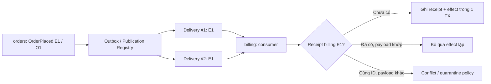
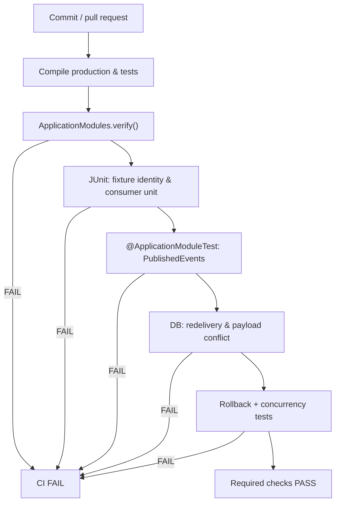

# Test data cho duplicate event

> **Chương:** Test data  
> **Phạm vi:** `SPRING_MODULITH_VERIFICATION_TESTING` — rèn kỹ năng kiểm chứng ranh giới ứng dụng Spring Modulith bằng `ApplicationModules` và các quy tắc phụ thuộc giữa module; thực hành `@ApplicationModuleTest`, kiểm thử sự kiện, cơ sở dữ liệu, tích hợp và CI quality gate để ngăn phụ thuộc sai, hồi quy.

## 1. Tình huống: một sự kiện được giao hai lần, nhưng không phải hai lần đặt hàng

Module `orders` phát một sự kiện `OrderPlaced` để module `billing` tạo bút toán cho đơn hàng. `billing` xử lý thành công nhưng phản hồi xác nhận bị mất trước khi tầng giao nhận ghi nhận kết quả. Hạ tầng thử giao lại **chính sự kiện cũ**. Nếu `billing` không nhận diện được lần giao lại, nó có thể tạo hai bút toán cho cùng một sự kiện.

Một log minh họa:

```text
09:00:00 orders: committed OrderPlaced(eventId=E1, orderId=O1)
09:00:01 billing: received event E1, inserted one billing entry
09:00:02 relay: acknowledgement uncertain
09:00:05 billing: received event E1 again
Expected: one committed billing effect, not two
```

Vấn đề không nằm ở việc event object có được Java cấp phát lại hay không. Một message có thể trải qua serialization, network, broker, retry và deserialization, sinh ra các Java instances khác nhau nhưng vẫn mô tả **cùng một logical event**.

**Điểm trọng tâm của bài:** Test data cho duplicate event phải làm rõ *điều gì trùng*, *điều gì không trùng*, *trạng thái consumer trước lần nhận*, và *side effect nào được phép xuất hiện sau hai hoặc nhiều lần giao*.

Sau bài này, bạn sẽ:

1. Phân biệt **redelivery cùng event**, **payload conflict cùng event ID**, **event khác của cùng entity**, **business duplicate** và **duplicate giữa hai consumer scopes**.
2. Tạo fixture có `eventId`, `orderId`, `correlationId`, payload và `occurredAt` ổn định; không dùng hai random IDs để giả lập redelivery.
3. Viết JUnit tests cho delivery lần đầu, lần hai, nhiều lần, nhận trùng sau restart, ID collision và một event mới.
4. Kiểm đúng số **delivery attempts** và số **committed business effects**, không chỉ kiểm exception hoặc một collection fake.
5. Thiết kế receipt/inbox có unique constraint, transaction và payload-consistency policy; kiểm concurrency và crash recovery trên database thật.
6. Sử dụng `@ApplicationModuleTest` với `PublishedEvents` để kiểm producer, phân biệt với kiểm consumer, listener và database commit.
7. Giữ test data theo quyền sở hữu module và kết hợp `ApplicationModules.verify()` với CI quality gate.

## 2. Trước tiên phân loại các dạng “duplicate”

Từ “duplicate” dễ gây ngộ nhận vì hai events có thể trùng một số field nhưng **không** phải cùng logical occurrence.

| Trường hợp | `eventId` | `orderId` | Payload / ý nghĩa | Có phải redelivery? |
| --- | --- | --- | --- | --- |
| **Giao lại cùng event** | `E1 = E1` | `O1 = O1` | Cùng semantic payload | **Có** |
| **ID collision / payload conflict** | `E1 = E1` | Có thể cùng | Payload khác nhau, ví dụ quantity 2 → 5 | **Không phải duplicate hợp lệ**; cần policy |
| **Event khác của cùng đơn** | `E1 != E2` | `O1 = O1` | `OrderPlaced` và `OrderCancelled` | Không |
| **Hai `OrderPlaced` khác ID cho cùng đơn** | `E1 != E2` | `O1 = O1` | Có thể là business duplicate | **Không** theo khóa eventId |
| **Hai events cùng workflow** | `E1 != E2` | Có thể khác | Cùng `correlationId` | Không |
| **Cùng event cho hai consumers** | `E1 = E1` | `O1 = O1` | Một event, hai trách nhiệm xử lý | Không được bỏ consumer thứ hai |
| **Hai broker envelopes** | Transport ID có thể khác | Như event nguồn | Có thể cùng `E1` | Phải nhìn **domain event ID**, không đoán theo envelope |

### 2.1. Mô hình identity

```text
Entity: Order O1

Logical event: OrderPlaced E1
  eventId       E1
  orderId       O1
  correlationId C1
  payload       sku=SKU-001, quantity=2
  occurredAt    2026-01-01T09:00:00Z

Delivery attempt #1:
  domain event E1 / same semantic payload

Delivery attempt #2:
  domain event E1 / same semantic payload

Logical event khác, ví dụ OrderCancelled:
  eventId E2
  orderId O1
  correlationId có thể C1
```

**Entity ID** nhận diện đơn hàng, **event ID** nhận diện một sự kiện cụ thể, **correlation ID** nối một workflow, còn **delivery/transport ID** thuộc cơ chế truyền. Không dùng `orderId` hoặc `correlationId` làm khóa dedup *cho mọi loại event*; như vậy có thể loại bỏ event hợp lệ khác cùng đơn/luồng.

### 2.2. Sơ đồ một event được giao hai lần



Sơ đồ là mô hình khái niệm. Trong implementation dùng database unique key, bước **claim receipt** nên là thao tác ghi atomic để tránh hai threads cùng quan sát “chưa có” rồi cùng thực hiện effect.

## 3. Hợp đồng Given–When–Then cho duplicate event

Một test consumer đúng cần cụ thể hơn “gửi hai event giống nhau”.

```text
ID: EVT-DUP-001
Mục tiêu:
  Billing áp dụng đúng một bút toán cho một OrderPlaced
  dù event được giao lại.

Given:
  Event E1 (eventId=E1, orderId=O1, sku=SKU-001,
            quantity=2, correlationId=C1, occurredAt=T1)
  Chưa có receipt (consumer=billing, eventId=E1)
  Chưa có billing entry cho E1

When:
  Deliver event E1 lần thứ nhất
  Deliver chính event E1 lần thứ hai

Then:
  Có 2 delivery attempts được thực hiện bởi test
  Có 1 receipt (billing,E1) đã commit
  Có 1 business effect/entry cho E1 đã commit
  Không thay đổi semantic payload của E1 ở lần hai
```

Test phải có **dữ liệu và assertions** để phân biệt ba implementation:

1. **Đúng:** nhận hai lần, ghi một effect.
2. **Sai:** nhận hai lần, ghi hai effects.
3. **Sai:** nhận hai lần nhưng không ghi effect nào.

Chỉ assert “số effect ≤ 1” sẽ cho trường hợp (3) PASS giả. Chỉ assert “sau lần hai không throw” sẽ cho cả ba trường hợp PASS. Nên assert **đúng một** committed effect khi nghiệp vụ yêu cầu.

### 3.1. Ma trận tối thiểu cho các scenario khác nhau

| Scenario | Test data Given | When | Kết quả mong muốn |
| --- | --- | --- | --- |
| D-01 First delivery | `E1` chưa xử lý | Nhận `E1` | 1 receipt, 1 effect |
| D-02 Duplicate delivery | `E1` chưa xử lý | Nhận `E1` hai lần | 1 receipt, 1 effect |
| D-03 Many redeliveries | `E1` chưa xử lý | Nhận cùng `E1` 5 lần | Vẫn 1 effect |
| D-04 Duplicate after restart | Receipt `E1` đã commit trong DB | Consumer instance mới nhận `E1` | Không ghi thêm |
| D-05 Conflicting duplicate | Receipt `E1` ghi payload `P1` | Nhận cùng `E1`, payload `P2 != P1` | Reject/flag theo contract |
| D-06 Same order, different event | `E1` đã xử lý | Nhận `E2 != E1` liên quan `O1` | Không bỏ nhầm do trùng orderId |
| D-07 Two consumer scopes | Receipt `billing,E1` đã có, `analytics,E1` chưa | `analytics` nhận `E1` | `analytics` vẫn được xử lý |
| D-08 First delivery fails | Lỗi trước commit của receipt/effect | Retry `E1` | Có thể xử lý lại, cuối cùng 1 effect |
| D-09 Concurrent duplicate | Receipt `E1` chưa có | Hai threads/instances nhận cùng `E1` | DB unique/transaction giữ 1 effect |
| D-10 Malformed payload | `E_BAD` thiếu field/sai rule | Nhận event lỗi | Không ghi effect, xử lý poison event theo policy |
| D-11 Business duplicate | `OrderPlaced(E1,O1)` đã thành công | Nhận `OrderPlaced(E2,O1)` | Bảo vệ bằng business uniqueness **ngoài** event dedup |

Không cần đưa 11 ca vào cùng một bài test. Tách mỗi scenario theo **một nguyên nhân có thể thất bại** để báo cáo CI giúp xác định chính xác lớp bảo vệ nào bị hỏng.

## 4. Dữ liệu nào phải giống và dữ liệu nào phải khác?

Với **cùng một logical event được redeliver**, nên giữ ổn định:

- `eventId`.
- `orderId` và các domain identifiers liên quan.
- `sku`, `quantity` và những trường nghiệp vụ bất biến của event.
- `correlationId` và `occurredAt` theo event contract.
- Schema/version hoặc một representation tương đương được định nghĩa rõ trong hệ thống.

Những thứ **có thể khác** giữa hai deliveries:

- Java object identity sau deserialize (`firstDelivery != secondDelivery` theo tham chiếu).
- Broker delivery tag, envelope metadata hoặc số lần thử.
- Thời điểm **nhận** event tại consumer, retry count và logging context.

**Không dùng thời gian nhận lại làm `occurredAt` mới**. Nếu nghiệp vụ cần sửa dữ liệu cũ, đó thường là **sự kiện mới** (correction event) với event ID mới và quan hệ nhân quả rõ, không thay payload của event cũ rồi gọi là retry.

### 4.1. Hai giả thuyết cần được test riêng

> **Event-level dedup:** Cùng `(consumerName,eventId)` không tạo business effect thứ hai.

> **Business-level uniqueness:** Cùng một đơn chỉ có một bút toán đặt hàng theo hợp đồng `billing`, ngay cả nếu hệ thống lỗi phát hai `OrderPlaced` với **hai eventId khác nhau**.

Giả thuyết thứ hai không tự suy ra từ giả thuyết thứ nhất. Test D-11 cần một business unique key/aggregate state guard riêng; đừng tuyên bố inbox event ID đủ chống mọi double charge.

## 5. Cấu trúc Spring Modulith minh họa

Giả sử Spring Boot root package là `com.example.shop`:

```text
src/main/java/com/example/shop/
├── ShopApplication.java
├── orders/
│   ├── OrderPlaced.java
│   ├── OrderEventEmitter.java
│   └── internal/OrderJpaRepository.java
├── billing/
│   ├── BillingEventConsumer.java
│   └── internal/BillingLedgerRepository.java
└── inventory/
    ├── StockQuery.java
    └── internal/StockJpaRepository.java

src/test/java/com/example/shop/
├── ModuleArchitectureTest.java
├── orders/OrderEventProducerModuleTest.java
└── billing/
    ├── DuplicateEventFixtures.java
    ├── BillingDuplicateEventUnitTest.java
    ├── BillingDuplicateEventDbTest.java
    └── BillingDuplicateEventConcurrencyTest.java
```

Theo cơ chế nhận diện application module thông thường, `orders`, `billing` và `inventory` là các module từ package con trực tiếp của root. Kiểm thử `billing` dùng kiểu sự kiện **được công bố** `orders.OrderPlaced`; không import `orders.internal.OrderJpaRepository` để seed state. Test dữ liệu của `billing` thuộc `billing`; test tích hợp xuyên module cần setup theo API hoặc hạ tầng test có ownership rõ ràng.

Các lớp, bảng và giới hạn nghiệp vụ trong bài là **ví dụ tự chứa**, không phải thành phần Spring Modulith tự sinh. Dự án thực có thể dùng Spring Modulith Event Publication Registry, outbox/inbox framework, broker hoặc persistence strategy khác; phải kiểm đường đi production thực.

### 5.1. Event contract của module `orders`

`src/main/java/com/example/shop/orders/OrderPlaced.java`:

```java
package com.example.shop.orders;

import java.time.Instant;
import java.util.Objects;
import java.util.UUID;

public record OrderPlaced(
        UUID eventId,
        UUID orderId,
        UUID correlationId,
        String sku,
        int quantity,
        Instant occurredAt
) {
    public OrderPlaced {
        Objects.requireNonNull(eventId, "eventId");
        Objects.requireNonNull(orderId, "orderId");
        Objects.requireNonNull(correlationId, "correlationId");
        Objects.requireNonNull(occurredAt, "occurredAt");
        if (sku == null || sku.isBlank() || quantity <= 0) {
            throw new IllegalArgumentException("Invalid OrderPlaced");
        }
    }
}
```

Event là immutable record với `UUID`, `String`, `int`, `Instant` (các field đều có tính bất biến phù hợp). `equals(...)` của record so các components nên hai instances có cùng payload được xem là bằng nhau về giá trị.

Ví dụ có constructor validation để ngăn event không hợp lệ trong code Java. Các payload lỗi do JSON deserialization, schema evolution, legacy input hoặc dữ liệu hỏng phải được kiểm ở adapter/consumer boundary phù hợp: nếu constructor đã từ chối, không “bẻ” constructor bằng reflection để đưa object sai vào test happy path.

## 6. Tạo fixture duplicate event **có chủ đích**

`src/test/java/com/example/shop/billing/DuplicateEventFixtures.java`:

```java
package com.example.shop.billing;

import java.time.Instant;
import java.util.UUID;
import com.example.shop.orders.OrderPlaced;

final class DuplicateEventFixtures {

    static final UUID ORDER_ID = UUID.fromString(
            "11111111-1111-1111-1111-111111111111");
    static final UUID EVENT_ID = UUID.fromString(
            "22222222-2222-2222-2222-222222222222");
    static final UUID SECOND_EVENT_ID = UUID.fromString(
            "44444444-4444-4444-4444-444444444444");
    static final UUID CORRELATION_ID = UUID.fromString(
            "33333333-3333-3333-3333-333333333333");
    static final Instant OCCURRED_AT =
            Instant.parse("2026-01-01T09:00:00Z");

    private DuplicateEventFixtures() {}

    static OrderPlaced firstDelivery() {
        return new OrderPlaced(
            EVENT_ID, ORDER_ID, CORRELATION_ID,
            "SKU-001", 2, OCCURRED_AT);
    }

    static OrderPlaced redelivery() {
        // Instance mới, vẫn là SAME logical event.
        return firstDelivery();
    }

    static OrderPlaced conflictingPayload() {
        // Cùng eventId nhưng payload nghiệp vụ KHÁC.
        return new OrderPlaced(
            EVENT_ID, ORDER_ID, CORRELATION_ID,
            "SKU-001", 5, OCCURRED_AT);
    }

    static OrderPlaced differentEventSameOrder() {
        return new OrderPlaced(
            SECOND_EVENT_ID, ORDER_ID, CORRELATION_ID,
            "SKU-001", 2, OCCURRED_AT.plusSeconds(30));
    }
}
```

Hàm `redelivery()` trả về **object khác** nhưng cùng event ID, order ID, correlation ID, payload và occurredAt. `conflictingPayload()` vẫn hợp lệ theo constructor nhưng mang nội dung không giống event trước — thích hợp để kiểm xung đột identity. `differentEventSameOrder()` giữ order ID nhưng tạo một logical event ID mới.

### 6.1. Chứng minh fixture thật sự biểu diễn duplicate

```java
package com.example.shop.billing;

import static org.junit.jupiter.api.Assertions.*;
import org.junit.jupiter.api.Test;
import com.example.shop.orders.OrderPlaced;

class DuplicateEventFixtureTest {

    @Test
    void duplicateHasSameIdentityAndPayloadButNewInstance() {
        OrderPlaced first = DuplicateEventFixtures.firstDelivery();
        OrderPlaced retry = DuplicateEventFixtures.redelivery();

        assertNotSame(first, retry);
        assertEquals(first.eventId(), retry.eventId());
        assertEquals(first, retry);
        assertEquals(first.occurredAt(), retry.occurredAt());
    }

    @Test
    void newLogicalEventHasDifferentEventId() {
        OrderPlaced first = DuplicateEventFixtures.firstDelivery();
        OrderPlaced another = DuplicateEventFixtures.differentEventSameOrder();

        assertEquals(first.orderId(), another.orderId());
        assertNotEquals(first.eventId(), another.eventId());
    }
}
```

Đây mới chỉ là test **fixture semantics**, chưa kiểm consumer hoặc effect. Không dừng ở `assertEquals(first, retry)` rồi kết luận hệ thống đã xử lý duplicate an toàn.

### 6.2. Khi nào dùng ID cố định, khi nào dùng ID riêng?

| Tầng test | ID test-data | Vì sao |
| --- | --- | --- |
| Unit test độc lập | UUID constants có tên | Dễ đọc và tái hiện; không có DB collision |
| Unit test duplicate | Cùng EVENT_ID trong một method | Kiểm đúng logic redelivery |
| DB integration test chạy song song | Cấp UUID riêng cho **mỗi scenario** | Tránh va chạm receipt/ledger rows |
| DB duplicate test | Cấp E1 một lần, dùng lại trong hai calls | Cần chạm unique constraint đúng |
| Business duplicate test | E1 và E2 **khác nhau**, orderId giống | Tách event dedup với business uniqueness |
| Consumer scopes | Cùng eventId, consumerName khác | Mỗi consumer có thể xử lý riêng |

Đừng dùng một `static final EVENT_ID` cho toàn bộ integration suite rồi ghi vào cùng bảng `processed_events`. Hai tests độc lập có thể vô tình làm nhau FAIL/PASS giả vì dữ liệu đã tồn tại; nếu cần deterministic IDs, phải cô lập schema/transaction hoặc cấp ID theo scenario.

## 7. Hai cấp kiểm thử: unit semantics và DB atomicity

Trong unit test, có thể dùng một fake receipt/effect mới cho mỗi method để chứng minh logic đầu vào và các assertion mong muốn. Nhưng một fake `HashMap` không chứng minh cạnh tranh hai consumers, crash recovery hay transaction rollback.

Phân cấp:

| Loại test | Điều chứng minh | Điều chưa chứng minh |
| --- | --- | --- |
| Fixture unit test | Hai deliveries mô tả cùng logical event | Consumer xử lý đúng |
| Consumer unit test | Khi cùng event đến hai lần, fake ghi một effect theo logic test | Unique constraint, race safety, durability |
| `@ApplicationModuleTest` producer | Service/bean publish event với identity/payload đúng | Consumer xử lý xong, DB commit |
| DB integration test consumer | Receipt/effect đúng một lần qua transactions | Broker ack/retry thực |
| Broker/Modulith listener integration | Redelivery và callback thực ở runtime | Mọi service ngoài DB có exactly-once |
| Structural test `verify()` | Module dependencies/API đúng | Idempotency runtime |

**Không đánh đồng** “đúng một event được publish” với “event được publish đúng một lần trên network”. Trong mô hình giao nhận at-least-once, một logical event có thể được giao nhiều lần nhưng business effect phải idempotent theo contract.

## 8. Consumer unit test: fake mới cho từng scenario

### 8.1. Port mô tả effect được áp dụng một lần

Trong module `billing`:

```java
package com.example.shop.billing;

import com.example.shop.orders.OrderPlaced;

interface BillingEffects {
    void applyOnce(OrderPlaced event);
}

final class BillingEventHandler {

    private final BillingEffects effects;

    BillingEventHandler(BillingEffects effects) {
        this.effects = effects;
    }

    void handle(OrderPlaced event) {
        effects.applyOnce(event);
    }
}
```

`BillingEffects.applyOnce` là **hợp đồng của port**. Đoạn code trên không tự thực hiện dedup — implementation persistence phải chịu trách nhiệm. Test double sau đây mô phỏng hợp đồng cho unit test, **không phải giải pháp production**.

### 8.2. Recording fake nhận diện eventId và payload

```java
package com.example.shop.billing;

import static org.junit.jupiter.api.Assertions.*;

import java.util.ArrayList;
import java.util.HashMap;
import java.util.List;
import java.util.Map;
import java.util.UUID;
import org.junit.jupiter.api.Test;
import com.example.shop.orders.OrderPlaced;

class BillingDuplicateEventUnitTest {

    static final class RecordingEffects implements BillingEffects {

        final Map<UUID, OrderPlaced> receipts = new HashMap<>();
        final List<UUID> billedOrderIds = new ArrayList<>();

        @Override
        public void applyOnce(OrderPlaced event) {
            OrderPlaced previous =
                    receipts.putIfAbsent(event.eventId(), event);

            if (previous == null) {
                billedOrderIds.add(event.orderId());
            } else if (!previous.equals(event)) {
                throw new IllegalArgumentException(
                    "Same eventId with conflicting payload");
            }
        }
    }

    @Test
    void firstAndDuplicateDeliveryCauseOneEffect() {
        RecordingEffects effects = new RecordingEffects();
        BillingEventHandler handler = new BillingEventHandler(effects);

        handler.handle(DuplicateEventFixtures.firstDelivery());
        handler.handle(DuplicateEventFixtures.redelivery());

        assertEquals(1, effects.receipts.size());
        assertEquals(List.of(DuplicateEventFixtures.ORDER_ID),
                effects.billedOrderIds);
    }

    @Test
    void conflictingDuplicateIsRejectedWithoutSecondEffect() {
        RecordingEffects effects = new RecordingEffects();
        BillingEventHandler handler = new BillingEventHandler(effects);
        handler.handle(DuplicateEventFixtures.firstDelivery());

        assertThrows(IllegalArgumentException.class,
                () -> handler.handle(
                    DuplicateEventFixtures.conflictingPayload()));

        assertEquals(1, effects.receipts.size());
        assertEquals(1, effects.billedOrderIds.size());
    }

    @Test
    void multipleRedeliveriesStillProduceOneEffect() {
        RecordingEffects effects = new RecordingEffects();
        BillingEventHandler handler = new BillingEventHandler(effects);

        for (int delivery = 0; delivery < 5; delivery++) {
            handler.handle(DuplicateEventFixtures.redelivery());
        }

        assertEquals(1, effects.receipts.size());
        assertEquals(1, effects.billedOrderIds.size());
    }
}
```

**Bằng chứng trong unit test:** hai hoặc năm lần `handle(...)` đều được gọi, nhưng số business effects là 1. Một test chỉ kiểm list không tăng sau lần hai mà không kiểm lần đầu đã xử lý có thể cho **zero-effect bug** PASS.

### 8.3. Unit fake không bảo vệ multi-thread/độ bền

`HashMap` và `ArrayList` trên không thread-safe; receipt và effect cũng không nằm trong transaction. Nếu process crash sau khi đưa eventId vào map nhưng trước `billedOrderIds.add(...)`, fake có thể đánh dấu event đã xử lý dù effect chưa được ghi. Do đó:

- **Unit test** chứng minh cách chúng ta diễn đạt duplicate scenario và expectations.
- **Integration test** phải xác minh implementation thật của `BillingEffects` hoặc consumer với database, unique constraint, rollback, retry.
- Không gọi fake in-memory là “exactly-once production”.

### 8.4. Hai event IDs khác nhau cho cùng đơn

Với `differentEventSameOrder()`, fake trên xem event thứ hai là **mới** và sẽ ghi effect lần hai. Đây là điều đúng ở **event-level key** nhưng có thể sai với chính sách “một bút toán đặt hàng cho mỗi order”. Nếu nghiệp vụ chỉ cho phép một bút toán cho mỗi đơn, cần một bảo vệ **business key** riêng, ví dụ unique `order_id` hoặc `(order_id, charge_type)`, rồi test D-11.

Không sửa fake thành dedup mọi event bằng `orderId` mà không xét loại event: làm thế dễ khiến một event hủy/hoàn tiền hợp lệ bị loại nhầm.

## 9. Thiết kế dữ liệu database cho duplicate event

Một consumer thật có thể chạy trên nhiều processes, bị restart, hoặc cùng lúc nhận hai bản giao của event. Vì vậy, receipt/inbox phải bền vững nếu hợp đồng yêu cầu idempotent effect sau crash.

Ví dụ schema PostgreSQL thuộc **module `billing`**:

```sql
CREATE TABLE billing_processed_events (
    consumer_name VARCHAR(100) NOT NULL,
    event_id UUID NOT NULL,
    order_id UUID NOT NULL,
    correlation_id UUID NOT NULL,
    sku VARCHAR(64) NOT NULL,
    quantity INTEGER NOT NULL CHECK (quantity > 0),
    occurred_at TIMESTAMPTZ NOT NULL,
    processed_at TIMESTAMPTZ NOT NULL,
    PRIMARY KEY (consumer_name, event_id)
);

CREATE TABLE billing_entries (
    entry_id UUID PRIMARY KEY,
    order_id UUID NOT NULL,
    source_event_id UUID NOT NULL UNIQUE,
    quantity INTEGER NOT NULL CHECK (quantity BETWEEN 1 AND 10)
);
```

Giả định migrations của ứng dụng tạo các bảng này trong database test. Không tạo schema giả không tương thích production chỉ để test “xanh”. Nếu dự án sử dụng một inbox framework hoặc cơ chế chống trùng đã có, cần kiểm chính implementation và migration thật của nó.

### 9.1. Vì sao unique key là `(consumer_name, event_id)`?

Một sự kiện `E1` có thể được nhận bởi `billing` và `analytics`. Hai consumers có trách nhiệm khác nhau; receipt của `billing,E1` không được khiến `analytics` coi `E1` đã xử lý.

```text
processed events:

consumer_name | event_id | status
--------------+----------+-----------------
billing       | E1       | processed
analytics     | E1       | chưa có receipt

analytics nhận E1:
  => được phép xử lý lần đầu trong scope analytics.
```

Nếu business policy yêu cầu chỉ một bút toán cho một order, `billing_entries` cần **business constraint riêng** như `UNIQUE(order_id)` hoặc `UNIQUE(order_id, entry_type)`, tùy nghiệp vụ. Unique `source_event_id` chỉ ngăn hai lần áp dụng **cùng event ID**. Không gộp business uniqueness và event dedup thành một khái niệm.

### 9.2. Receipt phải đủ thông tin để phát hiện payload conflict

Schema trên cố ý lưu `order_id`, `correlation_id`, `sku`, `quantity`, `occurred_at` bên cạnh `event_id`. Khi sự kiện cùng ID đến lại, consumer có thể so sánh **payload đã xử lý** với payload mới:

- Nếu khớp: một redelivery hợp lệ, không ghi effect lần nữa.
- Nếu không khớp: event ID bị tái sử dụng sai hoặc payload bị sửa; báo conflict theo policy.

Trong hệ thống dùng JSON/Avro/Protobuf và schema evolution, có thể lưu canonical payload digest, event version hoặc trường business cần thiết. Cần định nghĩa **canonicalization**, timezone/precision và tương thích schema rõ; không tùy tiện so hash của chuỗi JSON với thứ tự field không ổn định rồi kết luận là xung đột.

### 9.3. Số delivery attempts và số rows khác nhau

Đối với D-02, một test cần khẳng định:

```text
Number of calls to consumer   = 2
Committed receipt count       = 1
Committed billing entry count = 1
```

Receipt đại diện cho **event đã xử lý thành công** theo consumer scope, không phải log của mọi delivery attempt. Muốn điều tra số lần giao thực tế, có thể ghi metric/log hoặc audit attempts riêng, nhưng đừng yêu cầu hai receipt rows cho một event chỉ vì nó được giao hai lần.

## 10. Consumer production: claim receipt và effect trong cùng transaction

Đây là một implementation JDBC minh họa, dùng PostgreSQL `ON CONFLICT DO NOTHING` để claim event một cách atomic. `BillingEventConsumer` thuộc package root `billing` và chỉ tham chiếu **public event contract** `orders.OrderPlaced`.

`src/main/java/com/example/shop/billing/BillingEventConsumer.java`:

```java
package com.example.shop.billing;

import java.sql.Timestamp;
import java.time.Clock;
import java.time.Instant;
import java.util.List;
import java.util.UUID;
import org.springframework.jdbc.core.JdbcTemplate;
import org.springframework.stereotype.Service;
import org.springframework.transaction.annotation.Transactional;
import com.example.shop.orders.OrderPlaced;

@Service
public class BillingEventConsumer {

    private static final String CONSUMER = "billing";

    private final JdbcTemplate jdbc;
    private final Clock clock;

    public BillingEventConsumer(JdbcTemplate jdbc, Clock clock) {
        this.jdbc = jdbc;
        this.clock = clock;
    }

    @Transactional
    public void on(OrderPlaced event) {
        if (event == null) {
            throw new IllegalArgumentException("event is required");
        }

        int claimed = jdbc.update(
            "INSERT INTO billing_processed_events "
                + "(consumer_name, event_id, order_id, correlation_id, "
                + "sku, quantity, occurred_at, processed_at) "
                + "VALUES (?, ?, ?, ?, ?, ?, ?, ?) "
                + "ON CONFLICT (consumer_name, event_id) DO NOTHING",
            CONSUMER,
            event.eventId(),
            event.orderId(),
            event.correlationId(),
            event.sku(),
            event.quantity(),
            Timestamp.from(event.occurredAt()),
            Timestamp.from(clock.instant())
        );

        if (claimed == 0) {
            Receipt old = jdbc.queryForObject(
                "SELECT order_id, correlation_id, sku, quantity, "
                    + "occurred_at FROM billing_processed_events "
                    + "WHERE consumer_name = ? AND event_id = ?",
                (rs, rowNum) -> new Receipt(
                    rs.getObject("order_id", UUID.class),
                    rs.getObject("correlation_id", UUID.class),
                    rs.getString("sku"),
                    rs.getInt("quantity"),
                    rs.getTimestamp("occurred_at").toInstant()
                ),
                CONSUMER, event.eventId()
            );

            if (old == null || !old.samePayload(event)) {
                throw new IllegalStateException(
                    "Conflicting payload for an existing eventId");
            }
            return; // Redelivery hợp lệ: không tạo effect thứ hai.
        }

        // Receipt claim và effect nằm trong CÙNG transaction.
        jdbc.update(
            "INSERT INTO billing_entries "
                + "(entry_id, order_id, source_event_id, quantity) "
                + "VALUES (?, ?, ?, ?)",
            UUID.randomUUID(), event.orderId(),
            event.eventId(), event.quantity()
        );
    }

    private record Receipt(
            UUID orderId, UUID correlationId, String sku,
            int quantity, Instant occurredAt) {

        boolean samePayload(OrderPlaced event) {
            return orderId.equals(event.orderId())
                && correlationId.equals(event.correlationId())
                && sku.equals(event.sku())
                && quantity == event.quantity()
                && occurredAt.equals(event.occurredAt());
        }
    }
}
```

### 10.1. Đường đi hai lần giao

```text
First delivery E1:
  INSERT receipt (billing,E1) -> affectedRows = 1
  INSERT billing entry for E1
  COMMIT

Second delivery E1, same semantic payload:
  INSERT receipt (billing,E1) -> affectedRows = 0
  SELECT old payload -> matches
  return without adding billing entry

Second delivery E1, changed payload:
  INSERT receipt -> affectedRows = 0
  SELECT old payload -> conflicts
  throw exception / hand off to error policy
```

**Điều kiện giao dịch:** Method phải được gọi qua Spring-managed proxy, hai bảng dùng cùng database/transaction manager, lỗi unchecked sẽ rollback theo quy tắc Spring mặc định. `ON CONFLICT` cùng unique key giúp hai workers không thể đồng thời **commit hai receipt cùng khóa**. Cơ chế xử lý contention, isolation level và retry khi deadlock/serialization failure vẫn cần integration test trên database thực tế.

### 10.2. Bốn giới hạn cần nêu rõ

1. **Không phải exactly-once delivery.** Broker vẫn có thể giao nhiều lần; mô hình đạt hiệu ứng idempotent trong phạm vi database được kiểm.
2. **Không thay thế business uniqueness.** Hai `OrderPlaced` khác eventId nhưng cùng orderId vẫn có thể ghi hai entries nếu bảng không có business constraint.
3. **Chưa xử lý external side effect.** Nếu thay insert DB bằng HTTP call đến payment gateway, DB transaction không làm HTTP atomic. Cần idempotency key ở hệ thống ngoài, outbox/saga hoặc thiết kế tương ứng.
4. **Chưa mô tả broker wiring.** Method `on` là consumer service; `@ApplicationModuleListener`, `@TransactionalEventListener` hoặc adapter message broker là lựa chọn tích hợp riêng. Test ở mục sau gọi consumer service thật để xác nhận receipt/effect.

Ngoài ra, so sánh `Instant` cần tương thích precision của cột DB/driver. Fixture dùng thời điểm nguyên giây để tránh sai khác nano/microsecond ở ví dụ; trong dự án thật, chọn chuẩn thời gian và payload normalization chính xác.

## 11. Integration test: giao hai lần, DB chỉ ghi một effect

Để chứng minh đúng cơ chế production, cần gọi bean Spring thật và query database sau khi các transaction kết thúc. Ví dụ dùng PostgreSQL qua `DataSource`/JDBC và migrations, không gắn `@Transactional` lên **test method**.

`src/test/java/com/example/shop/billing/BillingDuplicateEventDbTest.java`:

```java
package com.example.shop.billing;

import static org.junit.jupiter.api.Assertions.*;

import java.time.Clock;
import java.time.Instant;
import java.time.ZoneOffset;
import java.util.UUID;
import org.junit.jupiter.api.Test;
import org.springframework.beans.factory.annotation.Autowired;
import org.springframework.boot.test.context.SpringBootTest;
import org.springframework.boot.test.context.TestConfiguration;
import org.springframework.context.annotation.Bean;
import org.springframework.context.annotation.Import;
import org.springframework.context.annotation.Primary;
import org.springframework.jdbc.core.JdbcTemplate;
import com.example.shop.orders.OrderPlaced;

@SpringBootTest
@Import(BillingDuplicateEventDbTest.TestTime.class)
class BillingDuplicateEventDbTest {

    @TestConfiguration(proxyBeanMethods = false)
    static class TestTime {
        @Bean
        @Primary
        Clock fixedClock() {
            return Clock.fixed(
                Instant.parse("2026-01-01T10:00:00Z"),
                ZoneOffset.UTC);
        }
    }

    @Autowired BillingEventConsumer consumer;
    @Autowired JdbcTemplate jdbc;

    private OrderPlaced event(UUID eventId, UUID orderId) {
        return new OrderPlaced(
            eventId, orderId, UUID.randomUUID(),
            "SKU-001", 2,
            Instant.parse("2026-01-01T09:00:00Z"));
    }

    private int receipts(UUID eventId) {
        return jdbc.queryForObject(
            "SELECT COUNT(*) FROM billing_processed_events "
                + "WHERE consumer_name = ? AND event_id = ?",
            Integer.class, "billing", eventId);
    }

    private int entries(UUID eventId) {
        return jdbc.queryForObject(
            "SELECT COUNT(*) FROM billing_entries "
                + "WHERE source_event_id = ?",
            Integer.class, eventId);
    }

    private void cleanup(UUID eventId) {
        jdbc.update(
            "DELETE FROM billing_entries WHERE source_event_id = ?",
            eventId);
        jdbc.update(
            "DELETE FROM billing_processed_events "
                + "WHERE consumer_name = ? AND event_id = ?",
            "billing", eventId);
    }

    @Test
    void twoDeliveriesCreateExactlyOneCommittedEffect() {
        UUID eventId = UUID.randomUUID();
        UUID orderId = UUID.randomUUID();
        OrderPlaced original = event(eventId, orderId);
        OrderPlaced duplicate = new OrderPlaced(
            original.eventId(),
            original.orderId(),
            original.correlationId(),
            original.sku(),
            original.quantity(),
            original.occurredAt());

        try {
            assertEquals(0, receipts(eventId));
            assertEquals(0, entries(eventId));
            assertNotSame(original, duplicate);

            consumer.on(original);
            assertEquals(1, receipts(eventId));
            assertEquals(1, entries(eventId));

            consumer.on(duplicate);
            assertEquals(1, receipts(eventId));
            assertEquals(1, entries(eventId));
        } finally {
            cleanup(eventId);
        }
    }
}
```

**Vì sao không tạo `event(eventId,orderId)` hai lần?** Hàm `event(...)` trong ví dụ tự sinh `correlationId` mới ở mỗi lần gọi. Nếu dùng nó hai lần, payload sẽ khác và consumer đúng sẽ báo conflict! Vì vậy test tạo `original` **một lần**, sau đó sao chép các field nguyên vẹn sang `duplicate`. Đây là một chi tiết thiết kế fixture rất quan trọng.

Một cách khác là đổi helper thành `event(eventId,orderId,correlationId)` và truyền cùng correlation ở cả hai calls. Cả hai cách đều hợp lệ nếu giữ identity/payload nhất quán.

### 11.1. Lưu ý về Spring context

`@SpringBootTest` khởi tạo context theo ứng dụng thật. Nếu hệ thống có các beans khác cần `StockQuery`, các collaborators ngoài scope test phải được cung cấp bằng test configuration/infra phù hợp; không giả định ví dụ sẽ tự chạy trên mọi project. Nếu chỉ cần module `billing` và database của nó, cân nhắc `@ApplicationModuleTest` với mức bootstrap phù hợp cùng test beans, miễn nó thực sự tải được transaction/persistence cần kiểm.

### 11.2. Lưu ý về cleanup

`eventId` được tạo **riêng cho test**, giảm collision khi có DB chung. Cleanup xóa các rows có ID đó, theo thứ tự effect trước receipt. Với failure khiến connection/transaction bị abort, cleanup có thể phải chạy trong transaction khác; `finally` không thay thế isolation của database test environment. Không xóa toàn bảng khi test khác chạy song song.

## 12. Test conflict: cùng eventId nhưng payload bị sửa

D-05 cần **một receipt đã commit với P1**, sau đó nhận `eventId` cũ nhưng `quantity` hoặc `sku` khác. Đừng tạo payload invalid do constructor từ chối ngay; mục tiêu là **consumer phát hiện mismatch với dữ liệu đã xử lý**, không phải constructor validation.

Một phương thức bổ sung vào `BillingDuplicateEventDbTest`:

```java
@Test
void sameEventIdWithDifferentQuantityIsNotSilentDuplicate() {
    UUID eventId = UUID.randomUUID();
    UUID orderId = UUID.randomUUID();
    OrderPlaced first = event(eventId, orderId);
    OrderPlaced conflicting = new OrderPlaced(
        first.eventId(), first.orderId(), first.correlationId(),
        first.sku(), 5, first.occurredAt());

    try {
        consumer.on(first);
        assertThrows(IllegalStateException.class,
            () -> consumer.on(conflicting));

        assertEquals(1, receipts(eventId));
        assertEquals(1, entries(eventId));

        Integer quantity = jdbc.queryForObject(
            "SELECT quantity FROM billing_entries "
                + "WHERE source_event_id = ?",
            Integer.class, eventId);
        assertEquals(2, quantity);
    } finally {
        cleanup(eventId);
    }
}
```

Trong ví dụ này, consumer từ chối payload conflict bằng `IllegalStateException`. Production cần định nghĩa sẽ log/quarantine/dead-letter, retry có kiểm soát hay mở incident; không nên khiến một sự kiện có payload sai retry vô hạn mà không có terminal policy.

### 12.1. Schema evolution có thể khiến payload representation khác

Không phải mọi thay đổi bytes đều là semantic conflict. Ví dụ một event version mới thêm field optional không ảnh hưởng semantics. Nếu consumer lưu payload hash:

- Chuẩn hóa (canonicalize) fields/format theo version contract.
- Xác định trường nào tạo identity của logical event và trường nào có thể thay đổi ở transport envelope.
- Không tự thay `occurredAt` khi giao lại.
- Viết test cho cả **same semantic payload, different envelope** và **real semantic conflict**.

Trong bài này, `OrderPlaced` dùng immutable Java record và so fields trực tiếp để tránh nhập nhằng.

## 13. Test scope của receipt: cùng eventId, hai consumers

D-07 cần test rằng `analytics` không bị chặn bởi receipt của `billing`. Với primary key `(consumer_name,event_id)`, hai consumer scopes là hai keys khác nhau:

```text
Given:
  receipt billing,E1  = committed
  receipt analytics,E1 = absent

When:
  analytics consumer receives E1

Then:
  analytics effect is applied once
  analytics,E1 receipt is committed
  billing effect is not duplicated
```

Một integration test thực cần chạy **hai consumer implementations** với cùng event, mỗi consumer có receipt namespace được xác định. Không chứng minh điều này bằng cách chỉ thay hardcoded consumer name trong assertions mà không gọi consumer thứ hai.

Ngược lại, một service **billing** có hai instances không được dùng hai consumer names khác nhau cho cùng trách nhiệm xử lý; nếu mỗi instance tự nhận tên `billing-instance-1`/`billing-instance-2`, cùng event có thể được claim hai lần và business effect bị nhân đôi. Consumer name trong khóa nên đại diện cho **logical consumer trách nhiệm**, không phải instance ID.

## 14. Business duplicate: cùng đơn, hai eventId khác nhau

D-11 giả định ứng dụng có yêu cầu **mỗi đơn chỉ được tạo một bút toán đặt hàng**. Một bug ở producer có thể phát:

```text
OrderPlaced(eventId=E1, orderId=O1, quantity=2)
OrderPlaced(eventId=E2, orderId=O1, quantity=2)
                     ^ E2 khác E1
```

Event-level dedup xem đây là **hai logical events** và có thể ghi hai receipts/effects. Muốn bảo vệ business invariant, `billing` cần rule riêng (ví dụ unique `order_id` với nghiệp vụ chỉ có một bút toán đặt hàng cho đơn).

Schema ví dụ nếu phù hợp hợp đồng:

```sql
ALTER TABLE billing_entries
ADD CONSTRAINT uq_billing_one_placement_per_order UNIQUE (order_id);
```

**Đây không phải constraint nên thêm vô điều kiện.** Nếu `billing_entries` lưu nhiều loại bút toán cho một đơn (đặt cọc, trả thêm, hoàn tiền), unique `order_id` toàn bảng sẽ sai nghiệp vụ; có thể cần `entry_type` và key `(order_id,entry_type)` hoặc một aggregate policy khác.

### 14.1. Cần hai bộ dữ liệu khác nhau cho hai lỗi

| Test | Input | Rủi ro muốn phát hiện | Bảo vệ |
| --- | --- | --- | --- |
| Redelivery | `E1` hai lần | Broker/relay giao lại | Receipt unique theo eventId |
| Business duplicate | `E1` và `E2` với cùng `O1` | Producer tạo hai occurrences hoặc command xử lý hai lần | Business constraint/idempotency theo order/request |

Đừng thay đổi `eventId` trong duplicate-delivery test để “có nhiều data hơn”: như vậy đã đổi câu hỏi kiểm thử. Cũng đừng chặn mọi `E2` của cùng order nếu đó là một event loại khác có hiệu ứng hợp lệ.

### 14.2. Kết quả DB test phải phản ánh policy

Nếu unique business key chặn `E2`, transaction của consumer phải rollback receipt `E2` cùng bút toán thất bại. Không để receipt `E2` ở trạng thái “đã xử lý” nếu thực tế business effect chưa hoàn thành. Sau đó xử lý/đánh dấu lỗi trùng nghiệp vụ theo policy; việc retry `E2` vô hạn vì unique conflict permanent sẽ không giải quyết được nguyên nhân.

## 15. Fault ở giữa consumer: receipt không được commit một mình

D-08 kiểm một failure path khác với duplicate thành công:

```text
Given:
  billing_processed_events[billing,E8] = absent
  billing_entries[source_event_id=E8] = absent
  Một lỗi được kích hoạt SAU khi claim receipt
  và TRƯỚC khi business effect commit

When:
  consumer.on(E8) -> exception

Then (sau rollback):
  billing_processed_events[billing,E8] = absent
  billing_entries[source_event_id=E8] = absent

Khi điều kiện tạm thời đã được khắc phục:
  deliver chính E8 với payload cũ

Then:
  có 1 receipt và 1 effect
```

Trong schema minh họa, `billing_entries.quantity` có constraint **1 đến 10**, trong khi `OrderPlaced` constructor chỉ yêu cầu quantity dương. Có thể sử dụng một event `quantity = 11` để làm test **DB constraint failure sau claim receipt**:

```java
// Phương thức bổ sung trong BillingDuplicateEventDbTest.
// Thêm import org.springframework.dao.DataIntegrityViolationException.

@Test
void failedEffectWriteAlsoRollsBackReceipt() {
    UUID eventId = UUID.randomUUID();
    OrderPlaced event = new OrderPlaced(
        eventId, UUID.randomUUID(), UUID.randomUUID(),
        "SKU-001", 11,
        Instant.parse("2026-01-01T09:00:00Z"));

    try {
        assertThrows(DataIntegrityViolationException.class,
            () -> consumer.on(event));

        assertEquals(0, receipts(eventId));
        assertEquals(0, entries(eventId));
    } finally {
        cleanup(eventId);
    }
}
```

Với `quantity = 11`, receipt insert qua `billing_processed_events` có thể thành công vì constraint của bảng receipt chỉ yêu cầu `quantity > 0`. Bước insert `billing_entries` sau đó gặp `CHECK(quantity BETWEEN 1 AND 10)`, làm transaction rollback **cả receipt**. Đảm bảo trong project thật test xác định lỗi đến từ đúng constraint, không phải một lỗi unrelated.

**Giới hạn:** Đây là *permanent validation/integrity fault*, **không nên retry vô hạn với cùng payload 11**. Muốn kiểm “lỗi lần đầu, retry thành công”, cần **fault injection tạm thời** ở billing-write port hoặc điều kiện DB transient có kiểm soát. Khi fault đã được gỡ, giao lại **chính event E8 và payload không đổi**, rồi assert một receipt/effect. Không sửa `quantity = 11` thành 2 trên cùng eventId để “làm retry thành công”: đó là một payload conflict, không phải redelivery hợp lệ.

### 15.1. Lỗi ở receipt và lỗi ở effect khác nhau

| Điểm thất bại | Receipt đã bắt đầu ghi? | Cần rollback gì? |
| --- | --- | --- |
| Reject invalid payload trước SQL | Chưa | Không effect, không receipt |
| Claim receipt gặp DB lỗi | Có thử ghi | Không effect, không partial receipt |
| Claim thành công, ghi billing entry lỗi | Đã insert trong transaction | **Rollback cả receipt và effect** |
| Business effect commit, ack bị mất | Receipt/effect đã commit | Redelivery đọc receipt, **không ghi lần hai** |

Một test chỉ assert exception có thể bỏ sót bug receipt đã commit sớm. Cần query database sau khi transaction kết thúc, từ một transaction/connection hợp lệ.

## 16. Concurrent duplicate: hai consumers cùng claim một event

Hai lời gọi tuần tự không đủ chứng minh chống duplicate khi có nhiều worker instances:

```text
Thread A: receives E9, attempts receipt claim
Thread B: receives E9, attempts receipt claim

Expected with DB unique + atomic transaction:
  exactly one committed receipt (billing,E9)
  exactly one billing entry for E9
```

### 16.1. Mẫu test concurrency

Đoạn sau là **một test method bổ sung trong `BillingDuplicateEventDbTest`**. Thêm imports từ `java.util.concurrent` và `java.util.concurrent.Callable` theo IDE:

```java
@Test
void concurrentRedeliveryCreatesOneCommittedEffect() throws Exception {
    UUID eventId = UUID.randomUUID();
    OrderPlaced event = event(eventId, UUID.randomUUID());

    var executor = java.util.concurrent.Executors
            .newFixedThreadPool(2);
    var start = new java.util.concurrent.CountDownLatch(1);

    try {
        java.util.concurrent.Callable<Void> delivery = () -> {
            if (!start.await(5, java.util.concurrent.TimeUnit.SECONDS)) {
                throw new IllegalStateException("Start gate timed out");
            }
            consumer.on(event);
            return null;
        };

        var first = executor.submit(delivery);
        var second = executor.submit(delivery);
        start.countDown();

        first.get(10, java.util.concurrent.TimeUnit.SECONDS);
        second.get(10, java.util.concurrent.TimeUnit.SECONDS);

        assertEquals(1, receipts(eventId));
        assertEquals(1, entries(eventId));
    } finally {
        executor.shutdownNow();
        cleanup(eventId);
    }
}
```

Đây là một **integration test có chủ đích**, không chỉ unit test với `HashSet`. Để chạy ổn định:

- Có ít nhất hai database connections khả dụng khi hai threads xử lý đồng thời.
- Không gắn transaction bao ngoài test method.
- Hai tasks gọi bean consumer qua Spring proxy để mỗi thread có transaction riêng.
- Unique constraint/transaction isolation được cung cấp bởi DB thật.
- Sử dụng timeout hữu hạn để phát hiện deadlock hoặc contention không hoàn tất.
- Bảo đảm test database/connection pool và các scenario khác không gây nhiễu.

Hai tasks được cho phép bắt đầu gần nhau, nhưng `CountDownLatch` không bảo đảm chúng đã dừng **đúng cùng SQL statement**. Với kiểm tra race sâu hơn, có thể inject synchronization hooks tại điểm claim receipt, đo SQL contention hoặc dùng DB test infrastructure chuyên dụng. Kết quả PASS của test này là bằng chứng tốt cho luồng đó, không phải chứng minh toán học về mọi scheduling.

### 16.2. Nếu một worker thất bại vì serialization/deadlock?

Ở một số isolation levels và DBs, transaction cạnh tranh có thể nhận serialization failure/deadlock và cần retry có giới hạn. Khi đó test phải phản ánh **chính sách retryable exception** thực tế; không tự nuốt mọi exception trong `Callable` để luôn báo PASS. Trạng thái cuối vẫn phải bảo vệ đúng một committed effect và không có receipt giả.

## 17. Producer trong `@ApplicationModuleTest`: kiểm event nào được publish?

Consumer tests D-02/D-09 tập trung vào **giao lại cùng event**. Producer test ở `orders` lại phải kiểm **mỗi hành động nghiệp vụ hợp lệ tạo event với identity/payload theo hợp đồng**. `@ApplicationModuleTest` và `PublishedEvents` giúp quan sát event qua Spring trong phạm vi module.

### 17.1. Một emitter minh họa trong module `orders`

`src/main/java/com/example/shop/orders/OrderEventEmitter.java`:

```java
package com.example.shop.orders;

import org.springframework.context.ApplicationEventPublisher;
import org.springframework.stereotype.Component;

@Component
public class OrderEventEmitter {

    private final ApplicationEventPublisher publisher;

    public OrderEventEmitter(ApplicationEventPublisher publisher) {
        this.publisher = publisher;
    }

    public void emit(OrderPlaced event) {
        publisher.publishEvent(event);
    }
}
```

Emitter là **adapter đơn giản minh họa cơ chế Spring publish**. Nó không tự chống gọi hai lần, không đảm bảo DB outbox/transaction, không kiểm một command đã xử lý đúng. Khi cần kiểm producer nghiệp vụ, hãy gọi **service/command handler thật** thay vì chỉ emitter pass-through.

### 17.2. Quan sát sự kiện bằng `PublishedEvents`

`src/test/java/com/example/shop/orders/OrderEventProducerModuleTest.java`:

```java
package com.example.shop.orders;

import static org.assertj.core.api.Assertions.assertThat;

import java.time.Instant;
import java.util.UUID;
import org.junit.jupiter.api.Test;
import org.springframework.beans.factory.annotation.Autowired;
import org.springframework.modulith.test.ApplicationModuleTest;
import org.springframework.modulith.test.PublishedEvents;

@ApplicationModuleTest
class OrderEventProducerModuleTest {

    @Autowired
    OrderEventEmitter emitter;

    @Test
    void publishesAnEventWithTheGivenLogicalIdentity(
            PublishedEvents published) {
        UUID eventId = UUID.randomUUID();
        UUID orderId = UUID.randomUUID();
        UUID correlationId = UUID.randomUUID();
        Instant occurredAt = Instant.parse("2026-01-01T09:00:00Z");
        OrderPlaced event = new OrderPlaced(
            eventId, orderId, correlationId, "SKU-001", 2, occurredAt);

        emitter.emit(event);

        assertThat(published.ofType(OrderPlaced.class))
                .anySatisfy(observed -> {
                    assertThat(observed.eventId()).isEqualTo(eventId);
                    assertThat(observed.orderId()).isEqualTo(orderId);
                    assertThat(observed.correlationId())
                            .isEqualTo(correlationId);
                    assertThat(observed.quantity()).isEqualTo(2);
                    assertThat(observed.occurredAt()).isEqualTo(occurredAt);
                });
    }
}
```

Test này xác nhận emitter đã phát một event **phù hợp** với input. `anySatisfy` không chứng minh **chính xác một** event; nếu requirement là đúng một lần publish mỗi business action, hãy thêm phép đếm bằng API `PublishedEvents` tương thích phiên bản Spring Modulith. Quan trọng hơn, phải thay emitter call bằng **hành vi production tạo event** để phát hiện lỗi producer phát lặp.

### 17.3. Phân biệt publish, delivery và committed effect

| Tầng | Evidence | Không được suy luận quá |
| --- | --- | --- |
| Service publish vào Spring | `PublishedEvents` thấy event | Chưa chứng minh broker đã giao |
| Outbox/registry commit | Row publication bền vững | Chưa chứng minh consumer đã xử lý |
| Broker redelivery | Cùng event ID được giao lại | Chưa chứng minh consumer idempotent |
| Consumer commit | Receipt + business effect đúng một | Không chứng minh broker chỉ giao một lần |

Spring Modulith có `@ApplicationModuleListener` và event publication support cho xử lý module event. Hành vi after-commit, async và retry tùy cấu hình/phiên bản. Test listener phải chạy đúng transaction lifecycle, chờ side effect bằng điều kiện quan sát được thay vì đoán bằng `Thread.sleep(100)`.

### 17.4. Rollback nguồn và duplicate delivery không giống nhau

Nếu transaction nguồn rollback, event chưa commit có thể không được listener after-commit xử lý. Nếu source transaction đã **commit** mà ack bị mất, listener/relay có thể nhận lại cùng event. Hai test có dữ liệu khác:

- **Rollback test:** không có committed outbox/side effect sau lỗi.
- **Redelivery test:** có logical event `E1` đã commit, giao lại `E1`; effect chỉ xuất hiện một lần.

`PublishedEvents` ở module test có thể ghi nhận event đã publish trong quá trình xử lý, không chứng minh nó đã được commit hoặc delivered. Vì vậy không dùng `PublishedEvents` làm assertion duy nhất cho R-08 hoặc D-09.

## 18. Test fixture cho event invalid, ordering và schema evolution

Để một bộ duplicate-event tests có ý nghĩa, cần phân biệt lỗi dữ liệu đầu vào với lỗi giao lặp:

| Case | Fixture | Assertion phù hợp |
| --- | --- | --- |
| Event malformed JSON | Payload chuỗi sai format cho adapter | Deserialization/validation từ chối; không business effect |
| Thiếu `eventId` | Payload null/missing ID | Adapter/constructor từ chối; không receipt |
| Quantity ≤ 0 | Event vi phạm domain contract | Validation fail; không receipt |
| Trùng `eventId` với payload mới | Hai events riêng đều parse hợp lệ | Consumer phát hiện ID conflict |
| Hai event IDs khác cùng order | `E1 != E2` | Không coi là redelivery; kiểm business invariant |
| Out-of-order versions | Version 4 rồi 3 cho cùng aggregate | Chính sách version/sequence, không dựa vào UUID |
| Event cùng semantic payload nhưng envelope mới | Event ID/payload cũ; metadata transport khác | Dedup theo event identity, không theo envelope ID |
| Event schema version mới | Fields optional/version được canonicalize | Tương thích theo contract; không false conflict |

Event ID không mã hóa thứ tự theo mặc định; nếu cần xử lý ordering, nên dùng aggregate version/sequence rõ. Một trường hợp “E2 có UUID lớn hơn E1” không đủ chứng minh E2 xảy ra sau E1.

### 18.1. Không dùng mutable shared event fixture

`OrderPlaced` trong bài là record với components bất biến nên phù hợp để copy giá trị. Nếu event có `List<MutableLineItem>` hay `Map<String,Object>`, hai deliveries có thể chia sẻ tham chiếu mutable và test A sửa dữ liệu của test B. Khi đó cần immutable snapshot/deep copy của semantic payload; test redelivery phải giữ **giá trị giống**, không nhất thiết giữ cùng Java object.

### 18.2. Không tạo fixture dữ liệu production thật

Không lấy nguyên payload sự kiện khách hàng, token hoặc payment information thật từ production dump rồi commit vào repository. Dùng ID giả và dữ liệu được tổng hợp hoặc đã khử nhận dạng; chỉ đưa những fields cần thiết để phân biệt duplicate, conflict, retry và business uniqueness.

## 19. Cổng kiến trúc Spring Modulith là hàng rào độc lập

Đối với module `SPRING_MODULITH_VERIFICATION_TESTING`, việc kiểm duplicate event thuộc **behavioral/integration verification**. Nó không thay thế structural verification của Spring Modulith.

`src/test/java/com/example/shop/ModuleArchitectureTest.java`:

```java
package com.example.shop;

import org.junit.jupiter.api.Test;
import org.springframework.modulith.core.ApplicationModules;

class ModuleArchitectureTest {

    @Test
    void moduleBoundariesRemainValid() {
        ApplicationModules.of(ShopApplication.class).verify();
    }
}
```

Đối với cấu trúc minh họa:

- `billing` tham chiếu `orders.OrderPlaced` như **hợp đồng public event** nếu dependency policy cho phép.
- `billing` **không** truy cập `orders.internal.OrderJpaRepository` để đọc state hoặc “dọn duplicate”.
- `orders` chỉ gọi API `inventory.StockQuery`, không truy cập `inventory.internal.StockJpaRepository`.
- `billing_processed_events` và `billing_entries` thuộc sở hữu `billing`; `orders` không ghi trực tiếp dữ liệu nội bộ của `billing`.

`ApplicationModules.verify()` không cần seed một event hay row database nào. Nó kiểm các dependency/module API theo model `ApplicationModules`; không thể chứng minh consumer dedup đúng khi broker giao E1 hai lần.

### 19.1. Một negative architectural probe

Trên nhánh thử nghiệm riêng, cho production code `billing` import một kiểu `public` trong `orders.internal`. Trong cấu hình module mặc định phù hợp, Java vẫn có thể compile, nhưng `ApplicationModules.verify()` phải báo vi phạm và CI quality gate FAIL.

Khôi phục code bằng public `OrderPlaced` event contract trước khi merge. Đây là **architectural negative probe**, khác với duplicate-event negative test: test D-02 phải **PASS** khi consumer chống trùng đúng; còn phép thử import trái module phải khiến **structural test FAIL**.

## 20. Đưa duplicate-event tests vào CI quality gate

Một CI gate đáng tin cần hai nhóm bằng chứng:

1. **Structural:** ranh giới module không bị vi phạm.
2. **Behavioral/integration:** producer phát event theo contract và consumer xử lý duplicate/redelivery đúng với database, transaction và concurrency cần thiết.



### 20.1. Maven/Gradle: chạy đúng nhóm test

Với Maven Wrapper và Surefire/JUnit Platform được cấu hình:

```bash
# Chạy structural test riêng để xác nhận discovery.
./mvnw -B -Dtest=ModuleArchitectureTest test

# Chạy vòng đời kiểm chứng theo cấu hình của dự án.
./mvnw -B verify
```

Với Gradle Wrapper và `useJUnitPlatform()` trên task `test`:

```bash
./gradlew test --tests 'com.example.shop.ModuleArchitectureTest'
./gradlew check
```

Đây là hai lựa chọn theo build tool đang dùng, không cần chạy cả hai. Maven `verify` chỉ bao gồm các `*IT` nếu Failsafe/lifecycle được cấu hình; Gradle `check` cần nối custom `integrationTest` hoặc các task kiểm DB/broker vào dependency graph thì mới chạy. Trong multi-project build, chọn đúng project chứa test.

### 20.2. Báo cáo và bằng chứng cần kiểm

| Test class/nhóm | Evidence |
| --- | --- |
| `ModuleArchitectureTest` | `verify()` chạy, phát hiện đúng modules, không skipped |
| `DuplicateEventFixtureTest` | Cùng event ID/payload cho redelivery, khác ID cho event mới |
| `BillingDuplicateEventUnitTest` | Hai/năm deliveries → một effect trong fake mới |
| `OrderEventProducerModuleTest` | Event được publish với ID/payload tương ứng |
| `BillingDuplicateEventDbTest` | Receipt + effect commit một lần qua hai transactions |
| Conflict/rollback test | Payload đổi bị phát hiện; receipt rollback khi effect thất bại |
| Concurrency test | Hai workers tranh chấp cùng event, kết quả committed đúng một |
| Broker/listener integration nếu có | Thực sự có redelivery/ack và side effect như hợp đồng |

Với Maven, xem `target/surefire-reports` và `target/failsafe-reports` nếu Failsafe có cấu hình. Với Gradle, xem `build/test-results/<task>`, `build/reports/tests/<task>` theo task/subproject.

Một build xanh nhưng thiếu `BillingDuplicateEventDbTest` trong report **không** chứng minh DB dedup đã được kiểm. Tránh `-DskipTests`, Gradle `-x test`, `ignoreFailures`, `continue-on-error: true` hoặc shell nuốt exit code. Các job quan trọng phải là **required checks** trong chính sách merge.

### 20.3. Không biến test flakiness thành “cho phép FAIL”

Nếu concurrency/broker test chập chờn:

- Xác định collision fixture IDs, receipt tồn dư, thiếu cleanup, connection pool thiếu, listener chậm hoặc transaction isolation.
- Thêm đồng bộ hóa test hợp lệ và timeout hữu hạn, không thêm sleep cố định rồi cho rằng đã sửa.
- Ghi ID của event và consumer scope, attempt number, expected/actual committed effects.
- Nếu hạ tầng cần chạy tuần tự vì tài nguyên độc quyền, ghi rõ giới hạn và tách job tương ứng.
- Không dùng kết quả ngẫu nhiên “PASS một lần” làm bằng chứng thay cho assertions đúng và isolation.

### 20.4. Khi cần kiểm tự động theo thời gian

Với một pipeline chạy thường xuyên, các trường hợp duplicate/redelivery/concurrency có giá trị để đưa vào nightly/integration suite **nếu hạ tầng đắt**. Tuy vậy, những test tối thiểu bắt lỗi idempotency quan trọng nên thuộc gate bắt buộc trước merge; không đẩy toàn bộ khả năng phát hiện duplicate sang một job không ảnh hưởng quyết định merge.

## 21. Những sai lầm thường gặp với duplicate-event fixtures

| Sai lầm | Vì sao nguy hiểm | Cách sửa |
| --- | --- | --- |
| Hai lần giao dùng hai `UUID.randomUUID()` cho eventId | Không vào nhánh duplicate | Tạo event một lần, redeliver cùng eventId |
| Giữ eventId nhưng mỗi lần tạo correlation/time khác | Consumer đúng báo payload conflict | Copy toàn bộ semantic payload cũ |
| So `firstDelivery == secondDelivery` | Hai objects sau deserialize khác tham chiếu | So event ID và semantic payload |
| Dùng orderId để dedup mọi loại event | Bỏ nhầm event hợp lệ khác cùng đơn | Dedup theo event ID + consumer scope; business rule riêng |
| Dùng correlationId làm khóa duy nhất của event | Nhiều events cùng workflow bị bỏ nhầm | Correlation cho tracing, không mặc định cho dedup |
| Test chỉ assert “không throw” | Double charge vẫn PASS | Assert đúng một committed effect |
| Test chỉ assert “không quá một entry” | Consumer không xử lý lần đầu vẫn PASS | Assert **chính xác một** effect sau deliveries |
| Receipt được ghi trước effect trong transaction khác | Crash có thể để receipt giả | Receipt + effect atomic |
| Fake `HashSet` được xem là giải pháp production | Mất state khi restart/race multi-instance | DB unique/inbox + transaction |
| Receipt conflict bị nuốt im lặng | Che thay đổi payload trái contract | Detect/report/quarantine theo policy |
| Test duplicate dùng receipt có sẵn từ scenario trước | Test PASS giả do dữ liệu tồn dư | Mỗi test có receipt namespace/ID riêng |
| `Thread.sleep(100)` sau publish | Chưa chắc listener đã commit | Chờ điều kiện quan sát được theo ID |
| Chỉ dùng `PublishedEvents` để kết luận exactly-once billing | Publication khác consumer commit | Có DB/consumer integration test |
| Dùng H2 suy ra PostgreSQL locking luôn tương đương | Concurrency/SQL semantics có thể khác | Test trên DB engine phù hợp |
| `@Transactional` trên test ôm toàn hai deliveries | Cả hai chưa commit như production | Mỗi consumer call có transaction service riêng |
| Xóa toàn bảng receipts trong cleanup | Có thể phá tests song song | Xóa theo `consumer_name` và `eventId` |
| Đặt business `UNIQUE(order_id)` không xét refund/partial charge | Chặn giao dịch hợp lệ | Dùng business key đúng domain |
| CI build xanh nhưng test DB bị skip | Không có bằng chứng dedup thật | Sửa discovery/task và required check |

## 22. Hướng dẫn chẩn đoán khi duplicate test FAIL

Ví dụ một build báo `expected 1 but was 2` ở bảng `billing_entries`. Đừng lập tức sửa test bằng cách xóa một row sau khi nhận sự kiện.

### 22.1. Quy trình sáu bước

1. **Xác định event identity:** hai deliveries có đúng cùng `eventId` không? Có phải đang tạo hai logical events?
2. **So semantic payload:** `orderId`, `correlationId`, `sku`, `quantity`, `occurredAt` có giống nhau không?
3. **Kiểm trạng thái ban đầu:** receipt/effect của `eventId` có sẵn từ test khác không? Test có query đúng consumer scope không?
4. **Kiểm transaction:** receipt và effect có nằm trong cùng transaction không? Lời gọi có qua Spring-managed proxy không?
5. **Kiểm concurrency và DB:** unique index có thật trên schema CI? Isolation, migration và connection pool có phù hợp không?
6. **Kiểm test runner:** test integration/broker có chạy, lỗi có được truyền lên CI, có timeout/async side effect không?

### 22.2. Bảng chẩn đoán nhanh

| Triệu chứng | Khả năng cao | Kiểm gì? |
| --- | --- | --- |
| Nhận cùng `E1` nhưng ghi hai effects | Dedup lookup-then-insert bị race; không unique; sai scope | Unique constraint và transaction |
| Consumer bỏ qua event mới `E2` | Dedup theo orderId/correlation | Khóa dedup thực sự dùng field nào |
| Duplicate bị báo conflict | Fixture thay timestamp/correlation hoặc payload | Copy dữ liệu đã commit, không tạo lại |
| Test D-02 PASS nhưng restart lại ghi kép | Receipt chỉ ở RAM | Durability sau process restart |
| Có receipt, không có billing entry | Commit receipt trước effect | Atomicity, rollback test D-08 |
| D-09 FAIL chỉ trên CI | Race, pool, DB isolation hoặc row cũ | Logs SQL, transactions, ID isolation |
| Hai consumers khác nhau dùng chung receipt | Sai consumer namespace | Composite key `(consumer_name,event_id)` |
| Test producer thấy event nhưng consumer không chạy | Chưa commit, listener async, dependency context | Tách publish/after-commit/effect tests |
| Duplicate test lỗi unique `order_id` | Đang thử business duplicate, không phải event redelivery | Kiểm E1/E2 và policy từng layer |
| JUnit không có DB test trong report | Cấu hình Failsafe/Gradle task sai | Test discovery và required job |

### 22.3. Những tín hiệu nên đưa vào test report

Trong failure message/log có kiểm soát, nên có:

- Tên scenario (`D-02`, `D-05`, `D-09`), commit và test runner.
- `eventId`, `orderId` và logical consumer scope bằng **test IDs giả**.
- Thứ tự delivery attempts và trạng thái đã commit sau mỗi bước.
- Số receipt/effect expected vs actual, tên DB constraint nếu vi phạm.
- Nếu conflict: trường semantic nào khác, không cần log payload nhạy cảm đầy đủ.

Không log thông tin khách hàng thật, token, dữ liệu thanh toán hoặc secrets vào CI artifacts.

## 23. Bài thực hành: chứng minh một event không tạo hai business effects

**Bối cảnh:** Spring Boot application `ShopApplication` có `orders` công bố `OrderPlaced`; `billing` sở hữu receipts và ledger. Thực hành theo Maven hoặc Gradle mà project đang dùng.

### Phần A — Thiết kế fixture matrix

1. Xác định rõ semantics của `eventId`, `orderId`, `correlationId`, `occurredAt`.
2. Tạo `firstDelivery()` và `redelivery()` cùng ID/payload nhưng khác Java instance.
3. Tạo `conflictingPayload()` cùng eventId nhưng quantity khác.
4. Tạo `differentEventSameOrder()` với eventId khác nhưng orderId giống.
5. Viết Given–When–Then và expected effect count cho D-01, D-02, D-05, D-06, D-11.

### Phần B — Unit duplicate tests

1. Viết `BillingEventHandler` với port `BillingEffects.applyOnce(...)`.
2. Dùng `RecordingEffects` mới trong **mỗi** JUnit method.
3. Nhận cùng event hai lần, assert một effect.
4. Nhận cùng event năm lần, assert vẫn một effect.
5. Nhận cùng event ID nhưng quantity khác, assert conflict và không thêm effect.
6. Đánh dấu rõ đây là unit fake, chưa chứng minh concurrency/DB durability.

### Phần C — Database integration

1. Tạo migration `billing_processed_events` có khóa `(consumer_name,event_id)` và `billing_entries` theo contract.
2. Viết `BillingEventConsumer` có `@Transactional`, claim receipt qua unique insert, ghi effect cùng transaction.
3. Giao cùng `E1` hai lần với Spring-managed bean, assert một receipt và một entry.
4. Test payload conflict sau khi receipt đầu commit, assert receipt và entry giữ nguyên.
5. Tạo fault **sau receipt claim**; assert rollback cả receipt/effect.
6. Nếu cần, bổ sung unique business key và test `E1 != E2` cùng `orderId` theo nghiệp vụ.

### Phần D — Concurrency và two-consumer scope

1. Giao cùng `E9` đồng thời từ hai worker threads với database test.
2. Kiểm không có hai committed effects và không nuốt lỗi transaction không mong muốn.
3. Chạy với database engine, isolation level và connection pool phù hợp.
4. Tạo `billing` và `analytics` như hai logical consumer scopes; kiểm mỗi scope có receipt riêng.
5. Không đặt consumer name theo hostname/instance ID, tránh mỗi instance xử lý trùng event.

### Phần E — Spring Modulith và quality gate

1. Viết `@ApplicationModuleTest` của `orders`; gọi producer thật và dùng `PublishedEvents` kiểm event identity/payload.
2. Viết test listener sau commit nếu ứng dụng dùng `@ApplicationModuleListener` hoặc broker; đợi side effect theo `eventId`.
3. Chạy `ApplicationModules.of(ShopApplication.class).verify()` trong JUnit; bảo đảm `billing` không import `orders.internal`.
4. Trên nhánh thử, tạo dependency trái module boundary để xác nhận architectural test và CI FAIL; khôi phục.
5. Chạy full unit/module/event/DB/concurrency suite, đọc test reports và xác nhận các required checks PASS.

### Checklist nghiệm thu

- [ ] Mỗi duplicate scenario có định nghĩa logical event, consumer scope và expected effect count rõ ràng.
- [ ] Redelivery dùng **cùng eventId và semantic payload**; không sinh correlation/time mới.
- [ ] Event khác của cùng entity dùng eventId khác, không bị nhầm với delivery trùng.
- [ ] Test kiểm **đúng một** effect sau hai/nhiều deliveries, không chỉ “không throw”.
- [ ] Một receipt riêng theo `(consumer_name,event_id)` và unique constraint bền vững.
- [ ] Receipt và business effect được ghi trong cùng transaction nếu nằm cùng DB.
- [ ] Test conflict phát hiện same ID/different payload; retry không sửa âm thầm event đã commit.
- [ ] Test failure path chứng minh receipt rollback nếu business effect thất bại.
- [ ] Concurrency test dùng database thật, kiểm tranh chấp hai workers và timeout hữu hạn.
- [ ] Business duplicate với `E1 != E2` được bảo vệ bằng rule riêng khi cần.
- [ ] `@ApplicationModuleTest`/`PublishedEvents` không bị đánh đồng với committed consumer effect.
- [ ] Test data, IDs, receipts và cleanup cô lập giữa các scenarios; không dùng production PII.
- [ ] `ApplicationModules.verify()`, unit/module/integration tests đều được CI thực thi và lỗi được phản ánh vào required check.

## 24. Câu hỏi tự đánh giá

1. Hai `OrderPlaced` có cùng orderId nhưng eventId khác nhau có nhất thiết là duplicate delivery không?
2. Khi broker gửi lại một logical event, các field nào phải giữ nguyên và field nào có thể là metadata mới của delivery?
3. Vì sao `UUID.randomUUID()` hai lần khiến test “duplicate event” có thể kiểm sai scenario?
4. `assertEquals(firstDelivery, secondDelivery)` đủ chứng minh consumer idempotency chưa? Vì sao?
5. Tại sao assert “số effect không quá một” yếu hơn assert “đúng một effect”?
6. Vì sao receipt unique theo `(consumer_name,event_id)` tốt hơn khóa chỉ `event_id` khi nhiều logical consumers xử lý cùng một event?
7. Hai instances của cùng consumer có nên dùng hai `consumer_name` khác nhau để claim receipt không?
8. Khi eventId trùng nhưng quantity bị đổi, vì sao không nên lặng lẽ xem là redelivery hợp lệ?
9. Nếu receipt commit trước business effect rồi process crash, lần retry có nguy cơ gì?
10. Vì sao một `HashMap`/`HashSet` fake không chứng minh chống duplicate sau restart hoặc trên hai instances?
11. Khi kiểm concurrency, một `CountDownLatch` và hai DB transactions mang lại bằng chứng gì mà test tuần tự không có?
12. Business uniqueness (một bút toán mỗi order) khác event-level dedup (một effect mỗi eventId) ở điểm nào?
13. `PublishedEvents` chứng minh được điều gì về producer, và điều gì cần integration test để xác nhận?
14. Tại sao `ApplicationModules.verify()` PASS không chứng minh consumer xử lý redelivery đúng?
15. Nếu CI BUILD SUCCESS nhưng `BillingDuplicateEventDbTest` không có trong report, quality gate còn thiếu điều gì?

**Ghi nhớ:** Test data cho **duplicate event** phải mô tả **cùng một logical event được giao nhiều lần**, không chỉ hai object hoặc hai event cùng order. Giữ nguyên event ID và semantic payload qua redelivery, phân biệt payload conflict và business duplicate, kiểm **chính xác một committed effect** cùng receipt bền vững theo consumer scope, và kiểm failure/concurrency trên database thật. Trong Spring Modulith, kết hợp `@ApplicationModuleTest`/`PublishedEvents` cho hợp đồng producer, event/DB integration tests cho idempotent consumer, `ApplicationModules.verify()` cho ranh giới tĩnh và CI required checks để chống hồi quy.
