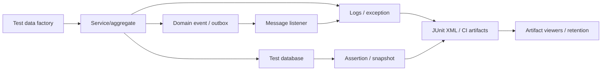
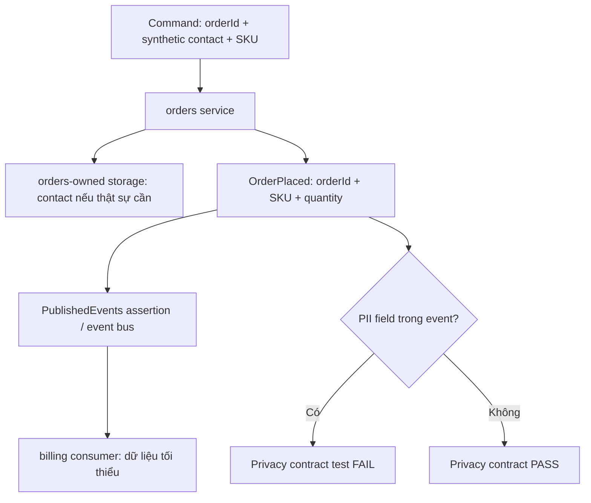

# Ẩn thông tin nhạy cảm trong fixture

> **Chương:** Test data  
> **Module học:** `SPRING_MODULITH_VERIFICATION_TESTING` — kiểm chứng ranh giới kiến trúc Spring Modulith bằng `ApplicationModules` và quy tắc phụ thuộc module, kết hợp `@ApplicationModuleTest`, kiểm thử sự kiện, cơ sở dữ liệu, tích hợp và CI quality gate để ngăn phụ thuộc sai và hồi quy.

## 1. Bài toán thực sự: fixture an toàn ở máy cá nhân nhưng rò qua CI

Một lập trình viên cần kiểm chức năng đặt hàng có địa chỉ giao nhận. Để “thật hơn”, người đó sao chép một dòng đơn hàng từ môi trường production vào `OrderFixture.java`, giữ email, số điện thoại và địa chỉ rồi đổi mỗi `orderId`. Khi test lỗi, assertion tự in ra toàn bộ object; CI lưu JUnit XML, HTML report và log trong artifacts. Một thông tin từng chỉ có trong cơ sở dữ liệu bảo vệ nội bộ giờ nằm ở repository, pull request, local caches, báo cáo build và có thể cả hệ thống phân tích log.

Đây là một sự cố **ở vòng đời của test data**, không phải chỉ là một bug trong chức năng đặt hàng. Thêm `@Transactional` hay chạy `ApplicationModules.verify()` không ngăn thông tin đó lọt vào nguồn dữ liệu fixture, log hoặc artifact.

Mục tiêu bài học là trả lời đúng câu hỏi: **Làm thế nào để ẩn và bảo vệ thông tin nhạy cảm trong fixture mà test vẫn có khả năng bắt lỗi?**

Đến cuối bài, bạn có thể:

1. Phân loại thông tin cần **không xuất hiện trong fixture** và dữ liệu tổng hợp có thể sử dụng.
2. Chọn giữa **tạo dữ liệu giả, masking/redaction, pseudonymization và encryption** theo đúng mục tiêu; không coi chúng tương đương.
3. Thiết kế factory tạo fixture với email/domain giả, địa chỉ giả và test-only identifiers, có độ đa dạng cần cho kiểm thử.
4. Kiểm rằng dữ liệu nhạy cảm **không bị ghi vào event công bố, thông báo lỗi, structured log, snapshot hoặc báo cáo CI**.
5. Dùng `@ApplicationModuleTest`/`PublishedEvents` kiểm payload sự kiện chỉ chứa trường cần thiết mà không vượt qua module boundary.
6. Tổ chức test database, outbox, files, secrets và CI artifacts theo chính sách xử lý dữ liệu có phạm vi và quyền truy cập rõ ràng.

**Nguyên tắc xuyên suốt:** Fixture càng dễ tái hiện càng tốt, nhưng **không** đạt tính “giống thật” bằng cách sao chép thông tin của người thật hoặc credentials thật. Khi kiểm quyền riêng tư, phải assert được dữ liệu nào **không được phép xuất hiện** ở đầu ra.

## 2. Vẽ đường đi của fixture: rủi ro không dừng ở source code

Đừng chỉ hỏi “fixture đã che email chưa?”. Một scenario có thể làm dữ liệu di chuyển qua:



Các đường rò thường thấy:

| Bề mặt | Cách thông tin đi ra | Biện pháp chính |
| --- | --- | --- |
| `src/test/java` và `src/test/resources` | Fixture/hardcoded token được commit | Dữ liệu tổng hợp; secret scanning; review |
| Test report, assertion diff | `toString()` của command/entity chứa email/địa chỉ | Assert theo trường an toàn; thông báo lỗi đã redacted |
| Application/SQL log | Log request payload, SQL parameters, exception | Log metadata tối thiểu, chặn raw body/PII |
| Domain event / outbox | Event DTO lộ contact hoặc token sang module khác | Data minimization và contract allowlist |
| Database test và snapshot | Seed từ dump thật, table export và failure attachment | DB riêng; dữ liệu giả; kiểm cleanup/TTL |
| HTTP mock / broker | Body trong request journal, dead-letter queue | Payload giả; giới hạn ghi journal và quyền xem |
| CI cache/artifacts | Lưu nguyên `target/`, `build/`, HAR, screenshot hoặc dump | Sanitize trước upload; quyền truy cập, retention |
| Debug output thủ công | `System.out.println(command)` hoặc dump environment | Structured diagnostics, không in secret |

Một test có thể chỉ xử lý **dữ liệu tổng hợp**, nhưng vẫn đáng có kiểm tra **không phát tán**. Lý do: ngày mai một dev có thể vô tình thêm `shippingAddress` vào `OrderPlaced`, rồi hành vi đó lộ thông tin thật khi production vận hành. Dữ liệu giả giúp chạy test an toàn; assertion hợp đồng giúp ngăn **lỗ hổng ở code production**.

## 3. Phân loại trường dữ liệu trước khi quyết định “ẩn” thế nào

Không có một hàm `mask(...)` nào đúng cho mọi loại thông tin.

| Loại | Ví dụ | Mặc định trong fixture | Cần kiểm thêm |
| --- | --- | --- | --- |
| **Thông tin liên hệ/PII** | Email, số điện thoại, địa chỉ, họ tên | Tạo giá trị **hư cấu** có format phù hợp | Không lộ trong log/event không cần chúng |
| **Bí mật xác thực** | Password, API key, session token, JWT, private key | Không copy thật; dùng stub/placeholder không dùng được | Không nằm trong source, exception, artifacts |
| **Thanh toán** | PAN/CVV, tài khoản ngân hàng, thông tin ví | Test values chính thức của sandbox nếu được phép; không dùng thẻ thật | Không log thông tin thanh toán; PCI/sandbox policy |
| **Định danh liên kết cá nhân** | Customer ID, device ID, IP, order ID gắn người | ID giả/synthetic; không trích bản ghi thật | Opaque ID vẫn có thể là dữ liệu cá nhân khi liên kết được |
| **Sức khỏe/vị trí/quan hệ** | Hồ sơ bệnh án, GPS chính xác, lịch sử cá nhân | Không đưa dữ liệu người thật vào fixture | Kiểm data minimization theo contract |
| **Tài sản nội bộ** | Endpoint riêng, tên tenant, hợp đồng đối tác, cấu hình hạ tầng | Dùng địa chỉ/tenant giả hoặc test endpoint | Không in URL có credentials/query secrets |
| **Dữ liệu nghiệp vụ thông thường** | SKU mẫu, số lượng, trạng thái đơn | Có thể dùng synthetic constants | Kết hợp scenario để phát hiện edge cases |

**ID ngẫu nhiên không có nghĩa dữ liệu đã ẩn danh.** Nếu còn bảng ánh xạ ID ↔ người thật hoặc có thể liên kết với nhật ký hệ thống, ID ấy vẫn có thể giúp nhận diện cá nhân. `orderId` từ production dù không có email cũng không nên được sao chép bừa vào fixture công khai.

### 3.1. “Không dùng dữ liệu thật” là phương án ưu tiên

Thứ tự lựa chọn thực dụng:

1. **Synthetic fixture:** tự tạo người, đơn hàng và thông tin liên hệ hư cấu; không có bản ghi gốc từ production.
2. **Sandbox/test data chính thức:** dùng dữ liệu được provider công bố cho môi trường thử nghiệm, không hoạt động ở production.
3. **Dữ liệu đã biến đổi và được phê duyệt:** chỉ khi thật sự cần kiểm distribution/compatibility mà synthetic không đủ; kiểm quy trình ẩn danh, quyền, retention và re-identification risk.
4. **Raw production dump:** không phải nguồn fixture mặc định, ngay cả khi dùng trên máy nội bộ.

Không coi việc xóa mỗi cột `email` khỏi một production dump là “đã an toàn”: tên người, địa chỉ, thời gian, mã đơn và các quasi-identifiers khác có thể kết hợp để tái nhận diện.

## 4. Masking, redaction, pseudonymization và encryption khác nhau

| Kỹ thuật | Mục tiêu chính | Cần lưu ý |
| --- | --- | --- |
| **Redaction** | Bỏ hẳn giá trị không cần xuất hiện: `[REDACTED]` | Ưu tiên cho log/report/debug |
| **Masking** | Che một phần, ví dụ email hiển thị dạng `a***@...` | Phần còn lại vẫn có thể nhận diện; không phù hợp mọi log |
| **Synthetic generation** | Tạo dữ liệu **không bắt nguồn từ người thật** | Tốt nhất cho đa số fixtures có thể commit |
| **Pseudonymization/tokenization** | Thay giá trị thật bằng ID/token có khả năng liên kết nội bộ | Còn rủi ro tái nhận diện; bảng ánh xạ và khóa phải được bảo vệ |
| **Hashing/HMAC** | Biến đổi deterministically để so khớp/đối chiếu theo policy | Hash email dễ đoán không bảo đảm ẩn danh; HMAC cần khóa bí mật |
| **Encryption** | Bảo vệ dữ liệu khi lưu/truyền, có thể giải mã bởi bên được phép | Không tự thay data minimization hay ngăn log plaintext |
| **Anonymization thực sự** | Làm không thể hoặc không còn hợp lý để nhận diện lại theo ngữ cảnh | Khó đạt với dữ liệu giàu liên kết; phải đánh giá rủi ro |

### 4.1. Một ví dụ rõ ràng

Giả sử người thật có địa chỉ email `REAL_USER_ADDRESS` (ký hiệu, **không đưa email thật vào ví dụ**):

```text
Raw:
  REAL_USER_ADDRESS                   <- không đưa vào fixture

Redacted:
  [REDACTED_EMAIL]                    <- thích hợp cho log

Synthetic:
  fixture.001@example.test            <- thích hợp cho test email format

Pseudonymized:
  customer-token-xyz                  <- có thể liên kết nếu giữ mapping

Encrypted:
  ciphertext...                       <- vẫn có bản gốc sau khi giải mã
```

Ở đây `example.test` là domain dùng cho ví dụ/test, không phải hộp thư người thật. Không gửi email/SMS thực từ test chỉ vì địa chỉ có vẻ giả: phải dùng mail transport giả, mock provider hoặc sandbox được kiểm soát.

### 4.2. Vì sao `SHA-256(email)` chưa đủ?

Email và số điện thoại nằm trong một không gian có thể đoán/dò. Một hash không khóa của giá trị đã chuẩn hóa có thể bị thử bằng từ điển. Hash thường còn giữ tính liên kết: hai nơi dùng cùng giá trị sẽ ra cùng digest. Đừng tuyên bố một cột `sha256(email)` trong fixture **vô danh**.

Khi mục tiêu test chỉ là “hai email giống nhau tạo cùng lookup key”, hãy **tạo email giả deterministic** rồi tính hash trong test. Nếu production dùng keyed HMAC để pseudonymize, test logic đó qua một **test key riêng**, không hardcode khóa production. Dữ liệu được pseudonymize vẫn có thể thuộc diện cần bảo vệ.

### 4.3. Che dữ liệu không có nghĩa xóa nghĩa vụ bảo vệ

Ngay cả khi fixture có `[REDACTED]`, một test có thể kết nối tới production service bằng credentials thật rồi tạo rủi ro khác. Vì vậy cần **cả hai**: fixture không chứa thông tin thật **và** test infrastructure được cô lập để không gửi/ghi dữ liệu sang hệ thống thật.

## 5. Bộ quy tắc tạo fixture giả mà vẫn kiểm được nghiệp vụ

Không phải cứ thay mọi trường bằng `"xxx"` là an toàn và hữu ích. Một fixture cần có đủ hình thức và giá trị để đi qua validation, nhưng không gắn với chủ thể thật.

| Trường | Fixture nên dùng | Fixture nên tránh |
| --- | --- | --- |
| Email hợp lệ | `fixture.001@example.test` | Email sao chép từ tài khoản nhân viên/khách |
| Email không hợp lệ | `missing-at-symbol` | Sửa bừa email thật để tạo negative case |
| Người nhận | `"Test Customer 01"` | Họ tên thật từ ticket/CRM |
| Địa chỉ | `"1 Example Lane, Fictional City"` | Địa chỉ cư trú thật, kể cả đã đổi tên |
| Số điện thoại | Placeholder theo validator hoặc số test chính thức của nhà cung cấp | Số di động thật hoặc “số random” có thể thuộc ai đó |
| Order ID | UUID chỉ sinh trong test | UUID lấy từ production log |
| Tenant ID | Test tenant đã được cấp riêng | Tenant production mà test có quyền truy cập |
| Token/secret | Stub marker `"TEST_ONLY_NOT_A_CREDENTIAL"` | Access token thực, private key, session cookie |
| Payment | Sandbox test data do provider hướng dẫn | Số thẻ/CVV/thông tin ngân hàng thật |

**Số điện thoại ngẫu nhiên có thể trùng số thật.** Nếu validator yêu cầu chuẩn E.164, hãy dùng dải số hư cấu được nhà mạng/nhà cung cấp công bố dành cho test hoặc stub validator/transport ở test scope; không tự coi mọi số `+84...` được random là an toàn để gọi/gửi SMS.

### 5.1. Nên test cả hai bề mặt: dữ liệu giả và không gửi ra ngoài

Một test với `fixture.001@example.test` có thể chạy đúng mà vẫn vô tình gọi SMTP thật. Mục tiêu kiểm là:

- Service gọi email gateway theo hợp đồng, **không** giao tiếp mạng thật.
- Nội dung cần thiết được đưa tới mock/sandbox có kiểm soát.
- Log/exception không in địa chỉ, token hoặc nội dung thư riêng tư.

Đối với endpoint thực bên ngoài, chặn network egress của CI job khi không cần thiết, dùng test configuration và credentials **chỉ có quyền ở sandbox**.

## 6. Ví dụ xuyên suốt: đơn hàng có contact, event không cần contact

Giả sử ứng dụng `com.example.shop` có module `orders` và `billing`. Khách nhập email/địa chỉ để giao hàng, nhưng `billing` chỉ cần biết `orderId`, `sku` và `quantity` để tạo nghiệp vụ tương ứng. Nếu `orders` publish nguyên `PlaceOrderCommand` như event, module `billing` sẽ nhận dữ liệu liên hệ **không cần thiết**, và chúng có thể bị lưu vào outbox/log.

Thiết kế được kiểm:

```text
src/main/java/com/example/shop/
├── ShopApplication.java
├── orders/
│   ├── PlaceOrderCommand.java
│   ├── OrderPlaced.java
│   ├── OrderStore.java
│   └── OrderService.java
└── billing/
    └── BillingOrderConsumer.java

src/test/java/com/example/shop/
├── ModuleArchitectureTest.java
└── orders/
    ├── SafeOrderFixtures.java
    ├── OrderPrivacyUnitTest.java
    ├── OrderEventPrivacyModuleTest.java
    └── OrderPrivacyDbIT.java
```

Đây là mô hình dạy học, không phải package tree áp dụng bắt buộc. Theo Spring Modulith mặc định, `orders`/`billing` là application modules; `billing` dùng API công bố `orders.OrderPlaced`, không import repository hay contact entity nằm trong `orders.internal`.

### 6.1. Command có contact là dữ liệu nhạy cảm **ở phía tiếp nhận**

`src/main/java/com/example/shop/orders/PlaceOrderCommand.java`:

```java
package com.example.shop.orders;

import java.util.UUID;

public record PlaceOrderCommand(
        UUID orderId,
        String contactEmail,
        String shippingAddress,
        String sku,
        int quantity
) {}
```

Command tồn tại vì service cần nhận thông tin giao hàng. Không suy ra rằng mọi event/consumer phải có bản sao của cả command.

### 6.2. Domain event chỉ mang dữ liệu cần cho consumer

`src/main/java/com/example/shop/orders/OrderPlaced.java`:

```java
package com.example.shop.orders;

import java.util.UUID;

public record OrderPlaced(
        UUID orderId,
        String sku,
        int quantity
) {}
```

Event này **không** có `contactEmail` hay `shippingAddress`. `orderId` là opaque identifier trong ví dụ, nhưng vẫn có thể liên kết tới khách hàng ở nơi có quyền truy cập mapping; không mặc định coi nó là dữ liệu “vô danh”. Cần đánh giá nhu cầu chia sẻ orderId và chính sách retention của event.

### 6.3. Port lưu dữ liệu của riêng `orders`

`src/main/java/com/example/shop/orders/OrderStore.java`:

```java
package com.example.shop.orders;

import java.util.UUID;

interface OrderStore {
    void save(StoredOrder order);
}

record StoredOrder(
        UUID id,
        String contactEmail,
        String shippingAddress,
        String sku,
        int quantity
) {}
```

Hai kiểu package-private thuộc module `orders`. Chúng tồn tại để mô tả rằng có dữ liệu liên hệ trong storage thuộc quyền sở hữu module. Không để module `billing` import `StoredOrder` hoặc truy cập trực tiếp database/table nội bộ `orders`.

### 6.4. Service phát event **tối thiểu**

`src/main/java/com/example/shop/orders/OrderService.java`:

```java
package com.example.shop.orders;

import java.util.Objects;
import org.springframework.context.ApplicationEventPublisher;
import org.springframework.stereotype.Service;

@Service
public class OrderService {

    private final OrderStore store;
    private final ApplicationEventPublisher publisher;

    public OrderService(
            OrderStore store, ApplicationEventPublisher publisher) {
        this.store = store;
        this.publisher = publisher;
    }

    public void place(PlaceOrderCommand command) {
        Objects.requireNonNull(command, "command");

        if (command.orderId() == null
                || command.contactEmail() == null
                || command.contactEmail().isBlank()
                || command.shippingAddress() == null
                || command.shippingAddress().isBlank()
                || command.sku() == null
                || command.sku().isBlank()
                || command.quantity() <= 0) {
            // Không nối raw input vào exception message.
            throw new IllegalArgumentException("ORDER_INPUT_INVALID");
        }

        store.save(new StoredOrder(
            command.orderId(),
            command.contactEmail(),
            command.shippingAddress(),
            command.sku(),
            command.quantity()
        ));

        // Không publish PlaceOrderCommand nguyên vẹn.
        publisher.publishEvent(new OrderPlaced(
            command.orderId(), command.sku(), command.quantity()
        ));
    }
}
```

**Giới hạn:** Service này chưa có transaction/outbox/reliable delivery, email format validator hoặc mã hóa dữ liệu lưu trữ. Những vấn đề đó phải theo hợp đồng production, không tự phát sinh chỉ từ bài về fixture. Ví dụ tập trung kiểm một đường **contact in → minimal event out**.

### 6.5. Fixture tổng hợp có giá trị phân biệt lỗi

`src/test/java/com/example/shop/orders/SafeOrderFixtures.java`:

```java
package com.example.shop.orders;

import java.util.UUID;

final class SafeOrderFixtures {

    static final String SYNTHETIC_EMAIL = "fixture.001@example.test";
    static final String SYNTHETIC_ADDRESS =
            "1 Example Lane, Fictional City";
    static final String SKU = "SKU-TEST-001";

    private SafeOrderFixtures() {}

    static PlaceOrderCommand validCommand() {
        return validCommand(UUID.fromString(
            "11111111-1111-1111-1111-111111111111"));
    }

    static PlaceOrderCommand validCommand(UUID orderId) {
        return new PlaceOrderCommand(
            orderId,
            SYNTHETIC_EMAIL,
            SYNTHETIC_ADDRESS,
            SKU,
            2
        );
    }

    static PlaceOrderCommand invalidEmail(UUID orderId) {
        return new PlaceOrderCommand(
            orderId,
            "",  // Không phải email thật bị sửa.
            SYNTHETIC_ADDRESS,
            SKU,
            2
        );
    }
}
```

`validCommand()` tạo fixture deterministic thuận tiện cho unit test chỉ dùng memory. `validCommand(UUID)` cho phép integration tests cấp ID riêng khi cùng database được chia sẻ. Email và địa chỉ là **giả**, nhưng có cấu trúc để khi ai đó lỡ đưa chúng vào event/log, test có thể phát hiện **giá trị sentinel cụ thể**.

**Không dùng `toString()` của command làm diagnostic**: Java `record` mặc định có thể đưa `contactEmail` và `shippingAddress` vào chuỗi biểu diễn, kể cả khi đây là dữ liệu giả ở test. Trong production, cùng cách log đó sẽ chứa dữ liệu thật.

## 7. Unit test kiểm “contact được sử dụng đúng chỗ, không bị publish”

Một privacy test tốt không chỉ xác minh `OrderPlaced` được tạo. Nó phải bắt được hồi quy khi developer sửa event từ:

```java
new OrderPlaced(command.orderId(), command.sku(), command.quantity())
```

thành một kiểu event vô tình thêm `contactEmail` hoặc `shippingAddress`.

### 7.1. Assertion kiểm payload thực tế và danh sách field cho phép

`src/test/java/com/example/shop/orders/OrderPrivacyUnitTest.java`:

```java
package com.example.shop.orders;

import static org.junit.jupiter.api.Assertions.*;

import java.lang.reflect.RecordComponent;
import java.util.ArrayList;
import java.util.Arrays;
import java.util.HashSet;
import java.util.List;
import java.util.Set;
import org.junit.jupiter.api.Test;
import org.springframework.context.ApplicationEventPublisher;

class OrderPrivacyUnitTest {

    @Test
    void retainsContactInOwnedStoreButPublishesMinimalEvent() {
        List<StoredOrder> saved = new ArrayList<>();
        List<Object> emitted = new ArrayList<>();
        OrderStore store = saved::add;
        ApplicationEventPublisher events = emitted::add;
        OrderService service = new OrderService(store, events);
        PlaceOrderCommand command = SafeOrderFixtures.validCommand();

        service.place(command);

        assertEquals(1, saved.size());
        assertEquals(command.contactEmail(), saved.get(0).contactEmail());
        assertEquals(command.shippingAddress(),
                saved.get(0).shippingAddress());

        assertEquals(1, emitted.size());
        OrderPlaced event = assertInstanceOf(
                OrderPlaced.class, emitted.get(0));
        assertEquals(command.orderId(), event.orderId());
        assertEquals(command.sku(), event.sku());
        assertEquals(command.quantity(), event.quantity());

        // Schema contract: chỉ những field tối thiểu được công bố.
        Set<String> allowedFields = Set.of(
                "orderId", "sku", "quantity");
        Set<String> actualFields = new HashSet<>(
                Arrays.stream(OrderPlaced.class.getRecordComponents())
                    .map(RecordComponent::getName)
                    .toList()
        );
        assertEquals(allowedFields, actualFields);

        // Canary: nếu dữ liệu contact lộ vào event.toString,
        // test FAIL với synthetic values có thể nhận diện rõ.
        String eventRepresentation = event.toString();
        assertFalse(eventRepresentation.contains(command.contactEmail()));
        assertFalse(eventRepresentation.contains(command.shippingAddress()));
    }

    @Test
    void validationErrorDoesNotEchoContactOrAddress() {
        PlaceOrderCommand valid = SafeOrderFixtures.validCommand();
        PlaceOrderCommand invalidAddress = new PlaceOrderCommand(
                valid.orderId(),
                valid.contactEmail(),
                "", // Chỉ trường address invalid.
                valid.sku(),
                valid.quantity()
        );
        OrderService service = new OrderService(
                saved -> fail("Invalid input must not be saved"),
                event -> fail("Invalid input must not publish an event")
        );

        IllegalArgumentException failure = assertThrows(
                IllegalArgumentException.class,
                () -> service.place(invalidAddress)
        );

        assertEquals("ORDER_INPUT_INVALID", failure.getMessage());
        assertFalse(failure.getMessage().contains(valid.contactEmail()));
        assertFalse(failure.getMessage().contains(
                SafeOrderFixtures.SYNTHETIC_ADDRESS));
    }
}
```

Test đầu tiên **không khẳng định hệ thống không được lưu email ở mọi nơi**. Khi nghiệp vụ giao hàng thực sự cần email và địa chỉ, module sở hữu có thể phải lưu dữ liệu đó với quyền, retention và bảo vệ thích hợp. Điều đang được bảo vệ là **không đưa contact vào event công bố cho module khác chỉ vì nó có trong command**.

Test thứ hai kiểm rằng lỗi validation trả về **error code**, không nối giá trị thô vào `getMessage()`. Nó không chứng minh toàn bộ logging middleware an toàn; cần kiểm logger/HTTP layer theo đường thực tế.

### 7.2. Giới hạn của `event.toString()`

`event.toString()` là **một điểm quan sát**, không phải JSON serialization test. Nếu production publish event qua Jackson, Avro hoặc broker serializer, có thể thêm một test contract dành riêng serializer:

```java
// Khi project dùng Jackson ObjectMapper:
String serialized = objectMapper.writeValueAsString(event);

assertThat(serialized)
        .doesNotContain(command.contactEmail())
        .doesNotContain(command.shippingAddress());
```

Đoạn trên là **phần mở rộng minh họa trong test đã có `objectMapper`, `event` và `command`**, không phải class chạy độc lập. Với Jackson, cách mạnh hơn là đọc JSON như tree rồi assert **allowlist các field được phép**: `orderId`, `sku`, `quantity`. Chỉ tìm một sentinel string sẽ không phát hiện việc một bản sao biến đổi/encode của email bị rò.

Không viết test `assertFalse(json.contains("@"))` cho mọi payload: có thể tạo false positive ở các dữ liệu hợp lệ không nhạy cảm. Hãy kiểm **schema contract**, các giá trị nhạy cảm cần cấm và bề mặt cụ thể mà hệ thống thực sự serialize.

### 7.3. Tạo một negative probe để chứng minh test bảo vệ được gì

Trên nhánh thử nghiệm, thêm `contactEmail` vào event và thay producer truyền giá trị đó. Một test chỉ assert `orderId`/`sku`/`quantity` có thể vẫn PASS; test **allowlist record components** ở trên phải FAIL hoặc buộc cập nhật có chủ đích. Không giữ thay đổi làm lộ contact trong production branch.

Sửa lại event tối thiểu rồi chạy cả test module và integration test. Đây là **negative privacy probe**, không phải negative architectural probe: `ApplicationModules.verify()` có thể vẫn PASS dù event công bố có thêm field PII.

## 8. Test diagnostics: không để assertion/log tự phá dữ liệu an toàn

Nhiều rò rỉ xảy ra khi test thất bại, chứ không xảy ra trên đường success.

### 8.1. Những cách log dễ lộ dữ liệu

Các ví dụ **không nên dùng** nếu object chứa PII/token:

```java
// Anti-pattern: record.toString có thể in raw contact.
log.info("Incoming order: {}", command);

// Anti-pattern: exception message kèm input thô.
throw new IllegalArgumentException(
    "Invalid email: " + command.contactEmail());

// Anti-pattern: assertion diff in toàn bộ request.
assertEquals(expectedCommand, actualCommand);

// Anti-pattern: dump raw variables để điều tra CI.
System.out.println(System.getenv());
```

Một số logging frameworks và SQL proxies còn có thể in HTTP headers, raw request bodies hoặc bound SQL parameters. Ngay cả khi test fixture giả, production dùng cùng code sẽ chứa email/token thật. Không dựa vào việc “log chỉ tồn tại ở CI” để hợp lý hóa dump.

### 8.2. Thay bằng diagnostic có allowlist

Một lớp diagnostic an toàn theo nguyên tắc dữ liệu tối thiểu:

```java
package com.example.shop.orders;

import java.util.UUID;

public record OrderDiagnostic(
        String eventCode,
        UUID orderId,
        String reasonCode
) {}
```

Ví dụ:

```java
OrderDiagnostic diagnostic = new OrderDiagnostic(
        "ORDER_REJECTED",
        command.orderId(),
        "INVALID_ADDRESS"
);
log.warn("{}", diagnostic);
```

Đây là một đoạn sử dụng minh họa, giả sử có `log` và `command` trong method. `orderId` có thể vẫn liên kết tới người thật thông qua hệ thống khác; vì vậy log access, retention và masking policy vẫn cần áp dụng. Trong một số hệ thống, thay ID nghiệp vụ bằng request ID không liên kết hoặc correlation ID phạm vi ngắn có thể phù hợp hơn.

### 8.3. Một test kiểm nội dung diagnostic

```java
package com.example.shop.orders;

import static org.junit.jupiter.api.Assertions.*;

import org.junit.jupiter.api.Test;

class OrderDiagnosticTest {

    @Test
    void diagnosticContainsOnlyApprovedMetadata() {
        PlaceOrderCommand input = SafeOrderFixtures.validCommand();
        OrderDiagnostic diagnostic = new OrderDiagnostic(
                "ORDER_REJECTED", input.orderId(), "INVALID_ADDRESS");

        String rendered = diagnostic.toString();

        assertTrue(rendered.contains("ORDER_REJECTED"));
        assertTrue(rendered.contains("INVALID_ADDRESS"));
        assertFalse(rendered.contains(input.contactEmail()));
        assertFalse(rendered.contains(input.shippingAddress()));
    }
}
```

Trong unit test này, ta kiểm **object diagnostic được đưa tới logger**. Muốn chứng minh log thật không rò, phải có integration test bắt log ở appender/provider thực, gồm filters, exception formatting và HTTP access logs. Tương tự, privacy test của log nên dùng synthetic canary có chủ đích thay vì PII thật.

### 8.4. Log và metrics có hai vai trò khác nhau

Một metric counter như `orders.validation.rejected=1` thường không cần email hoặc customer ID. Tránh gắn email, token hoặc order ID cardinality cao vào metric labels; vừa tăng rủi ro riêng tư vừa làm hệ thống metrics nặng.

Nếu bắt buộc phải truy vết theo một request, dùng request/correlation ID có lifetime, access control và retention phù hợp, không đưa raw address/phone vào span attributes hay exception breadcrumbs mặc định.

## 9. Test có token/credential: mục tiêu là **không có secret thật trong fixture**

Một unit test gọi payment adapter không cần tài khoản thật hay API key thật. Cách an toàn nhất là inject **stub gateway** và dùng một marker không thể xác thực:

```java
interface PaymentGateway {
    boolean authorize(String requestId, int amountMinorUnits);
}

PaymentGateway fake = (requestId, amount) -> true;
// Không cần PAYMENT_API_KEY trong fixture hay test method.
```

Đoạn này là ví dụ interface/test double gắn vào adapter tương ứng của project. Cả requestId lẫn số tiền đều là synthetic data; unit test chỉ cần phân biệt thành công/thất bại và side effect.

### 9.1. Khi integration test bắt buộc gọi sandbox có xác thực

Cách tổ chức:

1. **CI secret manager** cung cấp sandbox credential ngắn hạn, quyền thấp, chỉ cho môi trường thử nghiệm.
2. Không viết key vào `application-test.yml`, Java constant, test snapshot hay Dockerfile.
3. Test infrastructure đọc secret qua provider chuẩn khi chạy; không in giá trị và không gắn vào URL query.
4. Phân biệt **missing configuration** với một test failure: job bắt buộc phải báo lỗi cấu hình rõ, không tự `@Disabled` rồi xanh giả.
5. Giới hạn network egress tới sandbox endpoints, không để test có thể gọi production API bằng nhầm configuration.
6. Rotate/revoke test credentials nếu chúng bị lộ; xóa khỏi Git HEAD **không** xóa lịch sử cũ.

**Phân biệt rõ:** Marker `TEST_ONLY_NOT_A_CREDENTIAL` là một chuỗi giả có thể commit, không được dùng như một bearer token thật. Một “token giả” có cấu trúc trông giống production secret có thể gây false positives trong scanner hoặc bị người khác vô tình đưa vào môi trường thực; stub không cần token thường tốt hơn.

### 9.2. Kiểm secret không xuất hiện khi test FAIL

Nếu test sandbox tạo lỗi, không được để HTTP client/server dump header `Authorization` hoặc response chứa token vào JUnit XML/stack trace. Cần cấu hình redaction trên:

- HTTP client interceptors.
- Request/response logging.
- Exception handlers và retry wrappers.
- Tracing spans, request journals của mock servers.
- CI console và artifacts.

Một test phù hợp dùng **synthetic sentinel** giả làm token trong fake request để xác nhận log sanitizer che đúng trường. Không đưa secret thật vào assertions vì nếu assertion thất bại nó có thể tự in lại secret.

## 10. Test database và event: bảo vệ **đường phát tán** thay vì cấm lưu mọi dữ liệu

Đối với đơn hàng, module `orders` có thể có căn cứ nghiệp vụ để lưu email/địa chỉ giao hàng. Điều không phù hợp là copy thông tin đó vào outbox event công bố cho module khác nếu không cần.

### 10.1. Ma trận storage và event ownership

| Dữ liệu | Nơi có thể cần xuất hiện | Nơi cần cấm hoặc hạn chế |
| --- | --- | --- |
| `contactEmail` | Bảng contact của `orders`/shipping theo contract | `OrderPlaced` broadcast tới `billing` không cần email |
| `shippingAddress` | Kho dữ liệu giao nhận được kiểm soát | Structured logs, JUnit snapshots, billing event |
| `orderId` | Order storage và event cần tham chiếu đơn | Không công bố vô hạn ở telemetry không cần thiết |
| Payment credential | Provider secret store hoặc gateway runtime | Source/test fixture, outbox, query strings, CI report |
| `sku`/`quantity` | Event nếu consumer cần | Không tự coi chúng là tuyệt đối phi nhạy cảm trong mọi domain |

**Data minimization là property của contract.** Không chỉ “che chuỗi email khi in” mà cần loại field không cần thiết khỏi event ngay từ producer.

### 10.2. SQL schema minh họa có storage riêng và outbox tối thiểu

```sql
CREATE TABLE customer_orders (
    id UUID PRIMARY KEY,
    contact_email VARCHAR(320) NOT NULL,
    shipping_address TEXT NOT NULL,
    sku VARCHAR(64) NOT NULL,
    quantity INTEGER NOT NULL
);

CREATE TABLE order_outbox (
    event_id UUID PRIMARY KEY,
    order_id UUID NOT NULL REFERENCES customer_orders(id),
    event_type VARCHAR(80) NOT NULL,
    payload JSONB NOT NULL
);
```

Đây là schema ví dụ, không phải yêu cầu Spring Modulith tạo bảng này. `customer_orders` có dữ liệu contact vì domain giả định cần giao hàng; `order_outbox.payload` của `OrderPlaced` **không** cần những contact fields. Nếu project đã dùng Event Publication Registry hoặc outbox riêng, test storage event thực tế của project.

### 10.3. Test integration kiểm outbox payload

Khi **production implementation thật** có transaction/outbox tương ứng, thêm một test kiểm:

```java
// Pseudocode trong một integration test có applicationService và jdbc.
var command = SafeOrderFixtures.validCommand(UUID.randomUUID());
applicationService.place(command);

String payloadJson = jdbc.queryForObject(
    "SELECT payload::text FROM order_outbox "
        + "WHERE order_id = ? AND event_type = ?",
    String.class,
    command.orderId(),
    "OrderPlaced"
);

assertThat(payloadJson).isNotNull();
assertThat(payloadJson).doesNotContain(command.contactEmail());
assertThat(payloadJson).doesNotContain(command.shippingAddress());
```

Đây là **pseudocode có các biến/hạ tầng chưa khai báo trong ví dụ**, không chạy nguyên khối vì service `OrderService` ở mục 6 chỉ gọi `ApplicationEventPublisher` và `OrderStore`, chưa viết outbox. Khi áp dụng vào project thật, phải thay bằng service/serializer/outbox thực, assert **payload field allowlist** và kiểm transaction state.

**Quan trọng:** Không dùng test này để chứng minh “mã hóa-at-rest” hay “DB đã tuân thủ mọi quy định dữ liệu cá nhân”. Nó chỉ xác minh một hợp đồng cụ thể: **contact không rò sang outbox payload**.

### 10.4. Snapshot và DB dump không tự trở nên an toàn vì có rollback

`@Transactional` rollback cuối test có thể dọn rows trong DB, nhưng không gỡ thông tin đã được ghi vào:

- SQL parameter logs.
- Testcontainers startup/driver logs.
- Stack traces và JUnit XML.
- Snapshot files tạo trong test.
- HTTP/broker artifacts.

Nếu test chụp database dump để chẩn đoán, dump chỉ được dùng với **dữ liệu synthetic**, được giới hạn access/retention; không commit hoặc upload toàn bộ dump một cách mặc định.

## 11. `@ApplicationModuleTest` kiểm contract sự kiện không phát tán contact

Trong Spring Modulith, test module `orders` có thể gọi `OrderService` thật qua Spring container, sau đó quan sát `OrderPlaced` được publish. Điều này giúp phát hiện một thay đổi ở service làm event mang thông tin liên hệ từ command.

### 11.1. Test-only configuration không cần chứa dữ liệu nhạy cảm

`src/test/java/com/example/shop/orders/OrderPrivacyModuleConfig.java`:

```java
package com.example.shop.orders;

import org.springframework.boot.test.context.TestConfiguration;
import org.springframework.context.annotation.Bean;
import org.springframework.context.annotation.Primary;

@TestConfiguration(proxyBeanMethods = false)
class OrderPrivacyModuleConfig {

    @Bean
    @Primary
    OrderStore noOpOrderStore() {
        // Module test này chỉ kiểm event contract, không kiểm DB.
        return order -> {};
    }
}
```

Stub không lưu thông tin contact trong singleton bean hoặc static list. Nếu cần kiểm DB/persistence, dùng integration test riêng và chiến lược isolation. `@Primary` chỉ giúp lựa chọn bean trong một số cấu hình; khi dự án có tên bean trùng, custom configurations hoặc test bean replacement, cần điều chỉnh cho phiên bản Spring Boot đang chạy.

### 11.2. Module test gọi service và dùng `PublishedEvents`

`src/test/java/com/example/shop/orders/OrderEventPrivacyModuleTest.java`:

```java
package com.example.shop.orders;

import static org.assertj.core.api.Assertions.assertThat;

import java.lang.reflect.RecordComponent;
import java.util.Arrays;
import java.util.Set;
import java.util.stream.Collectors;
import org.junit.jupiter.api.Test;
import org.springframework.beans.factory.annotation.Autowired;
import org.springframework.context.annotation.Import;
import org.springframework.modulith.test.ApplicationModuleTest;
import org.springframework.modulith.test.PublishedEvents;

@ApplicationModuleTest
@Import(OrderPrivacyModuleConfig.class)
class OrderEventPrivacyModuleTest {

    @Autowired
    OrderService service;

    @Test
    void publishesOnlyApprovedFields(PublishedEvents published) {
        PlaceOrderCommand input = SafeOrderFixtures.validCommand();

        service.place(input);

        // Một event do Spring thu thập, không phải object tự assert riêng.
        assertThat(published.ofType(OrderPlaced.class))
                .anySatisfy(event -> {
                    assertThat(event.orderId()).isEqualTo(input.orderId());
                    assertThat(event.sku()).isEqualTo(input.sku());
                    assertThat(event.quantity()).isEqualTo(input.quantity());

                    assertThat(event.toString())
                            .doesNotContain(input.contactEmail())
                            .doesNotContain(input.shippingAddress());
                });

        // Schema allowlist bảo vệ cả khi xuất hiện field PII mới.
        Set<String> actualFields = Arrays.stream(
                OrderPlaced.class.getRecordComponents())
            .map(RecordComponent::getName)
            .collect(Collectors.toSet());

        assertThat(actualFields)
                .containsExactlyInAnyOrder(
                        "orderId", "sku", "quantity");
    }
}
```

**Hai assertions có chức năng khác nhau:** `PublishedEvents` chứng minh service đã thực sự publish một event theo contract. Reflection/allowlist kiểm kiểu event chỉ có trường được phép. Một assertion kiểm mỗi `event.toString()` không thay thế việc kiểm JSON/protobuf serializer thực tế nếu event được gửi ra broker.

`anySatisfy` chỉ chứng minh **ít nhất một event phù hợp**, không chứng minh đúng một event hoặc mọi event khác của module đều an toàn. Nếu contract đòi hỏi đúng một event, thêm assertion đếm phù hợp API/version; kiểm các event types khác theo allowlist riêng.

### 11.3. Tách quyền riêng tư khỏi module dependency verification

Structural test:

```java
package com.example.shop;

import org.junit.jupiter.api.Test;
import org.springframework.modulith.core.ApplicationModules;

class ModuleArchitectureTest {

    @Test
    void verifiesModuleDependencies() {
        ApplicationModules.of(ShopApplication.class).verify();
    }
}
```

`ApplicationModules.verify()` kiểm dependency/module API được Spring Modulith nhận diện, ví dụ `billing` không import `orders.internal` trái quy tắc. Nhưng nếu public `OrderPlaced` thêm `contactEmail`, dependency vẫn có thể hợp lệ và structural verification **PASS**. Vi phạm privacy cần test hợp đồng/serializer/logging/DB riêng.

**Không sửa privacy leak bằng cách mở rộng `@NamedInterface` hoặc `allowedDependencies`.** Làm thế có thể chỉ khiến thêm modules truy cập được dữ liệu, trái mục tiêu giới hạn phát tán. Sửa event schema/producer và quyền sở hữu dữ liệu ở đúng module.

### 11.4. Một workflow event an toàn



Nếu module `billing` thực sự cần thông tin liên hệ cho một use case hợp lệ, không nên “lén” thêm toàn bộ contact vào broadcast event. Cần review hợp đồng data-sharing: có thể dùng API theo mục đích, token/capability có thời hạn hoặc một event chuyên biệt giới hạn subscribers với access control. Test vẫn cần minh chứng chỉ những bên được phép mới nhận dữ liệu.

## 12. Dùng sentinel trong fixture để kiểm leak có thể xảy ra

Một fixture với giá trị `"x"` rất khó phân biệt trong log hoặc payload. Một **synthetic sentinel** nên đủ đặc trưng để tìm chính xác, nhưng không có giá trị ngoài test:

```text
contactEmail:     fixture.001@example.test
shippingAddress:  1 Example Lane, Fictional City
secretMarker:     TEST_ONLY_NOT_A_CREDENTIAL
```

**Không dùng token thật làm sentinel.** Một test báo lỗi có thể in thẳng giá trị nó phát hiện. Dùng marker hư cấu cho phép scanner kiểm mà không đưa dữ liệu nhạy cảm vào report.

### 12.1. Contract test ở nhiều “sink”

| Sink | Cách test quan sát | Assertion chính |
| --- | --- | --- |
| Public event object | `PublishedEvents` | Event không có field contact |
| Serialized event JSON | Serializer production | Field allowlist, không có raw synthetic contact |
| Structured audit | Audit sink fake hoặc appender test | Chỉ reason code/ID được phép |
| Validation exception | `assertThrows` và message | Không nối contact/token vào message |
| Outbox payload | Query DB theo event/order ID | Payload không có field/value contact |
| HTTP response error | Web test theo controller thực | Không trả raw request body/PII |
| Broker/dead-letter | Test adapter với sandbox/test broker | Không gửi field nhạy cảm ngoài policy |
| CI test report | Scan artifact sau khi build | Không có sentinel contact/secret trong report |

Không dùng một regex “email-looking string” duy nhất để khẳng định mọi rò rỉ đã được chặn. Dữ liệu có thể bị URL-encode, Base64, JSON-escape, hash/tokenize hoặc nằm trong binary artifacts. Một privacy gate tốt kết hợp **allowlist schema**, **test từng đường phát tán thực**, và **scanning ở tầng CI**.

### 12.2. Negative leak test phải chứng minh sẽ chuyển đỏ

Trên branch dùng để thử nghiệm, tạm tạo lỗi ở một đường:

```java
// Anti-pattern cố ý trên branch thử:
log.info("Placing order {}", command);
```

Vì `command` có contact, appender/test output chứa sentinel phải bị gate phát hiện. Nếu vẫn PASS, phải kiểm logging level, appender đang capture đúng logger/thread hay không, CI scanner có nhìn đúng report/artifact không.

**Không merge dòng log nhạy cảm.** Khôi phục diagnostic chỉ gồm code/ID được phép. Mục tiêu không phải sinh dữ liệu thật để “test scanner mạnh hơn”, mà chứng minh scanner kiểm được một trường hợp có thể tái hiện bằng **fixture giả**.

### 12.3. Các trường hợp cần thêm test

- Exception handler tự log stack trace kèm `request.toString()`.
- JDBC proxy bật log bound SQL parameters.
- Retry wrapper ghi raw request mỗi lần attempt FAIL.
- Broker adapter ghi payload ở dead-letter record.
- Mock HTTP server lưu full request journal.
- Snapshot matcher xuất toàn bộ expected/actual object vào diff.

Chỉ test happy path event không đủ phát hiện các đường **failure-only** ở trên.

## 13. CI: chặn dữ liệu nhạy cảm ở nguồn và ở artifact

Có ba lớp bảo vệ bổ sung, không thay thế nhau:

1. **Trước khi commit:** kiểm fixture, resource files và credentials để tránh đưa dữ liệu thật vào Git.
2. **Khi chạy test:** kiểm contract về log/event/DB/exceptions; không cho test liên lạc production service.
3. **Trước khi chia sẻ artifacts:** giới hạn những gì upload, scan/sanitize đúng định dạng và ràng buộc truy cập/retention.

### 13.1. Đừng chỉ quét source code

Quét source có thể phát hiện hardcoded key, private key hoặc chuỗi giống credentials, nhưng không phát hiện một service **tự in secret lấy từ environment khi chạy**. Quét runtime artifacts có thể thấy contact sentinel xuất hiện trong JUnit XML, nhưng không chắc phát hiện mọi encoding hoặc cấu trúc dữ liệu. Vì vậy cần **cả static secret scanning và runtime privacy assertions**.

### 13.2. Mẫu quy trình CI theo mục đích

```text
Pull request:
  (1) Scan tracked source + test resources for leaked secrets
  (2) Verify test environment cannot reach production endpoints
  (3) Run structural test: ApplicationModules.verify()
  (4) Run privacy-focused unit & @ApplicationModuleTest tests
  (5) Run event/DB/HTTP integration tests in isolated environment
  (6) Scan/sanitize generated logs & reports using safe canaries/policies
  (7) Upload only approved artifacts with access controls + retention
  (8) Required checks must FAIL on any violated privacy gate
```

Một công cụ chuyên dụng như secret scanner/DLP scanner có thể được cấu hình theo tổ chức; ví dụ quét loại token, private key, high-entropy string, policy của repo và allowlist các **synthetic fixtures** đã được review. Không “allowlist toàn bộ `src/test`” chỉ vì có test data. Allowlist nên hẹp, giải thích được và không che secrets thật.

### 13.3. Ví dụ kiểm synthetic canary ở JUnit report

Giả sử CI Linux chạy Maven và sau build có thư mục `target/surefire-reports`. Một kiểm tra **minh họa**, không phải DLP scanner hoàn chỉnh:

```bash
./mvnw -B verify

# FAIL nếu nội dung được coi là contact sentinel xuất hiện trong
# báo cáo test, ví dụ do assertion/log dump chứa raw fixture.
if grep -R -F -q 'fixture.001@example.test' target/surefire-reports; then
  echo 'Privacy gate failed: contact fixture leaked into test reports.'
  exit 1
fi
```

Lệnh minh họa này có điều kiện: thư mục reports tồn tại; dự án có thể dùng Gradle, Failsafe hoặc custom report paths khác. Với Maven multi-module, phải quét **mọi module có reports**; với Gradle có thể quét `build/test-results`/report paths tương ứng. `grep` trên XML/HTML chỉ là canary check; không kiểm binary artifacts, biến thể encode hoặc đường log khác. Scanner phải có policy cho trường hợp **giá trị giả được in cố ý trong một unit test kiểm logging**: hãy tách logs kiểm thử nội bộ khỏi public upload và đưa assertions về redaction vào test.

**Không upload báo cáo thô trước khi quét.** Nếu scanner phát hiện dữ liệu nhạy cảm thật, CI phải ngừng phát tán artifacts và kích hoạt quy trình xử lý rò rỉ; chỉ in thông điệp và file path cần thiết, không in lại chính secret đã tìm thấy.

### 13.4. Required check không được “xanh giả”

Tránh:

```bash
# Không dùng trong quality gate:
./mvnw verify || true
./gradlew check --continue   # Không thay thế việc kiểm exit code.
```

`--continue` của Gradle vẫn có thể trả mã lỗi khi có task thất bại, nhưng **không** coi nó là cơ chế bỏ qua lỗi hoặc cách sửa flakiness. Các cấu hình thật sự nuốt failure như `ignoreFailures`, shell `|| true`, CI `continue-on-error: true` hoặc skip tests sẽ làm quality gate mất ý nghĩa.

Maven/Gradle:

```bash
# Maven build lifecycle:
./mvnw -B verify

# Hoặc Gradle với JUnit Platform và custom tasks đã nối vào check:
./gradlew --no-daemon check
```

Maven `verify` chỉ chạy integration tests `*IT` nếu Failsafe/lifecycle được cấu hình. Gradle `check` chỉ chạy custom `integrationTest` khi task đã được nối vào graph. Trong multi-project, phải dùng đúng module chứa structural/privacy tests và xem JUnit reports để tránh trường hợp test quan trọng không được discovery.

### 13.5. Quyền truy cập và retention là một phần chất lượng test

Ngay cả với synthetic data, artifacts có thể gồm stack traces với config hạ tầng nội bộ. CI nên:

- Giới hạn ai được xem/download logs và artifacts.
- Không tự động đính kèm mọi file `target/` hoặc `build/` vào issue public.
- Đặt thời hạn lưu phù hợp; tránh “giữ mãi” theo mặc định.
- Không đưa secrets vào workflow outputs, cache keys, command-line arguments hiển thị trong logs.
- Có quy trình revoke/rotate nếu một secret thật bị lộ.

**Mục tiêu:** Một bài test FAIL không được biến thành một kênh công bố dữ liệu nhạy cảm mới.

## 14. Ma trận quyết định: ẩn ở đâu, giữ gì để test vẫn bắt lỗi?

Một lỗi thường gặp là “ẩn hết” bằng cách thay các field thành `null` hoặc `"***"` ngay trong input fixture. Như vậy test không còn đi qua validation/hành vi thật, hoặc bỏ sót bug chỉ xuất hiện với định dạng đầu vào hợp lệ.

| Mục tiêu kiểm | Given nên dùng | Không được làm | Assertion quan trọng |
| --- | --- | --- | --- |
| Email validation | `fixture.001@example.test` và một chuỗi sai format | Email thật hoặc fake luôn `"x"` | Hợp lệ đi qua; sai bị reject |
| Billing event contract | Command có synthetic email/địa chỉ | Xóa hết contact trước khi gọi service | Event **không** có contact dù command có |
| Exception không lộ PII | Email giả có marker rõ, tạo input invalid | Dùng email thật để “thử log” | Error code không chứa sentinel |
| Structured logs | Fake email/địa chỉ + audit appender riêng | In toàn command để dễ debug | Chỉ approved metadata được ghi |
| Serialized event | Event được tạo bởi production service | Tự serialize object “đã sạch” ngoài service | JSON/Avro fields theo allowlist |
| Outbox privacy | DB synthetic contact + event có ID riêng | Dùng production dump | Outbox payload không có contact |
| Redacted failure artifact | Test được ép FAIL ở sink có kiểm soát | Đưa raw token vào test | CI không xuất sentinel ra artifacts |
| Retry/duplicate event | Event có ID/payload ổn định, không chứa contact thừa | Sinh contact/token mới cho redelivery | Retry không phát tán thêm data |
| Secret injection | Stub provider hoặc sandbox key từ secret manager | Commit secret vào resource file | Secret không vào logs/reports |

Ở các test “no leak”, **synthetic email là một canary có chủ đích**, không phải thứ phải xóa khỏi fixture trước khi chạy service. Nếu xóa nó từ đầu, test không còn chứng minh service biết bảo vệ contact khi nhận dữ liệu thật trong production.

### 14.1. Masking khác redaction theo mục đích

Nếu mục tiêu sản phẩm là hiển thị email đã mask trên một màn hình có quyền truy cập, viết test **hàm masking** với giá trị giả và expected output rõ ràng. Nhưng nếu mục tiêu là **log nội bộ không có email**, ưu tiên redaction toàn bộ thay vì mask một ít.

Ví dụ hàm redaction:

```java
final class SafeRedaction {

    private SafeRedaction() {}

    static String contactForLogs(String rawEmail) {
        return rawEmail == null ? "[CONTACT_MISSING]" : "[REDACTED_EMAIL]";
    }
}
```

Test:

```java
@Test
void redactionNeverIncludesRawEmail() {
    String synthetic = "fixture.001@example.test";
    String redacted = SafeRedaction.contactForLogs(synthetic);

    assertEquals("[REDACTED_EMAIL]", redacted);
    assertFalse(redacted.contains(synthetic));
}
```

Đây là hai đoạn code minh họa cần đặt trong test-support classes cùng package và import JUnit assertions. Trong hệ thống có nhiều fields nhạy cảm, giải pháp tốt hơn là **log approved fields ngay từ đầu**, không gọi `toString()` toàn object rồi trông chờ một regex replace được mọi secret.

### 14.2. Pseudonymization phải quản lý khả năng liên kết

Đối với test analytics cần nhiều sự kiện của **cùng một người giả**, dùng synthetic customer ID nhất quán qua những events liên quan. Không cần copy một real customer ID rồi hash. Nếu dữ liệu biến đổi từ production là bắt buộc theo quy trình được duyệt, cần xác định:

- Những quasi-identifiers nào còn lại sau biến đổi?
- Có bảng ánh xạ để khôi phục không, ai giữ?
- Có thể brute-force email/phone từ digest không?
- HMAC/encryption keys được quản lý ngoài Git như thế nào?
- Tập dữ liệu sau biến đổi có thể kết hợp với log/CRM để nhận diện lại không?
- Ai phê duyệt purpose, scope, retention và quyền truy cập?

Không coi một transformation deterministic là bằng chứng “đã ẩn danh tuyệt đối”.

## 15. Anti-pattern và cách xử lý đúng

| Anti-pattern | Rủi ro cụ thể | Cách sửa |
| --- | --- | --- |
| Copy customer row production sang test fixture | PII xuất hiện trong Git/PR | Tạo synthetic row từ factory |
| Đổi mỗi email, giữ địa chỉ/đơn cũ | Có thể tái nhận diện qua quasi-identifiers | Tạo liên hệ/ID giả độc lập |
| Dùng `UUID` từ production và cho là vô danh | ID vẫn liên kết được qua hệ thống khác | Cấp ID trong test |
| Log `PlaceOrderCommand` trực tiếp | Record `toString()` in contact | Approved structured diagnostic |
| Exception `"Invalid: " + input` | Error/CI report lộ dữ liệu | Error code và safe context |
| Snapshot toàn bộ HTTP request | Raw body/headers nằm trong artifacts | Snapshot allowlist, strip secrets |
| Publish nguyên command làm event | Module không liên quan nhận PII | Event DTO tối thiểu |
| Unit test chỉ dùng `"***"` ở email field | Không test đường nhận email hợp lệ | Canary synthetic email đúng format |
| Dùng SHA-256 email thật rồi commit | Có thể dò/đối chiếu hash | Synthetic email hoặc governed scheme |
| Hardcode sandbox key trong `application-test.yml` | Secret rò qua Git | CI secret manager, least privilege |
| Đưa secret vào assertion expected/actual | JUnit diff in secret khi FAIL | Assert metadata/code, không chứa raw secret |
| Tắt SQL log cục bộ nhưng CI vẫn bật full bindings | PII vào CI console | Kiểm cấu hình logging của CI |
| Bật raw HTTP logging khi test lỗi | Header `Authorization` bị lưu | Sanitized logging, kiểm error paths |
| `@Transactional` rồi tin rằng mọi log/dump biến mất | Rollback DB không thu hồi artifacts | Kiểm từng sink và retention |
| `@DirtiesContext` để “xóa privacy leak” | Chỉ reset context, không xóa Git/report | Sửa fixture và đường phát tán |
| Scanner allowlist toàn bộ test folder | Secrets thật lọt qua | Allowlist hẹp, có review |
| CI upload toàn bộ `build/` trước khi scan | Báo cáo chứa dữ liệu đã phát tán | Scan/sanitize trước upload |
| Chỉ chạy `ApplicationModules.verify()` | Không kiểm field payload/log | Thêm privacy unit/module/integration gates |

### 15.1. Nếu một secret thật từng bị commit

Không chỉ thay secret trong file rồi coi đã xử lý xong. Tùy quy trình tổ chức, cần **thu hồi/rotate secret**, đánh giá quyền truy cập, xem artifacts/logs đã phát tán, xử lý lịch sử Git và lưu lại incident. Việc rewrite Git history không làm các bản sao đã clone hoặc CI artifacts tự biến mất.

Tránh đưa chính secret thật vào tin nhắn báo lỗi hoặc ticket. Gửi **loại secret, phạm vi ảnh hưởng, path/commit và trạng thái revoke**, không paste plaintext.

## 16. Thực hành có trọng tâm: tạo một privacy regression gate

**Bối cảnh:** Ứng dụng `ShopApplication` có `orders` tiếp nhận contact và công bố `OrderPlaced` cho `billing`. Không dùng production dump, email thật, số điện thoại thật hoặc credentials thật.

### Phần A — Chỉ rõ dữ liệu cần được che

1. Liệt kê fields của `PlaceOrderCommand` và đánh dấu `contactEmail`, `shippingAddress` là contact data.
2. Giải thích vì sao `billing` không cần hai fields đó để xử lý `OrderPlaced` trong ví dụ.
3. Viết event allowlist: chỉ `orderId`, `sku`, `quantity`.
4. Xác định nơi contact có thể được giữ bởi module `orders` theo purpose, access và retention; nơi nào **không được** xuất hiện.

**Bằng chứng nộp:** Bảng source → sink → chính sách cho phép/cấm.

### Phần B — Viết fixture giả có sentinel

1. Tạo `SafeOrderFixtures` với email `fixture.001@example.test` và địa chỉ `1 Example Lane, Fictional City`.
2. Có một valid case và một invalid address/email case.
3. Không cho fixture đọc PII từ production environment hoặc dump.
4. Cấp order ID riêng cho integration scenario nếu DB được chia sẻ.
5. Giải thích vì sao fixed synthetic email có thể tái sử dụng ở unit test nhưng raw customer ID production thì không.

**Bằng chứng nộp:** Fixture class và một mô tả ngắn về các field được tổng hợp.

### Phần C — Bảo vệ service và event

1. Tạo `OrderService` nhận command có contact nhưng chỉ publish `OrderPlaced(orderId,sku,quantity)`.
2. Viết `OrderPrivacyUnitTest` kiểm contact nằm ở owned store stub, không vào event.
3. Dùng reflection hoặc serializer contract test để assert **event allowlist**.
4. Kiểm invalid input không nối email/địa chỉ vào exception message.
5. Trên nhánh thử, cố ý thêm contact field vào event; xác nhận privacy test chuyển đỏ rồi khôi phục.

**Bằng chứng nộp:** Unit test PASS ở code đúng, FAIL khi event lộ contact.

### Phần D — Kiểm Spring Modulith và runtime sinks

1. Viết `@ApplicationModuleTest` gọi service thật và kiểm `PublishedEvents`.
2. Nếu production có outbox, query payload đã serialize và assert không chứa contact/field ngoài allowlist.
3. Nếu ứng dụng ghi audit/log thật, bắt output qua appender/test harness và kiểm không có raw sentinel.
4. Nếu gọi payment/email provider, dùng fake/sandbox; bảo đảm không gửi ra production.
5. Chạy `ApplicationModules.of(ShopApplication.class).verify()`, giải thích vì sao architectural test không thay privacy test.

**Bằng chứng nộp:** Module event contract test và ít nhất một test runtime sink có ý nghĩa.

### Phần E — Kiểm CI artifacts

1. Đưa static secret scanning/fixture review vào pull request workflow.
2. Chạy full suite có privacy unit/module/integration tests.
3. Kiểm JUnit report/log xem có synthetic sentinel raw contact xuất hiện không.
4. Thử negative leak trên branch thử (log command) và chứng minh gate FAIL.
5. Chỉ upload artifacts đã được xem xét/sanitize; xác định quyền xem và retention.
6. Kiểm required checks thực thi, không bỏ test hoặc nuốt exit code.

**Bằng chứng nộp:** Test report/required check với file path và số test thực thi, không đưa raw secrets vào ảnh chụp hoặc báo cáo.

### Checklist nghiệm thu

- [ ] Không có PII hoặc secret thật trong Java fixtures, YAML, SQL seed, JSON, snapshots.
- [ ] Email/địa chỉ/ID test là synthetic, có dữ liệu positive/negative đủ phát hiện validation lỗi.
- [ ] Không random số điện thoại có thể thuộc người thật để gửi SMS/call.
- [ ] Redaction, masking, pseudonymization, encryption được dùng đúng mục tiêu.
- [ ] Không coi hash email thật hoặc UUID production là dữ liệu đã ẩn danh.
- [ ] Public event chỉ có field thuộc allowlist, không publish cả command/aggregate.
- [ ] Unit test kiểm canary values không lọt vào event và exception.
- [ ] `@ApplicationModuleTest` kiểm event thực sự được Spring publish.
- [ ] Nếu có serializer/outbox, test kiểm payload thực tế chứ không chỉ `toString()`.
- [ ] Logging/error paths không dump request, header, SQL bindings hoặc secrets.
- [ ] DB/test infrastructure không trỏ tới production, test data có isolation/retention.
- [ ] CI secret scanning và runtime artifact checks được cấu hình có chủ đích.
- [ ] Artifacts không được upload thô nếu chứa thông tin cần bảo vệ.
- [ ] `ApplicationModules.verify()` và privacy/integration tests đều chạy trong quality gate.
- [ ] Negative probe chứng minh privacy gate chuyển đỏ khi event/log lộ contact.

## 17. Câu hỏi tự đánh giá

1. Vì sao thay email thật bằng UUID nhưng giữ địa chỉ và thời gian giao dịch vẫn có thể gây rủi ro tái nhận diện?
2. Sự khác nhau giữa synthetic fixture và pseudonymized production data là gì?
3. Tại sao `sha256(email)` chưa đủ để tuyên bố một bản ghi là vô danh?
4. Vì sao test nên dùng `fixture.001@example.test` thay vì email thật hoặc chỉ `"***"`?
5. Với `PlaceOrderCommand` có contact, tại sao không nên publish nguyên command thành `OrderPlaced`?
6. Assertion `event.toString()` không có email đã đủ kiểm JSON serialization chưa?
7. Vì sao structural `ApplicationModules.verify()` có thể PASS khi `OrderPlaced` đã thêm field `contactEmail`?
8. Những đường nào có thể lộ secret ngay cả khi DB test rollback?
9. Có thể hardcode một sandbox API key trong `application-test.yml` vì “không phải production key” không? Vì sao?
10. Khi CI upload JUnit XML, dữ liệu nào có thể bị đưa vào assertion diff hoặc exception message?
11. Một privacy test có synthetic email nhưng vẫn gửi SMTP ra ngoài có được coi là an toàn không?
12. Vì sao một kiểm tra `grep` trên test reports không thay thế schema allowlist và secret scanning?
13. Nếu `OrderStore` hợp lệ chứa contact nhưng event công bố không chứa contact, đâu là ranh giới data minimization đang kiểm?
14. Khi tìm thấy secret thật trong repository history, vì sao chỉ xóa dòng secret ở commit mới chưa đủ?
15. Bạn sẽ tổ chức negative probe nào để chứng minh event privacy gate FAIL khi developer thêm email vào DTO?

**Ghi nhớ:** “Ẩn thông tin nhạy cảm trong fixture” trước hết là **không đưa dữ liệu thật vào test**; tiếp theo là **không để dữ liệu contact/credential phát tán sang những sink không cần chúng**. Dùng synthetic fixtures có canary rõ, redaction cho log, event schema allowlist và kiểm thử riêng cho serializer/outbox/exception/CI artifacts. Trong Spring Modulith, `@ApplicationModuleTest` với `PublishedEvents` bảo vệ hợp đồng event, `ApplicationModules.verify()` bảo vệ module boundaries; cả hai cùng với runtime privacy tests và CI required checks mới tạo được hàng rào hữu ích chống hồi quy.
