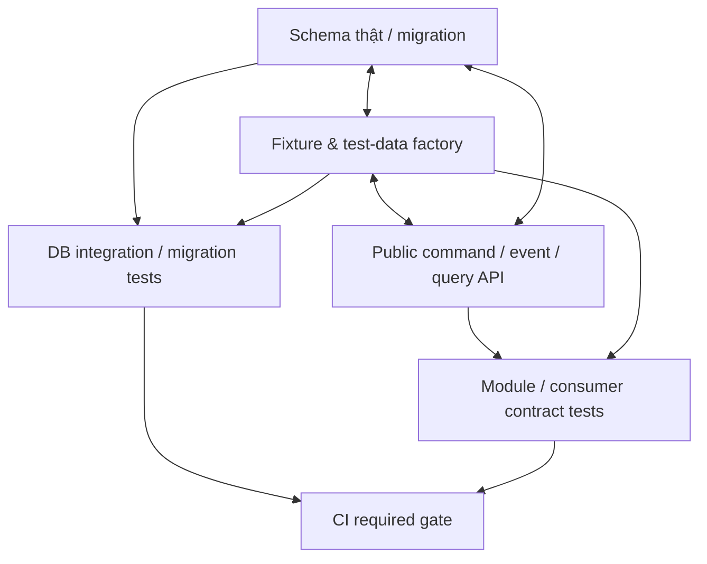
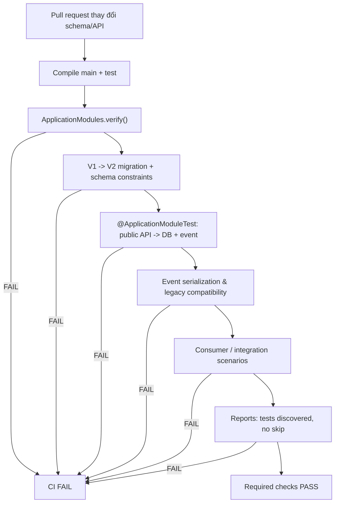

# Đồng bộ fixture với schema và public API

> **Chương:** Test data  
> **Phạm vi:** `SPRING_MODULITH_VERIFICATION_TESTING` — kiểm chứng ranh giới kiến trúc ứng dụng Spring Modulith bằng `ApplicationModules` và các quy tắc phụ thuộc module; thực hành `@ApplicationModuleTest`, sự kiện, cơ sở dữ liệu, tích hợp và CI quality gate để ngăn phụ thuộc sai và hồi quy.

## 1. Khi thêm một trường vào schema, fixture và API phải thay đổi thế nào?

Một ứng dụng bán hàng có module `orders` và `billing`. Ở phiên bản V1, đơn hàng được lưu với `id`, `sku`, `quantity`, `total_minor` và `placed_at`; public event `OrderPlaced` cũng truyền số tiền nhưng không có đơn vị tiền tệ. V2 mở rộng hệ thống sang nhiều loại tiền và thêm `currency VARCHAR(3) NOT NULL` vào bảng `shop_orders`, đồng thời đưa `currency` vào event để `billing` tính toán đúng.

Người phát triển sửa migration và Java record production, nhưng quên cập nhật `OrderFixtures` và JSON event fixture cũ. Hậu quả có thể khác nhau theo đường test:

| Đường kiểm thử | Triệu chứng khi fixture không theo kịp | Nguyên nhân sâu |
| --- | --- | --- |
| Unit test dùng constructor mới | Compile FAIL vì thiếu `currency` | Fixture không theo public API mới |
| SQL seed của repository test | Insert FAIL do `currency NOT NULL` | Fixture không theo DB schema mới |
| Test chỉ có mock repository | Vẫn PASS dù runtime insert thiếu `currency` | Mock che tương thích DB |
| Event serialization snapshot | Expected JSON thiếu `currency` | Contract event đổi nhưng snapshot chưa được review |
| Một consumer ngoài module | Deserialization hoặc xử lý số tiền sai | Thay đổi public API mà thiếu compatibility test |
| CI chạy mỗi structural test | `ApplicationModules.verify()` PASS nhưng migration/runtime FAIL | Architectural gate không kiểm schema/value contract |

Đây là **contract drift** giữa ba bề mặt: **database schema**, **public API của module** và **test fixture**. Câu hỏi thực hành không chỉ là “thêm `currency` vào fixture”, mà là:

1. Trường mới có ý nghĩa gì và bắt buộc ở đâu?
2. Migration xử lý dữ liệu cũ theo quy tắc nào?
3. Public API thay đổi có tương thích với caller/consumer cũ không?
4. Test data được tạo qua API công bố hay lén viết vào internal repository?
5. Bài test nào chứng minh cả schema và API hoạt động trên cùng một scenario?

**Kết luận trước:** Một fixture đồng bộ không phải bản sao tất cả fields của bảng hoặc DTO. Nó là một tập dữ liệu **hợp lệ theo các hợp đồng mà test cần kiểm**, đủ để gây lỗi khi một contract bị phá vỡ. Nếu thay đổi contract có chủ đích, phải cập nhật cả fixture lẫn tests compatibility/negative cases, không chỉ sửa để test xanh.

## 2. “Đồng bộ” nghĩa là kiểm được ba chiều, không chỉ sửa code cho compile



| Mối liên hệ | Nội dung phải giữ | Phép kiểm tốt nhất |
| --- | --- | --- |
| Fixture ↔ Schema | Tên cột, nullability, kiểu, enum/check, FK, unique, default, generated IDs | Migration + DB integration tests với engine thật |
| Fixture ↔ Public API | Constructor/DTO, validation, field names/format, event version, semantic values | Unit/module tests và serialization contract |
| Schema ↔ Public API | Data mapping, transaction, dữ liệu trả về, precision, default/backfill | Gọi service/repository thật rồi query/read API |
| Ranh giới module | Ai sở hữu schema, ai được gọi API, package nào được công bố | `ApplicationModules.verify()` |
| CI ↔ Tất cả | Tests được phát hiện, chạy đúng migration và lỗi chặn merge | Report + required check có exit code thật |

### 2.1. Chọn source of truth đúng theo từng tầng

- **DB migration** là nguồn xác định trạng thái schema triển khai; fixture SQL không nên tự định nghĩa một bảng “gần giống” bằng `CREATE TABLE` tùy tiện rồi bỏ qua migrations thực.
- **Public API/event contract** là nguồn xác định điều module khác được phép thấy và cách diễn giải dữ liệu; không suy API chỉ từ một JPA entity nội bộ.
- **Domain rule** là nguồn xác định giá trị hợp lệ của quantity/money/currency; không để fixture dùng giá trị qua được DB nhưng trái nghiệp vụ.
- **Fixture factory** phải bám các nguồn trên và dùng default có tên, có căn cứ, thay vì sinh dữ liệu ngẫu nhiên không thể giải thích.

Không nên đặt chính test fixture là “nguồn chân lý” rồi sửa migration/production để chấp nhận bất kỳ dữ liệu nào fixture cũ tạo. Khi một test fail vì dữ liệu không còn hợp lệ, phải quyết định: **fixture lỗi thời hay contract thay đổi sai**.

### 2.2. Phân loại các thay đổi dễ làm fixture lệch

| Thay đổi | Mức rủi ro | Điều cần cập nhật ngoài factory |
| --- | --- | --- |
| Thêm cột nullable thật sự optional | Thấp đến vừa | Tests default/NULL và read mapping |
| Thêm cột `NOT NULL` | Cao | Backfill, fixture insert, producer validation |
| Đổi đơn vị tiền tệ/độ chính xác | Cao | Value semantics, serialization, consumer calculations |
| Đổi tên cột | Cao | Migrations, SQL seeds, mapper, queries |
| Đổi enum hoặc check constraint | Vừa đến cao | Positive/negative data, historical rows |
| Đổi khóa/foreign key | Cao | Thứ tự seed, identity và cleanup |
| Thêm field public event | Có thể phá compatibility | Consumer contract tests, event version/backward compatibility |
| Chuyển event sang package nội bộ | Cao về kiến trúc | Public API, `@NamedInterface`/dependency rules |
| Đổi generated ID DB ↔ application-assigned | Cao | Fixture identity, persistence assertions |

## 3. Ví dụ V1 → V2 có chủ đích: một biến đổi, nhiều hợp đồng

### 3.1. Bố cục module và test

```text
src/main/java/com/example/shop/
├── ShopApplication.java
├── orders/
│   ├── PlaceOrderCommand.java
│   ├── OrderPlaced.java
│   ├── OrderPlacementService.java
│   └── internal/
│       └── OrderReportingRepository.java
└── billing/
    └── BillingEventConsumer.java

src/main/resources/db/migration/
├── V1__create_shop_orders.sql
└── V2__add_order_currency.sql

src/test/java/com/example/shop/
├── ModuleArchitectureTest.java
└── orders/
    ├── OrderScenario.java
    ├── OrderContractTestClock.java
    ├── OrderModuleContractTest.java
    ├── OrderSchemaConstraintTest.java
    └── OrderMigrationCompatibilityTest.java
```

Theo mô hình nhận diện module mặc định của Spring Modulith, `orders` và `billing` là application modules trực tiếp dưới `com.example.shop`. `orders` sở hữu bảng `shop_orders`; `billing` chỉ dùng hợp đồng public như `orders.OrderPlaced`. Không import `orders.internal.OrderReportingRepository` từ `billing` để lấy dữ liệu mà event thiếu.

### 3.2. Contract V1 đã triển khai

V1 giả định mọi đơn dùng **VND**, nên hệ thống cũ lưu số tiền không có đơn vị tiền. Đây là **giả định nghiệp vụ cần xác minh**, không phải lý do để backfill mọi dữ liệu production thành VND một cách máy móc.

```sql
-- V1__create_shop_orders.sql
CREATE TABLE shop_orders (
    id UUID PRIMARY KEY,
    sku VARCHAR(64) NOT NULL,
    quantity INTEGER NOT NULL CHECK (quantity > 0),
    total_minor BIGINT NOT NULL CHECK (total_minor > 0),
    placed_at TIMESTAMPTZ NOT NULL
);
```

Public event V1 về mặt khái niệm:

```java
// Minh họa contract đã từng triển khai, KHÔNG đồng thời tạo
// class cùng tên với OrderPlaced V2 trong source set hiện tại.
public record OrderPlacedV1(
        java.util.UUID orderId,
        String sku,
        int quantity,
        long totalMinor,
        java.time.Instant occurredAt
) {}
```

Nếu V1 từng được publish ra broker và lưu vào event store, payload V1 có thể vẫn được redeliver sau khi ứng dụng triển khai V2. Fixture lịch sử ấy có thể **cố ý thiếu currency** vì nó kiểm backward compatibility. Không được “cập nhật hết dữ liệu cũ” khiến mất đường test consumer đọc được sự kiện trước đây.

### 3.3. Migration V2: thêm currency không null và kiểm miền giá trị

```sql
-- V2__add_order_currency.sql
ALTER TABLE shop_orders
    ADD COLUMN currency VARCHAR(3);

-- Chỉ đúng nếu đã xác minh toàn bộ dữ liệu V1 là VND.
UPDATE shop_orders
SET currency = 'VND'
WHERE currency IS NULL;

ALTER TABLE shop_orders
    ALTER COLUMN currency SET NOT NULL;

ALTER TABLE shop_orders
    ADD CONSTRAINT chk_shop_orders_currency
    CHECK (currency IN ('VND', 'USD'));
```

Tại sao không bắt đầu bằng `ADD COLUMN currency VARCHAR(3) NOT NULL`? Với bảng đã có dữ liệu, migration có thể thất bại vì old rows chưa có giá trị cho cột mới. Thêm nullable → backfill có căn cứ → đặt NOT NULL là một phương án **expand rồi siết** dễ kiểm. Việc chạy trong transaction, lock và kế hoạch triển khai zero downtime phụ thuộc DB engine, kích thước bảng và chiến lược release.

**Không tự gán `'VND'` cho mọi old row nếu V1 từng chứa USD hoặc một nghiệp vụ khác.** Khi giả định “V1 chỉ VND” không đúng, cần mapping từ nguồn tin cậy, migration dữ liệu có kiểm soát hoặc giữ trạng thái chưa xác định để xử lý — không biến backfill thành dữ liệu sai nhưng hợp lệ về kỹ thuật.

### 3.4. Quyết định cùng lúc cho ba bề mặt

| Bề mặt V2 | Quy tắc |
| --- | --- |
| DB `shop_orders.currency` | `NOT NULL`, giá trị hiện hỗ trợ `VND`/`USD` |
| Public `PlaceOrderCommand.currency` | Bắt buộc; validation không chấp nhận null/empty |
| Public `OrderPlaced.currency` | Bắt buộc với **events V2 mới** |
| Fixture happy path | Tạo currency rõ ràng, ví dụ `VND` |
| Fixture âm tính | Null, `""`, `"XYZ"` để kiểm đúng layer |
| Fixture lịch sử | V1 payload có thể thiếu currency để test adapter compatibility |
| DB integration | Seed qua migrations thật, assert read lại currency |
| Consumer contract | Không diễn giải money khi thiếu currency mà không có version policy |

## 4. Public API mới phải có validation và semantics nhất quán

Các kiểu sau thuộc **package root của module `orders`** và được dùng làm contract trong ví dụ.

### 4.1. Public command V2

`src/main/java/com/example/shop/orders/PlaceOrderCommand.java`:

```java
package com.example.shop.orders;

import java.util.Objects;
import java.util.Set;
import java.util.UUID;

public record PlaceOrderCommand(
        UUID orderId,
        String sku,
        int quantity,
        long totalMinor,
        String currency
) {
    private static final Set<String> SUPPORTED =
            Set.of("VND", "USD");

    public PlaceOrderCommand {
        Objects.requireNonNull(orderId, "orderId");
        if (sku == null || sku.isBlank()) {
            throw new IllegalArgumentException("sku required");
        }
        if (quantity <= 0 || totalMinor <= 0) {
            throw new IllegalArgumentException("positive quantity/amount required");
        }
        if (!SUPPORTED.contains(currency)) {
            throw new IllegalArgumentException("unsupported currency");
        }
    }
}
```

Đây là rule đơn giản của **ví dụ**. Ứng dụng thật có thể dùng kiểu `Money`/`Currency` chuyên biệt, bảng tham chiếu currency, precision theo ISO 4217, currency không chỉ hai giá trị và validation phức tạp hơn. Điểm cần kiểm là **fixture không dùng một default mơ hồ hoặc một currency không đúng domain**.

### 4.2. Public event V2

`src/main/java/com/example/shop/orders/OrderPlaced.java`:

```java
package com.example.shop.orders;

import java.time.Instant;
import java.util.Objects;
import java.util.UUID;

public record OrderPlaced(
        UUID orderId,
        String sku,
        int quantity,
        long totalMinor,
        String currency,
        Instant occurredAt
) {
    public OrderPlaced {
        Objects.requireNonNull(orderId, "orderId");
        Objects.requireNonNull(occurredAt, "occurredAt");
        if (sku == null || sku.isBlank()
                || quantity <= 0 || totalMinor <= 0
                || !java.util.Set.of("VND", "USD").contains(currency)) {
            throw new IllegalArgumentException("invalid OrderPlaced");
        }
    }
}
```

Ví dụ chọn record `OrderPlaced` mới có `currency` để minh họa tác động lên fixture. **Không mặc định việc thêm field vào event công bố là backward compatible.** Nếu consumer V1 còn tồn tại hoặc broker còn message V1, phải version/upcast/rollout theo hợp đồng triển khai (mục 11).

### 4.3. Service ghi schema V2 và publish public event

`src/main/java/com/example/shop/orders/OrderPlacementService.java`:

```java
package com.example.shop.orders;

import java.sql.Timestamp;
import java.time.Clock;
import java.time.Instant;
import org.springframework.context.ApplicationEventPublisher;
import org.springframework.jdbc.core.JdbcTemplate;
import org.springframework.stereotype.Service;
import org.springframework.transaction.annotation.Transactional;

@Service
public class OrderPlacementService {

    private final JdbcTemplate jdbc;
    private final ApplicationEventPublisher publisher;
    private final Clock clock;

    public OrderPlacementService(
            JdbcTemplate jdbc,
            ApplicationEventPublisher publisher,
            Clock clock) {
        this.jdbc = jdbc;
        this.publisher = publisher;
        this.clock = clock;
    }

    @Transactional
    public OrderPlaced place(PlaceOrderCommand command) {
        Instant at = clock.instant();

        jdbc.update(
            "INSERT INTO shop_orders "
                + "(id, sku, quantity, total_minor, currency, placed_at) "
                + "VALUES (?, ?, ?, ?, ?, ?)",
            command.orderId(),
            command.sku(),
            command.quantity(),
            command.totalMinor(),
            command.currency(),
            Timestamp.from(at)
        );

        OrderPlaced event = new OrderPlaced(
                command.orderId(),
                command.sku(),
                command.quantity(),
                command.totalMinor(),
                command.currency(),
                at
        );
        publisher.publishEvent(event);
        return event;
    }
}
```

Trong ví dụ, service được Spring quản lý, gọi qua proxy để `@Transactional` có hiệu lực. Nó chưa triển khai durable outbox, idempotency hoặc event delivery sau commit; `publishEvent` trong transaction có thể được một synchronous listener quan sát trước khi transaction commit. Những guarantees đó cần được kiểm riêng khi dự án có cơ chế tương ứng. Mục tiêu bài này là **mapping đồng nhất currency giữa command → bảng → event**.

### 4.4. Cấu hình Clock production tối thiểu

`src/main/java/com/example/shop/orders/OrdersTimeConfiguration.java`:

```java
package com.example.shop.orders;

import java.time.Clock;
import org.springframework.context.annotation.Bean;
import org.springframework.context.annotation.Configuration;

@Configuration(proxyBeanMethods = false)
class OrdersTimeConfiguration {

    @Bean
    Clock ordersClock() {
        return Clock.systemUTC();
    }
}
```

`Clock` được inject để fixture kiểm timestamp chính xác mà không thay global JVM clock.

## 5. Một factory tạo scenario hợp lệ cho API và persistence

Fixture nên cấp **một danh tính scenario**, từ đó tạo command và assertions dự kiến. Đừng có ba phương thức dùng ba bộ default currency khác nhau cho command, SQL seed và expected event.

`src/test/java/com/example/shop/orders/OrderScenario.java`:

```java
package com.example.shop.orders;

import java.time.Instant;
import java.util.UUID;

record OrderScenario(
        UUID orderId,
        String sku,
        int quantity,
        long totalMinor,
        String currency,
        Instant placedAt
) {
    static final Instant FIXED_AT =
            Instant.parse("2026-01-01T09:00:00Z");

    static OrderScenario newVnd() {
        return new OrderScenario(
            UUID.randomUUID(), "SKU-001", 2, 150000L, "VND", FIXED_AT);
    }

    static OrderScenario newUsd() {
        // 1599 minor units = 15.99 USD theo semantics USD.
        return new OrderScenario(
            UUID.randomUUID(), "SKU-USD-001", 1, 1599L, "USD", FIXED_AT);
    }

    PlaceOrderCommand command() {
        return new PlaceOrderCommand(
            orderId, sku, quantity, totalMinor, currency);
    }

    OrderPlaced expectedEvent() {
        return new OrderPlaced(
            orderId, sku, quantity, totalMinor, currency, placedAt);
    }
}
```

Điểm đáng chú ý:

- `newVnd()` và `newUsd()` tạo **dữ liệu hợp lệ, có ý nghĩa theo đơn vị tiền**, không phải một `currency` ngẫu nhiên.
- `UUID.randomUUID()` được cấp **một lần cho scenario**; dùng cùng `orderId` để insert, query, kiểm event và cleanup.
- `Instant FIXED_AT` là hằng bất biến; đồng bộ với test `Clock.fixed`.
- `command()` đi qua **constructor public** `PlaceOrderCommand`. Khi public API yêu cầu thêm trường bắt buộc, compiler/test sẽ phản hồi tại một điểm tập trung.
- `expectedEvent()` là tiện ích đọc; assertions quan trọng vẫn cần kiểm **từng field/DB row riêng** để tránh cùng một sai sót mapping được sao chép vào expected và actual.

### 5.1. Factory có vai trò, không phải “god fixture”

Không tạo một `FullOrderFixture` chứa mọi thứ: JPA entity, SQL row, REST request, event, HTTP response, broker envelope, billing ledger… rồi chia sẻ tất cả fields. Khi schema hoặc API đổi, một god fixture dễ ép các tầng cùng cấu trúc và che boundary ownership.

Thay vào đó:

| Fixture | Trách nhiệm | Không nên làm |
| --- | --- | --- |
| `OrderScenario` | Identity, input nghiệp vụ hợp lệ, expected public outcome | Mở transaction hoặc kết nối DB |
| `DbOrderSeed` dành cho repository tests | Tạo rows qua schema/migration thật | Tự thay đổi bảng production |
| `PublicOrderEventFixture` | Payload phiên bản được công bố | Import `orders.internal` để tạo event |
| `LegacyOrderPlacedV1Fixture` | Payload lịch sử để test compatibility | Âm thầm biến V1 thành V2 rồi mất case |
| `BillingScenario` | Side effects/receipts thuộc `billing` | Ghi trực tiếp bảng nội bộ của `orders` |

Chia theo **hợp đồng được kiểm**, không phải cố dùng một object mutable làm state chung cho mọi test.

### 5.2. Đừng chữa lỗi fixture bằng cách nới validation

Nếu V1 fixture gọi `new PlaceOrderCommand(id,sku,qty,total)` và V2 cần `currency`, ba lựa chọn có ý nghĩa:

1. **Happy-path V2 fixture:** cập nhật constructor và cung cấp currency được công bố.
2. **Negative fixture:** cố ý truyền currency không hợp lệ để kiểm validation, dùng direct constructor/JSON adapter theo mục tiêu.
3. **Historical V1 fixture:** giữ riêng payload V1 cho test deserialize/compatibility, không gọi constructor V2 rồi ép null.

Không nên thêm constructor quá tải mặc định `"VND"` vào mọi public API chỉ để test cũ compile. Một default như vậy có thể làm production callers không phải khai báo currency dù nghiệp vụ V2 đã yêu cầu nó.

## 6. Kiểm một scenario từ public command đến DB row và public event

Đây là phép kiểm trung tâm của bài: **cùng một fixture** đi qua public entry point của module, được lưu với schema đã migrate và tạo public event có ý nghĩa giống dữ liệu persistence.

### 6.1. Test configuration dùng thời điểm ổn định

`src/test/java/com/example/shop/orders/OrderContractTestClock.java`:

```java
package com.example.shop.orders;

import java.time.Clock;
import java.time.ZoneOffset;
import org.springframework.boot.test.context.TestConfiguration;
import org.springframework.context.annotation.Bean;
import org.springframework.context.annotation.Primary;

@TestConfiguration(proxyBeanMethods = false)
class OrderContractTestClock {

    @Bean
    @Primary
    Clock fixedContractClock() {
        return Clock.fixed(OrderScenario.FIXED_AT, ZoneOffset.UTC);
    }
}
```

Production có bean `ordersClock()`; trong test, `@Primary` ưu tiên bean cố định khi inject theo type. Nếu dự án có bean names trùng nhau, custom qualifier hoặc bean replacement policy của Spring Boot, cần điều chỉnh cấu hình thực tế; `@Primary` không chữa mọi lỗi bean collision.

### 6.2. `@ApplicationModuleTest` kiểm thật cả mapping và event

`src/test/java/com/example/shop/orders/OrderModuleContractTest.java`:

```java
package com.example.shop.orders;

import static org.assertj.core.api.Assertions.assertThat;

import java.time.Instant;
import org.junit.jupiter.api.Test;
import org.springframework.beans.factory.annotation.Autowired;
import org.springframework.context.annotation.Import;
import org.springframework.jdbc.core.JdbcTemplate;
import org.springframework.modulith.test.ApplicationModuleTest;
import org.springframework.modulith.test.PublishedEvents;

@ApplicationModuleTest
@Import(OrderContractTestClock.class)
class OrderModuleContractTest {

    @Autowired
    OrderPlacementService service;

    @Autowired
    JdbcTemplate jdbc;

    private record StoredRow(
            String sku,
            int quantity,
            long totalMinor,
            String currency,
            Instant placedAt) {}

    @Test
    void fixtureMatchesPublicCommandDbSchemaAndEvent(
            PublishedEvents published) {
        OrderScenario scenario = OrderScenario.newVnd();

        try {
            OrderPlaced returned = service.place(scenario.command());

            // Public event result.
            assertThat(returned.orderId()).isEqualTo(scenario.orderId());
            assertThat(returned.currency()).isEqualTo("VND");
            assertThat(returned.totalMinor()).isEqualTo(150000L);
            assertThat(returned.occurredAt())
                    .isEqualTo(OrderScenario.FIXED_AT);

            // DB row sau khi service transaction kết thúc.
            StoredRow row = jdbc.queryForObject(
                "SELECT sku, quantity, total_minor, currency, placed_at "
                    + "FROM shop_orders WHERE id = ?",
                (rs, index) -> new StoredRow(
                    rs.getString("sku"),
                    rs.getInt("quantity"),
                    rs.getLong("total_minor"),
                    rs.getString("currency"),
                    rs.getTimestamp("placed_at").toInstant()
                ),
                scenario.orderId()
            );

            assertThat(row).isNotNull();
            assertThat(row.sku()).isEqualTo("SKU-001");
            assertThat(row.quantity()).isEqualTo(2);
            assertThat(row.totalMinor()).isEqualTo(150000L);
            assertThat(row.currency()).isEqualTo("VND");
            assertThat(row.placedAt()).isEqualTo(OrderScenario.FIXED_AT);

            // Event được Spring thu thập từ service thật.
            assertThat(published.ofType(OrderPlaced.class))
                    .anySatisfy(event -> {
                        assertThat(event.orderId())
                                .isEqualTo(scenario.orderId());
                        assertThat(event.currency()).isEqualTo("VND");
                        assertThat(event.totalMinor()).isEqualTo(150000L);
                    });
        } finally {
            jdbc.update("DELETE FROM shop_orders WHERE id = ?",
                    scenario.orderId());
        }
    }
}
```

**Điều kiện trước khi chạy:**

- Spring Boot test context của `@ApplicationModuleTest` phải có `DataSource`, `JdbcTemplate`, transaction manager và migrations phù hợp; có thể dùng Testcontainers PostgreSQL cùng cấu hình module test.
- Test không bị một `@Transactional` bao ngoài làm thay đổi thời điểm commit cần quan sát; trong ví dụ method không gắn annotation đó.
- Migrations V1/V2 đã được áp dụng vào test database **trước** khi service insert.
- `OrderScenario.newVnd()` tạo ID riêng, cleanup chỉ xóa row của scenario.
- Nếu event listener chạy bất đồng bộ gây side effect khác, nó cần test/lifecycle isolation riêng; `PublishedEvents` không chứng minh consumer đã commit.

**Vì sao cần ba nhóm assertion?** Test có thể compile nhưng SQL insert quên `currency`; test có thể lưu currency đúng nhưng event mapping quên currency; hoặc event đúng nhưng DB converter lưu `USD` thay vì `VND`. Kiểm ba tầng với cùng ID làm lộ chỗ lệch.

### 6.3. Tránh test “expected = cùng logic production”

Một anti-pattern là:

```java
// Yếu: nếu method mapper dùng chung đã có bug,
// expected và actual có thể cùng sai.
assertEquals(productionMapper.toEvent(command),
             service.place(command));
```

Ví dụ tốt ở trên assert **literal expected value có ý nghĩa** (`VND`, `150000L`) và đọc row từ DB. `OrderScenario.expectedEvent()` có thể dùng để giảm boilerplate trong một số test, nhưng vẫn nên có ít nhất một **contract test độc lập** cho các field quan trọng.

### 6.4. Test cả currency thứ hai

Đừng chỉ tạo `newVnd()` rồi kết luận việc thêm currency hoàn tất. Một test `USD` cần xác nhận:

```text
Given:
  orderId mới, currency=USD, totalMinor=1599
When:
  place(command của scenario USD)
Then:
  shop_orders.currency = USD
  shop_orders.total_minor = 1599
  OrderPlaced.currency = USD
  OrderPlaced.totalMinor = 1599
```

Với đơn hàng USD trong ví dụ, `1599` minor units tương ứng `15.99 USD`. Với VND, đơn vị phụ của currency không giống USD; đừng viết fixture mặc định “mọi currency có 2 chữ số thập phân”. Khi dự án dùng tiền thật, ưu tiên kiểu tiền tệ/rounding chính xác và test conversion ở đúng layer.

## 7. Test database constraints bằng **dữ liệu bất hợp lệ có chủ đích**

Test `OrderModuleContractTest` chỉ chứng minh **happy path**. Muốn kiểm schema V2 thực sự áp dụng, cần negative tests đưa dữ liệu sai vào DB **trực tiếp tại tầng persistence**, vì public command constructor đã ngăn input sai trước khi SQL được gọi.

### 7.1. Ví dụ kiểm NOT NULL và CHECK ở PostgreSQL

`src/test/java/com/example/shop/orders/OrderSchemaConstraintTest.java`:

```java
package com.example.shop.orders;

import static org.junit.jupiter.api.Assertions.assertThrows;

import java.sql.Timestamp;
import java.util.UUID;
import org.junit.jupiter.api.Test;
import org.springframework.beans.factory.annotation.Autowired;
import org.springframework.boot.test.context.SpringBootTest;
import org.springframework.dao.DataIntegrityViolationException;
import org.springframework.jdbc.core.JdbcTemplate;

@SpringBootTest
class OrderSchemaConstraintTest {

    @Autowired
    JdbcTemplate jdbc;

    private void rawInsert(UUID id, String currency) {
        jdbc.update(
            "INSERT INTO shop_orders "
                + "(id, sku, quantity, total_minor, currency, placed_at) "
                + "VALUES (?, ?, ?, ?, ?, ?)",
            id, "SKU-001", 1, 1000L, currency,
            Timestamp.from(OrderScenario.FIXED_AT)
        );
    }

    @Test
    void schemaRejectsNullCurrency() {
        UUID id = UUID.randomUUID();
        try {
            assertThrows(DataIntegrityViolationException.class,
                    () -> rawInsert(id, null));
        } finally {
            jdbc.update("DELETE FROM shop_orders WHERE id = ?", id);
        }
    }

    @Test
    void schemaRejectsUnknownCurrency() {
        UUID id = UUID.randomUUID();
        try {
            assertThrows(DataIntegrityViolationException.class,
                    () -> rawInsert(id, "XYZ"));
        } finally {
            jdbc.update("DELETE FROM shop_orders WHERE id = ?", id);
        }
    }
}
```

**Không đặt `@Transactional` trên test methods ở ví dụ này** nếu JDBC exception khiến transaction trên PostgreSQL bị aborted và bạn muốn cleanup bằng một statement tiếp theo. Các statements chạy trong auto-commit transactions do `JdbcTemplate`/DataSource quản lý khi không có transaction test bao ngoài; sau lỗi, cleanup theo ID được thực hiện riêng.

### 7.2. Một negative test phải xác định **đúng constraint**

`DataIntegrityViolationException` là nhóm exception rộng. Để tránh false positive do lỗi khác (FK, cột tên sai, thiếu bảng):

1. Đảm bảo tất cả fields trừ `currency` đều hợp lệ.
2. Chạy một positive control insert với currency `VND` và kiểm có thể đọc lại row.
3. Với DB driver/constraint naming có khả năng kiểm, xác định lỗi thuộc `NOT NULL` hoặc `chk_shop_orders_currency` (SQLState/constraint name theo engine).
4. Xác nhận không còn row do failed insert, không chỉ có exception.
5. Bảo đảm test chạy trên schema do migration V2 tạo, không phải bảng do test tự `CREATE TABLE` gần giống.

Chỉ có test `assertThrows(IllegalArgumentException, () -> new PlaceOrderCommand(..., null))` sẽ kiểm **API validation**; nó không thể chứng minh bảng DB đã có `NOT NULL`. Ngược lại, test DB constraint không chứng minh public API trả error response đúng. Hai tầng bổ sung nhau.

### 7.3. Không “cứu” seed lỗi bằng default SQL bừa

SQL seed kiểu V1:

```sql
-- Sai khi dùng trên schema V2 nếu currency NOT NULL:
INSERT INTO shop_orders
    (id, sku, quantity, total_minor, placed_at)
VALUES
    ('11111111-1111-1111-1111-111111111111',
     'SKU-001', 2, 150000, '2026-01-01T09:00:00Z');
```

Đừng thêm `DEFAULT 'VND'` vào cột DB **chỉ để fixture cũ không cần sửa**. Nếu business V2 yêu cầu currency từ caller, default đó có thể che lỗi production code bỏ currency. Chỉ dùng DB default khi đây là quy tắc domain/rollout có chủ đích và đã kiểm compatibility.

SQL seed V2 nên khai báo field:

```sql
INSERT INTO shop_orders
    (id, sku, quantity, total_minor, currency, placed_at)
VALUES
    ('11111111-1111-1111-1111-111111111111',
     'SKU-001', 2, 150000, 'VND', '2026-01-01T09:00:00Z');
```

Các IDs cố định trên phù hợp cho **một fixture có phạm vi và cleanup rõ**. Nếu cùng DB chạy các tests song song, nên cấp IDs khác nhau theo scenario hoặc cô lập schema/transaction để tránh primary-key collision.

## 8. Migration test phải có **dữ liệu V1 trước migration**

Chạy test trên database **đã ở V2** chỉ kiểm schema cuối, chưa kiểm một database cũ có thể nâng cấp lên V2 và giữ đúng dữ liệu.

Một migration compatibility scenario đúng:

```text
Given:
  Một PostgreSQL test database sạch.
  Chạy V1__create_shop_orders.sql (chưa có currency).
  Insert V1 row: O_OLD, total_minor=150000, known historical VND.

When:
  Chạy V2__add_order_currency.sql qua migration tool thật.

Then:
  V1 row vẫn tồn tại, cùng ID/SKU/quantity/amount.
  currency của O_OLD = VND, không null.
  Insert V2 row currency=USD thành công.
  Insert V2 row currency=NULL hoặc XYZ bị constraint từ chối.
  Không có dữ liệu nào bị chuyển sai theo policy.
```

### 8.1. Một migration test không được tự dựng V2 schema

Quy trình phù hợp với Flyway + Testcontainers (khung hướng dẫn):

1. Tạo một database/schema **cô lập** dành cho migration test.
2. Cấu hình Flyway chạy **chỉ tới V1** rồi insert V1 seed.
3. Tiếp tục `migrate()` tới V2 bằng **cùng migration files production**.
4. Query row cũ, metadata constraints và các insert âm tính/dương tính.
5. Hủy database/schema test, không để ảnh hưởng module tests đang chạy.

Các API quản lý `target`/`baseline` và lifecycle của Flyway/Testcontainers phải cấu hình theo phiên bản đang dùng. Nếu chỉ chạy `@SpringBootTest` đã auto-migrate hết V2 trước `@BeforeEach`, test đó **không** mô phỏng được dữ liệu V1 ngay trước migration.

### 8.2. Dữ liệu lịch sử không thể suy từ fixture V2 hiện tại

Để test backfill đúng, phải giữ một V1 dataset:

```sql
-- Chỉ chạy KHI database còn ở schema V1.
INSERT INTO shop_orders (id, sku, quantity, total_minor, placed_at)
VALUES (
    'aaaaaaaa-aaaa-aaaa-aaaa-aaaaaaaaaaaa',
    'SKU-OLD-001',
    2,
    150000,
    '2025-01-01T09:00:00Z'
);
```

Sau migration:

```sql
SELECT id, sku, quantity, total_minor, currency, placed_at
FROM shop_orders
WHERE id = 'aaaaaaaa-aaaa-aaaa-aaaa-aaaaaaaaaaaa';
-- Expected: currency = VND; các field khác không đổi.
```

Không xóa V1 fixture chỉ vì “thiếu field currency nên lỗi thời”: đây là **dữ liệu lịch sử hợp lệ tại thời điểm V1**. Đặt nó trong test migration/compatibility với tên phiên bản rõ và không dùng làm seed happy path cho schema V2.

### 8.3. Backfill âm tính khi giả định lịch sử không đúng

Giả sử thực tế V1 từng cho phép đơn USD nhưng không lưu currency. Migration gán tất cả thành VND sẽ **hoàn tất kỹ thuật nhưng làm sai nghiệp vụ**. Cần một test/kiểm chứng dữ liệu lịch sử để bảo đảm nguồn dữ liệu cho phép phân biệt currency, hoặc kế hoạch migration xử lý trường hợp mơ hồ.

Một bài migration review phải trả lời:

- Dữ liệu V1 được sinh bởi những API/regions nào?
- Có invariant chứng minh mọi V1 order dùng VND không?
- Nếu invariant bị vi phạm, migration nên dừng, cần mapping khác hay chuyển xử lý thủ công?
- Rollback chiến lược migration ra sao nếu V2 đã ghi USD?
- Old code có còn chạy cùng DB sau migrate không, và compatibility window kéo dài bao lâu?

Không viết test chỉ assert `currency IS NOT NULL`: một backfill sai sang VND cho tất cả rows vẫn PASS điều kiện ấy.

## 9. Fixture cho repository và fixture cho public API không giống nhau

Một test truy vấn database có thể **cần insert rows trực tiếp** để tạo các biến thể khó hình thành qua public command (ví dụ historical rows, dữ liệu gần ngưỡng constraint, nhiều trạng thái). Nhưng integration test hành vi của module nên ưu tiên đi qua **public application service** để kiểm entry point thực.

### 9.1. Quyết định đường seed theo rủi ro cần phát hiện

| Mục đích | Seed qua đâu? | Kiểm gì? |
| --- | --- | --- |
| `OrderPlacementService` ghi event và DB | Public `place(command)` | API validation → persistence → event |
| Repository filter/query | SQL hoặc repository seed thuộc test scope | Dữ liệu đối chứng/constraints/mapper |
| Migration từ V1 | V1 SQL seed rồi migrations | Backfill và evolution |
| Public event serialization | Public `OrderPlaced`/versioned JSON fixture | JSON shape, compatibility |
| Consumer `billing` | Public event DTO, consumer-owned receipt data | Không import `orders.internal` |
| Generated-ID behavior | Repository/service thật với DB tương ứng | ID sinh/đọc đúng |
| Event after-commit | Transaction/outbox/listener thật | Không chỉ event được publish |

Không nên xây fixture bằng cách truy cập private field hoặc reflection vào aggregate để nhét trạng thái trái invariant chỉ vì public API không cho tạo trạng thái đó. Nếu test cần kiểm xử lý dữ liệu legacy/hỏng, đặt rõ đó là **corrupt/historical data scenario** và dùng harness thuộc tầng phù hợp.

### 9.2. Ngăn fixture mirror làm hỏng kiểm thử

Một mẹo nguy hiểm là dùng cùng một method `toRow()` của code production để tạo **expected** DB row và actual row. Nếu method map `currency` sai, cả hai có thể sai giống nhau. Cần có:

- Một expected literal có ý nghĩa trong ít nhất một contract test.
- Assertions từ DB thật sau service call.
- Negative cases cho `NOT NULL`, enum/check và rounding.
- Case thứ hai khác VND để chứng minh mapping không hardcode.

Test data factory giảm lặp, **không** nên loại bỏ các independent oracles của test.

## 10. Public API không chỉ là Java constructor: còn có JSON và semantics

Một consumer có thể nhận `OrderPlaced` qua event bus, outbox serializer hoặc HTTP adapter. Thêm `String currency` vào Java record sẽ làm các constructor calls cũ báo compile error, nhưng **payload V1 đã lưu trên broker** không tự được biên dịch lại. Khi V2 đọc message cũ không có currency, decoder có thể báo lỗi hoặc trả `null` tùy serializer/configuration.

### 10.1. V1 JSON là một historical contract test, không phải fixture sai

```json
{
  "eventType": "OrderPlaced",
  "version": 1,
  "orderId": "aaaaaaaa-aaaa-aaaa-aaaa-aaaaaaaaaaaa",
  "sku": "SKU-OLD-001",
  "quantity": 2,
  "totalMinor": 150000,
  "occurredAt": "2025-01-01T09:00:00Z"
}
```

V1 JSON thiếu `currency` **một cách có chủ đích**. Đây là dữ liệu tổng hợp, không chứa PII. Nếu hệ thống còn event V1 trong message storage hoặc consumers V1 còn tồn tại, hãy giữ fixture này như một **contract input lịch sử** và định nghĩa chiến lược đọc nó.

V2 JSON mới:

```json
{
  "eventType": "OrderPlaced",
  "version": 2,
  "orderId": "bbbbbbbb-bbbb-bbbb-bbbb-bbbbbbbbbbbb",
  "sku": "SKU-USD-001",
  "quantity": 1,
  "totalMinor": 1599,
  "currency": "USD",
  "occurredAt": "2026-01-01T09:00:00Z"
}
```

Trường `version` và `eventType` ở ví dụ này là **envelope metadata giả định**. Event record `OrderPlaced` trong Java ở mục 4 chưa có hai trường ấy; serializer/adapter cần định nghĩa nơi lưu envelope. Đừng suy Spring Modulith tự thêm những JSON fields này theo đúng tên trên.

### 10.2. Những quyết định compatibility phải minh thị

| Chiến lược | Khi phù hợp | Điều fixture phải chứng minh |
| --- | --- | --- |
| Thêm optional field | Consumer hiểu default/absence hợp lệ | V1 thiếu field vẫn có nghĩa đúng, V2 có field được đọc |
| Versioned event types `OrderPlacedV1/V2` | Thay đổi mang tính breaking | V1 và V2 được decode/upcast đúng |
| Upcaster từ payload cũ | Lưu event lịch sử lâu dài | Backfill semantics có căn cứ, không đoán bừa |
| Dual-read khi rollout | Còn producer/consumer hai phiên bản | Cả hai message versions được consumer hỗ trợ |
| Dual-publish tạm thời | Hạ tầng cần chuyển đổi phức tạp | Không khiến consumer tạo **hai business effects** |
| Thay đổi đồng loạt không hỗ trợ V1 | Chỉ khi toàn bộ hệ thống/queue đã được kiểm soát | Có bằng chứng không còn caller/message V1 cần đọc |

Ví dụ “cứ deserialize V1 thành record V2 rồi gán `currency = VND`” chỉ đúng khi đã chứng minh mọi event V1 đều có đơn vị VND. Nếu V1 từng có USD, việc default tạo dữ liệu **có vẻ hợp lệ nhưng sai tiền tệ** — nguy hiểm hơn một test fail rõ ràng.

### 10.3. Một compatibility adapter minh họa

Trong test hoặc một adapter phiên bản rõ, biểu diễn event V1:

```java
package com.example.shop.orders;

import java.time.Instant;
import java.util.UUID;

record LegacyOrderPlacedV1(
        UUID orderId, String sku, int quantity,
        long totalMinor, Instant occurredAt
) {}

final class OrderEventUpcaster {

    private OrderEventUpcaster() {}

    static OrderPlaced fromVerifiedVndV1(LegacyOrderPlacedV1 old) {
        // Chỉ dùng nếu lịch sử V1 được xác minh là toàn VND.
        return new OrderPlaced(
            old.orderId(), old.sku(), old.quantity(),
            old.totalMinor(), "VND", old.occurredAt());
    }
}
```

Ở production, nếu adapter/versioning phải được publish cho nhiều consumers, hãy đặt nó ở **tầng contract/serialization phù hợp**, không bắt module `billing` import một kiểu `orders.internal`. `LegacyOrderPlacedV1` ở trên chỉ là kiểu minh họa trong `orders`; trong dự án thực có thể đặt thành DTO versioned công bố hoặc converter của adapter nhận broker message.

### 10.4. Test đọc payload lịch sử, không tự “làm sạch” trước khi đưa vào decoder

Giả sử project có Jackson và `jackson-datatype-jsr310`, một contract test có thể đọc JSON V1 vào legacy DTO:

```java
package com.example.shop.orders;

import static org.junit.jupiter.api.Assertions.assertEquals;

import com.fasterxml.jackson.databind.ObjectMapper;
import com.fasterxml.jackson.datatype.jsr310.JavaTimeModule;
import org.junit.jupiter.api.Test;

class LegacyEventCompatibilityTest {

    private final ObjectMapper json =
            new ObjectMapper().registerModule(new JavaTimeModule());

    @Test
    void v1EventCanBeNormalizedUnderVerifiedVndRule()
            throws Exception {
        String payload = """
            {
              "orderId": "aaaaaaaa-aaaa-aaaa-aaaa-aaaaaaaaaaaa",
              "sku": "SKU-OLD-001",
              "quantity": 2,
              "totalMinor": 150000,
              "occurredAt": "2025-01-01T09:00:00Z"
            }
            """;

        LegacyOrderPlacedV1 legacy =
                json.readValue(payload, LegacyOrderPlacedV1.class);
        OrderPlaced normalized =
                OrderEventUpcaster.fromVerifiedVndV1(legacy);

        assertEquals("VND", normalized.currency());
        assertEquals(150000L, normalized.totalMinor());
        assertEquals(legacy.orderId(), normalized.orderId());
        assertEquals(legacy.occurredAt(), normalized.occurredAt());
    }
}
```

Test này chỉ minh họa **upcast V1 synthetic data theo rule đã xác minh**. Chưa kiểm adapter broker thực tế có đọc được metadata `version`/`eventType` hay không; phải có integration test riêng đi qua envelope serializer/consumer nếu ứng dụng dùng chúng.

### 10.5. Positive serialization contract V2 phải kiểm **field names**

Với JSON, `totalMinor` trong Java không đồng nghĩa mặc định là `total_minor` trong payload. `@JsonProperty`, naming strategy và schema registry có thể thay đổi shape. Một phép kiểm sử dụng serializer thật:

```java
// Trong contract test có ObjectMapper đã cấu hình giống production.
OrderPlaced event = OrderScenario.newUsd().expectedEvent();
var tree = objectMapper.valueToTree(event);

Set<String> fields = new HashSet<>();
tree.fieldNames().forEachRemaining(fields::add);

assertThat(fields).containsExactlyInAnyOrder(
        "orderId", "sku", "quantity",
        "totalMinor", "currency", "occurredAt");
assertThat(tree.get("currency").asText()).isEqualTo("USD");
assertThat(tree.get("totalMinor").asLong()).isEqualTo(1599L);
```

Đây là một **fragment mở rộng**: `objectMapper`, `Set`, `HashSet` và AssertJ imports cần có trong test thực. Không tự khởi tạo `new ObjectMapper()` rồi kết luận serializer production dùng cùng cấu hình nếu ứng dụng đã custom naming/serialization modules. Muốn kiểm outbox/broker shape, phải test chính adapter serialize/persist mà production dùng.

## 11. Không đồng bộ fixture bằng cách vượt public API của module

Một lỗi tổ chức thường gặp: khi `OrderPlaced` thay đổi, test `billing` vẫn cần data cũ và người viết test gọi trực tiếp `orders.internal.OrderJpaRepository` để “lấy thêm currency”. Điều này làm test phụ thuộc implementation của module khác và có thể khiến production cũng dần lạm dụng internal API.

### 11.1. Đường đúng và đường sai

```text
Đúng:
  orders (public OrderPlaced contract)
        |
        v
  billing consumer test
    Given: OrderPlaced fixture đúng schema public
    Then: billing side effect đúng currency/amount

Sai:
  billing test
     |
     v
  orders.internal.OrderJpaRepository
    -> đọc entity/row để tạo event cho billing
```

Đối với `billing`, fixture nên dựa vào **public OrderPlaced contract**. Khi test cần setup state sâu của `orders`, hãy chọn:

- Chạy module/integration scenario thông qua public `OrderPlacementService.place(...)`.
- Dùng test harness/fixtures do module sở hữu trong một test task tích hợp rõ trách nhiệm.
- Nếu cần truy vấn cross-module thực, thêm **API chính thức được review**, không công bố cả repository nội bộ chỉ cho tiện test.

### 11.2. Root package API và `@NamedInterface`

Trong cấu trúc minh họa, `orders.OrderPlaced` nằm ở package gốc của application module `orders` nên là kiểu có thể được công bố theo mô hình mặc định. Nếu tổ chức muốn nhóm event ở `orders.events`, cần xem **named interfaces**:

```java
// File: com/example/shop/orders/events/package-info.java
@org.springframework.modulith.NamedInterface("events")
package com.example.shop.orders.events;
```

Và khi cần giới hạn module `billing` chỉ phụ thuộc vào interface `events`:

```java
// File: com/example/shop/billing/package-info.java
@org.springframework.modulith.ApplicationModule(
        allowedDependencies = "orders::events")
package com.example.shop.billing;
```

Đây là **phương án thay thế** nếu chuyển event sang `orders.events`, không phải thêm song song vào ví dụ hiện tại. Khi dùng named interface:

- Cần chuyển/import `OrderPlaced` sang đúng public named package.
- Test fixture của `billing` dùng kiểu mới được công bố, không dùng `orders.internal`.
- `allowedDependencies` phải thể hiện đúng những module APIs khác mà `billing` được phép dùng; đừng vô tình chặn dependencies hợp lệ.
- Việc type là `public` trong Java không tự đảm bảo package con của một Spring Modulith module đã được công bố theo đúng mô hình architecture.

Không nới `allowedDependencies = {}` hoặc mở named interface gồm cả `internal` chỉ vì tests lệch API. Hãy sửa fixture/contract theo quyền sở hữu module.

### 11.3. Structural test bảo vệ ranh giới, không kiểm nullability

`src/test/java/com/example/shop/ModuleArchitectureTest.java`:

```java
package com.example.shop;

import org.junit.jupiter.api.Test;
import org.springframework.modulith.core.ApplicationModules;

class ModuleArchitectureTest {

    @Test
    void verifiesModuleBoundaries() {
        ApplicationModules.of(ShopApplication.class).verify();
    }
}
```

Test này có thể phát hiện dependency `billing → orders.internal` trái policy, hoặc chu trình module. Nhưng nó **không** biết bảng `shop_orders.currency` đã được migrate, không xác nhận outbox JSON có `currency` và không chứng minh consumer V1 đọc được V2 payload. Đó là lý do cần thêm schema/API fixture tests chứ không thay `verify()`.

### 11.4. Shared test fixtures vẫn phải tôn trọng boundary

Trong nhiều build modules, việc phát hành `java-test-fixtures`/test-scoped artifact có thể giúp dùng lại synthetic data factories. Nhưng những helpers được chia sẻ nên phụ thuộc vào **public contracts** thay vì yêu cầu consumer tests import package internal. Nếu một fixture muốn dùng JPA entity nội bộ chỉ để tạo event, đây là tín hiệu nên tách:

- **Producer-owned repository fixtures** (nội bộ, test module `orders`).
- **Public event fixtures** (có thể dùng bởi `billing`).
- **Cross-module integration test setup** qua explicit API/harness có phạm vi rõ.

Đừng biến test fixture artifact thành cửa hậu để vô hiệu hóa architectural verification.

## 12. Khi schema có nhiều constraint hơn public API

Không phải mọi schema constraint đều là field của event. Ví dụ `shop_orders` có thể có `created_by` (audit), `version` (optimistic locking), generated primary key hoặc FK đến một table nội bộ. Public `OrderPlaced` không nhất thiết phải lộ chúng.

| Schema field/rule | Fixture repository test | Fixture public API test |
| --- | --- | --- |
| `currency NOT NULL` | Phải seed hợp lệ/âm tính có chủ đích | Command/event chứa currency theo domain |
| `created_by NOT NULL` | Có audit identity phù hợp | Có thể do infrastructure tạo, không đưa vào event |
| `version` để optimistic lock | Cần setup/kiểm revision khi test concurrency | Có thể không công bố revision nếu consumer không cần |
| Generated surrogate ID | Không tự áp ID nếu DB là chủ sở hữu | Dùng stable business ID/return ID từ API |
| FK tới bảng nội bộ | Seed parent đúng ownership/transaction | Không đưa JPA reference vào event public |
| JSONB metadata nội bộ | Seed theo storage contract | Không mặc định publish tất cả metadata |

### 12.1. Dữ liệu thiếu có thể thuộc trách nhiệm infrastructure

Nếu DB tự gán `created_at DEFAULT now()` và application không cần caller truyền thời điểm, fixture không nhất thiết có field `createdAt`. Thay vào đó, test phải kiểm:

1. Migrations có default/trigger đúng theo thiết kế.
2. Row sau save có value hợp lệ.
3. Public API không bắt caller cung cấp một chi tiết mà infrastructure sở hữu.

Đồng bộ không có nghĩa **đưa mọi cột DB vào DTO**; nó nghĩa mỗi field có **chủ sở hữu và đường cấp giá trị rõ ràng**.

### 12.2. Thay enum hoặc mã trạng thái

Khi `status` đổi từ `PLACED` sang `CONFIRMED`, tránh sửa mọi fixture bằng global replace mà không xét historical event/DB rows. Cần tách:

- State hiện tại mà domain chấp nhận.
- State legacy còn có trong DB/broker và cách migrate.
- Public event version semantics/consumer expectations.
- Negative case kiểm trạng thái không được hỗ trợ.

Một test mà tất cả rows đều có status mới có thể bỏ sót bug khi đọc old rows chưa migrate.

### 12.3. Numeric precision và timezone là contract

Nếu DB đổi `DECIMAL(12,2)` sang `BIGINT total_minor`, fixture không chỉ đổi kiểu Java từ `BigDecimal` sang `long`. Cần xác minh:

- Đơn vị (`minor units` hay major currency units).
- Cách rounding và overflow.
- Sự khác nhau giữa VND/USD hoặc currency khác.
- Serialization representation (`1599` hay `15.99`).
- Historical values được chuyển đổi đúng.

Tương tự, thay `TIMESTAMP` bằng `TIMESTAMPTZ` không chỉ là sửa SQL seed. Dùng `Instant`/`Clock.fixed`, timestamp explicit zone và test offset conversion; không dựa vào default timezone của máy CI.

## 13. Ma trận thay đổi: ai cập nhật fixture, ai kiểm compatibility?

Trước khi merge một thay đổi schema/public contract, ghi tác động theo ma trận:

| Vị trí thay đổi | Người/module chịu trách nhiệm | Fixture phải sửa hoặc giữ | Test bắt buộc |
| --- | --- | --- | --- |
| `orders` migration thêm `currency` | Chủ sở hữu schema `orders` | V2 DB seeds, V1 historical seed **giữ** | Migration từ V1, NOT NULL/CHECK |
| `PlaceOrderCommand` thêm field | Chủ sở hữu public API `orders` | V2 command factory | Validation/unit/module |
| `OrderPlaced` thêm currency | Chủ sở hữu event contract `orders` | V2 event fixture; V1 fixture giữ theo policy | Serialization & consumer compatibility |
| `billing` xử lý đa currency | Chủ sở hữu logic `billing` | Event fixtures có VND/USD | Consumer behavior & money semantics |
| `orders` đổi package event | Chủ sở hữu API/module boundary | Imports trong client fixture qua named/root API | `ApplicationModules.verify()` |
| `OrderPlacementService` đổi mapping | Chủ sở hữu runtime `orders` | Scenario expected field literals | API→DB→event integration |
| CI đổi task/name pattern | Build/quality owners | Không nhất thiết đổi data | Test discovery/report/required check |

### 13.1. Một bộ test “contract drift tripwire” tối thiểu

Đối với thay đổi `currency`, tối thiểu có:

1. **Compile contract:** `OrderScenario.command()` dùng public record với currency mới.
2. **Happy-path mapping:** VND service call → persisted row và event chứa `VND`.
3. **Variant mapping:** USD service call → row và event chứa `USD` (ngăn hardcode `VND`).
4. **DB constraints:** `currency = NULL` và `XYZ` phải FAIL ở database.
5. **Migration history:** V1 row hợp lệ còn đúng sau V2.
6. **Event compatibility:** V1 payload được xử lý theo policy hoặc bị từ chối có chủ đích; V2 JSON đúng schema mới.
7. **Module boundary:** `billing` không lấy `currency` bằng cách import `orders.internal`.
8. **CI discovery:** các test trên thực sự được chạy trong required checks.

Một test constructor compile PASS **không** thay thế các test migration, compatibility và module boundary.

### 13.2. Mutation/negative probes xác nhận gate thật sự bắt lỗi

Chỉ thực hiện trên nhánh thử rồi hoàn nguyên:

| Sai lệch cố ý | Gate phải phản ứng | Nếu vẫn xanh, điều tra |
| --- | --- | --- |
| Service insert bỏ `currency` trên schema V2 | DB module/integration FAIL | Test chỉ dùng fake repository hoặc DB chưa migrate |
| Service luôn publish `currency="VND"` | USD event contract FAIL | Test chỉ có VND hoặc expected dùng cùng mapper |
| Migration V2 không backfill old rows | Migration compatibility FAIL | Test dựng thẳng V2, không có V1 seed |
| Serializer đổi field `totalMinor` thành `total_minor` | JSON contract FAIL nếu contract yêu cầu camelCase | Snapshot thiếu field assertions hoặc dùng serializer sai |
| Consumer không đọc được V1 event còn hỗ trợ | Legacy compatibility FAIL | Đã xóa V1 fixture hoặc không test decoder thật |
| `billing` import `orders.internal` | Architectural `verify()` FAIL | Module discovery/allowed dependencies sai hoặc test bị skip |
| CI bỏ integration test task | Report/required gate FAIL | Build chỉ kiểm green exit code, không kiểm test presence |

**Không merge các mutation trên.** Giá trị của phép thử âm tính là chứng minh mỗi gate có đường phát hiện lỗi thật, không phải tạo thêm test flaky cố ý.

## 14. CI quality gate cho schema, API và module architecture



### 14.1. Maven: đừng quên Failsafe nếu dùng `*IT`

```bash
# Structural test được JUnit phát hiện.
./mvnw -B -Dtest=ModuleArchitectureTest test

# Chạy lifecycle do project cấu hình.
./mvnw -B verify
```

`verify` không mặc định chạy mọi integration tests `*IT`. Project cần cấu hình Maven Failsafe plugin/phases tương ứng nếu test class như `OrderPrivacyDbIT` hoặc `OrderMigrationCompatibilityIT` được đặt theo convention đó. Với những class kết thúc bằng `*Test`, Surefire thường nhận diện chúng khi version/configuration phù hợp; vẫn phải xác nhận report.

### 14.2. Gradle: `check` phải phụ thuộc đúng custom tasks

```bash
./gradlew test --tests 'com.example.shop.ModuleArchitectureTest'
./gradlew --no-daemon check
```

`test` cần `useJUnitPlatform()`; nếu project có task `integrationTest` tách biệt (Testcontainers/Flyway/DB), phải nối task đó với `check` hoặc required CI workflow theo cấu hình build. Trong multi-project, chọn subproject chứa test đúng. Không suy từ `BUILD SUCCESS` rằng `OrderMigrationCompatibilityTest` đã chạy.

### 14.3. Báo cáo nào chứng minh đồng bộ?

| Gate | Cần thấy trong report/log |
| --- | --- |
| Architectural | `ModuleArchitectureTest` có executed tests, không skipped |
| Migration | V1 dataset thực đã migrate sang V2, assertions đúng |
| Schema constraints | Null/unknown currency bị DB từ chối |
| Public API | Command VND/USD được service xử lý theo validation |
| DB mapping | Row sau service call có đúng amount/currency |
| Published event | `PublishedEvents` có event đúng field |
| Serialization | V2 field names/type theo published contract |
| Legacy compatibility | V1 payload được hỗ trợ theo policy hoặc test explicit rejection |
| Consumer | Billing xử lý currency đúng, không truy cập internal repository |

Maven reports thường ở `target/surefire-reports`/`target/failsafe-reports`; Gradle tại `build/test-results/<task>` và `build/reports/tests/<task>` theo module. Xem **số test thực thi**, số skipped và tên test; không chỉ đọc dòng kết thúc.

### 14.4. Tránh quality gate xanh giả

Không dùng `-DskipTests`, Gradle `-x test`, `ignoreFailures`, CI `continue-on-error: true` hoặc shell `|| true` để bỏ qua một test fail vì fixture chưa theo schema. Nếu migration thực sự cần thay đổi có chủ đích, cập nhật code/fixture/test và đưa bằng chứng vào review.

Một migration test có thể tốn thời gian hơn unit test. Có thể tối ưu cách tái sử dụng Testcontainers infrastructure, nhưng không được biến test V1→V2 thành test chỉ chạy thủ công sau release nếu nó là rủi ro migration quan trọng.

## 15. Chẩn đoán lỗi cụ thể khi fixture và contract lệch nhau

| Triệu chứng | Dấu hiệu | Cách xử lý đúng |
| --- | --- | --- |
| `constructor ... cannot be applied` | Java record public thêm required field | Cập nhật V2 factory; giữ legacy DTO riêng nếu cần |
| `null value in column currency violates not-null constraint` | SQL seed/service thiếu currency | Kiểm migration/schema, seed V2 và mapping service |
| `check constraint chk_shop_orders_currency` | Fixture dùng currency không hỗ trợ | Phân loại negative test hay bug domain value |
| `column currency does not exist` | DB test chưa áp dụng V2 migration | Chạy migrations thực/đúng DataSource |
| `duplicate key shop_orders_pkey` | Fixed fixture order ID trùng giữa scenarios | ID riêng hoặc schema/transaction isolation |
| Test VND PASS nhưng USD FAIL | Mapping hardcode VND/default VND | Thêm variant fixture, sửa mapping |
| DB V2 PASS nhưng legacy consumer FAIL | Event V1 thiếu currency/version adapter | Giữ V1 fixture và compatibility adapter |
| JSON snapshot diff field `totalMinor` | Serializer naming/schema đổi | Review contract, không auto-approve |
| Timestamp lệch giờ | Fixture dùng local datetime/system timezone | `Instant`, zone explicit, `Clock.fixed` |
| Structural `verify()` FAIL | Test hoặc production truy cập internal package | Chuyển sang public/named interface hợp lệ |
| Structural PASS nhưng DB insert FAIL | `verify()` không kiểm schema | Bổ sung migration+DB integration gate |
| CI xanh nhưng integration không chạy | Task/Failsafe/JUnit discovery thiếu | Xem reports, thêm required check |
| Test pass khi build riêng, fail cả suite | Shared IDs/DB rows/fixture mutable | Cô lập data theo scenario và cleanup đúng scope |
| `@ApplicationModuleTest` không boot | DataSource, Clock, migration/test bean thiếu | Cấu hình test infrastructure đúng module |

### 15.1. Cách khoanh vùng theo bằng chứng, không sửa mò

1. **Xem lỗi đầu tiên:** compiler, migration, DB constraint, serialization, consumer, architectural verify hay CI task discovery?
2. **Xác định contract gốc:** có field nào mới, nullability mới, event version mới, tiền tệ/đơn vị mới?
3. **Xác định fixture thuộc thời kỳ nào:** V1 historical hay V2 happy path? Đừng thay V1 fixture thành V2 để che lỗi compatibility.
4. **Kiểm ownership:** dữ liệu được seed ở module sở hữu hay có một test module khác truy cập `internal`?
5. **Kiểm actual state:** query DB sau service, inspect event/JSON do production serialize, đối chiếu literal expected.
6. **Kiểm migrations thực:** đúng version, đúng database, có V1 data trước upgrade, đúng constraint.
7. **Xem test report:** test fail đã được chạy, hay CI bỏ sót hoàn toàn?
8. **Sửa đúng tầng:** API, migration, fixture hoặc consumer compatibility, rồi chạy lại tất cả gates liên quan.

### 15.2. Khi nào phải thay fixture, khi nào phải thay schema/API?

| Câu hỏi | Nếu trả lời Có | Hành động |
| --- | --- | --- |
| Fixture đang tạo giá trị không hợp lệ theo contract mới đã được review? | Có | Cập nhật V2 fixture/seed |
| Dữ liệu lịch sử vốn hợp lệ nay không đọc được? | Có | Viết migration/compatibility policy; **giữ** historical fixture |
| Public API không cho biểu diễn business case hợp lệ? | Có | Review API/domain rule, không ép test fake |
| DB constraint khác ý định domain? | Có | Review migration và test; không sửa fixture cho hợp thức hóa sai lầm |
| Consumer phải import module `internal` mới làm được việc? | Có | Thiết kế public contract/data sharing, không bypass architecture |
| Test chỉ fail vì resource shared/ID trùng? | Có | Cô lập scenario, không nới DB constraint |

**Không sửa trực tiếp một test expected JSON snapshot bằng nút “accept all changes”** trước khi đọc diff. Snapshot đó có thể là bằng chứng duy nhất rằng một public field đã đổi tên hoặc một PII field bị thêm không mong muốn.

## 16. Bài thực hành: nâng schema và public event mà fixture không bị drift

**Yêu cầu:** Dùng một Spring Boot application có `orders` và `billing`; tích hợp Spring Modulith test support, JDBC/DB migrations và một build tool đang dùng. Dữ liệu minh họa phải synthetic, không dùng database dump production.

### Phần A — Lập bảng hợp đồng V1/V2

1. Đọc V1 schema đã công bố: `id`, `sku`, `quantity`, `total_minor`, `placed_at`.
2. Xác định V2 có `currency` bắt buộc, hiện cho `VND`/`USD`.
3. Viết quyết định backfill V1 currency dựa trên **bằng chứng lịch sử V1 chỉ dùng VND** hoặc sửa rule nếu không đúng.
4. Chỉ rõ public command/event nào thêm `currency`, ai là consumer.
5. Chọn chính sách đọc event V1 còn tồn tại: versioned adapter hoặc rollout có chứng cứ.

**Bằng chứng nộp:** Ma trận schema ↔ public API ↔ fixture ↔ test cho từng field thay đổi.

### Phần B — Viết migrations và fixture V2

1. Tạo `V1__create_shop_orders.sql` và `V2__add_order_currency.sql` theo rule đã review.
2. Tạo `OrderScenario.newVnd()` và `newUsd()`; mỗi scenario có order ID mới.
3. Tạo public `PlaceOrderCommand` và `OrderPlaced` chứa currency.
4. Không đưa JPA entity/`orders.internal` vào `BillingEventFixture`.
5. Tạo negative data `currency=NULL`/`XYZ` cho schema tests, không dùng những giá trị đó làm happy-path factory.

**Bằng chứng nộp:** Migration files, fixture factory, Java public API records.

### Phần C — Kiểm end-to-end trong module

1. Dùng `@ApplicationModuleTest` với `Clock.fixed` và database đã migrate.
2. Gọi `OrderPlacementService.place(scenario.command())`.
3. Query row `shop_orders` và assert `currency`, `total_minor`, `placed_at`.
4. Dùng `PublishedEvents` xác nhận `OrderPlaced` có currency/amount tương ứng.
5. Chạy lại bằng scenario USD; xác nhận không hardcode VND.
6. Cleanup theo order ID của scenario, không xóa toàn bảng.

**Bằng chứng nộp:** JUnit test VND và USD; actual DB/event assertions.

### Phần D — Migration và compatibility

1. Tạo DB ở V1, insert historical row không có currency.
2. Chạy migration thực lên V2, assert row còn và currency được backfill đúng.
3. Assert DB từ chối currency null/unknown khi insert mới.
4. Giữ một JSON V1 fixture lịch sử; chạy decoder/upcaster theo policy.
5. Kiểm V2 JSON field names và semantics của `totalMinor`.
6. Nếu consumer vẫn cần hỗ trợ V1, bổ sung consumer integration test đọc payload V1 qua adapter thật.

**Bằng chứng nộp:** Migration compatibility report + schema/API versioned contract tests.

### Phần E — Kiến trúc và CI

1. `billing` dùng public `OrderPlaced`; không import `orders.internal`.
2. Chạy `ApplicationModules.of(ShopApplication.class).verify()`.
3. Trên branch thử, bỏ currency khỏi SQL insert hoặc hardcode currency `VND` ở producer; xác nhận tests thích hợp FAIL.
4. Khôi phục code đúng, chạy Maven `verify` hoặc Gradle `check` với các integration tasks nối vào workflow.
5. Kiểm reports có architectural, migration, schema constraints, module event và compatibility tests.

**Bằng chứng nộp:** Required CI checks PASS và minh chứng negative probe FAIL đúng nơi; không merge lỗi thử nghiệm.

## 17. Checklist review trước khi merge một thay đổi schema/public API

### Schema và migrations

- [ ] Migration mới nằm đúng vị trí, theo naming/versioning tool đang dùng.
- [ ] Có test **V1 data → migrate V2**, không chỉ test DB sạch ở V2.
- [ ] Backfill có căn cứ nghiệp vụ, không điền giá trị mặc định chỉ để qua NOT NULL.
- [ ] Negative tests kiểm NOT NULL/CHECK/FK/unique liên quan.
- [ ] Test dùng database engine tương thích production khi kiểm kiểu SQL/locking/precision.
- [ ] Có kịch bản dữ liệu cũ, dữ liệu null hợp lệ và constraints theo đúng contract.
- [ ] SQL fixtures/cleanup có phạm vi scenario, không phá tests song song.

### Public API và fixture

- [ ] Command/event DTO công bố có fields và validation đúng phiên bản mới.
- [ ] Test factory tạo dữ liệu VND/USD có nghĩa, không hardcode một giá trị ở mọi case.
- [ ] Fixture tạo input qua **public API**, không reflection hack hoặc import package nội bộ.
- [ ] Historical fixtures giữ riêng theo version để kiểm compatibility.
- [ ] Serializer tests dùng configuration thật và kiểm JSON field names/type/units.
- [ ] Có independent expected literals, không chỉ so expected qua production mapper.
- [ ] Consumer không suy dữ liệu còn thiếu bằng cách đọc repository của module khác.
- [ ] Event public không mang fields nội bộ/PII mới chỉ vì schema bổ sung cột.

### Spring Modulith và CI

- [ ] `@ApplicationModuleTest` gọi application service thật, không chỉ assert fixture đã tự tạo.
- [ ] `PublishedEvents` kiểm event thực sự publish và những fields quan trọng.
- [ ] DB integration test đọc row **sau** service call với transaction boundaries đúng.
- [ ] `ApplicationModules.verify()` vẫn PASS với package/interface được công bố.
- [ ] Migration/schema/event/consumer tests được đưa vào đúng Surefire/Failsafe/Gradle tasks.
- [ ] Test reports cho thấy các tests bắt buộc **đã thực thi**, không skipped/NO-SOURCE.
- [ ] Required checks chặn merge khi một trong các gate FAIL; không dùng skip/ignore errors.
- [ ] Có ít nhất một negative probe cho mapping/schema/API drift trên branch thử.
- [ ] Review có giải thích về compatibility window và tác động tới consumers/old payloads.

## 18. Câu hỏi tự đánh giá

1. Vì sao chỉ sửa `OrderScenario.command()` cho compile PASS chưa chứng minh schema V2 đúng?
2. Test nào phân biệt lỗi SQL thiếu currency với lỗi event mapping bỏ currency?
3. Vì sao một fixture V1 không có currency cần **giữ** trong migration/legacy compatibility tests?
4. Khi nào backfill `currency='VND'` cho historical rows là đúng, khi nào là làm sai dữ liệu?
5. Nếu thêm `DEFAULT 'VND'` để SQL seed V1 tiếp tục chạy, có thể che lỗi nào của production V2?
6. Vì sao cần test USD dù business happy path chủ yếu là VND?
7. Một `@ApplicationModuleTest` dùng `PublishedEvents` có thể chứng minh database migration V1→V2 thành công không?
8. Tại sao public record thêm field có thể gây lỗi cho consumer đọc event V1 dù project compile sạch?
9. Test JSON field names khác gì test Java record getters?
10. Khi billing test cần currency nhưng không có trong public event, tại sao truy cập `orders.internal.OrderJpaRepository` là giải pháp sai?
11. `@NamedInterface("events")` giải quyết vấn đề nào, và nó có tự sửa event serialization không?
12. Vì sao `ApplicationModules.verify()` PASS không chứng minh `shop_orders.currency NOT NULL` đã được triển khai?
13. Khi fixture test sử dụng cùng production mapper cho expected và actual, lỗi nào có thể không bị phát hiện?
14. Một build CI xanh nhưng không chạy migration/compatibility tests còn rủi ro gì?
15. Bạn sẽ dùng một negative probe nào để chứng minh cả DB mapping và public event currency đều được bảo vệ?

**Ghi nhớ:** Đồng bộ fixture với schema và public API là bảo đảm **một scenario có thể đi qua đúng public entry point, được lưu theo migration thật và tạo event theo contract đã công bố**, trong khi vẫn giữ fixtures lịch sử cần thiết cho migration và compatibility. Đừng biến fixture thành bản sao internal entity hay sửa dữ liệu cũ chỉ để build xanh. Dùng V1→V2 migration tests, DB constraints, VND/USD module tests, serialization contracts, `ApplicationModules.verify()` và CI required checks để mỗi thay đổi ở một tầng đều được kiểm chứng ở các tầng liên quan.
