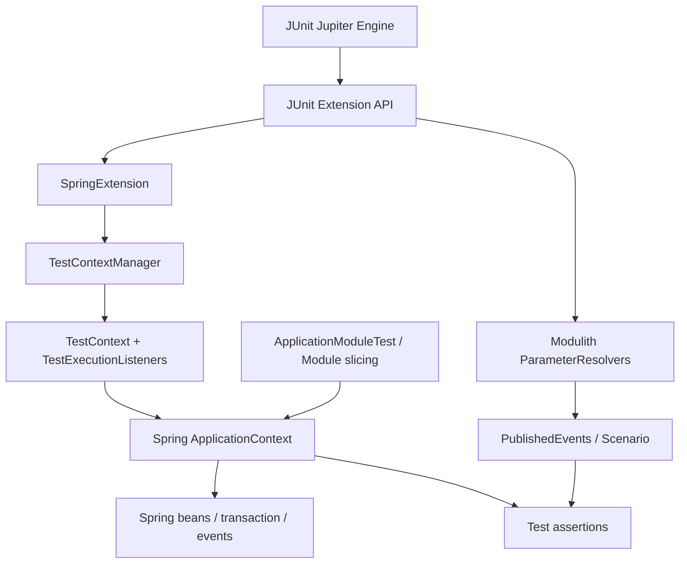
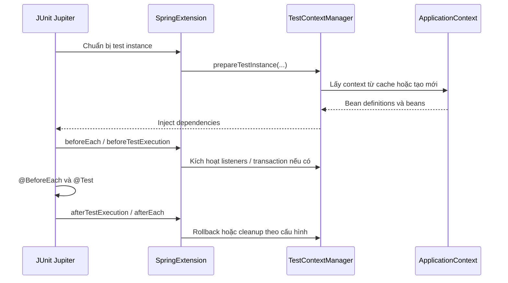

# JUnit 5 extension và Spring TestContext trong kiểm thử Spring Modulith

## 1. Tại sao cần hiểu cả JUnit 5 và Spring TestContext?

Một ứng dụng Spring Modulith được chia thành các **application module** như `order`, `inventory`, `billing` và `notification`. Khi kiểm thử một module, lập trình viên thường muốn chạy những phương thức JUnit Jupiter quen thuộc (`@Test`, `@BeforeEach`, assertion) nhưng vẫn cần các khả năng của Spring: tạo `ApplicationContext`, inject bean thật, chọn profile, quản lý transaction và ghi nhận sự kiện ứng dụng.

JUnit 5 tự nó **không** tạo Spring bean. Spring cũng không tự quyết định test case nào cần chạy, cách đặt tên test hay cách thực hiện assertion. Hai framework phối hợp thông qua **JUnit Jupiter Extension API** và **Spring TestContext Framework**. Spring Modulith xây thêm một tầng nữa để giới hạn context theo ranh giới application module.

Trong học phần **SPRING_MODULITH_VERIFICATION_TESTING**, kỹ năng này phục vụ mục tiêu kiểm chứng ranh giới kiến trúc với `ApplicationModules` và quy tắc phụ thuộc, thực hành `@ApplicationModuleTest`, kiểm thử sự kiện/cơ sở dữ liệu/tích hợp, rồi đưa các kiểm chứng vào **quality gate CI** để phát hiện phụ thuộc sai hoặc hồi quy.

### Sau bài học, bạn có thể

- Phân biệt **JUnit Platform**, **JUnit Jupiter**, `Extension`/`ParameterResolver` và **Spring TestContext**.
- Giải thích vai trò của `SpringExtension`, `TestContextManager` và các `TestExecutionListener`.
- Sử dụng `@SpringJUnitConfig`, `@SpringBootTest` và `@ApplicationModuleTest` đúng mục đích.
- Viết module test dùng bean thật, JUnit `TestInfo` và Spring Modulith `PublishedEvents` trong cùng phương thức `@Test`.
- Biết khi nào `Scenario` cần transaction manager, khi nào `@Transactional` sẽ rollback và vì sao async listener là trường hợp đặc biệt.
- Quản lý lifecycle, context cache, mock, profile và các nhóm kiểm thử trên CI, kết hợp `ApplicationModules.verify()` để bảo vệ ranh giới.

## 2. Ba tầng trách nhiệm: JUnit → Spring TestContext → Spring Modulith



| Tầng | Thành phần tiêu biểu | Vai trò chính |
| --- | --- | --- |
| **JUnit Platform/Jupiter** | `@Test`, `@BeforeEach`, `@ParameterizedTest`, `TestInfo`, `@Tag` | Phát hiện, lên lịch, chạy test và cung cấp extension/lifecycle |
| **Spring TestContext** | `SpringExtension`, `TestContextManager`, `@ContextConfiguration`, `@Autowired`, `@Transactional` | Tạo và tái sử dụng context, inject bean, quản lý transaction/dữ liệu test |
| **Spring Boot Test** | `@SpringBootTest`, `@ActiveProfiles`, `@AutoConfigureMockMvc` | Khởi tạo Spring Boot và các auto-configuration phù hợp |
| **Spring Modulith Test** | `@ApplicationModuleTest`, `BootstrapMode`, `PublishedEvents`, `Scenario` | Chỉ bootstrap các module được chọn, ghi nhận event và hỗ trợ kịch bản tích hợp |

Một số phân biệt quan trọng:

1. **JUnit Jupiter** chạy các phương thức `@Test`; nó không biết `OrderService` nào là bean Spring.
2. **`SpringExtension`** là cầu nối JUnit Jupiter với Spring TestContext, không phải một `BootstrapMode` của Spring Modulith.
3. **Spring Modulith** xác định module mục tiêu và giới hạn phạm vi context. Nó không thay thế JUnit engine hoặc TestContext.
4. **`PublishedEvents` và `Scenario`** là tiện ích kiểm thử của Modulith, có thể được cung cấp làm tham số phương thức test qua những bộ giải tham số JUnit.

## 3. JUnit Jupiter Extension API hoạt động như thế nào?

JUnit 5 bao gồm JUnit Platform, Jupiter và các thành phần khác. **Jupiter Extension API** cho phép framework mở rộng vòng đời test mà không yêu cầu lập trình viên gọi tay các hàm khởi tạo/hủy đối tượng.

Một extension có thể hiện thực một hoặc nhiều interface như:

| Extension API | Thời điểm / khả năng | Tình huống sử dụng |
| --- | --- | --- |
| `BeforeAllCallback` | Trước các test của lớp | Chuẩn bị tài nguyên dùng chung |
| `BeforeEachCallback` | Trước một test case | Chuẩn bị trạng thái theo từng test |
| `TestInstancePostProcessor` | Sau khi JUnit tạo test instance | Inject dependency vào test instance |
| `ParameterResolver` | Khi test/lifecycle method cần tham số | Cung cấp `TestInfo`, bean Spring hoặc object test đặc thù |
| `BeforeTestExecutionCallback` / `AfterTestExecutionCallback` | Quanh đoạn thực thi phương thức `@Test` | Đo thời gian thực thi, tracing |
| `AfterEachCallback` | Sau một test | Dọn tài nguyên hoặc listener state |
| `ExecutionCondition` | Trước lúc quyết định chạy test | Bật/tắt test theo điều kiện |

### Một extension JUnit không dùng Spring

Ví dụ này đo thời gian của một phương thức `@Test` bằng hai callback. File `TimingExtension.java`:

```java
package com.example.shop.testing;

import org.junit.jupiter.api.extension.AfterTestExecutionCallback;
import org.junit.jupiter.api.extension.BeforeTestExecutionCallback;
import org.junit.jupiter.api.extension.ExtensionContext;

public class TimingExtension
        implements BeforeTestExecutionCallback, AfterTestExecutionCallback {

    private static final ExtensionContext.Namespace NAMESPACE =
            ExtensionContext.Namespace.create(TimingExtension.class);

    @Override
    public void beforeTestExecution(ExtensionContext context) {
        context.getStore(NAMESPACE).put("start", System.nanoTime());
    }

    @Override
    public void afterTestExecution(ExtensionContext context) {
        Long start = context.getStore(NAMESPACE).remove("start", Long.class);
        if (start != null) {
            long elapsedNanos = System.nanoTime() - start;
            System.out.printf("%s: %d ns%n",
                    context.getDisplayName(), elapsedNanos);
        }
    }
}
```

Đăng ký extension bằng `@ExtendWith`:

```java
package com.example.shop.testing;

import static org.junit.jupiter.api.Assertions.assertEquals;

import org.junit.jupiter.api.Test;
import org.junit.jupiter.api.extension.ExtendWith;

@ExtendWith(TimingExtension.class)
class SimpleJUnitTests {

    @Test
    void addsNumbers() {
        assertEquals(4, 2 + 2);
    }
}
```

Extension ở trên **không** tạo Spring context và **không** inject bean. Đây là ví dụ nền tảng để thấy cách JUnit đăng ký callback; `SpringExtension` cũng dựa trên Extension API, nhưng thực hiện những nhiệm vụ liên quan đến Spring TestContext.

## 4. SpringExtension và TestContextManager

`SpringExtension` là thành phần tích hợp Spring TestContext vào JUnit Jupiter. Khi test có `@ExtendWith(SpringExtension.class)`, extension có thể:

- Chuẩn bị `TestContext` và tải `ApplicationContext` theo cấu hình.
- Inject bean vào các field/constructor/method parameter được Spring hỗ trợ.
- Gọi các `TestExecutionListener` trước và sau quá trình chạy test.
- Áp dụng transaction test, SQL scripts, profile, bean override và nhiều tiện ích khác.
- Tái sử dụng `ApplicationContext` theo cache key của Spring TestContext.

`TestContextManager` điều phối các `TestExecutionListener`; ví dụ `DependencyInjectionTestExecutionListener` hỗ trợ inject bean và `TransactionalTestExecutionListener` hỗ trợ transaction test. **Không cần tự tạo một `TestContextManager` hoặc gọi các listener** trong bài test thông thường.

### Ví dụ với `@SpringJUnitConfig`

Đoạn sau cho thấy dùng JUnit Jupiter + Spring mà **không cần** Spring Boot hoặc Spring Modulith:

```java
package com.example.shop.testing;

import static org.assertj.core.api.Assertions.assertThat;

import org.junit.jupiter.api.Test;
import org.junit.jupiter.api.TestInfo;
import org.springframework.beans.factory.annotation.Autowired;
import org.springframework.context.annotation.Bean;
import org.springframework.context.annotation.Configuration;
import org.springframework.test.context.junit.jupiter.SpringJUnitConfig;

@SpringJUnitConfig(PriceCalculatorTests.TestConfig.class)
class PriceCalculatorTests {

    @Autowired PriceCalculator calculator;

    @Test
    void calculatesTotal(@Autowired PriceCalculator fromParameter,
                         TestInfo testInfo) {
        assertThat(calculator.total(10, 3)).isEqualTo(30);
        assertThat(fromParameter).isSameAs(calculator);
        assertThat(testInfo.getDisplayName()).isNotBlank();
    }

    static class PriceCalculator {
        int total(int price, int quantity) {
            return price * quantity;
        }
    }

    @Configuration
    static class TestConfig {
        @Bean
        PriceCalculator priceCalculator() {
            return new PriceCalculator();
        }
    }
}
```

Trong ví dụ này, `@SpringJUnitConfig` kết hợp cơ chế đăng ký `SpringExtension` với `@ContextConfiguration`. Spring cung cấp `PriceCalculator` vào field `@Autowired` **và** tham số có `@Autowired`; JUnit Jupiter cung cấp `TestInfo`. Đây là hai nguồn parameter resolution khác nhau có thể cùng tồn tại.

### Cách đăng ký extension trong Spring Boot và Spring Modulith

Với stack Spring Boot 3.x/JUnit Jupiter 5, `@SpringBootTest` đã meta-annotate với `SpringExtension`. `@ApplicationModuleTest` cũng tích hợp Spring Boot Test và các extension/parameter resolver của Modulith. Vì vậy thông thường **không cần viết thêm**:

```java
// Thường dư thừa trên một bài @ApplicationModuleTest:
// @ExtendWith(SpringExtension.class)
// @ApplicationModuleTest
```

Việc thêm `@ExtendWith` cho **extension riêng của ứng dụng** vẫn có thể cần thiết, chẳng hạn `TimingExtension` hoặc một `ScenarioCustomizer`. Chỉ tránh đăng ký trùng các extension đã được annotation tích hợp cung cấp.

> **Về phiên bản:** Bài này trình bày cách dùng quen thuộc với Spring Boot 3.4/3.5, Spring Framework 6.2, Spring Modulith 1.4 và JUnit Jupiter 5 (chọn các phiên bản BOM tương thích). Ở Spring Framework 7.0, `SpringExtension` yêu cầu JUnit Jupiter 6 trở lên. Do đó khi nâng cấp Spring Boot 4.x/Spring Modulith 2.x, cần đối chiếu tài liệu phiên bản mới và cấu hình test engine tương ứng.

## 5. Tạo dự án mẫu và đặt module test đúng vị trí

Mẫu sau đủ để minh họa **JUnit lifecycle + Spring DI + Modulith context slicing + event assertions** mà không cần database hoặc message broker.

### 5.1. Dependencies và cấu trúc

Với Maven và Spring Boot 3.x, thêm các dependency tiêu biểu sau; phiên bản được quản lý bằng Spring Boot/Spring Modulith BOM tương thích:

```xml
<dependency>
    <groupId>org.springframework.boot</groupId>
    <artifactId>spring-boot-starter</artifactId>
</dependency>
<dependency>
    <groupId>org.springframework.boot</groupId>
    <artifactId>spring-boot-starter-test</artifactId>
    <scope>test</scope>
</dependency>
<dependency>
    <groupId>org.springframework.modulith</groupId>
    <artifactId>spring-modulith-starter-test</artifactId>
    <scope>test</scope>
</dependency>
```

`spring-boot-starter-test` cung cấp JUnit Jupiter, AssertJ, Mockito và Spring Test hỗ trợ cho stack tương ứng. `spring-modulith-starter-test` cung cấp khả năng kiểm thử module và `PublishedEvents`/`Scenario`. Chưa cần thêm artifact `spring-modulith-junit`: artifact đó dành cho **change-aware test execution** và sẽ được giới thiệu riêng ở phần 11.

```text
src/
├── main/java/com/example/shop/
│   ├── ShopApplication.java
│   ├── order/
│   │   ├── OrderService.java
│   │   └── OrderSubmitted.java
│   └── billing/
│       └── BillingFacade.java
└── test/java/com/example/shop/
    ├── order/
    │   └── OrderModuleIntegrationTests.java
    └── ModuleArchitectureTests.java
```

Với cơ chế nhận diện module mặc định, `order` và `billing` là hai application module. Một test đặt trong `com.example.shop.order` sẽ chọn `order` làm module mục tiêu khi có `@ApplicationModuleTest`.

### 5.2. Cấu hình Spring Boot gốc

```java
package com.example.shop;

import org.springframework.boot.SpringApplication;
import org.springframework.boot.autoconfigure.SpringBootApplication;

@SpringBootApplication
public class ShopApplication {
    public static void main(String[] args) {
        SpringApplication.run(ShopApplication.class, args);
    }
}
```

### 5.3. Event và bean thật thuộc module `order`

File `src/main/java/com/example/shop/order/OrderSubmitted.java`:

```java
package com.example.shop.order;

import java.util.UUID;

public record OrderSubmitted(UUID orderId, String sku, int quantity) {}
```

File `src/main/java/com/example/shop/order/OrderService.java`:

```java
package com.example.shop.order;

import java.util.UUID;

import org.springframework.context.ApplicationEventPublisher;
import org.springframework.stereotype.Service;

@Service
public class OrderService {

    private final ApplicationEventPublisher events;

    public OrderService(ApplicationEventPublisher events) {
        this.events = events;
    }

    public UUID submit(String sku, int quantity) {
        if (sku == null || sku.isBlank() || quantity <= 0) {
            throw new IllegalArgumentException("Invalid order");
        }

        UUID id = UUID.randomUUID();
        events.publishEvent(new OrderSubmitted(id, sku, quantity));
        return id;
    }
}
```

Ví dụ dùng `ApplicationEventPublisher` thật trong Spring context. Nó chỉ chứng minh **phát event**, không mô phỏng lưu đơn hàng hoặc xử lý event qua database.

### 5.4. Bean ở module `billing` không thuộc mục tiêu test

```java
package com.example.shop.billing;

import org.springframework.stereotype.Service;

@Service
public class BillingFacade {
    public String status() {
        return "billing-ready";
    }
}
```

Với test `STANDALONE` thuộc `order` và không có import/custom scanning đặc biệt, Spring không tự component-scan bean `BillingFacade` ở module `billing`.

## 6. Một bài `@ApplicationModuleTest` dùng cả JUnit và Spring/Modulith

File `src/test/java/com/example/shop/order/OrderModuleIntegrationTests.java`:

```java
package com.example.shop.order;

import static org.assertj.core.api.Assertions.assertThat;
import static org.assertj.core.api.Assertions.assertThatThrownBy;

import java.util.UUID;

import com.example.shop.billing.BillingFacade;
import org.junit.jupiter.api.BeforeEach;
import org.junit.jupiter.api.DisplayName;
import org.junit.jupiter.api.Tag;
import org.junit.jupiter.api.Test;
import org.junit.jupiter.api.TestInfo;
import org.springframework.beans.factory.annotation.Autowired;
import org.springframework.context.ApplicationContext;
import org.springframework.modulith.test.ApplicationModuleTest;
import org.springframework.modulith.test.PublishedEvents;

@Tag("module")
@ApplicationModuleTest
class OrderModuleIntegrationTests {

    @Autowired OrderService orders;
    @Autowired ApplicationContext context;

    @BeforeEach
    void checksJUnitLifecycle(TestInfo info) {
        assertThat(info.getDisplayName()).isNotBlank();
    }

    @Test
    @DisplayName("Đơn hợp lệ phát đúng OrderSubmitted")
    void publishesOrderEvent(PublishedEvents events) {
        UUID id = orders.submit("SKU-01", 2);

        assertThat(events.ofType(OrderSubmitted.class)
                .matching(OrderSubmitted::orderId, id))
                .hasSize(1);

        assertThat(context.getBeansOfType(BillingFacade.class)).isEmpty();
    }

    @Test
    void rejectsInvalidOrder(PublishedEvents events) {
        assertThatThrownBy(() -> orders.submit("", 1))
                .isInstanceOf(IllegalArgumentException.class);

        assertThat(events.ofType(OrderSubmitted.class)).isEmpty();
    }
}
```

Phân tích chính xác những gì xảy ra:

1. **JUnit Jupiter** nhìn thấy `@Test`, chạy `@BeforeEach` trước mỗi test, cung cấp `TestInfo` và hiển thị `@DisplayName`.
2. **SpringExtension/TestContext** tạo hoặc tái sử dụng `ApplicationContext` và inject `OrderService` cùng `ApplicationContext` vào field `@Autowired`.
3. **Spring Modulith** chọn module `order` dựa trên package chứa lớp test, mặc định `BootstrapMode.STANDALONE`; do đó không tự tạo bean `BillingFacade`.
4. **Modulith parameter resolver** cung cấp `PublishedEvents` làm tham số của phương thức `@Test`, ghi nhận event được publish trong lần test.
5. **AssertJ** xác minh event đúng loại/correlation ID và không có event khi yêu cầu bị từ chối.

Ví dụ tập trung vào kỹ thuật JUnit/TestContext, nên không khởi động server web, không dùng datasource và không cần mock dependency ngoài module. Nó **không** chứng minh listener ở một module khác đã nhận hoặc xử lý event.

### Tại sao kiểm tra event theo `orderId`?

Nếu chỉ assert “có ít nhất một `OrderSubmitted`”, event từ kịch bản không liên quan có thể tạo kết quả xanh sai. Dùng `matching(OrderSubmitted::orderId, id)` làm assertion gắn với **tác nhân cụ thể của test hiện tại**, đặc biệt quan trọng với suite có event bất đồng bộ.

## 7. ParameterResolver: phân biệt tham số do ai cung cấp

Có nhiều kiểu tham số xuất hiện trong một phương thức JUnit:

| Tham số | Bộ cung cấp/giải tham số | Ví dụ |
| --- | --- | --- |
| `TestInfo` | JUnit Jupiter built-in | `void test(TestInfo info)` |
| `TestReporter` | JUnit Jupiter built-in | `void test(TestReporter reporter)` |
| `ApplicationContext` | `SpringExtension` / Spring TestContext | `void test(ApplicationContext context)` |
| Bean Spring bất kỳ | `SpringExtension` khi tham số được `@Autowired`, `@Qualifier` hoặc `@Value` phù hợp | `void test(@Autowired OrderService orders)` |
| `PublishedEvents` hoặc `AssertablePublishedEvents` | Spring Modulith test extension | `void test(PublishedEvents events)` |
| `Scenario` | Spring Modulith scenario extension | `void test(Scenario scenario)` |
| Dữ liệu từ `@CsvSource`/`@MethodSource` | JUnit Jupiter parameterized test | `void test(String sku, int quantity)` |

Một ví dụ kết hợp ba nguồn tham số trong **cùng bài test**:

```java
@Test
void combinesResolvers(TestInfo info,
                       @Autowired OrderService service,
                       PublishedEvents events) {
    assertThat(info.getDisplayName()).isNotBlank();

    UUID id = service.submit("SKU-02", 1);
    assertThat(events.ofType(OrderSubmitted.class)
            .matching(OrderSubmitted::orderId, id))
            .hasSize(1);
}
```

Đoạn trên là **phương thức bổ sung vào lớp `OrderModuleIntegrationTests`** ở phần 6; nó dùng các import và kiểu đã được khai báo ở đó.

### Cảnh báo với constructor injection

Spring hỗ trợ inject bean vào test constructor bằng `@Autowired` hoặc `@TestConstructor(autowireMode = ALL)`. Một số phiên bản `@ApplicationModuleTest` cũng meta-annotate `@TestConstructor(autowireMode = ALL)`. Khi **Spring nhận toàn quyền resolve constructor**, một `ParameterResolver` khác có thể không được dùng cho cùng constructor.

Với `PublishedEvents`/`Scenario`, cách dễ đọc và ít xung đột nhất là **khai báo chúng ở tham số phương thức `@Test`**, đúng cách tài liệu Spring Modulith minh họa. Đừng tự đăng ký một resolver khác cho chính cùng kiểu tham số nếu extension Modulith đã cung cấp.

Nếu gặp `ParameterResolutionException`, hãy kiểm tra: thiếu annotation/extension, thiếu dependency test, kiểu tham số không hỗ trợ, hoặc có nhiều `ParameterResolver` cùng nhận một tham số. Không nên giải quyết lỗi bằng cách thêm ngẫu nhiên nhiều `@ExtendWith`.

## 8. `Scenario`: JUnit parameter injection cho event flow

`PublishedEvents` cho biết **event đã được publish**. Khi bài test cần chờ một listener xử lý bất đồng bộ, event kết quả hoặc thay đổi trạng thái, Spring Modulith cung cấp `Scenario`.

Ví dụ **mang tính cấu trúc**, cần có bean `OrderWorkflow`, `OrderHandled` và hạ tầng transaction/listener phù hợp trong ứng dụng thực:

```java
@Test
void waitsForAsyncFlow(Scenario scenario) {
    UUID id = UUID.randomUUID();

    scenario.stimulate(() -> workflow.request(id, "SKU-01"))
            .andWaitAtMost(Duration.ofSeconds(5))
            .forEventOfType(OrderHandled.class)
            .matching(event -> event.orderId().equals(id))
            .toArriveAndVerify(event ->
                    assertThat(event.orderId()).isEqualTo(id));
}
```

Khác với ví dụ hoàn chỉnh ở phần 6, đoạn này **chưa thể sao chép chạy độc lập**: `workflow`, `OrderHandled` và transaction infrastructure cần được khai báo. Cần chuẩn bị `PlatformTransactionManager` hoặc `TransactionOperations` phù hợp để stimulus/transactional listener hoạt động theo đúng thiết kế.

Điểm cần ghi nhớ về Spring TestContext và JUnit:

- `Scenario` được inject bởi extension Modulith vào phương thức test; không tự nhận `@Autowired` từ một bean ứng dụng bình thường.
- `Scenario.stimulate(...)` và `Scenario.publish(...)` dùng cơ chế transaction cho stimulus để các `@TransactionalEventListener` hoạt động sau commit.
- Việc chờ event/state có timeout cụ thể; không dùng `Thread.sleep(...)` làm tiêu chí hoàn thành duy nhất.
- Khi stimulus commit trong một transaction riêng hoặc listener chạy trên thread/transaction khác, rollback mặc định của phương thức test **không** bao phủ mọi side effect. Dùng cleanup/fixture cô lập nếu có database.

## 9. Lifecycle của JUnit và transaction trong Spring TestContext

Với `@ApplicationModuleTest`, vẫn sử dụng các annotation JUnit như `@BeforeEach`, `@AfterEach`, `@BeforeAll` và `@AfterAll`. Tuy nhiên, phải phân biệt **vòng đời test instance**, **vòng đời Spring context** và **vòng đời transaction test**.



### `@TestInstance` không phải context scope

JUnit Jupiter thường tạo **test instance mới cho mỗi method** theo `PER_METHOD`, trừ khi cấu hình khác. `PER_CLASS` dùng một instance chung trong lớp test. Một số phiên bản `@ApplicationModuleTest` có meta-annotation `@TestInstance(PER_CLASS)` để điều chỉnh lifecycle; hãy kiểm tra Javadoc **đúng version** của dự án trước khi dựa vào điều đó.

Dù JUnit có tạo test instance mới hay không, **Spring `ApplicationContext` có thể vẫn được cache và tái sử dụng**. Không nên suy luận “JUnit tạo instance mới nên mọi singleton bean trong Spring tự được reset”. Với state trong singleton, cần reset fixture hợp lý.

### `@Transactional` cho test

Spring TestContext hỗ trợ `@Transactional` trên test class hoặc test method nếu `ApplicationContext` có `PlatformTransactionManager`. Theo mặc định, transaction của test được **rollback** sau test.

```java
package com.example.shop.order;

import org.junit.jupiter.api.Test;
import org.springframework.modulith.test.ApplicationModuleTest;
import org.springframework.transaction.annotation.Transactional;

@ApplicationModuleTest
class OrderJpaModuleTests {

    @Test
    @Transactional
    void savesAndReadsEntity() {
        // Giả định test đã có repository/entity/datasource phù hợp.
        // Dữ liệu ghi đồng bộ trong test-managed transaction sẽ rollback.
    }
}
```

Đoạn này là **mẫu cấu hình**, không phải test persistence hoàn chỉnh: muốn chạy phải khai báo JPA/JDBC repository, datasource, schema và assertion. `@Transactional` cũng **không** tạo transaction manager nếu ứng dụng chưa có.

Đặc biệt:

1. `@BeforeEach` và `@AfterEach` của JUnit được thực thi trong test-managed transaction nếu phương thức test dùng `@Transactional` theo cơ chế TestContext.
2. `@BeforeAll` và `@AfterAll` **không** tự nằm trong transaction của từng test method.
3. Listener `AFTER_COMMIT` sẽ không chạy theo nhánh after-commit nếu transaction test cuối cùng **rollback** thay vì commit.
4. `Scenario` hoặc request HTTP qua server thật thường đi qua transaction/thread riêng; dữ liệu side effect có thể **không** rollback theo test method.
5. Timeout kiểu *preemptive* trong test có thể chạy body trên thread khác với thread đã được Spring gắn transaction, gây rò dữ liệu ngoài ý muốn.

Đối với test JPA, cần dữ liệu riêng theo test, schema rõ ràng và khi cần có `@Sql`, cleanup hoặc Testcontainers. Không dùng `@DirtiesContext` để thay thế cleanup database thường ngày.

## 10. Profile, context cache, mock và test isolation

Spring TestContext cache `ApplicationContext` cho những cấu hình test tương đương. Cache key xét đến những yếu tố như lớp cấu hình, profile, property, context customizer, bean overrides và nhiều phần cấu hình liên quan khác.

| Tùy chọn | Ảnh hưởng thường gặp |
| --- | --- |
| `@ActiveProfiles("test")` | Chọn bean/property theo profile; có thể tạo context cache key khác |
| `@TestPropertySource` | Ghi đè property; context khác khi property khác |
| `@MockitoBean`/`@TestBean` | Thay hoặc thêm bean trong test context; khác mock/qualifier có thể khác cache key |
| `@ApplicationModuleTest(mode = ...)` | Nạp tập module khác; thường yêu cầu context khác |
| `@DirtiesContext` | Báo Spring loại context khỏi cache và tạo lại khi cần |
| JUnit `@TestInstance(PER_CLASS)` | Thay vòng đời **test instance**, không phải lời yêu cầu Spring tạo context mới |

Nếu module `order` phụ thuộc API công khai từ `inventory` nhưng test chạy `STANDALONE`, có thể dùng `@MockitoBean InventoryAvailability inventory`. Annotation này tạo hoặc thay bean cho dependency ngoài module theo cách Spring Test hỗ trợ. Với test cần implementation thật, chuyển sang `DIRECT_DEPENDENCIES` có chủ đích và không dùng mock đó.

**Tránh những thực hành gây flaky test:**

- Dùng trạng thái mutable `static` hoặc singleton chia sẻ mà không reset.
- Phụ thuộc vào thứ tự chạy các phương thức `@Test` để chuẩn bị dữ liệu.
- Gắn `@DirtiesContext` lên mọi test chỉ để “chắc chắn”: điều đó phá lợi ích cache và khiến suite chậm.
- Thay đổi `System.setProperty(...)` giữa các bài test mà không dọn, làm test phụ thuộc thứ tự.
- Khởi chạy async listener nhưng kết luận test hoàn tất trước khi kiểm tra kết quả xử lý.

Để quan sát hiệu quả cache:

```properties
logging.level.org.springframework.test.context.cache=DEBUG
logging.level.org.springframework.modulith=DEBUG
```

Log Modulith giúp thấy module được chọn và phạm vi quét; log TestContext cache giúp thấy khi context được tạo hoặc tái sử dụng. Hai loại log phục vụ hai câu hỏi khác nhau.

## 11. JUnit integration trong CI: `@Tag` và extension chọn test theo thay đổi

JUnit Jupiter hỗ trợ `@Tag` để nhóm test. Ví dụ:

```java
@Tag("module")
@ApplicationModuleTest
class OrderModuleIntegrationTests {
    // Các @Test thuộc nhóm module.
}
```

Đoạn này minh họa cách đặt tag (không phải định nghĩa lại lớp mẫu ở phần 6). Maven/Gradle có thể lọc tag qua cấu hình plugin/test task tương ứng. Ví dụ Gradle Kotlin DSL cho một task test:

```kotlin
tasks.test {
    useJUnitPlatform {
        includeTags("module")
    }
}
```

Nếu áp dụng `includeTags("module")` trên task test mặc định, **những test không mang tag đó sẽ không được chạy bởi task ấy**. Hãy tổ chức task/stage riêng để architecture test và full integration test vẫn được chạy trong pipeline bắt buộc.

### Spring Modulith `spring-modulith-junit` và change-aware execution

Từ **Spring Modulith 1.3**, dự án có extension JUnit Jupiter hỗ trợ **chọn test bị ảnh hưởng bởi thay đổi source**. Artifact này **khác** `spring-modulith-starter-test`:

```xml
<dependency>
    <groupId>org.springframework.modulith</groupId>
    <artifactId>spring-modulith-junit</artifactId>
    <scope>test</scope>
</dependency>
```

Khi được kích hoạt, cơ chế xét:

1. Những module có thay đổi.
2. Những module **phụ thuộc trực tiếp hoặc bắc cầu vào** module đã thay đổi.
3. Root module và các điều kiện mà extension quyết định không tối ưu, chẳng hạn chạy chủ đích từ IDE hoặc thay đổi build/classpath resources.

**Ví dụ:** `order → inventory`. Nếu code của `inventory` thay đổi, test thuộc `order` có thể bị ảnh hưởng và được chọn chạy; ngược lại, nếu chỉ `order` thay đổi, không tự kết luận test của `inventory` bị ảnh hưởng theo chiều phụ thuộc đó.

Trong CI, muốn tính thay đổi theo lần build thành công trước cần cấu hình property `spring.modulith.test.reference-commit` phù hợp và bảo đảm git checkout có lịch sử commit liên quan. Nếu không có thay đổi phù hợp để tối ưu, extension có thể quay lại chạy tất cả test; **không được mặc định suy ra nó luôn skip những test không liên quan**.

**Lưu ý về quality gate:** Chạy chọn lọc giúp giảm thời gian phản hồi nhưng **không thay thế** một lịch chạy full regression suite và bài architecture verification bắt buộc. Cần đảm bảo kiểm thử các quy tắc phụ thuộc được chạy trong CI ngay cả khi thay đổi chỉ ở một module nhỏ.

## 12. Kiểm chứng ranh giới kiến trúc bằng một bài JUnit riêng

Test tích hợp có thể chạy xanh dù code phụ thuộc sai vào một package `internal` của module khác. Để kiểm tra **quy tắc kiến trúc**, dùng `ApplicationModules.verify()` trong bài JUnit độc lập:

```java
package com.example.shop;

import org.junit.jupiter.api.Tag;
import org.junit.jupiter.api.Test;
import org.springframework.modulith.core.ApplicationModules;

@Tag("architecture")
class ModuleArchitectureTests {

    @Test
    void modulesDoNotViolateBoundaries() {
        ApplicationModules.of(ShopApplication.class).verify();
    }
}
```

Bài test này dùng **JUnit Jupiter** nhưng không cần khởi tạo Spring `ApplicationContext`, vì `ApplicationModules` phân tích cấu trúc ứng dụng. Nó hỗ trợ các quy tắc phụ thuộc, ví dụ cấm một module truy cập package nội bộ không được công khai của module khác.

`@ApplicationModuleTest` ở các phiên bản hiện hành cũng hỗ trợ tự xác minh kiến trúc qua `verifyAutomatically = true` theo mặc định. Dù vậy, bài kiến trúc tường minh vẫn đáng có để **CI báo lỗi rõ ràng** ngay cả khi nhóm module integration test được lọc bởi tag hoặc change-aware selection.

Một chuỗi quality gate hợp lý:

1. **Architecture tests**: kiểm chứng ranh giới `ApplicationModules`.
2. **Module tests**: JUnit Jupiter + `@ApplicationModuleTest` kiểm tra bean thật, API công khai và event được publish.
3. **Cross-module event/database tests**: `Scenario`, repository thật và datasource/broker phù hợp khi cần.
4. **Full-application tests**: ít nhất một tập kiểm thử `@SpringBootTest` phát hiện lỗi khi nhiều module cùng khởi tạo.

Tùy dự án, CI chạy JUnit qua `./mvnw test` hoặc `./gradlew test`, với test tasks/tags được cấu hình để không bỏ sót các nhóm kiểm thử bắt buộc.

## 13. Chẩn đoán lỗi thường gặp

| Triệu chứng | Nguyên nhân có thể | Cách xử lý |
| --- | --- | --- |
| JUnit không chạy test `@Test` | Thiếu Jupiter engine hoặc cấu hình build không dùng JUnit Platform | Kiểm tra starter test, test engine và Maven Surefire/Gradle test task |
| `@Autowired` field bị `null` | Test đang chạy như JUnit thuần, không có SpringExtension/Boot TestContext | Dùng `@SpringJUnitConfig`, `@SpringBootTest` hoặc `@ApplicationModuleTest` phù hợp |
| `Failed to load ApplicationContext` | Lỗi bean, datasource, profile hoặc component scanning | Đọc root cause; phân biệt thiếu bean nghiệp vụ và lỗi hạ tầng |
| `ParameterResolutionException` với `PublishedEvents` | Thiếu extension Modulith/starter hoặc cấu hình test không phù hợp | Dùng `@ApplicationModuleTest` với `spring-modulith-starter-test` |
| `ParameterResolutionException` với `Scenario` | Thiếu resolver hoặc hạ tầng cần thiết cho Scenario | Kiểm tra annotation/starter và transaction manager |
| `ParameterResolutionException` với Spring bean | Thiếu `@Autowired`/qualifier, kiểu bean không có trong context hoặc nhiều resolver xung đột | Kiểm tra signature, type và phạm vi module |
| Bean module ngoài không được inject | `STANDALONE` không nạp dependency ngoài | Mock API công khai hoặc chọn `DIRECT_DEPENDENCIES` khi cần |
| Test `@Transactional` vẫn để lại dữ liệu | Async/HTTP/thread mới hoặc transaction riêng commit | Dùng cleanup, fixture riêng, không dựa vào rollback toàn cục |
| Test chạy chậm khi thêm nhiều lớp test | Context cache key khác do profile/mock/mode, hoặc dùng `@DirtiesContext` quá nhiều | Giảm cấu hình khác biệt không cần thiết, xem log cache |
| CI bỏ qua test có lỗi | Tag filter/change-aware configuration chưa có full gate | Bổ sung architecture và full regression stage bắt buộc |
| Event được phát nhưng consumer không chạy | Listener thuộc module khác không được bootstrap, transaction chưa commit | Nạp listener phù hợp, dùng `Scenario` hoặc trạng thái dữ liệu để chứng minh xử lý |

Khi điều tra lỗi, hãy hỏi theo đúng tầng: **JUnit có nhận test không? Extension có chạy không? Context có được tải không? Bean có được inject không? Listener/event có chạy đúng phạm vi không? Assertion có đủ bằng chứng không?**

## 14. Bài tập thực hành

1. Viết `TimingExtension` như phần 3 và dùng `@ExtendWith` trong một test JUnit thuần. Giải thích vì sao extension này không cung cấp `@Autowired`.
2. Chạy `PriceCalculatorTests` với `@SpringJUnitConfig`. Thay tham số `@Autowired PriceCalculator` thành `PriceCalculator` không có annotation, xem bộ giải tham số phản hồi thế nào trong phiên bản đang dùng.
3. Chạy `OrderModuleIntegrationTests` và quan sát `TestInfo`, `PublishedEvents` cùng bean `OrderService` được cung cấp từ ba cơ chế khác nhau.
4. Gỡ `@ApplicationModuleTest` khỏi một test có `PublishedEvents`, rồi đọc `ParameterResolutionException`; giải thích annotation/extension nào còn thiếu.
5. Thêm module `inventory` và để `order` phụ thuộc một public API. So sánh test `STANDALONE` + `@MockitoBean` và test `DIRECT_DEPENDENCIES` với bean thật.
6. Thêm repository JPA và `@Transactional` vào module test. Quan sát rollback sau method test; sau đó thử một listener `AFTER_COMMIT` để thấy vì sao transaction chưa commit làm listener không chạy.
7. Tạo `@Tag("module")` và `@Tag("architecture")`. Viết cấu hình Maven/Gradle để chạy nhanh nhóm module nhưng vẫn giữ architecture gate bắt buộc.
8. Bật DEBUG cho `org.springframework.test.context.cache`, thay profile/mock giữa các lớp test và giải thích nguyên nhân tạo context mới.
9. Bổ sung `spring-modulith-junit` cho một dự án có git history phù hợp, thay một class ở `inventory` và xem tập test bị ảnh hưởng. Sau đó cấu hình một job full regression để tránh lệ thuộc hoàn toàn vào chọn lọc.
10. Tạo phụ thuộc trái quy tắc vào `inventory.internal` và chạy `ApplicationModules.verify()`; giải thích vì sao JUnit module test thành công không hợp thức hóa phụ thuộc đó.

**Kết luận:** JUnit Jupiter điều phối test và extension; `SpringExtension` liên kết JUnit với Spring TestContext để tải context, inject bean và quản lý transaction; Spring Modulith bổ sung bootstrap theo application module cùng `PublishedEvents`/`Scenario`. Hiểu đúng từng tầng giúp viết test có phạm vi rõ ràng, tránh lỗi parameter resolution và context lifecycle, kiểm chứng event/database đúng mức, rồi dùng `ApplicationModules.verify()` và CI quality gate để ngăn hồi quy kiến trúc.

### Tài liệu tham khảo

- [Spring Framework 6.2 — SpringExtension và TestContext Framework](https://docs.spring.io/spring-framework/reference/6.2/testing/testcontext-framework/support-classes.html)
- [Spring Framework — Quản lý transaction trong TestContext](https://docs.spring.io/spring-framework/reference/testing/testcontext-framework/tx.html)
- [Spring Framework — Context caching](https://docs.spring.io/spring-framework/reference/testing/testcontext-framework/ctx-management/caching.html)
- [Spring Modulith — Integration Testing Application Modules](https://docs.spring.io/spring-modulith/reference/testing.html)
- [Spring Modulith — Working with Application Events](https://docs.spring.io/spring-modulith/reference/events.html)
- [Spring Modulith 1.4 API — `ApplicationModuleTest`](https://docs.spring.io/spring-modulith/docs/1.4.x/api/org/springframework/modulith/test/ApplicationModuleTest.html)
- [Spring Modulith API — `PublishedEventsParameterResolver`](https://docs.spring.io/spring-modulith/docs/1.4.x/api/org/springframework/modulith/test/PublishedEventsParameterResolver.html)
- [JUnit 5 User Guide — Extension Model](https://junit.org/junit5/docs/current/user-guide/#extensions)
