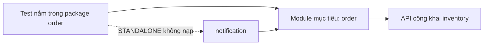

# Cấu hình lớp test cho module với JUnit Jupiter và Spring Modulith

## 1. Vì sao cấu hình lớp test quyết định chất lượng kiểm chứng module?

Trong kiến trúc **modular monolith**, ứng dụng Spring Boot có thể gồm các application module `order`, `inventory`, `payment` và `notification`. Các module cùng chạy trong một tiến trình nhưng cần tuân thủ ranh giới phụ thuộc. Một bài test đặt sai package, chọn nhầm bootstrap mode hoặc import cấu hình Spring quá rộng có thể làm mất ý nghĩa của việc kiểm thử theo module.

Ví dụ, bạn muốn chứng minh `OrderService` từ chối đơn hàng vượt giới hạn số lượng. Nếu test vô tình bootstrap toàn bộ ứng dụng, lỗi cấu hình của `notification` có thể khiến test của `order` thất bại trước khi chạy assertion. Ngược lại, nếu bài test dùng mock cho mọi dependency nhưng lại tuyên bố kiểm tra tích hợp thực với `inventory`, kết quả xanh cũng chưa chứng minh implementation `inventory` chạy đúng.

**Cấu hình lớp test** là tập các quyết định về vị trí package, annotation, phạm vi module, profile, property, bean thay thế, hạ tầng và vòng đời JUnit. Với Spring Modulith, `@ApplicationModuleTest` là annotation trung tâm: nó kết hợp Spring Boot Test/Spring TestContext với việc giới hạn `ApplicationContext` theo application module.

Bài nằm trong chương **JUnit integration** của học phần **SPRING_MODULITH_VERIFICATION_TESTING**. Mục tiêu của học phần là rèn kỹ năng kiểm chứng ranh giới qua `ApplicationModules` và quy tắc phụ thuộc, thực hành `@ApplicationModuleTest`, kiểm thử sự kiện/cơ sở dữ liệu/tích hợp và thiết lập **quality gate CI** nhằm ngăn phụ thuộc sai và hồi quy.

Sau bài này, bạn có thể:

- Đặt lớp test đúng package để Spring Modulith xác định module mục tiêu.
- Chọn `STANDALONE`, `DIRECT_DEPENDENCIES` hay `ALL_DEPENDENCIES` dựa trên mức độ tích hợp cần chứng minh.
- Dùng `module`, `classes`, `extraIncludes` và `webEnvironment` đúng trách nhiệm.
- Sử dụng `@ActiveProfiles`, `@TestPropertySource`, `@MockitoBean` và `@TestConfiguration` đúng trường hợp.
- Viết JUnit test có bean thật, `PublishedEvents`, assertion nghiệp vụ và kiểm tra ranh giới bean.
- Quản lý transaction, context cache, test isolation và kiến trúc CI.

## 2. Vị trí lớp test là một phần của cấu hình

Giả sử ứng dụng được tổ chức như sau:

```text
src/
├── main/java/com/example/shop/
│   ├── ShopApplication.java
│   ├── order/
│   │   ├── OrderService.java
│   │   └── OrderPlaced.java
│   ├── inventory/
│   │   ├── StockChecker.java
│   │   └── StockCheckerService.java
│   └── notification/
│       └── NotificationFacade.java
└── test/java/com/example/shop/
    └── order/
        ├── OrderModuleTests.java
        ├── OrderWithInventoryTests.java
        └── OrderWithFakeStockTests.java
```

Theo cách nhận diện application module mặc định, `com.example.shop.order`, `com.example.shop.inventory` và `com.example.shop.notification` là các module riêng. Khi `OrderModuleTests` nằm trong `com.example.shop.order` hoặc package con như `com.example.shop.order.web`, Spring Modulith nhận diện **`order` là module mục tiêu**.



Mũi tên `A → B` nghĩa là **A phụ thuộc vào B**. `order` tham chiếu API công khai của `inventory`; `notification` có thể lắng nghe event của `order` nhưng quan hệ đi theo chiều ngược lại.

**Quy tắc thực hành:** Khi có thể, đặt test bên trong package của module cần kiểm chứng. Đừng đặt tất cả lớp module test vào package chung `com.example.integrationtests` rồi mặc định nghĩ rằng framework tự suy ra đúng module đích.

## 3. Annotation cơ bản: `@ApplicationModuleTest` và JUnit Jupiter

Một lớp module test tối thiểu:

```java
package com.example.shop.order;

import org.junit.jupiter.api.Test;
import org.springframework.modulith.test.ApplicationModuleTest;

@ApplicationModuleTest
class OrderModuleTests {

    @Test
    void runsInsideOrderContext() {
        // Thêm assertion nghiệp vụ thực tế ở các phần tiếp theo.
    }
}
```

Về cơ chế:

1. **JUnit Jupiter** phát hiện và chạy các phương thức `@Test`.
2. **Spring TestContext/SpringExtension** tải context, hỗ trợ dependency injection, transaction và các test execution listener.
3. **Spring Boot Test** tạo ứng dụng thử nghiệm và đánh giá auto-configuration.
4. **Spring Modulith** giới hạn component scanning, auto-configuration packages và entity scanning packages vào các application module được chọn.

Theo Javadoc hiện hành, `@ApplicationModuleTest` được meta-annotate bởi `@SpringBootTest` và `@ModuleSlicing`. Vì vậy, với bài module test thông thường **không cần gắn thêm** `@SpringBootTest` hoặc `@ExtendWith(SpringExtension.class)` chỉ để có Spring context. Chỉ thêm extension riêng khi test thực sự cần.

**Mặc định**, `@ApplicationModuleTest` dùng `BootstrapMode.STANDALONE` và `SpringBootTest.WebEnvironment.MOCK`. `MOCK` không có nghĩa Spring Boot tự tạo `MockMvc` cho mọi trường hợp: test Spring MVC thường cần thêm `@AutoConfigureMockMvc`.

## 4. Thuộc tính của lớp test và trách nhiệm riêng

| Thuộc tính | Ví dụ | Vai trò |
| --- | --- | --- |
| `mode` | `BootstrapMode.STANDALONE` | Chọn độ sâu phụ thuộc module được nạp |
| `value` | `BootstrapMode.DIRECT_DEPENDENCIES` | Alias của `mode`; nên dùng một lối khai báo nhất quán |
| `extraIncludes` | `"notification"` | Thêm một hay nhiều module cụ thể theo tên logic |
| `module` | `"order"` | Chọn module mục tiêu khi test nằm ngoài package module (Spring Modulith 1.3+) |
| `classes` | `ShopApplication.class` | Chọn lớp cấu hình Spring Boot gốc (Spring Modulith 1.3+) |
| `webEnvironment` | `SpringBootTest.WebEnvironment.MOCK` | Chọn môi trường web, không chọn module nghiệp vụ |
| `verifyAutomatically` | `true` | Tự kiểm chứng cấu trúc module khi bootstrap (mặc định `true`) |

Không có thuộc tính `testProfile`, `replaceWithMocks` hoặc `useMainMethod` trên `@ApplicationModuleTest`. Với profile/property, dùng annotation Spring Test; với bean mock, dùng `@MockitoBean`. `useMainMethod` là thuộc tính của `@SpringBootTest` chứ không phải của `@ApplicationModuleTest`.

### Tập module theo `BootstrapMode`


| Chế độ với test `order` | Module được nạp trong đồ thị trên | Mục tiêu |
| --- | --- | --- |
| `STANDALONE` (mặc định) | `order` | Cô lập nghiệp vụ, mock hoặc fake API ngoài |
| `DIRECT_DEPENDENCIES` | `order`, `inventory` | Cần implementation thật của dependency trực tiếp |
| `ALL_DEPENDENCIES` | `order`, `inventory`, `catalog` | Cần chuỗi phụ thuộc trực tiếp và bắc cầu |

`notification` **không tự được thêm** vào `ALL_DEPENDENCIES` của `order` vì nó phụ thuộc *vào* `order`. Nếu cần test listener `notification` trong context của test `order`, dùng `extraIncludes = "notification"` hoặc xây test tại module nhận event.

Tập trên nói về **application module nghiệp vụ**, không phải tất cả bean Spring. Spring Boot vẫn có thể auto-configure datasource, transaction manager, security và các thành phần hạ tầng phù hợp.

## 5. Chuẩn bị ví dụ xuyên suốt

Ví dụ sử dụng Java 17+, Spring Boot 3.4/3.5, Spring Framework 6.2, Spring Modulith 1.4 và JUnit Jupiter theo các BOM **tương thích**. `@MockitoBean` có từ Spring Framework 6.2. Khi nâng cấp Boot 4/Modulith 2.x, cần đối chiếu starter và package import theo phiên bản.

Một phần dependency Maven của dự án:

```xml
<dependencies>
    <dependency>
        <groupId>org.springframework.boot</groupId>
        <artifactId>spring-boot-starter</artifactId>
    </dependency>
    <dependency>
        <groupId>org.springframework.boot</groupId>
        <artifactId>spring-boot-starter-test</artifactId>
        <scope>test</scope>
    </dependency>
    <dependency>
        <groupId>org.springframework.modulith</groupId>
        <artifactId>spring-modulith-starter-test</artifactId>
        <scope>test</scope>
    </dependency>
</dependencies>
```

Đây là phần bổ sung cho dự án Spring Boot Maven đã quản lý phiên bản và plugin, không phải toàn bộ `pom.xml`. Ví dụ cơ bản không dùng database/server để tách riêng vấn đề cấu hình lớp test.

File `src/main/java/com/example/shop/ShopApplication.java`:

```java
package com.example.shop;

import org.springframework.boot.SpringApplication;
import org.springframework.boot.autoconfigure.SpringBootApplication;

@SpringBootApplication
public class ShopApplication {
    public static void main(String[] args) {
        SpringApplication.run(ShopApplication.class, args);
    }
}
```

File `src/main/java/com/example/shop/inventory/StockChecker.java` (API công khai):

```java
package com.example.shop.inventory;

public interface StockChecker {
    boolean available(String sku, int quantity);
}
```

File `src/main/java/com/example/shop/inventory/StockCheckerService.java` (bean thật):

```java
package com.example.shop.inventory;

import org.springframework.stereotype.Service;

@Service
public class StockCheckerService implements StockChecker {

    @Override
    public boolean available(String sku, int quantity) {
        return "SKU-READY".equals(sku) && quantity <= 3;
    }
}
```

Đặt interface tại package gốc của `inventory` giúp module `order` gọi **API công khai**, không import lớp `inventory.internal`.

File `src/main/java/com/example/shop/order/OrderPlaced.java`:

```java
package com.example.shop.order;

import java.util.UUID;

public record OrderPlaced(UUID orderId, String sku, int quantity) {}
```

File `src/main/java/com/example/shop/order/OrderService.java`:

```java
package com.example.shop.order;

import java.util.UUID;
import com.example.shop.inventory.StockChecker;
import org.springframework.beans.factory.annotation.Value;
import org.springframework.context.ApplicationEventPublisher;
import org.springframework.stereotype.Service;

@Service
public class OrderService {

    private final StockChecker stock;
    private final ApplicationEventPublisher events;
    private final int maxQuantity;

    public OrderService(StockChecker stock,
                        ApplicationEventPublisher events,
                        @Value("${orders.max-quantity:5}") int maxQuantity) {
        this.stock = stock;
        this.events = events;
        this.maxQuantity = maxQuantity;
    }

    public UUID place(String sku, int quantity) {
        if (sku == null || sku.isBlank()
                || quantity <= 0 || quantity > maxQuantity) {
            throw new IllegalArgumentException("INVALID_ORDER");
        }
        if (!stock.available(sku, quantity)) {
            throw new IllegalStateException("OUT_OF_STOCK");
        }

        UUID id = UUID.randomUUID();
        events.publishEvent(new OrderPlaced(id, sku, quantity));
        return id;
    }
}
```

`OrderService` phụ thuộc vào API `StockChecker`, hạ tầng Spring `ApplicationEventPublisher` và property `orders.max-quantity`. Nhờ đó ví dụ minh họa **module scope, property override, mock dependency và event assertion** mà không cần database.

Thêm bean độc lập ở `notification`:

```java
package com.example.shop.notification;

import org.springframework.stereotype.Service;

@Service
public class NotificationFacade {

    public String status() {
        return "notification-ready";
    }
}
```

## 6. Cấu hình chuẩn: `STANDALONE`, profile, property và mock

File `src/test/java/com/example/shop/order/OrderModuleTests.java`:

```java
package com.example.shop.order;

import static org.assertj.core.api.Assertions.assertThat;
import static org.assertj.core.api.Assertions.assertThatThrownBy;
import static org.mockito.BDDMockito.given;
import static org.mockito.BDDMockito.then;

import java.util.UUID;
import com.example.shop.inventory.StockChecker;
import com.example.shop.notification.NotificationFacade;
import org.junit.jupiter.api.DisplayName;
import org.junit.jupiter.api.Tag;
import org.junit.jupiter.api.Test;
import org.springframework.beans.factory.annotation.Autowired;
import org.springframework.context.ApplicationContext;
import org.springframework.core.env.Environment;
import org.springframework.modulith.test.ApplicationModuleTest;
import org.springframework.modulith.test.PublishedEvents;
import org.springframework.test.context.ActiveProfiles;
import org.springframework.test.context.TestPropertySource;
import org.springframework.test.context.bean.override.mockito.MockitoBean;

@Tag("module")
@ActiveProfiles("test")
@TestPropertySource(properties = "orders.max-quantity=4")
@ApplicationModuleTest
class OrderModuleTests {

    @Autowired OrderService orders;
    @Autowired ApplicationContext context;
    @Autowired Environment environment;

    @MockitoBean StockChecker stock;

    @Test
    @DisplayName("Đơn hợp lệ phát đúng sự kiện")
    void acceptsOrderAndPublishesEvent(PublishedEvents events) {
        given(stock.available("SKU-01", 2)).willReturn(true);

        UUID id = orders.place("SKU-01", 2);

        assertThat(events.ofType(OrderPlaced.class)
                .matching(OrderPlaced::orderId, id))
                .hasSize(1);
        then(stock).should().available("SKU-01", 2);

        assertThat(environment.getProperty(
                "orders.max-quantity", Integer.class)).isEqualTo(4);
        assertThat(context.getBeansOfType(NotificationFacade.class)).isEmpty();
    }

    @Test
    void rejectsQuantityAboveTestLimit(PublishedEvents events) {
        assertThatThrownBy(() -> orders.place("SKU-01", 5))
                .isInstanceOf(IllegalArgumentException.class)
                .hasMessage("INVALID_ORDER");

        assertThat(events.ofType(OrderPlaced.class)).isEmpty();
        then(stock).shouldHaveNoInteractions();
    }

    @Test
    void rejectsUnavailableStock(PublishedEvents events) {
        given(stock.available("SKU-OUT", 1)).willReturn(false);

        assertThatThrownBy(() -> orders.place("SKU-OUT", 1))
                .isInstanceOf(IllegalStateException.class)
                .hasMessage("OUT_OF_STOCK");

        assertThat(events.ofType(OrderPlaced.class)).isEmpty();
        then(stock).should().available("SKU-OUT", 1);
    }
}
```

Lớp test này có nhiều nhóm cấu hình:

1. **`@ApplicationModuleTest`:** lấy module mục tiêu theo `com.example.shop.order`, mặc định `STANDALONE`.
2. **`@ActiveProfiles("test")`:** kích hoạt profile `test`; nếu dự án có `application-test.yml`, Spring Boot sẽ nạp cấu hình phù hợp.
3. **`@TestPropertySource`:** ghi đè giới hạn số lượng, thay mặc định `5` trong `@Value` bằng `4`.
4. **`@MockitoBean StockChecker`:** đăng ký mock tại API module ngoài; không nạp implementation `inventory`.
5. **`@Autowired`:** inject bean thật của `order` và hạ tầng test.
6. **`PublishedEvents`:** tiện ích Modulith qua cơ chế giải tham số test, theo dõi event được publish.
7. **`@Tag`, `@DisplayName`, `@Test`:** thuộc JUnit Jupiter, tổ chức và thực thi testcase.

**Phạm vi bằng chứng:** đây là module integration test kiểm tra `OrderService` thật với phản hồi tồn kho giả lập. Nó **không chứng minh** thuật toán `StockCheckerService` thật hoặc listener `notification` đã xử lý event.

`@MockitoBean` mặc định có thể tạo bean dù implementation không nằm trong context. **Không dùng** `enforceOverride = true` ở đây, vì tùy chọn đó yêu cầu đã có bean thật để thay. Với Spring Boot cũ hơn, có thể cần `@MockBean`; chọn annotation theo phiên bản thực tế.

## 7. Cấu hình để dùng dependency module thật

Khi cần chứng minh `OrderService` dùng implementation thật của `inventory`, không cung cấp mock nữa mà chọn:

```java
package com.example.shop.order;

import static org.assertj.core.api.Assertions.assertThat;

import java.util.UUID;
import org.junit.jupiter.api.Test;
import org.springframework.beans.factory.annotation.Autowired;
import org.springframework.modulith.test.ApplicationModuleTest;
import org.springframework.modulith.test.ApplicationModuleTest.BootstrapMode;

@ApplicationModuleTest(mode = BootstrapMode.DIRECT_DEPENDENCIES)
class OrderWithInventoryTests {

    @Autowired OrderService orders;

    @Test
    void callsRealInventoryImplementation() {
        UUID id = orders.place("SKU-READY", 2);
        assertThat(id).isNotNull();
    }
}
```

Trong ví dụ này, quan hệ `order → inventory` được mô hình `ApplicationModules` nhận diện qua việc `order` tham chiếu API công khai `StockChecker`. `DIRECT_DEPENDENCIES` nạp `inventory`, vì thế Spring tạo bean `StockCheckerService` thật. `notification` không tự được thêm vì nó không phải dependency của `order`.

Nếu `inventory` cần bean từ `catalog` theo `inventory → catalog`, `DIRECT_DEPENDENCIES` vẫn có thể thiếu bean `catalog`. Khi test cần chuỗi phụ thuộc thật thì cân nhắc `ALL_DEPENDENCIES`; nếu không, mock hoặc fake dependency sâu có thể hợp lý hơn.

**Không mở rộng `mode` chỉ để che lỗi:** Bean thuộc chính module có thể thiếu vì `@Profile`, `@Conditional` hoặc cấu hình datasource sai. Những lỗi đó không được giải quyết đúng bản chất bằng cách nạp thêm mọi module.

## 8. Chỉ định `module` và `classes` khi test nằm ngoài package module

Một dự án có thể tập trung test tích hợp ở package `com.example.integrationtests`, nghĩa là **không** nằm dưới `com.example.shop.order`. Khi đó Spring Modulith không thể suy ra module đích chỉ từ package lớp test.

Từ **Spring Modulith 1.3**, `@ApplicationModuleTest` hỗ trợ:

- `module = "order"`: chọn **module mục tiêu theo tên logic**.
- `classes = ShopApplication.class`: chỉ định **lớp cấu hình Spring Boot gốc** khi không thể tự dò `@SpringBootApplication` qua các package cha.

File `src/test/java/com/example/integrationtests/ExternalOrderModuleTests.java`:

```java
package com.example.integrationtests;

import static org.assertj.core.api.Assertions.assertThat;
import static org.mockito.BDDMockito.given;

import java.util.UUID;
import com.example.shop.ShopApplication;
import com.example.shop.inventory.StockChecker;
import com.example.shop.order.OrderPlaced;
import com.example.shop.order.OrderService;
import org.junit.jupiter.api.Test;
import org.springframework.beans.factory.annotation.Autowired;
import org.springframework.modulith.test.ApplicationModuleTest;
import org.springframework.modulith.test.PublishedEvents;
import org.springframework.test.context.bean.override.mockito.MockitoBean;

@ApplicationModuleTest(
    module = "order",
    classes = ShopApplication.class
)
class ExternalOrderModuleTests {

    @Autowired OrderService orders;
    @MockitoBean StockChecker stock;

    @Test
    void selectsOrderModuleExplicitly(PublishedEvents events) {
        given(stock.available("SKU-01", 1)).willReturn(true);

        UUID id = orders.place("SKU-01", 1);

        assertThat(events.ofType(OrderPlaced.class)
                .matching(OrderPlaced::orderId, id))
                .hasSize(1);
    }
}
```

Ở đây `module` chọn **ranh giới nghiệp vụ**, còn `classes` chọn **application configuration**. Cung cấp `ShopApplication.class` **không làm mất module slicing** của `@ApplicationModuleTest`. Nếu test đã nằm trong package `order` và Spring Boot tìm được cấu hình gốc, hai thuộc tính này thường dư thừa.

Giá trị `"order"` là tên **logic** được mô hình `ApplicationModules` nhận diện. Trong dự án có cấu hình module tùy chỉnh, tên logic không nhất thiết trùng tên thư mục.

## 9. Thêm module nhận event bằng `extraIncludes`

Giả sử `order` phát `OrderPlaced`; module `notification` nhận event và gửi thông báo. Nếu listener ở `notification` phụ thuộc vào type event công khai của `order`, đồ thị dependency có thể là `notification → order`. Đây là chiều **ngược** với cây dependency đi ra từ `order`.

Một lớp test thuộc `order` muốn nạp thêm listener có thể khai báo:

```java
package com.example.shop.order;

import org.springframework.modulith.test.ApplicationModuleTest;

@ApplicationModuleTest(extraIncludes = "notification")
class OrderNotificationFlowTests {
    // @Test kiểm tra kết quả do listener notification tạo ra.
}
```

Đoạn trên chỉ minh họa **cấu hình phạm vi**, không phải một test sự kiện hoàn chỉnh. Bạn phải triển khai listener thật, assertion về kết quả xử lý và hạ tầng event. Hơn nữa `OrderService` trong ví dụ vẫn cần `StockChecker`: khi test chỉ nạp `order` + `notification`, hãy bổ sung mock/fake API này hoặc chọn mode cho phép nạp `inventory` thật.

`extraIncludes` không tự hợp pháp hóa một dependency trái quy tắc và không tự tạo database hay message broker. Nếu listener bất đồng bộ/transactional, dùng `Scenario` để chờ event kết quả hoặc trạng thái bền vững khi điều kiện hạ tầng đã được đáp ứng.

## 10. Cấu hình test bean bằng `@TestConfiguration` và `@Import`

Không phải bài test nào cũng cần Mockito. Một **fake** có quy tắc ổn định đôi khi dễ đọc và tái sử dụng. `@TestConfiguration` định nghĩa bean dành cho môi trường test; `@Import` thêm cấu hình đó vào context.

File `src/test/java/com/example/shop/order/StubStockConfiguration.java`:

```java
package com.example.shop.order;

import com.example.shop.inventory.StockChecker;
import org.springframework.boot.test.context.TestConfiguration;
import org.springframework.context.annotation.Bean;

@TestConfiguration
class StubStockConfiguration {

    @Bean
    StockChecker stockChecker() {
        return (sku, quantity) ->
                "SKU-FAKE".equals(sku) && quantity <= 2;
    }
}
```

File `src/test/java/com/example/shop/order/OrderWithFakeStockTests.java`:

```java
package com.example.shop.order;

import static org.assertj.core.api.Assertions.assertThat;

import java.util.UUID;
import org.junit.jupiter.api.Test;
import org.springframework.beans.factory.annotation.Autowired;
import org.springframework.context.annotation.Import;
import org.springframework.modulith.test.ApplicationModuleTest;

@ApplicationModuleTest
@Import(StubStockConfiguration.class)
class OrderWithFakeStockTests {

    @Autowired OrderService orders;

    @Test
    void acceptsPredefinedFixture() {
        UUID id = orders.place("SKU-FAKE", 2);
        assertThat(id).isNotNull();
    }
}
```

Test vẫn dùng `STANDALONE`, nhưng `@Import` đăng ký **một bean cụ thể** do test quản lý. Điều này khác với việc nạp **nguyên module `inventory`** bằng `mode`. Không gắn đồng thời mock và fake của cùng API lên một lớp test trừ khi bạn cố ý kiểm chứng cơ chế bean override.

| Cách cung cấp dependency | Phù hợp khi | Giới hạn |
| --- | --- | --- |
| `@MockitoBean` | Stub và verify lời gọi API ngoài theo từng testcase | Không kiểm tra implementation thật |
| `@TestConfiguration` + `@Import` | Cần fake/adapter test với hành vi cố định | Phải quản lý trạng thái fake nếu mutable |
| `@TestBean` của Spring Test mới | Cung cấp bean test từ factory method | Phụ thuộc phiên bản Spring Framework |
| `DIRECT_DEPENDENCIES` | Cần implementation thật của module phụ thuộc | Có thể kéo theo datasource và dependency bắc cầu |

## 11. Web adapter, persistence và lựa chọn lát cắt kiểm thử

`@ApplicationModuleTest` kiểm thử **nhiều tầng trong một module**, chứ không chỉ service thuần. Cấu hình lớp test sẽ khác khi mục tiêu chuyển sang HTTP adapter hoặc repository.

### 11.1. Web adapter với `MockMvc`

Nếu module `order` có REST controller nằm trong package `order.web`, có thể dùng:

```java
package com.example.shop.order.web;

import org.springframework.boot.test.autoconfigure.web.servlet.AutoConfigureMockMvc;
import org.springframework.boot.test.context.SpringBootTest;
import org.springframework.modulith.test.ApplicationModuleTest;

@ApplicationModuleTest(
    webEnvironment = SpringBootTest.WebEnvironment.MOCK
)
@AutoConfigureMockMvc
class OrderWebAdapterTests {
    // @Autowired MockMvc và @Test assertion HTTP status/JSON.
}
```

Đây là **khung cấu hình**, cần web starter, controller thực và `MockMvc` assertion tương ứng. `MOCK` không mở cổng HTTP thật. Nếu phải kiểm tra server nhúng qua mạng, dùng `webEnvironment = RANDOM_PORT` cùng HTTP client phù hợp.

**Tương thích:** Import `@AutoConfigureMockMvc` trên là cho **Spring Boot 3.x**. Spring Boot 4.x dùng package `org.springframework.boot.webmvc.test.autoconfigure`. Hãy kiểm tra chính xác dependency và version của dự án trước khi sao chép.

### 11.2. Repository/JPA

Khi module `order` có `OrderRepository`, entity và datasource test, lớp kiểm thử có thể dùng transaction:

```java
package com.example.shop.order;

import org.junit.jupiter.api.Test;
import org.springframework.modulith.test.ApplicationModuleTest;
import org.springframework.test.context.ActiveProfiles;
import org.springframework.transaction.annotation.Transactional;

@ApplicationModuleTest
@ActiveProfiles("test")
class OrderJpaModuleTests {

    @Test
    @Transactional
    void persistsAndReadsOrder() {
        // @Autowired OrderRepository và assertions:
        // yêu cầu JPA starter, datasource, entity và schema phù hợp.
    }
}
```

Đây **chưa phải test persistence độc lập có thể chạy**: phải bổ sung repository, dữ liệu và assertion. `@Transactional` trên test thường rollback transaction đồng bộ do Spring Test quản lý, nhưng nó không tự tạo datasource hoặc transaction manager.

Nếu listener chạy `AFTER_COMMIT`, async thread hoặc transaction riêng, rollback của transaction JUnit **không bảo đảm** rollback mọi side effect. Với `Scenario`, cần transaction infrastructure và cleanup cho dữ liệu đã commit.

### 11.3. Cắt theo module khác cắt theo tầng kỹ thuật

`@WebMvcTest` hoặc `@DataJpaTest` tạo **lát cắt ngang theo tầng**. `@ApplicationModuleTest` tạo **lát cắt dọc theo module nghiệp vụ**, có thể gồm controller, service và repository nếu cấu hình đủ.

Từ **Spring Modulith 2.1**, `@ModuleSlicing` được công bố làm nền tảng để phối hợp lát cắt module với các slice test của Spring Boot. **Ở Spring Modulith 1.4**, `@ApplicationModuleTest` đã cung cấp module test nhưng chưa có annotation `@ModuleSlicing` độc lập như API 2.1; không sao chép đoạn code 2.1 vào ứng dụng 1.4 nếu dependency chưa có. Tránh gắn đồng thời `@SpringBootTest` và `@DataJpaTest` trên cùng class rồi mặc định nghĩ Spring tự kết hợp hai test bootstrapper.

## 12. Vòng đời JUnit, transaction và Spring context cache

Trong lớp `@ApplicationModuleTest`, JUnit Jupiter vẫn chạy `@BeforeEach`, `@AfterEach`, `@Test`, `@Tag` và các assertion. Nhưng **vòng đời test instance** khác **vòng đời Spring `ApplicationContext`**.

| Thành phần | Ảnh hưởng |
| --- | --- |
| `@BeforeEach` | Chuẩn bị fixture trước từng phương thức test |
| `@TestInstance(PER_METHOD/PER_CLASS)` | Quyết định JUnit tạo test instance mới hay dùng một instance |
| `@ActiveProfiles` | Chọn bean/property theo profile; có thể tạo context cache key mới |
| `@TestPropertySource` | Ghi đè property của context test |
| `@MockitoBean` / `@Import` | Tùy chỉnh bean, ảnh hưởng cấu hình context |
| `mode` / `extraIncludes` | Thay phạm vi module, thường tạo cấu hình context khác |
| `@DirtiesContext` | Yêu cầu Spring loại context khỏi cache và tạo lại khi cần |

Spring TestContext cache các context có **cấu hình tương đương** để tái sử dụng giữa các lớp test. Dùng nhiều profile/property/mock khác nhau không cần thiết hoặc gắn `@DirtiesContext` cho mọi test có thể làm chậm suite.

Ở Spring Modulith **1.4**, Javadoc `@ApplicationModuleTest` có meta-annotation `@TestInstance(PER_CLASS)` và `@TestConstructor(autowireMode = ALL)`; cần lưu ý khi dùng constructor injection và trạng thái test instance. Dù JUnit tạo một hay nhiều test instance, **Spring singleton và database không tự được reset** theo mỗi phương thức.

Để quan sát:

```properties
logging.level.org.springframework.test.context.cache=DEBUG
logging.level.org.springframework.modulith=DEBUG
```

Log TestContext giúp xác định context được tái sử dụng hay tạo mới; log Modulith cho biết module đang bootstrap. Không phụ thuộc thứ tự chạy test, biến mutable static hay dữ liệu từ test trước.

## 13. Chẩn đoán lỗi cấu hình lớp test

| Triệu chứng | Nguyên nhân cần kiểm tra | Hướng giải quyết |
| --- | --- | --- |
| Không xác định được module mục tiêu | Lớp test nằm ngoài package module | Đặt test trong module hoặc dùng `module`/`classes` nếu phiên bản hỗ trợ |
| Không tìm thấy lớp `@SpringBootApplication` | Spring Boot không dò được cấu hình gốc qua package cha | Khai báo `classes = ShopApplication.class` khi cần |
| `UnsatisfiedDependencyException` với API ngoài module | `STANDALONE` không nạp implementation ngoài | Dùng `@MockitoBean`/fake hoặc mở rộng `mode` có mục đích |
| Bean thuộc module hiện tại vẫn thiếu | Thiếu `@Service`/`@Bean`, profile hoặc conditional không thỏa | Kiểm tra package, scan và cấu hình bean |
| `@MockitoBean` không biên dịch | Spring Framework quá cũ hoặc sai import | Kiểm tra BOM; dùng `@MockBean` nếu stack cũ hỗ trợ |
| `PublishedEvents` không resolve | Thiếu extension/starter của Modulith hoặc test annotation không đúng | Kiểm tra `spring-modulith-starter-test` và `@ApplicationModuleTest` |
| `Scenario` timeout | Listener không nạp, transaction chưa commit hoặc async error | Kiểm tra mode/extraIncludes, transaction manager và log listener |
| Lỗi JPA datasource/schema | Persistence infrastructure chưa sẵn sàng | Cấu hình H2/Testcontainers, migration, entity/repository đúng |
| Web test nhận `401`/`403` | Security filter hoặc CSRF | Thiết lập user/role, CSRF và `spring-security-test` đúng mục tiêu |
| Bean ngoài module xuất hiện bất ngờ | `@Import`, custom `@ComponentScan` hoặc test configuration tạo bean | Kiểm tra nguồn bean và thu hẹp cấu hình |
| Test module xanh nhưng architecture test đỏ | Code phụ thuộc vào API nội bộ module khác | Sửa dependency/ràng buộc kiến trúc, không chỉ mở rộng mode |
| Suite chậm do tạo nhiều context | Profile, property, mock/mode không thống nhất hoặc `@DirtiesContext` quá nhiều | Giảm biến thể cấu hình không cần thiết, xem log cache |

Khi điều tra, hỏi theo thứ tự: **JUnit có nhận test? Spring context load được? Module đích đúng? Bean nào thiếu/dư? Property/profile nào được áp dụng? Assertion có chứng minh đúng mục tiêu?**

## 14. Kiểm chứng kiến trúc và quality gate CI

Một module test khởi tạo thành công **chưa chứng minh** toàn bộ phụ thuộc của ứng dụng hợp lệ. Ví dụ `order` có thể import class thuộc `inventory.internal`, và một test mở rộng vẫn chạy được dù đã phá ranh giới.

Viết một bài JUnit **không cần Spring context** để kiểm chứng kiến trúc:

```java
package com.example.shop;

import org.junit.jupiter.api.Tag;
import org.junit.jupiter.api.Test;
import org.springframework.modulith.core.ApplicationModules;

@Tag("architecture")
class ModuleArchitectureTests {

    @Test
    void modulesRespectDependencies() {
        ApplicationModules.of(ShopApplication.class).verify();
    }
}
```

`ApplicationModules.verify()` kiểm tra ràng buộc kiến trúc và phụ thuộc giữa application module. `@ApplicationModuleTest` cũng có `verifyAutomatically = true` theo mặc định, nhưng một bài kiến trúc riêng giúp **quality gate rõ ràng** dù CI chỉ chạy một nhóm module integration tests.

Một pipeline cân bằng có thể gồm:

1. **JUnit unit tests:** quy tắc Java thuần, không cần Spring.
2. **Module test `STANDALONE`:** bean thật trong module, mock/fake API ngoài, kiểm tra event nguồn.
3. **Module integration tests:** `DIRECT_DEPENDENCIES`/`ALL_DEPENDENCIES` hoặc `extraIncludes` cho luồng nhiều module.
4. **DB/event/web tests:** datasource, transaction, broker và HTTP phù hợp yêu cầu.
5. **Full `@SpringBootTest`:** một tập bài bảo vệ khả năng startup và phối hợp toàn ứng dụng.
6. **Architecture gate:** `ApplicationModules.verify()` chạy bắt buộc, không bỏ qua vì test nghiệp vụ xanh.

Với Maven hoặc Gradle, các bài JUnit chạy qua task kiểm thử được cấu hình (ví dụ `./mvnw test` hoặc `./gradlew test`). `@Tag("module")` giúp chia nhóm, nhưng pipeline vẫn cần chạy architecture gate và full regression theo chính sách của dự án.

## 15. Bài tập thực hành

1. Đặt `OrderModuleTests` vào `com.example.shop.order` rồi chuyển nó sang `com.example.integrationtests`. Thử bỏ `module`/`classes` để xem lỗi; giải thích mỗi thuộc tính giải quyết vấn đề gì.
2. Chạy test với `orders.max-quantity=4`. Thay thành `2` và bổ sung assertion nghiệp vụ chứng minh cấu hình mới được áp dụng đúng.
3. Bỏ `@MockitoBean StockChecker` khỏi test `STANDALONE` rồi chạy lại. Đọc root cause lỗi khởi tạo context và sửa lần lượt bằng mock rồi `DIRECT_DEPENDENCIES`.
4. Cho `inventory` phụ thuộc `catalog`. Giải thích vì sao `DIRECT_DEPENDENCIES` có thể vẫn thiếu bean `catalog` và khi nào nên dùng fake hoặc `ALL_DEPENDENCIES`.
5. Viết `OrderWithFakeStockTests` với `@TestConfiguration` + `@Import`; so sánh với Mockito về verification, tính ổn định và context cache.
6. Tạo listener `OrderPlaced` ở `notification`. So sánh test xác nhận event phát ở `STANDALONE` với test có `extraIncludes`/`Scenario` để xác nhận consumer xử lý.
7. Bổ sung repository JPA cho `order`, datasource/schema test và `@Transactional`. Giải thích vì sao listener sau commit có thể cần cleanup riêng.
8. Thêm REST adapter trong `order.web`; viết module test `@AutoConfigureMockMvc` và assertion HTTP, rồi so sánh với `@WebMvcTest` chỉ kiểm tra controller.
9. Bật DEBUG cho `org.springframework.test.context.cache`, chạy hai lớp test với profile/property khác nhau và phân tích số context được tạo.
10. Cố tình cho `order` phụ thuộc vào `inventory.internal`. Chạy `ApplicationModules.verify()` và giải thích vì sao `ALL_DEPENDENCIES` không sửa được lỗi kiến trúc.

### Checklist trước khi commit lớp module test

| Câu hỏi | Điều kiện cần đạt |
| --- | --- |
| Lớp test ở đúng package module? | Spring Modulith chọn đúng module mục tiêu |
| `mode` có khớp mục tiêu assertion? | Không mở rộng scope để che lỗi |
| Dependency ngoài module có được kiểm soát? | Module mục tiêu dùng bean thật; mock/fake đúng API |
| Profile/property độc lập môi trường CI? | Không phụ thuộc cấu hình sản xuất hoặc thứ tự test |
| Hạ tầng DB/web/event đầy đủ khi cần? | Không nhầm lỗi infra với module scope |
| Event assertion có correlation ID? | Xác minh đúng event của testcase hiện tại |
| Fixture/transaction được dọn phù hợp? | Kết quả không phụ thuộc lần chạy trước |
| Quality gate kiến trúc hoạt động? | `ApplicationModules.verify()` chặn dependency sai |

**Ghi nhớ:** Cấu hình lớp test cho module không chỉ là đặt `@ApplicationModuleTest`. Vị trí package chọn module mục tiêu; `mode`/`extraIncludes` chọn module được nạp; `@ActiveProfiles`/`@TestPropertySource` chọn môi trường; `@MockitoBean`/`@TestConfiguration` kiểm soát dependency; còn JUnit Jupiter và Spring TestContext điều phối vòng đời. Kết hợp những quyết định này có chủ đích với `ApplicationModules.verify()` để kiểm chứng cả hành vi lẫn ranh giới kiến trúc trong CI.

### Tài liệu tham khảo

- [Spring Modulith Reference — Integration Testing Application Modules](https://docs.spring.io/spring-modulith/reference/testing.html)
- [Spring Modulith Javadoc — `ApplicationModuleTest`](https://docs.spring.io/spring-modulith/docs/current/api/org/springframework/modulith/test/ApplicationModuleTest.html)
- [Spring Modulith 1.4 Javadoc — `ApplicationModuleTest` và JUnit lifecycle](https://docs.spring.io/spring-modulith/docs/1.4.0/api/org/springframework/modulith/test/ApplicationModuleTest.html)
- [Spring Modulith Reference — Verifying Application Module Structure](https://docs.spring.io/spring-modulith/reference/verification.html)
- [Spring Framework Reference — Testing with Environment Profiles](https://docs.spring.io/spring-framework/reference/testing/testcontext-framework/ctx-management/env-profiles.html)
- [Spring Framework Reference — Context Caching](https://docs.spring.io/spring-framework/reference/testing/testcontext-framework/ctx-management/caching.html)
- [Spring Framework Reference — `@MockitoBean` và `@MockitoSpyBean`](https://docs.spring.io/spring-framework/reference/testing/annotations/integration-spring/annotation-mockitobean.html)
- [Spring Boot Reference — Testing Spring Boot Applications](https://docs.spring.io/spring-boot/reference/testing/spring-boot-applications.html)
- [JUnit User Guide — Test Lifecycle and Organization](https://docs.junit.org/current/user-guide/)
