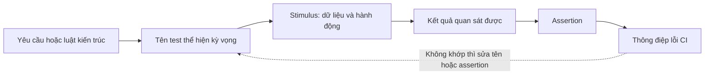

# Tên test mô tả hành vi hoặc luật kiến trúc

## 1. Tên test là một phần của hợp đồng kiểm thử

Trong ứng dụng **Spring Modulith**, các application module như `order`, `inventory`, `payment` và `notification` cùng được triển khai trong một tiến trình nhưng có ranh giới phụ thuộc riêng. Mỗi module cần được kiểm chứng ở hai khía cạnh: **hành vi nghiệp vụ** và **luật kiến trúc**. Khi CI báo `test1() failed`, người đọc phải mở source để hiểu điều gì sai; khi CI báo `publishesOrderSubmitted_whenStockIsAvailable() failed`, ý nghĩa sai lệch đã rõ hơn.

Tên test tốt diễn đạt **một yêu cầu có thể quan sát**: điều kiện ban đầu, hành động và kết quả mong đợi. Nó không chỉ sao chép tên phương thức production. Ví dụ `testPlaceOrder()` không nói hệ thống phải làm gì; `rejectsOrderWithoutEvent_whenStockIsUnavailable()` cho biết điều kiện từ chối và hệ quả không được phép xảy ra.

Bài này nằm trong chương **JUnit integration** của học phần **SPRING_MODULITH_VERIFICATION_TESTING**. Mục tiêu của học phần là kiểm chứng ranh giới bằng `ApplicationModules` và các quy tắc phụ thuộc, thực hành `@ApplicationModuleTest`, kiểm thử sự kiện/cơ sở dữ liệu/tích hợp và xây dựng **quality gate CI** để ngăn phụ thuộc sai, hồi quy.

Sau khi học, bạn có thể:

- Chuyển yêu cầu nghiệp vụ và quy tắc kiến trúc thành **tên test có thể kiểm chứng**.
- Phân biệt tên bài **behavior test**, **module integration test**, **event-flow test** và **architecture test**.
- Dùng `@DisplayName`, `@DisplayNameGeneration`, `@Nested`, `@ParameterizedTest(name = ...)` và `@Tag` của JUnit Jupiter đúng vai trò.
- Viết `@ApplicationModuleTest` với tên trùng khớp assertion, `PublishedEvents` và mock tại ranh giới module.
- Tên đúng cho bài `ApplicationModules.verify()` và thiết kế thông điệp lỗi CI hữu ích.

## 2. Hai nhóm hợp đồng: hành vi và kiến trúc

**Hợp đồng hành vi** mô tả một kích thích đầu vào và kết quả nghiệp vụ quan sát được: giá trị trả về, exception, record được ghi, domain event được phát hoặc kết quả listener xử lý.

**Hợp đồng kiến trúc** mô tả ràng buộc cấu trúc: không có chu trình dependency giữa module, chỉ truy cập API công khai của module khác, chỉ phụ thuộc những module được cho phép nếu dự án có khai báo luật đó.

| Câu hỏi | Tên test biểu đạt tốt | Assertion cần có |
| --- | --- | --- |
| Đủ hàng có phát sự kiện? | `publishesOrderSubmitted_whenStockIsAvailable` | Event `OrderSubmitted` đúng mã đơn |
| Hết hàng có phát event không? | `rejectsWithoutEvent_whenInventoryReportsOutOfStock` | Exception **và** không phát event |
| Số lượng không hợp lệ được xử lý ra sao? | `rejectsInvalidQuantity_beforeCallingInventory` | Validation error, không gọi kho |
| `order` dùng bean thật của `inventory`? | `placesOrder_usingRealInventoryModule` | Integration không dùng mock |
| Listener xử lý xong event? | `createsReceipt_afterOrderSubmittedIsHandled` | Chờ receipt/state hoặc event kết quả |
| Toàn bộ cấu trúc module hợp lệ? | `applicationModulesRespectSpringModulithRules` | `ApplicationModules.verify()` hoàn tất không lỗi |

**Tên phải đúng với bằng chứng.** Đừng đặt `persistsOrderInDatabase` nếu test chỉ mock repository và verify lời gọi `save(...)`. Đừng đặt `notificationProcessesEvent` nếu chỉ dùng `PublishedEvents` để chứng minh event đã publish. Tên test không được nói quá phạm vi assertion.



## 3. Quy ước đặt tên dễ duy trì

Không có convention bắt buộc duy nhất. Một nhóm nên thống nhất cú pháp Java dễ tìm kiếm, độ dài vừa phải và dùng display name tiếng Việt khi có lợi cho báo cáo.

### Mẫu A: kết quả trước, điều kiện sau

```text
<expectedBehavior>_when<Condition>
<expectedBehavior>_given<Context>
```

Ví dụ (chỉ là chữ ký minh họa, không phải test hoàn chỉnh):

```java
void publishesOrderSubmitted_whenStockIsAvailable() {}
void rejectsOrder_whenQuantityExceedsLimit() {}
void doesNotCreateReceipt_whenOrderWasCancelled() {}
```

### Mẫu B: Given–When–Then

```text
given<Context>_when<Action>_then<ObservableOutcome>
```

```java
void givenUnavailableStock_whenOrderIsPlaced_thenRejectsWithoutEvent() {}
void givenValidOrder_whenSubmitted_thenPublishesOrderSubmitted() {}
```

Mẫu này thuận tiện khi có nhiều điều kiện nhưng dễ quá dài. Khi tên trở thành một đoạn văn, tách bối cảnh vào `@Nested` hoặc `@DisplayName` và giữ tên method tập trung vào kết quả.

### Mẫu C: luật kiến trúc là một mệnh đề

```java
void applicationModulesRespectSpringModulithRules() {}
void orderUsesOnlyPublishedInventoryAPIs() {}
void dependencyGraphContainsNoCycles() {}
```

**Cẩn thận:** Đây là ba phát biểu khác nhau. Nếu assertion thực tế chỉ gọi `ApplicationModules.verify()`, tên mô tả **toàn bộ kiểm chứng cấu trúc của Modulith** là trung thực hơn tên khẳng định một luật riêng biệt mà test không tách riêng.

### Những tên cần tránh

| Tên mơ hồ | Vấn đề | Tên có ý nghĩa hơn |
| --- | --- | --- |
| `test1` / `test2` | Không có hợp đồng | `rejectsBlankSku_beforeCheckingStock` |
| `testService` | Chỉ nêu loại đối tượng | `publishesOrderSubmitted_whenAccepted` |
| `shouldWork` | Không nói kết quả | `throwsOutOfStock_whenInventoryRejectsQuantity` |
| `verifyEvent` | Không rõ event nào | `publishesOrderSubmittedWithMatchingId_whenAccepted` |
| `integrationTest` | Không rõ tích hợp cái gì | `placesOrder_usingRealInventoryModule` |
| `sendsEmailSuccessfully` trong test mock sender | Tên khẳng định quá mức | `requestsNotification_whenOrderCompletes` |
| `allArchitectureRulesAreFine` | Quá chung, có thể vượt assertion | `applicationModulesRespectSpringModulithRules` |

## 4. API JUnit Jupiter dùng để hiển thị tên

Tên Java method phục vụ tra cứu source/stack trace. `@DisplayName` giúp trình bày một câu đầy đủ trong IDE và báo cáo JUnit:

```java
package com.example.shop.order;

import org.junit.jupiter.api.DisplayName;
import org.junit.jupiter.api.Test;

@DisplayName("Order — quy tắc chấp nhận đơn hàng")
class OrderNamingExamples {

    @Test
    @DisplayName("Khi đủ hàng, hệ thống phát OrderSubmitted đúng mã đơn")
    void publishesOrderSubmitted_whenStockIsAvailable() {
        // Ví dụ tên; phần thực hành cung cấp assertion thực tế.
    }
}
```

Tên method Java ưu tiên ASCII dễ tìm kiếm; display name có thể viết tiếng Việt đầy đủ. **Đừng dùng `@DisplayName` để che một method tên vô nghĩa**: stack trace hoặc công cụ chạy test theo method vẫn cần tên Java có ý nghĩa.

### `@DisplayNameGeneration`

```java
package com.example.shop.order;

import org.junit.jupiter.api.DisplayNameGeneration;
import org.junit.jupiter.api.DisplayNameGenerator;
import org.junit.jupiter.api.Test;

@DisplayNameGeneration(DisplayNameGenerator.ReplaceUnderscores.class)
class OrderNamingByConventionTests {

    @Test
    void rejects_blank_sku_before_checking_stock() {
        // Dấu gạch dưới thành dấu cách trong display name.
    }
}
```

`ReplaceUnderscores` chỉ thay dấu gạch dưới bằng dấu cách; nó không biến `test_1` thành một tên hữu ích. JUnit Jupiter còn có `Standard`, `Simple` và `IndicativeSentences`. Thứ tự ưu tiên tên:

1. `@DisplayName` trên class/method, nếu có.
2. Generator chỉ định bởi `@DisplayNameGeneration`.
3. Generator mặc định của dự án, nếu cấu hình.
4. Cách hiển thị chuẩn của JUnit.

Một ví dụ cấu hình generator mặc định trong `src/test/resources/junit-platform.properties`:

```properties
junit.jupiter.displayname.generator.default=org.junit.jupiter.api.DisplayNameGenerator$ReplaceUnderscores
```

`@Tag("module")` hoặc `@Tag("architecture")` **không phải tên test**: chúng là metadata giúp lọc nhóm chạy trong CI. Tên vẫn phải nêu hành vi/luật có assertion.

## 5. Dự án mẫu `order → inventory`

Ví dụ dùng Java 17+, **Spring Boot 3.4/3.5**, Spring Framework 6.2, Spring Modulith 1.4 và JUnit Jupiter 5, với các BOM tương thích. Nó không cần database/broker để minh họa đúng tên test và ranh giới kiểm thử. Với Spring Boot cũ hơn có thể cần `@MockBean` thay `@MockitoBean`.

```text
src/
├── main/java/com/example/shop/
│   ├── ShopApplication.java
│   ├── inventory/
│   │   ├── StockLookup.java
│   │   └── InMemoryStockLookup.java
│   └── order/
│       ├── CheckoutService.java
│       └── OrderSubmitted.java
└── test/java/com/example/shop/
    ├── order/
    │   ├── CheckoutBehaviorModuleTests.java
    │   └── CheckoutWithInventoryModuleTests.java
    └── ModuleArchitectureTests.java
```

Các dependency Maven tiêu biểu trong một dự án đã quản lý phiên bản:

```xml
<dependency>
    <groupId>org.springframework.boot</groupId>
    <artifactId>spring-boot-starter</artifactId>
</dependency>
<dependency>
    <groupId>org.springframework.boot</groupId>
    <artifactId>spring-boot-starter-test</artifactId>
    <scope>test</scope>
</dependency>
<dependency>
    <groupId>org.springframework.modulith</groupId>
    <artifactId>spring-modulith-starter-test</artifactId>
    <scope>test</scope>
</dependency>
```

File `src/main/java/com/example/shop/ShopApplication.java`:

```java
package com.example.shop;

import org.springframework.boot.SpringApplication;
import org.springframework.boot.autoconfigure.SpringBootApplication;

@SpringBootApplication
public class ShopApplication {
    public static void main(String[] args) {
        SpringApplication.run(ShopApplication.class, args);
    }
}
```

API công khai của `inventory` — `StockLookup.java`:

```java
package com.example.shop.inventory;

public interface StockLookup {
    boolean isAvailable(String sku, int quantity);
}
```

Implementation thật — `InMemoryStockLookup.java`:

```java
package com.example.shop.inventory;

import org.springframework.stereotype.Service;

@Service
public class InMemoryStockLookup implements StockLookup {

    @Override
    public boolean isAvailable(String sku, int quantity) {
        return "SKU-READY".equals(sku) && quantity <= 3;
    }
}
```

Interface nằm ở package gốc của `inventory`, tức là **API công khai mặc định** của module theo cách tổ chức thông thường. `order` không dùng class nằm trong `inventory.internal`.

File `src/main/java/com/example/shop/order/OrderSubmitted.java`:

```java
package com.example.shop.order;

import java.util.UUID;

public record OrderSubmitted(UUID orderId, String sku, int quantity) {}
```

File `src/main/java/com/example/shop/order/CheckoutService.java`:

```java
package com.example.shop.order;

import java.util.UUID;

import com.example.shop.inventory.StockLookup;
import org.springframework.beans.factory.annotation.Value;
import org.springframework.context.ApplicationEventPublisher;
import org.springframework.stereotype.Service;

@Service
public class CheckoutService {

    private final StockLookup inventory;
    private final ApplicationEventPublisher events;
    private final int maxQuantity;

    public CheckoutService(StockLookup inventory,
                           ApplicationEventPublisher events,
                           @Value("${orders.max-quantity:5}") int maxQuantity) {
        this.inventory = inventory;
        this.events = events;
        this.maxQuantity = maxQuantity;
    }

    public UUID place(String sku, int quantity) {
        if (sku == null || sku.isBlank()
                || quantity <= 0 || quantity > maxQuantity) {
            throw new IllegalArgumentException("INVALID_ORDER");
        }
        if (!inventory.isAvailable(sku, quantity)) {
            throw new IllegalStateException("OUT_OF_STOCK");
        }

        UUID id = UUID.randomUUID();
        events.publishEvent(new OrderSubmitted(id, sku, quantity));
        return id;
    }
}
```

Nghiệp vụ minh họa có ba nhánh: dữ liệu không hợp lệ thì từ chối trước khi hỏi kho; hợp lệ nhưng kho báo hết hàng thì từ chối; hợp lệ và còn hàng thì phát `OrderSubmitted`.

## 6. Test hành vi với tên và assertion tương ứng

File `src/test/java/com/example/shop/order/CheckoutBehaviorModuleTests.java`:

```java
package com.example.shop.order;

import static org.assertj.core.api.Assertions.assertThat;
import static org.assertj.core.api.Assertions.assertThatThrownBy;
import static org.mockito.BDDMockito.given;
import static org.mockito.BDDMockito.then;

import java.util.UUID;

import com.example.shop.inventory.StockLookup;
import org.junit.jupiter.api.DisplayName;
import org.junit.jupiter.api.Tag;
import org.junit.jupiter.api.Test;
import org.springframework.beans.factory.annotation.Autowired;
import org.springframework.modulith.test.ApplicationModuleTest;
import org.springframework.modulith.test.PublishedEvents;
import org.springframework.test.context.TestPropertySource;
import org.springframework.test.context.bean.override.mockito.MockitoBean;

@Tag("module")
@DisplayName("Order — chấp nhận đơn và phát sự kiện")
@ApplicationModuleTest
@TestPropertySource(properties = "orders.max-quantity=3")
class CheckoutBehaviorModuleTests {

    @Autowired CheckoutService checkout;
    @MockitoBean StockLookup inventory;

    @Test
    @DisplayName("Đủ hàng → phát OrderSubmitted đúng mã đơn")
    void publishesOrderSubmitted_whenStockIsAvailable(PublishedEvents events) {
        given(inventory.isAvailable("SKU-01", 2)).willReturn(true);

        UUID orderId = checkout.place("SKU-01", 2);

        assertThat(events.ofType(OrderSubmitted.class)
                .matching(OrderSubmitted::orderId, orderId))
                .hasSize(1);
        then(inventory).should().isAvailable("SKU-01", 2);
    }

    @Test
    @DisplayName("Hết hàng → từ chối và không phát OrderSubmitted")
    void rejectsWithoutEvent_whenInventoryReportsOutOfStock(
            PublishedEvents events) {
        given(inventory.isAvailable("SKU-OUT", 1)).willReturn(false);

        assertThatThrownBy(() -> checkout.place("SKU-OUT", 1))
                .isInstanceOf(IllegalStateException.class)
                .hasMessage("OUT_OF_STOCK");

        assertThat(events.ofType(OrderSubmitted.class)).isEmpty();
        then(inventory).should().isAvailable("SKU-OUT", 1);
    }
}
```

Hai test này chạy với **bean thật `CheckoutService`** nhưng `StockLookup` là mock ở ranh giới `order → inventory`. `@ApplicationModuleTest` dùng `STANDALONE` để chỉ bootstrap module `order`; `PublishedEvents` ghi nhận sự kiện nguồn. Test **không** xác nhận `inventory` thực sự giữ hàng hay consumer ở module khác đã xử lý event.

Tên `rejectsWithoutEvent_whenInventoryReportsOutOfStock` đi cùng **hai assertion** — ném exception và không publish event — bởi cả hai cùng diễn tả một hợp đồng từ chối đơn hàng. Tên `inventoryReservesStockSuccessfully` sẽ là một khẳng định sai trong lớp test này vì dependency đã bị mock.

## 7. `@ParameterizedTest(name = ...)`: tên cho từng trường hợp dữ liệu

Khi nhiều dữ liệu khác nhau phải tuân thủ **cùng một quy tắc**, JUnit Jupiter hỗ trợ `@ParameterizedTest`. Đừng chỉ đặt tên chung `invalidInputTest`; hãy dùng tên nêu *loại giới hạn*, còn invocation name cho biết *giá trị nào* làm test thất bại.

Có thể thêm method sau vào lớp `CheckoutBehaviorModuleTests` ở phần 6:

```java
@ParameterizedTest(
    name = "[{index}] quantity={0}: từ chối trước khi gọi inventory"
)
@ValueSource(ints = {-1, 0, 4})
void rejectsQuantityOutsideAllowedRange_beforeCheckingInventory(
        int quantity) {
    assertThatThrownBy(() -> checkout.place("SKU-01", quantity))
            .isInstanceOf(IllegalArgumentException.class)
            .hasMessage("INVALID_ORDER");

    then(inventory).shouldHaveNoInteractions();
}
```

Cần bổ sung hai import:

```java
import org.junit.jupiter.params.ParameterizedTest;
import org.junit.jupiter.params.provider.ValueSource;
```

Trong test context đang dùng `orders.max-quantity=3`, các giá trị `-1`, `0`, `4` đều không hợp lệ. Mỗi invocation được hiển thị cùng `quantity` trong báo cáo. Cả ba trường hợp đều assert exception và việc **không gọi API kho**, nên tên và assertion khớp nhau.

**Phân biệt tên nhóm và tên invocation:**

- Tên method mô tả quy tắc chung: “Từ chối số lượng ngoài giới hạn trước khi gọi kho”.
- `@ParameterizedTest(name = ...)` cho biết lần kiểm thử cụ thể: `quantity=0` hoặc `quantity=4`.
- Khi test có `@DisplayName`, tên đó có thể đóng vai trò nhãn của phương thức; cấu hình `name` tiếp tục quyết định nhãn từng invocation. Không dựa vào format report riêng của một IDE để suy rằng JUnit đã đổi tên phương thức Java.

Đừng đưa dữ liệu ngẫu nhiên, token, email hoặc thông tin bí mật vào `@ParameterizedTest(name = ...)`, vì display name có thể xuất hiện trong log CI/artifact.

### Khi nào cần `@CsvSource` hoặc `@MethodSource`?

Nếu một quy tắc phụ thuộc **nhiều tham số**, `@CsvSource` thuận tiện để ghi các ví dụ như SKU, quantity, expected result. Với dữ liệu phức tạp, `@MethodSource` cho phép cung cấp `Arguments.of(...)` và nhãn phù hợp. Nhưng các case trong cùng phương thức vẫn phải có **một hợp đồng assertion nhất quán**. Nếu mỗi hàng yêu cầu hành vi hoàn toàn khác, hãy tách thành bài test có tên riêng để khi fail dễ hiểu hơn.

## 8. `@Nested` giúp tách bối cảnh khỏi tên method

Tên quá dài như `givenExistingOrderAndAvailableStockAndPaymentApproved_whenCheckoutRuns_then...` thường là dấu hiệu cần tách bối cảnh. `@Nested` nhóm các bài test theo trạng thái, còn tên method giữ kết quả cụ thể.

Thêm lớp lồng vào bên trong `CheckoutBehaviorModuleTests`:

```java
@Nested
@DisplayName("Khi SKU không hợp lệ")
class InvalidSku {

    @Test
    @DisplayName("Từ chối trước khi kiểm tra tồn kho")
    void rejectsBlankSku_beforeCallingInventory() {
        assertThatThrownBy(() -> checkout.place(" ", 1))
                .isInstanceOf(IllegalArgumentException.class)
                .hasMessage("INVALID_ORDER");

        then(inventory).shouldHaveNoInteractions();
    }
}
```

Cần import `org.junit.jupiter.api.Nested`. Đây là **inner class không static**, dùng các field và static imports của lớp test bao ngoài. Với Spring TestContext ở các phiên bản hỗ trợ, cấu hình test của lớp bao ngoài thường được kế thừa theo cơ chế nested test configuration; nếu dự án thay chính sách kế thừa bằng `@NestedTestConfiguration`, cần kiểm tra cấu hình tương ứng.

Trong một báo cáo phân cấp, người đọc thấy:

```text
Order — chấp nhận đơn và phát sự kiện
└── Khi SKU không hợp lệ
    └── Từ chối trước khi kiểm tra tồn kho
```

Ba tầng đã cung cấp đủ ngữ cảnh, nên không cần lặp mọi chi tiết trong tên method. Ưu tiên `@Nested` khi thật sự có nhiều nhóm bối cảnh; chỉ một case đơn giản thì tên method trực tiếp thường rõ hơn.

## 9. Đặt tên bài integration test dùng dependency module thật

Tên một module test dùng mock **không** được tuyên bố bean ngoài module hoạt động thật. Khi mục tiêu đổi thành kiểm tra implementation của `inventory`, cấu hình test cũng phải đổi:

```java
package com.example.shop.order;

import static org.assertj.core.api.Assertions.assertThat;

import java.util.UUID;
import org.junit.jupiter.api.DisplayName;
import org.junit.jupiter.api.Tag;
import org.junit.jupiter.api.Test;
import org.springframework.beans.factory.annotation.Autowired;
import org.springframework.modulith.test.ApplicationModuleTest;
import org.springframework.modulith.test.ApplicationModuleTest.BootstrapMode;

@Tag("module-integration")
@DisplayName("Order và Inventory — tích hợp trực tiếp")
@ApplicationModuleTest(mode = BootstrapMode.DIRECT_DEPENDENCIES)
class CheckoutWithInventoryModuleTests {

    @Autowired CheckoutService checkout;

    @Test
    @DisplayName("Dùng implementation kho thật để chấp nhận SKU sẵn có")
    void placesOrder_usingRealInventoryModule() {
        UUID id = checkout.place("SKU-READY", 2);
        assertThat(id).isNotNull();
    }
}
```

Test này dùng implementation `InMemoryStockLookup` thật vì `order → inventory` là quan hệ phụ thuộc trực tiếp. Nó **không** dùng `@MockitoBean`, nên tên `usingRealInventoryModule` đúng về bằng chứng. Trong ví dụ tối giản, implementation kho là in-memory chứ không phải database; vì thế test **không** nên mang tên `reservesRealDatabaseInventory`.

Nếu `inventory` lại phụ thuộc module `catalog`, `DIRECT_DEPENDENCIES` có thể chưa đủ để khởi tạo các bean `inventory`. Có thể mock dependency tầng sâu hoặc chọn `ALL_DEPENDENCIES` cho kịch bản tích hợp xuyên nhiều module. Tên test cần phản ánh **độ trung thực của hạ tầng được dùng**, không chỉ annotation hiện diện.

## 10. Tên kiến trúc: mô tả đúng quy tắc mà framework kiểm tra

Trong Spring Modulith, module test chạy thành công không đủ chứng minh **mọi quan hệ phụ thuộc đều hợp lệ**. Một class ở `order` vẫn có thể import `inventory.internal.SomeImplementation`, vượt qua ranh giới API công khai. Một bài test kiến trúc chuyên biệt nên có tên diễn tả những **bất biến cấu trúc**.

Spring Modulith cung cấp `ApplicationModules` để phân tích mô hình và xác minh cấu trúc:

```java
package com.example.shop;

import org.junit.jupiter.api.DisplayName;
import org.junit.jupiter.api.Tag;
import org.junit.jupiter.api.Test;
import org.springframework.modulith.core.ApplicationModules;

@Tag("architecture")
@DisplayName("Kiến trúc Spring Modulith — các module tuân thủ ranh giới")
class ModuleArchitectureTests {

    @Test
    @DisplayName("Các module tuân thủ những quy tắc cấu trúc của Modulith")
    void applicationModulesRespectSpringModulithRules() {
        ApplicationModules.of(ShopApplication.class).verify();
    }
}
```

Đây là **JUnit test thuần không cần Spring `ApplicationContext`**; `ApplicationModules.of(...).verify()` phân tích mô hình module và ném exception khi phát hiện vi phạm những quy tắc mà Spring Modulith áp dụng, như chu trình module hoặc truy cập trái quy tắc vào phần không công khai.

Tên `applicationModulesRespectSpringModulithRules` là chủ đích: một lần `verify()` kiểm tra **nhiều quy tắc cấu trúc**. Tên `orderDoesNotCallPaymentGatewayDirectly` sẽ quá cụ thể nếu không có assertion tương ứng. Nếu cần kiểm tra luật tùy chỉnh như “controller không được gọi repository”, phải viết test cấu trúc/ArchUnit riêng chứ không giả định `ApplicationModules.verify()` bao phủ mọi chuẩn kiến trúc của nhóm.

### Làm rõ ràng buộc dependency trong mô hình

Spring Modulith hỗ trợ khai báo `allowedDependencies` để giới hạn những module một module được phép phụ thuộc. Một ví dụ tùy chọn trong file `src/main/java/com/example/shop/order/package-info.java`:

```java
@org.springframework.modulith.ApplicationModule(
    allowedDependencies = "inventory"
)
package com.example.shop.order;
```

Khi dự án chọn áp dụng rule này, `order` được phép tham chiếu `inventory` theo quy tắc API công khai, nhưng không tùy ý thêm dependency sang module khác. Lúc đó `verify()` có một ràng buộc **được khai báo rõ** để kiểm chứng. Với một mô hình không khai báo `allowedDependencies`, không nên đặt tên test như thể dự án đã tự động cấm mọi dependency ngoài `inventory`.

### Khi nào tách thành nhiều bài architecture test?

Nếu các bất biến độc lập có cơ chế kiểm tra riêng, hãy tách:

| Luật mong muốn | Đặt tên khi có assertion thực sự |
| --- | --- |
| Tất cả rule mặc định và khai báo của Modulith | `applicationModulesRespectSpringModulithRules` |
| Không có dependency cycle (bài kiểm tra riêng) | `applicationModuleGraphContainsNoCycles` |
| Không truy cập `inventory.internal` (bài kiểm tra riêng) | `orderUsesOnlyPublishedInventoryAPIs` |
| Web adapter không truy cập repository trực tiếp (custom ArchUnit rule) | `webAdaptersDoNotDependOnPersistenceAdapters` |

Không tạo các method `@Test` rỗng chỉ để có tên đẹp. **Mỗi tên phải có một assertion triển khai thực sự**; nếu không, CI có thể báo xanh giả.

## 11. Tên của kiểm thử event flow và database phải chính xác

Trong Spring Modulith, `PublishedEvents` và `Scenario` cung cấp **hai loại bằng chứng khác nhau**:

| Test kiểm chứng | Tên phù hợp | Điều cần assert |
| --- | --- | --- |
| `order` publish event | `publishesOrderSubmitted_whenCheckoutSucceeds` | Event nguồn đúng payload/ID |
| Listener `notification` xử lý event | `marksNotificationSent_afterOrderSubmittedIsHandled` | State hoặc event kết quả từ consumer |
| Repository ghi đơn thành công | `persistsOrderEntity_whenTransactionCommits` | Dữ liệu tồn tại sau commit thực tế |
| Giao dịch bị rollback | `doesNotPersistOrder_whenTransactionRollsBack` | Trạng thái DB quan sát được sau rollback |
| Message externalization | `externalizesOrderSubmitted_toBrokerWhenConfigured` | Thông điệp thực được publish tới broker test |

Với bài đầu, `PublishedEvents` trong phần 6 là đủ. Với listener bất đồng bộ hoặc `@TransactionalEventListener`, chỉ kiểm tra “event đã publish” **không chứng minh consumer đã chạy**.

### Ví dụ đọc cấu trúc `Scenario`

Đoạn sau minh họa cách **đặt tên và tiêu chí chờ**; nó **chưa chạy độc lập** nếu chưa có `notificationWorkflow`, `NotificationSent`, listener và transaction manager:

```java
@Test
@DisplayName("Khi xử lý OrderSubmitted, notification tạo kết quả đúng đơn")
void publishesNotificationSent_afterOrderSubmittedIsHandled(
        Scenario scenario) {
    UUID orderId = UUID.randomUUID();

    scenario.publish(new OrderSubmitted(orderId, "SKU-01", 1))
            .andWaitAtMost(Duration.ofSeconds(5))
            .forEventOfType(NotificationSent.class)
            .matching(event -> event.orderId().equals(orderId))
            .toArriveAndVerify(event ->
                    assertThat(event.orderId()).isEqualTo(orderId));
}
```

Trong file test thực tế, cần import `Scenario`, `Duration`, `UUID`, `Test` và các type nghiệp vụ. Chú ý:

1. `Scenario.publish(...)` tạo stimulus; listener thực của module nhận event phải được nạp.
2. `forEventOfType(...).matching(...)` chờ **event kết quả với correlation ID đúng**, không dùng event bất kỳ của suite.
3. Khi listener ở module `notification` phụ thuộc ngược vào `order`, `ALL_DEPENDENCIES` của test `order` **không** tự nạp `notification`; dùng `extraIncludes` hoặc test riêng trong module consumer.
4. Thời hạn chờ là điều kiện test, không phải cam kết sự kiện không bao giờ xuất hiện sau timeout. `Scenario` cần transaction infrastructure phù hợp cho stimulus.

**Với database:** Nếu test chỉ assert `repository.save(...)` được gọi trên mock, tên phải nói “gửi yêu cầu lưu” thay vì “đã lưu vào DB”. Muốn đặt tên `persistsOrderEntity_whenTransactionCommits`, cần repository thật, datasource/schema, transaction thực sự commit và quan sát dữ liệu sau commit. `@Transactional` trên test method thường rollback theo mặc định, nên phải phân biệt rõ trạng thái **trong transaction test** với trạng thái **sau commit**.

## 12. JUnit report, CI và quy ước đặt tên theo nhóm

Một CI có thể chạy nhiều loại test và xuất báo cáo. Khi thất bại, người duyệt PR cần biết **tên hợp đồng**, **module liên quan** và **phạm vi bằng chứng** trước khi mở code.

| Thành phần | Gợi ý | Chức năng |
| --- | --- | --- |
| Tên class | `CheckoutBehaviorModuleTests` | Nhóm test theo module và mục tiêu |
| Tên method | `rejectsWithoutEvent_whenInventoryReportsOutOfStock` | Hợp đồng hành vi rõ ràng |
| `@DisplayName` | “Hết hàng → từ chối, không phát OrderSubmitted” | Dễ đọc trong IDE/test report |
| `@ParameterizedTest(name = ...)` | “quantity=4: từ chối trước khi gọi kho” | Phân biệt từng invocation |
| `@Tag("module")` | Nhóm module integration tests | Dùng làm bộ lọc test task |
| `@Tag("architecture")` | Nhóm kiến trúc | Tạo quality gate độc lập |

Ví dụ minh họa log có ý nghĩa (không phải log cố định của JUnit):

```text
FAILED: Order — chấp nhận đơn và phát sự kiện
        Hết hàng → từ chối và không phát OrderSubmitted
        Expected: no OrderSubmitted event
        Actual:   one OrderSubmitted event

FAILED: Kiến trúc Spring Modulith — các module tuân thủ ranh giới
        Các module tuân thủ những quy tắc cấu trúc của Modulith
        Cause: invalid inter-module dependency
```

Thông điệp thực tế phụ thuộc engine, runner và assertion framework. Có thể dùng AssertJ `as("...")` để gắn thêm bối cảnh nghiệp vụ vào assertion, nhưng tránh lặp lại toàn bộ method name.

### Phân nhóm test trong Gradle/JUnit Platform

```kotlin
tasks.test {
    useJUnitPlatform {
        includeTags("module")
    }
}
```

Đoạn cấu hình này **chỉ chạy các test mang tag `module` trong task đó**. Nếu CI dùng bộ lọc này cho mọi job, architecture test có thể vô tình không chạy. Tổ chức một task/stage riêng hoặc cấu hình tags để **architecture gate luôn được thực thi**, rồi chạy các test tích hợp quan trọng khác theo chính sách.

Chọn tên method/class ổn định: nhiều công cụ cho phép tìm hoặc lọc test bằng tên kỹ thuật, trong khi `@DisplayName` phục vụ cách trình bày. Khi refactor, hãy đổi tên cùng lúc với assertion; đừng đổi sang tên đẹp hơn mà giữ một kiểm chứng khác nội dung.

## 13. Checklist phát hiện tên test “đẹp nhưng sai”

Trước khi commit, đối chiếu tên và phần setup–act–assert:

| Dấu hiệu | Vì sao không ổn | Cách sửa |
| --- | --- | --- |
| Tên nói “thành công” nhưng chỉ assert `isNotNull()` | Không chứng minh đúng kết quả nghiệp vụ | Thêm assertion nội dung và trạng thái/event phù hợp |
| Tên nói “đã lưu DB” nhưng dùng mock repository | Không có persistence thật | Đổi tên thành “gọi repository”, hoặc dùng DB test thật |
| Tên nói “consumer xử lý” nhưng chỉ `PublishedEvents` | Chỉ biết event nguồn đã phát | Thêm `Scenario` hoặc assertion trên kết quả listener |
| Tên nói “module độc lập” nhưng dùng full `@SpringBootTest` | Không kiểm tra được cô lập theo module | Chọn `@ApplicationModuleTest(STANDALONE)` |
| Tên nói “mọi dependency bị cấm” nhưng chưa khai báo luật | Assertion không có cơ sở ràng buộc ấy | Khai báo `allowedDependencies` hoặc custom rule phù hợp |
| Một test có 8 nhánh không liên quan | Tên không thể diễn tả tất cả hợp đồng | Tách test theo outcome |
| Tên chứa chi tiết private helper | Refactor implementation làm tên lỗi thời | Đặt tên theo hành vi quan sát |
| Tên chứa secret, email hay dữ liệu production | Dữ liệu lộ ra log/CI | Dùng fixture vô hại, nhãn ổn định |

### Quy trình cải thiện test cũ

1. Đọc assertion trước, đừng bắt đầu từ tên cũ.
2. Xác định phạm vi: unit, module, cross-module, kiến trúc hay full application.
3. Ghi một câu theo dạng **“Khi …, hệ thống phải …”** hoặc **“Module … không được …”**.
4. Chuyển câu đó thành tên method dễ tìm kiếm; dùng `@DisplayName` để giải thích trong báo cáo.
5. Nếu assertion chưa đủ chứng minh tên, **bổ sung assertion hoặc hạ kỳ vọng trong tên**.
6. Kiểm tra test thất bại thử nghiệm: thông điệp báo lỗi có đủ giúp điều tra không?

## 14. Bài tập tự thực hành

1. Đổi các tên `testOrder1`, `testOrder2`, `testService` thành các tên nêu rõ hành vi và điều kiện tương ứng; giải thích assertion nào hỗ trợ mỗi tên.
2. Chạy `CheckoutBehaviorModuleTests`. Thử cố ý publish event sai `orderId` và xem tên bài test có giúp hiểu lỗi không.
3. Thêm `@ParameterizedTest(name = ...)` cho các số lượng `-1`, `0`, `4`. So sánh cách hiển thị giữa một test thường và ba invocation có nhãn.
4. Dùng `@Nested` chia nhóm “SKU không hợp lệ” và “Kho không đủ hàng”; chọn tên method để tránh lặp bối cảnh.
5. Chuyển bài dùng `@MockitoBean StockLookup` sang `DIRECT_DEPENDENCIES` và implementation thật. Đổi tên test để phản ánh **độ trung thực tích hợp**.
6. Tạo `package-info.java` với `allowedDependencies = "inventory"` cho `order`, cố tình tạo dependency tới một module khác rồi chạy `ApplicationModules.verify()`.
7. Thêm listener trong `notification`, tạo event kết quả `NotificationSent` và dùng `Scenario` chờ đúng correlation ID. Đặt hai tên test riêng cho event **được phát** và event **được xử lý**.
8. Viết bài repository/JPA với database test: so sánh tên “gọi save” với tên “dữ liệu có mặt sau commit” và mức assertion cần cho mỗi tên.
9. Dùng `@Tag("module")` và `@Tag("architecture")` trong CI; thử một bộ lọc tag chỉ chạy module test rồi sửa cấu hình để architecture gate không bị bỏ sót.
10. Trong code review, yêu cầu mỗi bài test trả lời được: “Tên nói gì? Setup tạo điều kiện đó chưa? Assertion chứng minh được phần nào?”

## 15. Checklist trước khi merge

| Câu hỏi | Tiêu chí đạt |
| --- | --- |
| Tên nói về hành vi hoặc luật, không chỉ tên API? | Người đọc hiểu hợp đồng mà chưa mở code |
| Điều kiện và kết quả có thể quan sát? | Setup–act–assert khớp tên |
| `@DisplayName` có nhất quán với method name? | Không diễn tả hai outcome khác nhau |
| Các invocation của parameterized test có phân biệt dữ liệu? | Log/CI chỉ ra case sai |
| Có nhầm publish event với xử lý event? | Tên phù hợp với `PublishedEvents` hay `Scenario` |
| Có nhầm mock với tích hợp thật? | Tên phản ánh đúng bean/hạ tầng thực sự dùng |
| Architecture test có assertion thật? | `ApplicationModules.verify()` hoặc custom rule phù hợp |
| Có dùng tags để phân loại mà không bỏ sót quality gate? | Architecture và regression suite vẫn được chạy |
| Khi test fail, tên và thông điệp đủ để triage? | Xác định được module, hợp đồng và dữ liệu liên quan |

**Ghi nhớ:** Một tên test tốt là bản mô tả ngắn của một **hợp đồng được assertion bảo vệ**. Với Spring Modulith, hãy nói rõ hành vi ở ranh giới module và phân biệt kiểm thử event nguồn, event flow, persistence thật và quy tắc kiến trúc. `@DisplayName`/`@Nested`/`@ParameterizedTest` cải thiện khả năng đọc báo cáo; `@ApplicationModuleTest` giới hạn phạm vi nghiệp vụ; `ApplicationModules.verify()` giữ quality gate kiến trúc trong CI. Khi tên và bằng chứng khớp nhau, test thất bại sẽ trở thành thông tin hành động được, không chỉ một dấu đỏ trong pipeline.

### Tài liệu tham khảo

- [JUnit Jupiter User Guide — Display Names](https://docs.junit.org/5.14.4/writing-tests/display-names.html)
- [JUnit Jupiter User Guide — Parameterized Tests](https://docs.junit.org/5.14.4/writing-tests/parameterized-tests.html)
- [JUnit Jupiter User Guide — Nested Tests](https://docs.junit.org/5.14.4/writing-tests/nested-tests.html)
- [Spring Modulith Reference — Integration Testing Application Modules](https://docs.spring.io/spring-modulith/reference/testing.html)
- [Spring Modulith Reference — Working with Application Events](https://docs.spring.io/spring-modulith/reference/events.html)
- [Spring Modulith Reference — Verifying Application Module Structure](https://docs.spring.io/spring-modulith/reference/verification.html)
- [Spring Modulith API — `ApplicationModuleTest`](https://docs.spring.io/spring-modulith/docs/current/api/org/springframework/modulith/test/ApplicationModuleTest.html)
