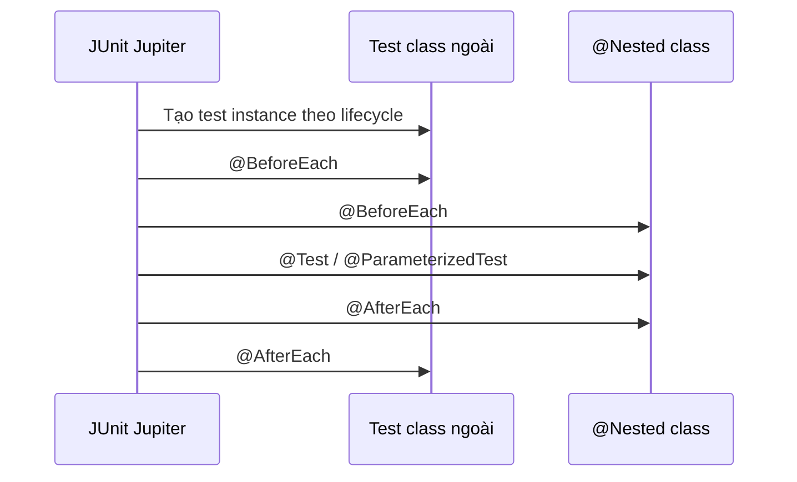

# Nested test cho nhóm scenario trong JUnit Jupiter và Spring Modulith

## 1. Vì sao nên nhóm test theo scenario?

Một module nghiệp vụ thường có nhiều nhánh cần kiểm chứng. Chẳng hạn module `order` có thể **chấp nhận đơn** khi dữ liệu hợp lệ và kho còn hàng, **từ chối** khi hết hàng hoặc **dừng sớm** nếu số lượng không hợp lệ. Nếu tất cả bài test nằm ngang hàng trong một lớp dài, những điều kiện khởi tạo giống nhau bị lặp lại, tên phương thức trở nên khó đọc và báo cáo CI không thể hiện rõ bối cảnh lỗi.

JUnit Jupiter cung cấp `@Nested` để tạo **lớp test lồng nhau, không static** bên trong lớp test ngoài. Mỗi lớp lồng có thể đại diện cho một *scenario* hay một nhóm tình huống. Nhờ `@DisplayName` và `@BeforeEach`, cấu trúc test phản ánh quy tắc nghiệp vụ:

```text
Order — kiểm chứng nghiệp vụ đặt hàng
├── Khi đơn hợp lệ và kho còn hàng
│   ├── Phát OrderPlaced với ID đúng
│   └── Chấp nhận số lượng tối đa cho phép
├── Khi kho báo hết hàng
│   └── Từ chối và không phát OrderPlaced
└── Khi dữ liệu đầu vào không hợp lệ
    ├── SKU trống → từ chối trước khi gọi kho
    └── quantity âm, bằng 0 hoặc vượt ngưỡng → từ chối
```

Tên bài **“Nested test cho nhóm scenario”** đề cập trước hết đến tính năng `@Nested` của **JUnit Jupiter**. Cần phân biệt nó với **`org.springframework.modulith.test.Scenario`**, là một API khác dùng để kiểm thử chuỗi *stimulus → event/state change* trong Spring Modulith. Hai công cụ có thể kết hợp nhưng không thay thế nhau.

Bài này thuộc chương **JUnit integration** của học phần **SPRING_MODULITH_VERIFICATION_TESTING**: rèn kỹ năng xác minh ranh giới bằng `ApplicationModules` và quy tắc phụ thuộc giữa module, thực hành `@ApplicationModuleTest`, kiểm thử sự kiện/cơ sở dữ liệu/tích hợp, đồng thời kết hợp quality gate trong CI để ngăn phụ thuộc sai và hồi quy.

Sau bài học, bạn có thể:

- Tổ chức một lớp `@ApplicationModuleTest` thành các nhóm `@Nested` theo **điều kiện và kết quả nghiệp vụ**.
- Giải thích thứ tự chạy `@BeforeEach`/`@AfterEach` ở lớp ngoài và lớp trong, và tác động của `@TestInstance`.
- Hiểu Spring TestContext **kế thừa** cấu hình từ lớp bao ngoài theo `@NestedTestConfiguration(INHERIT)` mặc định.
- Kết hợp `@MockitoBean`, `@ParameterizedTest`, `PublishedEvents` và khi cần, Modulith `Scenario` trong nested tests.
- Tránh làm rò rỉ trạng thái, phá context cache hoặc nhầm nested class với một application module.
- Đặt tên và phân nhóm báo cáo CI, kết hợp `ApplicationModules.verify()` làm quality gate.

## 2. `@Nested` tạo hệ thống phân cấp test, không tạo module Spring mới

Ví dụ cơ bản hoàn toàn thuộc **JUnit Jupiter**, không cần Spring:

```java
package com.example.shop.testing;

import static org.junit.jupiter.api.Assertions.assertEquals;

import java.util.ArrayList;
import java.util.List;
import org.junit.jupiter.api.BeforeEach;
import org.junit.jupiter.api.DisplayName;
import org.junit.jupiter.api.Nested;
import org.junit.jupiter.api.Test;

@DisplayName("Tính toán đơn hàng")
class PricingRulesTests {

    List<String> trace;

    @BeforeEach
    void prepareSharedFixture() {
        trace = new ArrayList<>();
        trace.add("outer");
    }

    @Nested
    @DisplayName("Khi số lượng hợp lệ")
    class ValidQuantity {

        @BeforeEach
        void prepareScenario() {
            trace.add("inner");
        }

        @Test
        @DisplayName("Cả fixture chung và fixture riêng đều được chuẩn bị")
        void preparesEnclosingContextBeforeNestedContext() {
            assertEquals(List.of("outer", "inner"), trace);
        }
    }
}
```

Điều đáng chú ý:

1. `ValidQuantity` là **inner class không static**. Nó truy cập được trường `trace` của instance lớp ngoài.
2. Trước một test lồng, JUnit chạy `@BeforeEach` của lớp ngoài rồi đến `@BeforeEach` của lớp trong.
3. Khi có `@AfterEach`, thứ tự dọn dẹp đi **từ lớp trong ra lớp ngoài**.
4. Có thể chạy riêng một test trong lớp `@Nested` mà JUnit vẫn thực hiện các callback của lớp bao ngoài.
5. `@Nested` không tạo `ApplicationContext` và không thay đổi cấu hình dependency injection của Spring nếu test không dùng Spring.



**Không đảm bảo thứ tự chạy giữa các test method hoặc giữa các nhóm `@Nested`.** Dù báo cáo có dạng cây, các test vẫn phải độc lập; không dùng test của nhóm “đơn hợp lệ” để chuẩn bị dữ liệu cho nhóm “hết hàng”.

## 3. Đặt ranh giới scenario ở đâu?

Một cấu trúc tốt thường có ba cấp:

| Cấp | Chứa gì? | Ví dụ |
| --- | --- | --- |
| Lớp ngoài | **Module hoặc use case mục tiêu**, Spring context dùng chung, hạ tầng test chung | `OrderModuleScenarios` |
| Lớp `@Nested` | **Một ngữ cảnh nghiệp vụ ổn định** và fixture đặc trưng | `StockAvailable`, `OutOfStock`, `InvalidRequest` |
| Method `@Test` | **Một hợp đồng có assertion rõ ràng** | `publishesOrderPlacedWithMatchingId()` |

Đặt tên theo câu “**Khi …, hệ thống phải …**”:

```text
Lớp ngoài:       Order — quy tắc đặt hàng
Lớp @Nested:     Khi kho xác nhận còn hàng
@Test:           Phát đúng OrderPlaced
```

Đừng làm mọi scenario thành một lớp `@Nested` nếu chúng chỉ có một assertion đơn giản và không chia sẻ bối cảnh đáng kể. Ngược lại, khi có nhiều nhánh cùng cần setup khác nhau, tách nhóm giúp giảm trùng lặp và làm kết quả CI dễ đọc.

**Ranh giới module vẫn độc lập với cách nhóm JUnit.** Một nested class dưới `OrderModuleScenarios` **không trở thành module mới**; việc nạp `order`, `inventory` hay `notification` do `@ApplicationModuleTest` và `BootstrapMode` quyết định.

## 4. Spring TestContext xử lý annotation của lớp ngoài thế nào?

Spring Framework 5.3+ hỗ trợ `@NestedTestConfiguration` để điều khiển việc **kế thừa cấu hình từ test class bao ngoài**. Mặc định là `INHERIT`. Với lựa chọn này, các test class `@Nested` có thể kế thừa những annotation Spring Test phù hợp ở lớp ngoài như `@ContextConfiguration`, `@ActiveProfiles` và `@TestPropertySource`.

```java
package com.example.shop.order;

import org.junit.jupiter.api.Nested;
import org.junit.jupiter.api.Test;
import org.springframework.modulith.test.ApplicationModuleTest;
import org.springframework.test.context.ActiveProfiles;
import org.springframework.test.context.NestedTestConfiguration;

@ApplicationModuleTest
@ActiveProfiles("test")
@NestedTestConfiguration(
    NestedTestConfiguration.EnclosingConfiguration.INHERIT
)
class OrderModuleNestedConfigurationExample {

    @Nested
    class AcceptedOrderScenarios {

        @Test
        void inheritsModuleTestAndProfile() {
            // Lớp trong kế thừa cấu hình Spring Test của lớp ngoài.
        }
    }
}
```

Ví dụ này minh họa **cấu hình lớp**, không có assertion nghiệp vụ nên không đủ làm bài kiểm thử cuối cùng. Chú ý `@NestedTestConfiguration(INHERIT)` trên lớp ngoài là **khai báo tường minh cho dễ hiểu**; nếu dự án không thay đổi mặc định thì có thể bỏ.

### `INHERIT` khác `OVERRIDE`

| Chế độ | Ý nghĩa | Hệ quả trong module test |
| --- | --- | --- |
| `INHERIT` *(mặc định)* | Lớp `@Nested` kế thừa cấu hình Spring Test từ lớp bao ngoài | Nhóm scenario thường dùng cùng `@ApplicationModuleTest`, profile và property |
| `OVERRIDE` | Lớp trong không kế thừa các annotation cấu hình Spring Test của lớp ngoài theo cơ chế này | Có thể không còn bootstrap theo module nếu không khai báo lại cấu hình cần thiết |

Nếu muốn đổi sang `OVERRIDE` cho một lớp trong:

```java
@Nested
@NestedTestConfiguration(
    NestedTestConfiguration.EnclosingConfiguration.OVERRIDE
)
class DifferentContextScenarios {
    // Phải tự khai báo cấu hình Spring Test cần thiết cho nhóm này.
}
```

Khối này chỉ là **ví dụ cơ chế**, không phải một nhóm test chạy độc lập. Khi dùng `OVERRIDE`, nên cân nhắc tách nhóm thành **lớp test top-level riêng** nếu nó cần một module target, bootstrap mode hoặc context hoàn toàn khác. Dù inner class vẫn có quyền truy cập trường Java của outer instance, điều đó **không bảo đảm hai context Spring giống nhau**.

Thay đổi mặc định toàn cục thông qua system property `spring.test.enclosing.configuration=override` cũng có thể ảnh hưởng kết quả. Vì vậy, khi nhóm scenario bỗng không nhận Spring bean, cần kiểm tra cả cấu hình nested inheritance trước khi thêm `@ExtendWith` một cách tùy tiện.

## 5. Chuẩn bị ví dụ thực hành: `order → inventory`

Ví dụ xuyên suốt sử dụng **Java 17+, Spring Boot 3.4/3.5, Spring Framework 6.2, Spring Modulith 1.4 và JUnit Jupiter 5** theo các BOM tương thích. `@MockitoBean` có từ Spring Framework 6.2. Với Spring Boot 4/Spring Modulith 2.x cần chọn đúng phiên bản và import của stack thực tế.

### 5.1. Cấu trúc thư mục

```text
src/
├── main/java/com/example/shop/
│   ├── ShopApplication.java
│   ├── inventory/
│   │   ├── StockAvailability.java
│   │   └── StockAvailabilityService.java
│   ├── order/
│   │   ├── OrderService.java
│   │   └── OrderPlaced.java
│   └── notification/
│       └── NotificationFacade.java
└── test/java/com/example/shop/
    ├── order/
    │   ├── OrderModuleScenarios.java
    │   └── OrderInventoryIntegrationTests.java
    └── ModuleArchitectureTests.java
```

Theo cách nhận diện module mặc định, `order`, `inventory` và `notification` là ba application module ngang cấp. Test đặt trong `com.example.shop.order` sẽ chọn `order` làm module mục tiêu.

### 5.2. Dependency Maven

Trong một dự án Maven Spring Boot đã quản lý phiên bản bằng BOM phù hợp:

```xml
<dependency>
    <groupId>org.springframework.boot</groupId>
    <artifactId>spring-boot-starter</artifactId>
</dependency>
<dependency>
    <groupId>org.springframework.boot</groupId>
    <artifactId>spring-boot-starter-test</artifactId>
    <scope>test</scope>
</dependency>
<dependency>
    <groupId>org.springframework.modulith</groupId>
    <artifactId>spring-modulith-starter-test</artifactId>
    <scope>test</scope>
</dependency>
```

Đây không phải toàn bộ `pom.xml`. Spring Boot test starter cung cấp JUnit Jupiter, AssertJ, Mockito và Spring Test; Modulith test starter cung cấp `@ApplicationModuleTest` cùng `PublishedEvents`/`Scenario`. Ví dụ cơ bản **không yêu cầu database hay HTTP server**, để tập trung vào nhóm scenario và vòng đời JUnit.

### 5.3. Spring Boot application

File `src/main/java/com/example/shop/ShopApplication.java`:

```java
package com.example.shop;

import org.springframework.boot.SpringApplication;
import org.springframework.boot.autoconfigure.SpringBootApplication;

@SpringBootApplication
public class ShopApplication {
    public static void main(String[] args) {
        SpringApplication.run(ShopApplication.class, args);
    }
}
```

### 5.4. API công khai của `inventory`

File `src/main/java/com/example/shop/inventory/StockAvailability.java`:

```java
package com.example.shop.inventory;

public interface StockAvailability {
    boolean available(String sku, int quantity);
}
```

Implementation thật phục vụ bài test tích hợp mở rộng:

```java
package com.example.shop.inventory;

import org.springframework.stereotype.Service;

@Service
public class StockAvailabilityService implements StockAvailability {
    @Override
    public boolean available(String sku, int quantity) {
        return "SKU-READY".equals(sku) && quantity <= 3;
    }
}
```

Interface được đặt tại package gốc của module `inventory` để `order` sử dụng **API module công khai**, không tham chiếu package nội bộ của `inventory`.

### 5.5. Event và service của `order`

File `src/main/java/com/example/shop/order/OrderPlaced.java`:

```java
package com.example.shop.order;

import java.util.UUID;

public record OrderPlaced(UUID orderId, String sku, int quantity) {}
```

File `src/main/java/com/example/shop/order/OrderService.java`:

```java
package com.example.shop.order;

import java.util.UUID;
import com.example.shop.inventory.StockAvailability;
import org.springframework.beans.factory.annotation.Value;
import org.springframework.context.ApplicationEventPublisher;
import org.springframework.stereotype.Service;

@Service
public class OrderService {

    private final StockAvailability stock;
    private final ApplicationEventPublisher events;
    private final int maxQuantity;

    public OrderService(StockAvailability stock,
                        ApplicationEventPublisher events,
                        @Value("${orders.max-quantity:3}") int maxQuantity) {
        this.stock = stock;
        this.events = events;
        this.maxQuantity = maxQuantity;
    }

    public UUID place(String sku, int quantity) {
        if (sku == null || sku.isBlank()
                || quantity <= 0 || quantity > maxQuantity) {
            throw new IllegalArgumentException("INVALID_ORDER");
        }
        if (!stock.available(sku, quantity)) {
            throw new IllegalStateException("OUT_OF_STOCK");
        }

        UUID id = UUID.randomUUID();
        events.publishEvent(new OrderPlaced(id, sku, quantity));
        return id;
    }
}
```

Service thật gồm ba nhánh có thể kiểm chứng độc lập: từ chối đầu vào sai **trước khi** gọi kho; từ chối đơn hết hàng; chấp nhận đơn và phát event khi hợp lệ/đủ hàng.

Đặt một bean độc lập tại module `notification` để quan sát giới hạn context:

```java
package com.example.shop.notification;

import org.springframework.stereotype.Service;

@Service
public class NotificationFacade {
    public String status() {
        return "ready";
    }
}
```

`@ApplicationModuleTest` ở `STANDALONE` không tự nạp bean của `notification`, mặc dù type này vẫn có mặt trên classpath. Cơ chế module slicing quyết định vùng quét bean nghiệp vụ, không phải việc có thể import class trong code Java.

## 6. Ví dụ hoàn chỉnh: ba nhóm `@Nested` trong một module test

File `src/test/java/com/example/shop/order/OrderModuleScenarios.java`:

```java
package com.example.shop.order;

import static org.assertj.core.api.Assertions.assertThat;
import static org.assertj.core.api.Assertions.assertThatThrownBy;
import static org.mockito.ArgumentMatchers.anyInt;
import static org.mockito.ArgumentMatchers.anyString;
import static org.mockito.BDDMockito.given;
import static org.mockito.BDDMockito.then;

import java.util.UUID;

import com.example.shop.inventory.StockAvailability;
import org.junit.jupiter.api.BeforeEach;
import org.junit.jupiter.api.DisplayName;
import org.junit.jupiter.api.Nested;
import org.junit.jupiter.api.Tag;
import org.junit.jupiter.api.Test;
import org.junit.jupiter.params.ParameterizedTest;
import org.junit.jupiter.params.provider.ValueSource;
import org.springframework.beans.factory.annotation.Autowired;
import org.springframework.context.ApplicationContext;
import org.springframework.modulith.test.ApplicationModuleTest;
import org.springframework.modulith.test.PublishedEvents;
import org.springframework.test.context.NestedTestConfiguration;
import org.springframework.test.context.TestPropertySource;
import org.springframework.test.context.bean.override.mockito.MockitoBean;

@Tag("module")
@DisplayName("Order — các scenario đặt hàng")
@ApplicationModuleTest
@TestPropertySource(properties = "orders.max-quantity=3")
@NestedTestConfiguration(
    NestedTestConfiguration.EnclosingConfiguration.INHERIT
)
class OrderModuleScenarios {

    @Autowired OrderService orders;
    @Autowired ApplicationContext context;

    @MockitoBean StockAvailability stock;

    @BeforeEach
    void verifyCommonModuleScope() {
        assertThat(orders).isNotNull();
        assertThat(context.containsBean("notificationFacade")).isFalse();
    }

    @Nested
    @DisplayName("Khi đơn hợp lệ và kho còn hàng")
    class StockAvailable {

        @BeforeEach
        void givenAvailableStock() {
            given(stock.available(anyString(), anyInt())).willReturn(true);
        }

        @Test
        @DisplayName("Phát OrderPlaced đúng mã đơn")
        void publishesOrderPlacedWithMatchingId(PublishedEvents events) {
            UUID id = orders.place("SKU-READY", 2);

            assertThat(events.ofType(OrderPlaced.class)
                    .matching(OrderPlaced::orderId, id))
                    .hasSize(1);
            then(stock).should().available("SKU-READY", 2);
        }

        @Test
        @DisplayName("Chấp nhận đúng số lượng tối đa cho phép")
        void acceptsMaximumAllowedQuantity(PublishedEvents events) {
            UUID id = orders.place("SKU-READY", 3);

            assertThat(events.ofType(OrderPlaced.class)
                    .matching(event -> event.orderId().equals(id)
                            && event.quantity() == 3))
                    .hasSize(1);
            then(stock).should().available("SKU-READY", 3);
        }
    }

    @Nested
    @DisplayName("Khi kho báo hết hàng")
    class OutOfStock {

        @BeforeEach
        void givenStockUnavailable() {
            given(stock.available("SKU-EMPTY", 1)).willReturn(false);
        }

        @Test
        @DisplayName("Từ chối và không phát OrderPlaced")
        void rejectsOrderWithoutEvent(PublishedEvents events) {
            assertThatThrownBy(() -> orders.place("SKU-EMPTY", 1))
                    .isInstanceOf(IllegalStateException.class)
                    .hasMessage("OUT_OF_STOCK");

            assertThat(events.ofType(OrderPlaced.class)).isEmpty();
            then(stock).should().available("SKU-EMPTY", 1);
        }
    }

    @Nested
    @DisplayName("Khi request không hợp lệ")
    class InvalidRequest {

        @Test
        @DisplayName("SKU trống bị từ chối trước khi gọi kho")
        void rejectsBlankSkuBeforeCallingInventory(PublishedEvents events) {
            assertThatThrownBy(() -> orders.place(" ", 1))
                    .isInstanceOf(IllegalArgumentException.class)
                    .hasMessage("INVALID_ORDER");

            then(stock).shouldHaveNoInteractions();
            assertThat(events.ofType(OrderPlaced.class)).isEmpty();
        }

        @ParameterizedTest(
            name = "quantity={0}: từ chối trước khi gọi kho"
        )
        @ValueSource(ints = {-1, 0, 4})
        void rejectsInvalidQuantityBeforeCallingInventory(
                int quantity, PublishedEvents events) {
            assertThatThrownBy(() -> orders.place("SKU-READY", quantity))
                    .isInstanceOf(IllegalArgumentException.class)
                    .hasMessage("INVALID_ORDER");

            then(stock).shouldHaveNoInteractions();
            assertThat(events.ofType(OrderPlaced.class)).isEmpty();
        }
    }
}
```

Lớp trên có **năm phương thức test** nhưng nhóm `@ParameterizedTest` tạo thêm nhiều invocation. Trong context của bài test:

1. Lớp ngoài đặt `@ApplicationModuleTest`, thuộc package `order`; module mục tiêu được bootstrap ở `STANDALONE`. Không có `@SpringBootTest` thứ hai trên các inner class.
2. `@TestPropertySource` đặt giới hạn số lượng bằng `3` cho mọi nhóm scenario.
3. `@MockitoBean StockAvailability` cung cấp dependency giả cho `OrderService` thật; implementation `inventory` không cần được nạp.
4. `verifyCommonModuleScope()` là `@BeforeEach` của outer, chạy cho **mỗi invocation** của test trong các nhóm, giúp xác minh bean nghiệp vụ `notification` không lọt vào context.
5. Nhóm `StockAvailable` khai báo fixture riêng bằng `@BeforeEach`; nhóm `OutOfStock` dùng fixture khác. Nhóm `InvalidRequest` không cần stub kho vì validation phải chặn request trước khi gọi API.
6. `PublishedEvents` được Spring Modulith cung cấp vào **tham số phương thức test lồng nhau**, cho phép kiểm chứng phát event với `orderId` đúng kịch bản.

**Tương quan setup:** Khi chạy `publishesOrderPlacedWithMatchingId()`, thứ tự là `verifyCommonModuleScope()` (outer) → `givenAvailableStock()` (inner) → phương thức `@Test`. Với một invocation của `rejectsInvalidQuantityBeforeCallingInventory(...)`, chỉ callback chung của outer chạy vì nhóm `InvalidRequest` không có `@BeforeEach` riêng.

### Vì sao cần assertion không phát event?

Một test từ chối đơn chỉ kiểm tra exception có thể bỏ sót lỗi quan trọng: service ném lỗi **sau khi** đã phát event. Ở cả nhóm `OutOfStock` và `InvalidRequest`, việc `PublishedEvents` không chứa `OrderPlaced` là một phần trực tiếp của hợp đồng nghiệp vụ.

### Vì sao `@ParameterizedTest` vẫn thuộc nhóm `@Nested`?

Ba giá trị `-1`, `0`, `4` cùng vi phạm quy tắc số lượng trong khi service được cấu hình với ngưỡng `3`. `@ParameterizedTest(name = ...)` làm hiện từng giá trị trong báo cáo JUnit. Tham số từ `@ValueSource` phải nằm **trước** tham số được `ParameterResolver` khác xử lý; vì vậy signature là `(int quantity, PublishedEvents events)`.

## 7. Test instance, Spring context và Mockito reset là ba vòng đời khác nhau

`@Nested` tạo cấu trúc phân cấp test nhưng **không tạo mới Spring `ApplicationContext` cho mỗi nhóm** nếu cấu hình Spring Test của các nhóm tương đương. Tương tự, JUnit có thể tạo test instance mới trong khi Spring singleton vẫn được lấy từ context cache.

| Vòng đời | Ai quản lý? | Điều cần lưu ý |
| --- | --- | --- |
| **Test instance** | JUnit Jupiter, `@TestInstance` | Mặc định JUnit là `PER_METHOD`, nhưng annotation tích hợp có thể thay đổi |
| **Fixture outer/inner** | JUnit `@BeforeEach`/`@AfterEach` | Outer setup chạy trước inner; teardown theo chiều ngược |
| **Spring context** | Spring TestContext cache | Có thể tái sử dụng giữa nhóm/lớp nếu cấu hình tương đương |
| **Mockito mock trong context** | Spring Test + `@MockitoBean` | Mặc định được reset theo cơ chế test support, không phải một bean mới mỗi test |
| **Database, broker, file, async task** | Hạ tầng và code test | Không tự reset chỉ vì test nằm trong một inner class |

Ở **Spring Modulith 1.4**, `@ApplicationModuleTest` còn meta-annotate `@TestInstance(PER_CLASS)` và `@TestConstructor(autowireMode = ALL)`. Vì vậy không nên áp đặt giả định “mỗi test module luôn có một outer instance mới”. Ở phiên bản khác, hãy xem Javadoc tương ứng. **Dù lifecycle là gì, không được dùng trạng thái mutable còn sót từ test trước** để tạo tiền đề cho test sau.

### Nên reset mock bằng cách nào?

Trong ví dụ dùng `@MockitoBean`, Spring Test quản lý việc reset mock mặc định giữa các test. Mỗi nhóm `@Nested` vẫn phải tự thiết lập hành vi qua `given(...)` và kiểm tra tương tác trong cùng phương thức. **Không cần thêm `Mockito.reset(stock)` vào mỗi `@BeforeEach`** chỉ để che fixture dùng chung; việc reset thủ công có thể xóa stubbing hợp lệ được setup ở lớp ngoài.

Nếu dùng một fake bean hoặc singleton có trạng thái mutable, Spring không tự khôi phục trạng thái nghiệp vụ cho bạn. Hãy thiết kế fake stateless, làm sạch dữ liệu trong `@AfterEach` hoặc tạo fixture riêng bằng transaction/cleanup thích hợp.

### `@BeforeAll` trong nested class

Với JUnit Jupiter, các `@BeforeAll`/`@AfterAll` **non-static** cần lifecycle `PER_CLASS`. Có thể khai báo tường minh trên nhóm nested:

```java
@Nested
@TestInstance(TestInstance.Lifecycle.PER_CLASS)
class ExpensiveFixtureScenarios {

    @BeforeAll
    void prepareOnce() {
        // Chỉ chuẩn bị tài nguyên thực sự dùng chung và an toàn.
    }
}
```

Đoạn minh họa cần import `Nested`, `TestInstance`, `BeforeAll` và nằm **bên trong một lớp JUnit test**. Với Java 16+, `@BeforeAll`/`@AfterAll` static cũng có thể dùng trong inner class; tuy nhiên dùng `PER_CLASS` và method non-static thường thể hiện chủ đích rõ hơn.

Không dùng `@BeforeAll` để tạo dữ liệu mỗi kịch bản phải có bản riêng. Nó chỉ chạy một lần cho nhóm, trong khi `@BeforeEach` chạy trước mọi invocation và thích hợp hơn cho isolation.

## 8. Nhóm scenario không thay đổi `BootstrapMode` của Spring Modulith

Xét đồ thị phụ thuộc:


Lớp ngoài `OrderModuleScenarios` đang dùng mặc định `STANDALONE`, nên chỉ nạp bean ứng dụng của `order` và cung cấp mock cho API tồn kho. **Việc khai báo ba lớp `@Nested` không tự đổi sang `DIRECT_DEPENDENCIES` hay `ALL_DEPENDENCIES`**.

Nếu muốn dùng implementation `inventory` thật, nên viết **một lớp test top-level riêng**:

```java
package com.example.shop.order;

import static org.assertj.core.api.Assertions.assertThat;

import java.util.UUID;
import org.junit.jupiter.api.Test;
import org.springframework.beans.factory.annotation.Autowired;
import org.springframework.modulith.test.ApplicationModuleTest;
import org.springframework.modulith.test.ApplicationModuleTest.BootstrapMode;

@ApplicationModuleTest(mode = BootstrapMode.DIRECT_DEPENDENCIES)
class OrderInventoryIntegrationTests {

    @Autowired OrderService orders;

    @Test
    void usesRealInventoryServiceToAcceptAvailableSku() {
        UUID id = orders.place("SKU-READY", 2);
        assertThat(id).isNotNull();
    }
}
```

Bài này không khai báo `@MockitoBean`, nên `StockAvailabilityService` thật được nạp từ module `inventory`. Cách chọn top-level class riêng giúp phân biệt rõ **kiểm thử module cô lập** và **kiểm thử tích hợp hai module**. Một `@Nested` annotation đơn lẻ trên nhóm mới không phải cách đảm bảo override toàn bộ cấu hình bootstrapping của lớp ngoài.

Nếu module nhận event `notification` phụ thuộc theo chiều `notification → order`, `ALL_DEPENDENCIES` của test thuộc `order` không tự nạp `notification`. Cần `extraIncludes = "notification"` hoặc một bài test đặt ở module consumer khi mục tiêu là chứng minh listener thực sự xử lý.

## 9. Kết hợp `@Nested` với Spring Modulith `Scenario`

Hai từ **scenario** trong bài này có hai ý nghĩa khác nhau:

| Công cụ | Thuộc framework | Chức năng |
| --- | --- | --- |
| `@Nested` | **JUnit Jupiter** | Nhóm phương thức test theo bối cảnh để chia sẻ fixture và trình bày kết quả phân cấp |
| `Scenario` | **Spring Modulith Test** | Điều phối stimulus, chờ event kết quả hoặc trạng thái thay đổi và thực hiện assertion/cleanup |

Một lớp test có thể dùng **cả hai**: `@Nested` định nghĩa nhóm “Khi listener nhận OrderPlaced”, còn `Scenario` kiểm tra luồng xử lý bất đồng bộ trong phương thức `@Test`.

Giả sử ứng dụng được bổ sung listener của module `notification` nhận `OrderPlaced` và phát `NotificationSent`. Mẫu sau chỉ minh họa **cấu trúc bài test**, chưa chạy độc lập với phần 5 vì còn cần định nghĩa `NotificationSent`, listener thực, transaction manager và hạ tầng mà listener dùng:

```java
package com.example.shop.order;

import static org.assertj.core.api.Assertions.assertThat;

import java.time.Duration;
import java.util.UUID;
import com.example.shop.inventory.StockAvailability;
import com.example.shop.order.OrderPlaced;
import com.example.shop.notification.NotificationSent;
import org.junit.jupiter.api.DisplayName;
import org.junit.jupiter.api.Nested;
import org.junit.jupiter.api.Test;
import org.springframework.modulith.test.ApplicationModuleTest;
import org.springframework.modulith.test.Scenario;
import org.springframework.test.context.bean.override.mockito.MockitoBean;

@ApplicationModuleTest(extraIncludes = "notification")
@DisplayName("Order → Notification — event flow")
class OrderNotificationScenarios {

    @MockitoBean StockAvailability stock;

    @Nested
    @DisplayName("Khi notification nhận OrderPlaced")
    class NotificationDelivery {

        @Test
        @DisplayName("Phát NotificationSent cho đúng đơn hàng")
        void publishesNotificationSentAfterHandlingOrderPlaced(
                Scenario scenario) {
            UUID id = UUID.randomUUID();

            scenario.publish(new OrderPlaced(id, "SKU-01", 2))
                    .andWaitAtMost(Duration.ofSeconds(5))
                    .forEventOfType(NotificationSent.class)
                    .matching(event -> event.orderId().equals(id))
                    .toArriveAndVerify(event ->
                            assertThat(event.orderId()).isEqualTo(id));
        }
    }
}
```

Điểm cần hiểu:

1. **`extraIncludes = "notification"`** chủ động nạp module consumer dù chiều dependency không phải `order → notification`.
2. `@MockitoBean` cung cấp dependency tồn kho cho `OrderService` nếu service đó cần inject khi module `order` khởi tạo; bản thân stimulus `publish(...)` không đi qua `OrderService`.
3. **`Scenario.publish(...)`** phát event trong một transaction do Scenario điều phối để các `@TransactionalEventListener` có cơ hội được kích hoạt sau commit.
4. **`forEventOfType(...).matching(...)`** chờ đúng event kết quả có correlation ID của đơn hàng hiện tại, không nhận nhầm event của testcase khác.
5. Nếu listener lỗi, không được nạp hoặc không publish `NotificationSent`, scenario có thể thất bại vì điều kiện không đến trong timeout.

Nếu chỉ cần kiểm tra module `order` **phát** `OrderPlaced`, không cần nạp `notification`: `PublishedEvents` như phần 6 đã đáp ứng. Nếu cần chứng minh listener thực sự **xử lý thành công**, phải đưa consumer vào context và assert event kết quả hoặc trạng thái bền vững.

**Không dùng `@Nested` để che thiếu hạ tầng.** Nếu `Scenario` cần `PlatformTransactionManager` mà ứng dụng test không có, phải bổ sung datasource/JPA/JDBC hoặc transaction infrastructure phù hợp. Dùng `@Nested` không tạo transaction manager, broker hay database.

## 10. Test dữ liệu và transaction trong nested scenarios

Khi module `order` có repository JPA, các nhóm scenario có thể cần các trạng thái dữ liệu khác nhau:

- **“Chưa tồn tại đơn”**: fixture phải bảo đảm không có record của ID đang dùng.
- **“Đơn đã tồn tại”**: tạo record trong setup có transaction phù hợp.
- **“Transaction rollback”**: kiểm chứng dữ liệu không tồn tại **sau rollback**, thay vì chỉ kiểm tra bean trả về exception.
- **“Listener sau commit”**: stimulus phải commit trước khi listener `AFTER_COMMIT` được kích hoạt.

Trong test JPA có `@Transactional` và `PlatformTransactionManager`, Spring TestContext thường rollback transaction do test quản lý sau phương thức. Nhưng **không phải mọi side effect đều nằm trong transaction đó**: listener `@Async`, request HTTP đi qua server thread khác hoặc stimulus của `Scenario` có thể thực hiện transaction riêng.

| Tình huống | Có thể dựa vào rollback mặc định của test không? | Cách giữ test độc lập |
| --- | --- | --- |
| Repository đồng bộ được gọi trong test-managed `@Transactional` | Thường có | Dùng transaction test và ID riêng |
| `Scenario.publish(...)` với transaction stimulus được commit | Không nên | `andCleanup(...)`, xóa dữ liệu theo ID, database cô lập |
| Listener `AFTER_COMMIT` chạy trên thread khác | Không | Chờ kết quả và cleanup trạng thái do listener tạo |
| HTTP server thật với `RANDOM_PORT` | Không đảm bảo | Dữ liệu test riêng, cleanup và fixture nhất quán |
| Fake bean có state mutable | Không liên quan transaction DB | Reset fake trong `@BeforeEach`/`@AfterEach` |

Một khung nested test cho repository:

```java
@ApplicationModuleTest
class OrderRepositoryScenarios {

    @Autowired OrderRepository repository;

    @Nested
    @DisplayName("Khi chưa tồn tại đơn hàng")
    class MissingOrder {

        @Test
        @Transactional
        void findByIdReturnsEmpty() {
            assertThat(repository.findById("missing-id")).isEmpty();
        }
    }
}
```

Đây là **ví dụ khung**, cần lớp `OrderRepository`, entity, datasource và các import `ApplicationModuleTest`, `Autowired`, `Nested`, `DisplayName`, `Test`, `Transactional` cùng AssertJ. Nó không chạy độc lập với ví dụ order service ở phần 5 vì ở đó chưa khai báo JPA. Quan trọng là mỗi nested test phải tự thiết lập tiền điều kiện, không dựa vào việc một nhóm khác đã insert dữ liệu.

Khi cần test commit/rollback thật, hãy dùng repository và transaction boundary tương ứng, chạy assertion **sau** thời điểm commit hoặc rollback cần kiểm chứng. Không đặt tên `persistsAfterCommit` cho một test chỉ đọc entity trong transaction chưa commit của chính nó.

## 11. Profile và context cache khi nested group cần cấu hình khác

Spring TestContext **kế thừa** cấu hình từ lớp ngoài theo `INHERIT`, nhưng một nhóm nested có thể thêm profile hoặc property riêng. Ví dụ:

```java
@SpringJUnitConfig(TestConfiguration.class)
class PricingScenarios {

    @Nested
    @ActiveProfiles("discount")
    class DiscountEnabled {
        // Bài test dùng profile discount trong context phù hợp.
    }

    @Nested
    @ActiveProfiles("regular")
    class RegularPricing {
        // Bài test dùng profile regular trong context khác nếu cấu hình khác.
    }
}
```

Đây là **mẫu minh họa Spring TestContext**, cần bổ sung `TestConfiguration` và phương thức `@Test` khi đưa vào dự án. Với `@ActiveProfiles`, cấu hình kế thừa từ lớp ngoài cũng cần được xét đến; khi muốn thay thế hoàn toàn profile ngoài, dùng thuộc tính `inheritProfiles = false` hoặc tách top-level test riêng có chủ đích.

Điều cần nhớ:

1. Hai nhóm nested có **profile/property khác nhau** có thể tạo **hai Spring context khác nhau**, dù cùng nằm trong một file Java.
2. Ngược lại, nhiều nhóm dùng chung cấu hình thường hưởng lợi từ **Spring context cache**. `@Nested` không mặc định tạo một context mới mỗi test.
3. `@MockitoBean`/`@TestBean`, `@Import`, `@TestPropertySource` và `@DirtiesContext` đều có thể ảnh hưởng cache key hoặc vòng đời context.
4. Nếu nhóm nested cần thay `BootstrapMode` hay module target hoàn toàn khác, **tách thành lớp top-level riêng** thường dễ quản lý hơn cố chồng nhiều annotation Spring trên inner class.

Để quan sát:

```properties
logging.level.org.springframework.test.context.cache=DEBUG
logging.level.org.springframework.modulith=DEBUG
```

Log cache cho thấy context được tải mới hay tái sử dụng; log Modulith cho biết module nào được nạp. Với một lỗi `@Nested` bị thiếu bean, hãy kiểm tra **cả Spring configuration inheritance và module scope**, thay vì mặc định nghĩ JUnit không hỗ trợ nested Spring tests.

## 12. Đặt tên, tag và báo cáo CI cho các nhóm scenario

Một ưu điểm lớn của `@Nested` là báo cáo JUnit có thể trình bày **cây ngữ cảnh**, thuận tiện khi test thất bại:

```text
Order — các scenario đặt hàng
├── Khi đơn hợp lệ và kho còn hàng
│   ├── Phát OrderPlaced đúng mã đơn                   PASSED
│   └── Chấp nhận đúng số lượng tối đa cho phép       PASSED
├── Khi kho báo hết hàng
│   └── Từ chối và không phát OrderPlaced             FAILED
└── Khi request không hợp lệ
    ├── SKU trống bị từ chối trước khi gọi kho        PASSED
    ├── quantity=-1: từ chối trước khi gọi kho        PASSED
    ├── quantity=0: từ chối trước khi gọi kho         PASSED
    └── quantity=4: từ chối trước khi gọi kho         PASSED
```

Đây là **minh họa cấu trúc báo cáo**, không phải output cố định của JUnit hay một kết quả chạy test thực tế.

| Thành phần | Ý nghĩa |
| --- | --- |
| `@DisplayName` trên outer class | Nêu use case/module mục tiêu |
| `@DisplayName` trên inner class | Nêu **điều kiện của scenario** |
| `@DisplayName` trên method | Nêu **kết quả cần kiểm chứng** |
| `@ParameterizedTest(name = ...)` | Đưa giá trị đầu vào quan trọng vào tên từng invocation |
| `@Tag("module")` trên outer class | Phân nhóm module tests để lọc khi chạy CI |
| `@Tag("architecture")` trên bài riêng | Đảm bảo quality gate kiến trúc có thể chạy độc lập |

Không nên đặt tên nested group theo chi tiết implementation như `WhenMockReturnsFalseFromMethodX` nếu nghiệp vụ có thể diễn tả rõ hơn là “Khi kho báo hết hàng”. Nhóm càng dựa vào hợp đồng công khai, việc refactor service nội bộ càng ít khiến tên test sai.

### Đừng để tag filter bỏ qua bài kiểm chứng kiến trúc

Ví dụ cấu hình Gradle Kotlin DSL:

```kotlin
tasks.test {
    useJUnitPlatform {
        includeTags("module")
    }
}
```

Nếu dùng đoạn này trên task test mặc định, **chỉ test có tag `module`** được chạy ở task đó. Architecture test `@Tag("architecture")` có thể bị loại nếu không có stage/task khác. CI cần bố trí architecture gate bắt buộc, không dựa duy nhất vào nhóm nested module tests hoặc chọn lọc theo thay đổi.

Một bài kiểm chứng kiến trúc riêng:

```java
package com.example.shop;

import org.junit.jupiter.api.Tag;
import org.junit.jupiter.api.Test;
import org.springframework.modulith.core.ApplicationModules;

@Tag("architecture")
class ModuleArchitectureTests {

    @Test
    void applicationModulesRespectDeclaredBoundaries() {
        ApplicationModules.of(ShopApplication.class).verify();
    }
}
```

`ApplicationModules.verify()` kiểm tra các quy tắc cấu trúc/phụ thuộc của mô hình module. Nó **không cần Spring `ApplicationContext`** cho bài test này. Một nested scenario nghiệp vụ chạy xanh vẫn không chứng minh code không phụ thuộc trái phép vào package `internal` của module khác; cả hai lớp kiểm chứng phải cùng xuất hiện trong chiến lược chất lượng.

## 13. Những lỗi thường gặp khi dùng `@Nested` với Spring Modulith

| Triệu chứng | Nguyên nhân cần kiểm tra | Cách xử lý |
| --- | --- | --- |
| JUnit không tìm thấy test trong inner class | Inner class được khai báo `static`, thiếu `@Nested` hoặc thiếu JUnit Jupiter engine | Dùng **non-static inner class** có `@Nested`, kiểm tra build/test engine |
| `@BeforeEach` của nhóm không chạy | Setup đặt sai cấp hoặc test nằm ngoài nhóm đang kỳ vọng | Kiểm tra hierarchy và thứ tự outer → inner |
| Test nested không có Spring bean | Cấu hình Spring Test không được kế thừa do `OVERRIDE`, hoặc context load lỗi | Kiểm tra `@NestedTestConfiguration` và annotation outer |
| Context dùng profile khác dự kiến | Nested group thêm profile; kế thừa profile ngoài | Kiểm tra `@ActiveProfiles(inheritProfiles = ...)` và property thực tế |
| `PublishedEvents` không resolve | Thiếu Modulith test starter/extension, lớp outer không bootstrap đúng | Kiểm tra `@ApplicationModuleTest`, JUnit ParameterResolver và dependency |
| Mock đã được stub nhưng testcase khác thất bại | Test phụ thuộc stub/lời gọi từ testcase trước hoặc reset sai thời điểm | Mỗi test tự stub trong fixture của đúng nhóm; không dựa thứ tự |
| Assertion `shouldHaveNoInteractions` thất bại | Có code đã gọi kho trước validation, hoặc fixture outer tự gọi mock | Xem thứ tự setup và service; không che lỗi bằng `reset` tùy tiện |
| `Scenario` timeout | Listener ở module khác không được nạp, transaction chưa commit hoặc async lỗi | Chọn scope listener phù hợp, kiểm tra transaction/exception log và correlation ID |
| Test JPA để lại dữ liệu | Side effect commit ở transaction khác hoặc thread khác | Cleanup theo ID/Testcontainers, không phụ thuộc rollback của outer test |
| Context khởi tạo nhiều lần | Các nhóm khác profile/mock/property hoặc dùng `@DirtiesContext` | Quan sát cache và giảm cấu hình khác biệt không cần thiết |
| Dùng `@Nested` để thay mode nhưng scope không đổi | Nested class chỉ nhóm JUnit, không phải application module | Tách top-level class với `mode` hoặc `extraIncludes` đúng mục tiêu |
| CI chạy test nhóm nhưng bỏ qua architecture | Tag filter chỉ chọn `module` | Chạy riêng `ApplicationModules.verify()` và full regression theo chính sách |

**Quy trình chẩn đoán:** Trước hết xem JUnit có nhận inner test không; tiếp theo kiểm tra fixture outer/inner, Spring context inheritance, module scope/bean, rồi tới assertion và async/transaction. Các lớp lỗi này khác nhau; sửa đúng tầng giúp tránh mở rộng context không cần thiết.

## 14. Bài tập thực hành

1. Chạy `PricingRulesTests` ở phần 2. Thêm `@AfterEach` tại outer và inner, ghi lại thứ tự callback rồi giải thích vì sao cleanup chạy từ trong ra ngoài.
2. Tạo ba nhóm `@Nested` cho đơn hợp lệ, hết hàng và dữ liệu không hợp lệ như phần 6. Đặt `@BeforeEach` chung tại outer và fixture khác nhau tại inner.
3. Bổ sung `@ParameterizedTest` cho các quantity `-1`, `0`, `4`. Quan sát báo cáo test tree và kiểm tra từng invocation được gắn nhãn theo đầu vào.
4. Chạy lại test `STANDALONE` với `@MockitoBean`, sau đó tạo một top-level test `DIRECT_DEPENDENCIES` dùng bean `StockAvailabilityService` thật. Giải thích vì sao thay annotation trên một nhóm `@Nested` chưa đủ để biểu diễn hai phạm vi bootstrap độc lập.
5. Thử khai báo `@NestedTestConfiguration(OVERRIDE)` trên một nhóm và xem thay đổi về Spring configuration inheritance; sau đó quay lại `INHERIT` và xác minh bean/profiles được cung cấp như mong đợi.
6. Thêm `@ActiveProfiles("custom")` vào một nhóm nested, đo số context được tạo bằng log cache và giải thích khác biệt so với các nhóm có cùng cấu hình.
7. Tạo listener trong `notification`, bổ sung event kết quả và transaction manager. Dùng `Scenario` bên trong `@Nested` để chờ đúng event/state theo `orderId`.
8. Tạo repository JPA cho `order` và fixture khác nhau giữa hai nhóm nested. Kiểm tra rollback đồng bộ và bổ sung cleanup nếu listener chạy sau commit trên thread khác.
9. Dùng `@Tag("module")` và `@Tag("architecture")` trong CI. Cố ý chạy lọc theo `module` rồi sửa pipeline để architecture gate không bị bỏ qua.
10. Tạo một phụ thuộc vào package `inventory.internal`, chạy `ApplicationModules.verify()` và giải thích vì sao thêm nested tests hoặc mở rộng `BootstrapMode` không biến phụ thuộc sai thành đúng.

## 15. Checklist trước khi commit nested module tests

| Câu hỏi | Tiêu chí đạt |
| --- | --- |
| Outer class mô tả đúng module/use case? | `@ApplicationModuleTest` đặt tại đúng package/target |
| Mỗi `@Nested` đại diện cho một bối cảnh nghiệp vụ? | Không chia nhóm theo chi tiết private implementation |
| Lifecycle outer/inner được kiểm soát? | Fixture không phụ thuộc thứ tự chạy các test |
| Spring TestContext được kế thừa đúng? | `INHERIT` hoặc cấu hình tường minh có chủ đích |
| Test mock dependency ngoài module? | Bean thật của module mục tiêu vẫn được kiểm tra |
| Tên và assertion có khớp nhau? | Không nhầm event publish với event consumer xử lý |
| Parameterized invocations có rõ dữ liệu? | Báo cáo CI chỉ ra chính xác case thất bại |
| Test có transaction/async không? | Cleanup phù hợp, không giả định rollback toàn bộ |
| Context cache có bị phá không cần thiết? | Hạn chế profile/property/@DirtiesContext biến thể |
| Quality gate kiến trúc có chạy bắt buộc? | `ApplicationModules.verify()` được chạy độc lập với nhóm module tests |

**Ghi nhớ:** `@Nested` của JUnit Jupiter giúp nhóm các testcase theo *scenario nghiệp vụ*, kế thừa setup của lớp ngoài và trình bày báo cáo theo ngữ cảnh. Spring TestContext mặc định **INHERIT** annotation cấu hình cho nested test classes; vì vậy `@ApplicationModuleTest` có thể cung cấp cùng một module context cho nhiều nhóm. `Scenario` của Spring Modulith là API riêng để kiểm tra event/state flow. Hãy dùng từng công cụ đúng mục tiêu, giữ fixture độc lập, chọn bootstrap mode có chủ đích và chạy `ApplicationModules.verify()` như một quality gate CI để bảo vệ cả hành vi lẫn ranh giới kiến trúc.

### Tài liệu tham khảo

- [JUnit User Guide — Nested Tests](https://docs.junit.org/5.14.4/writing-tests/nested-tests.html)
- [JUnit User Guide — Test Instance Lifecycle](https://docs.junit.org/5.14.4/writing-tests/test-instance-lifecycle.html)
- [JUnit User Guide — Parameterized Tests](https://docs.junit.org/5.14.4/writing-tests/parameterized-classes-and-tests.html)
- [Spring Framework 6.2 — Spring TestContext và @Nested test configuration](https://docs.spring.io/spring-framework/reference/6.2/testing/testcontext-framework/support-classes.html)
- [Spring Framework 6.2 API — NestedTestConfiguration](https://docs.spring.io/spring-framework/docs/6.2.0/javadoc-api/org/springframework/test/context/NestedTestConfiguration.html)
- [Spring Modulith 1.4 — Integration Testing Application Modules](https://docs.spring.io/spring-modulith/reference/1.4/testing.html)
- [Spring Modulith 1.4 API — ApplicationModuleTest](https://docs.spring.io/spring-modulith/docs/1.4.0/api/org/springframework/modulith/test/ApplicationModuleTest.html)
- [Spring Modulith API — Scenario](https://docs.spring.io/spring-modulith/docs/current/api/org/springframework/modulith/test/Scenario.html)
- [Spring Modulith Reference — Verifying Application Module Structure](https://docs.spring.io/spring-modulith/reference/verification.html)
