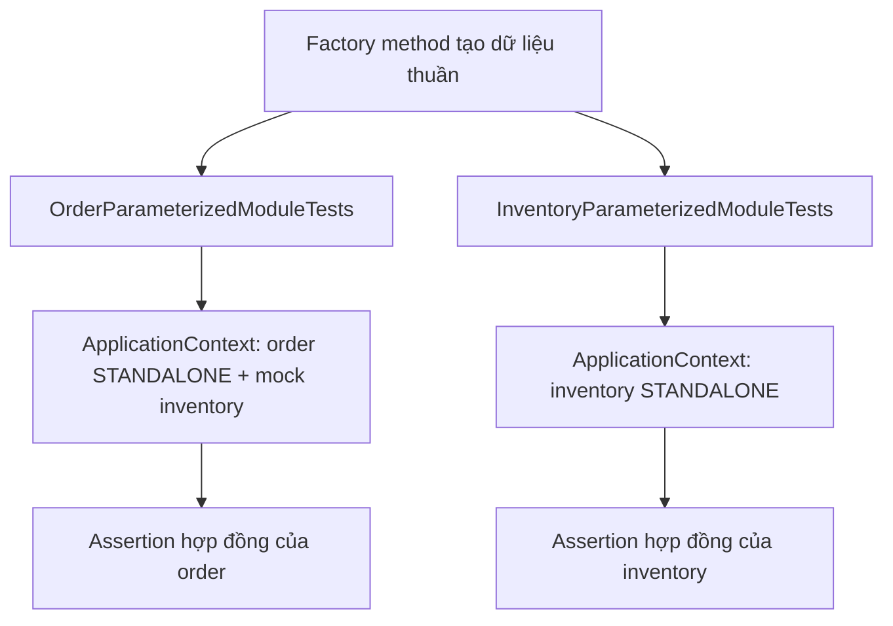

# Parameterised test cho nhiều module hoặc dữ liệu trong JUnit Jupiter và Spring Modulith

## 1. Khi nào nên tham số hóa bài kiểm thử?

Trong ứng dụng **Spring Modulith**, cùng một quy tắc thường cần được kiểm chứng với nhiều dữ liệu: SKU khác nhau, số lượng bằng ngưỡng/vượt ngưỡng, các loại trạng thái hoặc những bộ input–expected output. Viết một phương thức `@Test` cho mỗi dữ liệu làm lớp test dài và lặp setup; gom tất cả dữ liệu vào một vòng `for` thủ công lại khiến báo cáo CI khó cho biết **trường hợp nào** đã thất bại.

JUnit Jupiter giải quyết vấn đề này bằng **`@ParameterizedTest`**: một phương thức test được **gọi nhiều lần**, mỗi lần nhận dữ liệu từ một argument source. Mỗi invocation xuất hiện riêng trong test report và có thể mang tên chứa dữ liệu quan trọng.

Trong một modular monolith, từ **“nhiều module”** còn có ý nghĩa khác: bạn có thể muốn lặp một quy tắc kiến trúc trên `order`, `inventory` và `notification`, hoặc chạy những bài tích hợp tương tự nhưng với **Spring context khác nhau** cho từng module. Hai mục tiêu này **không giống nhau**:

1. **Nhiều dữ liệu, cùng module/context:** dùng `@ParameterizedTest` bên trong một lớp `@ApplicationModuleTest`.
2. **Nhiều module, cùng một quy tắc cấu trúc:** dùng `@ParameterizedTest` với mô hình `ApplicationModules`, thường **không cần Spring context**.
3. **Nhiều module, mỗi module cần bean/context riêng:** viết các **lớp module test riêng** hoặc một cấu trúc test được cấu hình riêng cho từng module; **không** cố thay `@ApplicationModuleTest(module = ...)` theo mỗi argument.

Bài này thuộc chương **JUnit integration** của học phần **SPRING_MODULITH_VERIFICATION_TESTING**: rèn kỹ năng kiểm chứng ranh giới kiến trúc bằng `ApplicationModules` và quy tắc phụ thuộc, thực hành `@ApplicationModuleTest`, kiểm thử sự kiện/cơ sở dữ liệu/tích hợp và thiết lập **quality gate CI** để chống phụ thuộc sai, hồi quy.

### Mục tiêu học tập

Sau bài này, bạn có thể:

- Dùng đúng `@ValueSource`, `@CsvSource`, `@NullAndEmptySource`, `@EnumSource` và `@MethodSource`.
- Viết `@ParameterizedTest(name = ...)` với tên invocation giúp đọc báo cáo JUnit/CI.
- Kết hợp dữ liệu từ argument source với tham số do JUnit/Spring Modulith giải, đặc biệt là `PublishedEvents`.
- Lặp kiểm tra hành vi trên nhiều dữ liệu **trong một module**, nhưng giữ nguyên ranh giới bootstrap theo `@ApplicationModuleTest`.
- Kiểm tra những module khác nhau bằng **module test riêng**, và lặp kiểm tra cấu trúc module bằng `ApplicationModules`.
- Tránh rò rỉ mock, transaction và trạng thái sự kiện giữa các invocation; tổ chức kiểm thử trong CI theo độ trung thực của hạ tầng.

## 2. Ba phép lặp không được đánh đồng

Giả sử quan hệ module của ứng dụng:


Mũi tên `A → B` nghĩa là **A phụ thuộc vào B**. `order` dùng API công khai của `inventory`; `notification` có thể sử dụng type event do `order` phát.

| Mục tiêu | Cách tổ chức | Có cần Spring context? | Phạm vi được lặp |
| --- | --- | --- | --- |
| Kiểm thử số lượng `-1`, `0` và `4` bị từ chối | Một `@ParameterizedTest` trong test `order` | Có, khi test `OrderService` thật | **Giá trị input**, cùng module `order` |
| Kiểm thử nhiều cặp SKU/số lượng được chấp nhận | `@CsvSource` hoặc `@MethodSource` | Có | **Tập case nghiệp vụ**, cùng context |
| Kiểm tra `StockAvailability` với nhiều SKU | Test nằm trong package `inventory` | Có | Case của module `inventory` |
| Kiểm tra các type thuộc đúng module logic nào | `ApplicationModules.of(...).getModuleByType(...)` + `@MethodSource` | **Không** | **Metadata của nhiều module** |
| Kiểm tra tất cả module tuân thủ dependency rules | `ApplicationModules.of(...).verify()` | **Không** | Một lần xác minh **toàn đồ thị module** |
| Kiểm tra hai module khác nhau với implementation thật và phạm vi riêng | Hai lớp `@ApplicationModuleTest` ở hai package | Có, hai cấu hình test riêng | **Bootstrap theo module**, không phải dữ liệu per invocation |

**Giới hạn kỹ thuật quan trọng:** `@ApplicationModuleTest` là annotation ở **cấp type**, Spring TestContext xác định và cache cấu hình bootstrap của lớp test. Các giá trị `module`, `mode` và `extraIncludes` là metadata của annotation, không phải các tham số runtime mà `@CsvSource` hay `@MethodSource` có thể thay theo mỗi invocation.

Như vậy, không tồn tại cú pháp hợp lệ kiểu `@ApplicationModuleTest(module = moduleNameFromCsv)`. Truyền `"order"`, `"inventory"` vào một phương thức `@ParameterizedTest` **chỉ đổi argument**, không tự chuyển context từ module này sang module khác.

## 3. Cơ chế `@ParameterizedTest` của JUnit Jupiter

Khác `@Test` chạy một lần, `@ParameterizedTest` chạy nhiều invocation dựa trên **nguồn argument** đã khai báo:

```java
package com.example.shop.testing;

import static org.junit.jupiter.api.Assertions.assertTrue;

import org.junit.jupiter.params.ParameterizedTest;
import org.junit.jupiter.params.provider.ValueSource;

class QuantityRulesTests {

    @ParameterizedTest(name = "[{index}] quantity={0} phải dương")
    @ValueSource(ints = {1, 2, 5})
    void acceptsPositiveQuantity(int quantity) {
        assertTrue(quantity > 0);
    }
}
```

JUnit tạo **ba invocation**. Mỗi lần, argument source cấp một `int`, test chạy assertion và báo kết quả riêng. Việc hiển thị có thể giống:

```text
acceptsPositiveQuantity(int)
├── [1] quantity=1 phải dương   PASSED
├── [2] quantity=2 phải dương   PASSED
└── [3] quantity=5 phải dương   PASSED
```

Đây chỉ là **minh họa báo cáo**, không phải output cố định của mọi IDE/CI runner.

### Dependency cần có

JUnit Jupiter parameterized tests yêu cầu artifact `junit-jupiter-params`. Trong dự án **Spring Boot 3.4/3.5** có `spring-boot-starter-test`, artifact này thường đã được quản lý/cung cấp theo bộ test dependencies; có thể khai báo tường minh nếu cấu hình build đặc thù:

```xml
<dependency>
    <groupId>org.junit.jupiter</groupId>
    <artifactId>junit-jupiter-params</artifactId>
    <scope>test</scope>
</dependency>
```

Không gắn đồng thời `@Test` và `@ParameterizedTest` lên cùng method. `@ParameterizedTest` tự đại diện cho một test template, với các nguồn argument và invocation do Jupiter quản lý.

## 4. Chọn argument source phù hợp

| Nguồn | Phù hợp nhất khi | Ví dụ |
| --- | --- | --- |
| `@ValueSource` | Một cột giá trị primitive, `String` hoặc `Class` được hỗ trợ | Số lượng `-1`, `0`, `4` |
| `@CsvSource` | Nhiều cột dạng text dễ đọc, có conversion sang type | SKU, quantity, expected |
| `@NullSource` / `@EmptySource` / `@NullAndEmptySource` | Kiểm tra `null` và chuỗi/collection rỗng phù hợp | SKU thiếu |
| `@EnumSource` | Toàn bộ hoặc tập con giá trị enum | Loại trạng thái hoặc kênh xử lý |
| `@MethodSource` | Case phức tạp, object, record, enum, exception type | Bảng case và kỳ vọng đa dạng |
| `@ArgumentsSource` | Nguồn argument tái sử dụng qua `ArgumentsProvider` | Bộ hợp đồng kiểm thử dùng nhiều lớp |

### 4.1. `@CsvSource`: trường hợp chấp nhận và từ chối

```java
@ParameterizedTest(name = "[{index}] sku={0}, quantity={1} -> available={2}")
@CsvSource({
    "SKU-READY, 1, true",
    "SKU-READY, 3, true",
    "SKU-READY, 4, false",
    "SKU-OUT,   1, false"
})
void inventoryAvailabilityMatchesContract(
        String sku, int quantity, boolean expected) {
    assertThat(stock.available(sku, quantity)).isEqualTo(expected);
}
```

Đây là **method minh họa** phải đặt trong lớp test đã có bean `stock` và import JUnit/AssertJ tương ứng; phần 8 sẽ cung cấp lớp hoàn chỉnh cho module `inventory`. JUnit chuyển chuỗi `"3"` thành `int` và `"false"` thành `boolean` theo quy tắc conversion.

Với `@CsvSource`, phân biệt **chuỗi rỗng có quote** và **cột trống không quote**: giá trị không quote để trống thường được hiểu là `null`; chuỗi quote rỗng có thể được hiểu là `""`. Với dữ liệu có dấu phẩy, ký tự quote hoặc dấu xuống dòng, dùng cú pháp CSV đúng hoặc chuyển sang `@MethodSource` để tránh lỗi đọc dữ liệu.

### 4.2. `@NullAndEmptySource`: ranh giới input

```java
@ParameterizedTest(name = "sku={0}: từ chối SKU không hợp lệ")
@NullAndEmptySource
@ValueSource(strings = {" ", "\t"})
void rejectsBlankSku(String sku) {
    assertThatThrownBy(() -> checkout.place(sku, 1))
            .isInstanceOf(IllegalArgumentException.class);
}
```

Ví dụ giả định `checkout` là bean use case thuộc module `order`; `@NullAndEmptySource` bổ sung `null` và `""`, còn `@ValueSource` bổ sung chuỗi khoảng trắng/tab. Các argument source kết hợp để kiểm tra cùng một luật. Với `String.isBlank()`, cả bốn case phải bị từ chối.

### 4.3. `@EnumSource`: kiểm tra một tập trạng thái

Ví dụ một quy tắc Java thuần: chỉ các trạng thái **kết thúc** được phép đóng đơn.

```java
package com.example.shop.testing;

import static org.assertj.core.api.Assertions.assertThat;

import org.junit.jupiter.params.ParameterizedTest;
import org.junit.jupiter.params.provider.EnumSource;

class OrderStateRulesTests {

    enum OrderState {
        DRAFT, CONFIRMED, COMPLETED, CANCELLED
    }

    static boolean isTerminal(OrderState state) {
        return state == OrderState.COMPLETED
                || state == OrderState.CANCELLED;
    }

    @ParameterizedTest(name = "state={0} là trạng thái kết thúc")
    @EnumSource(
        value = OrderState.class,
        names = {"COMPLETED", "CANCELLED"}
    )
    void terminalStatesAreRecognized(OrderState state) {
        assertThat(isTerminal(state)).isTrue();
    }
}
```

Ví dụ này **không cần Spring context**; nó minh họa rằng parameterization là tính năng JUnit, độc lập với Spring Modulith. Với tất cả enum constants, có thể viết `@EnumSource(OrderState.class)` khi mọi giá trị phải tuân thủ cùng một hợp đồng; đừng test một tập con rồi đặt tên như thể đã kiểm thử mọi trạng thái.

### 4.4. `@MethodSource`: bộ case có kiểu rõ ràng

Khi phải truyền `String`, `int`, `Class`, object tùy chỉnh hoặc nhiều giá trị expected, tạo factory method trả về `Stream<Arguments>`:

```java
static Stream<Arguments> unavailableOrders() {
    return Stream.of(
        Arguments.of("SKU-OUT", 1),
        Arguments.of("SKU-NOT-FOUND", 2),
        Arguments.of("SKU-OLD", 3)
    );
}

@ParameterizedTest(name = "[{index}] {0}, quantity={1}: hết hàng")
@MethodSource("unavailableOrders")
void rejectsUnavailableStock(String sku, int quantity) {
    // Bổ sung assertion nghiệp vụ trong lớp test module ở phần 7.
}
```

Trong một lớp test thông thường, factory method được khai báo **`static`**, không nhận argument, trả stream/collection/iterable phù hợp. JUnit có thể cho phép factory method không static khi test instance lifecycle là `PER_CLASS`; tuy nhiên **dùng static** giúp ví dụ ít phụ thuộc vào meta-annotation/lifecycle của một phiên bản `@ApplicationModuleTest` cụ thể.

Không truy cập field `@Autowired` từ factory method `static`: Spring context chưa chắc đã sẵn sàng khi JUnit cần liệt kê arguments. Nguồn dữ liệu nên là **fixture thuần**; bean Spring dùng trong body method test sau khi context đã được chuẩn bị.

## 5. Trật tự tham số: arguments từ nguồn trước, `ParameterResolver` sau

Trong test có Spring Modulith, ngoài những dữ liệu từ `@CsvSource`/`@MethodSource`, JUnit có thể inject thêm `TestInfo` và Modulith cung cấp `PublishedEvents` hoặc `Scenario` thông qua extension.

Theo quy tắc Jupiter:

1. **Indexed arguments** từ argument source khai báo **đầu tiên**, đúng thứ tự các cột.
2. Nếu có `ArgumentsAccessor` hoặc custom argument aggregator, chúng nằm **sau indexed arguments**.
3. **Tham số được extension `ParameterResolver` cấp** đặt **cuối cùng**.

Ví dụ đúng:

```java
@ParameterizedTest(name = "sku={0}, quantity={1}")
@CsvSource({"SKU-A, 1", "SKU-B, 2"})
void publishesEventForAvailableStock(
        String sku,
        int quantity,
        PublishedEvents events) {
    // sku, quantity: CsvSource; events: Modulith ParameterResolver.
}
```

Ví dụ sai cấu trúc:

```java
// Không đặt PublishedEvents ở trước các indexed arguments.
@ParameterizedTest
@CsvSource({"SKU-A, 1"})
void invalidOrderOfParameters(
        PublishedEvents events, String sku, int quantity) {
    // Có thể gặp lỗi argument/parameter resolution.
}
```

`@Autowired` bean Spring cũng có thể là tham số của test theo SpringExtension, nhưng với những bài `@ParameterizedTest` dùng dữ liệu nhiều cột, thường dễ đọc hơn nếu inject bean qua field/constructor được cấu hình đúng và để tham số method cho **dữ liệu + `PublishedEvents`**.

**Về phiên bản:** Ví dụ nghiệp vụ dưới đây theo stack Java 17+, Spring Boot 3.4/3.5, Spring Framework 6.2, Spring Modulith 1.4 và JUnit Jupiter 5 tương thích BOM. Trên Spring Boot 4.x/Spring Modulith 2.x, cần kiểm tra phiên bản JUnit và API test đã được phân phối trong starter; nguyên lý argument source và module bootstrap vẫn cần phân biệt như trên.

## 6. Chuẩn bị ứng dụng mẫu ba module

### 6.1. Cấu trúc và dependency

```text
src/
├── main/java/com/example/shop/
│   ├── ShopApplication.java
│   ├── inventory/
│   │   ├── StockAvailability.java
│   │   └── StockAvailabilityService.java
│   ├── order/
│   │   ├── OrderService.java
│   │   └── OrderPlaced.java
│   └── notification/
│       └── NotificationFacade.java
└── test/java/com/example/shop/
    ├── order/OrderParameterizedModuleTests.java
    ├── inventory/InventoryParameterizedModuleTests.java
    └── ModuleContractsTests.java
```

Một phần dependency Maven (dự án đã cấu hình Spring Boot và Modulith BOM tương thích):

```xml
<dependency>
    <groupId>org.springframework.boot</groupId>
    <artifactId>spring-boot-starter</artifactId>
</dependency>
<dependency>
    <groupId>org.springframework.boot</groupId>
    <artifactId>spring-boot-starter-test</artifactId>
    <scope>test</scope>
</dependency>
<dependency>
    <groupId>org.springframework.modulith</groupId>
    <artifactId>spring-modulith-starter-test</artifactId>
    <scope>test</scope>
</dependency>
```

Ở stack đã nói, `spring-boot-starter-test` bao gồm JUnit Jupiter/parameterized tests, AssertJ, Mockito và Spring Test. `spring-modulith-starter-test` cung cấp `@ApplicationModuleTest` và `PublishedEvents`/`Scenario`. Các khối dependency trên không phải toàn bộ `pom.xml`.

### 6.2. Lớp ứng dụng gốc

File `src/main/java/com/example/shop/ShopApplication.java`:

```java
package com.example.shop;

import org.springframework.boot.SpringApplication;
import org.springframework.boot.autoconfigure.SpringBootApplication;

@SpringBootApplication
public class ShopApplication {
    public static void main(String[] args) {
        SpringApplication.run(ShopApplication.class, args);
    }
}
```

### 6.3. API và implementation của `inventory`

File `src/main/java/com/example/shop/inventory/StockAvailability.java`:

```java
package com.example.shop.inventory;

public interface StockAvailability {
    boolean available(String sku, int quantity);
}
```

File `src/main/java/com/example/shop/inventory/StockAvailabilityService.java`:

```java
package com.example.shop.inventory;

import org.springframework.stereotype.Service;

@Service
public class StockAvailabilityService implements StockAvailability {
    @Override
    public boolean available(String sku, int quantity) {
        return "SKU-READY".equals(sku) && quantity <= 3;
    }
}
```

`StockAvailability` thuộc package gốc của module `inventory`, tức là **API công khai mặc định** theo cách nhận diện module thông thường. Implementation minh họa dùng dữ liệu cố định; bài test module `inventory` sẽ kiểm tra chính implementation này, không có cơ sở dữ liệu.

### 6.4. Sự kiện và nghiệp vụ `order`

File `src/main/java/com/example/shop/order/OrderPlaced.java`:

```java
package com.example.shop.order;

import java.util.UUID;

public record OrderPlaced(UUID orderId, String sku, int quantity) {}
```

File `src/main/java/com/example/shop/order/OrderService.java`:

```java
package com.example.shop.order;

import java.util.UUID;
import com.example.shop.inventory.StockAvailability;
import org.springframework.beans.factory.annotation.Value;
import org.springframework.context.ApplicationEventPublisher;
import org.springframework.stereotype.Service;

@Service
public class OrderService {

    private final StockAvailability stock;
    private final ApplicationEventPublisher events;
    private final int maxQuantity;

    public OrderService(StockAvailability stock,
                        ApplicationEventPublisher events,
                        @Value("${orders.max-quantity:3}") int maxQuantity) {
        this.stock = stock;
        this.events = events;
        this.maxQuantity = maxQuantity;
    }

    public UUID place(String sku, int quantity) {
        if (sku == null || sku.isBlank()
                || quantity <= 0 || quantity > maxQuantity) {
            throw new IllegalArgumentException("INVALID_ORDER");
        }
        if (!stock.available(sku, quantity)) {
            throw new IllegalStateException("OUT_OF_STOCK");
        }

        UUID id = UUID.randomUUID();
        events.publishEvent(new OrderPlaced(id, sku, quantity));
        return id;
    }
}
```

Nghiệp vụ này có ba nhóm dữ liệu: **validation** chặn dữ liệu không hợp lệ trước khi gọi kho, **hết hàng** gây từ chối nhưng không phát event, và **đủ hàng** phát `OrderPlaced` đúng payload.

### 6.5. Bean độc lập của `notification`

File `src/main/java/com/example/shop/notification/NotificationFacade.java`:

```java
package com.example.shop.notification;

import org.springframework.stereotype.Service;

@Service
public class NotificationFacade {
    public String status() {
        return "ready";
    }
}
```

Bean này chỉ phục vụ ví dụ kiểm chứng **module ownership** về sau; nó không phải consumer của `OrderPlaced`. Việc bean có mặt trong code/classpath **không** đồng nghĩa nó được tạo trong `STANDALONE` test thuộc `order`.

## 7. Ví dụ hoàn chỉnh: nhiều dữ liệu trong một module test `order`

File `src/test/java/com/example/shop/order/OrderParameterizedModuleTests.java`:

```java
package com.example.shop.order;

import static org.assertj.core.api.Assertions.assertThat;
import static org.assertj.core.api.Assertions.assertThatThrownBy;
import static org.mockito.BDDMockito.given;
import static org.mockito.BDDMockito.then;
import static org.junit.jupiter.params.provider.Arguments.arguments;

import java.util.UUID;
import java.util.stream.Stream;

import com.example.shop.inventory.StockAvailability;
import org.junit.jupiter.api.DisplayName;
import org.junit.jupiter.api.Tag;
import org.junit.jupiter.params.ParameterizedTest;
import org.junit.jupiter.params.provider.Arguments;
import org.junit.jupiter.params.provider.CsvSource;
import org.junit.jupiter.params.provider.MethodSource;
import org.junit.jupiter.params.provider.NullAndEmptySource;
import org.junit.jupiter.params.provider.ValueSource;
import org.springframework.beans.factory.annotation.Autowired;
import org.springframework.modulith.test.ApplicationModuleTest;
import org.springframework.modulith.test.PublishedEvents;
import org.springframework.test.context.TestPropertySource;
import org.springframework.test.context.bean.override.mockito.MockitoBean;

@Tag("module")
@DisplayName("Order — bảng dữ liệu nghiệp vụ")
@ApplicationModuleTest
@TestPropertySource(properties = "orders.max-quantity=3")
class OrderParameterizedModuleTests {

    @Autowired OrderService orders;
    @MockitoBean StockAvailability stock;

    @ParameterizedTest(
        name = "[{index}] sku={0}, qty={1}: phát OrderPlaced"
    )
    @CsvSource({
        "SKU-A, 1",
        "SKU-B, 2",
        "SKU-C, 3"
    })
    void publishesEventForEachAcceptedOrder(
            String sku, int quantity, PublishedEvents events) {

        given(stock.available(sku, quantity)).willReturn(true);

        UUID orderId = orders.place(sku, quantity);

        assertThat(events.ofType(OrderPlaced.class)
                .matching(event ->
                        event.orderId().equals(orderId)
                        && event.sku().equals(sku)
                        && event.quantity() == quantity))
                .hasSize(1);
        then(stock).should().available(sku, quantity);
    }

    @ParameterizedTest(
        name = "[{index}] quantity={0}: chặn trước khi kiểm tra kho"
    )
    @ValueSource(ints = {-1, 0, 4})
    void rejectsInvalidQuantitiesBeforeAccessingInventory(
            int quantity, PublishedEvents events) {

        assertThatThrownBy(() -> orders.place("SKU-A", quantity))
                .isInstanceOf(IllegalArgumentException.class)
                .hasMessage("INVALID_ORDER");

        then(stock).shouldHaveNoInteractions();
        assertThat(events.ofType(OrderPlaced.class)).isEmpty();
    }

    @ParameterizedTest(name = "[{index}] SKU={0}: từ chối")
    @NullAndEmptySource
    @ValueSource(strings = {" ", "\t"})
    void rejectsBlankSkuWithoutPublishingEvent(
            String sku, PublishedEvents events) {

        assertThatThrownBy(() -> orders.place(sku, 1))
                .isInstanceOf(IllegalArgumentException.class)
                .hasMessage("INVALID_ORDER");

        then(stock).shouldHaveNoInteractions();
        assertThat(events.ofType(OrderPlaced.class)).isEmpty();
    }

    static Stream<Arguments> unavailableOrders() {
        return Stream.of(
            arguments("SKU-OUT", 1),
            arguments("SKU-NOT-FOUND", 2),
            arguments("SKU-OLD", 3)
        );
    }

    @ParameterizedTest(
        name = "[{index}] sku={0}, qty={1}: hết hàng"
    )
    @MethodSource("unavailableOrders")
    void rejectsUnavailableStockWithoutPublishingEvent(
            String sku, int quantity, PublishedEvents events) {

        given(stock.available(sku, quantity)).willReturn(false);

        assertThatThrownBy(() -> orders.place(sku, quantity))
                .isInstanceOf(IllegalStateException.class)
                .hasMessage("OUT_OF_STOCK");

        then(stock).should().available(sku, quantity);
        assertThat(events.ofType(OrderPlaced.class)).isEmpty();
    }
}
```

### Phân tích bằng chứng thu được

1. `@ApplicationModuleTest` suy ra module `order` từ package lớp test; chế độ bootstrap mặc định là `STANDALONE`.
2. `@MockitoBean StockAvailability` cung cấp một **mock ở ranh giới với `inventory`**. `OrderService` vẫn là Spring bean **thật** của module `order`.
3. `@CsvSource` tạo ba invocation được chấp nhận; mỗi lần stub mock với SKU/số lượng của invocation và xác minh **payload `OrderPlaced` tương ứng**.
4. `@ValueSource` kiểm tra ba giá trị quantity không hợp lệ. Assertion `shouldHaveNoInteractions()` chứng minh validation chặn trước khi gọi module ngoài.
5. `@NullAndEmptySource` kết hợp `@ValueSource` để kiểm tra `null`, chuỗi rỗng và chuỗi chỉ gồm khoảng trắng.
6. `@MethodSource` tạo các case hết hàng có cùng kiểu exception và cùng kết luận **không publish event**.
7. `PublishedEvents` là tham số **cuối cùng** trong mỗi method parameterized, để JUnit có thể xử lý các arguments từ nguồn trước và Modulith resolver sau.

Tổng số invocation ở đây là **3 + 3 + 4 + 3 = 13**; mỗi invocation được báo riêng. Không có nghĩa Spring khởi động **13 ApplicationContext**: nếu cấu hình test không thay đổi, Spring TestContext có thể dùng cùng một context cache cho các invocation.

**Giới hạn của bài test:** Các case ở nhóm chấp nhận dùng phản hồi giả lập của `StockAvailability`. Test chứng minh **`order` phản ứng đúng với API tồn kho**, không chứng minh logic tồn kho thật đúng với từng SKU. Đó là mục tiêu của bài test module `inventory` ở phần tiếp theo.

### Tại sao không đặt mọi nhánh vào một `@CsvSource`?

Một bảng lớn kiểu `SKU,quantity,stockAvailable,expectedException,expectedEvent` có thể khiến body test phải chứa nhiều `if/else`, stub không dùng tới và assertion khác hẳn nhau. Điều này làm cho tên test mơ hồ và khó chẩn đoán khi fail.

**Nên tham số hóa các case cùng hợp đồng**: “input hợp lệ → publish đúng event”, “input sai → validation”, “kho báo hết → không publish”. Nếu mỗi hàng kiểm tra loại kết quả khác nhau, tách thành nhiều parameterized methods hoặc các nhóm `@Nested` giúp báo cáo rõ hơn.

## 8. Test riêng cho module `inventory`: nhiều dữ liệu, context khác

File `src/test/java/com/example/shop/inventory/InventoryParameterizedModuleTests.java`:

```java
package com.example.shop.inventory;

import static org.assertj.core.api.Assertions.assertThat;

import org.junit.jupiter.api.DisplayName;
import org.junit.jupiter.api.Tag;
import org.junit.jupiter.params.ParameterizedTest;
import org.junit.jupiter.params.provider.CsvSource;
import org.springframework.beans.factory.annotation.Autowired;
import org.springframework.modulith.test.ApplicationModuleTest;

@Tag("module")
@DisplayName("Inventory — hợp đồng kiểm tra hàng tồn")
@ApplicationModuleTest
class InventoryParameterizedModuleTests {

    @Autowired StockAvailability stock;

    @ParameterizedTest(
        name = "[{index}] sku={0}, qty={1} -> {2}"
    )
    @CsvSource({
        "SKU-READY, 1, true",
        "SKU-READY, 3, true",
        "SKU-READY, 4, false",
        "SKU-OUT,   1, false"
    })
    void returnsExpectedAvailability(
            String sku, int quantity, boolean expected) {

        assertThat(stock.available(sku, quantity))
                .isEqualTo(expected);
    }
}
```

Test nằm trong package `inventory`; `@ApplicationModuleTest` ở `STANDALONE` sẽ nạp module `inventory` thay vì `order`. `StockAvailabilityService` là bean **thật**, không dùng mock. Bốn invocation lần lượt xác minh hai SKU/số lượng có hàng và hai trường hợp không có hàng.

So sánh:

| Lớp test | Module mục tiêu | Dependency nghiệp vụ chính | Điều được bảo đảm |
| --- | --- | --- | --- |
| `OrderParameterizedModuleTests` | `order` | `StockAvailability` là mock | Quy tắc của `OrderService` và event nguồn |
| `InventoryParameterizedModuleTests` | `inventory` | `StockAvailabilityService` thật | Cách implementation `inventory` xác định còn hàng |

**Đây là cách đúng để parameterise nhiều module về hành vi:** dùng **các lớp module test riêng** cho từng module cần bootstrap, và trong mỗi lớp lặp những dữ liệu có cùng hợp đồng. Khi `order` cần bean `inventory` thật để kiểm chứng phối hợp, có thể viết một test khác trong package `order` dùng:

```java
@ApplicationModuleTest(
    mode = ApplicationModuleTest.BootstrapMode.DIRECT_DEPENDENCIES
)
class OrderInventoryContractTests {
    // @Test / @ParameterizedTest sử dụng OrderService thật
    // cùng StockAvailabilityService thật.
}
```

Đây chỉ là **mẫu annotation**, không phải một bài chạy độc lập. `DIRECT_DEPENDENCIES` nạp dependency trực tiếp của `order`; nếu `inventory` còn phụ thuộc `catalog`, phạm vi có thể cần được điều chỉnh hoặc dependency sâu được fake. Không nên mở rộng `ALL_DEPENDENCIES` chỉ để tránh phân tích nguyên nhân thiếu bean.

## 9. Parameterized architecture test trên **nhiều module**

Nếu cần lặp cùng một **câu hỏi cấu trúc** qua nhiều module, không cần khởi động context riêng cho từng module. Spring Modulith cung cấp `ApplicationModules` để phân tích mô hình code.

Một hợp đồng cụ thể: **mỗi public API type trong bảng case phải thuộc application module logic đã khai báo**. Lớp sau là JUnit Jupiter test thuần, không dùng `@SpringBootTest` hay `@ApplicationModuleTest`.

File `src/test/java/com/example/shop/ModuleContractsTests.java`:

```java
package com.example.shop;

import static org.assertj.core.api.Assertions.assertThat;
import static org.junit.jupiter.params.provider.Arguments.arguments;

import java.util.stream.Stream;

import com.example.shop.inventory.StockAvailability;
import com.example.shop.notification.NotificationFacade;
import com.example.shop.order.OrderService;
import org.junit.jupiter.api.DisplayName;
import org.junit.jupiter.api.Tag;
import org.junit.jupiter.api.Test;
import org.junit.jupiter.params.ParameterizedTest;
import org.junit.jupiter.params.provider.Arguments;
import org.junit.jupiter.params.provider.MethodSource;
import org.springframework.modulith.core.ApplicationModule;
import org.springframework.modulith.core.ApplicationModules;

@Tag("architecture")
@DisplayName("Kiến trúc — module ownership và dependency")
class ModuleContractsTests {

    private static final ApplicationModules MODULES =
            ApplicationModules.of(ShopApplication.class);

    static Stream<Arguments> expectedModuleOwnership() {
        return Stream.of(
            arguments("order", OrderService.class),
            arguments("inventory", StockAvailability.class),
            arguments("notification", NotificationFacade.class)
        );
    }

    @ParameterizedTest(
        name = "[{index}] {1} thuộc module {0}"
    )
    @MethodSource("expectedModuleOwnership")
    void publicTypesBelongToExpectedModules(
            String expectedName, Class<?> publicType) {

        ApplicationModule actual = MODULES.getModuleByType(publicType)
                .orElseThrow();

        assertThat(actual.getIdentifier().toString())
                .isEqualTo(expectedName);
    }

    @Test
    void applicationModulesRespectStructuralRules() {
        MODULES.verify();
    }
}
```

### Hai loại kiểm chứng kiến trúc trong cùng lớp

- **Parameterized ownership test**: kiểm tra các mapping **đã khai báo trong bảng `expectedModuleOwnership()`**. Nó trả lời “type này thuộc module nào?”, không tự chứng minh tất cả quy tắc dependency.
- **`MODULES.verify()`**: xác minh **các luật cấu trúc Spring Modulith áp dụng cho toàn đồ thị module**, bao gồm vòng phụ thuộc, truy cập vào phần nội bộ không công khai và những `allowedDependencies` được khai báo. Đây là quality gate quan trọng hơn kiểm tra tồn tại package đơn thuần.

Chú ý dùng `getIdentifier()` thay vì `getName()`, vì `getName()` đã bị deprecated từ Spring Modulith 1.3. `getModuleByType(...)` trả về `Optional<ApplicationModule>`, vì vậy `orElseThrow()` làm bài kiểm thử fail rõ nếu type không được nhận diện trong một application module.

**Đừng giả định kiểm chứng ownership đồng nghĩa dependency hợp lệ.** Một type có thể nằm trong đúng module nhưng vẫn import class thuộc `inventory.internal` trái quy tắc. Ngược lại, `MODULES.verify()` không thay thế những case về **module ownership** đặc thù nếu nhóm muốn khóa cấu trúc package khi refactor.

### Khi muốn lặp theo tên module thay vì theo type

Có thể dùng `@ValueSource(strings = {"order", "inventory", "notification"})` và `MODULES.getModuleByName(name)` để xác nhận các module bắt buộc tồn tại. Đây là **kiểm chứng metadata**, không phải module bootstrap:

```java
@ParameterizedTest(name = "Module logic {0} phải tồn tại")
@ValueSource(strings = {"order", "inventory", "notification"})
void expectedModuleNamesArePresent(String name) {
    assertThat(MODULES.getModuleByName(name)).isPresent();
}
```

Đoạn trên là **method bổ sung vào `ModuleContractsTests`**, cần thêm import `org.junit.jupiter.params.provider.ValueSource`. Những tên logic phải được xác định từ mô hình thật, nhất là khi dự án cấu hình tên module không trùng tên package.

## 10. Chia sẻ bảng dữ liệu giữa những lớp test mà không chia sẻ context

Hai module có thể cần **cùng một bộ dữ liệu đầu vào**, chẳng hạn các SKU/số lượng biên, nhưng **không** nên vì vậy mà dùng chung một Spring context để khởi động cả hai.

Mô hình nên là:



Nguồn dữ liệu **có thể dùng chung**, trong khi **bean và module context vẫn tách biệt**. Ví dụ tạo một class test utility:

```java
package com.example.shop.testing;

import static org.junit.jupiter.params.provider.Arguments.arguments;

import java.util.stream.Stream;
import org.junit.jupiter.params.provider.Arguments;

public final class OrderCaseSources {

    private OrderCaseSources() {}

    public static Stream<Arguments> positiveQuantities() {
        return Stream.of(
            arguments("SKU-READY", 1),
            arguments("SKU-READY", 2),
            arguments("SKU-READY", 3)
        );
    }
}
```

Một lớp test sử dụng external factory method bằng tên đầy đủ:

```java
@ParameterizedTest(name = "sku={0}, quantity={1}")
@MethodSource(
    "com.example.shop.testing.OrderCaseSources#positiveQuantities"
)
void acceptsSupportedInput(String sku, int quantity) {
    // Assertion cụ thể theo module mà lớp test thuộc về.
}
```

Đoạn test thứ hai là **khung minh họa**: để chạy, cần đặt trong lớp có method/use case và assertion thật. Factory method bên ngoài phải đáp ứng quy tắc JUnit của `@MethodSource` (thường `static` và public khi truy cập từ lớp khác). Nó không được giữ `ApplicationContext` hoặc mock mutable trong một singleton dùng chung.

Nếu hai module có **định nghĩa hợp đồng khác nhau** cho cùng một dữ liệu, đừng ép chúng dùng một bảng expected output chỉ để giảm vài dòng code. Dùng chung **input hợp lệ về mặt domain** vẫn không đồng nghĩa kết quả kỳ vọng giống hệt nhau giữa các module.

### `@CsvFileSource` cho bảng case dài

Khi số hàng lớn và dễ duy trì bằng dữ liệu, JUnit cung cấp `@CsvFileSource`:

```java
@ParameterizedTest(name = "case {index}: {0}, quantity={1}")
@CsvFileSource(
    resources = "/cases/order-quantities.csv",
    numLinesToSkip = 1
)
void acceptsRowsFromCsv(String sku, int quantity) {
    // Dùng service và assertion thật của module mục tiêu.
}
```

Đây là ví dụ **phụ thuộc một resource chưa được tạo**: file `src/test/resources/cases/order-quantities.csv` phải tồn tại với header và dữ liệu tương thích, ví dụ `sku,quantity` ở hàng đầu. Đừng đưa dữ liệu production nhạy cảm hoặc token vào CSV fixture; các giá trị có thể được in trong báo cáo test.

Đối với một số luật kiến trúc nhạy cảm (ví dụ danh sách module **bắt buộc tồn tại**), fixture nên được xem như **hợp đồng versioned** trong repository. Không âm thầm sinh expected module names trực tiếp từ chính mô hình vừa đọc rồi kết luận tất cả module đã đúng: như vậy test chỉ xác nhận dữ liệu đầu ra của mô hình với chính nó, không phát hiện module bị xóa hoặc đổi tên trái dự kiến.

## 11. Lifecycle mỗi invocation, mock reset và context cache

Một lỗi khó thấy của parameterized tests là **một case để lại trạng thái khiến case khác thất bại**. Hãy tách ba tầng:

| Tầng | Vòng đời thường gặp | Rủi ro |
| --- | --- | --- |
| **JUnit invocation** | Một bộ arguments tạo một lượt chạy, có callback `@BeforeEach`/`@AfterEach` tương ứng | Fixture mutable hoặc biến static làm các lượt phụ thuộc nhau |
| **Test instance** | Tùy `@TestInstance(PER_METHOD/PER_CLASS)` và meta-annotation của test framework | Field do test tự thay đổi có thể tồn tại qua nhiều lượt nếu `PER_CLASS` |
| **Spring `ApplicationContext`** | Spring TestContext cache theo cấu hình lớp test | Singleton bean, database, executor và hạ tầng **không tự được tạo lại** mỗi invocation |

Với `@MockitoBean`, Spring Test có cơ chế reset mock theo chính sách của annotation/test support, mặc định reset sau test. Vì vậy bài test ở phần 7 **tự stub và verify trong từng invocation**, không dựa vào stub hoặc số lần gọi từ invocation trước.

### Tại sao `@BeforeEach` vẫn cần thiết?

Nếu bạn sử dụng một fake bean có state mutable hoặc fixture nằm ngoài Mockito, hãy reset rõ ràng trước mỗi case:

```java
@BeforeEach
void resetFixture() {
    fakeStock.clearReservations();
}

@ParameterizedTest
@CsvSource({"SKU-A, 1", "SKU-B, 2"})
void reservesOneItemPerCase(String sku, int quantity) {
    // Thực hiện hành vi và xác minh trạng thái fake.
}
```

Đây là **mẫu minh họa**, giả định test có `fakeStock` với API `clearReservations()` và `reserves...` phù hợp. Nó không thuộc ví dụ `StockAvailabilityService` stateless ở phần 6. Lý do dùng `@BeforeEach` là **fixture isolation**, không phải yêu cầu tạo Spring context mới.

### Có nên bật chạy song song?

JUnit Platform có thể chạy test song song khi cấu hình. Nhưng với parameterized module tests dùng **Spring context được cache**, mock singleton, test DB, listener và resource ngoài, bật parallel execution thiếu kiểm soát dễ làm các invocation chen nhau, khiến stubbing/verification hoặc fixture DB bị ảnh hưởng.

Ưu tiên chạy tuần tự khi các case chia sẻ state; nếu muốn chạy song song, phải bảo đảm **dữ liệu/connection/mock/context** thực sự được cô lập và cơ chế scheduling phù hợp. Dùng `@ResourceLock` hoặc tách test class có cấu hình riêng khi cần khóa tài nguyên chia sẻ, thay vì thêm `Thread.sleep(...)` để tránh race condition.

### Tránh dùng `@DirtiesContext` trên mọi invocation

`@DirtiesContext` yêu cầu Spring loại context khỏi cache, có thể khiến số lần bootstrap tăng mạnh khi test có hàng chục hoặc hàng trăm case. Chỉ dùng nếu test thực sự làm context không thể tái sử dụng an toàn; với trạng thái DB/mock, **rollback, reset và cleanup** thường chính xác hơn.

Để đọc cache behavior:

```properties
logging.level.org.springframework.test.context.cache=DEBUG
logging.level.org.springframework.modulith=DEBUG
```

Log TestContext cache cho biết context nào được tạo/tái sử dụng; log Spring Modulith giúp xác định module đang bootstrap và những module phụ thuộc được nạp.

## 12. Parameterized tests với transaction và database

Với module có repository JPA/JDBC, mỗi case có thể cần dữ liệu riêng. `@ApplicationModuleTest` vẫn có thể nạp repository, entity, datasource và transaction manager phù hợp; không vì tham số hóa mà biến test tích hợp thành unit test.

Một **khung cấu hình** của module test có repository:

```java
@ApplicationModuleTest
class OrderPersistenceCases {

    @Autowired OrderRepository repository;

    @ParameterizedTest(name = "[{index}] sku={0}, qty={1}")
    @CsvSource({"SKU-A, 1", "SKU-B, 2"})
    @Transactional
    void persistsOrderForEachInput(String sku, int quantity) {
        // Tạo entity với orderId riêng.
        // Gọi repository thật, flush/đọc lại và assert dữ liệu.
        // Transaction test mặc định được rollback sau invocation.
    }
}
```

**Đây chưa phải test có thể biên dịch độc lập**, vì ví dụ chính ở phần 6 không định nghĩa `OrderRepository`, entity hay datasource; import cũng phải được bổ sung. Cần kiểm thử database với schema và transaction manager thật nếu tên method khẳng định có lưu trữ.

Trong Spring TestContext, `@Transactional` trên phương thức parameterized test thường tạo **test-managed transaction cho từng invocation** và **rollback theo mặc định**. Tuy nhiên:

- Điều đó chỉ áp dụng khi context có `PlatformTransactionManager` phù hợp.
- `@BeforeEach`/`@AfterEach` của JUnit thường nằm trong test-managed transaction, còn `@BeforeAll`/`@AfterAll` không tự nằm trong transaction từng case.
- Nếu listener chạy `AFTER_COMMIT`, transaction rollback ở cuối test có thể khiến listener **không được kích hoạt** như kịch bản production.
- Nếu test dùng `Scenario`, HTTP server thật hoặc listener async, có thể xuất hiện transaction/thread khác; dữ liệu đã commit ở đó **không tự rollback** với transaction của test invocation.

### Chiến lược dữ liệu cho nhiều invocation

| Kiểm thử | Điều kiện nên có | Cleanup |
| --- | --- | --- |
| Repository đồng bộ với test-managed transaction | H2/Testcontainers, schema, ID riêng mỗi case | Rollback theo invocation nếu phù hợp |
| Transaction commit thật | Ranh giới giao dịch được điều khiển rõ | Xóa record theo ID hoặc database cô lập |
| Async listener cập nhật DB | Chờ điều kiện trạng thái hoàn tất; log lỗi listener | Cleanup sau khi listener thực sự hoàn tất |
| Nhiều case chạy song song với DB | Mỗi case có khóa/tenant/schema hoặc dữ liệu không tranh chấp | Không dùng fixture shared mutable |

Đối với `@CsvFileSource` có hàng trăm case, không nên để mỗi invocation chạy migration phức tạp hoặc khởi động Testcontainers mới trừ khi đó là chủ đích. Tách **chi phí khởi động hạ tầng** khỏi **dữ liệu từng invocation** để bộ test vừa tin cậy vừa hiệu quả.

## 13. Dùng `Scenario` với dữ liệu tham số cho event flow

Khi một domain event từ `order` được xử lý bởi listener ở module `notification`, chỉ kiểm tra `PublishedEvents` của event nguồn **chưa chứng minh consumer đã hoàn tất**. Spring Modulith có `Scenario` để phát stimulus và chờ event kết quả hoặc trạng thái.

Một ví dụ **về cấu trúc** cho một dự án đã có listener thực và event kết quả:

```java
@ParameterizedTest(name = "[{index}] sku={0}, quantity={1}")
@CsvSource({"SKU-A, 1", "SKU-B, 2"})
void notificationFlowCompletesForEachOrder(
        String sku, int quantity, Scenario scenario) {

    UUID orderId = UUID.randomUUID();

    scenario.publish(new OrderPlaced(orderId, sku, quantity))
            .andWaitAtMost(Duration.ofSeconds(5))
            .forEventOfType(NotificationSent.class)
            .matching(event -> event.orderId().equals(orderId))
            .toArriveAndVerify(event ->
                    assertThat(event.orderId()).isEqualTo(orderId));
}
```

Khối này **chưa chạy độc lập với ứng dụng mẫu**: cần định nghĩa `NotificationSent`, listener thực ở `notification`, `Scenario` import, `Duration`/`UUID` import, transaction manager và context có module consumer. Một lớp test tương ứng có thể dùng `@ApplicationModuleTest(extraIncludes = "notification")` trong package `order`, với mock/fake `StockAvailability` nếu cần khởi tạo `OrderService`; nhưng việc **phát** event trực tiếp không kiểm tra logic `OrderService.place(...)`.

Với JUnit, hai arguments `sku` và `quantity` từ `@CsvSource` luôn đứng **trước** tham số `Scenario` do extension cung cấp. Mỗi invocation cần `orderId` riêng để không nhận nhầm event từ testcase khác. Giới hạn chờ và cleanup phải phù hợp với listener, database và hạ tầng thật.

**Phân biệt hai loại bằng chứng:**

- `PublishedEvents` xác nhận **event được publish** trong test đang xét.
- `Scenario` có thể xác nhận **event kết quả hoặc trạng thái đã thay đổi sau stimulus**, nếu listener cần thiết đã được nạp và transaction/hạ tầng hoạt động.

Khi mục tiêu là kiểm thử giao tiếp qua Kafka/RabbitMQ thật, `Scenario` trong Spring context **không tự thay thế** integration test của broker, serialization, retry và idempotency. Thêm test hạ tầng phù hợp thay vì đặt tên “end-to-end” cho một bài chỉ dùng Spring event trong bộ nhớ.

## 14. Lỗi phổ biến và cách chẩn đoán

| Hiện tượng | Nguyên nhân thường gặp | Cách xử lý |
| --- | --- | --- |
| JUnit không chạy `@ParameterizedTest` | Thiếu `junit-jupiter-params`, Jupiter engine hoặc cấu hình build | Kiểm tra Spring Boot test starter, dependency và JUnit Platform |
| `ParameterResolutionException` | Thứ tự tham số sai: `PublishedEvents` trước arguments từ source | Đặt indexed arguments trước, extension-resolved arguments cuối |
| `@MethodSource` không tìm được factory | Sai tên, factory không static với lifecycle tương ứng hoặc không visible | Dùng `static Stream<Arguments>` có tên chính xác; kiểm tra external factory |
| Giá trị CSV bị parse sai | Dấu phẩy/quote/ô rỗng dùng không đúng | Kiểm tra cú pháp `@CsvSource` hoặc dùng `@MethodSource` |
| Một invocation xanh, invocation sau đỏ | Mock/fake/database giữ state giữa các case | Mỗi case tự stub, ID riêng, rollback/cleanup theo invocation |
| Test `order` cần bean của `inventory` nhưng thiếu | `STANDALONE` không nạp implementation module ngoài | Cung cấp `@MockitoBean`/fake hoặc dùng `DIRECT_DEPENDENCIES` |
| Tham số `"inventory"` không làm test đổi module | `@ApplicationModuleTest` là metadata bootstrap của **lớp**, không theo input | Tách lớp module test; dùng `ApplicationModules` cho metadata test đa module |
| Context khởi động nhiều lần bất ngờ | `@DirtiesContext`, profile, property/mock khác nhau | Kiểm tra cache và tránh biến thể cấu hình không cần thiết |
| Event assertion nhận nhầm event khác | Không lọc correlation ID hoặc dữ liệu dùng chung | Gắn ID riêng mỗi invocation và predicate chặt |
| `Scenario` timeout | Listener không được nạp, transaction chưa commit hoặc async lỗi | Xác minh `extraIncludes`/mode, transaction manager, log listener |
| Dữ liệu còn sót sau testcase | Transaction phụ/async đã commit | Cleanup có chủ đích; không dựa vào rollback JUnit toàn cục |
| CI hiển thị test name mơ hồ | `@ParameterizedTest(name = ...)` không chứa dữ liệu phân biệt | Thêm index/SKU/quantity hoặc case label, tránh bí mật |
| Architecture gate vẫn xanh khi module bị đổi ngoài bảng expected | Test chỉ xác nhận case trong bảng hoặc không khai báo ràng buộc đủ | Kiểm tra `getModuleByType` theo expected cố định và luôn chạy `verify()` |

Khi điều tra, hỏi theo thứ tự: **JUnit đã tạo invocation chưa → source cấp đúng giá trị chưa → parameter resolver hoạt động chưa → Spring context là module nào → mock/fixture có sạch không → assertion đúng hợp đồng chưa?**

## 15. Thiết kế quality gate CI và cách đọc báo cáo

Một pipeline có thể tách thành các lớp kiểm chứng:

1. **Unit + parameterized tests:** kiểm tra quy tắc dữ liệu thuần nhanh, không cần Spring.
2. **Module parameterized tests:** test từng module bằng `@ApplicationModuleTest(STANDALONE)`, dùng mock/fake API ngoài nếu phù hợp.
3. **Cross-module tests:** chỉ những luồng cần implementation thật mới dùng `DIRECT_DEPENDENCIES`/`ALL_DEPENDENCIES` hoặc `extraIncludes`.
4. **DB/event integration:** repository, transaction, listener và broker thật/test-container theo mức độ chứng minh.
5. **Architecture gate:** `ApplicationModules.verify()` là bài JUnit riêng bắt buộc, không phụ thuộc vào việc một vài invocation nghiệp vụ xanh.
6. **Full-application regression:** một tập bài `@SpringBootTest` kiểm tra khởi động và tích hợp của toàn ứng dụng.

Ví dụ minh họa test report:

```text
Order — bảng dữ liệu nghiệp vụ
├── sku=SKU-A, qty=1: phát OrderPlaced        PASSED
├── sku=SKU-B, qty=2: phát OrderPlaced        PASSED
├── sku=SKU-C, qty=3: phát OrderPlaced        PASSED
├── quantity=-1: chặn trước khi kiểm tra kho  PASSED
├── quantity=0: chặn trước khi kiểm tra kho   PASSED
└── quantity=4: chặn trước khi kiểm tra kho   FAILED

Inventory — hợp đồng kiểm tra hàng tồn
├── sku=SKU-READY, qty=1 -> true             PASSED
├── sku=SKU-READY, qty=3 -> true             PASSED
├── sku=SKU-READY, qty=4 -> false            PASSED
└── sku=SKU-OUT, qty=1 -> false              PASSED

Kiến trúc — module ownership và dependency
├── OrderService thuộc module order           PASSED
├── StockAvailability thuộc module inventory PASSED
└── applicationModulesRespectStructuralRules PASSED
```

Đây là **báo cáo giả lập** để minh họa cách đọc lỗi, không phải kết quả thực thi code. Dấu `FAILED` giúp khoanh đúng dữ liệu biên bị hồi quy mà không phải đoán test method nào đã gọi.

`@Tag("module")` và `@Tag("architecture")` giúp CI chọn nhóm, nhưng cần cẩn thận: nếu Gradle/Maven chỉ chạy tag `module` trong một job thì bài `architecture` có thể không được chạy. Kiến trúc phải có **stage hoặc task bắt buộc**, bất kể nhóm module test đang được chọn lọc để giảm thời gian phản hồi.

Các ứng dụng Maven/Gradle thông thường chạy JUnit qua `./mvnw test` hoặc `./gradlew test` tùy project. Với nhiều datasource hoặc Testcontainers, runner CI phải có hạ tầng cần thiết; tên annotation không thể tự cung cấp một database hay broker.

## 16. Bài tập và checklist trước khi commit

### Bài tập

1. Dùng `@ValueSource(ints = {-1, 0, 4})` để chứng minh `OrderService` từ chối input trước khi gọi `StockAvailability`. Sau đó thêm `3` và giải thích vì sao testcase không còn cùng hợp đồng.
2. Viết `@CsvSource` kiểm tra đủ hàng với `SKU-A`/`SKU-B`/`SKU-C`; tên mỗi invocation chứa cả SKU và quantity, assertion kiểm tra payload `OrderPlaced` và correlation ID.
3. Kết hợp `@NullAndEmptySource` với `@ValueSource(strings = {" ", "\t"})`; xác minh không có `OrderPlaced` cho từng input.
4. Dùng `@MethodSource` trả về `Stream<Arguments>` với ba trường hợp hết hàng; thử cố ý khai báo `PublishedEvents` trước `sku` để quan sát `ParameterResolutionException`.
5. Chuyển một test `order` từ `STANDALONE` + `@MockitoBean` sang `DIRECT_DEPENDENCIES` dùng implementation `inventory` thật. So sánh loại lỗi mà mỗi test phát hiện.
6. Viết một lớp `@ApplicationModuleTest` trong package `inventory`, tham số hóa SKU/số lượng. Vì sao không nên dùng `@CsvSource` bên trong test `order` để tuyên bố đã bootstrap `inventory`?
7. Tạo bảng `expectedModuleOwnership()` với `OrderService`, `StockAvailability` và `NotificationFacade`. Thử cố ý chuyển một type sang package khác để xem architecture test phát hiện thay đổi ownership.
8. Bổ sung `allowedDependencies` cho module `order`, tạo phụ thuộc vào package `inventory.internal` rồi chạy `ApplicationModules.verify()`. Giải thích vì sao module test với mock vẫn có thể bỏ qua vấn đề cấu trúc nếu không chạy gate kiến trúc.
9. Tạo một repository JPA cho `order`, dùng parameterized test và `@Transactional`. Đo dữ liệu sau mỗi invocation và phân biệt rollback đồng bộ với side effect đã commit của listener `AFTER_COMMIT`.
10. Thêm listener ở `notification`, tạo `NotificationSent` và parameterized `Scenario` với mỗi `orderId` khác nhau. Quan sát kết quả khi listener không được bootstrap hoặc timeout quá ngắn.
11. Bật DEBUG cho `org.springframework.test.context.cache`, chạy hàng chục invocation rồi đo số Spring context được tạo; giải thích vì sao số invocation không nhất thiết bằng số context.
12. Chạy CI chỉ với tag `module`, sau đó bảo đảm bài `@Tag("architecture")` vẫn được chạy ở gate riêng.

### Checklist

| Câu hỏi | Tiêu chí đạt |
| --- | --- |
| Các case trong một method có **cùng một hợp đồng**? | Không có nhiều nhánh assertion trái nhau chỉ để gom dữ liệu |
| Tên invocation chỉ ra case hỏng? | Có index/SKU/quantity hoặc nhãn case phù hợp |
| Indexed arguments đặt trước extension arguments? | `PublishedEvents`/`Scenario` đứng sau source arguments |
| `@MethodSource` không phụ thuộc Spring bean quá sớm? | Factory method thuần, thường static |
| Test đang dùng **đúng module context**? | `@ApplicationModuleTest` theo package/annotation của class |
| Có nhầm tham số `"order"` với đổi bootstrap module? | Chọn class test khác hoặc dùng `ApplicationModules` metadata |
| Mock/fixture có độc lập giữa invocations? | Tự stub, reset đúng chính sách, không phụ thuộc thứ tự |
| Có DB/async/transaction? | Cleanup/rollback tương ứng với transaction thực |
| Event được lọc đúng correlation ID? | Không nhận nhầm event của invocation khác |
| Test nhiều module có architecture gate? | `ApplicationModules.verify()` chạy bắt buộc |

**Ghi nhớ:** `@ParameterizedTest` thay **dữ liệu của từng lần chạy**, còn `@ApplicationModuleTest` quyết định **Spring context theo lớp/module**. Muốn kiểm thử nghiệp vụ của nhiều module, hãy đặt **module test riêng** cho mỗi phạm vi và tham số hóa các dữ liệu trong phạm vi đó. Muốn lặp kiểm chứng **luật cấu trúc** trên nhiều module, hãy sử dụng `ApplicationModules` với `@MethodSource` hoặc `@ValueSource`, đồng thời giữ `verify()` làm quality gate CI. Khi hiểu đúng ba tầng *argument source → test context → kiến trúc module*, bộ test vừa dễ đọc, vừa phát hiện hồi quy nghiệp vụ lẫn phụ thuộc sai.

### Tài liệu tham khảo

- [JUnit Jupiter User Guide — Parameterized Classes and Tests](https://docs.junit.org/5.14.4/writing-tests/parameterized-classes-and-tests.html)
- [JUnit Jupiter User Guide — Display Names](https://docs.junit.org/5.14.4/writing-tests/display-names.html)
- [Spring Modulith Reference — Integration Testing Application Modules](https://docs.spring.io/spring-modulith/reference/testing.html)
- [Spring Modulith Javadoc — `ApplicationModuleTest` và `BootstrapMode`](https://docs.spring.io/spring-modulith/docs/current/api/org/springframework/modulith/test/ApplicationModuleTest.html)
- [Spring Modulith 1.4 Javadoc — `ApplicationModules`](https://docs.spring.io/spring-modulith/docs/1.4.x/api/org/springframework/modulith/core/ApplicationModules.html)
- [Spring Modulith 1.4 Javadoc — `ApplicationModule`](https://docs.spring.io/spring-modulith/docs/1.4.x/api/org/springframework/modulith/core/ApplicationModule.html)
- [Spring Modulith Reference — Verifying Application Module Structure](https://docs.spring.io/spring-modulith/reference/verification.html)
- [Spring Framework Reference — Context Caching](https://docs.spring.io/spring-framework/reference/testing/testcontext-framework/ctx-management/caching.html)
- [Spring Framework Reference — `@MockitoBean` and `@MockitoSpyBean`](https://docs.spring.io/spring-framework/reference/testing/annotations/integration-spring/annotation-mockitobean.html)
