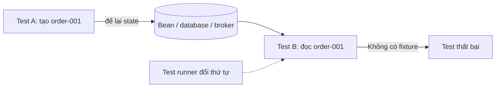
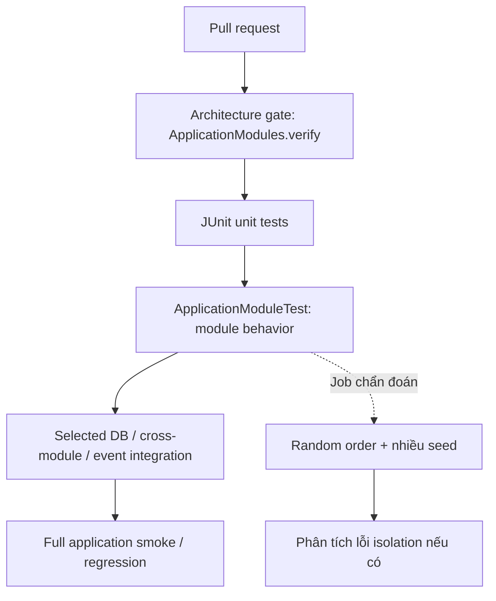

# Test order và vì sao nên tránh phụ thuộc thứ tự trong JUnit Jupiter và Spring Modulith

## 1. Bài test xanh vì đúng nghiệp vụ hay vì chạy đúng thứ tự?

Giả sử module `order` có hai bài kiểm thử:

- Bài **A** tạo một đơn hàng `order-001`.
- Bài **B** đọc lại đơn hàng ấy và kiểm tra nó còn tồn tại.

Nếu B chỉ xanh sau khi A đã chạy, B **không độc lập**: chạy B riêng từ IDE sẽ thất bại; đổi cách sắp thứ tự hoặc chạy song song trên CI có thể gây lỗi khó tái hiện. Trường hợp nguy hiểm hơn là B vẫn xanh nhờ **dữ liệu còn sót từ lần chạy trước**, che đi một hồi quy thực sự.

Trong ứng dụng **Spring Modulith**, vấn đề này còn dễ gặp hơn vì nhiều bài `@ApplicationModuleTest` sử dụng chung Spring `ApplicationContext` được cache, singleton bean, datasource, event publisher và đôi khi listener bất đồng bộ. Một bài module test có phạm vi hẹp **không tự động** đồng nghĩa mọi trạng thái được tạo mới cho từng phương thức JUnit.

**Nguyên tắc cốt lõi:** Mỗi test phải tự chuẩn bị tiền điều kiện, tự thực hiện hành động và tự xác minh kết quả; nó phải thành công khi **chạy riêng**, **chạy trước hoặc sau bài khác**, và **chạy lại** trong môi trường đã được thiết lập đúng.

Bài thuộc chương **JUnit integration** của học phần **SPRING_MODULITH_VERIFICATION_TESTING**. Học phần rèn kỹ năng kiểm chứng ranh giới bằng `ApplicationModules` và quy tắc phụ thuộc giữa module, thực hành `@ApplicationModuleTest`, kiểm thử sự kiện, cơ sở dữ liệu và tích hợp, kết hợp quality gate trong CI để ngăn phụ thuộc sai và hồi quy.

### Mục tiêu học tập

Sau bài, bạn có thể:

- Phân biệt **thứ tự thực thi JUnit**, **vòng đời test instance**, **Spring context cache** và **dữ liệu nghiệp vụ tồn tại lâu hơn một test**.
- Sử dụng đúng `@TestMethodOrder`, `@Order` và các `MethodOrderer` mà không dựa vào chúng để che lỗi isolation.
- Phát hiện và sửa anti-pattern “test sau dùng kết quả của test trước”.
- Viết `@ApplicationModuleTest` với fixture tự chủ, `@MockitoBean`, `PublishedEvents` và cleanup đúng phạm vi.
- Dùng `MethodOrderer.Random` và seed tái hiện để tìm dependency vô tình giữa test.
- Áp dụng rollback/cleanup cho database, `Scenario` cho event flow, và `ApplicationModules.verify()` làm quality gate CI.

## 2. JUnit Jupiter thật sự quyết định test order như thế nào?

JUnit Jupiter **không hứa** chạy test method theo thứ tự khai báo trong file Java, theo tên chữ cái hay theo tên `@DisplayName` khi bạn **không** cấu hình orderer. Theo JUnit User Guide, mặc định JUnit dùng một thuật toán **deterministic nhưng cố ý không hiển nhiên** (*deterministic but intentionally nonobvious*).

Điều đó nghĩa là:

1. Một test suite thường chạy theo thứ tự lặp lại trong điều kiện tương tự.
2. Không được xem thứ tự đó là **API hay hợp đồng** mà chương trình kiểm thử có quyền phụ thuộc.
3. Thay đổi phiên bản, tập phương thức, cấu hình runner, cách chọn test hoặc chạy song song có thể làm thứ tự quan sát khác đi.

### Các lựa chọn `MethodOrderer`

| Cơ chế | Nguyên tắc | Phù hợp khi |
| --- | --- | --- |
| **Mặc định** | Thuật toán ổn định nhưng không hiển nhiên | Các test **không phụ thuộc thứ tự** |
| `MethodOrderer.MethodName` | Sắp theo tên method và danh sách tham số | Tạo cách trình bày có thể dự đoán; **không** nên biến tên thành dependency |
| `MethodOrderer.DisplayName` | Sắp theo display name | Điều chỉnh thứ tự báo cáo theo tên dễ đọc |
| `MethodOrderer.OrderAnnotation` | Sắp theo giá trị `@Order` | Trường hợp **cố ý cần một trình tự** và có lý do rõ |
| `MethodOrderer.Random` | Sắp giả ngẫu nhiên | **Phát hiện test phụ thuộc thứ tự** |

Ví dụ cấu hình thứ tự tường minh:

```java
package com.example.shop.testing;

import org.junit.jupiter.api.MethodOrderer;
import org.junit.jupiter.api.Order;
import org.junit.jupiter.api.Test;
import org.junit.jupiter.api.TestMethodOrder;

@TestMethodOrder(MethodOrderer.OrderAnnotation.class)
class PresentationOrderExample {

    @Test
    @Order(1)
    void rejectsInvalidValues() {
        // Phải có assertions thật trong ứng dụng thực tế.
    }

    @Test
    @Order(2)
    void acceptsValidValues() {
        // Không được dựa vào side effect từ method trước.
    }
}
```

`@Order` trên **test methods** chỉ được dùng để sắp thứ tự theo số khi JUnit đã chọn `MethodOrderer.OrderAnnotation` (tường minh hoặc qua cấu hình mặc định). Đặt `@Order(1)` mà không có orderer phù hợp **không phải bảo đảm rằng test sẽ chạy đầu tiên**.

**Không nhầm với ordering của class:** `@TestClassOrder` cùng `ClassOrderer` điều khiển thứ tự **lớp test** hoặc các lớp `@Nested`. `@TestMethodOrder` điều khiển **method test** trong phạm vi áp dụng. Cả hai đều không thay thế isolation.

## 3. Vì sao test-order dependency là lỗi thiết kế?



Một test phụ thuộc bài khác thường có các triệu chứng sau:

| Triệu chứng | Nguyên nhân có thể | Điều đang bị che |
| --- | --- | --- |
| Cả lớp xanh, chạy riêng một method đỏ | Method dựa vào fixture do method khác tạo | Thiếu setup trong chính test đó |
| Chạy theo ABC xanh, đổi tên method lại đỏ | Vô tình phụ thuộc thứ tự hiện tại | Coupling vào runner thay vì hợp đồng nghiệp vụ |
| CI khác IDE | Context cache, profile, seed, test selection, database hoặc parallelism khác | Hành vi không độc lập môi trường |
| Một test chỉ thất bại khi chạy sau test khác | Singleton/static data hoặc mock stubbing còn sót | Không reset/dọn đúng tài nguyên |
| Bài kiểm tra DB xanh lần đầu, đỏ lần hai | Unique key/record tồn từ lần trước | Không dùng ID riêng hoặc thiếu cleanup |
| Event test thỉnh thoảng nhận event sai | Correlation ID không riêng, async listener chưa hoàn tất | Assertion quá rộng và race condition |

Một anti-pattern thường gặp là **test B “kiểm tra kết quả A”**. Khi đó không còn hai test độc lập, mà thực chất là **một kịch bản gồm hai bước** bị chia sai thành hai phương thức JUnit. Nên gộp hai bước vào **cùng một test** (Arrange–Act–Assert), hoặc cho B tự tạo dữ liệu tiền điều kiện.

## 4. Anti-pattern JUnit thuần: dùng `@Order` để chuyền trạng thái

Đoạn sau minh họa **cách không nên viết**; mục tiêu học tập là nhận diện vấn đề, **không** sử dụng làm bài kiểm thử chuẩn trong CI.

```java
package com.example.shop.testing;

import static org.junit.jupiter.api.Assertions.assertEquals;

import java.util.ArrayList;
import java.util.List;
import org.junit.jupiter.api.MethodOrderer;
import org.junit.jupiter.api.Order;
import org.junit.jupiter.api.Test;
import org.junit.jupiter.api.TestInstance;
import org.junit.jupiter.api.TestMethodOrder;

@TestInstance(TestInstance.Lifecycle.PER_CLASS)
@TestMethodOrder(MethodOrderer.OrderAnnotation.class)
class FragileOrderTests {

    private final List<String> orders = new ArrayList<>();

    @Test
    @Order(1)
    void createOrder() {
        orders.add("order-001");
    }

    @Test
    @Order(2)
    void findPreviouslyCreatedOrder() {
        assertEquals(List.of("order-001"), orders);
    }
}
```

Vì `PER_CLASS` dùng **một test instance** và `@Order` buộc `createOrder()` chạy trước, bài thứ hai có thể xanh. Nhưng khi chọn chạy **chỉ** `findPreviouslyCreatedOrder()` từ IDE, danh sách rỗng, test thất bại. Nếu bỏ `@TestMethodOrder` hoặc đảo thứ tự, lỗi có thể lộ ra.

Lỗi không nằm ở `@Order` tự thân; lỗi là **test B không tự thiết lập trạng thái** mà B yêu cầu. Việc chú thích rằng “phải chạy cả lớp để test B hoạt động” không giải quyết sự thiếu độc lập.

### Refactor: mỗi test tự tạo dữ liệu cần thiết

```java
package com.example.shop.testing;

import static org.junit.jupiter.api.Assertions.assertEquals;
import static org.junit.jupiter.api.Assertions.assertTrue;

import java.util.ArrayList;
import java.util.List;
import org.junit.jupiter.api.BeforeEach;
import org.junit.jupiter.api.Test;

class IndependentOrderTests {

    private List<String> orders;

    @BeforeEach
    void createFreshFixture() {
        orders = new ArrayList<>();
    }

    @Test
    void createsOneOrder() {
        orders.add("order-001");
        assertEquals(1, orders.size());
    }

    @Test
    void readsOrderThatThisTestCreated() {
        orders.add("order-001");
        assertTrue(orders.contains("order-001"));
    }
}
```

Mỗi test có fixture riêng và không cần bảo đảm method nào chạy trước. Bạn có thể chuyển bước setup lặp thành **helper** được gọi ở chính test, nhưng helper không được phụ thuộc vào việc test khác đã chạy.

### Checklist Arrange–Act–Assert

Trong từng testcase, hãy tự hỏi:

1. **Arrange:** Test có tự chuẩn bị đầy đủ dữ liệu, mock, profile và điều kiện không?
2. **Act:** Hành động cần kiểm chứng có được gọi **trong chính testcase** không?
3. **Assert:** Kết quả được kiểm chứng có thuộc riêng stimulus vừa tạo không?
4. **Cleanup:** Side effect có được rollback/xóa để test sau không chịu ảnh hưởng không?

## 5. Bẫy đặc biệt trong `@ApplicationModuleTest`: lifecycle `PER_CLASS`

Theo Javadoc của **Spring Modulith 1.4**, `@ApplicationModuleTest` được meta-annotate với `@SpringBootTest`, các extension Modulith và `@TestInstance(PER_CLASS)`. Nghĩa là với phiên bản đó, JUnit có thể dùng **cùng một instance của lớp test** trong nhiều test methods.

Song song với điều đó, **Spring TestContext cache** có thể tái sử dụng một `ApplicationContext` cho nhiều method hoặc lớp có cấu hình tương đương. Đây là **hai cấp vòng đời khác nhau**:

| Phần trạng thái | Tồn tại ở đâu? | Vì sao có thể rò rỉ? |
| --- | --- | --- |
| Field Java trên test class | Test instance `PER_CLASS` | Test khác dùng lại field đã bị thay đổi |
| `static` field | JVM/classloader | Còn giá trị qua nhiều test class |
| Singleton `@Service`/`@Repository` | Spring `ApplicationContext` | Context được cache và bean không tự tạo mới |
| Mockito bean `@MockitoBean` | Spring TestContext | Mock được reset theo chính sách, không đồng nghĩa reset state nghiệp vụ khác |
| H2/PostgreSQL, Redis, message broker | Hạ tầng ngoài test instance | Dữ liệu tồn tại sau khi method JUnit kết thúc |
| Async listener/transaction khác thread | Executor và transaction riêng | Side effect có thể đến muộn hoặc đã commit |

**Không suy luận:** `@TestInstance(PER_METHOD)` sẽ tạo lại Spring context cho mỗi test. Nó chỉ ảnh hưởng vòng đời **test object**. Tương tự, `@TestInstance(PER_CLASS)` **không bắt buộc** các test phải phụ thuộc nhau — chỉ cần không dùng field mutable để truyền dữ liệu.

Khi dùng Spring Modulith 2.x hoặc stack khác, kiểm tra Javadoc của phiên bản thực tế thay vì mặc định mọi version đều có cùng meta-annotation. Quy tắc độc lập của testcase vẫn đúng bất kể lifecycle.

## 6. Chuẩn bị ứng dụng mẫu với state có thể quan sát

Ví dụ Java dưới đây dùng **Spring Boot 3.4/3.5, Spring Framework 6.2, Spring Modulith 1.4 và JUnit Jupiter 5** với các BOM tương thích; Java 17+. `@MockitoBean` có từ Spring Framework 6.2. Với Spring Boot 4/Spring Modulith 2.x, cần kiểm tra phiên bản và package import tương ứng.

Ứng dụng gồm module `order`, API công khai `inventory` và một module `notification` độc lập. Để quan sát rõ state, ví dụ dùng **in-memory `OrderBook`** thuộc module `order`; trong ứng dụng production nó có thể được thay bằng repository JDBC/JPA.

```text
src/
├── main/java/com/example/shop/
│   ├── ShopApplication.java
│   ├── inventory/
│   │   ├── StockAvailability.java
│   │   └── StockAvailabilityService.java
│   ├── order/
│   │   ├── OrderRecord.java
│   │   ├── OrderBook.java
│   │   ├── OrderPlaced.java
│   │   └── OrderService.java
│   └── notification/
│       └── NotificationFacade.java
└── test/java/com/example/shop/
    ├── order/
    │   ├── FragileOrderModuleTests.java
    │   └── IndependentOrderModuleTests.java
    └── ModuleArchitectureTests.java
```

### Các dependency Maven

Trong dự án đã quản lý Spring Boot và Spring Modulith BOM phù hợp:

```xml
<dependency>
    <groupId>org.springframework.boot</groupId>
    <artifactId>spring-boot-starter</artifactId>
</dependency>
<dependency>
    <groupId>org.springframework.boot</groupId>
    <artifactId>spring-boot-starter-test</artifactId>
    <scope>test</scope>
</dependency>
<dependency>
    <groupId>org.springframework.modulith</groupId>
    <artifactId>spring-modulith-starter-test</artifactId>
    <scope>test</scope>
</dependency>
```

Đây là đoạn dependency cần thiết, không phải toàn bộ `pom.xml`. Ví dụ lõi không cần datasource/broker để minh họa vấn đề test order; phần sau phân tích cách mở rộng sang database và listener thực.

### Cấu hình ứng dụng gốc

File `src/main/java/com/example/shop/ShopApplication.java`:

```java
package com.example.shop;

import org.springframework.boot.SpringApplication;
import org.springframework.boot.autoconfigure.SpringBootApplication;

@SpringBootApplication
public class ShopApplication {
    public static void main(String[] args) {
        SpringApplication.run(ShopApplication.class, args);
    }
}
```

### API công khai của module `inventory`

File `src/main/java/com/example/shop/inventory/StockAvailability.java`:

```java
package com.example.shop.inventory;

public interface StockAvailability {
    boolean available(String sku, int quantity);
}
```

File `src/main/java/com/example/shop/inventory/StockAvailabilityService.java`:

```java
package com.example.shop.inventory;

import org.springframework.stereotype.Service;

@Service
public class StockAvailabilityService implements StockAvailability {

    @Override
    public boolean available(String sku, int quantity) {
        return "SKU-READY".equals(sku) && quantity <= 3;
    }
}
```

Module `order` chỉ phụ thuộc vào **interface công khai** `StockAvailability`, không import class thuộc `inventory.internal`. Trong bài `@ApplicationModuleTest` `STANDALONE`, implementation `StockAvailabilityService` được chủ ý thay bằng mock.

### Bản ghi đơn hàng và in-memory store

File `src/main/java/com/example/shop/order/OrderRecord.java`:

```java
package com.example.shop.order;

import java.util.UUID;

public record OrderRecord(UUID orderId, String sku, int quantity) {}
```

File `src/main/java/com/example/shop/order/OrderBook.java`:

```java
package com.example.shop.order;

import java.util.Optional;
import java.util.UUID;
import java.util.concurrent.ConcurrentHashMap;
import java.util.concurrent.ConcurrentMap;
import org.springframework.stereotype.Repository;

@Repository
public class OrderBook {

    private final ConcurrentMap<UUID, OrderRecord> records =
            new ConcurrentHashMap<>();

    public void save(OrderRecord order) {
        if (records.putIfAbsent(order.orderId(), order) != null) {
            throw new IllegalStateException("DUPLICATE_ORDER");
        }
    }

    public Optional<OrderRecord> findById(UUID id) {
        return Optional.ofNullable(records.get(id));
    }

    public void deleteById(UUID id) {
        records.remove(id);
    }

    public int count() {
        return records.size();
    }
}
```

`OrderBook` là bean singleton của Spring: map được chia sẻ giữa các lần gọi nếu context được cache. API `deleteById` được sử dụng trong ví dụ để xóa **đúng record của testcase** thay vì xóa mù mọi dữ liệu của context. Trong ứng dụng production với database, cần thiết kế transaction/cleanup tương ứng.

### Event và use case của module `order`

File `src/main/java/com/example/shop/order/OrderPlaced.java`:

```java
package com.example.shop.order;

import java.util.UUID;

public record OrderPlaced(UUID orderId, String sku, int quantity) {}
```

File `src/main/java/com/example/shop/order/OrderService.java`:

```java
package com.example.shop.order;

import java.util.UUID;
import com.example.shop.inventory.StockAvailability;
import org.springframework.beans.factory.annotation.Value;
import org.springframework.context.ApplicationEventPublisher;
import org.springframework.stereotype.Service;

@Service
public class OrderService {

    private final StockAvailability stock;
    private final OrderBook book;
    private final ApplicationEventPublisher events;
    private final int maxQuantity;

    public OrderService(StockAvailability stock,
                        OrderBook book,
                        ApplicationEventPublisher events,
                        @Value("${orders.max-quantity:3}") int maxQuantity) {
        this.stock = stock;
        this.book = book;
        this.events = events;
        this.maxQuantity = maxQuantity;
    }

    public void place(UUID orderId, String sku, int quantity) {
        if (orderId == null || sku == null || sku.isBlank()
                || quantity <= 0 || quantity > maxQuantity) {
            throw new IllegalArgumentException("INVALID_ORDER");
        }
        if (!stock.available(sku, quantity)) {
            throw new IllegalStateException("OUT_OF_STOCK");
        }
        book.save(new OrderRecord(orderId, sku, quantity));
        events.publishEvent(new OrderPlaced(orderId, sku, quantity));
    }
}
```

Nghiệp vụ từ chối input sai **trước khi gọi kho**, từ chối đơn hết hàng **trước khi lưu**, và chỉ publish event sau khi lưu bản ghi. Không có `@Transactional` ở ví dụ in-memory: vì vậy không được suy rằng ghi map và phát event là một transaction database nguyên tử. Để kiểm thử tính nguyên tử trong hệ thống thật, cần JPA/JDBC transaction và listener event phù hợp.

Thêm bean độc lập ở module `notification` để thấy giới hạn scanning:

```java
package com.example.shop.notification;

import org.springframework.stereotype.Service;

@Service
public class NotificationFacade {
    public String status() {
        return "ready";
    }
}
```

Bean này không được khởi tạo mặc định trong `STANDALONE` test của `order`. Phần nội dung còn lại sẽ dùng chính ứng dụng mẫu này để so sánh test phụ thuộc thứ tự với test độc lập.

## 7. Anti-pattern trong module test: “tạo trước, kiểm tra sau”

File `src/test/java/com/example/shop/order/FragileOrderModuleTests.java`:

```java
package com.example.shop.order;

import static org.assertj.core.api.Assertions.assertThat;
import static org.mockito.BDDMockito.given;

import java.util.UUID;
import com.example.shop.inventory.StockAvailability;
import org.junit.jupiter.api.MethodOrderer;
import org.junit.jupiter.api.Order;
import org.junit.jupiter.api.Test;
import org.junit.jupiter.api.TestMethodOrder;
import org.springframework.beans.factory.annotation.Autowired;
import org.springframework.modulith.test.ApplicationModuleTest;
import org.springframework.test.context.bean.override.mockito.MockitoBean;

// ANTI-PATTERN: chỉ để phân tích, không đưa vào CI như test chuẩn.
@ApplicationModuleTest
@TestMethodOrder(MethodOrderer.OrderAnnotation.class)
class FragileOrderModuleTests {

    @Autowired OrderService orders;
    @Autowired OrderBook book;
    @MockitoBean StockAvailability stock;

    private UUID orderId;

    @Test
    @Order(1)
    void createsOrderForAnotherTest() {
        given(stock.available("SKU-READY", 2)).willReturn(true);

        orderId = UUID.randomUUID();
        orders.place(orderId, "SKU-READY", 2);
    }

    @Test
    @Order(2)
    void readsOrderCreatedByPreviousTest() {
        assertThat(orderId).isNotNull();
        assertThat(book.findById(orderId)).isPresent();
    }
}
```

Đây là **mẫu lỗi cố ý**. Vì Spring Modulith 1.4 áp dụng `PER_CLASS`, field `orderId` có thể còn giá trị giữa hai phương thức; `OrderBook` lại là singleton trong Spring context. `@Order(1)` và `@Order(2)` khiến B thường chạy sau A khi chạy cả lớp.

**Thử nghiệm để thấy lỗi:**

1. Chạy cả lớp theo đúng `OrderAnnotation`: nhiều khả năng hai test đều xanh.
2. Chỉ chạy `readsOrderCreatedByPreviousTest()`: `orderId` không được thiết lập, assertion đầu thất bại.
3. Bỏ `@TestMethodOrder` hoặc đổi sang `MethodOrderer.Random`: thứ tự không còn bảo đảm theo số, B có thể chạy trước A và thất bại.
4. Chạy lại cùng context sau khi A đã tạo đơn: record có thể vẫn tồn tại, khiến test khác thấy dữ liệu không thuộc mình.

Test thứ nhất cũng **không có assertion** kiểm chứng kết quả tạo đơn và **không cleanup** record sau khi test xong. Việc dùng `@Order` ở đây che đi **hai lỗi thiết kế độc lập**: thiếu assertion và thiếu test isolation.

## 8. Sửa đúng: mỗi module test tự tạo ID, tự assert và tự cleanup

File `src/test/java/com/example/shop/order/IndependentOrderModuleTests.java`:

```java
package com.example.shop.order;

import static org.assertj.core.api.Assertions.assertThat;
import static org.assertj.core.api.Assertions.assertThatThrownBy;
import static org.mockito.BDDMockito.given;
import static org.mockito.BDDMockito.then;

import java.util.UUID;
import com.example.shop.inventory.StockAvailability;
import org.junit.jupiter.api.DisplayName;
import org.junit.jupiter.api.MethodOrderer;
import org.junit.jupiter.api.Tag;
import org.junit.jupiter.api.Test;
import org.junit.jupiter.api.TestMethodOrder;
import org.springframework.beans.factory.annotation.Autowired;
import org.springframework.modulith.test.ApplicationModuleTest;
import org.springframework.modulith.test.PublishedEvents;
import org.springframework.test.context.TestPropertySource;
import org.springframework.test.context.bean.override.mockito.MockitoBean;

@Tag("module")
@DisplayName("Order — các hành vi không phụ thuộc thứ tự test")
@ApplicationModuleTest
@TestPropertySource(properties = "orders.max-quantity=3")
@TestMethodOrder(MethodOrderer.Random.class)
class IndependentOrderModuleTests {

    @Autowired OrderService orders;
    @Autowired OrderBook book;
    @MockitoBean StockAvailability stock;

    @Test
    @DisplayName("Đủ hàng → lưu đúng đơn và phát OrderPlaced")
    void savesAndPublishesOrderWhenStockIsAvailable(
            PublishedEvents events) {

        UUID id = UUID.randomUUID();

        try {
            given(stock.available("SKU-READY", 2)).willReturn(true);
            orders.place(id, "SKU-READY", 2);

            assertThat(book.findById(id))
                    .contains(new OrderRecord(id, "SKU-READY", 2));
            assertThat(events.ofType(OrderPlaced.class)
                    .matching(OrderPlaced::orderId, id))
                    .hasSize(1);
            then(stock).should().available("SKU-READY", 2);
        } finally {
            book.deleteById(id);
        }
    }

    @Test
    @DisplayName("Số lượng sai → không gọi kho, không lưu, không phát event")
    void rejectsInvalidQuantityWithoutSideEffects(
            PublishedEvents events) {

        UUID id = UUID.randomUUID();

        try {
            assertThatThrownBy(() ->
                    orders.place(id, "SKU-READY", 4))
                    .isInstanceOf(IllegalArgumentException.class)
                    .hasMessage("INVALID_ORDER");

            then(stock).shouldHaveNoInteractions();
            assertThat(book.findById(id)).isEmpty();
            assertThat(events.ofType(OrderPlaced.class)).isEmpty();
        } finally {
            book.deleteById(id);
        }
    }

    @Test
    @DisplayName("Hết hàng → từ chối trước khi lưu hoặc phát event")
    void rejectsUnavailableStockWithoutSideEffects(
            PublishedEvents events) {

        UUID id = UUID.randomUUID();

        try {
            given(stock.available("SKU-OUT", 1)).willReturn(false);

            assertThatThrownBy(() ->
                    orders.place(id, "SKU-OUT", 1))
                    .isInstanceOf(IllegalStateException.class)
                    .hasMessage("OUT_OF_STOCK");

            assertThat(book.findById(id)).isEmpty();
            assertThat(events.ofType(OrderPlaced.class)).isEmpty();
            then(stock).should().available("SKU-OUT", 1);
        } finally {
            book.deleteById(id);
        }
    }
}
```

### Vì sao phiên bản mới không phụ thuộc thứ tự?

- **Mỗi test tự tạo `UUID`** nên không cần field chung như `orderId` trong anti-pattern.
- **Mỗi test tự tạo stimulus**: stub mock, gọi use case và kiểm chứng kết quả đều nằm trong cùng method.
- **Assertion có phạm vi cụ thể**: tra record bằng `id` do chính test tạo, lọc `OrderPlaced` theo correlation ID và kiểm tra không phát event ở nhánh từ chối.
- **`finally` cleanup** ngay cả khi assertion thất bại giữa chừng; không cần “test cleanup” được chạy **sau** test khác.
- **`@MockitoBean` được Spring Test quản lý reset** theo chính sách mặc định giữa các test methods; mỗi method vẫn chủ động stub dữ liệu nó dùng.
- **`MethodOrderer.Random`** được dùng ở đây như một bước **chẩn đoán/test độ độc lập**, không phải thành phần bắt buộc để tính năng nghiệp vụ chạy đúng.

Lớp được nạp theo `@ApplicationModuleTest` ở module `order` với `STANDALONE`. `OrderService` và `OrderBook` là bean thật của module `order`; `StockAvailability` là mock ở API module `inventory`. Test **không** giả vờ đã kiểm chứng logic `StockAvailabilityService` thật.

**Giới hạn của ví dụ:** `OrderBook` là repository in-memory đồng bộ. `finally` xóa record theo ID sau test là đủ cho phạm vi minh họa, nhưng trong ứng dụng thật với listener bất đồng bộ, database transaction hoặc message broker, việc cleanup có thể cần đợi side effect hoàn tất; các phần sau bàn riêng.

### Vì sao không reset toàn bộ `OrderBook` ở `@BeforeEach`?

Xóa mọi record trước mỗi test có vẻ đơn giản, nhưng có thể làm hỏng testcase khác đang chạy song song hoặc che lỗi do side effect còn đến muộn. **Xóa theo ID của testcase** chính xác hơn khi nhiều bài test chia sẻ datasource/context. Nếu test cần một trạng thái “database trống hoàn toàn”, hãy dùng database/schema/transaction riêng hoặc một fixture được quản lý rõ, thay vì xóa toàn bộ dữ liệu không thuộc mình.

## 9. `@BeforeEach`, `@AfterEach` và `@TestInstance`: dùng đúng mục đích

JUnit Jupiter cung cấp callback để tạo/thu hồi tài nguyên per test:

| Công cụ | Chạy khi nào? | Sử dụng thích hợp |
| --- | --- | --- |
| `@BeforeEach` | Trước **mỗi** test method hoặc invocation | Reset biến tạm, tạo fixture đặc trưng |
| `@AfterEach` | Sau **mỗi** test method hoặc invocation | Xóa tài nguyên do test vừa tạo |
| `@BeforeAll` | Trước tất cả test của lớp | Setup tài nguyên thật sự dùng chung và bất biến |
| `@AfterAll` | Sau tất cả test của lớp | Đóng tài nguyên chung |
| `@TestInstance(PER_METHOD)` | JUnit tạo instance mới cho mỗi method/invocation | Hạn chế chia sẻ field instance |
| `@TestInstance(PER_CLASS)` | JUnit dùng cùng instance của lớp | Tiện constructor/BeforeAll non-static nhưng phải quản lý field mutable |

Một pattern dùng `@AfterEach` thay `try/finally`:

```java
@ApplicationModuleTest
class OrderCleanupExample {

    @Autowired OrderBook book;

    private UUID createdOrderId;

    @BeforeEach
    void resetTestLocalTracking() {
        createdOrderId = null;
    }

    @AfterEach
    void deleteOnlyWhatThisTestCreated() {
        if (createdOrderId != null) {
            book.deleteById(createdOrderId);
        }
    }

    // @Test: gán createdOrderId trước khi ghi order,
    // rồi dùng cùng ID để query/assert.
}
```

Đây là **mẫu cấu trúc**, không phải bài test đầy đủ. Nó cần import `Autowired`, `BeforeEach`, `AfterEach`, `UUID` và `ApplicationModuleTest` khi đặt vào dự án. Pattern dùng field `createdOrderId` **chỉ an toàn trong chế độ thực thi tuần tự** hoặc khi tracking state được cô lập cho mỗi invocation. Với `PER_CLASS` và chạy song song, các method có thể ghi đè field này: hãy ưu tiên `try/finally` với **biến cục bộ** hoặc cơ chế fixture per invocation thích hợp.

**Tránh nhầm:** `@BeforeEach` cũng không xóa `static` field, database, broker hay mọi singleton Spring nếu bạn không tự viết logic dọn tương ứng. `PER_METHOD` không tự reset `ApplicationContext`. `@DirtiesContext` chỉ nên dùng khi context thật sự bị thay đổi đến mức không tái sử dụng an toàn, không phải giải pháp mặc định cho mỗi method.

## 10. Thứ tự của `@Nested` test và nhóm scenario

`@Nested` của JUnit Jupiter tạo nhóm bối cảnh, **không phải** cách đặt dependency “nhóm A chạy để chuẩn bị cho nhóm B”. Các lớp trong có thể dùng `@BeforeEach` của lớp ngoài; outer setup chạy trước inner setup. Tuy nhiên, không nên giả định nhóm “Create” sẽ chạy trước nhóm “Read”.

```java
@DisplayName("Order — các scenario độc lập")
class IndependentNestedScenarios {

    @Nested
    @DisplayName("Khi có đơn hợp lệ")
    class ValidOrder {
        @Test
        void createsAnOrderWithItsOwnFixture() {}
    }

    @Nested
    @DisplayName("Khi cần đọc một đơn")
    class ReadOrder {
        @Test
        void createsFixtureAndReadsItWithinSameTest() {}
    }
}
```

Khối trên chỉ minh họa **tên và nhóm**, không có assertion nghiệp vụ. Khi cần **sắp thứ tự nhóm nested để trình bày**, JUnit cung cấp `@TestClassOrder(ClassOrderer.OrderAnnotation.class)` đặt trên lớp ngoài cùng `@Order` trên các lớp `@Nested`. Nhưng **thứ tự trình bày không được biến thành tiền đề dữ liệu**.

Nếu một quy trình thật gồm **ba bước bắt buộc** như tạo đơn → xác nhận thanh toán → hoàn tất, hãy viết **một test kịch bản có ba bước** và assertion ở các điểm cần thiết. Bằng cách đó bạn thể hiện đúng thứ tự **nghiệp vụ** mà không phụ thuộc thứ tự **phương thức JUnit**.

## 11. Database và transaction: rollback không đồng nghĩa mọi thứ sạch

Khi `OrderBook` in-memory được thay bằng JPA/JDBC repository, database trở thành nguồn **state dùng chung**. Nhiều lỗi phụ thuộc thứ tự đến từ việc một test insert record nhưng không xóa, khiến test sau bị trùng unique key hoặc nhận kết quả của lần chạy trước.

Spring TestContext hỗ trợ **test-managed transaction** nếu context có `PlatformTransactionManager` và test được gắn `@Transactional`. Theo mặc định, transaction này được **rollback sau mỗi test method**. Trong các trường hợp đồng bộ đơn giản, đây là một cơ chế isolation thuận tiện:

```java
package com.example.shop.order;

import org.junit.jupiter.api.Test;
import org.springframework.modulith.test.ApplicationModuleTest;
import org.springframework.transaction.annotation.Transactional;

@ApplicationModuleTest
class OrderJdbcTransactionTests {

    @Test
    @Transactional
    void persistsAnOrderWithinThisTestTransaction() {
        // @Autowired JdbcTemplate/Repository thật.
        // Tạo orderId riêng, insert rồi query/assert chính ID đó.
        // Transaction test mặc định rollback sau phương thức.
    }
}
```

Đây là **khung kiến thức**, không phải test có thể chạy độc lập với ứng dụng in-memory ở phần 6. Muốn kiểm chứng JDBC/JPA thực, cần dependency database, `DataSource`, schema, repository và assertion đầy đủ. `@Transactional` không tự tạo database hoặc transaction manager.

### Phân biệt loại transaction và thời điểm cleanup

| Trường hợp | Phạm vi transaction/side effect | Chiến lược isolation |
| --- | --- | --- |
| Repository được gọi đồng bộ trong test `@Transactional` | Thường tham gia test-managed transaction | Rollback sau test, dữ liệu riêng theo ID |
| `@BeforeEach` và `@AfterEach` của một test transactional | Chạy trong test-managed transaction theo Spring TestContext | Có thể chuẩn bị/dọn dữ liệu trong transaction |
| `@BeforeAll` và `@AfterAll` | Không tự ở trong transaction per-test | Dùng transaction tường minh nếu cần |
| `@Transactional(propagation = REQUIRES_NEW)` ở application code | Có thể commit ở một transaction khác | Cleanup riêng, đừng dựa vào rollback của test |
| `@TransactionalEventListener(AFTER_COMMIT)` | Listener chờ transaction nguồn commit | Test rollback mặc định có thể khiến listener không chạy |
| HTTP server thật / listener `@Async` | Có thể dùng thread và transaction khác | Chờ hoàn tất, xóa dữ liệu do nó tạo |
| `Scenario.stimulate(...)` hoặc `publish(...)` | Stimulus dùng transaction riêng để kích hoạt event listeners | Cleanup side effect đã commit |

**Đặc biệt nguy hiểm:** dùng JUnit `assertTimeoutPreemptively(...)` bao quanh thao tác database đang phụ thuộc test-managed transaction. Spring TestContext liên kết transaction với thread thực thi; timeout kiểu preemptive có thể chạy body trên thread khác và **ghi dữ liệu ngoài transaction đang được rollback**. Với kiểm thử transaction, ưu tiên timeout không đổi thread hoặc cơ chế đợi theo điều kiện được thiết kế cho async flow.

Nếu test đặt `@Commit` hoặc `@Rollback(false)` thì dữ liệu có thể cố ý tồn tại sau phương thức, nhưng không được coi điều đó là fixture “cho test kế tiếp”. Khi cần kiểm chứng hành vi sau commit, hãy **thực hiện commit và assert trong cùng một testcase**, rồi cleanup dữ liệu bền vững đã tạo.

### Ví dụ một phép thử “sau commit” có chủ đích

Spring Test hỗ trợ `TestTransaction` để điều khiển kết thúc transaction hiện tại trong một test có `@Transactional`. Mẫu minh họa:

```java
@Test
@Transactional
void recordIsVisibleAfterExplicitCommit() {
    // Tạo record với UUID riêng bằng repository thật.

    TestTransaction.flagForCommit();
    TestTransaction.end(); // Kết thúc và commit transaction test.

    // Truy vấn lại sau commit, bằng ID vừa tạo, trong cùng testcase.
    // Xóa dữ liệu đã commit bằng cleanup riêng.
}
```

Đoạn trên yêu cầu import `org.springframework.test.context.transaction.TestTransaction` và hạ tầng database thật. Nó **không** chạy độc lập vì còn thiếu repository và assertion, nhưng chỉ ra nguyên tắc quan trọng: **đừng tách “commit” thành test A và “verify commit” thành test B**.

## 12. Event flow và async listener: dependency theo thời gian cũng là dependency

Spring Modulith khuyến khích giao tiếp giữa các module bằng domain event khi phù hợp. Ví dụ `order` phát `OrderPlaced`, còn `notification` xử lý event sau khi transaction commit. Nếu test B chạy ngay sau test A rồi đợi thấy “thông báo đã gửi”, nó có thể đang dựa vào:

- Event do A publish, không phải stimulus của B.
- Listener A còn chạy bất đồng bộ khi B bắt đầu.
- Database/event publication log chưa được cleanup.
- Một event cùng type nhưng **sai correlation ID**.

**Không nên viết** “test A phát event → test B chờ consumer xử lý”. Khi mục tiêu là **một event flow hoàn chỉnh**, hãy đặt cả stimulus và assertion trong **một test**.

### `PublishedEvents` và `Scenario` giải quyết hai câu hỏi khác nhau

| API | Câu hỏi nó giúp trả lời | Điều nó **không** tự chứng minh |
| --- | --- | --- |
| `PublishedEvents` | Trong testcase, event nguồn đã được publish đúng payload/ID chưa? | Consumer khác module đã xử lý thành công hay chưa |
| `Scenario` | Sau stimulus, event kết quả hoặc trạng thái mong đợi có xuất hiện trong timeout không? | Giao thức broker thật, retry, serialization nếu không được dùng trong test |

Mẫu test event flow (giả định ứng dụng được **bổ sung** listener và type `NotificationSent` trong module `notification`, cùng transaction manager cần thiết):

```java
package com.example.shop.order;

import static org.assertj.core.api.Assertions.assertThat;

import java.time.Duration;
import java.util.UUID;
import com.example.shop.inventory.StockAvailability;
import com.example.shop.notification.NotificationSent;
import org.junit.jupiter.api.Test;
import org.springframework.modulith.test.ApplicationModuleTest;
import org.springframework.modulith.test.Scenario;
import org.springframework.test.context.bean.override.mockito.MockitoBean;

@ApplicationModuleTest(extraIncludes = "notification")
class OrderNotificationFlowTests {

    @MockitoBean StockAvailability stock;

    @Test
    void handlesThisOrderEventWithoutRelyingOnPreviousTests(
            Scenario scenario) {

        UUID id = UUID.randomUUID();

        scenario.publish(new OrderPlaced(id, "SKU-01", 1))
                .andWaitAtMost(Duration.ofSeconds(5))
                .forEventOfType(NotificationSent.class)
                .matching(event -> event.orderId().equals(id))
                .toArriveAndVerify(event ->
                        assertThat(event.orderId()).isEqualTo(id));
    }
}
```

Đây là **mẫu cấu trúc, chưa chạy với dự án tối giản** ở phần 6: bạn phải định nghĩa `NotificationSent`, listener `notification`, bean hạ tầng transaction và cleanup các side effect phù hợp. Một `@ApplicationModuleTest` ở `order` mặc định `STANDALONE` **không tự nạp consumer `notification`**, vì `notification → order` là chiều phụ thuộc ngược; `extraIncludes` chủ động bổ sung module listener.

Trong test này:

1. Event đầu vào được tạo **ngay trong testcase**; không chờ test khác publish.
2. `UUID` riêng được dùng để lọc event kết quả, tránh nhận nhầm event của testcase khác.
3. `Scenario` chờ theo điều kiện và timeout; không dựa vào `Thread.sleep(1000)` hoặc thời gian chạy của testcase trước.
4. Nếu listener ghi DB hoặc publication registry, cần thêm cleanup **sau khi xử lý hoàn tất**, thường bằng callback cleanup của `Scenario` hoặc fixture cô lập theo ID.

**Không lạm dụng tăng timeout** để che lỗi. Nếu scenario chỉ xanh khi chạy sau testcase khác, hãy kiểm tra listener registration, transaction commit, context scope, dữ liệu thừa và correlation ID trước tiên.

## 13. Phát hiện phụ thuộc thứ tự bằng random order có seed tái hiện

`MethodOrderer.Random` rất hữu ích như một **bài thử khả năng chịu thay đổi thứ tự**, nhưng nó không chứng minh tuyệt đối rằng không còn state leakage.

### 13.1. Chọn random order ngay trên lớp test

```java
@TestMethodOrder(MethodOrderer.Random.class)
class RandomizedScenarioTests {

    @Test
    void testWithOwnFixtureA() {}

    @Test
    void testWithOwnFixtureB() {}
}
```

Đây là **minh họa cách cấu hình orderer**; hai method rỗng không phải test nghiệp vụ có giá trị. `IndependentOrderModuleTests` ở phần 8 đã áp dụng orderer này vào bài test có assertion thật.

### 13.2. Đặt cấu hình mặc định trong `junit-platform.properties`

Một cấu hình JUnit Jupiter 5.x có thể đặt trong `src/test/resources/junit-platform.properties`:

```properties
# Chỉ khi muốn chẩn đoán phụ thuộc thứ tự toàn suite:
junit.jupiter.testmethod.order.default=org.junit.jupiter.api.MethodOrderer$Random
junit.jupiter.testclass.order.default=org.junit.jupiter.api.ClassOrderer$Random
junit.jupiter.execution.order.random.seed=20261126
```

Giải thích:

- `junit.jupiter.testmethod.order.default` chọn orderer **mặc định cho methods**; lớp có `@TestMethodOrder` riêng có thể override.
- `junit.jupiter.testclass.order.default` chọn orderer cho **test classes**. Thứ tự lớp và thứ tự method là **hai lựa chọn riêng**.
- `junit.jupiter.execution.order.random.seed` là một số nguyên kiểu `long`. Dùng một seed cố định giúp **tái hiện đúng lựa chọn sắp thứ tự** khi điều kiện thực thi không đổi.
- Một seed chỉ tạo **một hoán vị có thể tái hiện**; chạy nhiều seed ở job chẩn đoán giúp tăng cơ hội phát hiện dependency ẩn. Không coi chạy một seed xanh là bằng chứng đầy đủ.

**Quan trọng:** Nếu đặt cấu hình này vào file `junit-platform.properties` của toàn dự án, nó áp dụng rộng cho các test không có cấu hình ưu tiên riêng. Đó là **ví dụ để chủ động thử nghiệm**, không phải khuyến nghị ngầm đổi thứ tự của tất cả bài test production một cách không kiểm soát.

### 13.3. Dùng seed khi tái hiện lỗi trên CI

Khi một job random-order thất bại, ghi lại seed, JUnit version, test selection, profile, Spring context configuration và tình trạng parallel execution. Có thể cung cấp seed qua JVM system property khi chạy test:

```text
-Djunit.jupiter.execution.order.random.seed=20261126
```

Đoạn trên là **JVM argument**, không phải lệnh build độc lập. Cách truyền argument qua Maven Surefire hoặc Gradle test task cần theo cấu hình của từng dự án; nếu một plugin fork JVM, bảo đảm property được truyền vào **JVM chạy JUnit**.

Các phép kiểm tra nên thực hiện khi phát hiện lỗi:

1. Chạy **riêng test thất bại** trong môi trường sạch.
2. Chạy cả lớp với **seed đã ghi**, giữ nguyên những test có khả năng gây ảnh hưởng.
3. Thay đổi seed để xem test nào bắt đầu gây tác dụng phụ.
4. Kiểm tra dữ liệu DB, mock interactions, singleton/static state, async executor và context cache.
5. **Sửa fixture/isolation**, không kết thúc bằng việc thêm `@Order` để “bắt buộc test lại xanh”.

### 13.4. Test order khác parallel execution

Random method order làm thay đổi **thứ tự**; parallel execution có thể làm hai testcase **đang chạy đồng thời**. Đây là hai vấn đề độc lập. Một bộ test xanh với random-order chạy tuần tự chưa chắc an toàn khi nhiều method dùng chung `@MockitoBean`, H2 database hoặc mutable singleton chạy song song.

Nếu không bảo đảm isolation cho tài nguyên chia sẻ, hãy chạy test theo thứ tự tuần tự hợp lý; khi cần parallel, dùng dữ liệu/schema/tenant độc lập hoặc cơ chế bảo vệ tài nguyên (ví dụ JUnit `@ResourceLock`) theo thiết kế thực. **`@Order` không phải công cụ đồng bộ hóa** và không thay thế cơ chế khóa tài nguyên.

## 14. Test order độc lập không bảo đảm kiến trúc module đúng

Một test `order` có thể xanh ở mọi hoán vị nhưng code vẫn vi phạm ranh giới, ví dụ import class thuộc `inventory.internal`. Ngược lại, `ApplicationModules.verify()` có thể xác nhận dependency hợp lệ nhưng một test database vẫn thất bại do dữ liệu của test trước còn sót. Đây là **hai nhóm quality gate bổ sung cho nhau**.

Spring Modulith cung cấp mô hình `ApplicationModules` để kiểm chứng cấu trúc mà không cần Spring `ApplicationContext`:

```java
package com.example.shop;

import org.junit.jupiter.api.Tag;
import org.junit.jupiter.api.Test;
import org.springframework.modulith.core.ApplicationModules;

@Tag("architecture")
class ModuleArchitectureTests {

    @Test
    void modulesRespectDeclaredArchitecturalBoundaries() {
        ApplicationModules.of(ShopApplication.class).verify();
    }
}
```

`ApplicationModules.verify()` kiểm tra các ràng buộc kiến trúc mà Spring Modulith áp dụng, trong đó có **chu trình phụ thuộc** hoặc việc truy cập trái quy tắc vào package nội bộ của module khác. Nếu dự án dùng `allowedDependencies` để giới hạn module được phép tham chiếu, quy tắc đó cũng cần được khai báo đúng trong mô hình trước khi mong `verify()` phát hiện vi phạm.

`@ApplicationModuleTest` ở phiên bản Spring Modulith 1.4 có `verifyAutomatically = true` theo mặc định; nhưng một bài architecture test **độc lập** vẫn có ích vì CI có thể chạy chọn lọc module tests, còn architecture gate phải luôn hoạt động.

### Thiết kế pipeline không dựa vào “test A chuẩn bị cho test B”

Một chuỗi job/stage gợi ý:



Các stage **có thể chạy theo thứ tự ở cấp pipeline** vì chúng có mục đích và độ nặng khác nhau; điều đó **không được biến thành tiền đề dữ liệu** giữa các test. Một stage integration test không nên ngầm dựa vào database đã được unit test tạo record trước đó.

| Quality gate | Điều cần bảo vệ | Dấu hiệu thất bại |
| --- | --- | --- |
| JUnit unit tests | Quy tắc Java thuần | Assertion logic sai |
| `@ApplicationModuleTest` `STANDALONE` | Hành vi/wiring bên trong module với API ngoài được kiểm soát | Bean thiếu hoặc nhánh nghiệp vụ sai |
| `DIRECT_DEPENDENCIES` / `extraIncludes` | Tương tác thật giữa module liên quan | Giao tiếp module hoặc listener lỗi |
| Database/event tests | Transaction, persistence, event flow và side effect bền vững | Record/event không đúng, timeout, dữ liệu không sạch |
| Random-order diagnostic | Independence của các testcase | Test chỉ đỏ khi chọn thứ tự/seed khác |
| `ApplicationModules.verify()` | Quy tắc cấu trúc và phụ thuộc module | Cycle, truy cập internal hoặc luật khai báo bị vi phạm |
| `@SpringBootTest` smoke | Tất cả module cùng khởi động/cấu hình chung | Lỗi bean, datasource hoặc startup toàn ứng dụng |

### `@Tag`: phân nhóm nhưng đừng lọc mất architecture gate

`IndependentOrderModuleTests` ở phần 8 dùng `@Tag("module")`; `ModuleArchitectureTests` dùng `@Tag("architecture")`. Nếu một Gradle task chỉ có:

```kotlin
tasks.test {
    useJUnitPlatform {
        includeTags("module")
    }
}
```

thì các bài **không mang tag `module`** — trong đó có architecture test — có thể không được chạy bởi task đó. Hãy cấu hình job/task riêng hoặc bộ lọc phù hợp để architecture gate luôn chạy bắt buộc. Các dự án Maven/Gradle thực tế chạy JUnit qua `./mvnw test` hoặc `./gradlew test` theo plugin/task được cấu hình; **không** mặc định rằng mọi task trong mọi dự án tự chạy đầy đủ các nhóm test.

**Lưu ý về “fail fast”:** Chạy các bài nhanh hoặc từng thất bại trước có thể tối ưu thời gian chờ CI; đó là **thứ tự lên lịch công việc**, không phải việc test nghiệp vụ phải chia sẻ trạng thái để chạy đúng.

## 15. Bảng chẩn đoán lỗi do thứ tự hoặc trạng thái chia sẻ

| Triệu chứng | Bước điều tra | Hướng xử lý |
| --- | --- | --- |
| Chỉ chạy riêng một method thì fail | Test có tự tạo fixture/ID hay dùng field từ method khác? | Chuyển setup vào cùng testcase hoặc `@BeforeEach` |
| `@Order(2)` fail khi bỏ `@Order(1)` | Có phụ thuộc trực tiếp giữa test methods | Gộp thành một scenario, hoặc tạo fixture riêng cho B |
| Test ngẫu nhiên đỏ khi đổi seed | Static/singleton state, data DB, mock hoặc event listener | Tái hiện seed, xác định test gây nhiễm, cleanup/rollback |
| Tên method đổi làm test lỗi | Đang vô tình dựa vào orderer mặc định/MethodName | Không dựa vào thứ tự tên; sửa fixture |
| `@ApplicationModuleTest` bị ảnh hưởng bởi test trước | Context cache tái sử dụng singleton, test instance `PER_CLASS` hoặc dữ liệu lưu trữ | Không truyền state qua field; reset đúng tài nguyên |
| Mockito verify nhận tương tác không thuộc test | Mock dùng chung/stub hoặc interaction chưa reset đúng | Từng test tự stub; kiểm tra reset policy và parallelism |
| Có `DUPLICATE_ORDER` hoặc trùng unique key | Record của case trước chưa được xóa hoặc ID cố định | ID riêng; rollback/cleanup đúng transaction |
| Test `@Transactional` vẫn để lại DB record | Code mở transaction khác, commit riêng hoặc chạy thread khác | Kiểm tra propagation/thread, dọn dữ liệu đã commit |
| Listener `AFTER_COMMIT` không chạy | Transaction test đang rollback, không commit | Dùng stimulus có commit thật và quan sát kết quả trong cùng test |
| Event test nhận event sai `orderId` | Predicate chỉ kiểm tra type, không lọc correlation ID | Dùng ID riêng và `matching(...)` đúng |
| `Scenario` timeout lúc CI tải cao | Listener không nạp, exception async, transaction chưa commit hoặc timeout quá thấp | Điều tra root cause, log, điều kiện chờ, không chỉ sleep/tăng timeout |
| Chạy song song làm test flaky | Hai test ghi cùng record hoặc cùng stubbing mock trong cached context | Cô lập tài nguyên, kiểm soát parallel scheduling |
| `@DirtiesContext` khiến suite cực chậm | Buộc load lại context liên tục để chữa state leakage | Dọn đúng dữ liệu; chỉ dirty context khi thật sự cần |
| Module test xanh nhưng CI architecture đỏ | Code phụ thuộc sai package/module | Sửa cấu trúc, không thêm `@Order` hoặc mở rộng bootstrap |

### Một quy trình điều tra có thể lặp lại

1. **Tái hiện:** Chạy đúng test bị lỗi riêng lẻ và cả lớp; lưu seed nếu dùng random order.
2. **Khoanh tác nhân:** Lần lượt bật/tắt các test chạy trước, xác định testcase nào để lại state.
3. **Kiểm tra các lớp state:** Test instance, `static`, Spring singleton, Mockito, DB, broker, transaction, async listener.
4. **Xác định scope:** Dữ liệu có thuộc module đang kiểm thử không? Listener ở module nào được bootstrap?
5. **Sửa nguyên nhân:** Tạo ID riêng, setup trong cùng test, assertion có correlation ID, cleanup/rollback hoặc tách context khi thật sự cần.
6. **Ngăn tái diễn:** Chạy test riêng, nhiều seed, pipeline đầy đủ và `ApplicationModules.verify()`.

Nếu một bài test chỉ xanh khi “đừng chạy song song”, đó là một thông tin cần ghi nhận; nhưng cần phân biệt **ràng buộc tài nguyên thực sự không thể chia sẻ** với **test fixture chưa được thiết kế độc lập**. Chỉ định chạy tuần tự nên là quyết định có lý do, không phải cách chữa mặc định.

## 16. Bài tập thực hành và checklist

### Bài tập

1. Chạy `FragileOrderTests` trong phần 4 dưới `PER_CLASS` và `OrderAnnotation`. Sau đó chỉ chạy `findPreviouslyCreatedOrder()` và giải thích vì sao thất bại.
2. Sửa anti-pattern thành `IndependentOrderTests`; thử đảo tên hai method, chạy riêng từng method và kiểm tra kết quả.
3. Chạy `FragileOrderModuleTests` rồi dùng `MethodOrderer.Random`. Ghi seed khi test fail; phân biệt lỗi field `orderId` với state trong singleton `OrderBook`.
4. Chạy `IndependentOrderModuleTests` với ít nhất ba seed. Tại sao ba lượt xanh giúp tăng độ tin cậy nhưng không chứng minh tuyệt đối không có race condition?
5. Thay `OrderBook` bằng repository JPA/H2. Viết hai testcase độc lập với ID khác nhau, dùng `@Transactional` và xác minh rollback sau từng case.
6. Cố tình tạo một application method `REQUIRES_NEW` ghi dữ liệu và commit; quan sát vì sao rollback của transaction JUnit không dọn thay record đó.
7. Bổ sung listener `@TransactionalEventListener(AFTER_COMMIT)` tại `notification`, dùng `Scenario` kiểm tra stimulus và event kết quả trong **một method** có ID riêng.
8. Thử chạy hai testcase có `@MockitoBean` song song trong cùng context. Phân tích cách stubbing/verification có thể chen nhau; đề xuất isolation hoặc cấu hình tuần tự.
9. Tạo lớp `@Nested` gồm nhóm “tạo đơn” và “đọc đơn”, cố tình để nhóm đọc phụ thuộc nhóm tạo. Refactor để mỗi nested test tự chuẩn bị dữ liệu cần thiết.
10. Cố tình cho `order` import class `inventory.internal`. Chạy `ApplicationModules.verify()` và giải thích vì sao test ngẫu nhiên đổi thứ tự không thể phát hiện đầy đủ loại lỗi này.
11. Cấu hình một job CI chỉ chạy tag `module`, xác nhận architecture test bị bỏ qua; sau đó tách job `architecture` bắt buộc để chặn phụ thuộc sai.
12. Tạo một bài kiểm thử đầy đủ “tạo đơn → thanh toán → hoàn tất” trong **một testcase**, rồi so sánh với ba test `@Order(1/2/3)` chia sẻ DB state. Vì sao một testcase thể hiện business workflow trung thực hơn?

### Checklist trước khi commit

| Câu hỏi | Tiêu chí đạt |
| --- | --- |
| Chạy riêng từng test có xanh không? | Mỗi test tự tạo mọi tiền điều kiện |
| Đổi method order có làm đổi kết quả không? | Không, trừ trường hợp trình tự đã được thiết kế rõ và cô lập |
| Có truyền state qua field mutable hoặc `static`? | Không dùng kết quả của testcase trước |
| Spring singleton/cache có giữ dữ liệu? | Side effect được kiểm soát, không xóa dữ liệu của test khác |
| `@MockitoBean` có được stub/verify từng test? | Không dựa vào interaction từ test trước |
| DB fixture có ID riêng, transaction và cleanup? | Không trùng khóa, không phụ thuộc dữ liệu còn sót |
| Listener async có thể tiếp tục sau test? | Có điều kiện chờ và cleanup đúng thời điểm |
| `PublishedEvents`/`Scenario` có lọc correlation ID? | Không nhận event của testcase khác |
| Random order có seed để tái hiện khi lỗi? | Ghi seed, JUnit version và cấu hình runner |
| Test chạy song song có an toàn? | Không dùng chung mutable state thiếu kiểm soát |
| CI có bảo vệ ranh giới module? | `ApplicationModules.verify()` chạy bắt buộc |

**Ghi nhớ:** JUnit Jupiter hỗ trợ `@TestMethodOrder` và `@Order`, nhưng **thứ tự chạy không phải phương tiện quản lý fixture**. Một testcase tốt tự thiết lập trạng thái, dùng ID riêng, tự thực hiện hành động và assertion, rồi rollback/cleanup các side effect. Trong Spring Modulith, cần đặc biệt lưu ý `@ApplicationModuleTest`, lifecycle `PER_CLASS` của phiên bản 1.4, Spring context cache, singleton, transaction và event bất đồng bộ. Hãy dùng random order như công cụ **phát hiện coupling**, không dùng fixed order để che nó; đồng thời kết hợp kiểm chứng event/database với `ApplicationModules.verify()` trong CI để ngăn cả hồi quy nghiệp vụ lẫn vi phạm kiến trúc.

### Tài liệu tham khảo

- [JUnit 5.14.4 User Guide — Test Execution Order](https://docs.junit.org/5.14.4/writing-tests/test-execution-order.html)
- [JUnit 5.14.4 API — MethodOrderer.Random và random seed](https://docs.junit.org/5.14.4/api/org.junit.jupiter.api/org/junit/jupiter/api/MethodOrderer.Random.html)
- [JUnit User Guide — Test Instance Lifecycle](https://docs.junit.org/5.14.4/writing-tests/test-instance-lifecycle.html)
- [JUnit User Guide — Nested Tests](https://docs.junit.org/5.14.4/writing-tests/nested-tests.html)
- [Spring Modulith 1.4 Javadoc — ApplicationModuleTest](https://docs.spring.io/spring-modulith/docs/1.4.0/api/org/springframework/modulith/test/ApplicationModuleTest.html)
- [Spring Modulith Reference — Integration Testing Application Modules](https://docs.spring.io/spring-modulith/reference/testing.html)
- [Spring Modulith Reference — Verifying Application Module Structure](https://docs.spring.io/spring-modulith/reference/verification.html)
- [Spring Framework Reference — TestContext Transaction Management](https://docs.spring.io/spring-framework/reference/testing/testcontext-framework/tx.html)
- [Spring Framework Reference — Context Caching](https://docs.spring.io/spring-framework/reference/testing/testcontext-framework/ctx-management/caching.html)
- [Spring Framework Reference — MockitoBean và MockitoSpyBean](https://docs.spring.io/spring-framework/reference/testing/annotations/integration-spring/annotation-mockitobean.html)
