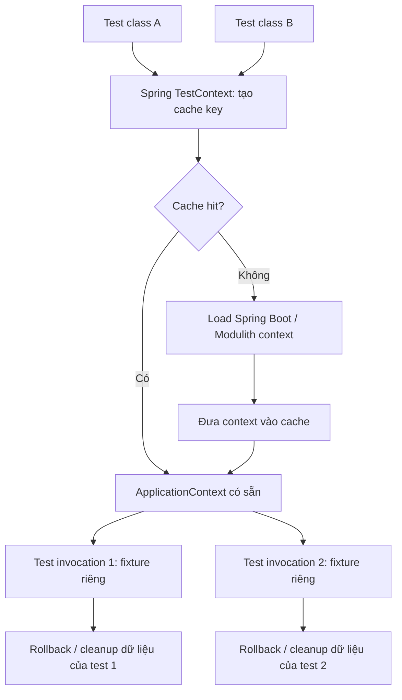
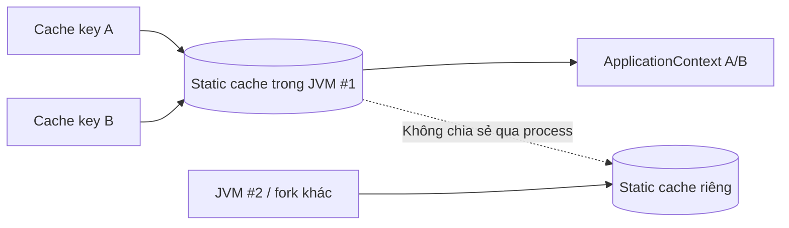
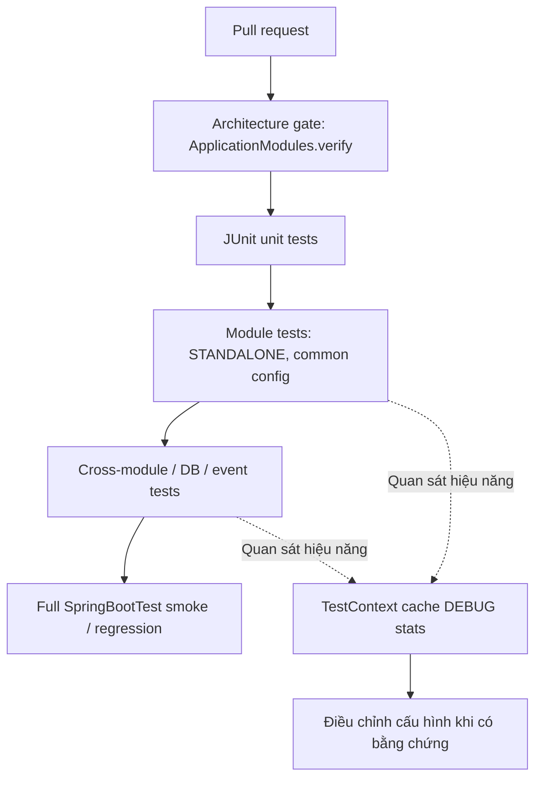

# Context caching và thay đổi cấu hình trong JUnit Jupiter và Spring Modulith

## 1. Vì sao cache `ApplicationContext` quan trọng với module test?

Trong Spring Boot, một bài kiểm thử tích hợp thường phải dựng **`ApplicationContext`**, đánh giá auto-configuration, tạo bean, nối datasource và có thể chạy migration trước khi JUnit thực thi assertion đầu tiên. Tải lại toàn bộ context cho từng phương thức test vừa chậm vừa tăng nguy cơ lỗi do tài nguyên môi trường.

Spring TestContext Framework giải quyết vấn đề đó bằng **context caching**: khi đã tải thành công một `ApplicationContext`, nó giữ context trong **cache tĩnh** để những lớp test khác có **cấu hình context tương đương** có thể tái sử dụng trong cùng JVM. Spring Modulith tận dụng hạ tầng này vì `@ApplicationModuleTest` cũng chạy trên Spring Boot Test / Spring TestContext, nhưng chỉ bootstrap tập application module được chọn.

Ví dụ: hai bài test nghiệp vụ cùng kiểm chứng module `order`, sử dụng profile `test`, cùng property và cùng mock dependency bên ngoài có khả năng chia sẻ context. Nếu mỗi lớp tự đổi property, thêm mock hoặc import configuration khác, Spring phải cân nhắc một **cache key** khác và có thể tạo context mới.

**Lưu ý:** *Spring TestContext context cache* khác hoàn toàn *Spring Cache abstraction* (ví dụ `@Cacheable` trên service). Context cache lưu **container Spring**; nó **không** tự xóa dữ liệu repository, reset singleton nghiệp vụ hay vô hiệu hóa cache kết quả của `@Cacheable`.

Bài **“Context caching và thay đổi cấu hình”** thuộc chương **JUnit integration** của học phần **SPRING_MODULITH_VERIFICATION_TESTING**. Học phần rèn kỹ năng kiểm chứng ranh giới bằng `ApplicationModules` và quy tắc phụ thuộc, thực hành `@ApplicationModuleTest`, kiểm thử sự kiện, cơ sở dữ liệu và tích hợp, kết hợp quality gate CI để ngăn phụ thuộc sai và hồi quy.

### Mục tiêu học tập

Sau bài này, bạn có thể:

- Giải thích vòng đời và **cache key** của Spring TestContext, và vì sao hai lớp test có thể tái sử dụng hoặc không tái sử dụng context.
- Phân biệt **context caching**, **JUnit test instance lifecycle**, **mock reset**, **transaction rollback** và **dọn dữ liệu nghiệp vụ**.
- Dự đoán tác động của `@ApplicationModuleTest`, `@ActiveProfiles`, `@TestPropertySource`, `@MockitoBean`, `@TestConfiguration` và `@DynamicPropertySource`.
- Viết một bộ test module `order` có fixture độc lập và cấu hình nhất quán để tận dụng cache hợp lý.
- Dùng `@DirtiesContext` **chỉ khi cần**, không thay thế cleanup DB/mock; đọc cache statistics, LRU eviction và failure threshold.
- Thiết kế CI có context reuse hiệu quả nhưng vẫn duy trì `ApplicationModules.verify()` và kiểm thử tích hợp thật.

## 2. Ba vòng đời khác nhau: JUnit, Spring context và dữ liệu

Một nhầm lẫn phổ biến là: “JUnit tạo test instance mới nên Spring cũng tạo context mới”, hoặc “Context được cache thì mọi dữ liệu của testcase tự được rollback”. Cả hai đều **không đúng**.

| Đối tượng | Ai quản lý? | Có thể được tái sử dụng? | Cơ chế làm sạch phù hợp |
| --- | --- | --- | --- |
| **Test instance** | JUnit Jupiter: `PER_METHOD` / `PER_CLASS` | Tùy `@TestInstance` | Fixture per test, reset field mutable |
| **Spring `ApplicationContext`** | Spring TestContext, cache tĩnh | Có, với context cache key tương đương trong cùng JVM | `@DirtiesContext` khi context thật sự bị thay đổi không thể phục hồi |
| **Spring singleton bean** | Chính `ApplicationContext` | Có khi context được tái sử dụng | Reset state nghiệp vụ, thiết kế stateless, cleanup per test |
| **Mockito mock từ `@MockitoBean`** | Spring Test bean override | Bean mock thuộc context, reset theo chính sách | Stub/verify riêng từng test; kiểm tra reset mode |
| **DataSource / database records** | JDBC/JPA và database thật/test container | Có thể vượt vòng đời context/JUnit | Test transaction rollback, truncate có kiểm soát, ID riêng |
| **Event listener / broker / async executor** | Spring và tài nguyên ngoài | Có thể còn việc sau khi testcase kết thúc | Chờ completion, correlation ID, cleanup và isolation |

Theo Spring Modulith **1.4**, `@ApplicationModuleTest` meta-annotate `@TestInstance(PER_CLASS)`. Vì thế **test instance có thể được dùng chung trong một lớp** ngay cả trước khi xét tới Spring context cache. Đây là chi tiết **theo phiên bản**; kiểm tra Javadoc của stack thực tế khi dùng Modulith 2.x.



Hai testcase có thể cùng dùng một `ApplicationContext` nhưng mỗi case **vẫn cần tự thiết lập tiền điều kiện**. Tái sử dụng context là tối ưu khởi tạo hạ tầng, không phải lý do để truyền trạng thái giữa các method.

## 3. Spring TestContext tạo cache key từ những gì?

Theo tài liệu chính thức Spring Framework 6.2, **cache key** được xác định từ tổ hợp thông tin cấu hình context. Các thành phần quan trọng gồm:

| Thành phần key | Nguồn thông dụng | Ví dụ thay đổi gây khác cấu hình |
| --- | --- | --- |
| `locations` | `@ContextConfiguration` | XML/config locations khác |
| `classes` | `@ContextConfiguration` và cấu hình Spring Boot tương ứng | `ShopApplication.class` so với cấu hình khác |
| `contextInitializerClasses` | `@ContextConfiguration(initializers = ...)` | Thêm `ApplicationContextInitializer` |
| `contextCustomizers` | `ContextCustomizerFactory`, Spring Boot Test, `@DynamicPropertySource`, bean overrides | Thêm `@MockitoBean` hoặc đổi `@TestBean`/dynamic property method |
| `contextLoader` | `@ContextConfiguration(loader = ...)` | Chọn cơ chế tải khác |
| `parent` | `@ContextHierarchy` | Thay parent context |
| `activeProfiles` | `@ActiveProfiles` | `test` so với `integration` |
| `propertySourceDescriptors` | `@TestPropertySource(locations = ...)` | Dùng file test properties khác |
| `propertySourceProperties` | `@TestPropertySource(properties = ...)` | `orders.max-quantity=3` so với `=5` |
| `resourceBasePath` | `@WebAppConfiguration` | Thay web application resource path |

**Tên lớp test không tự nó là toàn bộ cache key.** Hai lớp khác tên vẫn **có thể** dùng chung context khi *merged context configuration* tương đương. Ngược lại, cùng một class có những cấu hình test khác nhau theo context inheritance, property hoặc customizer vẫn có thể dẫn đến context khác.

### Một ví dụ suy luận key

| Test class | Cấu hình đáng chú ý | Kỳ vọng |
| --- | --- | --- |
| `OrderAcceptsTests` | `order`, `test`, max=3, mock `InventoryAvailability` | Có thể reuse với test kế bên nếu toàn bộ key tương đương |
| `OrderRejectsTests` | Giống các giá trị trên và customizers tương đương | Cache **hit** là mục tiêu tối ưu |
| `OrderHigherLimitTests` | max=5 thay vì max=3 | Property key khác; context thường được nạp riêng |
| `OrderWithRealInventoryTests` | `DIRECT_DEPENDENCIES`, không có mock | Phạm vi bean khác; cần kiểm tra cache key/context thực tế |
| `OrderWithDifferentProfileTests` | `@ActiveProfiles("external")` | Cache key khác vì active profiles khác |

Không nên tự kết luận **chắc chắn reuse** chỉ từ một bảng annotation: Spring Boot và Spring Modulith có thể cung cấp thêm `ContextCustomizer`, và test inheritance/module slicing cần được xét theo **merged configuration thực tế**. Hãy bật log cache và quan sát thống kê *hit/miss* cùng identity của context khi cần xác minh.

### Điều **không** phải thành phần key thông thường

Tên một phương thức `@Test`, dữ liệu của từng `@ParameterizedTest`, `@DisplayName` và `@Tag` **không tự chúng** tạo Spring context cache key mới. Do đó 20 invocations khác input trong một lớp `@ApplicationModuleTest` thường vẫn dùng một context, trừ khi code test làm bẩn context hoặc có thay đổi cấu hình context thực sự.

## 4. Cache là tĩnh trong một JVM, có giới hạn dung lượng

Spring TestContext lưu context trong **static cache**. Hệ quả:

1. Test class A và B chạy trong **cùng JVM/test suite** mới có cơ hội reuse context.
2. Nếu Maven/Gradle fork **process JVM khác** giữa các nhóm test, cache static **không chia sẻ xuyên process**; mỗi JVM có cache riêng.
3. Nếu chạy một test trong IDE hôm nay rồi chạy lại trong một JVM mới, lần sau vẫn cần load context.
4. Mặc định cache chứa tối đa **32 context**. Khi đạt giới hạn, Spring dùng chính sách **least recently used (LRU)** để loại và đóng context ít được sử dụng gần đây.
5. Có thể thay giới hạn qua **JVM system property** `spring.test.context.cache.maxSize`, nhưng tăng số lượng context giữ lại cũng tăng RAM/tài nguyên.

Ví dụ một JVM argument dành cho build/test runner:

```text
-Dspring.test.context.cache.maxSize=64
```

Đây **không phải command build độc lập**. Phải đảm bảo property được truyền vào **JVM chạy JUnit**; dùng `-D` ở một process khác không bảo đảm điều chỉnh cache của test runner.



**Tối ưu đúng là giảm những biến thể cấu hình không cần thiết trước khi tăng `maxSize`.** Một suite có hàng trăm tổ hợp profile/property/mock sẽ chậm nếu nó cứ load context mới; LRU eviction có thể khiến cùng một context phải load lại về sau.

## 5. Bootstrap theo module ảnh hưởng đến những bean được nạp

Spring Modulith giới hạn **component scanning**, **auto-configuration packages** và **entity scanning packages** theo các application module được chọn. Điều này thay đổi phạm vi bootstrap so với `@SpringBootTest` toàn ứng dụng.

Giả sử đồ thị:


Với một bài test thuộc package `order`:

| `@ApplicationModuleTest` mode | Những application module được xét | Phù hợp khi |
| --- | --- | --- |
| `STANDALONE` (mặc định) | `order` | Test nghiệp vụ order bằng mock/fake cho dependency ngoài |
| `DIRECT_DEPENDENCIES` | `order` + `inventory` | Cần implementation inventory thật |
| `ALL_DEPENDENCIES` | `order` + `inventory` + `catalog` | Cần cả chuỗi dependency |
| `STANDALONE` + `extraIncludes = "notification"` | `order` + `notification` | Chủ động nạp consumer để kiểm tra event flow |

**Không dùng `mode` như mẹo ép Spring tạo cache hit.** Hai test có mục tiêu khác nhau (mock API ngoài so với integration với bean thật) cần cấu hình khác nhau nếu đó là cách đúng để chứng minh hành vi. Ngược lại, đừng chọn `ALL_DEPENDENCIES` cho mọi test chỉ vì muốn giảm số kiểu context: như vậy làm yếu ý nghĩa module isolation và có thể tăng chi phí bootstrap.

**Phân biệt hai yếu tố:** `BootstrapMode` định nghĩa **phạm vi application module**; cache key của Spring TestContext phản ánh **merged context configuration**. Không coi tên enum `BootstrapMode` là một trong mười trường key chính thức trong bảng phần 3. Đối với thay đổi mode/extraIncludes, kiểm tra cả context scope và cache log trên phiên bản đang dùng.

## 6. Chuẩn bị ví dụ thực hành: hai lớp test muốn reuse một context

Ví dụ dùng **Java 17+, Spring Boot 3.4/3.5, Spring Framework 6.2, Spring Modulith 1.4, JUnit Jupiter 5** với BOM tương thích. `@MockitoBean` của Spring Test có từ Spring Framework 6.2; stack cũ hơn có thể cần `@MockBean`. Ví dụ không dùng database để quan sát vấn đề **context reuse vs test state** mà không bị hạ tầng DB lấn át.

### 6.1. Cấu trúc dự án

```text
src/
├── main/java/com/example/shop/
│   ├── ShopApplication.java
│   ├── inventory/
│   │   ├── InventoryAvailability.java
│   │   └── InventoryService.java
│   └── order/
│       ├── OrderRecord.java
│       ├── OrderStore.java
│       ├── OrderPlaced.java
│       └── OrderService.java
└── test/java/com/example/shop/
    ├── order/
    │   ├── OrderModuleTestSupport.java
    │   ├── OrderAcceptsTests.java
    │   ├── OrderRejectsTests.java
    │   ├── OrderHigherLimitTests.java
    │   └── OrderWithRealInventoryTests.java
    └── ModuleArchitectureTests.java
```

### 6.2. Dependencies Maven (trong một dự án đã có Spring Boot/BOM)

```xml
<dependency>
    <groupId>org.springframework.boot</groupId>
    <artifactId>spring-boot-starter</artifactId>
</dependency>
<dependency>
    <groupId>org.springframework.boot</groupId>
    <artifactId>spring-boot-starter-test</artifactId>
    <scope>test</scope>
</dependency>
<dependency>
    <groupId>org.springframework.modulith</groupId>
    <artifactId>spring-modulith-starter-test</artifactId>
    <scope>test</scope>
</dependency>
```

Đây là **đoạn dependencies**, không phải toàn bộ `pom.xml`. Chọn dependency management tương thích trước khi sao chép ví dụ.

### 6.3. Lớp ứng dụng gốc

File `src/main/java/com/example/shop/ShopApplication.java`:

```java
package com.example.shop;

import org.springframework.boot.SpringApplication;
import org.springframework.boot.autoconfigure.SpringBootApplication;

@SpringBootApplication
public class ShopApplication {
    public static void main(String[] args) {
        SpringApplication.run(ShopApplication.class, args);
    }
}
```

### 6.4. Module `inventory`: API công khai và implementation thật

File `src/main/java/com/example/shop/inventory/InventoryAvailability.java`:

```java
package com.example.shop.inventory;

public interface InventoryAvailability {
    boolean available(String sku, int quantity);
}
```

File `src/main/java/com/example/shop/inventory/InventoryService.java`:

```java
package com.example.shop.inventory;

import org.springframework.stereotype.Service;

@Service
public class InventoryService implements InventoryAvailability {

    @Override
    public boolean available(String sku, int quantity) {
        return "SKU-READY".equals(sku) && quantity <= 3;
    }
}
```

`InventoryAvailability` nằm tại package gốc của module `inventory`, là **API công khai mặc định** theo cách tổ chức module thông thường. `order` chỉ phụ thuộc interface, không import type ở `inventory.internal`.

### 6.5. Event, record và repository in-memory của `order`

File `src/main/java/com/example/shop/order/OrderRecord.java`:

```java
package com.example.shop.order;

import java.util.UUID;

public record OrderRecord(UUID orderId, String sku, int quantity) {}
```

File `src/main/java/com/example/shop/order/OrderPlaced.java`:

```java
package com.example.shop.order;

import java.util.UUID;

public record OrderPlaced(UUID orderId, String sku, int quantity) {}
```

File `src/main/java/com/example/shop/order/OrderStore.java`:

```java
package com.example.shop.order;

import java.util.Optional;
import java.util.UUID;
import java.util.concurrent.ConcurrentHashMap;
import java.util.concurrent.ConcurrentMap;

import org.springframework.stereotype.Repository;

@Repository
public class OrderStore {

    private final ConcurrentMap<UUID, OrderRecord> records =
            new ConcurrentHashMap<>();

    public void save(OrderRecord record) {
        if (records.putIfAbsent(record.orderId(), record) != null) {
            throw new IllegalStateException("DUPLICATE_ORDER");
        }
    }

    public Optional<OrderRecord> findById(UUID id) {
        return Optional.ofNullable(records.get(id));
    }

    public void deleteById(UUID id) {
        records.remove(id);
    }
}
```

`OrderStore` là **singleton Spring** dùng map trong bộ nhớ. Nếu context được reuse, bản ghi test trước tạo ra **không tự biến mất**. Ta cố tình dùng kiểu này để thấy sự khác nhau giữa context caching và cleanup dữ liệu. Trong hệ thống production, repository có thể dùng JPA/JDBC hoặc một công nghệ persistence khác.

### 6.6. Service của module `order`

File `src/main/java/com/example/shop/order/OrderService.java`:

```java
package com.example.shop.order;

import java.util.UUID;

import com.example.shop.inventory.InventoryAvailability;
import org.springframework.beans.factory.annotation.Value;
import org.springframework.context.ApplicationEventPublisher;
import org.springframework.stereotype.Service;

@Service
public class OrderService {

    private final InventoryAvailability inventory;
    private final OrderStore store;
    private final ApplicationEventPublisher events;
    private final int maxQuantity;

    public OrderService(InventoryAvailability inventory,
                        OrderStore store,
                        ApplicationEventPublisher events,
                        @Value("${orders.max-quantity:3}") int maxQuantity) {
        this.inventory = inventory;
        this.store = store;
        this.events = events;
        this.maxQuantity = maxQuantity;
    }

    public void place(UUID orderId, String sku, int quantity) {
        if (orderId == null || sku == null || sku.isBlank()
                || quantity <= 0 || quantity > maxQuantity) {
            throw new IllegalArgumentException("INVALID_ORDER");
        }
        if (!inventory.available(sku, quantity)) {
            throw new IllegalStateException("OUT_OF_STOCK");
        }

        store.save(new OrderRecord(orderId, sku, quantity));
        events.publishEvent(new OrderPlaced(orderId, sku, quantity));
    }
}
```

Property `orders.max-quantity` quyết định giới hạn đặt hàng. Một test với max=3 và một test với max=5 **không có cùng cấu hình kết quả nghiệp vụ**, nên không nên ép chúng dùng một context chỉ để giảm thời gian khởi động.

## 7. Cấu hình chung cho hai lớp module test

Mục tiêu của phần này là tổ chức **hai lớp khác nhau** nhưng dùng một tập annotation/module/dependency override giống nhau. Chúng có thể chia sẻ context nếu merged config tương đương, **nhưng không chia sẻ dữ liệu record**.

File `src/test/java/com/example/shop/order/OrderModuleTestSupport.java`:

```java
package com.example.shop.order;

import com.example.shop.inventory.InventoryAvailability;
import org.springframework.beans.factory.annotation.Autowired;
import org.springframework.context.ApplicationContext;
import org.springframework.modulith.test.ApplicationModuleTest;
import org.springframework.test.context.ActiveProfiles;
import org.springframework.test.context.TestPropertySource;
import org.springframework.test.context.bean.override.mockito.MockitoBean;

@ApplicationModuleTest
@ActiveProfiles("test")
@TestPropertySource(properties = "orders.max-quantity=3")
abstract class OrderModuleTestSupport {

    @Autowired OrderService orders;
    @Autowired OrderStore store;
    @Autowired ApplicationContext context;

    @MockitoBean InventoryAvailability inventory;
}
```

Điểm thiết kế:

- Lớp này là **abstract test support** và không có `@Test` riêng; nó cung cấp cấu hình và field dùng chung.
- `@ApplicationModuleTest` của Spring Modulith là annotation được kế thừa ở cấp lớp; Spring TestContext cũng kế thừa `@ActiveProfiles` và `@TestPropertySource` theo mặc định.
- `@MockitoBean` đặt trên field của superclass được Spring Test nhận diện ở subclass. Mỗi testcase tự stub cho chính mình.
- Không có singleton giả tự giữ dữ liệu test khác ngoài `OrderStore`; vì vậy cần cleanup bằng ID sau mỗi testcase.

### 7.1. Lớp test A: chấp nhận đơn

File `src/test/java/com/example/shop/order/OrderAcceptsTests.java`:

```java
package com.example.shop.order;

import static org.assertj.core.api.Assertions.assertThat;
import static org.mockito.BDDMockito.given;

import java.util.UUID;
import org.junit.jupiter.api.DisplayName;
import org.junit.jupiter.api.Tag;
import org.junit.jupiter.api.Test;
import org.springframework.modulith.test.PublishedEvents;

@Tag("module")
@DisplayName("Order — chấp nhận đơn với cấu hình max=3")
class OrderAcceptsTests extends OrderModuleTestSupport {

    @Test
    void storesOrderAndPublishesEvent(PublishedEvents events) {
        UUID id = UUID.randomUUID();

        try {
            given(inventory.available("SKU-01", 2)).willReturn(true);

            orders.place(id, "SKU-01", 2);

            assertThat(store.findById(id))
                    .contains(new OrderRecord(id, "SKU-01", 2));
            assertThat(events.ofType(OrderPlaced.class)
                    .matching(OrderPlaced::orderId, id))
                    .hasSize(1);

            System.out.println("contextId=" +
                    System.identityHashCode(context));
        } finally {
            store.deleteById(id);
        }
    }
}
```

`System.identityHashCode(context)` dùng để **quan sát một instance context** trong cùng JVM khi debug. Nó không phải một khóa định danh toàn cục hay API để so sánh tính tương đương cache giữa các JVM. Trong code production test, thường chỉ cần log cache của Spring TestContext.

### 7.2. Lớp test B: từ chối đơn không hợp lệ

File `src/test/java/com/example/shop/order/OrderRejectsTests.java`:

```java
package com.example.shop.order;

import static org.assertj.core.api.Assertions.assertThat;
import static org.assertj.core.api.Assertions.assertThatThrownBy;
import static org.mockito.BDDMockito.then;

import java.util.UUID;
import org.junit.jupiter.api.DisplayName;
import org.junit.jupiter.api.Tag;
import org.junit.jupiter.api.Test;
import org.springframework.modulith.test.PublishedEvents;

@Tag("module")
@DisplayName("Order — từ chối quantity vượt max=3")
class OrderRejectsTests extends OrderModuleTestSupport {

    @Test
    void rejectsQuantityBeforeCallingInventory(PublishedEvents events) {
        UUID id = UUID.randomUUID();

        try {
            assertThatThrownBy(() ->
                    orders.place(id, "SKU-01", 4))
                    .isInstanceOf(IllegalArgumentException.class)
                    .hasMessage("INVALID_ORDER");

            then(inventory).shouldHaveNoInteractions();
            assertThat(store.findById(id)).isEmpty();
            assertThat(events.ofType(OrderPlaced.class)).isEmpty();

            System.out.println("contextId=" +
                    System.identityHashCode(context));
        } finally {
            store.deleteById(id);
        }
    }
}
```

Hai lớp sử dụng cùng `OrderModuleTestSupport`, cùng module `order`, profile `test`, property max=3 và cùng bean override `InventoryAvailability`. Đây là kiểu cấu hình **có thể giúp Spring tái sử dụng context** giữa các lớp, tùy kết quả merged configuration của stack thực tế.

Không đưa assertion kiểu “contextId của A phải bằng contextId của B” vào hai lớp test: điều đó biến **chi tiết tối ưu khởi tạo** thành **dependency theo thứ tự chạy**, khiến chạy riêng từng lớp từ IDE thất bại. Cache hit/miss nên được quan sát **qua log hoặc báo cáo**, không trở thành một yêu cầu nghiệp vụ.

### 7.3. Vì sao `@MockitoBean` phải thống nhất?

Spring Framework 6.2 có lưu ý: khi dùng `@MockitoBean` hoặc `@MockitoSpyBean` trên field, **qualifier hoặc tên field dự phòng** có thể tham gia việc xác định mock và context cache key. Nếu cùng một bean được override ở nhiều lớp test, hãy thống nhất field name (ví dụ đều dùng `inventory`) hoặc dùng tên bean rõ ràng khi hợp lý.

Hai khai báo sau **có thể tạo khác biệt context customizer** nếu dùng trong các lớp khác nhau:

```java
@MockitoBean InventoryAvailability inventory;

// Trong một lớp khác:
@MockitoBean InventoryAvailability stock;
```

Nếu chỉ có một bean cùng type, hai cách đều có thể hoạt động về mặt injection, nhưng **đừng coi chúng luôn có cùng cache key**. Có thể đặt mock override trong superclass hoặc tạo composed annotation dùng lại để giảm biến thể. Và nếu `STANDALONE` chưa có bean implementation thật, `@MockitoBean` mặc định dùng cơ chế **replace-or-create**; bật `enforceOverride = true` trong trường hợp đó có thể gây lỗi vì không có bean để thay.

## 8. Thay `@TestPropertySource` tạo mục tiêu cấu hình mới

Giờ ta muốn kiểm tra một chính sách khác: cho phép đặt hàng với quantity=5, thay vì ngưỡng 3. Lớp test phải nhận **property khác trong `ApplicationContext`**; đây không chỉ là dữ liệu input của method.

File `src/test/java/com/example/shop/order/OrderHigherLimitTests.java`:

```java
package com.example.shop.order;

import static org.assertj.core.api.Assertions.assertThat;
import static org.mockito.BDDMockito.given;

import java.util.UUID;
import org.junit.jupiter.api.DisplayName;
import org.junit.jupiter.api.Tag;
import org.junit.jupiter.api.Test;
import org.springframework.test.context.TestPropertySource;

@Tag("module")
@DisplayName("Order — cấu hình max=5 tạo test context khác")
@TestPropertySource(
    properties = "orders.max-quantity=5",
    inheritProperties = false
)
class OrderHigherLimitTests extends OrderModuleTestSupport {

    @Test
    void acceptsQuantityFiveUnderNewPolicy() {
        UUID id = UUID.randomUUID();

        try {
            given(inventory.available("SKU-01", 5)).willReturn(true);

            orders.place(id, "SKU-01", 5);

            assertThat(store.findById(id))
                    .contains(new OrderRecord(id, "SKU-01", 5));
        } finally {
            store.deleteById(id);
        }
    }
}
```

`inheritProperties = false` trên `@TestPropertySource` của subclass **không lấy thêm các inline properties từ superclass**; lớp này nhận ngưỡng 5. Vì `propertySourceProperties` của merged context configuration khác với hai lớp ở phần 7, cache key sẽ khác theo quy tắc Spring TestContext.

**Không đổi property bằng `System.setProperty(...)` trong `@BeforeEach` rồi mong bean `OrderService` tự đọc lại giá trị.** Bean có thể đã được tạo trước khi `@BeforeEach` chạy; `@Value` đã được inject khi khởi tạo. Việc đổi System property toàn JVM còn làm các testcase khác phụ thuộc thứ tự. Khi cần hai cấu hình bean khác nhau, dùng **lớp test/context configuration khác nhau** như ở đây.

## 9. Module thật thay mock: thay cả tính chất kiểm thử

Một bài `order` có thể cần **implementation thật của `inventory`**, không chỉ một mock. Đây là mục tiêu tích hợp khác với hai lớp ở phần 7.

File `src/test/java/com/example/shop/order/OrderWithRealInventoryTests.java`:

```java
package com.example.shop.order;

import static org.assertj.core.api.Assertions.assertThat;

import java.util.UUID;
import org.junit.jupiter.api.DisplayName;
import org.junit.jupiter.api.Test;
import org.springframework.beans.factory.annotation.Autowired;
import org.springframework.modulith.test.ApplicationModuleTest;
import org.springframework.modulith.test.ApplicationModuleTest.BootstrapMode;
import org.springframework.test.context.ActiveProfiles;
import org.springframework.test.context.TestPropertySource;

@DisplayName("Order + Inventory — dùng bean dependency thật")
@ActiveProfiles("test")
@TestPropertySource(properties = "orders.max-quantity=3")
@ApplicationModuleTest(mode = BootstrapMode.DIRECT_DEPENDENCIES)
class OrderWithRealInventoryTests {

    @Autowired OrderService orders;
    @Autowired OrderStore store;

    @Test
    void placesOrderWhenRealInventoryApprovesSku() {
        UUID id = UUID.randomUUID();

        try {
            orders.place(id, "SKU-READY", 2);
            assertThat(store.findById(id)).isPresent();
        } finally {
            store.deleteById(id);
        }
    }
}
```

Lớp này **không có `@MockitoBean`**: `DIRECT_DEPENDENCIES` nạp `inventory` vì `order → inventory` là dependency trực tiếp, và `InventoryService` thật quyết định SKU hợp lệ. Đừng ép lớp test này dùng chung context với `STANDALONE` + mock: khác biệt đó **phục vụ độ tin cậy của assertion**, không phải lãng phí vô cớ.

### Những gì có thể và không thể kết luận từ ví dụ

- Test `STANDALONE` + mock kiểm chứng **hành vi `order` trước phản hồi API ngoài**.
- Test `DIRECT_DEPENDENCIES` kiểm chứng **phối hợp với implementation `inventory` thật**.
- Cả hai có thể chạy với JUnit/Spring TestContext caching, nhưng cần so sánh *merged config*, module scope và log cache để biết chính xác context nào được reuse.
- Việc một test dùng `@ApplicationModuleTest(mode = ALL_DEPENDENCIES)` không bảo đảm tự động dùng chung cache key với test khác, cũng không làm kiến trúc trở nên hợp lệ hơn.

Ở stack **Spring Modulith 1.4**, `@ApplicationModuleTest` được meta-annotate với `@SpringBootTest` và các extension/auto-configuration chuyên kiểm thử module. Không cần thêm `@SpringBootTest` tường minh vào mỗi class; cũng không nên đặt hai annotation bootstrapping xung đột lên cùng một test class chỉ để thử cache.

## 10. Những thay đổi cấu hình thường làm tăng số context

Trong một dự án lớn, số lượng cache miss thường tăng không phải vì thêm nhiều method `@Test`, mà vì **mỗi class có một bộ cấu hình riêng**. Các annotation dưới đây cần được quản lý như những biến số của test suite.

### 10.1. `@ActiveProfiles`: thay bộ bean hoặc property

```java
@ActiveProfiles("test")
@ApplicationModuleTest
class OrderTestProfileCases {
    // @Test kiểm chứng cấu hình profile test.
}

// Ở một class khác:
@ActiveProfiles("external")
@ApplicationModuleTest
class OrderExternalProfileCases {
    // @Test kiểm chứng profile external.
}
```

Các đoạn trên là **mẫu annotation**, không có assertion đầy đủ. Hai active profile khác nhau tạo **cache key khác nhau**. Việc có profile `external` chỉ có ý nghĩa khi ứng dụng khai báo bean/property theo profile đó; annotation không tự sinh một integration environment có sẵn.

Khi kiểm thử cùng module, hãy ưu tiên một **profile test chung** nếu mục tiêu tương đương, và tách profile chỉ khi testcase cần bảo đảm một nhánh cấu hình thực sự khác.

### 10.2. `@TestPropertySource`: thay inline property

Hai khai báo:

```java
@TestPropertySource(properties = "orders.max-quantity=3")

// So với:
@TestPropertySource(properties = "orders.max-quantity=5")
```

sẽ góp phần tạo **`propertySourceProperties` khác nhau** trong merged context configuration. Đây là lý do test `OrderHigherLimitTests` ở phần 8 không nên reuse context đã khởi tạo `OrderService` với ngưỡng 3.

Ngược lại, việc hai method truyền số lượng `1` và `2` vào `orders.place(...)` **không** thay đổi inline property hoặc cache key. Đây chỉ là khác biệt về **data**, thích hợp cho `@ParameterizedTest`.

### 10.3. `@Import` và `@TestConfiguration`: thêm bean cấu hình test

Nếu một lớp import `Clock` cố định còn lớp khác không import, hai bài có **bean definitions** và cấu hình context không giống nhau.

```java
package com.example.shop.testing;

import java.time.Clock;
import java.time.Instant;
import java.time.ZoneOffset;

import org.springframework.boot.test.context.TestConfiguration;
import org.springframework.context.annotation.Bean;

@TestConfiguration(proxyBeanMethods = false)
public class FixedClockTestConfiguration {

    @Bean
    Clock clock() {
        return Clock.fixed(
                Instant.parse("2026-01-01T00:00:00Z"),
                ZoneOffset.UTC
        );
    }
}
```

Lớp test có thể import:

```java
@ApplicationModuleTest
@Import(FixedClockTestConfiguration.class)
class OrderWithFixedClockTests {
    // @Autowired Clock clock; @Test sử dụng clock.
}
```

Ví dụ thứ hai là **khung cấu hình**, cần import `ApplicationModuleTest`, `Import` và `FixedClockTestConfiguration`. Import bean theo từng lớp chỉ khi cần; không thêm vào tất cả test để “đồng nhất” nếu nó thay đổi mục tiêu kiểm chứng.

**Không mặc định:** `@TestConfiguration` chỉ được dùng để cấu hình test, không có nghĩa mọi bean được khai báo ở đó được tạo mới cho mỗi method. Chúng vẫn thuộc Spring context và có thể được cache.

### 10.4. `@MockitoBean`/`@MockitoSpyBean`: cấu hình override khác

Mock/spy tham gia `contextCustomizers` trong cache key. Hai test có cùng dependency class nhưng khác **loại override**, qualifier, bean name hoặc chính sách override có thể tạo context khác:

```java
@MockitoBean InventoryAvailability inventory;

// So với:
@MockitoSpyBean InventoryAvailability inventory;
```

Mock thay bean bằng Mockito mock; spy bọc một bean thực và có yêu cầu khác đối với bean đã tồn tại. Không chuyển từ `@MockitoBean` sang `@MockitoSpyBean` chỉ để thử tối ưu cache: đây là thay đổi **ngữ nghĩa bài test**.

**Quan trọng:** Thay stubbing trong `@BeforeEach` hay trong từng method, ví dụ `given(inventory.available(...)).willReturn(true)`, **không tự thay định nghĩa context cache key**. Stubbing là **trạng thái runtime của mock** và cần được reset giữa các test theo chính sách Spring Test; nó không phải annotation bean override mới.

### 10.5. `webEnvironment`, slice test và `@AutoConfigureMockMvc`

Chuyển từ module service test sang REST adapter test có thể cần web environment và auto-configured test beans khác:

```java
@ApplicationModuleTest(
    webEnvironment = SpringBootTest.WebEnvironment.MOCK
)
@AutoConfigureMockMvc
class OrderWebAdapterTests {
    // @Autowired MockMvc và @Test kiểm tra status/response.
}
```

Ví dụ là **khung test**, dùng import `@AutoConfigureMockMvc` của **Spring Boot 3.x** tại `org.springframework.boot.test.autoconfigure.web.servlet.AutoConfigureMockMvc`. Spring Boot 4.x đã chuyển một số package kiểm thử MVC. `MOCK` không mở cổng HTTP thật; `RANDOM_PORT` tạo server nhúng nếu web stack hỗ trợ.

Web test thường cần Spring `WebApplicationContext` và context customizers khác service-only test. Không cố ép các kiểu test này dùng chung context khi hạ tầng thật sự khác nhau.

## 11. `@DynamicPropertySource` và giá trị động từ hạ tầng test

Với Testcontainers hoặc một service chạy trên port ngẫu nhiên, bạn có thể phải cung cấp JDBC URL, username, port hay endpoint **sau khi** tài nguyên test được khởi động. Spring TestContext hỗ trợ `@DynamicPropertySource`:

```java
package com.example.shop.order;

import static org.assertj.core.api.Assertions.assertThat;
import static org.mockito.BDDMockito.given;

import java.util.UUID;
import com.example.shop.inventory.InventoryAvailability;
import org.junit.jupiter.api.Test;
import org.springframework.beans.factory.annotation.Autowired;
import org.springframework.modulith.test.ApplicationModuleTest;
import org.springframework.test.context.DynamicPropertyRegistry;
import org.springframework.test.context.DynamicPropertySource;
import org.springframework.test.context.TestPropertySource;
import org.springframework.test.context.bean.override.mockito.MockitoBean;

@ApplicationModuleTest
@TestPropertySource(properties = "orders.max-quantity=3")
class OrderWithDynamicPropertyTests {

    @Autowired OrderService orders;
    @Autowired OrderStore store;
    @MockitoBean InventoryAvailability inventory;

    @DynamicPropertySource
    static void dynamicOrderPolicy(DynamicPropertyRegistry properties) {
        properties.add("orders.max-quantity", () -> "4");
    }

    @Test
    void dynamicPropertyOverridesInlineTestValue() {
        UUID id = UUID.randomUUID();

        try {
            given(inventory.available("SKU-01", 4)).willReturn(true);
            orders.place(id, "SKU-01", 4);
            assertThat(store.findById(id)).isPresent();
        } finally {
            store.deleteById(id);
        }
    }
}
```

Ở ví dụ này:

1. `@DynamicPropertySource` cần một phương thức **`static`** nhận đúng một `DynamicPropertyRegistry`.
2. `properties.add(...)` đăng ký một supplier; giá trị động có độ ưu tiên **cao hơn `@TestPropertySource`** trong Spring TestContext, nên max=4 thắng max=3.
3. Phương thức `dynamicOrderPolicy(...)` góp phần vào **`contextCustomizers`**; điều đó có thể làm merged context configuration khác với các lớp không có dynamic method.
4. Giữ datasource/endpoint động ở test support hoặc test class tương ứng; **không** sửa `System.setProperty(...)` toàn JVM tùy tiện giữa các method.

### Bẫy khi nhiều subclass dùng một dynamic method

**Cache key xét phương thức `@DynamicPropertySource` trong context customizer, không đơn giản lấy mỗi giá trị trả về của supplier làm key.** Nếu một phương thức kế thừa trong base test dùng cùng supplier nhưng dữ liệu phía sau supplier **thay đổi giữa các subclass** (ví dụ container URL/port khác), framework có thể reuse context cũ trong khi bạn kỳ vọng endpoint mới.

Tài liệu Spring Framework khuyến nghị trong tình huống dynamic values thay đổi giữa các subclass, có thể cần `@DirtiesContext` trên base class để mỗi subclass dùng context mới. Nhưng tốt hơn, hãy đánh giá liệu hai nhóm test có thật sự cần **hai container khác nhau** hay có thể quản lý fixture riêng trên cùng hạ tầng. Không dùng `@DirtiesContext` như một thói quen cho tất cả Testcontainers tests.

Một ví dụ thực tế khi có PostgreSQL Testcontainers (chỉ minh họa đoạn đăng ký, cần khai báo container và dependency tương ứng):

```java
@DynamicPropertySource
static void configurePostgres(DynamicPropertyRegistry registry) {
    registry.add("spring.datasource.url", postgres::getJdbcUrl);
    registry.add("spring.datasource.username", postgres::getUsername);
    registry.add("spring.datasource.password", postgres::getPassword);
}
```

Trong đoạn này, `postgres` phải là biến container đã được tạo/khởi động theo cơ chế Testcontainers của dự án. Đừng copy phương thức đơn lẻ rồi mặc định nó tạo database.

## 12. `@DirtiesContext`: khi nào phải xóa context khỏi cache?

`@DirtiesContext` dùng khi một test đã **thay đổi hoặc làm hỏng trạng thái container Spring** theo cách mà những test sau không thể tái sử dụng context an toàn. Spring TestContext sẽ **loại context khỏi cache và đóng nó**; test tiếp theo cần cùng cấu hình sẽ phải load lại.

Một ví dụ có chủ đích:

```java
package com.example.shop.order;

import org.junit.jupiter.api.Test;
import org.springframework.modulith.test.ApplicationModuleTest;
import org.springframework.test.annotation.DirtiesContext;

@ApplicationModuleTest
class MutatesContainerConfigurationTests {

    @Test
    @DirtiesContext(
        methodMode = DirtiesContext.MethodMode.AFTER_METHOD
    )
    void changesAnUnrecoverableSingletonState() {
        // Giả định test cố ý làm thay đổi singleton
        // và không thể khôi phục bằng cleanup thông thường.
    }
}
```

Đây là **khung minh họa tình huống**; method chưa có assertion và không nên đưa vào CI chỉ để đo số lần load context. Các chế độ phổ biến:

| Vị trí | Tùy chọn | Khi context bị đánh dấu dirty |
| --- | --- | --- |
| Method | `BEFORE_METHOD` | Trước method hiện tại |
| Method | `AFTER_METHOD` *(mặc định method)* | Sau method hiện tại |
| Class | `BEFORE_CLASS` | Trước khi test class chạy |
| Class | `AFTER_CLASS` *(mặc định class)* | Sau khi test class chạy |
| Class | `BEFORE_EACH_TEST_METHOD` | Trước từng method trong class |
| Class | `AFTER_EACH_TEST_METHOD` | Sau từng method trong class |

**Không dùng `@DirtiesContext` để thay thế cleanup dữ liệu:**

- Nếu `OrderStore` chứa một record test vừa tạo, xóa record bằng ID là chính xác hơn đóng toàn bộ context.
- Nếu test dùng repository PostgreSQL bên ngoài JVM, **đóng Spring context không có nghĩa xóa record database**.
- Nếu Mockito mock còn stubbing/interaction, dùng chính sách reset mock và fixture riêng trước khi đòi tạo context mới.
- Nếu listener async vẫn đang chạy, đóng context giữa chừng có thể tạo thêm lỗi race; cần chờ completion và cleanup side effect đúng cách.

Mỗi lần dirty context có thể làm Spring tải lại bean, datasource, migration, web server, message listener..., khiến suite chậm. Với `@ContextHierarchy`, `@DirtiesContext` còn có `hierarchyMode` để lựa chọn phạm vi loại cache; mặc định có thể ảnh hưởng nhiều context trong cùng hierarchy. Nếu dự án không dùng context hierarchy, không cần cấu hình thêm để làm phức tạp bài test.

### LRU eviction không giống `@DirtiesContext`

`@DirtiesContext` là **quyết định có chủ đích của test**: context không nên tái sử dụng nữa. LRU eviction là **cơ chế quản lý dung lượng cache**: khi quá `maxSize`, context ít dùng gần đây bị loại và đóng. Hai trường hợp đều có thể dẫn tới **cache miss** ở lần sau, nhưng nguyên nhân và cách xử lý khác nhau.

## 13. Reuse context nhưng vẫn cần isolation cho JPA và event flow

Điểm quan trọng nhất khi tối ưu cache là **không hy sinh tính độc lập của testcase**. Context reuse giúp giảm bootstrap cost, nhưng database, event listener và singleton nghiệp vụ vẫn có thể tồn tại giữa các test.

### 13.1. JPA/JDBC: rollback của testcase khác với context eviction

Khi module `order` có repository thật, `@ApplicationModuleTest` có thể nạp JPA/JDBC và datasource theo các package module được chọn. Một test JPA minh họa:

```java
package com.example.shop.order;

import org.junit.jupiter.api.Test;
import org.springframework.modulith.test.ApplicationModuleTest;
import org.springframework.test.context.ActiveProfiles;
import org.springframework.transaction.annotation.Transactional;

@ApplicationModuleTest
@ActiveProfiles("test")
class OrderJpaCases {

    @Test
    @Transactional
    void persistsRecordOnlyWithinThisTestTransaction() {
        // Tạo entity có ID riêng, save với repository thật,
        // flush / query / assert rồi để Spring Test rollback.
    }
}
```

**Đây là khung test**, không chạy độc lập với ví dụ `OrderStore` in-memory ở phần 6 vì chưa có entity, JPA repository, datasource hoặc schema. Khi cấu hình hạ tầng thật, `@Transactional` trên test thường tạo **test-managed transaction** và rollback mặc định sau phương thức. Nhờ vậy nhiều test có thể **reuse cùng context + datasource** nhưng có dữ liệu transaction riêng.

Các giới hạn quan trọng:

- Test phải có `PlatformTransactionManager` phù hợp.
- Dữ liệu ghi trong **transaction khác** hoặc `REQUIRES_NEW` có thể đã commit và không được rollback cùng test.
- `@BeforeEach`/`@AfterEach` chạy trong test-managed transaction khi test dùng `@Transactional`; `@BeforeAll`/`@AfterAll` không tự nằm trong transaction per-test.
- Với server nhúng thật (`webEnvironment = RANDOM_PORT`), request HTTP chạy trên **server thread khác** nên transaction phía server không tự rollback cùng transaction client test.
- Đóng context bằng `@DirtiesContext` **không xóa database thật**. Dùng rollback, cleanup SQL, schema cô lập hoặc Testcontainers theo mục tiêu.

Nếu test cần chứng minh *dữ liệu còn sau commit*, hãy thực hiện commit và quan sát dữ liệu **trong cùng testcase** rồi dọn record bền vững. Không tạo một testcase A để commit dữ liệu rồi buộc testcase B chạy tiếp sau A.

### 13.2. `PublishedEvents`: assertion gắn với một stimulus

Lớp `OrderAcceptsTests` ở phần 7 đã dùng `PublishedEvents` để xác minh `OrderPlaced`. Bất kể context được reuse hay không, cách assert nên dựa vào **correlation ID** của chính kịch bản:

```java
UUID id = UUID.randomUUID();

orders.place(id, "SKU-01", 2);

assertThat(events.ofType(OrderPlaced.class)
        .matching(OrderPlaced::orderId, id))
        .hasSize(1);
```

Đây là **trích đoạn nằm bên trong testcase đã có** `orders`, `events` và mock stub phù hợp, không phải một file test độc lập. Chỉ assert “có bất kỳ `OrderPlaced` nào” dễ nhận nhầm event của kịch bản khác nếu test có nhiều event hoặc listener bất đồng bộ.

**Context caching không phải event storage semantics.** `PublishedEvents` được Modulith cung cấp cho quá trình test; còn event publication registry, outbox hoặc dữ liệu listener ghi ra DB có vòng đời riêng tùy ứng dụng.

### 13.3. `Scenario`: cần chờ completion và cleanup

Trong giao tiếp event giữa các module, listener có thể chạy sau commit hoặc trên thread khác. Nếu module `notification` nhận `OrderPlaced` và phát `NotificationHandled`, kiểm thử integration nên dùng một stimulus và điều kiện chờ trong **cùng testcase**.

Mẫu sau chỉ minh họa **cấu trúc**; ứng dụng cần được bổ sung type `NotificationHandled`, listener thực và transaction manager phù hợp:

```java
package com.example.shop.order;

import static org.assertj.core.api.Assertions.assertThat;

import java.time.Duration;
import java.util.UUID;
import com.example.shop.inventory.InventoryAvailability;
import com.example.shop.notification.NotificationHandled;
import org.junit.jupiter.api.Test;
import org.springframework.modulith.test.ApplicationModuleTest;
import org.springframework.modulith.test.Scenario;
import org.springframework.test.context.bean.override.mockito.MockitoBean;

@ApplicationModuleTest(extraIncludes = "notification")
class OrderNotificationFlowTests {

    @MockitoBean InventoryAvailability inventory;

    @Test
    void handlesCurrentOrderWithoutSharingPreviousTestEvents(
            Scenario scenario) {

        UUID id = UUID.randomUUID();

        scenario.publish(new OrderPlaced(id, "SKU-01", 1))
                .andWaitAtMost(Duration.ofSeconds(5))
                .forEventOfType(NotificationHandled.class)
                .matching(event -> event.orderId().equals(id))
                .toArriveAndVerify(event ->
                        assertThat(event.orderId()).isEqualTo(id));
    }
}
```

Test này dùng `extraIncludes = "notification"` để nạp listener ở module nhận event. `Scenario.publish(...)` có thể kích hoạt các `@TransactionalEventListener` bằng transaction do Scenario điều phối. **Không có transaction manager thì không được mặc định scenario hoạt động như production.**

Nếu listener ghi DB, cần cleanup dữ liệu đã commit **sau khi listener hoàn tất**, không chỉ đóng context. Nếu listener phụ thuộc broker ngoài, caching `ApplicationContext` cũng không thể thay thế kiểm thử protocol, serialization hay retry bằng Testcontainers/integration phù hợp.

## 14. Quan sát cache thực tế: DEBUG logs và context identity

Không nên chỉ đo thời gian một testcase rồi đoán có cache hit. Thời gian có thể bị ảnh hưởng bởi JVM warmup, I/O, migration và runner. Spring TestContext cung cấp **cache statistics**.

Trong cấu hình logging test, bật:

```properties
logging.level.org.springframework.test.context.cache=DEBUG
logging.level.org.springframework.modulith=DEBUG
```

Nếu cơ chế cấu hình logging của ứng dụng chỉ được áp dụng **sau** khi Spring TestContext bắt đầu khởi tạo, có thể cần thiết lập logging ở cấp **test logging backend** (ví dụ `logback-test.xml`) để thấy toàn bộ thông tin sớm nhất. Cấu hình logging hợp lệ phụ thuộc dự án, không nhất thiết giống nhau ở mọi runner.

Khi log được bật, bộ cache thường có thông tin như:

```text
Spring test ApplicationContext cache statistics:
size=2, maxSize=32, hitCount=18, missCount=2
```

**Đây là số giả lập** để minh họa các chỉ số, không phải một lần chạy dự án này. Dòng log thực và tên trường thay đổi theo phiên bản.

### Hiểu đúng các con số

| Chỉ số | Ý nghĩa | Khi tăng bất ngờ cần kiểm tra |
| --- | --- | --- |
| **cache hit** | TestContext tìm thấy context phù hợp trong cache | Đây thường là tín hiệu tốt, nhưng không chứng minh fixture sạch |
| **cache miss** | Không có context phù hợp; phải tải context | Cấu hình mới, `@DirtiesContext`, LRU eviction hoặc process khác |
| **cache size** | Số context đang lưu tại thời điểm log | Có quá nhiều biến thể profile, bean override hoặc module scope? |
| **maxSize** | Giới hạn cấu hình cache | Có eviction lặp lại vì dung lượng quá nhỏ so với số key thật? |
| **failure count / skipped load** | Context từng bootstrap thất bại | Cần đọc **root cause lần tải đầu** và failure threshold |

Để so sánh hai lớp ở phần 7, chạy chúng **cùng một JVM** và quan sát số **miss** trong phần load context. Sau đó thêm `OrderHigherLimitTests` và theo dõi cache miss mới. Không hardcode thứ tự của hai lớp hoặc assert số hit tuyệt đối: CI runner có thể chạy thêm test, fork process hoặc load context khác trước đó.

### Vì sao context identity chỉ là công cụ chẩn đoán?

`System.identityHashCode(context)` có thể giúp nhận biết object context trong log **cùng JVM**, nhưng hash có khả năng trùng, và mỗi process có không gian identity riêng. Cách chắc chắn hơn để nghiên cứu cơ chế caching là kết hợp cache DEBUG stats với merged configuration và việc quan sát startup logs.

## 15. Context failure threshold: vì sao test sau báo “skipped load”?

Từ **Spring Framework 6.1**, TestContext có **context failure threshold policy**. Mặc định threshold bằng **1**, nghĩa là với **một cache key** đã load context thất bại, Spring không tiếp tục thử khởi tạo lặp đi lặp lại vô ích cho mọi test kế tiếp có cùng key.

Ví dụ:

1. `OrderAcceptsTests` bắt đầu bootstrap context, nhưng lỗi thiếu bean/datasource làm load thất bại.
2. Spring ghi nhận một failure cho cache key tương ứng.
3. `OrderRejectsTests` sử dụng cùng key; thay vì tiếp tục thử load context từ đầu, Spring có thể báo `IllegalStateException` với thông điệp tương đương **“ApplicationContext failure threshold exceeded; skipping repeated attempt to load”**.

**Điều này không có nghĩa test B là nguyên nhân đầu tiên**. Khi gặp lỗi “preemptively skipped”, hãy tìm **root cause của lần load context đầu tiên** trong log suite — ví dụ `UnsatisfiedDependencyException` hoặc cấu hình database sai.

Có thể điều chỉnh ngưỡng bằng JVM system property:

```text
-Dspring.test.context.failure.threshold=2
```

Đây là **JVM argument** dành cho runner, không phải lệnh build. Tăng threshold có thể hữu ích khi chẩn đoán một hạ tầng tạm thời lỗi, nhưng **không nên dùng để che một lỗi wiring cố định** khiến suite chậm và log lặp lại. Mặc định threshold=1 là cách thất bại nhanh và rõ cho các context không thể khởi tạo.

### Phân biệt failure threshold với cache miss

- **Cache miss**: chưa có context phù hợp trong cache, Spring sẽ cố load.
- **Context load failure**: quá trình load thất bại, root cause phải được phân tích.
- **Failure threshold exceeded**: một lần load tương ứng đã thất bại đủ ngưỡng; lần thử tiếp theo có thể bị chặn ngay.
- **`@DirtiesContext`**: test chủ động loại **context đã tải** khỏi cache; đây không phải cách khắc phục root cause của một context không thể load.

Nếu test A và B có **cache key khác nhau**, failure threshold của A không tự động giải thích lỗi của B. Phải kiểm tra đúng merged config trước khi gom các lỗi thành một nguyên nhân.

## 16. Chẩn đoán lỗi caching và thay đổi cấu hình

Khi suite chậm hoặc thất bại ngẫu nhiên, hãy điều tra theo **hai trục độc lập**: cấu hình context có quá nhiều biến thể không, và test có để lại trạng thái không?

| Triệu chứng | Nguyên nhân thường gặp | Kiểm tra / hướng sửa |
| --- | --- | --- |
| Mỗi lớp module test đều tải lại context | Profile, inline property, bean override hoặc context customizer khác | So sánh annotation/merged config, xem `org.springframework.test.context.cache=DEBUG` |
| Hai lớp tưởng giống nhau nhưng miss | `@MockitoBean` field qualifier/name khác; `@Import` hay dynamic property method khác | Chuẩn hóa override và cấu hình chung nếu đúng mục tiêu |
| Cache hit nhiều nhưng test sau thất bại | Singleton/data của test trước chưa được dọn | Tạo fixture riêng, ID riêng, cleanup đúng tài nguyên |
| `@TestInstance(PER_METHOD)` nhưng Spring bean còn state | Vòng đời test instance khác Spring context | Reset state nghiệp vụ, không nhầm hai lifecycle |
| Test `@Transactional` vẫn để lại dữ liệu DB | Transaction khác thread, `REQUIRES_NEW` hoặc listener commit riêng | Kiểm tra propagation, transaction boundary và cleanup |
| Thêm `@DirtiesContext` làm suite chậm | Context bị đóng và tải lại quá thường xuyên | Thay bằng rollback/cleanup, chỉ dirty context khi thật sự cần |
| Context dùng property cũ dù đã đổi `System.setProperty` | Bean đã được khởi tạo với giá trị cũ, cache chưa đổi key | Dùng `@TestPropertySource`/dynamic property đúng cấp class |
| Dynamic port khác nhưng subclass vẫn trỏ endpoint cũ | Cùng dynamic method/config cache key dù supplier state thay | Tổ chức container lifecycle/fixture đúng hoặc dirty context có chủ đích |
| Mất cache reuse giữa IDE và CI | Build runner fork JVM, test filtering hoặc plugin cấu hình khác | Kiểm tra số fork và JVM chạy test |
| `size` đạt `maxSize`, miss tăng về cuối suite | LRU evict rồi load lại context từng dùng | Giảm biến thể; chỉ tăng cache size khi đủ RAM và có số đo |
| “failure threshold exceeded” ở nhiều test | Một key từng load context thất bại | Tìm root cause ở lần lỗi đầu, không sửa từng test “skipped” |
| Module test nạp bean ngoài scope | Custom `@ComponentScan`/`@Import`/bootstrap mode rộng | Kiểm tra module scope, loại cấu hình import không cần |
| Test `DIRECT_DEPENDENCIES` đỏ, `STANDALONE` xanh | Implementation thật/hạ tầng dependency bị lỗi | Không tự mock bỏ đi vấn đề tích hợp; sửa dependency hoặc test infrastructure |
| Test module xanh, kiến trúc vẫn sai | Hành vi chạy được không bảo đảm dependency hợp lệ | Chạy `ApplicationModules.verify()` bắt buộc |
| Cache ổn nhưng process hết RAM | Nhiều context nặng còn được giữ, external resources | Theo dõi heap, maxSize, LRU và shutdown lifecycle |

### Checklist khi nghi ngờ cache key

1. **Đúng module chưa?** Package lớp `@ApplicationModuleTest` và `BootstrapMode` đã chọn tập bean phù hợp chưa?
2. **Đúng main config chưa?** Test có vô tình dùng `classes` hoặc `@ContextConfiguration` khác?
3. **Profile/property có giống không?** So sánh `@ActiveProfiles` và `@TestPropertySource` với cấu hình kế thừa.
4. **Bean override có giống không?** Xem `@MockitoBean`, `@MockitoSpyBean`, `@TestBean`, qualifier/field name.
5. **Dynamic source có thay đổi không?** Kiểm tra `@DynamicPropertySource`, Testcontainers lifecycle và port được cấp.
6. **Context có bị dirty/evict không?** Tìm `@DirtiesContext`, cache maxSize/LRU và process fork.
7. **Trạng thái ứng dụng còn sót không?** Kiểm tra bean singleton, transaction, database, event listener, async task.
8. **Lỗi được báo là lần đầu hay skip?** Với failure threshold, tìm root cause của context load đầu tiên.

Nếu bạn thấy **nhiều cache miss** nhưng assertion vẫn đúng, đó chủ yếu là vấn đề **hiệu năng/cấu hình**. Nếu bạn thấy **cache hit** nhưng testcase mất tính độc lập, đó là vấn đề **thiết kế test/isolation**. Không “chữa” vấn đề này bằng giải pháp dành cho vấn đề kia.

## 17. Tối ưu context reuse mà không làm yếu module boundaries

Có vài cách thực hành giúp suite nhanh và đáng tin cậy:

### 17.1. Chuẩn hóa cấu hình khi mục tiêu giống nhau

Hai lớp test module `order` cùng ngưỡng 3 có thể kế thừa `OrderModuleTestSupport` như phần 7. Các giá trị chung nên được đặt ở một nơi dễ kiểm soát:

```text
OrderModuleTestSupport
├── @ApplicationModuleTest (STANDALONE)
├── @ActiveProfiles("test")
├── @TestPropertySource("orders.max-quantity=3")
└── @MockitoBean InventoryAvailability inventory
    ├── OrderAcceptsTests
    └── OrderRejectsTests
```

Đối với một nhóm lớn hơn, bạn cũng có thể xây **composed annotation** cho các cấu hình test có cùng mục tiêu. Nhưng đừng tách annotation chỉ để trông ngắn gọn nếu nó làm người đọc không rõ **module nào được bootstrap, mock nào tồn tại**.

### 17.2. Tách test có hạ tầng và hợp đồng khác nhau

Một bộ `@ApplicationModuleTest(STANDALONE)` với mock thường tải nhanh; bài `DIRECT_DEPENDENCIES` với repository thật và Testcontainers cần nhiều setup hơn. Nên phân tầng:

| Nhóm test | Context/hạ tầng | Tối ưu phù hợp |
| --- | --- | --- |
| **Unit** | Không cần Spring | Test Java thuần, không cố dùng context cache |
| **Module behavior** | `STANDALONE` + mock/fake API ngoài | Chia sẻ cấu hình common support, tránh profile/property biến thể vô ích |
| **Module dependency integration** | `DIRECT_DEPENDENCIES`/`ALL_DEPENDENCIES` có chủ đích | Chọn phạm vi nhỏ đủ kiểm tra coupling, không mở rộng toàn bộ |
| **DB integration** | Datasource, entity, migration, transaction | Reuse container/context khi hợp lệ, rollback/cleanup dữ liệu từng case |
| **Event-flow integration** | Listener, transaction, đôi khi broker | Dùng `Scenario` và correlation ID, chờ completion |
| **Full application smoke** | `@SpringBootTest` toàn ứng dụng | Một nhóm ít hơn nhưng đủ phát hiện startup/integration lỗi |
| **Architecture verification** | Phân tích `ApplicationModules`, không cần context | Chạy nhanh, tách gate bắt buộc |

**Không dùng chung context chỉ vì benchmark.** Một bài test yêu cầu web server thật và một bài test chỉ xác minh service không cần server có trách nhiệm khác nhau. Buộc cả hai cùng nạp full stack chỉ để giảm số cache key có thể khiến tổng thời gian tăng, đồng thời làm test khó cô lập.

### 17.3. Giữ `@DirtiesContext` là ngoại lệ

Trước khi thêm `@DirtiesContext`, thử trả lời:

- Có thể reset field trong fake/bean mà không rebuild toàn context không?
- Có thể dùng transaction rollback hoặc cleanup record theo ID không?
- Có thể chờ listener async hoàn tất rồi cleanup không?
- Có thể tách một bài thật sự thay đổi cấu hình container sang class riêng không?

Chỉ khi câu trả lời hợp lý đều là “không”, `@DirtiesContext` mới đáng cân nhắc. Tối ưu cache **không đồng nghĩa giữ mọi state**; nó là sự cân bằng giữa chi phí bootstrap và isolation được thiết kế rõ.

## 18. Quality gate CI: context cache nhanh nhưng kiến trúc vẫn phải đúng

Spring Modulith có hai loại bằng chứng bổ sung:

1. **Module behavior/integration test:** `@ApplicationModuleTest` chứng minh service, repository và event flow chạy đúng trong phạm vi module được chọn.
2. **Architecture verification:** `ApplicationModules.verify()` kiểm tra những ranh giới phụ thuộc của mô hình; không dựa vào việc Spring context có được cache hay không.

Bài JUnit kiến trúc riêng:

```java
package com.example.shop;

import org.junit.jupiter.api.Tag;
import org.junit.jupiter.api.Test;
import org.springframework.modulith.core.ApplicationModules;

@Tag("architecture")
class ModuleArchitectureTests {

    @Test
    void applicationModulesRespectArchitecturalRules() {
        ApplicationModules.of(ShopApplication.class).verify();
    }
}
```

`verify()` phát hiện các vi phạm quy tắc mà Spring Modulith áp dụng, như dependency cycle hoặc truy cập trái quy tắc vào internal package. Nó **không yêu cầu tạo Spring `ApplicationContext`** ở testcase trên, nên **không có lý do đưa bài này vào cùng một cached Spring context** chỉ để “tối ưu” thời gian.

Một pipeline có thể sử dụng các bước:



### Khi CI chạy nhiều JVM

Maven Surefire, Gradle hoặc hệ thống CI có thể chạy test trong các **forked JVM** hay job độc lập. Vì cache static **không chia sẻ xuyên JVM**, không nên lấy một con số hit/miss từ laptop để bảo đảm kết quả ở runner song song. Khi so sánh hiệu năng, ghi nhận ít nhất:

- JDK, Spring Framework/Spring Boot/Spring Modulith version và test runner.
- Số fork hoặc nhóm process; test order/filtering và parallel execution.
- Số **unique context configurations**, cache hit/miss, maxSize.
- Hạ tầng DB/Redis/broker/Testcontainers, migration và context startup logs.
- Heap/RAM và việc có context bị close/evict hay dirty.

Không cần **gộp tất cả test vào một JVM** chỉ để tăng cache hit nếu việc đó gây thiếu RAM hoặc làm các test tác động lẫn nhau. Chọn chiến lược fork/parallel theo ràng buộc tài nguyên và độ tin cậy của suite.

### Tránh bỏ sót kiến trúc vì tag filter

Các bài `OrderAcceptsTests` và `OrderRejectsTests` dùng `@Tag("module")`, còn `ModuleArchitectureTests` dùng `@Tag("architecture")`. Nếu Gradle chỉ chạy:

```kotlin
tasks.test {
    useJUnitPlatform {
        includeTags("module")
    }
}
```

thì test có tag `architecture` không tự được chạy bởi task đó. Hãy cấu hình stage/task riêng hoặc bộ lọc phù hợp để **architecture gate là bắt buộc**. Caching không phải mục tiêu thay thế correctness: suite chạy nhanh nhưng bỏ qua ranh giới module là một tối ưu sai.

## 19. Bài tập thực hành

1. Chạy `OrderAcceptsTests` và `OrderRejectsTests` **cùng một JVM** với cache DEBUG log. Ghi số hit/miss trước và sau; giải thích vì sao không nên assert hai context identity bằng cách truyền dữ liệu giữa test methods.
2. Thêm `OrderHigherLimitTests` với max=5 và `inheritProperties=false`. Quan sát cache key thay đổi và kiểm tra behavior quantity=5 chỉ được chấp nhận khi cấu hình cho phép.
3. Đổi tên field `@MockitoBean InventoryAvailability inventory` thành `stock` trong một lớp test khác (không sửa superclass dùng chung). Quan sát context customizer/cache logs và giải thích vai trò **fallback qualifier** của tên field.
4. Thêm `@ActiveProfiles("external")` cho một lớp test. Giải thích vì sao profile mới ảnh hưởng cache key ngay cả khi các method `@Test` không thay đổi.
5. Tạo `FixedClockTestConfiguration` và import nó vào một lớp module test. Kiểm tra bean `Clock` được dùng đúng và theo dõi cache behavior.
6. Dùng `@DynamicPropertySource` đặt `orders.max-quantity=4` để ghi đè `@TestPropertySource` max=3. Thử thay giá trị supplier giữa hai subclass dùng chung method và điều tra nguy cơ reuse context đã inject giá trị cũ.
7. Thêm `@DirtiesContext(methodMode = AFTER_METHOD)` vào một bài test, đo số lần load context và thời gian chạy. Sau đó bỏ annotation và thay bằng cleanup record theo ID; so sánh hiệu năng.
8. Chạy nhiều lớp test với property/mock/profile khác nhau, đến khi số context unique tăng. Quan sát eviction khi vượt maxSize mặc định 32 trong một suite đủ lớn; **không** mặc định muốn nhanh hơn phải tăng maxSize.
9. Cố tình để `OrderStore` giữ record từ test trước, chạy lại các method với thứ tự khác. Sửa bằng ID riêng và `finally` cleanup; giải thích vì sao cache hit không phải nguyên nhân lỗi, mà là state leakage không được quản lý.
10. Bổ sung JPA/H2 hoặc Testcontainers, dùng `@Transactional` và kiểm tra dữ liệu được rollback trong test đồng bộ. Sau đó thử `REQUIRES_NEW` hoặc async listener và bổ sung cleanup phù hợp.
11. Bổ sung module listener `notification`, sự kiện kết quả và transaction manager. Dùng `Scenario` trong một testcase có correlation ID riêng; không dựa vào event của bài trước.
12. Tạo một lỗi thiếu bean khiến context load thất bại. Với Spring Framework 6.2, quan sát thông điệp failure threshold ở test sau có cùng key và xác định root cause ở lần load đầu.
13. Tách suite thành hai forked JVM (nếu build runner hỗ trợ), so sánh cache statistics với chế độ một JVM. Đánh giá trade-off giữa tốc độ, RAM và isolation.
14. Cố tình cho module `order` phụ thuộc `inventory.internal`; chạy `ApplicationModules.verify()` và chứng minh việc tái sử dụng context thành công **không làm phụ thuộc sai trở nên hợp lệ**.
15. Thiết kế CI với hai nhóm tag `module` và `architecture`, bảo đảm architecture gate không bị bỏ qua khi job module test có lọc test để tiết kiệm thời gian.

### Checklist trước khi merge

| Câu hỏi | Tiêu chí đạt |
| --- | --- |
| Có phân biệt test instance và context cache? | Không mong `PER_METHOD` sẽ rebuild singleton Spring |
| Các lớp test cùng mục tiêu có dùng cấu hình nhất quán? | Profile, property, mock/qualifier được quản lý rõ |
| Có cố ý thay configuration trong lớp riêng? | Khác biệt ngữ nghĩa được giữ, không ép reuse sai |
| Test có tạo state ở singleton/DB/broker? | Mỗi case có fixture và cleanup/rollback phù hợp |
| Có dùng `@DirtiesContext` quá mức? | Chỉ dirty khi context không thể phục hồi |
| Dynamic values và Testcontainers lifecycle được xác định? | Không dùng nhầm URL/port cũ từ context cache |
| Đã xem cache hit/miss thay vì chỉ đoán từ thời gian? | Có DEBUG statistics và thông tin JVM runner |
| Có hiểu failure threshold? | Khi skip load, tìm lỗi bootstrap đầu tiên |
| Có coi `@ApplicationModuleTest` là lát cắt module? | `mode`/`extraIncludes` đúng mục tiêu kiểm thử |
| Architecture quality gate có chạy? | `ApplicationModules.verify()` bắt buộc |
| CI có nhiều JVM hoặc parallel tests? | Test isolation không phụ thuộc reuse giữa process |

**Ghi nhớ:** Spring TestContext cache `ApplicationContext` dựa trên **cấu hình đã hợp nhất**, không chỉ tên test class. `@ActiveProfiles`, `@TestPropertySource`, `@MockitoBean`, `@Import`, `@DynamicPropertySource` và lựa chọn bootstrap module có thể làm số context tăng; nhưng không phải mọi biến thể đều nên bị loại bỏ. Hãy chia sẻ cấu hình **khi hợp đồng test tương đương**, giữ context riêng **khi mục tiêu khác nhau**, dọn dữ liệu **đúng vòng đời** và sử dụng `@DirtiesContext` có chọn lọc. Context cache là công cụ tối ưu tốc độ; `ApplicationModules.verify()` và những assertions về event/database/tích hợp vẫn là nền tảng bảo đảm chất lượng kiến trúc trong CI.

### Tài liệu tham khảo

- [Spring Framework 6.2 Reference — Context Caching](https://docs.spring.io/spring-framework/reference/6.2/testing/testcontext-framework/ctx-management/caching.html)
- [Spring Framework 6.2 Reference — Context Failure Threshold](https://docs.spring.io/spring-framework/reference/6.2/testing/testcontext-framework/ctx-management/failure-threshold.html)
- [Spring Framework 6.2 Reference — Dynamic Property Sources](https://docs.spring.io/spring-framework/reference/6.2/testing/testcontext-framework/ctx-management/dynamic-property-sources.html)
- [Spring Framework 6.2 Reference — @DirtiesContext](https://docs.spring.io/spring-framework/reference/6.2/testing/annotations/integration-spring/annotation-dirtiescontext.html)
- [Spring Framework 6.2 Reference — @MockitoBean/@MockitoSpyBean](https://docs.spring.io/spring-framework/reference/6.2/testing/annotations/integration-spring/annotation-mockitobean.html)
- [Spring Framework Reference — TestContext Transaction Management](https://docs.spring.io/spring-framework/reference/testing/testcontext-framework/tx.html)
- [Spring Boot Reference — Testing Spring Boot Applications](https://docs.spring.io/spring-boot/reference/testing/spring-boot-applications.html)
- [Spring Modulith 1.4 Reference — Integration Testing Application Modules](https://docs.spring.io/spring-modulith/reference/1.4/testing.html)
- [Spring Modulith 1.4 Javadoc — ApplicationModuleTest](https://docs.spring.io/spring-modulith/docs/1.4.0/api/org/springframework/modulith/test/ApplicationModuleTest.html)
- [Spring Modulith Reference — Verifying Application Module Structure](https://docs.spring.io/spring-modulith/reference/verification.html)
