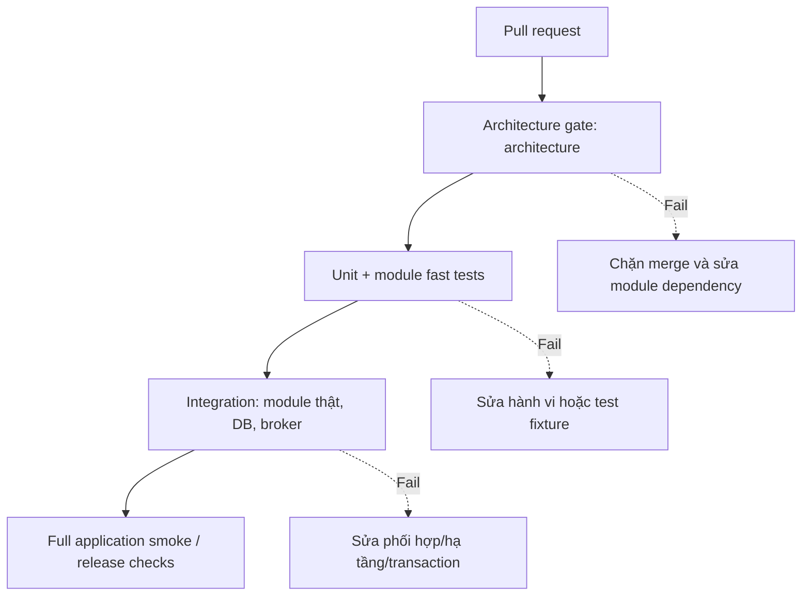

# Tags cho architectural, module và integration test trong JUnit Jupiter và Spring Modulith

## 1. Vì sao phân loại test bằng tags là một quyết định kiến trúc CI?

Một ứng dụng **Spring Modulith** có thể chứa hàng nghìn bài kiểm thử. Có bài chỉ cần phân tích mã nguồn để bảo đảm module không phụ thuộc sai; có bài phải khởi động một application module bằng Spring TestContext; có bài cần **implementation thật của module khác**, database hoặc message broker. Nếu tất cả bài kiểm thử luôn chạy như nhau, CI có thể quá chậm. Nếu chỉ chạy một nhóm nhanh mà bỏ sót kiểm chứng kiến trúc, dự án có thể merge một phụ thuộc sai dù nghiệp vụ vẫn chạy xanh.

JUnit Jupiter cung cấp `@Tag` để **đánh dấu** lớp hoặc phương thức test. JUnit Platform, Gradle, Maven Surefire/Failsafe và IDE có thể sử dụng các tags để **lọc tập test được phát hiện và thực thi**.

Ví dụ ba tầng cơ bản:

- `architecture`: xác minh ranh giới kiến trúc bằng `ApplicationModules.verify()`; thường **không cần khởi động Spring context**.
- `module`: kiểm thử hành vi của một application module, thường với `@ApplicationModuleTest` và mock/fake ở các API ngoài module.
- `integration`: kiểm thử sự phối hợp **implementation thật** của nhiều module hoặc hạ tầng như JPA, broker và toàn ứng dụng.

**Cảnh báo quan trọng:** Đây là các **quy ước đặt tên tag do nhóm phát triển chọn**, không phải ba annotations đặc biệt do Spring Modulith tự cung cấp. `@Tag("architecture")` **không** tự gọi `ApplicationModules.verify()`; `@Tag("module")` **không** tự khởi động `@ApplicationModuleTest`; `@Tag("integration")` **không** tự tạo Testcontainers, datasource hay broker. Chỉ các annotation/configuration và assertion thật mới tạo bằng chứng kiểm thử.

Bài này thuộc chương **JUnit integration** trong học phần **SPRING_MODULITH_VERIFICATION_TESTING**. Mục tiêu xuyên suốt là rèn kỹ năng kiểm chứng ranh giới bằng `ApplicationModules` và các quy tắc phụ thuộc, thực hành `@ApplicationModuleTest`, kiểm thử sự kiện, cơ sở dữ liệu và tích hợp, rồi đưa **quality gate** vào CI để ngăn phụ thuộc sai và hồi quy.

### Kết quả học tập

Sau bài này, bạn có thể:

- Thiết kế một **tag taxonomy** tách loại test, module/chức năng và yêu cầu hạ tầng.
- Dùng `@Tag` ở cấp class/method, gắn nhiều tag và hiểu tác động của kế thừa.
- Viết **tag expressions** với `!`, `&`, `|`, dấu ngoặc và `any()`/`none()`.
- Phân loại một architecture test `ApplicationModules.verify()`, module test `@ApplicationModuleTest` và integration test với dependency thật.
- Cấu hình lọc tag cho **Gradle Kotlin DSL** và **Maven Surefire/Failsafe**, tránh lọt test do naming convention và filter.
- Tổ chức pipeline CI có architecture gate bắt buộc, test module nhanh và integration test chọn lọc mà không đánh đồng tag với độ phủ.

## 2. Thiết kế bộ tag theo **ba chiều**, không coi chúng là cấp bậc tự động

Một quy ước nhất quán nên trả lời ba câu hỏi:

1. **Loại bằng chứng:** Test kiểm tra luật kiến trúc, hành vi một module hay tích hợp thực?
2. **Module/feature mục tiêu:** Test đang chứng minh hợp đồng của `order`, `inventory`, `payment` hay `notification`?
3. **Hạ tầng/chi phí:** Test cần database, broker, network, hoặc thường chậm?

| Chiều | Tag đề xuất | Ý nghĩa chính xác |
| --- | --- | --- |
| Loại bằng chứng | `architecture` | Chạy **assertion kiểm chứng cấu trúc** (Modulith, ArchUnit hoặc rule phù hợp) |
| Loại bằng chứng | `module` | Tập trung vào **hành vi/ràng buộc của một application module** |
| Loại bằng chứng | `integration` | Dùng **dependency thật** hoặc hạ tầng tích hợp; có thể đồng thời là module test |
| Module/feature | `order`, `inventory`, `notification` | Module/feature **chính** được kiểm chứng, không nhất thiết toàn bộ module được khởi động |
| Phạm vi | `application` | Test toàn ứng dụng hoặc phối hợp ở cấp ứng dụng |
| Hạ tầng/kịch bản | `db`, `event`, `broker`, `web` | Khía cạnh thực sự được assertion bao phủ |
| Chi phí | `slow` | Đã xác nhận chi phí cao hoặc được nhóm thống nhất xếp chậm |

Tag **không mang nghĩa phân cấp**. Gắn `@Tag("integration")` không tự tạo thêm `module`; gắn `@Tag("event")` không có nghĩa đang dùng broker thật. Mỗi tag cần một định nghĩa nhóm có thể kiểm tra lại khi review.

### Ví dụ cùng một test mang nhiều tag

```java
@Tag("module")
@Tag("integration")
@Tag("order")
@ApplicationModuleTest(
    mode = ApplicationModuleTest.BootstrapMode.DIRECT_DEPENDENCIES
)
class OrderInventoryIT {
    // Các @Test thật sẽ dùng OrderService và InventoryService.
}
```

Khối trên chỉ minh họa **bộ annotation**, chưa phải testcase chạy độc lập. Bộ tag có nghĩa: “Đây là integration test của luồng thuộc module `order`, và nó cũng là một module-oriented test.” Nó không mâu thuẫn: **một test có thể thuộc nhiều tập lọc**.

| Tag expression | Chọn test trên? | Vì sao? |
| --- | --- | --- |
| `module` | Có | Test có tag module |
| `integration` | Có | Test có tag integration |
| `module & integration` | Có | Test thỏa đồng thời hai tag |
| `module & !integration` | Không | Test đã được đánh dấu integration |
| `architecture` | Không | Test không kiểm tra luật kiến trúc riêng |
| `order & integration` | Có | Test thuộc feature order và integration |

**Đề xuất thực tế:** Dùng những tên ngắn, ổn định, chữ thường và không có khoảng trắng. Tránh tạo các biến thể như `integration-test`, `integrationTest`, `Integration` cho cùng một mục đích, trừ khi đã thiết kế quy tắc rõ ràng.

## 3. API JUnit Jupiter: `@Tag` làm gì và không làm gì?

`@Tag` nằm ở `org.junit.jupiter.api.Tag`, có thể gắn trên **class** hoặc **method**. Nó là annotation *repeatable*, nên một class/method có thể mang nhiều tag:

```java
package com.example.shop.testing;

import org.junit.jupiter.api.Tag;
import org.junit.jupiter.api.Test;

@Tag("module")
@Tag("order")
class TaggingExamples {

    @Test
    void checksInputValidation() {
        // Assertion thật được bổ sung trong bài module test.
    }

    @Test
    @Tag("event")
    void checksEventPublication() {
        // Khi thực thi với Spring Modulith, cần PublishedEvents assertion.
    }
}
```

Các method trên là **ví dụ cú pháp, chưa có assertion**, không phải bộ test sẵn sàng đưa vào CI. Điểm cần đọc:

- `checksInputValidation()` có tags `module` và `order` từ cấp class.
- `checksEventPublication()` có thêm tag `event` tại cấp method; tag method **bổ sung**, không xóa tags class.
- Một `@Nested` JUnit class có thể tạo nhóm scenario bên trong class mang tag. Các tags của container bao ngoài tham gia tập tags hiệu dụng cho các test bên trong; cần phân biệt việc đó với cách Java thừa kế một superclass.
- `@Tag` ở cấp class có tính kế thừa; không nên suy rằng tag trên một test method tự được truyền cho method khác.

**Không nhầm** `@Tag` với `@DisplayName` hoặc `@Disabled`:

| Annotation | Chức năng |
| --- | --- |
| `@Tag("architecture")` | Phân loại để **lọc** test ở JUnit Platform |
| `@DisplayName("Các module không có chu trình")` | Đặt tên hiển thị trong IDE/report |
| `@Disabled("...")` | Vô hiệu hóa test theo cơ chế JUnit; không phải phân loại |
| `@ApplicationModuleTest` | Khởi tạo Spring context theo phạm vi application module |
| `@SpringBootTest` | Khởi tạo Spring Boot test context theo cấu hình được chọn |
| `@Test` | Đánh dấu phương thức có logic kiểm chứng được JUnit gọi |

Tag filter thường ảnh hưởng **test discovery/selection**. Một test bị lọc khỏi kế hoạch chạy không nhất thiết xuất hiện trong báo cáo như một test “skipped” do `@Disabled`. Vì vậy **đừng dùng số skipped bằng 0** để kết luận pipeline đã chạy đủ mọi loại test.

## 4. Cú pháp tag hợp lệ và tag expressions

JUnit Platform kiểm tra cú pháp của **tên tag**. Sau khi trim, tên không được rỗng, không chứa khoảng trắng, ISO control characters hoặc các ký tự dành riêng `,` `(` `)` `&` `|` `!`.

| Tag | Hợp lệ? | Nhận xét |
| --- | --- | --- |
| `architecture` | Có | Tên ngắn, rõ nghĩa |
| `module` | Có | Chọn nhóm module tests |
| `integration` | Có | Chọn nhóm tích hợp |
| `module-order` | Có | Dấu gạch nối được chấp nhận; không tự tạo quan hệ với `module` |
| `db-postgres` | Có | Tag mô tả hạ tầng |
| `integration test` | **Không** | Chứa khoảng trắng |
| `module&integration` | **Không** | `&` dành cho **tag expression**, không thuộc tên tag |
| `order,inventory` | **Không** | Dấu phẩy là ký tự dành riêng |
| `!slow` | **Không** | Phủ định thuộc **expression**, không phải tên tag |

Tag expression là **biểu thức Boolean** dùng trong cấu hình lọc, không đặt bên trong `@Tag`:

```text
architecture
module & !integration
integration & order
architecture | (module & !integration)
(module | integration) & !slow
any()
none()
```

Thứ tự ưu tiên toán tử JUnit Platform từ cao xuống thấp:

1. `!` — phủ định.
2. `&` — giao.
3. `|` — hợp.

Dấu ngoặc cho phép diễn đạt nhóm rõ ràng. Vì `&` ưu tiên cao hơn `|`, biểu thức `architecture | module & !integration` tương đương `architecture | (module & !integration)`; nên **viết ngoặc tường minh** trong CI để code review không phải suy đoán.

### Hai biểu thức đặc biệt

- `any()`: chọn những test có **ít nhất một tag**.
- `none()`: chọn những test **không có tag nào**.

Đây là **biểu thức lọc**, không phải giá trị hợp lệ cho `@Tag("any()")`. Việc `none()` có thể chọn unit tests không tag là hữu ích khi kiểm tra các bài cũ chưa được phân loại; nhưng không nên coi mọi test không tag là unit test theo mặc định.

### Một số biểu thức lọc thực tế

| Mục tiêu | Biểu thức | Những gì sẽ không chạy |
| --- | --- | --- |
| Architecture gate | `architecture` | Test không mang tag architecture |
| Chỉ module test không tích hợp nặng | `module & !integration` | Module integration, architecture không tagged module |
| Module integration | `module & integration` | Standalone module test |
| Mọi test tích hợp | `integration` | Unit, architecture, module không tagged integration |
| Chỉ tích hợp thuộc `order` | `integration & order` | Integration của feature khác |
| PR fast gate gồm architecture + module nhẹ | `architecture | (module & !integration)` | Full integration, các unit tests không có tag |
| Đã phân loại, trừ test slow | `any() & !slow` | Test không tag và test slow |
| Tìm test chưa phân loại | `none()` | Mọi test đã gắn ít nhất một tag |

**Cạm bẫy:** Nếu CI chỉ chạy `module & !integration`, architecture tests **không tự được chọn**. Không có giả định nào trong JUnit nói rằng `architecture` là một dạng con của `module`.

## 5. Chuẩn bị ứng dụng mẫu ba nhóm test

Bài thực hành sử dụng **Java 17+, Spring Boot 3.5, Spring Framework 6.2, Spring Modulith 1.4 và JUnit Jupiter 5** theo các BOM tương thích. Nếu dùng Spring Boot 4 hoặc Spring Modulith 2.x, hãy điều chỉnh dependency/import theo phiên bản; nguyên tắc phân loại bằng JUnit tags vẫn giữ nguyên.

```text
src/
├── main/java/com/example/shop/
│   ├── ShopApplication.java
│   ├── inventory/
│   │   ├── InventoryAvailability.java
│   │   └── InventoryService.java
│   └── order/
│       ├── OrderPlaced.java
│       └── OrderService.java
└── test/java/com/example/shop/
    ├── ShopArchitectureTests.java
    ├── FullApplicationIT.java
    └── order/
        ├── OrderModuleTests.java
        └── OrderInventoryIT.java
```

Theo nhận diện module mặc định, `inventory` và `order` là hai application module. `order` phụ thuộc **API công khai** của `inventory`; không import implementation thuộc package `internal` của module khác.

### Dependency Maven

Trong một dự án Maven đã khai báo Spring Boot parent/plugin và Spring Modulith BOM tương thích, các dependency chính:

```xml
<dependency>
    <groupId>org.springframework.boot</groupId>
    <artifactId>spring-boot-starter</artifactId>
</dependency>
<dependency>
    <groupId>org.springframework.boot</groupId>
    <artifactId>spring-boot-starter-test</artifactId>
    <scope>test</scope>
</dependency>
<dependency>
    <groupId>org.springframework.modulith</groupId>
    <artifactId>spring-modulith-starter-test</artifactId>
    <scope>test</scope>
</dependency>
```

Đây là đoạn dependency, **không phải toàn bộ `pom.xml`**. `spring-boot-starter-test` cung cấp JUnit Jupiter, AssertJ, Mockito và Spring Test; Modulith test starter cung cấp `@ApplicationModuleTest` và `PublishedEvents`. Với Spring Framework 6.2+, `@MockitoBean` được import từ `org.springframework.test.context.bean.override.mockito`. Các test minh họa lõi không cần database hoặc HTTP server.

### Lớp ứng dụng gốc

File `src/main/java/com/example/shop/ShopApplication.java`:

```java
package com.example.shop;

import org.springframework.boot.SpringApplication;
import org.springframework.boot.autoconfigure.SpringBootApplication;

@SpringBootApplication
public class ShopApplication {

    public static void main(String[] args) {
        SpringApplication.run(ShopApplication.class, args);
    }
}
```

### API công khai của module `inventory`

File `src/main/java/com/example/shop/inventory/InventoryAvailability.java`:

```java
package com.example.shop.inventory;

public interface InventoryAvailability {
    boolean available(String sku, int quantity);
}
```

Implementation thật trong cùng module:

```java
package com.example.shop.inventory;

import org.springframework.stereotype.Service;

@Service
public class InventoryService implements InventoryAvailability {

    @Override
    public boolean available(String sku, int quantity) {
        return "SKU-READY".equals(sku) && quantity <= 3;
    }
}
```

### Event của module `order`

File `src/main/java/com/example/shop/order/OrderPlaced.java`:

```java
package com.example.shop.order;

import java.util.UUID;

public record OrderPlaced(UUID orderId, String sku, int quantity) {}
```

### Use case của module `order`

File `src/main/java/com/example/shop/order/OrderService.java`:

```java
package com.example.shop.order;

import java.util.UUID;
import com.example.shop.inventory.InventoryAvailability;
import org.springframework.context.ApplicationEventPublisher;
import org.springframework.stereotype.Service;

@Service
public class OrderService {

    private final InventoryAvailability inventory;
    private final ApplicationEventPublisher events;

    public OrderService(InventoryAvailability inventory,
                        ApplicationEventPublisher events) {
        this.inventory = inventory;
        this.events = events;
    }

    public UUID place(String sku, int quantity) {
        if (sku == null || sku.isBlank()
                || quantity <= 0 || quantity > 3) {
            throw new IllegalArgumentException("INVALID_ORDER");
        }

        if (!inventory.available(sku, quantity)) {
            throw new IllegalStateException("OUT_OF_STOCK");
        }

        UUID orderId = UUID.randomUUID();
        events.publishEvent(new OrderPlaced(orderId, sku, quantity));
        return orderId;
    }
}
```

Logic đơn giản nhưng đủ để phân biệt ba loại bằng chứng: ranh giới mã nguồn `order → inventory`, hành vi `order` với phản hồi kho được mock và tích hợp thật với `InventoryService`. Phần tiếp theo gắn tags vào đúng **bài kiểm chứng**, thay vì gắn chỉ để tạo tên nhóm.

## 6. Architectural test: gắn `architecture` vào một kiểm chứng thật

File `src/test/java/com/example/shop/ShopArchitectureTests.java`:

```java
package com.example.shop;

import org.junit.jupiter.api.DisplayName;
import org.junit.jupiter.api.Tag;
import org.junit.jupiter.api.Test;
import org.springframework.modulith.core.ApplicationModules;

@Tag("architecture")
@DisplayName("Ranh giới kiến trúc giữa các application module")
class ShopArchitectureTests {

    @Test
    @DisplayName("Các module tuân thủ quy tắc phụ thuộc của Spring Modulith")
    void applicationModulesRespectDeclaredBoundaries() {
        ApplicationModules.of(ShopApplication.class).verify();
    }
}
```

`ApplicationModules.of(ShopApplication.class).verify()` kiểm chứng mô hình module ở cấp mã nguồn, **không cần khởi tạo Spring `ApplicationContext`** cho testcase này. Theo Spring Modulith, các luật cấu trúc cơ bản bao gồm:

1. **Không có chu trình phụ thuộc ở cấp application module**.
2. **Không phụ thuộc trái quy tắc vào phần API nội bộ** của module khác; các biến thể `Open Application Module` có quy tắc riêng.
3. **Tôn trọng `allowedDependencies`** nếu module chủ động khai báo giới hạn phụ thuộc.

Một giới hạn quan trọng: `verify()` thực thi những quy tắc mà Spring Modulith có thể suy ra hoặc đã được cấu hình, **không tự biết** mọi luật kiến trúc riêng như “mọi controller không được gọi repository trực tiếp”. Với luật riêng, bổ sung ArchUnit hoặc test tương đương có assertion thực tế, đồng thời gắn `architecture` để CI chọn chạy.

### Một luật cho phép phụ thuộc tường minh

Nếu muốn `order` chỉ phụ thuộc ứng dụng vào module `inventory`, có thể bổ sung file `src/main/java/com/example/shop/order/package-info.java` trong dự án thực:

```java
@org.springframework.modulith.ApplicationModule(
    allowedDependencies = "inventory"
)
package com.example.shop.order;
```

Đây là **cấu hình kiến trúc tùy chọn** minh họa trong tài liệu, không phải file cần tạo cho bài học STEP 4. Nếu thêm dependency sang một module khác, `verify()` sẽ có ràng buộc được khai báo để so sánh. Không nên đặt tên test như thể dự án đã khai báo `allowedDependencies` khi thực tế chưa có.

### Vì sao architecture gate nên là một test riêng?

`@ApplicationModuleTest` hiện có cơ chế kiểm chứng cấu trúc tự động (ví dụ `verifyAutomatically` theo phiên bản), nhưng CI có thể chạy **chọn lọc** module tests bằng tags. Nếu các bài module test bị lọc ra, không nên để việc kiểm chứng kiến trúc vô tình biến mất cùng với chúng.

Một test `@Tag("architecture")` riêng:

- Khởi động nhanh hơn các test có Spring context.
- Cho tên và lỗi kiến trúc dễ tìm trong báo cáo CI.
- Dễ được đưa vào **stage bắt buộc**, bất kể có bao nhiêu integration tests được chọn.
- Không phụ thuộc vào việc các test khác có chạy trước để tải `ApplicationContext` hay không.

**Cảnh báo:** Gắn `@Tag("architecture")` lên một phương thức `@Test` rỗng **không tạo quality gate**. Chính phép gọi `verify()` hoặc các assertion kiến trúc khác mới phát hiện lỗi.

## 7. Module test: `@Tag("module")` đi cùng `@ApplicationModuleTest`

File `src/test/java/com/example/shop/order/OrderModuleTests.java`:

```java
package com.example.shop.order;

import static org.assertj.core.api.Assertions.assertThat;
import static org.assertj.core.api.Assertions.assertThatThrownBy;
import static org.mockito.BDDMockito.given;
import static org.mockito.BDDMockito.then;

import java.util.UUID;
import com.example.shop.inventory.InventoryAvailability;
import org.junit.jupiter.api.DisplayName;
import org.junit.jupiter.api.Tag;
import org.junit.jupiter.api.Test;
import org.springframework.beans.factory.annotation.Autowired;
import org.springframework.modulith.test.ApplicationModuleTest;
import org.springframework.modulith.test.PublishedEvents;
import org.springframework.test.context.bean.override.mockito.MockitoBean;

@Tag("module")
@Tag("order")
@DisplayName("Order — hành vi trong ranh giới module")
@ApplicationModuleTest
class OrderModuleTests {

    @Autowired OrderService orders;

    @MockitoBean InventoryAvailability inventory;

    @Test
    @Tag("event")
    @DisplayName("Đủ hàng → phát OrderPlaced đúng orderId")
    void publishesOrderPlaced_whenInventoryApproves(
            PublishedEvents publishedEvents) {

        given(inventory.available("SKU-A", 2)).willReturn(true);

        UUID id = orders.place("SKU-A", 2);

        assertThat(publishedEvents.ofType(OrderPlaced.class)
                .matching(OrderPlaced::orderId, id))
                .hasSize(1);

        then(inventory).should().available("SKU-A", 2);
    }

    @Test
    @Tag("validation")
    @Tag("event")
    @DisplayName("SKU trống → từ chối, không hỏi kho, không phát sự kiện")
    void rejectsBlankSku_withoutEventOrInventoryCall(
            PublishedEvents publishedEvents) {

        assertThatThrownBy(() -> orders.place(" ", 1))
                .isInstanceOf(IllegalArgumentException.class)
                .hasMessage("INVALID_ORDER");

        then(inventory).shouldHaveNoInteractions();
        assertThat(publishedEvents.ofType(OrderPlaced.class)).isEmpty();
    }
}
```

Ý nghĩa của lớp:

1. `@ApplicationModuleTest` **khởi động thật** application module `order` theo cơ chế Spring Modulith; mặc định `BootstrapMode.STANDALONE`.
2. `@MockitoBean InventoryAvailability` cung cấp mock ở API công khai của module `inventory`, nên không cần tạo `InventoryService` thật.
3. `@Tag("module")` dùng để **chọn nhóm kiểm thử** trong JUnit Platform, hoàn toàn không thay đổi cách bootstrap.
4. `@Tag("order")` cho biết feature/module đích; `@Tag("event")` trên method nêu rõ assertion có kiểm chứng event.
5. `PublishedEvents` chỉ xác nhận **event được publish** trong testcase; không chứng minh consumer module khác đã xử lý.
6. Cả hai test sử dụng `OrderService` thật, nhưng **không kiểm chứng implementation của `InventoryService`**. Vì vậy không nên gắn `integration` chỉ vì có một Spring context, nếu quy ước nhóm dành tag đó cho dependency/hạ tầng thật.

Trong JUnit, những methods trên đều mang `module` và `order` do tag class. Phương thức phát event có thêm `event`; phương thức validation có thêm `validation` và `event`. Do đó `module & event` có thể chọn hai testcase về sự kiện, còn `module & validation` chỉ chọn testcase validation.

**Giới hạn naming:** `@Tag("order")` mô tả **module chịu trách nhiệm về hợp đồng đang kiểm thử**. Nó không ngầm suy ra mọi dependency được nạp. Trong module test `STANDALONE`, `inventory` chỉ hiện diện qua một mock API, không phải implementation thật.

## 8. Cross-module integration test: gắn **cả** `module` và `integration`

Khi muốn kiểm tra `order` gọi được implementation `InventoryService` thật, bài test phải thay đổi **bootstrap mode**, không chỉ gắn thêm tag.

File `src/test/java/com/example/shop/order/OrderInventoryIT.java`:

```java
package com.example.shop.order;

import static org.assertj.core.api.Assertions.assertThat;
import static org.assertj.core.api.Assertions.assertThatThrownBy;

import java.util.UUID;
import com.example.shop.inventory.InventoryAvailability;
import org.junit.jupiter.api.DisplayName;
import org.junit.jupiter.api.Tag;
import org.junit.jupiter.api.Test;
import org.springframework.beans.factory.annotation.Autowired;
import org.springframework.modulith.test.ApplicationModuleTest;
import org.springframework.modulith.test.ApplicationModuleTest.BootstrapMode;
import org.springframework.modulith.test.PublishedEvents;

@Tag("module")
@Tag("integration")
@Tag("order")
@DisplayName("Order ↔ Inventory — tích hợp dependency thật")
@ApplicationModuleTest(mode = BootstrapMode.DIRECT_DEPENDENCIES)
class OrderInventoryIT {

    @Autowired OrderService orders;
    @Autowired InventoryAvailability inventory;

    @Test
    @Tag("event")
    @DisplayName("Kho thật xác nhận SKU → OrderPlaced được phát")
    void placesOrder_usingRealInventoryService(PublishedEvents events) {

        assertThat(inventory.available("SKU-READY", 2)).isTrue();

        UUID id = orders.place("SKU-READY", 2);

        assertThat(events.ofType(OrderPlaced.class)
                .matching(OrderPlaced::orderId, id))
                .hasSize(1);
    }

    @Test
    @DisplayName("Kho thật từ chối SKU → OrderService không chấp nhận đơn")
    void rejectsOrder_usingRealInventoryService() {
        assertThatThrownBy(() -> orders.place("SKU-OUT", 1))
                .isInstanceOf(IllegalStateException.class)
                .hasMessage("OUT_OF_STOCK");
    }
}
```

Test thứ hai gọi `OrderService.place(...)` thật và kiểm tra exception khi `InventoryService` trả `false` cho `SKU-OUT`. Như vậy cả **tên test lẫn assertion** đều mô tả cùng một hợp đồng tích hợp; không chỉ kiểm tra API kho riêng lẻ.

Tại đây:

- `@ApplicationModuleTest(mode = DIRECT_DEPENDENCIES)` quyết định **scope module**.
- `@Tag("integration")` quyết định **tập lọc CI**.
- `@Tag("module")` diễn tả test vẫn tập trung vào **một module mục tiêu**, nhưng chạy cùng dependency thật.
- Tên file `*IT.java` hỗ trợ **Maven Failsafe** tự phát hiện integration test theo convention, bên cạnh tag.

Việc gắn hai tag không có gì sai. Nhưng nếu CI dùng `includeTags("module")` mà không loại `integration`, bài kiểm thử này **vẫn chạy trong job module nhanh**; đó có thể không phải điều nhóm muốn. Lọc chính xác bằng `module & !integration` nếu mục tiêu là module tests nhẹ.

### Vì sao không chỉ dùng `@Tag("integration")`?

Tag `integration` chỉ nói **loại bằng chứng hoặc hạ tầng**. Tag `module` nói **mục tiêu ranh giới**. Một bài kiểm thử tích hợp cross-module có thể cần cả hai chiều. Nhờ đó có thể chọn `integration & order` để chỉ chạy test tích hợp của `order`, hoặc `module & integration` để kiểm tra các ranh giới giữa module.

### Không gắn `db` nếu không có database

`InventoryService` ở ví dụ dùng logic in-memory cố định, **không truy cập DB thật**. Vì vậy test mang `integration` là có cơ sở (dependency giữa hai module là bean thật), nhưng gắn `db` sẽ gây hiểu nhầm. Nếu muốn test DB, cần datasource, schema, repository và assertion persistence riêng.

## 9. Full-application integration test: `integration` mà không cần `module`

File `src/test/java/com/example/shop/FullApplicationIT.java`:

```java
package com.example.shop;

import static org.assertj.core.api.Assertions.assertThat;

import java.util.UUID;
import com.example.shop.inventory.InventoryAvailability;
import com.example.shop.order.OrderService;
import org.junit.jupiter.api.DisplayName;
import org.junit.jupiter.api.Tag;
import org.junit.jupiter.api.Test;
import org.springframework.beans.factory.annotation.Autowired;
import org.springframework.boot.test.context.SpringBootTest;

@Tag("integration")
@Tag("application")
@DisplayName("Toàn ứng dụng — startup và phối hợp bean thật")
@SpringBootTest(
    classes = ShopApplication.class,
    webEnvironment = SpringBootTest.WebEnvironment.NONE
)
class FullApplicationIT {

    @Autowired OrderService orders;
    @Autowired InventoryAvailability inventory;

    @Test
    void startsAndPlacesOrderWithRealInventory() {
        assertThat(inventory.available("SKU-READY", 2)).isTrue();

        UUID id = orders.place("SKU-READY", 2);

        assertThat(id).isNotNull();
    }
}
```

Đây là **full Spring Boot application test** trong ứng dụng mẫu tối giản; nó không áp dụng module slicing của `@ApplicationModuleTest`. Tag `integration` phù hợp vì test sử dụng bean thật của cả hai module. Tag `application` phân biệt nó với bài module integration `OrderInventoryIT`.

**Không khẳng định quá mức:** `FullApplicationIT` trên kiểm tra startup context và một đường gọi giữa hai bean; nó **không** chứng minh đã kiểm tra HTTP, database, message broker hoặc giao dịch thực. Tên “full application” nói về **bootstrap scope**, không có nghĩa end-to-end trên hạ tầng sản xuất.

### So sánh ba loại test chính

| Test | Tag hiệu dụng | Bootstrap / assertion | Tốc độ tương đối |
| --- | --- | --- | --- |
| `ShopArchitectureTests` | `architecture` | `ApplicationModules.verify()`, không cần context | Thường nhanh |
| `OrderModuleTests` | `module, order`; method thêm `event/validation` | `STANDALONE`, mock `inventory`, service thật | Thường nhẹ hơn full app |
| `OrderInventoryIT` | `module, integration, order`; một method thêm `event` | `DIRECT_DEPENDENCIES`, `inventory` thật | Phụ thuộc số bean/hạ tầng |
| `FullApplicationIT` | `integration, application` | Full `@SpringBootTest`, bean thật toàn ứng dụng | Có thể nặng hơn module test |

Thời gian ở cột cuối chỉ là **xu hướng**, không phải metric đo được. Một module test có Testcontainers hoặc nhiều auto-configuration có thể nặng hơn một full application smoke test tối giản. Dùng số liệu CI thực tế khi quyết định có gắn thêm `slow` hay không.

## 10. Tags cho database, event và web integration

Ba tag `architecture`, `module` và `integration` là **trục phân loại chính**, nhưng nhiều test cần thêm nhãn diễn tả **loại hạ tầng hoặc hợp đồng được quan sát**.

### 10.1. Database integration

Một bài test thực sự kiểm tra JPA repository với PostgreSQL Testcontainers có thể mang:

```java
@Tag("module")
@Tag("integration")
@Tag("db")
@ApplicationModuleTest
class OrderRepositoryIT {

    @Autowired OrderRepository repository;

    @Test
    @Transactional
    void storesAndReadsOrderInTestTransaction() {
        // Cần OrderRepository/entity, datasource, schema thật;
        // tạo ID riêng, save, flush, find và assertions cụ thể.
    }
}
```

Đây là **mẫu phân loại**, không phải file có thể biên dịch độc lập với ứng dụng ở phần 5: ví dụ nền chưa khai báo `OrderRepository`, entity, JDBC/JPA starter, database hoặc transaction manager. Trước khi dùng tag `db`, phải bổ sung **assertion persistence thật**, không chỉ mock `repository.save(...)`.

`@Transactional` trong Spring Test thường rollback **test-managed transaction** sau testcase; nó **không tự tạo DB**, và không tự rollback dữ liệu được commit trong transaction/thread khác. Vì thế “có tag `db`” chưa đủ chứng minh bộ test sạch dữ liệu.

### 10.2. Event flow: publish event khác consumer xử lý

Trong phần 7, `PublishedEvents` kiểm tra **event nguồn** `OrderPlaced`. Nếu muốn kiểm tra consumer `notification` xử lý xong event, cần listener thật, transaction manager và một điểm quan sát kết quả. Một skeleton dùng Spring Modulith `Scenario`:

```java
@Tag("module")
@Tag("integration")
@Tag("event")
@ApplicationModuleTest(extraIncludes = "notification")
class OrderNotificationIT {

    @Test
    void publishesCompletionAfterOrderPlacedIsHandled(
            Scenario scenario) {
        UUID orderId = UUID.randomUUID();

        scenario.publish(new OrderPlaced(orderId, "SKU-A", 1))
                .andWaitAtMost(Duration.ofSeconds(5))
                .forEventOfType(NotificationHandled.class)
                .matching(event -> event.orderId().equals(orderId))
                .toArriveAndVerify(event ->
                        assertThat(event.orderId()).isEqualTo(orderId));
    }
}
```

**Đây là mã khung minh họa API và tags**, không phải lớp chạy được trong ứng dụng mẫu: cần định nghĩa module `notification`, event `NotificationHandled`, listener xử lý `OrderPlaced`, transaction manager, imports và các dependency hạ tầng phù hợp. Nếu `OrderService` vẫn yêu cầu `InventoryAvailability` khi context khởi tạo, còn cần mock/fake nó hoặc chọn bootstrap mode khác.

Chú ý `Scenario.publish(...)` ở đây **phát event trực tiếp**, không đi qua `OrderService.place(...)`. Vì vậy test này không khẳng định validation của `order` đã chạy. Mục tiêu là kiểm thử **consumer event flow** với correlation ID chính xác; tag `integration, event` phản ánh đúng điều đó.

### 10.3. Web integration

Một REST adapter test có thể sử dụng `@ApplicationModuleTest` cùng Spring MVC `MockMvc`, rồi đặt `@Tag("module")`, `@Tag("web")`. Nếu test cần port mạng thật, datasource hoặc xác thực qua HTTP, có thể thêm `integration` theo quy ước nhóm.

**Không bắt buộc mọi web test là `integration`.** Một `@WebMvcTest` với service mock kiểm tra tầng adapter không tương đương một end-to-end test có server thật và database. Hãy phân loại theo **độ trung thực của hạ tầng/assertion**, không chỉ sự xuất hiện của Spring Test.

### 10.4. Tag hạ tầng không tự bật hạ tầng

| Tag bổ sung | Điều cần có trước khi tuyên bố đạt mục tiêu |
| --- | --- |
| `db` | Datasource/schema/repository thật và assertion kiểm tra dữ liệu |
| `broker` | Broker test hoặc môi trường tương đương, xác minh transport/serialization khi cần |
| `event` | Assertion event nguồn hoặc event/state kết quả với correlation phù hợp |
| `web` | Controller/HTTP contract được kiểm chứng bằng client hoặc MockMvc |
| `slow` | Lý do đo được hoặc thống nhất về budget, không phải tag để bỏ qua test lỗi |

Nếu một test có nhiều nhánh (ví dụ vừa kiểm tra event nguồn vừa DB), việc gắn nhiều tag chỉ nên diễn ra khi **assertions thực sự bao phủ** những khía cạnh đó.

## 11. `@Tag` cấp method, `@Nested` và annotation kết hợp

### 11.1. Một class có nhiều nhóm scenario

JUnit Jupiter `@Nested` có thể chia bối cảnh trong một lớp `@ApplicationModuleTest`:

```java
@Tag("module")
@Tag("order")
@ApplicationModuleTest
class NestedOrderModuleTests {

    @Nested
    @DisplayName("Validation")
    class InvalidRequests {

        @Test
        @Tag("validation")
        void rejectsInvalidQuantity() {
            // Tự thiết lập fixture và assertion thật.
        }
    }

    @Nested
    @DisplayName("Event publication")
    class SuccessfulOrders {

        @Test
        @Tag("event")
        void publishesOrderPlaced() {
            // Kiểm tra event đúng ID trong cùng test.
        }
    }
}
```

Khối trên chỉ là **mẫu phân cấp tag**, chưa phải test nghiệp vụ hoàn chỉnh. Outer class mang `module, order`; các method bên trong được bổ sung `validation` hoặc `event` theo scenario. **Không nên** gắn `integration` lên một nested group chỉ để “đổi” `BootstrapMode` của outer `@ApplicationModuleTest`: tags không tác động cách bootstrap và các nhóm có thể đang dùng chung Spring context.

Nếu một nhóm cần `DIRECT_DEPENDENCIES`/database thật còn nhóm khác cần `STANDALONE` + mock, tách **hai top-level test classes** như phần 7–8 thường rõ hơn.

### 11.2. Dùng composed annotation cho taxonomy ổn định

JUnit Jupiter hỗ trợ *meta-annotations*. Khi tag `architecture` được dùng ở nhiều chỗ, có thể tạo một annotation dùng lại:

```java
package com.example.shop.testing;

import java.lang.annotation.ElementType;
import java.lang.annotation.Inherited;
import java.lang.annotation.Retention;
import java.lang.annotation.RetentionPolicy;
import java.lang.annotation.Target;
import org.junit.jupiter.api.Tag;

@Target({ElementType.TYPE, ElementType.METHOD})
@Retention(RetentionPolicy.RUNTIME)
@Inherited
@Tag("architecture")
public @interface ArchitectureCheck {
}
```

Một test khác dùng:

```java
@ArchitectureCheck
class CatalogArchitectureTests {

    @Test
    void allApplicationModulesAreValid() {
        ApplicationModules.of(ShopApplication.class).verify();
    }
}
```

Đây là **hai file Java minh họa**; class thứ hai cần import `ArchitectureCheck`, `Test`, `ApplicationModules` và `ShopApplication` theo package. Annotation kết hợp giúp thống nhất tên tag, nhưng **chính test method** vẫn phải triển khai assertion thật. Tạo annotation `@ArchitectureCheck` không tự gọi `verify()`.

**Giới hạn:** Trong bài học này, ta chỉ kết hợp **tag**, không cố tạo annotation gộp `@Tag` với một số `@SpringBootTest`/`@ApplicationModuleTest` có thuộc tính bootstrap động. Với những annotation khởi tạo context, việc meta-annotation và aliasing cần được thiết kế đúng cho phiên bản Spring Test; cách đơn giản và minh bạch vẫn là đặt `@Tag` cạnh annotation test thật.

## 12. Cấu hình Gradle Kotlin DSL: ba task với ba mục tiêu rõ ràng

Gradle hỗ trợ JUnit Platform thông qua `Test.useJUnitPlatform`. Một dự án dùng plugin `java`/Spring Boot có thể phân chia:

- `test`: unit tests không tag và module tests nhẹ; **loại** `architecture` và `integration` để tránh chạy trùng.
- `architectureTest`: chỉ `architecture`; là **quality gate bắt buộc**.
- `integrationTest`: chỉ `integration`, không chạy lại architecture tests; có thể cần hạ tầng DB/broker.

Ví dụ đặt trong `build.gradle.kts` của dự án Gradle Java đã có các dependencies/JUnit Platform phù hợp:

```kotlin
import org.gradle.api.tasks.testing.Test

val architectureTest by tasks.registering(Test::class) {
    description = "Verify Spring Modulith module boundaries"
    group = "verification"
    testClassesDirs = sourceSets["test"].output.classesDirs
    classpath = sourceSets["test"].runtimeClasspath

    useJUnitPlatform {
        includeTags("architecture")
    }
}

tasks.named<Test>("test") {
    useJUnitPlatform {
        excludeTags("architecture", "integration")
    }
    mustRunAfter(architectureTest)
}

val integrationTest by tasks.registering(Test::class) {
    description = "Run tagged integration tests"
    group = "verification"
    testClassesDirs = sourceSets["test"].output.classesDirs
    classpath = sourceSets["test"].runtimeClasspath

    useJUnitPlatform {
        includeTags("integration")
        excludeTags("architecture")
    }
    mustRunAfter(tasks.named("test"))
}

tasks.named("check") {
    dependsOn(architectureTest, integrationTest)
}
```

**Điều kiện áp dụng:** Dự án phải dùng plugin Java/JVM để có `sourceSets["test"]` và task `check`, có JUnit Platform launcher/engine và các dependency test. Đây là **đoạn cấu hình tích hợp**, không phải toàn bộ `build.gradle.kts`. Nếu một dự án đã có task `integrationTest` hay custom JVM test suite, hãy điều chỉnh để không tạo hai task trùng tên.

### Thực thi từ Gradle

```bash
# Chạy duy nhất architecture gate
./gradlew architectureTest

# Unit + module tests nhẹ; bỏ qua architecture và integration
./gradlew test

# Integration theo tag (kể cả module & integration)
./gradlew integrationTest

# Verify đầy đủ qua Gradle check của plugin Java
./gradlew check
```

Ở cấu hình trên, `architectureTest` và `integrationTest` dùng chung **test source set** nên không cần sao chép lớp Java. `check` đã có quan hệ với task `test` từ Java plugin và được bổ sung hai task còn lại bằng `dependsOn`.

`mustRunAfter` chỉ quy định **thứ tự khi cả hai task đều được lên lịch**; bản thân nó **không tạo dependency bắt buộc**. Quality gate có mặt trong `check` là nhờ `dependsOn`. Nếu CI chỉ chạy `./gradlew test`, sẽ **không chạy** `architectureTest` hoặc `integrationTest` ở ví dụ này.

### Một cách lọc tag expression trực tiếp

Đối với một task muốn chọn kiến trúc cùng module test nhẹ:

```kotlin
useJUnitPlatform {
    includeTags("architecture | (module & !integration)")
}
```

Đây là cấu hình **thay thế** trong một task test phù hợp, **không chèn đồng thời** vào task `test` bên trên để tránh thay đổi ý nghĩa tập test. Nó chọn đúng biểu thức, nhưng **không chọn unit tests không tag**. Nếu mục tiêu là chạy cả unit tests chưa gắn tag, đừng dùng include-only expression mà không tính tới nhóm `none()`.

Ví dụ:

```kotlin
useJUnitPlatform {
    includeTags("architecture | (module & !integration) | none()")
}
```

Đoạn trên có thể chọn test không tag ngoài những loại bạn nghĩ là unit; vì vậy cần có **chính sách phân loại** và thống kê test count trước khi áp dụng trên CI.

### Một giới hạn của task Gradle

Test được lọc theo tag chỉ là **các test mà Gradle/JUnit Platform đã phát hiện trong source set/classpath của task đó**. Nếu test được đặt ở một source set khác hoặc không có JUnit engine phù hợp, `includeTags("integration")` không tự tìm test nằm ngoài `testClassesDirs`. Hãy kiểm tra task classpath và report, nhất là khi chuyển sang test suites riêng.

## 13. Maven Surefire và Failsafe: tags **và** tên lớp đều quan trọng

Với Maven, cần phân biệt:

- **Maven Surefire Plugin** thường chạy test ở phase `test`, ví dụ `ShopArchitectureTests` và `OrderModuleTests`.
- **Maven Failsafe Plugin** dành cho integration tests, chạy ở các phase `integration-test` và `verify`, ví dụ `OrderInventoryIT` và `FullApplicationIT`.

Cả hai plugin đều có thể lọc JUnit 5 tests bằng `groups` (bao gồm) và `excludedGroups` (loại trừ). Nhưng **phát hiện lớp test theo tên** diễn ra trước hoặc cùng quá trình áp dụng tag filter: một class không được plugin nhận diện không thể được “cứu” chỉ bằng `@Tag("integration")`.

### 13.1. Cấu hình ví dụ

Trong phần `<build><plugins>` của `pom.xml`, với Maven Surefire/Failsafe 3.6.1:

```xml
<build>
    <plugins>
        <plugin>
            <groupId>org.apache.maven.plugins</groupId>
            <artifactId>maven-surefire-plugin</artifactId>
            <version>3.6.1</version>
            <configuration>
                <!-- Unit tests, architecture tests, module tests nhẹ -->
                <excludedGroups>integration</excludedGroups>
            </configuration>
        </plugin>

        <plugin>
            <groupId>org.apache.maven.plugins</groupId>
            <artifactId>maven-failsafe-plugin</artifactId>
            <version>3.6.1</version>
            <executions>
                <execution>
                    <goals>
                        <goal>integration-test</goal>
                        <goal>verify</goal>
                    </goals>
                </execution>
            </executions>
            <configuration>
                <!-- Chỉ những integration tests được gắn tag -->
                <groups>integration</groups>
            </configuration>
        </plugin>
    </plugins>
</build>
```

Đoạn này là **cấu hình plugin cần tích hợp vào POM hiện có**, không thay thế BOM/dependencies của phần 5. Phần Failsafe được gắn mục tiêu `integration-test` và `verify` để kiểm tra kết quả sau quá trình integration test; nếu ứng dụng cần bước dựng/hạ hạ tầng ngoài, có thể dùng lifecycle `pre-integration-test` và `post-integration-test`.

### 13.2. Quy tắc tên lớp mặc định

| Plugin | Một số pattern mặc định | Lớp ví dụ được chọn |
| --- | --- | --- |
| **Surefire** | `Test*.java`, `*Test.java`, `*Tests.java`, `*TestCase.java` | `ShopArchitectureTests`, `OrderModuleTests` |
| **Failsafe** | `IT*.java`, `*IT.java`, `*ITCase.java` | `OrderInventoryIT`, `FullApplicationIT` |

Các pattern trên là **mặc định** và có thể được thay đổi qua `includes`/`excludes` của từng plugin. Những top-level JUnit test classes như `OrderModuleTests` và `FullApplicationIT` được đặt tên có chủ đích để phù hợp với cách tách plugin này.

**Bẫy thường gặp:**

```java
@Tag("integration")
class OrderDatabaseTests {
    @Test
    void testsRealDatabase() {
        // Giả định có assertion DB thật.
    }
}
```

Trong POM mẫu:

1. Surefire nhận tên `OrderDatabaseTests`, nhưng **loại** nó vì tag `integration`.
2. Failsafe **không nhận** `OrderDatabaseTests` theo pattern `*IT` mặc định.
3. Kết quả: test **có thể hoàn toàn không được chạy** dù nó mang tag đúng.

Hãy đổi thành `OrderDatabaseIT` hoặc cấu hình `includes` của Failsafe; đồng thời bảo đảm nó có datasource và assertion DB thật. **Tên class và tag là hai điều kiện lọc khác nhau**, phải kiểm tra cả hai.

### 13.3. Các lệnh Maven tương ứng

```bash
# Surefire chạy unit/architecture/module (không có integration)
./mvnw test

# Surefire chỉ chọn các bài mang tag architecture
./mvnw -Dgroups=architecture test

# Maven lifecycle chạy cả Surefire và Failsafe
./mvnw verify
```

`-Dgroups=architecture` là user property của Surefire để chọn nhóm JUnit tags cho một lượt chạy. Với POM mẫu trên, architecture test có tên `*Tests` và không mang tag `integration`, nên được chọn bởi Surefire. `./mvnw verify` chạy toàn bộ chuỗi Maven lifecycle từ đầu đến `verify`, bao gồm phần `test` và phần integration mà Failsafe được cấu hình.

**Nếu tổ chức một job architecture riêng và sau đó chạy `verify` toàn bộ**, architecture test có thể được chạy lại. Đây là lựa chọn pipeline: giảm thời gian fail sớm để chặn pull request sai kiến trúc, hay tối ưu không lặp test bằng cách bố trí riêng test selection/job. Đừng để tránh trùng mà bỏ hẳn architecture gate ở bản build cuối cùng.

### 13.4. Tag expression trong XML cần escape ký tự `&`

Để Surefire chỉ chạy **module tests không phải integration**, có thể cấu hình:

```xml
<groups>module &amp; !integration</groups>
```

`&amp;` là cách biểu diễn ký tự `&` trong XML; JUnit Platform cuối cùng nhận expression `module & !integration`. Không copy `&` trực tiếp vào giá trị XML nếu nó khiến tài liệu XML không hợp lệ.

**Hệ quả:** Filter đó loại luôn `architecture` và unit tests không tag. Nó **chỉ phù hợp cho một task/job chọn lọc**, không phù hợp làm lựa chọn duy nhất của CI nếu kiến trúc và unit tests chưa có stage riêng.

## 14. Thiết kế CI để architecture gate **không thể bị lọc mất**

Một pipeline cân bằng có thể có ba luồng, dựa trên **mức bằng chứng** chứ không chỉ tốc độ:



### Chính sách gợi ý

| Stage | Tag selection | Điều kiện bắt buộc |
| --- | --- | --- |
| Architecture | `architecture` | **Luôn chạy**, kể cả PR chỉ sửa một module |
| Unit + module nhanh | Unit không tag theo policy, hoặc `module & !integration` | Không làm mất các bài unit chưa phân loại |
| Module integration | `module & integration` | Có thật dependency/module liên quan được bootstrap |
| Database/message integration | `integration & (db | broker | event)` nếu quy ước đủ rõ | Hạ tầng test sẵn sàng, assertion/cleanup đúng |
| Full app smoke | `integration & application` | Kiểm chứng startup/các luồng tích hợp quan trọng |
| Release full regression | Toàn bộ loại test cần thiết | Không coi thay đổi nhỏ là lý do bỏ kiểm chứng cấu trúc |

Nếu dùng **Gradle** theo cấu hình phần 12, pipeline có thể chạy `architectureTest` rồi `test`, sau đó `integrationTest`. Nếu dùng **Maven** theo phần 13, `./mvnw test` sẽ gồm architecture + module/unit tests, còn `./mvnw verify` thêm integration phase.

### 14.1. Architecture gate phải có assertion và có test count

Để gọi một stage là “quality gate”, không chỉ cần tên job đẹp:

1. Có ít nhất một bài `@Tag("architecture")` mà assertion thực sự gọi `ApplicationModules.verify()` hoặc rule cấu trúc tương đương.
2. Runner phát hiện được class và phương thức `@Test`.
3. Tag filter của job **bao gồm architecture**; không bị `excludedGroups` hoặc `excludeTags` loại.
4. Report hiển thị **test count kỳ vọng**. Nếu job đột nhiên chọn **0 test**, pipeline phải coi đó là vấn đề cấu hình chứ không báo một lần kiểm chứng kiến trúc thành công.
5. Nếu phát hiện vi phạm dependency, job thất bại và chặn merge, không được soft-fail một cách im lặng.

Một build báo “BUILD SUCCESS” với **không có architecture testcase nào được chạy** không phải bằng chứng cho tính hợp lệ của kiến trúc.

### 14.2. Tránh lạm dụng tag `slow` để che lỗi

`slow` chỉ mô tả chi phí test đã được quan sát hoặc phân loại theo chính sách dự án. Nó không phải “danh sách test flaky” để bỏ qua vĩnh viễn. Nếu một test `integration` hay `architecture` thường xuyên đỏ, hãy điều tra wiring, event timing, data isolation, transaction và runner; việc chuyển nó sang `slow` rồi exclude mãi khỏi CI có thể tạo lỗ hổng kiểm chứng.

### 14.3. Tối ưu chọn lọc theo module: không thay architecture gate

Spring Modulith có khả năng **change-aware test execution** ở các phiên bản hỗ trợ qua artifact tùy chọn `spring-modulith-junit`. Việc tối ưu dựa vào thay đổi project/dependency graph khác với JUnit `@Tag`:

- **Tags**: nhóm phát triển tự gắn để chọn test theo *loại bằng chứng/feature*.
- **Change-aware execution**: framework có thể bỏ qua một số test không bị thay đổi ảnh hưởng theo graph và cấu hình.
- **Architecture verification**: kiểm chứng toàn bộ ranh giới không bị phá, nên cần một gate rõ ràng trong chính sách CI.

Nếu dùng cơ chế change-aware, cần hiểu tài liệu về **trường hợp bỏ tối ưu, reference commit, classpath/build file changes**, không giả định nó tương đương `module & !integration`. Việc chọn test theo diff không được khiến những vi phạm kiến trúc toàn cục bị bỏ qua.

## 15. Chẩn đoán các lỗi thường gặp khi phân loại và lọc test

| Hiện tượng | Nguyên nhân khả dĩ | Cách kiểm tra / sửa |
| --- | --- | --- |
| Architecture gate báo xanh nhưng không chạy test nào | Tag filter bỏ `architecture`, class không được discover, runner thiếu JUnit | Kiểm tra JUnit reports và expected test count |
| `@Tag("architecture")` không bắt lỗi dependency | Không có `ApplicationModules.verify()` hoặc rule thực | Bổ sung assertion kiến trúc thật |
| Test `OrderInventoryIT` chạy trong job module nhanh | Nó mang cả `module` và `integration` | Lọc `module & !integration` hoặc `excludeTags("integration")` |
| Maven `*Tests` mang `integration` không chạy ở phase nào | Surefire loại tag, Failsafe không discover tên | Đổi sang `*IT` hoặc cấu hình Failsafe includes |
| Gradle `includeTags("integration")` chọn 0 test | Test source set/classpath không chứa test, tags sai hoặc không có engine | Kiểm tra task `testClassesDirs` và reports |
| Một test `@Tag("db")` luôn thất bại vì thiếu datasource | Tag không khởi động hạ tầng | Cấu hình datasource/Testcontainers, schema/transaction |
| CI lọc `module` và không chạy architecture | Tags không phân cấp tự động | Stage riêng `architecture` bắt buộc |
| Lọc `module & !integration` bỏ unit tests | Unit không mang `module` | Chạy unit task khác hoặc bao gồm `none()` có kiểm soát |
| Lọc tag `module integration` không hợp lệ | Tên tag chứa khoảng trắng | Đặt hai `@Tag` riêng |
| Maven XML báo lỗi parse vì `&` | Chưa escape trong tag expression | Dùng `&amp;` trong XML |
| Test trong IDE chạy nhưng CI không thấy | IDE chạy class trực tiếp, build tool có naming convention | Kiểm tra Surefire/Failsafe patterns, Gradle sources |
| Tag `event` nhưng không có assertion consumer | Chỉ dùng `PublishedEvents`, listener thật không nạp | Đặt nghĩa `event` phù hợp; nếu tuyên bố processing cần `Scenario` |
| Test `db` xanh nhờ mock repository | Không kiểm thử persistence thật | Bỏ `db` hoặc dùng repository/datasource thật |
| Tag trên method không xuất hiện như kỳ vọng | Method không được JUnit phát hiện, annotation sai import hoặc class bị lọc | Kiểm tra `org.junit.jupiter.api.Tag`, `@Test`, runner/engine |
| Test bị chọn hai lần trong hai stage | Overlap biểu thức và tasks/classpath | Chủ động cho phép overlap hoặc phân vùng tag chính xác |
| Một stage integration hết hạ tầng ở CI | Thiếu container/network/credentials/port | Cấp hạ tầng test trước, dùng fixture an toàn, cleanup rõ |
| Test count thay đổi sau refactor | Đổi tên lớp `*IT`/`*Tests` hoặc sửa annotation | Giữ naming/tag policy trong code review |

### Quy trình tìm nguyên nhân khi test “biến mất”

1. **Source:** Method có `@Test`, `@ParameterizedTest` hoặc annotation test hợp lệ? Class có bị `abstract`/disabled không?
2. **Tên lớp:** Với Maven, nó khớp pattern Surefire hay Failsafe nào?
3. **Classpath:** Test engine và dependencies có mặt trong task chạy không?
4. **Tags hiệu dụng:** Class, superclass, enclosing/nested class và method có tags nào?
5. **Filter:** Include/exclude expression có điều kiện phủ định hoặc giao làm test bị loại không?
6. **Runner:** CI đang chạy `test`, `architectureTest`, `integrationTest` hay phase Maven nào?
7. **Report:** Thực sự chạy bao nhiêu test trong từng stage, và các lỗi có được coi là build failure không?

Đừng kết luận “tag không hoạt động” trước khi kiểm tra **cả quá trình discovery, selection và execution**. Phần lớn trường hợp test biến mất đến từ một filter hoặc convention chưa khớp mục tiêu.

## 16. Bài tập thực hành: xây taxonomy và kiểm chứng đường đi CI

Thực hiện trong một dự án Spring Modulith có ít nhất hai module `order` và `inventory`, dùng các ví dụ Java ở phần 5–9 làm điểm bắt đầu.

### Bài tập 1 — Phân loại đúng bằng chứng

Với mỗi testcase sau, chọn tags và giải thích **assertion thật** cần có:

| Kịch bản | Nhóm cần suy nghĩ |
| --- | --- |
| Kiểm tra đồ thị module không có cycle | Architecture, không nhất thiết Spring context |
| OrderService từ chối số lượng âm với InventoryAvailability mock | Module behavior, validation |
| OrderService phát `OrderPlaced` với mock inventory | Module behavior, event |
| OrderService nhận phản hồi từ InventoryService bean thật | Module integration |
| JPA repository lưu và đọc entity qua PostgreSQL Testcontainers | Integration, database |
| Listener `notification` phát event kết quả sau khi nhận `OrderPlaced` | Integration, event, transaction |
| Full `@SpringBootTest` xác nhận ứng dụng khởi động | Integration, application |

Đừng gắn `architecture` chỉ vì test nằm trong package `architecture`; cũng đừng gắn `db` vì mock repository có tên `OrderRepository`. **Tag mô tả phạm vi bằng chứng, không mô tả tên lớp production.**

### Bài tập 2 — Sửa test rỗng mang tag kiến trúc

Ban đầu:

```java
@Tag("architecture")
class ArchitectureTests {
    @Test
    void verifiesModules() {}
}
```

Hãy thêm phép kiểm chứng `ApplicationModules.of(ShopApplication.class).verify()` và chạy thử khi cố tình cho `order` import một class ở package `inventory.internal`. Giải thích vì sao một testcase rỗng vẫn có thể xuất hiện là “passed” nhưng không tạo quality gate.

### Bài tập 3 — Dự đoán bộ test được chọn

Với bốn lớp ở phần 6–9, hãy dự đoán:

1. Filter `architecture` sẽ chọn bao nhiêu lớp?
2. Filter `module & !integration` có chọn `OrderInventoryIT` không?
3. Filter `integration & order` có chọn `FullApplicationIT` không?
4. Filter `integration & application` sẽ chọn lớp nào?
5. Filter `event` có chọn mọi method của `OrderModuleTests` không?
6. Filter `none()` có chọn một unit test không tag không?

Sau đó đối chiếu với test report thật. Đếm **method/invocation** thay vì chỉ đếm class khi các lớp có `@ParameterizedTest` hoặc nhiều phương thức với tags khác nhau.

### Bài tập 4 — Thực hành Gradle

Áp dụng ba tasks `test`, `architectureTest` và `integrationTest` ở phần 12. Chạy lần lượt từng task và ghi bảng:

```text
Task               Test classes được chạy   Số tests   Kết quả
architectureTest    ...                       ...        ...
test                ...                       ...        ...
integrationTest     ...                       ...        ...
check               ...                       ...        ...
```

Cố tình đổi filter của `test` thành `includeTags("module")`, quan sát architecture test không còn thuộc task này, rồi khôi phục architecture gate bắt buộc qua `architectureTest`.

### Bài tập 5 — Thực hành Maven

Cấu hình Surefire/Failsafe như phần 13. Đổi tên `OrderInventoryIT` thành `OrderInventoryTests` nhưng **giữ nguyên** `@Tag("integration")`. Hãy xác minh vì sao test có thể không xuất hiện trong cả báo cáo Surefire và Failsafe, rồi sửa bằng một trong hai cách:

- Đặt lại tên `*IT` theo convention Failsafe.
- Hoặc cấu hình `includes` của Failsafe có chủ đích để nhận tên mới.

Đây là bài tập phát hiện lỗi **test discovery**, không phải lỗi của `@Tag`.

### Bài tập 6 — Tag expression và XML

Viết biểu thức chọn **architecture hoặc module không integration**. Dùng:

```text
architecture | (module & !integration)
```

Sau đó viết lại trong Maven XML bằng `&amp;` và trong Gradle Kotlin DSL bằng `includeTags("...")`. Giải thích vì sao hai cách khác nhau về cú pháp **escape**, nhưng cùng mang một logic lọc JUnit Platform.

### Bài tập 7 — Multi-tag một module integration test

Gắn `@Tag("module")` và `@Tag("integration")` vào một lớp `@ApplicationModuleTest(mode = DIRECT_DEPENDENCIES)`. Kiểm tra:

- `module` có chọn nó không?
- `module & integration` có chọn nó không?
- `module & !integration` có loại nó không?
- Khi đổi `mode` sang `STANDALONE` mà không có mock, lỗi gì xuất hiện?

Bài tập nhằm tách **lọc test bằng tags** khỏi **cấu hình bean/module scope**.

### Bài tập 8 — Hệ thống event có consumer thật

Thêm module `notification` với listener `OrderPlaced` và event kết quả riêng. Tạo một test tích hợp kiểm tra event kết quả bằng `Scenario` và correlation ID, gắn `@Tag("module")`, `@Tag("integration")`, `@Tag("event")`. Vì sao chỉ `PublishedEvents` của event nguồn chưa đủ khẳng định consumer đã xử lý?

### Bài tập 9 — Database lifecycle và tags

Tạo repository thật ở `order`, datasource test cùng transaction manager, rồi viết test có `@Tag("db")` và `@Tag("integration")`. Thực hiện một test có rollback đồng bộ và một test chủ động commit. Xác minh dữ liệu test không ảnh hưởng lần chạy khác trước khi đưa nhóm này vào CI.

### Bài tập 10 — Ngăn “zero-test gate”

Đổi sai tên hoặc filter của architecture task để nó chạy **0 test**, sau đó cấu hình CI phát hiện điều đó bằng report/test-count assertion hoặc chính sách build phù hợp. Đừng kết luận build xanh là đã có kiểm chứng kiến trúc khi không có method `verify()` nào được thực thi.

### Bài tập 11 — Tối ưu tốc độ không che hồi quy

Đo thời gian các nhóm `architecture`, `module & !integration`, `module & integration` và `integration & application`. Từ kết quả thực tế, quyết định liệu tag `slow` có ích hay không. Nếu một test `slow` quan trọng vẫn cần chạy trước merge hoặc release, hãy xác định stage rõ ràng thay vì loại bỏ vô thời hạn.

### Bài tập 12 — Review một pull request

Giả sử PR:

- Chuyển một class ở `inventory` từ API công khai sang `internal`.
- Thay đổi logic phát `OrderPlaced` ở `order`.
- Sửa mapping JPA cho entity order.

Hãy chỉ ra các tags/stages cần chạy để bảo vệ cả **kiến trúc, hành vi module, event và database**. Nêu rõ vì sao chạy chỉ `module & !integration` là thiếu; đồng thời tránh chạy full app test không có assertion DB mà tuyên bố đã kiểm tra mapping.

## 17. Checklist cuối bài và tài liệu tham khảo

### Checklist trước khi merge

| Câu hỏi | Tiêu chí đạt |
| --- | --- |
| Tag `architecture` có assertion thật? | `ApplicationModules.verify()` hoặc rule cấu trúc tương đương chạy và có thể fail |
| Tag `module` có context/behavior đúng? | `@ApplicationModuleTest` và assertion thực tế phù hợp mục tiêu |
| Tag `integration` có cơ sở? | Có implementation/hạ tầng thật, không chỉ mock |
| Tag module/feature có nghĩa rõ? | `order` chỉ module/feature đích, không ngầm mô tả toàn graph bootstrap |
| Method tags có bổ sung chứ không bị hiểu là thay tag class? | Tập tags hiệu dụng được giải thích đúng |
| Tên tag hợp lệ? | Không có whitespace hoặc ký tự biểu thức dành riêng |
| Tag expression có dấu ngoặc rõ? | `architecture | (module & !integration)` được hiểu thống nhất |
| Gradle tasks dùng đúng classpath và source set? | `testClassesDirs`, launcher và test engine đúng |
| Maven Surefire/Failsafe nhận đúng tên lớp? | `*Tests` và `*IT` theo cấu hình plugin, không lọt test |
| Stage architecture có bắt buộc? | Chạy ngay cả khi module/integration tests bị lọc |
| Có phát hiện stage chạy 0 test? | Theo dõi test report/count và xem zero-test là lỗi cấu hình |
| Có hạ tầng thật cho tags `db`, `broker`, `web`? | Tag khớp assertion thực và môi trường chạy |
| Event test có correlation ID và cleanup? | Không nhận nhầm event hoặc rò trạng thái testcase khác |
| Unit tests không tag có bị bỏ sót? | Nếu dùng include-only filter, có stage phù hợp cho unit |
| CI full regression có đủ các tầng? | Bảo vệ cả kiến trúc, module behavior và integration |

**Ghi nhớ:** JUnit `@Tag` là **ngôn ngữ phân loại và lọc test**, không phải cơ chế thực thi hay kiểm chứng kiến trúc. `architecture` phải đi cùng `ApplicationModules.verify()`; `module` phải có module behavior assertion trong phạm vi `@ApplicationModuleTest` khi phù hợp; `integration` phải phản ánh dependency hoặc hạ tầng thật. Một test có thể mang nhiều tag, nhưng Gradle/Maven và JUnit Platform chỉ thực thi những test **được phát hiện và thỏa filter**. Vì vậy hãy kiểm tra cả annotation, tag expression, naming convention, build task, **số test thực sự chạy** và assertion. Một quality gate CI đáng tin cậy là gate **không thể âm thầm bị lọc ra**.

### Tài liệu tham khảo

- [JUnit 5.14.4 User Guide — Tagging and Filtering](https://docs.junit.org/5.14.4/writing-tests/tagging-and-filtering.html)
- [JUnit 5.14.4 User Guide — Tags and Tag Expressions](https://docs.junit.org/5.14.4/running-tests/tags.html)
- [JUnit 5.14.4 API — Tag](https://docs.junit.org/5.14.4/api/org.junit.jupiter.api/org/junit/jupiter/api/Tag.html)
- [JUnit 5.14.4 User Guide — Build Support: Gradle and Maven](https://docs.junit.org/5.14.4/running-tests/build-support.html)
- [Gradle User Manual — Testing in Java and JVM Projects](https://docs.gradle.org/current/userguide/java_testing.html)
- [Maven Surefire — Using JUnit Platform and Filtering by Tags](https://maven.apache.org/surefire/maven-surefire-plugin/examples/junit-platform.html)
- [Maven Failsafe — Using JUnit Platform](https://maven.apache.org/surefire/maven-failsafe-plugin/examples/junit-platform.html)
- [Maven Failsafe — Default Test Class Includes](https://maven.apache.org/surefire/maven-failsafe-plugin/examples/inclusion-exclusion.html)
- [Maven Failsafe — Lifecycle and Usage](https://maven.apache.org/surefire/maven-failsafe-plugin/)
- [Spring Modulith — Integration Testing Application Modules](https://docs.spring.io/spring-modulith/reference/testing.html)
- [Spring Modulith — Verifying Application Module Structure](https://docs.spring.io/spring-modulith/reference/verification.html)
- [Spring Modulith — Working with Application Events](https://docs.spring.io/spring-modulith/reference/events.html)
