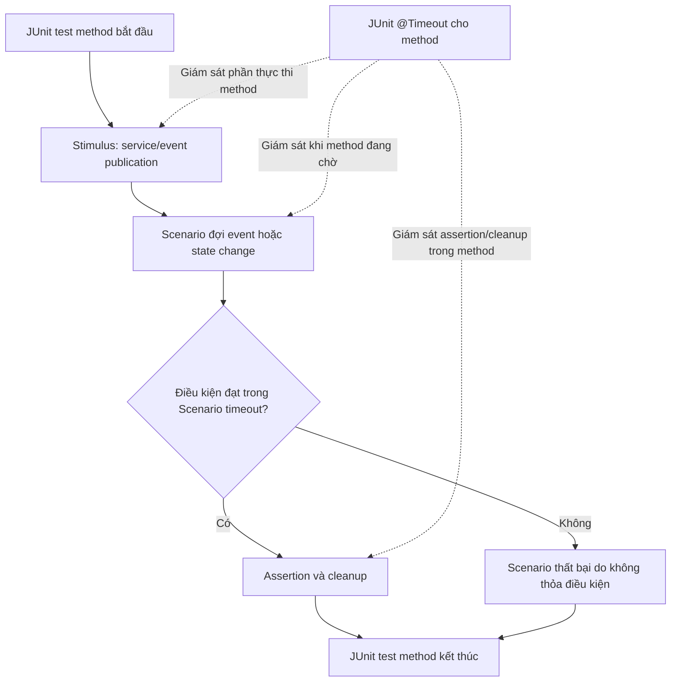
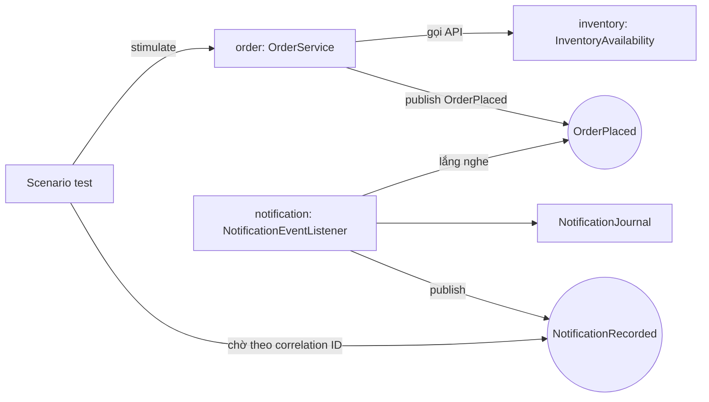
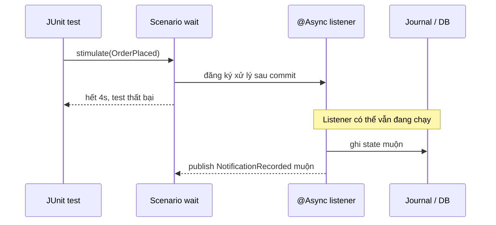
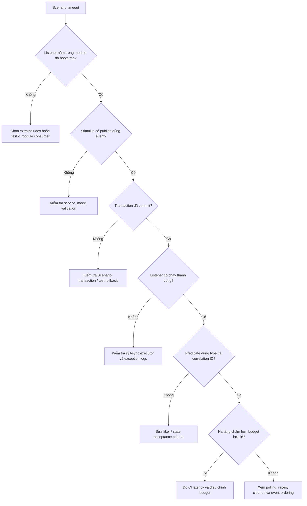

# Timeout của JUnit và timeout của Scenario trong Spring Modulith

## 1. Vì sao cùng một test cần hai kiểu timeout?

Giả sử module `order` phát `OrderPlaced` sau khi nhận đơn. Module `notification` xử lý sự kiện **bất đồng bộ** và phát `NotificationSent` khi hoàn tất. Bài kiểm thử cần trả lời hai câu hỏi khác nhau:

1. **Bài test có chạy quá lâu hay bị treo không?** Đây là giới hạn thời gian thực thi ở cấp **JUnit Jupiter**, thường dùng `@Timeout`.
2. **Sau stimulus, kết quả nghiệp vụ có xuất hiện đúng hạn không?** Đây là giới hạn **chờ điều kiện** của **Spring Modulith `Scenario`**, thường dùng `andWaitAtMost(Duration)`.

Nếu chỉ đặt `@Timeout(8)`, test có thể chờ event bằng `Thread.sleep(...)` rồi vẫn báo sai nếu listener hoàn thành chậm hoặc không hoàn thành. Nếu chỉ dùng `Scenario.andWaitAtMost(Duration.ofSeconds(5))`, test kiểm soát được **bước chờ event** nhưng không nhất thiết giới hạn được các phần khác như setup, stimulus gọi dịch vụ, assertion hoặc cleanup bị treo.

Hai giới hạn vì vậy **bổ sung chứ không thay thế nhau**. Một giới hạn là *guardrail cho phương thức JUnit*; giới hạn còn lại diễn đạt *hợp đồng eventual consistency* của scenario.

Bài thuộc chương **JUnit integration** trong học phần **SPRING_MODULITH_VERIFICATION_TESTING**. Mục tiêu xuyên suốt là rèn kỹ năng kiểm chứng ranh giới kiến trúc bằng `ApplicationModules` và quy tắc phụ thuộc module, thực hành `@ApplicationModuleTest`, kiểm thử sự kiện/cơ sở dữ liệu/tích hợp, và kết hợp quality gate trong CI để ngăn phụ thuộc sai và hồi quy. Không có `SPECIAL_NOTE` bổ sung.

### Sau bài học, bạn có thể

- Giải thích khác biệt giữa `@Timeout`, `assertTimeout`, `assertTimeoutPreemptively` và `Scenario.andWaitAtMost`.
- Chọn `Timeout.ThreadMode.SAME_THREAD` để tránh phá ngữ nghĩa transaction gắn với thread trong Spring Test.
- Dùng `Scenario` để chờ **event đúng correlation ID** hoặc **trạng thái được quan sát** thay vì dùng `Thread.sleep(...)`.
- Phân biệt timeout của kịch bản dương (*event phải đến*) và kịch bản âm (*event không được đến trong cửa sổ chờ*).
- Thiết kế **timeout budget** hợp lý cho test method, event wait, database, broker, CI runner và cleanup.
- Chẩn đoán test flaky do listener chưa được bootstrap, transaction chưa commit, polling predicate sai hoặc hạ tầng chậm.
- Giữ quality gate `ApplicationModules.verify()` độc lập với timeout và phạm vi khởi động module.

## 2. Bảng so sánh các tầng giới hạn thời gian

| Công cụ | Quản lý | Bắt đầu/kết thúc khi nào? | Điểm quan trọng |
| --- | --- | --- | --- |
| `@Timeout(value = ..., threadMode = SAME_THREAD)` | JUnit Jupiter | Giới hạn phương thức test/lifecycle được gắn annotation | Interrupt khi quá hạn; **không bảo đảm hủy mọi tác vụ bên ngoài** |
| `assertTimeout(Duration, executable)` | JUnit Assertions | Đo thời gian khối `executable`, đánh giá khi khối kết thúc | **Không preemptively dừng** công việc bị chậm |
| `assertTimeoutPreemptively(...)` | JUnit Assertions | Chạy executable trong **thread khác**, trả lỗi khi quá hạn | Nguy hiểm với Spring test-managed transaction / `ThreadLocal` |
| `Scenario.andWaitAtMost(Duration)` | Spring Modulith Test / Awaitility | Chờ event hoặc state change sau stimulus | Dừng **đợi điều kiện** khi hết hạn, không đồng nghĩa hủy listener |
| `Scenario.customize(factory -> factory.atMost(...))` | Spring Modulith / Awaitility | Tùy biến cách đợi của một scenario | Có thể chỉnh polling interval và các tham số Awaitility |
| Timeout HTTP/JDBC/broker | Client/driver/hạ tầng | Cho thao tác I/O cụ thể | Có cơ chế hủy, retry và exception riêng |
| Timeout của build/CI job | Runner Gradle/Maven/CI | Giới hạn task/job hoặc process | Là hàng rào ngoài; có thể giết process và mất cleanup |

Lưu ý: `@Timeout` trên **test method** không tự đo thời gian tải Spring `ApplicationContext` trước khi phương thức chạy. `@Timeout` trên **class** áp dụng cho các phương thức test, không tự áp dụng cho lifecycle callbacks `@BeforeEach`/`@AfterEach`. Muốn đặt timeout riêng cho lifecycle method, phải cấu hình phù hợp.



Đây là **sơ đồ phạm vi logic**; thời gian thực tế còn phụ thuộc việc JUnit chạy callback ở thread nào, cách interrupt được xử lý và transaction/event listener thực tế.

## 3. JUnit Jupiter `@Timeout`: giới hạn thời gian của method

`@Timeout` thuộc `org.junit.jupiter.api.Timeout`. Đơn vị mặc định là **giây**, có thể chọn `TimeUnit.MILLISECONDS`, `SECONDS`, `MINUTES`... Dưới đây là bài thuần JUnit có assertion thật:

```java
package com.example.shop.testing;

import static org.assertj.core.api.Assertions.assertThat;

import java.util.concurrent.TimeUnit;
import org.junit.jupiter.api.Test;
import org.junit.jupiter.api.Timeout;

class JUnitTimeoutExamples {

    @Test
    @Timeout(value = 2, unit = TimeUnit.SECONDS)
    void computesResultWithinTwoSeconds() {
        int total = 1 + 2;
        assertThat(total).isEqualTo(3);
    }
}
```

JUnit phát hiện nếu method không kết thúc trong giới hạn được cấu hình. **Đây không phải phép đo hiệu năng ổn định**: test chạy 1,9 giây trên laptop không bảo đảm 1,9 giây trên runner CI. Giới hạn nên phản ánh lỗi treo hoặc trễ bất thường, không áp đặt SLA production lên mọi test trong môi trường chia sẻ tài nguyên.

### Đặt `@Timeout` trên class và `@Nested`

```java
@Timeout(value = 8, unit = TimeUnit.SECONDS)
class OrderTimingTests {

    @Test
    void firstScenario() {
        // Test body: chịu giới hạn 8 giây.
    }

    @Nested
    class NestedScenarios {

        @Test
        @Timeout(value = 3, unit = TimeUnit.SECONDS)
        void fasterScenario() {
            // Method này ghi đè giới hạn kế thừa bằng 3 giây.
        }
    }
}
```

Đoạn này là **minh họa phạm vi annotation**, không phải bộ test nghiệp vụ vì chưa có assertion; khi đưa vào dự án cần thêm imports `@Test`, `@Nested`, `@Timeout` và `TimeUnit`. `@Timeout` class-level áp dụng cho test methods trong class và nested classes; method/nested class có annotation riêng sẽ ưu tiên giới hạn riêng.

`@Timeout` trên `@ParameterizedTest` hoặc `@RepeatedTest` áp dụng **cho từng invocation**, không phải tổng thời gian mọi invocation cộng lại. Nếu 30 data cases mỗi case có timeout 3 giây, không có nghĩa JUnit tự áp một tổng budget 3 giây cho toàn bộ phương thức parameterized.

### `SAME_THREAD`, `SEPARATE_THREAD` và `INFERRED`

| `Timeout.ThreadMode` | Hành vi | Khuyến nghị trong Spring Modulith |
| --- | --- | --- |
| `SAME_THREAD` | Test code chạy ở thread được JUnit dùng; khi quá hạn, thread đó bị interrupt từ thread khác | **Ưu tiên** với Spring transaction và các ThreadLocal context |
| `SEPARATE_THREAD` | Test code chạy ở worker thread khác, timeout preemptive | Tránh với test-managed transaction; có thể để lại side effect |
| `INFERRED` | Dựa vào `junit.jupiter.execution.timeout.thread.mode.default`, nếu không cấu hình thường fallback `SAME_THREAD` | Hợp lệ nhưng không tường minh như `SAME_THREAD` |

Ví dụ cho một phương thức tương tác transaction:

```java
@Test
@Timeout(
    value = 8,
    unit = TimeUnit.SECONDS,
    threadMode = Timeout.ThreadMode.SAME_THREAD
)
void executesOnTheSpringTestThread() {
    // Gọi repository/service thuộc test-managed transaction nếu cần.
    // Không dùng assertTimeoutPreemptively quanh lời gọi này.
}
```

Đây là **mẫu annotation**, không phải test tự chạy độc lập; nó cần `@Test`, `@Timeout` và các imports liên quan. Khi dùng `SAME_THREAD`, JUnit **interrupt** test thread sau giới hạn, nhưng không thể hứa mọi JDBC driver, HTTP client hay mã chạy bên ngoài sẽ ngừng ngay. Một tác vụ không xử lý interrupt có thể tiếp tục, do đó vẫn cần timeout I/O và policy của CI runner.

## 4. `assertTimeout` và `assertTimeoutPreemptively` không tương đương

Đôi khi chỉ một khối nhỏ trong test cần có giới hạn thời gian. JUnit cung cấp hai assertion:

```java
package com.example.shop.testing;

import static org.junit.jupiter.api.Assertions.assertEquals;
import static org.junit.jupiter.api.Assertions.assertTimeout;

import java.time.Duration;
import org.junit.jupiter.api.Test;

class LocalTimeoutAssertionsTests {

    @Test
    void calculatesWithoutUnexpectedDelay() {
        int result = assertTimeout(
                Duration.ofSeconds(2),
                () -> Math.addExact(2, 3));

        assertEquals(5, result);
    }
}
```

`assertTimeout` **thực thi code trên calling thread** và đo thời gian sau khi khối kết thúc. Nếu code bị kẹt vô hạn, assertion này **không bảo đảm trả về sau 2 giây**; muốn ngăn một test treo mãi, cân nhắc thêm `@Timeout(SAME_THREAD)` và timeout ở lớp I/O.

Ngược lại:

```java
// Chỉ minh họa API, không dùng trong Spring @Transactional test.
assertTimeoutPreemptively(
        Duration.ofSeconds(2),
        () -> slowOperation());
```

`assertTimeoutPreemptively` chạy khối trong **thread khác** và báo timeout ngay khi quá hạn; việc báo timeout không bảo đảm mọi tác động phụ của worker đã dừng. Với Spring TestContext, điều này có thể làm sai cơ chế transaction gắn `ThreadLocal`.

### Trường hợp đặc biệt nguy hiểm: transaction “rollback” nhưng DB vẫn có record

Spring Test quản lý transaction kiểm thử theo thread đang chạy test. Ví dụ khung dưới đây **cố ý không được khuyến khích**:

```java
@ApplicationModuleTest
class UnsafeTransactionalTimeoutExample {

    @Autowired OrderRepository repository;

    @Test
    @Transactional
    void unsafeTimeout() {
        assertTimeoutPreemptively(Duration.ofSeconds(1), () -> {
            repository.save(new OrderEntity(/* dữ liệu test */));
        });
    }
}
```

**Đây là anti-pattern và chỉ là skeleton**: `OrderRepository`, `OrderEntity`, datasource và imports phải được định nghĩa riêng; ví dụ không biên dịch độc lập. Test-managed transaction được liên kết với calling thread, còn code trong `assertTimeoutPreemptively` chạy thread khác. Lệnh lưu có thể chạy **ngoài** transaction mà Spring Test dự kiến rollback; dữ liệu có thể **được commit** dù test sau đó kết thúc bằng rollback của transaction trên calling thread.

**Cách viết ưu tiên:** Đặt `@Timeout(threadMode = SAME_THREAD)` ở method, dùng `assertTimeout` cho đoạn cần đo không preemptively, và dùng `Scenario.andWaitAtMost(...)` cho **điều kiện eventual consistency**. Nếu buộc phải timeout preemptive trên một tác vụ độc lập, thiết kế transaction và cleanup của tác vụ đó tường minh, không dựa vào rollback test thread.

## 5. Spring Modulith `Scenario` chờ **điều kiện**, không chỉ đo elapsed time

`org.springframework.modulith.test.Scenario` là DSL hỗ trợ kiểm thử một **stimulus** và **kết quả mong đợi**, đặc biệt hữu ích khi `@TransactionalEventListener` hoặc `@Async` tạo eventual consistency. `Scenario` được cung cấp làm tham số cho method trong `@ApplicationModuleTest`.

Một scenario thường có bốn phần:

1. **Stimulus:** `scenario.publish(new Event(...))` hoặc `scenario.stimulate(() -> service.command(...))`.
2. **Tùy chọn thời gian/cleanup:** `.andWaitAtMost(Duration...)`, `.customize(...)` và `.andCleanup(...)`.
3. **Điều kiện hoàn thành:** `.forEventOfType(ResultEvent.class).matching(...)` hoặc `.forStateChange(...)`.
4. **Terminal operation:** `.toArriveAndVerify(...)` hoặc `.andVerify(...)` để thực thi kịch bản trên Spring Modulith 1.4; ở **Modulith 2.2+** còn có `.notToArrive()` để kiểm tra trường hợp không có event.

Ví dụ dạng khung:

```java
scenario.publish(new OrderPlaced(orderId, "SKU-READY", 1))
        .andWaitAtMost(Duration.ofSeconds(4))
        .forEventOfType(NotificationSent.class)
        .matching(event -> event.orderId().equals(orderId))
        .toArriveAndVerify(event ->
                assertThat(event.orderId()).isEqualTo(orderId));
```

Đây **không phải một file test độc lập**: còn cần `scenario` từ Modulith, các event types, consumer được nạp và hạ tầng transaction; phần 8 sẽ cho một ví dụ đầy đủ hơn.

Khác `Thread.sleep(4000)`, Scenario **chờ đến khi điều kiện đạt rồi kết thúc sớm**; nếu không đạt trong cửa sổ chờ thì test thất bại. Timeout không khẳng định listener đã bị hủy hoặc sự kiện **không bao giờ** có thể xuất hiện sau thời hạn. Nó chỉ kết luận rằng kỳ vọng **không được đáp ứng đúng hạn**.

### Chọn event hoặc state làm dấu hiệu hoàn thành

| Mục tiêu | API Scenario | Chú ý |
| --- | --- | --- |
| Phát event và chờ event kết quả | `forEventOfType(...).matching(...).toArriveAndVerify(...)` | Dùng correlation ID để tránh nhận nhầm event |
| Chờ kết quả của listener được ghi vào state | `forStateChange(supplier, predicate).andVerify(...)` | Predicate phải xác định rõ thế nào là state **hoàn tất** |
| Kiểm tra không có event trong cửa sổ chờ (**Modulith 2.2+**) | `forEventOfType(...).matching(...).notToArrive()` | Phải **chờ hết thời hạn** nếu test thành công; **không có trong Modulith 1.4** |
| Chỉnh Awaitility polling/time budget | `customize(factory -> factory.atMost(...))` | Không lẫn với `@Timeout` của JUnit |

Mặc định, `Scenario` kiểm tra state change từ supplier bằng logic “giá trị non-null / `Optional` không rỗng” trong những overload tương ứng. Với `Boolean false`, đó vẫn là một object **non-null**; nếu cần đợi `true`, dùng overload có **predicate** `Boolean.TRUE::equals`.

## 6. Chọn một timeout budget có lý do

Tài liệu và code review nên phân biệt **thời gian chờ condition** với **tổng thời gian method**. Ví dụ mang tính minh họa cho một luồng listener thường hoàn thành nhanh trên máy CI:

| Thành phần | Ngân sách ví dụ | Vì sao |
| --- | --- | --- |
| Scenario event/state wait | **4 giây** | Đủ dung sai scheduling/commit ngắn; fail khi kết quả không đến |
| JUnit method `@Timeout(SAME_THREAD)` | **8 giây** | Có thêm khoảng cho stimulus, assertion, cleanup trong body |
| Client DB/HTTP | Giới hạn **riêng** tùy thao tác | Không để socket/read treo lâu vượt budget |
| CI test task/job | **Lớn hơn** chi phí suite và startup dự kiến | Fail-safe khi test process treo hoặc mất hạ tầng |

Đây là **giá trị học tập**, không phải SLA chung cho mọi hệ thống. Một listener phải chờ message broker qua mạng hoặc một transaction được retry có thể cần số liệu đo trên CI và timeout phù hợp hơn.

**Quy tắc:** Không đặt outer timeout bằng hoặc nhỏ hơn Scenario wait (ví dụ cả hai đều 4 giây) rồi mặc định Scenario sẽ kịp báo lỗi có ý nghĩa. Khi JUnit interrupt trước khi Scenario có thể kết thúc/cleanup, thông tin chẩn đoán và side effects dễ khó hiểu hơn. Hãy chọn **outer timeout có headroom**, đồng thời cấu hình timeout I/O độc lập.

```text
JUnit method:  @Timeout(8 giây, SAME_THREAD)
|------------------------------------------------------------|
| stimulus/commit | Scenario wait <= 4s | assert/cleanup | dư |
|------------------------------------------------------------|

Scenario timeout: chỉ tính cửa sổ chờ event hoặc state change.
```

Sơ đồ chỉ minh họa phân bổ budget. Khi điều kiện xuất hiện sớm hơn, Scenario có thể kết thúc trước thời hạn; khi condition timeout, phần assertion thành công không xảy ra, nhưng cleanup vẫn cần được thiết kế để thực hiện.

## 7. Thiết lập ứng dụng mẫu: event sau commit và listener bất đồng bộ

Ví dụ xuyên suốt sử dụng **Java 17+, Spring Boot 3.5, Spring Framework 6.2, Spring Modulith 1.4 và JUnit Jupiter 5**, với các BOM tương thích. Ta dùng H2 **chỉ để tạo transaction manager trong test**, còn trạng thái notification được lưu ở một bean in-memory để làm rõ cách Scenario chờ điều kiện. Không có email thật, broker hoặc bảng SQL được tạo trong ví dụ này.

### 7.1. Cấu trúc module

```text
src/
├── main/java/com/example/shop/
│   ├── ShopApplication.java
│   ├── inventory/
│   │   ├── InventoryAvailability.java
│   │   └── InventoryService.java
│   ├── order/
│   │   ├── OrderPlaced.java
│   │   └── OrderService.java
│   └── notification/
│       ├── NotificationRecorded.java
│       ├── NotificationJournal.java
│       └── NotificationEventListener.java
└── test/java/com/example/shop/
    ├── ModuleArchitectureTests.java
    └── order/
        ├── OrderEventTimeoutTests.java
        └── OrderValidationTimeoutTests.java
```

Theo cách nhận diện application module mặc định, `order`, `inventory` và `notification` là ba module ngang cấp. Module `order` phụ thuộc interface công khai của `inventory`, còn `notification` phụ thuộc **event công khai** của `order`. Test của `order` **không tự nạp notification** vì chiều phụ thuộc là `notification → order`.



### 7.2. Maven dependencies

Trong dự án có Spring Boot parent/BOM và Spring Modulith BOM tương thích, các dependency thiết yếu:

```xml
<dependency>
    <groupId>org.springframework.boot</groupId>
    <artifactId>spring-boot-starter-jdbc</artifactId>
</dependency>
<dependency>
    <groupId>org.springframework.boot</groupId>
    <artifactId>spring-boot-starter-test</artifactId>
    <scope>test</scope>
</dependency>
<dependency>
    <groupId>org.springframework.modulith</groupId>
    <artifactId>spring-modulith-starter-test</artifactId>
    <scope>test</scope>
</dependency>
<dependency>
    <groupId>com.h2database</groupId>
    <artifactId>h2</artifactId>
    <scope>test</scope>
</dependency>
```

`spring-boot-starter-jdbc` đưa vào hạ tầng JDBC và transaction; H2 ở **test scope** cho Spring Boot một embedded datasource trong môi trường test, từ đó tạo `PlatformTransactionManager`/`TransactionTemplate` cho `Scenario`. Vì code không truy vấn bảng, ví dụ **không cần `schema.sql`**. Khi đưa ứng dụng vào production, datasource phải được cấu hình đúng với database production; chỉ test-classpath H2 không giúp ứng dụng chạy ngoài test.

Không xem đây là toàn bộ `pom.xml`: phần dependency management và cấu hình Java/Spring Boot/Modulith của dự án phải tồn tại.

### 7.3. Lớp Spring Boot gốc và async execution

File `src/main/java/com/example/shop/ShopApplication.java`:

```java
package com.example.shop;

import org.springframework.boot.SpringApplication;
import org.springframework.boot.autoconfigure.SpringBootApplication;
import org.springframework.scheduling.annotation.EnableAsync;

@SpringBootApplication
@EnableAsync
public class ShopApplication {

    public static void main(String[] args) {
        SpringApplication.run(ShopApplication.class, args);
    }
}
```

`@EnableAsync` bật khả năng xử lý các method được gắn `@Async`. Async không bảo đảm method hoàn thành trong một khoảng thời gian cố định: nó chỉ đưa công việc sang executor. Khi cần production tuning, có thể cấu hình executor/queue/rejection policy; timeout test không thay thế quản lý thread pool.

### 7.4. API công khai module `inventory`

File `src/main/java/com/example/shop/inventory/InventoryAvailability.java`:

```java
package com.example.shop.inventory;

public interface InventoryAvailability {
    boolean available(String sku, int quantity);
}
```

Implementation thật, dùng được trong bài tích hợp với `DIRECT_DEPENDENCIES`:

```java
package com.example.shop.inventory;

import org.springframework.stereotype.Service;

@Service
public class InventoryService implements InventoryAvailability {

    @Override
    public boolean available(String sku, int quantity) {
        return "SKU-READY".equals(sku) && quantity <= 3;
    }
}
```

Trong bài test `order` ở `STANDALONE`, chúng ta sẽ dùng `@MockitoBean InventoryAvailability` để không nạp `InventoryService` thật. Như vậy timeout của event flow không bị lẫn với logic/hạ tầng tồn kho.

### 7.5. Event và service module `order`

File `src/main/java/com/example/shop/order/OrderPlaced.java`:

```java
package com.example.shop.order;

import java.util.UUID;

public record OrderPlaced(UUID orderId, String sku, int quantity) {}
```

File `src/main/java/com/example/shop/order/OrderService.java`:

```java
package com.example.shop.order;

import java.util.UUID;
import com.example.shop.inventory.InventoryAvailability;
import org.springframework.context.ApplicationEventPublisher;
import org.springframework.stereotype.Service;
import org.springframework.transaction.annotation.Transactional;

@Service
public class OrderService {

    private final InventoryAvailability inventory;
    private final ApplicationEventPublisher events;

    public OrderService(InventoryAvailability inventory,
                        ApplicationEventPublisher events) {
        this.inventory = inventory;
        this.events = events;
    }

    @Transactional
    public UUID place(UUID orderId, String sku, int quantity) {
        if (orderId == null || sku == null || sku.isBlank()
                || quantity <= 0 || quantity > 3) {
            throw new IllegalArgumentException("INVALID_ORDER");
        }
        if (!inventory.available(sku, quantity)) {
            throw new IllegalStateException("OUT_OF_STOCK");
        }

        events.publishEvent(new OrderPlaced(orderId, sku, quantity));
        return orderId;
    }
}
```

`@Transactional` bảo đảm event được publish **trong một transaction** khi use case chạy trong ứng dụng thật; listener `AFTER_COMMIT` sẽ xử lý sau khi transaction nguồn commit. `Scenario.stimulate(...)` cũng có cơ chế transaction riêng, nên trong test event flow có thể kích hoạt listener mà không dựa vào transaction do test method tình cờ mở.

### 7.6. State và event kết quả của module `notification`

File `src/main/java/com/example/shop/notification/NotificationRecorded.java`:

```java
package com.example.shop.notification;

import java.util.UUID;

public record NotificationRecorded(UUID orderId) {}
```

File `src/main/java/com/example/shop/notification/NotificationJournal.java`:

```java
package com.example.shop.notification;

import java.util.UUID;
import java.util.Set;
import java.util.concurrent.ConcurrentHashMap;
import org.springframework.stereotype.Component;

@Component
public class NotificationJournal {

    private final Set<UUID> recordedOrders =
            ConcurrentHashMap.newKeySet();

    public void record(UUID orderId) {
        recordedOrders.add(orderId);
    }

    public boolean contains(UUID orderId) {
        return recordedOrders.contains(orderId);
    }

    public void remove(UUID orderId) {
        recordedOrders.remove(orderId);
    }
}
```

Đây là state **in-memory**, không chứng minh notification đã được gửi qua email/SMS thật. Tên `NotificationRecorded` cố ý diễn đạt **đã ghi nhận xử lý trong module** chứ không khẳng định một provider ngoài đã chấp nhận/giao thông điệp.

### 7.7. Listener sau commit chạy bất đồng bộ

File `src/main/java/com/example/shop/notification/NotificationEventListener.java`:

```java
package com.example.shop.notification;

import com.example.shop.order.OrderPlaced;
import org.springframework.context.ApplicationEventPublisher;
import org.springframework.scheduling.annotation.Async;
import org.springframework.stereotype.Component;
import org.springframework.transaction.event.TransactionPhase;
import org.springframework.transaction.event.TransactionalEventListener;

@Component
public class NotificationEventListener {

    private final NotificationJournal journal;
    private final ApplicationEventPublisher events;

    public NotificationEventListener(NotificationJournal journal,
                                     ApplicationEventPublisher events) {
        this.journal = journal;
        this.events = events;
    }

    @Async
    @TransactionalEventListener(phase = TransactionPhase.AFTER_COMMIT)
    public void on(OrderPlaced source) {
        journal.record(source.orderId());
        events.publishEvent(new NotificationRecorded(source.orderId()));
    }
}
```

Khi transaction của `OrderService.place(...)` commit, listener được kích hoạt và xử lý trên executor do `@Async` quản lý. Nó ghi state trong `NotificationJournal` rồi phát `NotificationRecorded`. Mẫu này không có retry/idempotency/broker; các yêu cầu đó cần test riêng khi có trong thiết kế production.

**Điểm kiến trúc:** Module `notification` được phép import `OrderPlaced` **từ API công khai** của `order`, không cần truy cập implementation `order.internal`. Kiểm thử nghiệp vụ event flow và kiểm chứng phụ thuộc module ở CI là hai việc khác nhau.

## 8. Bài test hoàn chỉnh: outer `@Timeout` và inner `andWaitAtMost`

File `src/test/java/com/example/shop/order/OrderEventTimeoutTests.java`:

```java
package com.example.shop.order;

import static org.assertj.core.api.Assertions.assertThat;
import static org.mockito.BDDMockito.given;

import java.time.Duration;
import java.util.UUID;
import java.util.concurrent.TimeUnit;

import com.example.shop.inventory.InventoryAvailability;
import com.example.shop.notification.NotificationJournal;
import com.example.shop.notification.NotificationRecorded;
import org.junit.jupiter.api.DisplayName;
import org.junit.jupiter.api.Tag;
import org.junit.jupiter.api.Test;
import org.junit.jupiter.api.Timeout;
import org.springframework.beans.factory.annotation.Autowired;
import org.springframework.modulith.test.ApplicationModuleTest;
import org.springframework.modulith.test.Scenario;
import org.springframework.test.context.bean.override.mockito.MockitoBean;

@Tag("module")
@Tag("integration")
@Tag("event")
@DisplayName("Order → Notification — hai tầng timeout")
@ApplicationModuleTest(extraIncludes = "notification")
class OrderEventTimeoutTests {

    @Autowired OrderService orders;
    @Autowired NotificationJournal journal;

    @MockitoBean InventoryAvailability inventory;

    @Test
    @DisplayName("Đủ hàng → notification ghi nhận đúng đơn trong 4 giây")
    @Timeout(
        value = 8,
        unit = TimeUnit.SECONDS,
        threadMode = Timeout.ThreadMode.SAME_THREAD
    )
    void notificationEventArrivesWithinScenarioDeadline(
            Scenario scenario) {

        UUID id = UUID.randomUUID();
        given(inventory.available("SKU-READY", 1))
                .willReturn(true);

        scenario.stimulate(
                    () -> orders.place(id, "SKU-READY", 1))
                .andCleanup(() -> journal.remove(id))
                .andWaitAtMost(Duration.ofSeconds(4))
                .forEventOfType(NotificationRecorded.class)
                .matching(event -> event.orderId().equals(id))
                .toArriveAndVerify((event, returnedOrderId) -> {
                    assertThat(event.orderId()).isEqualTo(id);
                    assertThat(returnedOrderId).isEqualTo(id);
                    assertThat(journal.contains(id)).isTrue();
                });
    }

    @Test
    @DisplayName("Chờ state đã ghi nhận thay vì chờ event")
    @Timeout(
        value = 8,
        unit = TimeUnit.SECONDS,
        threadMode = Timeout.ThreadMode.SAME_THREAD
    )
    void notificationStateBecomesTrueWithinScenarioDeadline(
            Scenario scenario) {

        UUID id = UUID.randomUUID();
        given(inventory.available("SKU-READY", 2))
                .willReturn(true);

        scenario.stimulate(
                    () -> orders.place(id, "SKU-READY", 2))
                .andCleanup(() -> journal.remove(id))
                .andWaitAtMost(Duration.ofSeconds(4))
                .forStateChange(
                    () -> journal.contains(id),
                    Boolean.TRUE::equals
                )
                .andVerify(result -> assertThat(result).isTrue());
    }
}
```

### Phân tích bài test event

1. Test nằm trong package `order`, nên `@ApplicationModuleTest` chọn module `order`. Vì `notification` là **consumer** phụ thuộc `order`, ta chủ động thêm `extraIncludes = "notification"`.
2. `@MockitoBean InventoryAvailability` cung cấp dependency ngoài module mà `OrderService` cần. Nó không biến `OrderService` thành mock.
3. `scenario.stimulate(() -> orders.place(...))` gọi **use case thật**. Giá trị `UUID` do use case trả về được giữ làm *stimulus result* và kiểm tra ở overload `toArriveAndVerify(BiConsumer)`.
4. Scenario thực thi stimulus trong transaction để hỗ trợ listener `AFTER_COMMIT`. Không dựa vào transaction có thể được mở bởi test method; `Scenario` tự cung cấp ranh giới cần thiết.
5. `.andWaitAtMost(Duration.ofSeconds(4))` giới hạn **chờ `NotificationRecorded`**, không giới hạn startup Spring context trước method.
6. `.matching(...)` lọc event bằng **UUID riêng của testcase**; event cùng loại nhưng khác đơn hàng không được tính là thành công.
7. `@Timeout(8, SAME_THREAD)` giám sát **phương thức JUnit**; budget lớn hơn Scenario wait để còn thời gian cho stimulus, assertion và cleanup.
8. `.andCleanup(...)` yêu cầu xóa state journal của đúng testcase sau khi scenario kết thúc, dù thành công hay lỗi theo contract cleanup của API.

Tại sao cần vừa kiểm tra event vừa journal? Listener phát `NotificationRecorded` **sau khi** ghi journal; assertion xác nhận ý nghĩa event kết quả khớp state nghiệp vụ. Nếu listener bị sửa để publish event trước khi cập nhật state, kiểm thử có thể phát hiện hồi quy về thứ tự quan sát được.

### Phân tích bài test state change

`NotificationJournal.contains(id)` trả `boolean`. Nếu dùng overload `.forStateChange(() -> journal.contains(id))` mà không có predicate, giá trị `false` vẫn có thể được xem là **non-null object** có nghĩa trong cơ chế nhận biết state change. Do đó test truyền `Boolean.TRUE::equals` để chỉ kết luận **hoàn thành khi thực sự nhận `true`**.

**Không kết luận quá mức:** Hai bài trên dùng journal in-memory và Spring application events. Chúng **không kiểm tra** dữ liệu JPA đã commit, email gửi thành công, broker đã nhận message hoặc retry/idempotency. Nếu ứng dụng thật cần những hợp đồng đó, phải bổ sung integration tests đúng hạ tầng.

## 9. Kiểm thử nhánh âm trên Spring Modulith **1.4**

Với Spring Modulith 1.4, API `Scenario.When.EventResult` có `toArrive()` và `toArriveAndVerify(...)` nhưng **chưa có `notToArrive()`**. Đây là khác biệt quan trọng khi đọc tài liệu Spring Modulith “current”, vì phiên bản 2.2 mới bổ sung khả năng chờ để khẳng định event **không** đến.

Với use case **đồng bộ** từ chối input trước khi publish event, ta có thể dùng `PublishedEvents` để kiểm tra **không có event nguồn tại thời điểm test kết thúc**:

File `src/test/java/com/example/shop/order/OrderValidationTimeoutTests.java`:

```java
package com.example.shop.order;

import static org.assertj.core.api.Assertions.assertThat;
import static org.assertj.core.api.Assertions.assertThatThrownBy;
import static org.mockito.BDDMockito.then;

import java.util.UUID;
import java.util.concurrent.TimeUnit;

import com.example.shop.inventory.InventoryAvailability;
import org.junit.jupiter.api.DisplayName;
import org.junit.jupiter.api.Tag;
import org.junit.jupiter.api.Test;
import org.junit.jupiter.api.Timeout;
import org.springframework.beans.factory.annotation.Autowired;
import org.springframework.modulith.test.ApplicationModuleTest;
import org.springframework.modulith.test.PublishedEvents;
import org.springframework.test.context.bean.override.mockito.MockitoBean;

@Tag("module")
@DisplayName("Order — nhánh validation không phát event")
@ApplicationModuleTest
class OrderValidationTimeoutTests {

    @Autowired OrderService orders;
    @MockitoBean InventoryAvailability inventory;

    @Test
    @Timeout(
        value = 3,
        unit = TimeUnit.SECONDS,
        threadMode = Timeout.ThreadMode.SAME_THREAD
    )
    void rejectsInvalidQuantityWithoutPublishingEvent(
            PublishedEvents events) {

        UUID id = UUID.randomUUID();

        assertThatThrownBy(() ->
                orders.place(id, "SKU-READY", 0))
                .isInstanceOf(IllegalArgumentException.class)
                .hasMessage("INVALID_ORDER");

        then(inventory).shouldHaveNoInteractions();
        assertThat(events.ofType(OrderPlaced.class)
                .matching(OrderPlaced::orderId, id))
                .isEmpty();
    }
}
```

Test trên đúng với hợp đồng của `OrderService.place(...)`: validation lỗi được ném **trước khi** gọi inventory và publish event. Assertion event rỗng phản ánh **những gì đã được publish trong testcase**. Nó không chứng minh rằng một hệ thống hoàn toàn bất đồng bộ sẽ **không bao giờ** publish event ở tương lai; đó là một loại kiểm chứng khác cần cửa sổ quan sát và điều kiện phù hợp.

### Phần mở rộng dành riêng cho **Spring Modulith 2.2+**

Ngày **19/11/2026**, Spring Modulith 2.2 GA bổ sung `Scenario.When.EventResult.notToArrive()` và `notToArriveAndVerify(...)`. Khi dự án thật đang dùng **Modulith 2.2+ cùng Spring Boot/Framework tương thích**, có thể viết kịch bản âm:

```java
// Mẫu cú pháp chỉ dành cho Spring Modulith 2.2+.
// Giả định use case tryPlace(...) trả false, không ném exception,
// và không phát OrderPlaced khi inventory báo hết hàng.
scenario.stimulate(
            () -> orders.tryPlace(id, "SKU-OUT", 1))
        .andWaitAtMost(Duration.ofMillis(600))
        .forEventOfType(OrderPlaced.class)
        .matching(event -> event.orderId().equals(id))
        .notToArrive();
```

**Đây là ví dụ mở rộng, không chạy với app 1.4 phía trên:** cần tự bổ sung use case `tryPlace(...)` có hợp đồng từ chối **không ném exception**, chọn stack Modulith 2.2+ và imports. Khi Scenario thành công với `notToArrive()`, nó phải **đợi hết khoảng thời gian** để kết luận không thấy event phù hợp; nếu event xuất hiện trong cửa sổ, test thất bại sớm.

Không nên “làm giả” sự vắng mặt của event bằng cách thử `.toArrive()` rồi bắt lỗi timeout và gọi đó là thành công: cách làm ấy dễ nuốt cả lỗi infrastructure hoặc listener và khiến test xanh sai.

## 10. Chỉnh `Scenario` timeout và polling một cách có chủ đích

Spring Modulith 1.4 cho phép điều chỉnh cách Awaitility chờ kết quả qua `Scenario.When.customize(...)`:

```java
scenario.stimulate(() -> orders.place(id, "SKU-READY", 1))
        .andCleanup(() -> journal.remove(id))
        .customize(factory -> factory
                .atMost(Duration.ofSeconds(4))
                .pollInterval(Duration.ofMillis(100)))
        .andWaitForStateChange(
                () -> journal.contains(id),
                Boolean.TRUE::equals)
        .andVerify(result -> assertThat(result).isTrue());
```

Đây là **đoạn thay thế trong một test đã có** `scenario`, `orders`, `id`, `journal`, `inventory` được stub và imports tương ứng. Ưu điểm của `customize(...)` là điều chỉnh nhiều thuộc tính Awaitility trong cùng một chỗ; trong bài đơn giản, `andWaitAtMost(...)` thường đủ dễ đọc hơn.

`pollInterval(100 ms)` chỉ điều khiển **tần suất kiểm tra state change**, không làm listener `@Async` chạy mỗi 100 ms. Poll quá dày có thể làm tăng tải DB/CPU; poll quá thưa khiến test nhận biết state trễ và dễ vượt timeout.

### Vì sao không dùng `Thread.sleep(...)`?

```java
// Anti-pattern:
orders.place(id, "SKU-READY", 1);
Thread.sleep(4000);
assertThat(journal.contains(id)).isTrue();
```

Đoạn trên có ba vấn đề:

- Nếu listener hoàn thành sau 20 ms, test vẫn **chờ đủ 4 giây**.
- Nếu CI quá tải và listener hoàn thành sau 4,2 giây, test **flaky** dù logic có thể đúng.
- Nếu use case cần transaction **commit** để kích hoạt `AFTER_COMMIT`, lời gọi trực tiếp trong test-managed transaction có thể không commit đúng lúc; việc ngủ thêm không giải quyết transaction boundary.

Thay bằng `Scenario.stimulate(...).andWaitAtMost(...).forStateChange(...).andVerify(...)` để vừa có transaction stimulus hợp lệ vừa có điều kiện kết thúc tường minh.

### `ScenarioCustomizer` cho nhiều test

Nếu các scenario trong cùng một nhóm cần thiết lập timeout/polling thống nhất, Spring Modulith có `ScenarioCustomizer` đăng ký như một **JUnit extension**. Có thể dùng một default customizer cho lớp test và ghi đè ở scenario cụ thể:

```text
@ApplicationModuleTest
  + @ExtendWith(MyScenarioCustomizer.class)
    ├── Test event A: dùng default Awaitility timeout
    ├── Test event B: dùng default Awaitility timeout
    └── Test đặc biệt: thêm .customize(...) riêng
```

Đây là **sơ đồ annotation**, không phải mã Java biên dịch. Khi cài extension thật, hãy dùng Javadoc `ScenarioCustomizer` của phiên bản Modulith đang sử dụng (hợp đồng `getDefaultCustomizer(...)`) và tránh định nghĩa timeout phụ thuộc biến static giữa test methods.

**Đừng tạo hai nguồn cấu hình timeout mâu thuẫn** (ví dụ vừa `andWaitAtMost(4s)` vừa `customize(...atMost(10s))`) rồi giả định thứ tự ưu tiên. Chọn một cơ chế rõ ràng cho từng scenario và kiểm tra log test thực tế.

## 11. Timeout không đồng nghĩa dừng hẳn các side effect

Một sự kiện bất đồng bộ có thể xuất hiện **sau** khi Scenario báo timeout:



Nếu test chỉ gọi `journal.remove(id)` trong cleanup rồi listener tiếp tục ghi lại record **sau cleanup**, dữ liệu muộn có thể rò sang testcase khác. Cơ chế `andCleanup(...)` được gọi sau scenario kết thúc là hữu ích, nhưng **không phải một hàng rào đồng bộ chắc chắn** với mọi công việc nền đã được đưa vào executor.

Đối với test có side effect bền vững, cần thiết kế rõ:

1. **ID riêng** cho mỗi stimulus, không dùng một UUID cố định cho cả suite.
2. **Giới hạn thời gian chờ và điều kiện hoàn thành**, thường dựa trên kết quả có thể quan sát.
3. **Quy trình xử lý công việc thất bại/timeout**: hủy an toàn nếu API hỗ trợ, chờ executor hoàn tất khi cần hoặc dọn theo ID trong hạ tầng cô lập.
4. **Không dùng chung state không có cách cleanup** giữa các test chạy song song.
5. **Không coi timeout là rollback của database hoặc broker**.

Đây là lý do các bài test có listener async thường cần **fixture/test database độc lập**, hoặc cơ chế cleanup theo event/transaction ID. Nếu test phát hiện dữ liệu còn sót sau timeout, sửa ownership của dữ liệu và lifecycle của tác vụ — không chỉ tăng thời hạn đợi.

## 12. Cấu hình timeout mặc định cho JUnit Jupiter

JUnit Jupiter cho phép cấu hình timeout mặc định qua `junit-platform.properties` hoặc cơ chế JUnit Platform configuration parameters. Các giá trị có thể bao gồm số và đơn vị như `500 ms`, `8 s`, `2 m`.

Ví dụ file `src/test/resources/junit-platform.properties` trong một dự án muốn phát hiện test treo:

```properties
# Giới hạn mặc định cho các @Test chưa có @Timeout riêng.
junit.jupiter.execution.timeout.test.method.default=10 s

# Khi không khai báo threadMode, ưu tiên cùng thread với Spring Test.
junit.jupiter.execution.timeout.thread.mode.default=SAME_THREAD

# Có thể bỏ qua timeout @Timeout khi đang debug với JDWP.
junit.jupiter.execution.timeout.mode=disabled_on_debug

# Hữu ích khi cần chẩn đoán test thread bị treo.
junit.jupiter.execution.timeout.threaddump.enabled=true
```

**Lưu ý phạm vi:** Đây là **ví dụ cấu hình dự án**, không phải file cần ghi trong bước soạn Markdown hiện tại. Chỉ nên áp dụng khi nhóm đã chọn timeout budget phù hợp và runner JUnit hỗ trợ các tham số đó.

### Các mức default timeout của JUnit

| Configuration parameter | Phạm vi |
| --- | --- |
| `junit.jupiter.execution.timeout.default` | Fallback chung cho testable và lifecycle methods |
| `junit.jupiter.execution.timeout.testable.method.default` | Các phương thức testable như `@Test`, `@TestTemplate`, `@TestFactory` |
| `junit.jupiter.execution.timeout.test.method.default` | Riêng các phương thức `@Test` |
| `junit.jupiter.execution.timeout.testtemplate.method.default` | `@ParameterizedTest` và `@RepeatedTest` (test templates) |
| `junit.jupiter.execution.timeout.lifecycle.method.default` | Lifecycle callbacks nói chung |
| `junit.jupiter.execution.timeout.beforeeach.method.default` | Riêng `@BeforeEach` |
| `junit.jupiter.execution.timeout.aftereach.method.default` | Riêng `@AfterEach` |

Khi có nhiều cấu hình, **mức cụ thể ưu tiên mức tổng quát**; `@Timeout` khai báo trực tiếp tại method/class được áp dụng theo quy tắc annotation tương ứng. Vì vậy:

- Một `@Timeout(8)` tường minh trên scenario test có thể ghi đè default `10 s`.
- Một `@ParameterizedTest` không gắn `@Timeout` có thể dùng cấu hình `testtemplate.method.default`, không phải `test.method.default`.
- `@Timeout` đặt **trên lớp** không tự giới hạn `@BeforeEach`, nên khi setup/hạ tầng treo, cần xem lifecycle timeout hoặc timeout client/runner.

### Khi đang debug

`junit.jupiter.execution.timeout.mode=disabled_on_debug` là lựa chọn tiện khi dừng ở breakpoint: JUnit cố nhận biết chế độ debug và vô hiệu hóa timeout tương ứng. Nhưng **Scenario.andWaitAtMost(...)** là timeout của **Awaitility/Scenario**, **không tự bị vô hiệu hóa** bởi property `junit.jupiter.execution.timeout.mode`. Khi debug một listener, hãy điều chỉnh scenario timeout ở test đang điều tra hoặc dùng công cụ debug phù hợp, thay vì nghĩ rằng JUnit property đã tắt mọi timeout trong hệ thống.

### Thread dump on timeout

Nếu `junit.jupiter.execution.timeout.threaddump.enabled=true` và cơ chế timeout JUnit hỗ trợ, JUnit có thể ghi stack traces của các thread trước khi interrupt test thread. Điều này giúp nhận biết liệu test đang chờ `Awaitility`, JDBC connection, lock hay một lời gọi khác. Thread dump là **tín hiệu chẩn đoán**, không phải chứng minh root cause. Kết hợp với application logs, transaction logs và event correlation IDs để kết luận.

## 13. Transaction, database và timeout: những sai lầm đặc biệt tốn kém

Trong Spring TestContext, `@Transactional` trên method test thường mở **test-managed transaction** và rollback sau test. Cơ chế này liên kết transaction state với thread. Trong khi đó, `Scenario.stimulate(...)` và `Scenario.publish(...)` trong Spring Modulith có thể dùng **transaction riêng để kích hoạt transactional listeners**, nhằm bảo đảm sự kiện `AFTER_COMMIT` được xử lý.

| Trường hợp | Khi nào transaction kết thúc? | Nguy cơ |
| --- | --- | --- |
| Test `@Transactional` gọi repository đồng bộ | Rollback theo test khi method xong | Thường an toàn nếu cùng thread/transaction |
| Test gọi `assertTimeoutPreemptively` chứa thao tác DB | Worker thread khác test transaction | Lệnh ghi có thể commit và **không được rollback** |
| `@Timeout(SAME_THREAD)` trên test transactional | JUnit interrupt test thread khi quá hạn | Không đổi thread; vẫn cần xử lý I/O và rollback đúng |
| `Scenario.publish(...)` với listener `AFTER_COMMIT` | Stimulus được commit theo transaction do Scenario điều phối | Side effect đã commit **không rollback cùng test transaction bên ngoài** |
| Listener `@Async` mở transaction riêng | Thread/transaction riêng | State commit muộn có thể còn sau test timeout |
| HTTP server với `RANDOM_PORT` | Server thread riêng | Client test rollback không bảo đảm dọn DB server |

### Vì sao không nên chỉ thêm `@Transactional` lên test Scenario?

Nếu một test transactional tự gọi `orders.place(...)` rồi lập tức chờ `AFTER_COMMIT`, transaction test **chưa commit**, nên listener có thể chưa được kích hoạt và Scenario timeout. Cần chọn một trong các thiết kế có chủ đích:

1. Để `Scenario.stimulate(...)` thực thi stimulus với transaction phù hợp.
2. Nếu muốn kiểm chứng commit bằng test transaction thật, điều khiển bằng `TestTransaction.flagForCommit()` / `TestTransaction.end()` trong **cùng testcase**, sau đó cleanup dữ liệu đã commit.
3. Nếu listener xử lý bên ngoài transaction test, chờ **state/event kết quả thực tế** và dọn theo correlation ID.

**Không dùng** phương án “tăng `andWaitAtMost` từ 4 giây lên 40 giây” khi transaction nguồn sẽ rollback và **không bao giờ commit**. Thời hạn dài hơn không thể tạo một commit chưa xảy ra.

### Test data phải có ownership rõ

Với H2/JDBC/JPA hoặc Testcontainers, mỗi testcase nên dùng UUID riêng. Nếu Scenario timeout nhưng transaction stimulus đã commit, cleanup phải xử lý dữ liệu phát sinh từ stimulus **và từ listener** nếu có. Với các test chạy song song:

- Không xóa toàn bộ bảng chỉ để dọn một testcase, trừ khi database/schema được cô lập.
- Không dùng mock/reset toàn cục để giải quyết vấn đề một async listener vẫn đang chạy.
- Không xem `@DirtiesContext` là công cụ xóa dữ liệu PostgreSQL đã commit.
- Khi muốn test retry/idempotency, cần kiểm tra đúng cơ chế lưu event publication/broker, không chỉ in-memory `PublishedEvents`.

## 14. Chẩn đoán một `Scenario` timeout theo đúng thứ tự

Khi thấy lỗi chờ event/state, điều đầu tiên không phải tăng timeout. Hãy xác minh **có một đường dẫn hợp lệ từ stimulus tới điều kiện hoàn thành hay không**.



| Triệu chứng | Khả năng nguyên nhân | Cách điều tra |
| --- | --- | --- |
| `OrderPlaced` đã publish nhưng không có `NotificationRecorded` | Module `notification` không được nạp | Kiểm tra `extraIncludes` và log `org.springframework.modulith=DEBUG` |
| Listener `AFTER_COMMIT` im lặng | Không có transaction, transaction rollback hoặc lỗi lifecycle | Xác minh `PlatformTransactionManager`, commit và listener registration |
| `@Async` không chạy hoặc chạy lỗi | Executor không hoạt động, exception không được assert trên test thread | Xem async executor, logs và state kết quả |
| Scenario thấy event đúng loại nhưng không qua predicate | `orderId` sai, dùng test data cũ | Log correlation ID và payload nguồn/kết quả |
| State polling kết thúc quá sớm với `false` | Supplier trả `Boolean` non-null, thiếu predicate | Dùng `forStateChange(..., Boolean.TRUE::equals)` |
| Scenario chờ hết hạn dù state đã đổi | Poll supplier không đọc đúng store/transaction hoặc không thấy commit | Đọc lại với transaction phù hợp; kiểm tra visibility |
| Timeout chỉ xảy ra ở CI | CI quá tải, broker/DB chậm, executor starvation | Đo duration/p95, kiểm tra hạ tầng trước khi nới budget |
| `@Timeout` fail trước Scenario | Outer budget quá ngắn | Giữ headroom và phân biệt phạm vi timer |
| Test bị treo dù `@Timeout(SAME_THREAD)` đã interrupt | Driver/I/O hoặc code bỏ qua interrupt | Bổ sung timeout ở client/hạ tầng; runner timeout ngoài cùng |
| Test sau thấy record của test timeout trước | Listener commit sau cleanup, fixture dùng ID chung | Chờ/cô lập công việc nền, cleanup theo ID |
| DB còn record dù test `@Transactional` rollback | Dùng preemptive timeout hoặc transaction/thread riêng | Bỏ `assertTimeoutPreemptively` ở đoạn DB, sửa transaction boundary |
| `Scenario.notToArrive()` không compile trên Modulith 1.4 | API chỉ có từ Modulith 2.2 | Dùng `PublishedEvents` cho sync validation, hoặc nâng stack đúng phiên bản |

**Phương pháp điều tra:** Chụp lại thời điểm stimulus, commit, listener bắt đầu/kết thúc, event kết quả và điều kiện chờ. Log có correlation ID giúp phân biệt “không có event” với “có event nhưng filter sai” — hai lỗi có cách sửa khác nhau hoàn toàn.

## 15. CI quality gate: timeout phải giúp phát hiện lỗi, không che lỗi

Trong một dự án nhiều module, timeout là **giới hạn thực thi**, không phải một quy tắc bảo vệ kiến trúc. Cần kết hợp:

| Quality gate | Ví dụ | Điều bảo vệ |
| --- | --- | --- |
| Architecture gate | `ApplicationModules.verify()` | Cycle, dependency sai, internal API access theo luật Modulith |
| Module behavior tests | `@ApplicationModuleTest(STANDALONE)` + `PublishedEvents` | Validation, event nguồn, business rules |
| Cross-module event flow | `@ApplicationModuleTest(extraIncludes = ...)` + `Scenario` | Listener/state đạt điều kiện trong wait budget |
| DB integration | JDBC/JPA + transaction và cleanup | Persistence thật, rollback/commit, concurrent effects |
| Broker integration | Testcontainers/provider stub có protocol thật | Serialization, transport, retry, idempotency |
| CI task timeout | Gradle/Maven/runner job limit | Không treo toàn pipeline vô thời hạn |

### Architecture gate chạy độc lập với Event Scenario

File `src/test/java/com/example/shop/ModuleArchitectureTests.java`:

```java
package com.example.shop;

import org.junit.jupiter.api.Tag;
import org.junit.jupiter.api.Test;
import org.springframework.modulith.core.ApplicationModules;

@Tag("architecture")
class ModuleArchitectureTests {

    @Test
    void applicationModulesRespectDeclaredBoundaries() {
        ApplicationModules.of(ShopApplication.class).verify();
    }
}
```

Test này **không yêu cầu Spring `ApplicationContext`** và không chờ listener, nên không có lý do áp dụng 8 giây của Scenario test chỉ để “đồng nhất timeout”. Nó kiểm tra các luật cấu trúc Spring Modulith áp dụng; nếu dự án cần giới hạn dependency đặc thù, khai báo `allowedDependencies` hoặc bổ sung custom architecture rule/ArchUnit.

### Đừng để filter/runner bỏ architecture gate

Một test event flow có thể gắn:

```java
@Tag("module")
@Tag("integration")
@Tag("event")
```

Trong khi architecture test dùng `@Tag("architecture")`. Nếu CI chỉ chạy `module & !integration`, nó **không chọn** cross-module event flow và cũng **không chọn** architecture test. Hãy chạy stage architecture riêng và stage integration phù hợp; kiểm tra **test count thực sự** chứ không chỉ trạng thái xanh của lệnh build.

### Timeout tầng ngoài của CI không thay thế timeout nghiệp vụ

Nếu runner giết toàn bộ job khi quá thời gian, log có thể chỉ ghi “job exceeded time limit”, không cho biết listener nào thiếu hoặc predicate nào sai. Vì vậy:

1. Đặt **Scenario wait budget** để fail có ý nghĩa khi event/state không đến.
2. Đặt **JUnit method timeout** đủ headroom để bắt các phần test bị treo.
3. Đặt **DB/HTTP/broker timeout** đúng I/O cần quản lý.
4. Đặt **runner/job timeout** ở ngoài cùng để dừng pipeline mất kiểm soát.
5. Trên CI, giữ lại test reports/logs khi fail để tra transaction, listener, thread dump và correlation ID.

Không biến một test flaky thành “passed” bằng cách loại nó khỏi tag integration hay bắt mọi timeout exception rồi bỏ qua assertion. Nếu budget thật sự quá ngắn so với môi trường, hãy đo thời gian thực thi và điều chỉnh có cơ sở.

## 16. Bài tập thực hành

1. Chạy `JUnitTimeoutExamples` và thay `@Timeout(2s)` bằng `@Timeout(1 ms)`. Giải thích vì sao không nên dùng giới hạn nhỏ tùy ý để đo performance.
2. So sánh `assertTimeout(Duration)` với `assertTimeoutPreemptively(Duration)` trong ví dụ Java thuần. Ghi rõ khối nào chạy ở calling thread và khối nào chạy ở worker thread.
3. Tạo repository JPA/H2 có `@Transactional` test và thử *anti-pattern* preemptive timeout trên cơ sở dữ liệu test cô lập; sau đó viết lại bằng `@Timeout(SAME_THREAD)` và cleanup. Không chạy bài thử phá transaction trên database có dữ liệu thật.
4. Chạy `OrderEventTimeoutTests` ở phần 8. Ghi lại tổng thời gian method và thời gian Scenario chờ khi `NotificationRecorded` xuất hiện sớm.
5. Tạm vô hiệu hóa `@EnableAsync` hoặc listener, quan sát khác biệt giữa event được xử lý đồng bộ và event không được tạo; giải thích vì sao một test xanh nhanh không tự chứng minh concurrency.
6. Bỏ `extraIncludes = "notification"` khỏi test `order`. Quan sát module scope và giải thích vì sao `ALL_DEPENDENCIES` từ module `order` không tự nạp consumer phụ thuộc ngược.
7. Sửa `.matching(...)` cố tình so sánh sai `orderId`; quan sát Scenario timeout dù listener đã publish `NotificationRecorded` đúng loại.
8. Với `.forStateChange(() -> journal.contains(id), ...)`, thử bỏ predicate `Boolean.TRUE::equals`. Giải thích lý do kết quả `false` có thể khiến điều kiện tưởng như đạt.
9. Thử Scenario timeout 100 ms trên runner CI chậm; đo thời gian xử lý hợp lệ trước khi quyết định budget mới. Không chỉ tăng vô hạn.
10. Thay `.andWaitAtMost(...)` bằng `.customize(factory -> factory.atMost(...).pollInterval(...))`. Quan sát số lần state supplier được gọi và ảnh hưởng của poll interval.
11. Với Spring Modulith **1.4**, xác minh `EventResult.notToArrive()` **không tồn tại** trong Javadoc. Sau đó đọc Javadoc **2.2+**, nêu khác biệt về điều kiện âm tính và thời gian phải chờ hết cửa sổ.
12. Viết `OrderValidationTimeoutTests` để kiểm tra `INVALID_ORDER` xảy ra trước lời gọi inventory và trước event publish. Giải thích giới hạn của `PublishedEvents` trong trường hợp async.
13. Thử tạo listener cập nhật journal muộn sau khi Scenario timeout; xây cơ chế cleanup theo ID hoặc hạ tầng cô lập để lần chạy tiếp theo không nhận dữ liệu cũ.
14. Tạo một lỗi phụ thuộc trái phép từ `order` vào `inventory.internal`, chạy `ApplicationModules.verify()`. Giải thích vì sao tăng JUnit timeout hoặc Scenario timeout **không liên quan** cách sửa lỗi kiến trúc.
15. Thiết kế CI có ba tầng timeout (event wait, JUnit method, runner job) và một architecture gate bắt buộc. Kiểm tra những test nào được chọn khi filter chỉ chạy `module & !integration`.

### Checklist trước khi merge

| Câu hỏi | Tiêu chí đạt |
| --- | --- |
| Timeout JUnit và Scenario có mục tiêu khác nhau rõ? | Một cái giám sát method, một cái giám sát condition wait |
| Có tránh `assertTimeoutPreemptively` với test transaction? | Không chuyển code có rollback kỳ vọng sang thread khác |
| `@Timeout` có thread mode thích hợp? | Ưu tiên `SAME_THREAD` trong Spring Test |
| Scenario wait có ID riêng và predicate đủ chặt? | Không nhận event của testcase khác |
| Predicate state change có định nghĩa “hoàn tất” rõ? | Không coi `false` non-null là thành công |
| Listener có nằm trong context cần thiết? | `extraIncludes` hoặc test đặt ở consumer module khi phù hợp |
| Transaction stimulus có commit đúng thời điểm? | Listener `AFTER_COMMIT` có điều kiện kích hoạt |
| Có cleanup state sau scenario fail/timeout? | Side effect đã commit hoặc đến muộn được xử lý |
| Budget outer có headroom? | JUnit không interrupt trước khi Scenario báo lỗi có ý nghĩa |
| Timeout I/O có tách biệt? | Driver/broker/client không treo vô thời hạn |
| API `notToArrive` có đúng phiên bản? | Chỉ dùng từ Spring Modulith 2.2+ |
| CI có giữ log để chẩn đoán? | Có reports, event IDs, transaction/async log khi fail |
| Architecture gate có chạy? | `ApplicationModules.verify()` không bị bỏ qua bởi tag filter |

**Ghi nhớ:** `@Timeout` của JUnit là **hàng rào cho thời gian thực thi method**; `Scenario.andWaitAtMost(...)` là **thời hạn đạt điều kiện event/state**. Với Spring Test, ưu tiên timeout trên **cùng thread**, không dùng preemptive timeout để làm sai transaction rollback. Trong Spring Modulith, hãy bảo đảm listener được bootstrap, transaction đã commit, predicate đúng correlation ID và cleanup xử lý side effects. Đồng thời luôn giữ `ApplicationModules.verify()` trong CI: test event đến đúng hạn không tự chứng minh dependency module hợp lệ.

### Tài liệu tham khảo

- [JUnit Jupiter 5.14 — Timeout trong test](https://docs.junit.org/5.14.3/api/org.junit.jupiter.api/org/junit/jupiter/api/Timeout.html)
- [JUnit 5 User Guide — Timeouts, thread mode và debugging](https://docs.junit.org/5.14.0/user-guide/index.html)
- [JUnit 5 API — Assertions.assertTimeout và assertTimeoutPreemptively](https://docs.junit.org/5.14.3/api/org.junit.jupiter.api/org/junit/jupiter/api/Assertions.html)
- [Spring Framework — TestContext transaction management và preemptive timeouts](https://docs.spring.io/spring-framework/reference/testing/testcontext-framework/tx.html)
- [Spring Modulith 1.4 — Integration Testing Application Modules](https://docs.spring.io/spring-modulith/reference/1.4/testing.html)
- [Spring Modulith 1.4 — Scenario Javadoc](https://docs.spring.io/spring-modulith/docs/1.4.x/api/org/springframework/modulith/test/Scenario.html)
- [Spring Modulith 1.4 — Scenario.When Javadoc](https://docs.spring.io/spring-modulith/docs/1.4.x/api/org/springframework/modulith/test/Scenario.When.html)
- [Spring Modulith 1.4 — EventResult Javadoc](https://docs.spring.io/spring-modulith/docs/1.4.x/api/org/springframework/modulith/test/Scenario.When.EventResult.html)
- [Spring Modulith 2.2 — EventResult.notToArrive Javadoc](https://docs.spring.io/spring-modulith/docs/current/api/org/springframework/modulith/test/Scenario.When.EventResult.html)
- [Spring Modulith 2.2 GA release notes — negative event assertions](https://spring.io/blog/2026/11/19/spring-modulith-2-2-ga-2-1-3-and-2-0-10-released/)
- [Spring Modulith — Verifying Application Module Structure](https://docs.spring.io/spring-modulith/reference/verification.html)
