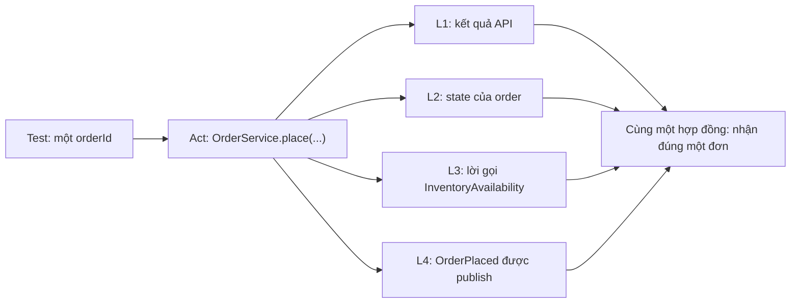
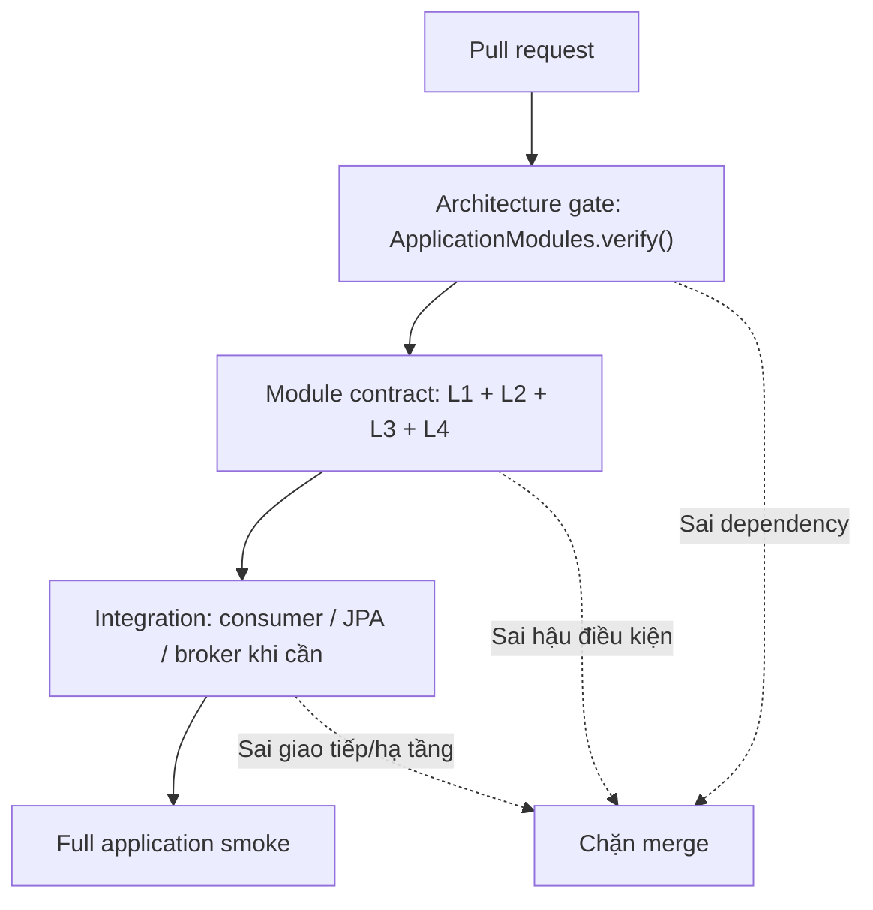

# Assertions nhiều lớp trong một test: kiểm chứng một hành vi từ API đến event

## 1. “Nhiều lớp” là nhiều bằng chứng cho **một** hợp đồng

Trong một module nghiệp vụ, một lệnh có thể tạo ra nhiều kết quả quan sát được. Ví dụ `OrderService.place(orderId, sku, quantity)` nhận đơn hàng và đồng thời:

1. Trả về đúng mã đơn và dữ liệu đã được chấp nhận.
2. Lưu bản ghi đơn trong state do module `order` sở hữu.
3. Chỉ hỏi API tồn kho của module `inventory` với đúng SKU và số lượng.
4. Phát **một** event `OrderPlaced` có cùng mã đơn, SKU và số lượng.

Một bài test chỉ kiểm tra “không ném exception” hoặc “trả về UUID khác null” sẽ không phát hiện những lỗi như lưu sai số lượng, gọi kho sai SKU hoặc phát hai event cho một đơn. Ngược lại, viết một bài test **riêng cho mỗi assertion** rồi để chúng chia sẻ cùng dữ liệu được tạo bởi testcase trước sẽ tạo phụ thuộc thứ tự chạy.

**Assertions nhiều lớp trong một test** là cách xác minh **nhiều hậu điều kiện độc lập nhưng cùng thuộc một stimulus và một giao dịch nghiệp vụ quan sát được**. “Lớp” ở đây là *lớp bằng chứng*, không nhất thiết là lớp Java, JUnit `@Nested` hay tầng vật lý của Spring.



Bài **“Assertions nhiều lớp trong một test”** nằm trong chương **JUnit integration** của học phần **SPRING_MODULITH_VERIFICATION_TESTING**: rèn kỹ năng kiểm chứng ranh giới kiến trúc bằng `ApplicationModules`, thực hành `@ApplicationModuleTest`, kiểm thử event, cơ sở dữ liệu và tích hợp, rồi duy trì quality gate trong CI để chặn phụ thuộc sai và hồi quy. Trọng tâm ở đây là **thiết kế assertion và chẩn đoán lỗi trong một testcase**, không ôn lại toàn bộ cơ chế JUnit hay các kiểu bootstrap.

### Kết quả mong đợi

Sau bài này, bạn có thể:

- Chọn những assertion cùng chứng minh **một hợp đồng**, tránh biến một test thành kiểm thử mọi chức năng.
- Phân biệt assertion **API/outcome**, **state/persistence**, **boundary interaction** và **event publication**.
- Dùng JUnit Jupiter `assertAll(...)`, AssertJ `assertSoftly(...)` và mô hình **hard precondition → soft/grouped postconditions** đúng ngữ nghĩa.
- Viết `@ApplicationModuleTest` với `@MockitoBean` và `PublishedEvents`, có correlation ID và cleanup độc lập.
- Kiểm tra đúng các nhánh âm: **exception, không thay đổi state, không gọi dependency ngoài hoặc chỉ gọi như dự kiến, không phát event**.
- Nêu chính xác giới hạn: `PublishedEvents` chứng minh **đã publish**, không chứng minh module nhận event đã hoàn tất; dùng `Scenario` khi cần *eventual outcome*.
- Tách architecture gate `ApplicationModules.verify()` và kiểm thử DB thật thành **bằng chứng phù hợp**, không lạm dụng assertion quá mức trong mỗi test.

## 2. Ma trận bằng chứng: mỗi assertion phát hiện lỗi gì?

Với use case “đơn hợp lệ và đủ hàng → chấp nhận đơn”, xác định trước các lớp bằng chứng:

| Lớp | Hợp đồng quan sát | Assertion điển hình | Lỗi có thể phát hiện |
| --- | --- | --- | --- |
| **L1 — API/outcome** | Lệnh trả về đúng kết quả của đơn này | `assertThat(receipt.orderId()).isEqualTo(id)` | Trả nhầm đơn, nhầm SKU/số lượng, kết quả không nhất quán |
| **L2 — state của module** | Đơn thật sự được lưu trong state sở hữu bởi `order` | `assertThat(store.findById(id)).contains(expected)` | Quên lưu, lưu sai payload, lưu vào ID khác |
| **L3 — boundary** | Lời gọi sang `inventory` đúng tham số và tần suất cần thiết | `then(inventory).should().available(sku, quantity)` | Gọi sai API/đối số, bỏ qua bước kiểm tra kho |
| **L4 — event** | Đúng một `OrderPlaced` với ID và payload khớp | `events.ofType(...).matching(...), hasSize(1)` | Không phát, phát trùng, sai correlation/payload |
| **L5 — consumer sau commit** *(khi cần)* | Module nhận sự kiện thực sự hoàn tất | `Scenario.forEventOfType(...).matching(...).toArriveAndVerify(...)` | Listener không nạp, không commit, lỗi async hoặc trạng thái nhận không đúng |
| **Kiến trúc** *(test riêng)* | Phụ thuộc module đúng quy tắc | `ApplicationModules.of(...).verify()` | Vòng phụ thuộc, truy cập nội bộ sai, vi phạm giới hạn khai báo |

**Không phải test nào cũng cần đủ mọi lớp.** Nếu test đang chứng minh validation bị chặn ngay tại API, các assertion quan trọng có thể là exception + **không tác động phụ**; không có lý do dựng database hay consumer thật chỉ để tăng số lượng assertion. Nếu kiểm tra repository thật, L2 phải đọc state từ repository/DB thật, **không** thay bằng một mock rồi tuyên bố đã kiểm chứng persistence.

### Nguyên tắc quyết định “giữ chung” hay “tách test”

Giữ trong **một test** khi:

- Cùng một **kích thích**/mã giao dịch, và các assertion cùng mô tả hậu điều kiện của kích thích đó.
- Mỗi assertion có thể đọc kết quả hoặc snapshot đã tạo mà **không phụ thuộc vào assertion khác phải chạy trước**.
- Khi lỗi, người đọc hiểu đây là **một hợp đồng nghiệp vụ không nhất quán**.

Tách thành **test khác** khi:

- Cần một stimulus khác (ví dụ đơn hết hàng thay vì còn hàng).
- Cần Spring context/`BootstrapMode` hoặc hạ tầng khác (mock inventory so với inventory thật, DB giả lập so với Testcontainers).
- Phải chờ một luồng event ở module consumer với ranh giới commit và cleanup khác hẳn.
- Một loạt assertion chỉ kiểm tra chi tiết nội bộ dễ thay đổi mà không thuộc hợp đồng công khai.

**Hướng thiết kế:** Một testcase có thể có nhiều assertion, nhưng chỉ nên có **một lý do nghiệp vụ rõ ràng để thất bại**: hậu điều kiện của đúng kịch bản mà tên test nêu.

## 3. JUnit `assertAll`: gom nhiều thất bại **sau khi** đã Act

JUnit Jupiter cung cấp `Assertions.assertAll(String heading, Executable...)`. Các `Executable` được thực thi để thu thập lỗi; nếu nhiều assertion thất bại, JUnit báo chúng dưới dạng `MultipleFailuresError`. Một lỗi bình thường ở nhánh đầu **không** ngăn những nhánh khác chạy. Các lỗi không thể phục hồi, như `OutOfMemoryError`, là ngoại lệ và có thể dừng ngay.

```java
import static org.junit.jupiter.api.Assertions.assertAll;
import static org.assertj.core.api.Assertions.assertThat;

record OrderSummary(String sku, int quantity, boolean accepted) {}

OrderSummary actual = new OrderSummary("SKU-A", 3, false);

assertAll("Hợp đồng kết quả đặt hàng",
    () -> assertThat(actual.sku()).isEqualTo("SKU-A"),
    () -> assertThat(actual.quantity()).isEqualTo(2),
    () -> assertThat(actual.accepted()).isTrue()
);
```

Đây là **đoạn minh họa đặt trong một test**, cố ý có hai kỳ vọng sai: quantity mong đợi `2` nhưng thực tế `3`, và `accepted` mong `true` nhưng thực tế `false`. Với `assertAll`, người học nhận **hai thông tin thất bại** trong cùng lần chạy thay vì chỉ nhìn lỗi đầu. Khi dùng đoạn code trong một phương thức Java, bản ghi `OrderSummary` phải khai báo ở phạm vi type thích hợp.

### Chọn thời điểm gọi `assertAll`

Trình tự nên là:

```text
Arrange → Act đúng một lần → chụp kết quả quan sát được
        → [hard precondition khi thực sự bắt buộc]
        → assertAll(L1, L2, L3, L4)
        → cleanup đúng testcase
```

Không đặt hành động có side effect như `orders.place(...)` ở **từng** lambda của `assertAll`:

```java
// SAI: thực thi lệnh đặt hàng hai lần.
assertAll("Sai: nhiều lần Act",
    () -> assertThat(orders.place(id, "SKU-A", 2)).isNotNull(),
    () -> assertThat(orders.place(id, "SKU-A", 2)).isNotNull()
);
```

Nếu lệnh thứ hai phát event trùng hoặc báo duplicate ID, lỗi do **cách test được viết**, không nhất thiết do nghiệp vụ. Hãy **Act một lần, rồi đọc nhiều góc quan sát**.

### Hard precondition và soft/grouped hậu điều kiện

Không nên dùng `assertAll` để tiếp tục thực thi các assertion phụ thuộc vào một object có thể null. Ví dụ:

```java
OrderRecord stored = store.findById(id).orElse(null);

// Cách nguy hiểm: stored có thể null và tạo NPE thiếu ngữ cảnh.
assertAll("Sai: dereference không có guard",
    () -> assertThat(stored.sku()).isEqualTo(sku),
    () -> assertThat(stored.quantity()).isEqualTo(quantity)
);
```

Có hai cách đúng, tùy điều muốn báo:

```java
// Cách A: hard precondition — không có record thì dừng test rõ lý do.
OrderRecord stored = store.findById(id)
        .orElseThrow(() -> new AssertionError(
                "Không tìm thấy orderId=" + id));

assertAll("Thuộc tính của bản ghi đã lưu",
    () -> assertThat(stored.sku()).isEqualTo(sku),
    () -> assertThat(stored.quantity()).isEqualTo(quantity)
);
```

Hoặc **tránh dereference** và so sánh `Optional` với value object đầy đủ:

```java
assertThat(store.findById(id))
        .as("L2: đơn %s phải được lưu đúng payload", id)
        .contains(new OrderRecord(id, sku, quantity));
```

Cách B đặc biệt phù hợp khi dùng `assertAll` ở ngoài: nếu record thiếu, nhánh state sẽ fail rõ ràng trong khi nhánh event/boundary vẫn tiếp tục cho thêm thông tin.

### Nested `assertAll`: nhóm theo lớp bằng chứng

```java
assertAll("Kết quả một đơn hàng",
    () -> assertAll("L1 — receipt",
        () -> assertThat(receipt.orderId()).isEqualTo(id),
        () -> assertThat(receipt.quantity()).isEqualTo(quantity)),
    () -> assertAll("L4 — event",
        () -> assertThat(event.orderId()).isEqualTo(id),
        () -> assertThat(event.sku()).isEqualTo(sku))
);
```

Đoạn này dùng các biến đã có sẵn trong testcase. Lợi ích là **tên nhóm** giúp báo cáo thể hiện tầng nào lệch hợp đồng; không nên lồng quá sâu chỉ để trang trí. Các câu lệnh trong cùng một lambda chạy tuần tự: nếu một lệnh ném exception, các lệnh **tiếp theo trong lambda ấy** bị bỏ qua, còn lambda khác ở cấp ngoài vẫn được thử.

## 4. `assertAll` hay AssertJ `assertSoftly`?

Nếu dự án đã dùng AssertJ, có thể thay grouped assertions bằng `SoftAssertions.assertSoftly(...)` để viết nhiều assertion liên tiếp và tổng hợp lỗi cuối khối.

```java
import static org.assertj.core.api.SoftAssertions.assertSoftly;

assertSoftly(soft -> {
    soft.assertThat(receipt.orderId())
            .as("L1: orderId")
            .isEqualTo(id);
    soft.assertThat(receipt.sku())
            .as("L1: SKU")
            .isEqualTo(sku);
    soft.assertThat(store.findById(id))
            .as("L2: record")
            .contains(new OrderRecord(id, sku, quantity));
});
```

`assertSoftly` tự kết thúc bằng việc báo các soft assertion errors đã thu thập. Nếu tự tạo `SoftAssertions soft = new SoftAssertions()`, phải gọi `soft.assertAll()` để test thực sự fail; nếu quên, kết quả có thể **xanh sai**.

| Tiêu chí | JUnit `assertAll` | AssertJ `assertSoftly` |
| --- | --- | --- |
| Cấu trúc | Nhiều lambda `Executable` | Một khối dùng `soft.assertThat(...)` |
| Gom lỗi | `MultipleFailuresError` và các lỗi con | Báo lỗi soft assertions ở cuối khối |
| Trộn AssertJ, Mockito, JUnit | **Thuận tiện**, mỗi lambda có thể dùng một loại assertion | Chỉ những call qua `soft` được gom; `verify(...)`/assertion thường vẫn có thể ném sớm |
| Đặt tên nhóm | `assertAll("L1...", ...)` và nested group | `as("L1: ...")` trên từng assertion |
| Rủi ro | Gọi Act nhiều lần trong các lambda; thiếu guard null | Quên `soft.assertAll()` khi tạo thủ công; gọi nhầm `assertThat(...)` thường thay vì `soft.assertThat(...)` |

**Gợi ý áp dụng trong Spring Modulith:** Dùng `assertAll` khi muốn gom **AssertJ outcome + mock verification + PublishedEvents** trong một testcase. Dùng `assertSoftly` khi tập trung kiểm tra **nhiều trường của một snapshot/object/state** và không cần trộn framework assertion. Không cần bọc cả hai tầng soft-assertion lồng nhau nếu không mang lại thông tin mới.

## 5. Ứng dụng mẫu tối giản: một lệnh, bốn hậu điều kiện

Ví dụ dùng **Java 17+, Spring Boot 3.4/3.5, Spring Framework 6.2, Spring Modulith 1.4, JUnit Jupiter 5** cùng các BOM tương thích. `@MockitoBean` là API của Spring Framework 6.2. Các đoạn code bên dưới chỉ cần Spring context và in-memory store; **không dùng JPA hoặc broker** để tách rõ những assertion mà module test thật sự có thể chứng minh.

### 5.1. File layout

```text
src/main/java/com/example/shop/
├── ShopApplication.java
├── inventory/
│   ├── InventoryAvailability.java
│   └── InventoryService.java
└── order/
    ├── OrderRecord.java
    ├── OrderReceipt.java
    ├── OrderPlaced.java
    ├── OrderStore.java
    └── OrderService.java

src/test/java/com/example/shop/
├── ModuleArchitectureTests.java
└── order/
    ├── OrderContractModuleTests.java
    └── OrderInventoryIntegrationTests.java
```

Trong cấu trúc này, `order` và `inventory` là hai application module ngang cấp; `order` phụ thuộc vào **interface công khai** thuộc package gốc `inventory`. Lớp test `com.example.shop.order.OrderContractModuleTests` sẽ chọn module `order` theo quy tắc `@ApplicationModuleTest`.

### 5.2. Maven dependencies thiết yếu

Đây là các dependency cần **tích hợp vào POM đã có Boot parent/BOM và Modulith BOM tương thích**, không phải một `pom.xml` hoàn chỉnh:

```xml
<dependency>
    <groupId>org.springframework.boot</groupId>
    <artifactId>spring-boot-starter</artifactId>
</dependency>
<dependency>
    <groupId>org.springframework.boot</groupId>
    <artifactId>spring-boot-starter-test</artifactId>
    <scope>test</scope>
</dependency>
<dependency>
    <groupId>org.springframework.modulith</groupId>
    <artifactId>spring-modulith-starter-test</artifactId>
    <scope>test</scope>
</dependency>
```

### 5.3. Root Spring Boot application

File `src/main/java/com/example/shop/ShopApplication.java`:

```java
package com.example.shop;

import org.springframework.boot.SpringApplication;
import org.springframework.boot.autoconfigure.SpringBootApplication;

@SpringBootApplication
public class ShopApplication {
    public static void main(String[] args) {
        SpringApplication.run(ShopApplication.class, args);
    }
}
```

### 5.4. API inventory: ranh giới cần kiểm chứng

File `src/main/java/com/example/shop/inventory/InventoryAvailability.java`:

```java
package com.example.shop.inventory;

public interface InventoryAvailability {
    boolean available(String sku, int quantity);
}
```

Implementation thật (dành cho test tích hợp khác phạm vi):

```java
package com.example.shop.inventory;

import org.springframework.stereotype.Service;

@Service
public class InventoryService implements InventoryAvailability {

    @Override
    public boolean available(String sku, int quantity) {
        return "SKU-READY".equals(sku) && quantity <= 3;
    }
}
```

Module `order` không import `InventoryService`; nó chỉ cần biết interface `InventoryAvailability`. Test `STANDALONE` sẽ thay interface bằng mock, còn test `DIRECT_DEPENDENCIES` có thể dùng implementation thật.

### 5.5. Ba value objects của order

File `src/main/java/com/example/shop/order/OrderRecord.java`:

```java
package com.example.shop.order;

import java.util.UUID;

public record OrderRecord(UUID orderId, String sku, int quantity) {}
```

File `src/main/java/com/example/shop/order/OrderReceipt.java`:

```java
package com.example.shop.order;

import java.util.UUID;

public record OrderReceipt(UUID orderId, String sku, int quantity) {}
```

File `src/main/java/com/example/shop/order/OrderPlaced.java`:

```java
package com.example.shop.order;

import java.util.UUID;

public record OrderPlaced(UUID orderId, String sku, int quantity) {}
```

Ba record có cùng shape nhưng **khác vai trò**:

| Type | Vai trò |
| --- | --- |
| `OrderReceipt` | Kết quả công khai của một lệnh use case |
| `OrderRecord` | Trạng thái mà module `order` lưu để tra cứu |
| `OrderPlaced` | Event thông báo một đơn đã được chấp nhận |

Sự giống nhau về các field **không có nghĩa chỉ cần test một đối tượng**: service hoàn toàn có thể tạo đúng receipt nhưng lưu sai record hoặc publish event với payload sai.

### 5.6. Store in-memory có cleanup theo ID

File `src/main/java/com/example/shop/order/OrderStore.java`:

```java
package com.example.shop.order;

import java.util.Optional;
import java.util.UUID;
import java.util.concurrent.ConcurrentHashMap;
import java.util.concurrent.ConcurrentMap;
import org.springframework.stereotype.Repository;

@Repository
public class OrderStore {

    private final ConcurrentMap<UUID, OrderRecord> records =
            new ConcurrentHashMap<>();

    public void save(OrderRecord record) {
        if (records.putIfAbsent(record.orderId(), record) != null) {
            throw new IllegalStateException("DUPLICATE_ORDER");
        }
    }

    public Optional<OrderRecord> findById(UUID id) {
        return Optional.ofNullable(records.get(id));
    }

    public void deleteById(UUID id) {
        records.remove(id);
    }
}
```

Vì `OrderStore` là singleton Spring, dữ liệu có thể **tồn tại qua nhiều testcase** khi Spring TestContext tái sử dụng context. Mỗi test phải tạo `UUID` riêng và dọn record theo đúng ID. In-memory store này **không kiểm chứng database durability, rollback hay concurrency transaction**.

### 5.7. Use case tạo bốn loại bằng chứng

File `src/main/java/com/example/shop/order/OrderService.java`:

```java
package com.example.shop.order;

import java.util.UUID;
import com.example.shop.inventory.InventoryAvailability;
import org.springframework.context.ApplicationEventPublisher;
import org.springframework.stereotype.Service;

@Service
public class OrderService {

    private final InventoryAvailability inventory;
    private final OrderStore store;
    private final ApplicationEventPublisher events;

    public OrderService(InventoryAvailability inventory,
                        OrderStore store,
                        ApplicationEventPublisher events) {
        this.inventory = inventory;
        this.store = store;
        this.events = events;
    }

    public OrderReceipt place(UUID id, String sku, int quantity) {
        if (id == null || sku == null || sku.isBlank()
                || quantity <= 0 || quantity > 3) {
            throw new IllegalArgumentException("INVALID_ORDER");
        }

        if (!inventory.available(sku, quantity)) {
            throw new IllegalStateException("OUT_OF_STOCK");
        }

        store.save(new OrderRecord(id, sku, quantity));
        events.publishEvent(new OrderPlaced(id, sku, quantity));

        return new OrderReceipt(id, sku, quantity);
    }
}
```

Chú ý thứ tự **validate → hỏi inventory → lưu → publish → trả kết quả**. Đó là đường đi cho kịch bản thành công, và cũng tạo ra các nhánh từ chối để kiểm chứng *không có side effect*.

**Giới hạn quan trọng:** `OrderStore` dùng map, không có transaction manager. Nếu `publishEvent(...)` ném lỗi sau khi `save(...)` thành công, record có thể còn trong map. Ví dụ này **không** tuyên bố bảo đảm atomicity giữa persistence và event publication. Trong hệ thống có database, cần transaction/outbox/event publication registry tùy yêu cầu; các test bổ sung ở phần 9 sẽ nói rõ cách chứng minh.

## 6. Test trọng tâm: bốn lớp assertion sau **một** lệnh đặt hàng

File `src/test/java/com/example/shop/order/OrderContractModuleTests.java`:

```java
package com.example.shop.order;

import static org.assertj.core.api.Assertions.assertThat;
import static org.junit.jupiter.api.Assertions.assertAll;
import static org.junit.jupiter.api.Assertions.assertThrowsExactly;
import static org.mockito.BDDMockito.given;
import static org.mockito.BDDMockito.then;

import java.util.UUID;
import com.example.shop.inventory.InventoryAvailability;
import org.junit.jupiter.api.DisplayName;
import org.junit.jupiter.api.Tag;
import org.junit.jupiter.api.Test;
import org.springframework.beans.factory.annotation.Autowired;
import org.springframework.modulith.test.ApplicationModuleTest;
import org.springframework.modulith.test.PublishedEvents;
import org.springframework.test.context.bean.override.mockito.MockitoBean;

@Tag("module")
@Tag("order")
@DisplayName("Order — hợp đồng đa lớp cho một lệnh place")
@ApplicationModuleTest
class OrderContractModuleTests {

    @Autowired OrderService orders;
    @Autowired OrderStore store;

    @MockitoBean InventoryAvailability inventory;

    @Test
    @Tag("event")
    @DisplayName("Đủ hàng: receipt, state, inventory và event nhất quán")
    void acceptedOrderHasConsistentOutcomesAcrossFourLayers(
            PublishedEvents events) {

        UUID id = UUID.randomUUID();
        String sku = "SKU-READY";
        int quantity = 2;

        given(inventory.available(sku, quantity)).willReturn(true);

        try {
            // ACT ĐÚNG MỘT LẦN.
            OrderReceipt receipt = orders.place(id, sku, quantity);

            // Một nguồn dữ liệu quan sát cho mỗi lớp bằng chứng.
            var storedOrder = store.findById(id);
            var matchingEvents = events.ofType(OrderPlaced.class)
                    .matching(OrderPlaced::orderId, id);

            assertAll("Một đơn được chấp nhận — bốn lớp bằng chứng",
                () -> assertAll("L1 — API/receipt",
                    () -> assertThat(receipt.orderId())
                            .as("Mã đơn trả về")
                            .isEqualTo(id),
                    () -> assertThat(receipt.sku())
                            .as("SKU trả về")
                            .isEqualTo(sku),
                    () -> assertThat(receipt.quantity())
                            .as("Số lượng trả về")
                            .isEqualTo(quantity)
                ),
                () -> assertThat(storedOrder)
                        .as("L2 — record phải lưu đúng đơn này")
                        .contains(new OrderRecord(id, sku, quantity)),
                () -> then(inventory).should()
                        .available(sku, quantity),
                () -> assertThat(matchingEvents)
                        .as("L4 — đúng một OrderPlaced cho orderId")
                        .singleElement()
                        .satisfies(event -> assertAll(
                            "Payload OrderPlaced",
                            () -> assertThat(event.orderId())
                                    .isEqualTo(id),
                            () -> assertThat(event.sku())
                                    .isEqualTo(sku),
                            () -> assertThat(event.quantity())
                                    .isEqualTo(quantity)
                        ))
            );
        } finally {
            store.deleteById(id);
        }
    }

    @Test
    @DisplayName("Số lượng không hợp lệ: exception và không side effect")
    void invalidQuantityLeavesAllObservableOutputsUntouched(
            PublishedEvents events) {

        UUID id = UUID.randomUUID();

        try {
            IllegalArgumentException error = assertThrowsExactly(
                    IllegalArgumentException.class,
                    () -> orders.place(id, "SKU-READY", 0));

            assertAll("Validation chặn hành vi trước boundary",
                () -> assertThat(error)
                        .hasMessage("INVALID_ORDER"),
                () -> assertThat(store.findById(id))
                        .as("Không tạo record khi quantity=0")
                        .isEmpty(),
                () -> then(inventory).shouldHaveNoInteractions(),
                () -> assertThat(events.ofType(OrderPlaced.class)
                        .matching(OrderPlaced::orderId, id))
                        .as("Không publish OrderPlaced")
                        .isEmpty()
            );
        } finally {
            store.deleteById(id);
        }
    }

    @Test
    @DisplayName("Hết hàng: đã hỏi kho nhưng không lưu và không phát event")
    void unavailableStockRejectsWithoutStateOrEvent(
            PublishedEvents events) {

        UUID id = UUID.randomUUID();
        String sku = "SKU-OUT";

        given(inventory.available(sku, 1)).willReturn(false);

        try {
            IllegalStateException error = assertThrowsExactly(
                    IllegalStateException.class,
                    () -> orders.place(id, sku, 1));

            assertAll("Kho từ chối — hậu điều kiện bảo toàn",
                () -> assertThat(error).hasMessage("OUT_OF_STOCK"),
                () -> then(inventory).should().available(sku, 1),
                () -> assertThat(store.findById(id)).isEmpty(),
                () -> assertThat(events.ofType(OrderPlaced.class)
                        .matching(OrderPlaced::orderId, id)).isEmpty()
            );
        } finally {
            store.deleteById(id);
        }
    }
}
```

### Vì sao đây là test **đa lớp**, không phải bốn test bị gộp tùy tiện?

**Một** `OrderReceipt`, **một** record, **một** lời gọi ranh giới và **một** event đều được gắn với **cùng `UUID id` và cùng cặp `(sku, quantity)`**. Nếu một trong các kết quả bị lệch, hậu điều kiện “đơn đã được chấp nhận nhất quán” bị vi phạm.

Lời gọi `orders.place(...)` xảy ra **một lần trước `assertAll`**. Những lambda chỉ đọc kết quả hoặc verify mock/event, không cố gọi lại use case. `finally` cleanup theo `id` được chạy ngay cả khi một assertion thất bại.

Ở nhánh validation lỗi, **không hỏi inventory** là một phần hợp đồng: service phải kiểm tra quantity trước khi gọi module ngoài. Ở nhánh hết hàng, inventory **phải được gọi**, nhưng state và event vẫn phải rỗng. Vì vậy không được tái sử dụng mù quáng cùng một assertion `shouldHaveNoInteractions()` cho cả hai nhánh.

**Lưu ý về mock:** Spring Test quản lý reset `@MockitoBean` theo chính sách mặc định giữa các test, nhưng từng testcase vẫn phải stub dữ liệu và verify các tương tác của chính nó. `@MockitoBean` thay dependency ngoài module, **không làm `OrderService` hoặc `OrderStore` trở thành mock**.

## 7. Đọc lỗi `assertAll` theo **lớp bằng chứng**, không sửa ngẫu nhiên

Giả sử một refactor vô tình sửa production code:

```java
// Lỗi giả định trong OrderService.place(...):
store.save(new OrderRecord(id, sku, quantity + 1));
events.publishEvent(new OrderPlaced(id, sku, quantity + 2));
return new OrderReceipt(id, sku, quantity);
```

Ở test thành công phần 6:

- **L1**: receipt đúng, vẫn xanh.
- **L2**: record có quantity `3` thay vì `2`, thất bại.
- **L3**: lời gọi inventory vẫn đúng, vẫn xanh.
- **L4**: event mang quantity `4` thay vì `2`, thất bại.

JUnit `assertAll` gom các lỗi L2 và L4 dưới một testcase. Nếu test dùng loạt assertion fail-fast, có thể chỉ nhìn thấy L2; chạy lại sau khi sửa L2 mới phát hiện event sai. Đây là **giá trị lớn nhất** của grouped assertions: giảm số vòng sửa lỗi đối với **các hậu điều kiện cùng một stimulus**, không làm thay đổi việc test cuối cùng **fail** khi có bất kỳ lỗi nào.

| Nhánh fail | Chẩn đoán bước đầu | Điều không nên kết luận vội |
| --- | --- | --- |
| L1 sai; L2/L4 đúng | Service trả dữ liệu sai sau khi đã làm đúng side effect | “Không có đơn nào được tạo” |
| L1 đúng; L2 sai | Store/save mapping hoặc đường ghi bị lỗi | “API không chấp nhận đơn” |
| L3 sai | Tương tác với API `inventory` không khớp hợp đồng | “InventoryService thật đã lỗi” (module test đang dùng mock) |
| L4 không có event | Không publish hoặc publish sai type/correlation ID | “Consumer chắc chắn không chạy” |
| L4 có hai event cùng ID | Có nguy cơ publish trùng; cần xem service/transaction | “Listener xử lý hai lần” (published source event ≠ xử lý consumer) |
| Tất cả L1–L4 xanh | Hợp đồng bốn lớp được kiểm chứng **trong phạm vi module test** | “Persistence đã commit bền vững, broker/email đã thành công” |

### `assertAll` **không** phải giao dịch nguyên tử

`assertAll` chỉ thu thập các failure của assertion; nó không rollback side effect nếu một lambda lỗi, không chạy “tất cả lệnh thành công hoặc không lệnh nào thành công”, và không làm snapshot của nhiều data source trở nên đồng bộ.

Nếu một lambda thay đổi state:

```java
// KHÔNG NÊN: assertion số 1 thay đổi điều kiện assertion số 2.
assertAll("Coupling giữa assertion lambdas",
    () -> store.deleteById(id),
    () -> assertThat(store.findById(id)).isPresent()
);
```

đây không còn là hai phép quan sát độc lập. Hãy giữ các lambda **không gây side effect nghiệp vụ**. Cleanup nên nằm ở `finally` hoặc callback cleanup được thiết kế rõ; Mockito verification có thể cập nhật metadata nội bộ của mock nhưng không nên làm thay đổi dữ liệu domain.

### Tại sao snapshot state quan trọng với async?

Trong test đồng bộ của phần 6, `OrderStore` được cập nhật trước khi `place(...)` trả về, nên đọc `findById(id)` ngay sau Act là hợp lý. Với hệ thống event-driven, một listener có thể ghi state **sau** thời điểm caller trả về. Nếu lấy snapshot quá sớm rồi `assertAll`, test sẽ fail ngẫu nhiên dù listener cuối cùng hoàn tất.

**Không chữa bằng `Thread.sleep(...)` tùy ý**. Với eventual consistency, trước hết chờ điều kiện đạt bằng `Scenario`, sau đó mới chạy các assertion nhiều lớp trên **event và state đã hoàn tất**.

## 8. Assert nhiều lớp với event consumer: đặt assertion **sau điểm đồng bộ**

Một application module có thể phát `OrderPlaced` đồng bộ, còn `notification` xử lý ở `@TransactionalEventListener(AFTER_COMMIT)` hoặc `@Async`. Lúc này phải phân biệt:

| Tầng | Bằng chứng | Có thể kiểm tra ngay trong test `order STANDALONE`? |
| --- | --- | --- |
| **Nguồn publish** | `PublishedEvents.ofType(OrderPlaced.class)` | **Có** |
| **Listener của notification được nạp** | Context bao gồm module consumer | **Không mặc định** |
| **Consumer xử lý và ghi state** | Event kết quả hoặc state đã đổi | **Cần chờ và assert sau completion** |
| **Email/broker thật giao nhận** | Provider acknowledgement/transport state | **Cần integration test hạ tầng tương ứng** |

Ở một test thuộc `order`, `DIRECT_DEPENDENCIES` hoặc `ALL_DEPENDENCIES` chỉ mở rộng theo chiều module mà **`order` phụ thuộc**. Consumer `notification` phụ thuộc ngược vào `order` nên thường cần `extraIncludes = "notification"` hoặc một integration test trong package của consumer.

### Một Scenario callback chứa nhiều assertion

Giả định bạn đã **bổ sung** module `notification` với:

```java
package com.example.shop.notification;

import java.util.UUID;

public record NotificationRecorded(UUID orderId, String channel) {}
```

và một bean `NotificationJournal` có phương thức `boolean contains(UUID orderId)`. Listener thật phải nhận `OrderPlaced`, ghi journal rồi phát `NotificationRecorded` **sau khi xử lý hoàn tất**.

Mẫu test bên dưới chỉ minh họa **lớp assertion tại điểm hoàn tất event**, chưa chạy độc lập với ứng dụng tối giản phần 5: cần listener `notification`, `NotificationJournal`, `@EnableAsync` nếu chạy async, **transaction manager** (ví dụ Spring JDBC + H2 test scope) và dọn dữ liệu theo ID.

```java
package com.example.shop.order;

import static org.assertj.core.api.Assertions.assertThat;
import static org.junit.jupiter.api.Assertions.assertAll;

import java.time.Duration;
import java.util.UUID;
import com.example.shop.inventory.InventoryAvailability;
import com.example.shop.notification.NotificationJournal;
import com.example.shop.notification.NotificationRecorded;
import org.junit.jupiter.api.Test;
import org.springframework.beans.factory.annotation.Autowired;
import org.springframework.modulith.test.ApplicationModuleTest;
import org.springframework.modulith.test.Scenario;
import org.springframework.test.context.bean.override.mockito.MockitoBean;

@ApplicationModuleTest(extraIncludes = "notification")
class OrderNotificationContractTests {

    @Autowired NotificationJournal journal;
    @MockitoBean InventoryAvailability inventory;

    @Test
    void notificationEventAndStateAgreeForSameOrder(
            Scenario scenario) {
        UUID id = UUID.randomUUID();

        scenario.publish(new OrderPlaced(id, "SKU-READY", 2))
                .andWaitAtMost(Duration.ofSeconds(5))
                .forEventOfType(NotificationRecorded.class)
                .matching(event -> event.orderId().equals(id))
                .toArriveAndVerify(event -> assertAll(
                    "Consumer đã hoàn tất cùng orderId",
                    () -> assertThat(event.orderId()).isEqualTo(id),
                    () -> assertThat(event.channel()).isEqualTo("EMAIL"),
                    () -> assertThat(journal.contains(id)).isTrue()
                ));
    }
}
```

**Cần bổ sung cleanup** journal cho kịch bản thật, ví dụ một callback `.andCleanup(() -> journal.remove(id))` trước phần `forEventOfType(...)` khi journal có API `remove(UUID)`. Nếu consumer commit vào DB/broker, cleanup cần phù hợp hạ tầng đã commit. Một listener bị timeout vẫn có thể hoàn tất **sau khi test thất bại**, nên cleanup đơn giản không tự bảo đảm chống mọi side effect đến muộn.

### Vì sao assert bên trong `toArriveAndVerify(...)`?

`Scenario.publish(...)` phát event trong transaction do Scenario điều phối để transactional listeners có cơ hội chạy sau commit. `forEventOfType(...).matching(...)` chờ **đúng event kết quả**. Khi callback được gọi, các assertion của callback có một **điểm đồng bộ quan sát được** thay vì đoán listener đã hoàn tất sau một giấc ngủ cố định.

Nhưng điểm đồng bộ chỉ đáng tin khi **listener phát event kết quả sau hậu điều kiện cần kiểm tra**. Nếu notification publish `NotificationRecorded` trước khi ghi journal, assertion `journal.contains(id)` có thể race. Lúc đó cần sửa hợp đồng event hoặc dùng `Scenario.forStateChange(...)` để chờ **state hoàn tất** thay vì chỉ chờ event xuất hiện.

**Giới hạn bằng chứng:** Assert `event.channel()=="EMAIL"` chỉ kiểm tra **metadata nội bộ** mà listener publish; nó **không chứng minh** nhà cung cấp email đã gửi hoặc người nhận đã nhận thông báo. Không nên gắn tên “end-to-end email delivered” cho testcase này.

### Kết hợp `Scenario` và `PublishedEvents` có phải càng nhiều càng tốt?

Không. Nếu Scenario đã chờ `NotificationRecorded` và kiểm tra đúng payload/state consumer, thêm nhiều assertion lặp lại cùng event thường ít giá trị. Chỉ bổ sung `PublishedEvents` của `OrderPlaced` khi nguồn publish là **một hợp đồng riêng quan trọng** trong cùng kịch bản. Hãy tự hỏi: “Nếu assertion này đỏ, nó cung cấp thông tin mới nào so với assertion bên cạnh?”

## 9. State in-memory, database thật và tính nguyên tử: đừng kết luận sai tầng

Ở ví dụ phần 5, `OrderStore` là map; L2 chỉ chứng minh **trạng thái trong Spring bean đã đổi**, không chứng minh transaction commit, ràng buộc SQL hay khả năng đọc từ một connection khác.

Khi chuyển sang Spring Data JPA/JDBC, assertion L2 cần dùng **repository thật**:

```java
// Khung kiểm thử mở rộng: đòi hỏi OrderJpaRepository/entity,
// datasource, schema và transaction manager thực tế.
UUID id = UUID.randomUUID();

OrderReceipt receipt = orders.place(id, "SKU-READY", 2);
entityManager.flush();
entityManager.clear();

assertAll("Hậu điều kiện dữ liệu",
    () -> assertThat(receipt.orderId()).isEqualTo(id),
    () -> assertThat(repository.findById(id))
            .hasValueSatisfying(entity ->
                assertThat(entity.getQuantity()).isEqualTo(2))
);
```

Đoạn trên **chưa chạy độc lập**, vì phải định nghĩa entity/repository, các imports, mapping và thay `OrderStore` bằng implementation dùng DB. `flush()/clear()` tăng khả năng kiểm tra SQL mapping và tránh đọc entity còn ở persistence context, nhưng vẫn **không chứng minh commit thành công** nếu method test đang ở transaction chưa commit.

### Một bảng bằng chứng cần dùng đúng tên

| Test có gì? | Điều được chứng minh | Điều **chưa** được chứng minh |
| --- | --- | --- |
| Mock repository `verify(save(...))` | Service đã **gọi** repository đúng đối số | Repository thật thực hiện SQL/persist đúng |
| In-memory `OrderStore.findById(id)` | State của bean được cập nhật | DB durability hoặc transaction atomicity |
| JPA `save/flush/clear/findById` trong test transaction | Entity mapping/SQL roundtrip trong phạm vi transaction | Đọc sau commit từ transaction khác |
| Test dùng `TestTransaction.flagForCommit()/end()` và query sau commit | Bản ghi có thể quan sát sau commit trong hạ tầng test | Broker/event publication cũng atomic nếu không kiểm tra |
| Event publication registry/outbox với transaction và retry được kiểm chứng | Bền vững/retry theo hợp đồng đã test | Nhà cung cấp bên ngoài chắc chắn giao thành công |

**Lưu ý transaction Spring Test:** `@Transactional` trên test thường rollback transaction do test quản lý; listener `@TransactionalEventListener(AFTER_COMMIT)` có thể **không chạy** nếu transaction không commit. Đừng thêm `Thread.sleep(...)` hoặc nhiều assertion hơn để sửa một transaction không bao giờ commit. Dùng `Scenario` hoặc commit có chủ đích trong cùng testcase và cleanup dữ liệu đã commit.

Ngoài ra, **không bao `assertAll` bằng `assertTimeoutPreemptively(...)`** khi các lambda tương tác với test-managed transaction. JUnit thực thi khối preemptive ở thread khác; Spring TestContext gắn transaction với thread ban đầu, khiến các thao tác DB có thể nằm ngoài transaction rollback mà test mong đợi. Ưu tiên `@Timeout(threadMode = SAME_THREAD)` hoặc `assertTimeout(...)` khi mục tiêu là giới hạn thời gian.

## 10. Khi một assertion thuộc **architecture gate**, không thuộc testcase nghiệp vụ

`OrderContractModuleTests` chứng minh một lệnh `place(...)` phù hợp với bốn hậu điều kiện, **không chứng minh** code không import class thuộc `inventory.internal` hoặc không tạo module dependency cycle. Bản thân `@MockitoBean` có thể khiến test nghiệp vụ chạy xanh ngay cả khi ứng dụng có vấn đề phụ thuộc ở những đường code không được nạp.

Để bảo vệ cấu trúc, tạo một bài JUnit riêng, không cần Spring `ApplicationContext`:

File `src/test/java/com/example/shop/ModuleArchitectureTests.java`:

```java
package com.example.shop;

import org.junit.jupiter.api.Tag;
import org.junit.jupiter.api.Test;
import org.springframework.modulith.core.ApplicationModules;

@Tag("architecture")
class ModuleArchitectureTests {

    @Test
    void modulesRespectDeclaredDependencies() {
        ApplicationModules.of(ShopApplication.class).verify();
    }
}
```

`verify()` thực hiện các luật cấu trúc Spring Modulith áp dụng cho mô hình, như chu trình dependency, ranh giới API/internal và `allowedDependencies` được khai báo. Nếu dự án cần những luật riêng không được diễn đạt bởi mô hình mặc định, bổ sung ArchUnit hoặc custom verification.

**Vì sao không gọi `verify()` trong mỗi nhánh của `assertAll`?**

- Luật kiến trúc là **hợp đồng của đồ thị module**, không phải một hậu điều kiện của **orderId hiện tại**.
- Kiểm chứng lại trong hàng trăm testcase lặp nguồn chi phí và làm báo cáo khó xác định nguyên nhân.
- CI thường dùng tags để lọc module tests; một architecture gate riêng có `@Tag("architecture")` dễ được cấu hình **bắt buộc**.
- Test nghiệp vụ thất bại vì thiếu bean/context và test kiến trúc thất bại vì dependency sai là **hai thông tin chẩn đoán khác nhau**.

Ở Spring Modulith 1.4, `@ApplicationModuleTest` có tùy chọn `verifyAutomatically`; mặc định hỗ trợ kiểm chứng cấu trúc. Điều này có ích nhưng **không thay thế chính sách CI có gate kiến trúc riêng** khi job chạy test bị lọc theo module/feature.

### Khi nào nên có hai tầng test riêng thay vì một `assertAll` lớn?

Một bài test `order STANDALONE` dùng mock `InventoryAvailability` kiểm chứng **cách order dùng API**; một bài `order DIRECT_DEPENDENCIES` với `InventoryService` thật kiểm chứng **phối hợp giữa hai module**. Hai bài cần context khác nên tách riêng:

```java
package com.example.shop.order;

import static org.assertj.core.api.Assertions.assertThat;

import java.util.UUID;
import org.junit.jupiter.api.Test;
import org.springframework.beans.factory.annotation.Autowired;
import org.springframework.modulith.test.ApplicationModuleTest;
import org.springframework.modulith.test.ApplicationModuleTest.BootstrapMode;

@ApplicationModuleTest(mode = BootstrapMode.DIRECT_DEPENDENCIES)
class OrderInventoryIntegrationTests {

    @Autowired OrderService orders;
    @Autowired OrderStore store;

    @Test
    void acceptsSkuWithRealInventoryImplementation() {
        UUID id = UUID.randomUUID();

        try {
            OrderReceipt result = orders.place(id, "SKU-READY", 2);
            assertThat(result.orderId()).isEqualTo(id);
            assertThat(store.findById(id)).isPresent();
        } finally {
            store.deleteById(id);
        }
    }
}
```

Ở đây không có `@MockitoBean`; `InventoryService` thật từ module `inventory` được nạp theo `DIRECT_DEPENDENCIES`. **Không biến bài `STANDALONE` thành full context chỉ để cùng một testcase có thêm nhiều assertion**. Nếu mục tiêu là kiểm chứng cả hành vi order và hợp đồng inventory thật, một test tích hợp riêng cho thấy rõ cấp bằng chứng.

## 11. Những anti-pattern của assertions nhiều lớp

| Anti-pattern | Vì sao sai hoặc dễ flaky? | Cách sửa |
| --- | --- | --- |
| **Mỗi lambda gọi lại Act** | Tạo nhiều order/event và có thể phát sinh lỗi duplicate | Act một lần trước `assertAll` |
| **Gộp nhiều use case khác nhau** | Failure của một kịch bản không liên quan các kịch bản khác | Tách testcase theo **hành vi** |
| **Không kiểm tra điều kiện tiên quyết** | NPE che lỗi “không có record” | Hard guard hoặc assert `Optional` trực tiếp |
| **Assertion phụ thuộc assertion trước** | Khi nhánh đầu fail, nhánh sau có thể đọc dữ liệu sai hoặc bị bỏ qua | Mỗi nhánh đọc snapshot hoặc kết quả độc lập |
| **Gọi `assertThat` thường trong `assertSoftly`** | Các assertion đó fail-fast và không được soft-collect | Dùng `soft.assertThat(...)` nhất quán |
| **Tạo `SoftAssertions` thủ công nhưng quên `assertAll()`** | Test có thể xanh dù đã ghi nhận lỗi | Dùng static `assertSoftly(...)` hoặc gọi `soft.assertAll()` |
| **Chỉ assert return value** | Không phát hiện thiếu save/event hoặc gọi sai dependency | Chọn thêm các hậu điều kiện có giá trị |
| **Assert interaction quá chặt** | `verifyNoMoreInteractions()` trên mọi đường code dễ vỡ khi refactor hợp lệ | Verify đúng **boundary contract**, chỉ assert absence khi thật sự có ý nghĩa |
| **Nhầm `PublishedEvents` với consumer success** | Event nguồn publish chưa đồng nghĩa listener đã xử lý | Dùng `Scenario` + module consumer + state/result |
| **Assert state async ngay sau Act** | Race với listener, test flaky | Đợi điều kiện hoàn tất rồi assert |
| **Mock repository nhưng gọi là DB integration** | Chỉ kiểm tra invocation, không kiểm tra SQL/mapping/commit | Dùng repository/datasource thật trong test riêng |
| **Dựa vào dữ liệu từ test khác** | Phụ thuộc test order và context cache | Tạo ID riêng, fixture/cleanup trong cùng testcase |
| **Cleanup nằm sau assertion nhưng không ở `finally`** | Khi test fail, state còn sót ảnh hưởng testcase sau | `try/finally` hoặc cleanup callback phù hợp |
| **Gọi `verify()` trong mọi nhóm assertion** | Lặp kiểm chứng toàn đồ thị và trộn phạm vi trách nhiệm | Architecture gate độc lập |
| **Lạm dụng `@DirtiesContext` để sửa state leak** | Làm chậm suite và không tự xóa record database bên ngoài | Rollback/cleanup đúng phạm vi |

### Đặt diagnostic label cụ thể

Hai assertion sau đều fail nếu không có event:

```java
// Thiếu ngữ cảnh:
assertThat(events.ofType(OrderPlaced.class)).hasSize(1);

// Có ngữ cảnh nguồn và correlation ID:
assertThat(events.ofType(OrderPlaced.class)
        .matching(OrderPlaced::orderId, id))
        .as("L4: đúng một OrderPlaced cho orderId=%s", id)
        .hasSize(1);
```

Đoạn này nằm **bên trong testcase có `events` và `id`**, không phải một file Java độc lập. Cách thứ hai tốt hơn vì chỉ rõ *event nào* và *lớp bằng chứng nào* được kiểm tra. Khi test fail trên CI, người điều tra không phải đoán sự kiện của order nào bị thiếu.

### Một lỗi khó: assertion quá nhiều nhưng cùng kiểm tra một nguồn

Ví dụ:

```java
assertThat(receipt.quantity()).isEqualTo(2);
assertThat(receipt).extracting(OrderReceipt::quantity)
        .isEqualTo(2);
assertThat(receipt.quantity() > 0).isTrue();
```

Ba assertion này phần lớn lặp lại **cùng một trường trên cùng một object**. Chúng không tương đương việc kiểm tra ba lớp API/state/event. Hãy ưu tiên những assertion có **đường quan sát độc lập**, không tăng số lượng chỉ để test nhìn “chặt chẽ”.

## 12. Checklist thiết kế và chiến lược CI

### Từ hợp đồng đến assertion

Trước khi viết test, điền một bảng ngắn:

| Câu hỏi | Ví dụ trả lời cho `order.place(...)` |
| --- | --- |
| Stimulus **duy nhất** là gì? | Đặt `id=UUID riêng, sku=SKU-READY, quantity=2` |
| Thành công nghĩa là gì? | Trả receipt, lưu một record, hỏi kho đúng, phát một event đúng |
| Chỉ số correlation? | `orderId` thống nhất mọi quan sát |
| State cần tạo mới/dọn ra sao? | Ghi và xóa record đúng `id` |
| Có async/transaction ngoài test thread? | Test `STANDALONE` này: không; test consumer khác: có |
| Assertion nào **tạo thông tin mới**? | Một cho receipt, một cho state, một boundary, một event |
| Vi phạm kiến trúc được bắt ở đâu? | `ModuleArchitectureTests` chạy `ApplicationModules.verify()` |

### CI theo lớp bằng chứng, không theo số assertion



Tag `module` có thể chọn `OrderContractModuleTests`, tag `architecture` chọn `ModuleArchitectureTests`, và tag `integration` dành cho các bài có implementation/hạ tầng thật. **Tag là công cụ lọc**, không tự sinh assertion. Nếu một task CI chỉ chạy `module & !integration`, architecture gate có thể bị bỏ qua trừ khi được chạy ở stage riêng. Kiểm tra **số testcase thực thi**, không chỉ trạng thái build xanh.

### Bài tập thực hành có trọng tâm

1. **Phát trùng event:** Sửa thử `OrderService.place(...)` để publish `OrderPlaced` **hai lần**. Chạy test bốn lớp và xác định assertion nào phát hiện lỗi. Vì sao chỉ `isNotEmpty()` là yếu?
2. **Lưu sai số lượng:** Thay `store.save(new OrderRecord(id, sku, quantity))` bằng quantity +1; xác minh L2 fail trong khi L1 và L3 có thể xanh.
3. **Mock bị gọi sai tham số:** Đổi lời gọi `inventory.available(sku, quantity)` sang `inventory.available(sku, 1)`. Quan sát khi test quantity=2, stub có thể trả false và làm **Act fail trước `assertAll`**. Hãy giải thích vì sao đó vẫn là một regression, không phải thiếu grouped assertion.
4. **Grouped vs fail-fast:** Tạo đồng thời lỗi ở L2 và L4. So sánh output của bốn assertion tuần tự với `assertAll` lồng nhóm. Đánh giá lượng thông tin hữu ích, không chỉ số lỗi.
5. **AssertJ soft assertions:** Viết lại L1/L2 bằng `assertSoftly`; cố tình dùng `assertThat` thường cho một trường rồi nhận xét sự khác biệt.
6. **Nhánh âm:** Với quantity=0, bổ sung assertion `shouldHaveNoInteractions()`, record rỗng và PublishedEvents rỗng. Với hết hàng, thay assertion mock thành **phải có lời gọi**; giải thích ý nghĩa nghiệp vụ.
7. **Consumer async:** Bổ sung module `notification`, transaction manager và listener thật. Dùng `Scenario` để chờ `NotificationRecorded`, sau đó assert event/result và journal state **trong cùng callback**.
8. **DB thật:** Thay `OrderStore` in-memory bằng JPA repository, kiểm tra `flush/clear/findById` và một kịch bản commit thật. Phân biệt điều gì được chứng minh trong transaction đang mở và sau commit.
9. **Kiến trúc:** Cho `order` phụ thuộc package `inventory.internal` và chạy `ApplicationModules.verify()`. Vì sao test đa lớp với mock inventory có thể vẫn xanh?
10. **Review testcase:** Tìm những assertion chỉ lặp lại cùng giá trị trên cùng object, hoặc những lambda gây side effect. Refactor để mỗi assertion cung cấp một **bằng chứng mới**.

### Checklist trước khi merge

| Tiêu chí | Đạt khi |
| --- | --- |
| Tên test nói rõ một hành vi | Không gom nhiều use case không liên quan |
| Act đúng một lần | Không gọi command lặp trong từng lambda assertion |
| Có correlation ID riêng | Return/state/event cùng được đối chiếu bằng ID đó |
| Nhóm assertion theo hậu điều kiện | L1/L2/L3/L4 được đặt tên rõ trong báo cáo |
| Precondition đúng mức | Không dereference object có thể null để tạo NPE khó hiểu |
| Assertions không gây side effect | Cleanup và transaction nằm ngoài assertion |
| Test negative kiểm tra absence đúng nhánh | Không hỏi kho trước validation, nhưng phải hỏi kho khi hết hàng |
| Biết scope của mock | Không nhầm mock interaction với integration test của module thật |
| Biết scope của PublishedEvents | Không tuyên bố consumer async đã hoàn tất khi mới publish |
| State async đã được đồng bộ | Chờ event/state trước khi đọc hậu điều kiện |
| Persistence được gọi đúng tên | In-memory ≠ JPA flush ≠ commit durability |
| Test độc lập thứ tự | Fixture và cleanup gắn với testcase hiện tại |
| Architecture gate độc lập | `ApplicationModules.verify()` chạy bắt buộc trên CI |

**Ghi nhớ:** Nhiều assertion chỉ có giá trị khi chúng kiểm tra **nhiều bằng chứng của cùng một hành vi**, không phải nhiều lần đọc một field hay nhiều lần gọi cùng use case. Dùng `assertAll`/`assertSoftly` để nhận báo cáo đầy đủ, nhưng luôn Act một lần, guard điều kiện bắt buộc, đối chiếu theo correlation ID và cleanup đúng nguồn state. Với Spring Modulith, `PublishedEvents` chứng minh publication, `Scenario` chứng minh kết quả async **sau khi đã chờ**, repository thật chứng minh persistence theo phạm vi transaction, và `ApplicationModules.verify()` bảo vệ kiến trúc ở gate riêng.

### Tài liệu tham khảo

- [JUnit Jupiter 5.14.4 API — Assertions.assertAll](https://docs.junit.org/5.14.4/api/org.junit.jupiter.api/org/junit/jupiter/api/Assertions.html)
- [JUnit User Guide — Writing Tests và grouped assertions](https://docs.junit.org/5.14.4/writing-tests/assertions.html)
- [AssertJ Documentation — Soft Assertions](https://assertj.github.io/doc/#assertj-core-soft-assertions)
- [Spring Modulith 1.4 — Testing Application Modules](https://docs.spring.io/spring-modulith/reference/1.4/testing.html)
- [Spring Modulith — Testing Published Events](https://docs.spring.io/spring-modulith/reference/events.html)
- [Spring Modulith 1.4 Javadoc — Scenario](https://docs.spring.io/spring-modulith/docs/1.4.x/api/org/springframework/modulith/test/Scenario.html)
- [Spring Modulith 1.4 Javadoc — PublishedEvents.TypedPublishedEvents](https://docs.spring.io/spring-modulith/docs/1.4.x/api/org/springframework/modulith/test/PublishedEvents.TypedPublishedEvents.html)
- [Spring Modulith — Verifying Application Module Structure](https://docs.spring.io/spring-modulith/reference/verification.html)
- [Spring Framework — TestContext Transaction Management](https://docs.spring.io/spring-framework/reference/testing/testcontext-framework/tx.html)
