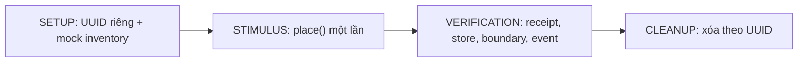

# Tách setup, stimulus và verification trong JUnit và Spring Modulith

## 1. Một testcase, ba pha có trách nhiệm rõ ràng

Trong chương **JUnit integration** của học phần **SPRING_MODULITH_VERIFICATION_TESTING**, mục tiêu của việc tách pha không đơn thuần là làm mã test đẹp hơn: nó giúp xác định **lỗi nằm ở tiền điều kiện, thao tác nghiệp vụ hay hậu điều kiện** khi kiểm chứng module, sự kiện và tích hợp. Học phần còn sử dụng `ApplicationModules` để bảo vệ ranh giới module và quality gate CI; kiểm chứng cấu trúc đó là một mục tiêu riêng, không nên lẫn với các assertion nghiệp vụ.

Một kịch bản cụ thể: module `order` nhận yêu cầu đặt 2 sản phẩm. Nếu kho cho phép, service phải trả receipt, lưu đơn và phát `OrderPlaced`.

| Pha | Câu hỏi | Trong test `order` |
| --- | --- | --- |
| **Setup (Given / Arrange)** | Điều gì phải đúng **trước** hành động? | Tạo `orderId` riêng, chọn SKU/số lượng, định nghĩa phản hồi từ API tồn kho, chuẩn bị fixture |
| **Stimulus (When / Act)** | Người dùng/hệ thống **làm gì một lần**? | Gọi `orders.place(id, sku, quantity)` hoặc yêu cầu `Scenario.stimulate(...)` thực thi |
| **Verification (Then / Assert)** | Hợp đồng nào phải đúng **sau** hành động? | Receipt đúng, đơn được lưu, API kho được gọi đúng, `OrderPlaced` mang cùng ID |
| **Cleanup** *(phần kết thúc vòng đời)* | Side effect nào phải được thu hồi? | Xóa dữ liệu đúng `orderId`/rollback, chờ công việc nền khi cần |



**Quy tắc thực dụng:** Nhìn vào một method test, người đọc phải chỉ ngay được dòng **Act**. Nếu không chỉ ra được vì `@BeforeEach` đã gọi nghiệp vụ, assertion đang phát lại event hoặc một test khác chuẩn bị dữ liệu, đó là dấu hiệu cần refactor.

Trong bài này, `SPECIAL_NOTE` rỗng; trọng tâm là thiết kế ba pha cho đúng nội dung `menuLevel2`, không mở rộng thành bài nhập môn về mọi annotation Spring.

## 2. Setup: tạo tiền điều kiện, không “thực thi trước một nửa kịch bản”

**Setup có thể tạo fixture**, kể cả insert những dữ liệu tham chiếu cần thiết vào database. Nhưng nó không nên âm thầm thực hiện **chính hành vi đang được kiểm chứng** và làm assertion ở pha sau mất ý nghĩa.

Ví dụ setup đúng cho module `order`:

```java
UUID id = UUID.randomUUID();
String sku = "SKU-READY";
int quantity = 2;

given(stock.available(sku, quantity)).willReturn(true);
```

Điều cần tránh:

```java
@BeforeEach
void arrangeEverything() {
    given(stock.available("SKU-READY", 2)).willReturn(true);
    orders.place(UUID.randomUUID(), "SKU-READY", 2); // SAI VAI TRÒ
}
```

Hành vi `orders.place(...)` ở đây tạo record và publish event **trước testcase**. Sau đó một assertion `events.ofType(OrderPlaced.class).hasSize(1)` có thể quan sát sự kiện từ setup thay vì stimulus thật, hoặc state từ setup làm testcase không độc lập. Đây là đoạn **anti-pattern**, không phải mã cần đưa vào CI.

### `@BeforeEach` nên chứa gì?

| Nên dùng `@BeforeEach` khi | Nên để **ngay trong test** khi |
| --- | --- |
| Reset một fake mutable cho **mỗi invocation**, với lifecycle rõ ràng | Chuẩn bị SKU/số lượng/ID của chính case |
| Khởi tạo một fixture Java **thuần** được dùng chung về cấu trúc | Stub behavior chỉ thuộc một nhánh `success`/`out-of-stock` |
| Xóa tài nguyên thử nghiệm riêng đã được quản lý đúng cách | Thực hiện setup có ảnh hưởng tới assertions cụ thể |
| Dọn mock/fake nếu framework **không** reset tự động | Gọi use case được kiểm thử — đây là stimulus |

Spring Modulith **1.4** gắn `@TestInstance(PER_CLASS)` trong `@ApplicationModuleTest`. Vì thế một field mutable như `UUID currentOrderId` có thể tồn tại giữa các method. Spring TestContext còn cache singleton `ApplicationContext`. **Không giả định mỗi `@BeforeEach` có context/bean mới**. Ưu tiên `UUID` **biến cục bộ** trong test; nếu dùng field fixture, reset đúng cho từng invocation và xem xét chạy song song.

Với `@MockitoBean` trên Spring Framework 6.2+, mock được Spring Test quản lý theo reset policy (mặc định reset sau test); tuy vậy **mỗi testcase vẫn nên tự stub những phản hồi nó cần**. Đừng dựa vào lần stubbing ở method khác.

### Setup helper: tên phải nói ra ý định

```java
private void stockAllows(String sku, int quantity) {
    given(stock.available(sku, quantity)).willReturn(true);
}

private void stockRejects(String sku, int quantity) {
    given(stock.available(sku, quantity)).willReturn(false);
}
```

Đó là **helper setup cho test class đã có field `stock`**, không phải production API. Helper tốt giúp đọc như hợp đồng; helper tên `prepare()` nhưng bên trong vừa mock, vừa gọi service, vừa verify thì che mất ranh giới ba pha.

## 3. Stimulus: một hành động nghiệp vụ, không lặp trong assertions

Stimulus là điểm bắt đầu của **hành vi đang kiểm chứng**. Khi dùng JUnit thông thường:

```java
// WHEN — duy nhất một lời gọi nghiệp vụ:
OrderReceipt receipt = orders.place(id, sku, quantity);
```

Những lỗi hay gặp:

```java
// SAI: gọi lệnh 2 lần, có thể publish 2 event / trùng orderId.
assertThat(orders.place(id, sku, quantity).orderId()).isEqualTo(id);
assertThat(orders.place(id, sku, quantity).quantity()).isEqualTo(quantity);
```

Giải pháp là **lưu kết quả sau một lần gọi**, rồi assert các thuộc tính trên snapshot và những side effect liên quan. Nguyên tắc này càng quan trọng khi use case gửi email, ghi DB hoặc tạo event: chạy lại lệnh chỉ để lấy một field là một stimulus mới.

### Khi nào dùng `Scenario.stimulate(...)`?

Nếu một lệnh dẫn tới **eventual outcome** ở module nhận event, Spring Modulith cung cấp `Scenario`:

```java
scenario.stimulate(() -> orders.place(id, sku, quantity))
        .andWaitAtMost(Duration.ofSeconds(5))
        .forEventOfType(NotificationRecorded.class)
        .matching(event -> event.orderId().equals(id))
        .toArriveAndVerify(event -> assertThat(event.orderId()).isEqualTo(id));
```

Đây là **mẫu nằm trong test có consumer và transaction manager**, không chạy độc lập nếu dự án chỉ có module `order`. Pha stimulus được định nghĩa ở `stimulate(...)`, còn **việc thực thi scenario thực tế bắt đầu khi gọi terminal operation** như `toArriveAndVerify(...)`. `andWaitAtMost(...)` là cấu hình chờ, không phải một lời gọi use case thứ hai.

**Phân biệt `scenario.publish(event)` và `scenario.stimulate(() -> service.command())`**:

- `publish(...)` đặt **event publication** làm stimulus; nó thích hợp khi test **consumer** và cố ý bỏ qua logic tạo event của producer.
- `stimulate(...)` gọi **use case thật** để kiểm tra cả hành vi command và kết quả sau đó; nếu cần xác nhận validation của service, dùng cách này.

`Scenario` tạo transaction cho quá trình phát stimulus để kiểm thử listener `AFTER_COMMIT`, nhưng **không** thay thế một integration test của broker/transport nếu hệ thống sử dụng Kafka/RabbitMQ thật.

## 4. Verification: tách bằng chứng ra khỏi hành động

Sau stimulus, câu hỏi không còn là “có gọi method không?” mà là “**hợp đồng của kết quả và side effect có đúng không?**”

```java
// THEN — ví dụ đặt trong method test đã có receipt, store, stock, events.
var stored = store.findById(id);
var published = events.ofType(OrderPlaced.class)
        .matching(OrderPlaced::orderId, id);

assertAll("Hợp đồng một đơn được chấp nhận",
    () -> assertThat(receipt).isEqualTo(
            new OrderReceipt(id, sku, quantity)),
    () -> assertThat(stored).contains(
            new OrderRecord(id, sku, quantity)),
    () -> then(stock).should().available(sku, quantity),
    () -> assertThat(published).hasSize(1)
);
```

Ba điểm thiết kế đáng chú ý:

1. **Một correlation ID** cho receipt, store và event. Không dùng assertion “có *bất kỳ* event nào” khi testcase phải kiểm chứng event của **đơn này**.
2. **Quan sát trước khi assert**: lấy snapshot `stored` và `published` sau Act, tránh thay đổi domain state trong từng lambda `assertAll`.
3. **Bằng chứng khác nhau**: kiểm tra return value, state, lời gọi qua ranh giới và event; không lặp lại bốn cách viết cho cùng một field của receipt.

`PublishedEvents` chứng minh event đã **được publish** trong test, không tự chứng minh listener của module khác đã xử lý. Để kiểm tra consumer async, dùng `Scenario` và event/state kết quả như phần 7.

### Đâu là ranh giới của `assertAll`?

JUnit Jupiter `assertAll(...)` tiếp tục các assertion lambda khác sau khi một assertion fail, rồi báo `MultipleFailuresError` với nhiều lỗi. **Nó không phải transaction atomic**, không rollback những lambda đã chạy và không bảo đảm các quan sát từ thread khác cùng một thời điểm.

Nếu kết quả của một assertion cần object khác phải tồn tại, kiểm tra điều kiện tiên quyết rõ ràng hoặc assert trên `Optional` để tránh `NullPointerException` khó hiểu:

```java
assertThat(store.findById(id))
        .as("Order %s phải tồn tại", id)
        .contains(new OrderRecord(id, sku, quantity));
```

Với kịch bản từ chối, verification phải bao gồm **absence of side effects**:

| Nhánh lỗi | Exception | Boundary inventory | State | Event |
| --- | --- | --- | --- | --- |
| Quantity sai, validation chặn sớm | `INVALID_ORDER` | **Không gọi** | Không lưu đơn | Không publish `OrderPlaced` |
| Kho từ chối | `OUT_OF_STOCK` | **Phải gọi** đúng SKU/quantity | Không lưu đơn | Không publish `OrderPlaced` |

Đừng dùng một `then(stock).shouldHaveNoInteractions()` cho **cả hai nhánh**: ở nhánh hết hàng, việc hỏi kho chính là một bước đúng của hợp đồng.

## 5. Ứng dụng mẫu: `order` sử dụng API công khai của `inventory`

Các ví dụ sau dùng **Java 17+, Spring Boot 3.4/3.5, Spring Framework 6.2, Spring Modulith 1.4 và JUnit Jupiter 5** với các BOM tương thích. Đây là mẫu **module test dùng in-memory state**, không phải database/broker integration test.

```text
src/main/java/com/example/shop/
  ShopApplication.java
  inventory/StockAvailability.java
  inventory/StockAvailabilityService.java
  order/OrderReceipt.java
  order/OrderRecord.java
  order/OrderPlaced.java
  order/OrderStore.java
  order/OrderService.java
src/test/java/com/example/shop/
  order/OrderContractTests.java
  ModuleArchitectureTests.java
```

### Dependencies cần có

Trong một dự án Maven đã cấu hình Spring Boot và Spring Modulith dependency management:

```xml
<dependency>
    <groupId>org.springframework.boot</groupId>
    <artifactId>spring-boot-starter</artifactId>
</dependency>
<dependency>
    <groupId>org.springframework.boot</groupId>
    <artifactId>spring-boot-starter-test</artifactId>
    <scope>test</scope>
</dependency>
<dependency>
    <groupId>org.springframework.modulith</groupId>
    <artifactId>spring-modulith-starter-test</artifactId>
    <scope>test</scope>
</dependency>
```

Đây chỉ là **đoạn dependencies**, không phải `pom.xml` đầy đủ. Ví dụ chỉ dùng JUnit, Mockito, Spring Test và Spring events nên không cần datasource ở bước này.

### Root application và ranh giới inventory

`src/main/java/com/example/shop/ShopApplication.java`:

```java
package com.example.shop;

import org.springframework.boot.SpringApplication;
import org.springframework.boot.autoconfigure.SpringBootApplication;

@SpringBootApplication
public class ShopApplication {
    public static void main(String[] args) {
        SpringApplication.run(ShopApplication.class, args);
    }
}
```

`src/main/java/com/example/shop/inventory/StockAvailability.java`:

```java
package com.example.shop.inventory;

public interface StockAvailability {
    boolean available(String sku, int quantity);
}
```

`src/main/java/com/example/shop/inventory/StockAvailabilityService.java`:

```java
package com.example.shop.inventory;

import org.springframework.stereotype.Service;

@Service
public class StockAvailabilityService implements StockAvailability {
    @Override
    public boolean available(String sku, int quantity) {
        return "SKU-READY".equals(sku) && quantity <= 3;
    }
}
```

Module `order` chỉ import interface **công khai** `StockAvailability`, không gọi trực tiếp implementation của `inventory`. Ở test `STANDALONE`, sẽ mock interface; ở test dùng `DIRECT_DEPENDENCIES`, Spring mới nạp implementation thật theo phạm vi module được chọn.

### Ba kiểu dữ liệu cho một lệnh

`src/main/java/com/example/shop/order/OrderReceipt.java`:

```java
package com.example.shop.order;

import java.util.UUID;

public record OrderReceipt(UUID orderId, String sku, int quantity) {}
```

`src/main/java/com/example/shop/order/OrderRecord.java`:

```java
package com.example.shop.order;

import java.util.UUID;

public record OrderRecord(UUID orderId, String sku, int quantity) {}
```

`src/main/java/com/example/shop/order/OrderPlaced.java`:

```java
package com.example.shop.order;

import java.util.UUID;

public record OrderPlaced(UUID orderId, String sku, int quantity) {}
```

**Receipt** là kết quả API, **Record** là state module lưu, **Placed** là domain event. Cùng các field nhưng khác nguồn quan sát; một output đúng không chứng minh hai output còn lại đúng.

### In-memory store có cleanup theo ID

`src/main/java/com/example/shop/order/OrderStore.java`:

```java
package com.example.shop.order;

import java.util.Optional;
import java.util.UUID;
import java.util.concurrent.ConcurrentHashMap;
import java.util.concurrent.ConcurrentMap;
import org.springframework.stereotype.Repository;

@Repository
public class OrderStore {

    private final ConcurrentMap<UUID, OrderRecord> data =
            new ConcurrentHashMap<>();

    public void save(OrderRecord order) {
        if (data.putIfAbsent(order.orderId(), order) != null) {
            throw new IllegalStateException("DUPLICATE_ORDER");
        }
    }

    public Optional<OrderRecord> findById(UUID id) {
        return Optional.ofNullable(data.get(id));
    }

    public void deleteById(UUID id) {
        data.remove(id);
    }
}
```

`OrderStore` là singleton bean. Context caching có thể giữ `data` qua nhiều method, nên mỗi testcase cần **ID riêng và cleanup**. Việc ghi map không tạo SQL transaction và không chứng minh persistence bền vững.

### Service thực thi nghiệp vụ

`src/main/java/com/example/shop/order/OrderService.java`:

```java
package com.example.shop.order;

import java.util.UUID;
import com.example.shop.inventory.StockAvailability;
import org.springframework.context.ApplicationEventPublisher;
import org.springframework.stereotype.Service;

@Service
public class OrderService {

    private final StockAvailability stock;
    private final OrderStore store;
    private final ApplicationEventPublisher publisher;

    public OrderService(StockAvailability stock,
                        OrderStore store,
                        ApplicationEventPublisher publisher) {
        this.stock = stock;
        this.store = store;
        this.publisher = publisher;
    }

    public OrderReceipt place(UUID id, String sku, int quantity) {
        if (id == null || sku == null || sku.isBlank()
                || quantity < 1 || quantity > 3) {
            throw new IllegalArgumentException("INVALID_ORDER");
        }

        if (!stock.available(sku, quantity)) {
            throw new IllegalStateException("OUT_OF_STOCK");
        }

        store.save(new OrderRecord(id, sku, quantity));
        publisher.publishEvent(new OrderPlaced(id, sku, quantity));
        return new OrderReceipt(id, sku, quantity);
    }
}
```

Service có trật tự nghiệp vụ tường minh: **validation → boundary inventory → lưu → event → receipt**. Bài test sẽ không mock `OrderService` và cũng không biến `Store.save(...)` thành setup. Đặc biệt, code ví dụ **không bảo đảm atomicity** nếu `publishEvent` ném lỗi sau khi `save` hoàn tất; để có bảo đảm đó, cần thiết kế transaction/event publication riêng.

## 6. Một lớp `@ApplicationModuleTest`: các vùng GIVEN–WHEN–THEN nhìn thấy được

File `src/test/java/com/example/shop/order/OrderContractTests.java`:

```java
package com.example.shop.order;

import static org.assertj.core.api.Assertions.assertThat;
import static org.junit.jupiter.api.Assertions.assertAll;
import static org.junit.jupiter.api.Assertions.assertThrowsExactly;
import static org.mockito.BDDMockito.given;
import static org.mockito.BDDMockito.then;

import java.util.UUID;
import com.example.shop.inventory.StockAvailability;
import org.junit.jupiter.api.DisplayName;
import org.junit.jupiter.api.Tag;
import org.junit.jupiter.api.Test;
import org.springframework.beans.factory.annotation.Autowired;
import org.springframework.modulith.test.ApplicationModuleTest;
import org.springframework.modulith.test.PublishedEvents;
import org.springframework.test.context.bean.override.mockito.MockitoBean;

@ApplicationModuleTest
@Tag("module")
@DisplayName("Order — tách setup, stimulus, verification")
class OrderContractTests {

    @Autowired OrderService orders;
    @Autowired OrderStore store;
    @MockitoBean StockAvailability stock;

    @Test
    @Tag("event")
    void acceptsOneOrderAndReportsConsistentOutputs(
            PublishedEvents events) {

        // GIVEN — chỉ dựng dữ liệu / xác định phản hồi dependency.
        UUID id = UUID.randomUUID();
        String sku = "SKU-READY";
        int quantity = 2;
        given(stock.available(sku, quantity)).willReturn(true);

        try {
            // WHEN — stimulus duy nhất, service thật.
            OrderReceipt receipt = orders.place(id, sku, quantity);

            // THEN — chỉ quan sát hậu điều kiện của chính id này.
            var saved = store.findById(id);
            var emitted = events.ofType(OrderPlaced.class)
                    .matching(OrderPlaced::orderId, id);

            assertAll("Đơn được chấp nhận nhất quán",
                () -> assertThat(receipt)
                        .isEqualTo(new OrderReceipt(id, sku, quantity)),
                () -> assertThat(saved)
                        .contains(new OrderRecord(id, sku, quantity)),
                () -> then(stock).should().available(sku, quantity),
                () -> assertThat(emitted)
                        .as("Đúng một OrderPlaced cho orderId")
                        .singleElement()
                        .satisfies(event -> assertAll(
                            "Payload OrderPlaced",
                            () -> assertThat(event.sku()).isEqualTo(sku),
                            () -> assertThat(event.quantity())
                                    .isEqualTo(quantity)
                        ))
            );
        } finally {
            // CLEANUP — thực hiện cả khi assertion thất bại.
            store.deleteById(id);
        }
    }

    @Test
    void rejectsInvalidQuantityBeforeCallingStock(
            PublishedEvents events) {

        // GIVEN
        UUID id = UUID.randomUUID();
        String sku = "SKU-READY";

        try {
            // WHEN — exception là outcome của stimulus.
            IllegalArgumentException error = assertThrowsExactly(
                    IllegalArgumentException.class,
                    () -> orders.place(id, sku, 0));

            // THEN — từ chối trước mọi side effect.
            assertAll("Validation chặn sớm",
                () -> assertThat(error).hasMessage("INVALID_ORDER"),
                () -> then(stock).shouldHaveNoInteractions(),
                () -> assertThat(store.findById(id)).isEmpty(),
                () -> assertThat(events.ofType(OrderPlaced.class)
                        .matching(OrderPlaced::orderId, id)).isEmpty()
            );
        } finally {
            store.deleteById(id);
        }
    }

    @Test
    void rejectsUnavailableStockWithoutSavingOrPublishing(
            PublishedEvents events) {

        // GIVEN
        UUID id = UUID.randomUUID();
        String sku = "SKU-OUT";
        given(stock.available(sku, 1)).willReturn(false);

        try {
            // WHEN
            IllegalStateException error = assertThrowsExactly(
                    IllegalStateException.class,
                    () -> orders.place(id, sku, 1));

            // THEN — đã hỏi kho, nhưng không ghi / publish.
            assertAll("Kho từ chối đơn",
                () -> assertThat(error).hasMessage("OUT_OF_STOCK"),
                () -> then(stock).should().available(sku, 1),
                () -> assertThat(store.findById(id)).isEmpty(),
                () -> assertThat(events.ofType(OrderPlaced.class)
                        .matching(OrderPlaced::orderId, id)).isEmpty()
            );
        } finally {
            store.deleteById(id);
        }
    }
}
```

### Ba điểm quan trọng của lớp test

**Thứ nhất, setup không giấu stimulus.** Lớp không cần `@BeforeEach`: mỗi test tự tạo ID, mock response theo nhánh và đọc dễ dàng luồng Given–When–Then. Lặp vài dòng setup giúp testcase **tự chứa** hơn một hook chung có hàng chục điều kiện.

**Thứ hai, một action có nhiều verification.** `assertAll` nhóm output, state, mock boundary và event của **cùng orderId**, nhưng **không gọi lại `orders.place(...)`**. Nếu test cần phát event hai lần để kiểm thử idempotency, đó là một hợp đồng khác và phải được ghi rõ ngay tên test.

**Thứ ba, negative tests kiểm tra đúng pha chặn.** Với quantity=0, `stock` hoàn toàn không được gọi. Với hết hàng, `stock` bắt buộc đã được hỏi, nhưng record/event không có. Hai trường hợp có cùng hậu điều kiện “không tạo đơn” nhưng **khác đường xử lý đúng**.

Test này có **Spring context thật chỉ trong module `order`** và mock API của `inventory`. Nó chưa xác nhận `StockAvailabilityService` thật, database commit hay consumer đã xử lý event; hãy chọn test tích hợp tương ứng khi cần độ tin cậy ấy.

## 7. Với event flow: phân biệt setup, stimulus và **đợi verification**

Khi module `notification` nhận `OrderPlaced` **sau commit**, không thể giả định consumer đã hoàn tất ngay sau khi `orders.place(...)` trả về. Pha verification cần một **điểm đồng bộ** dựa vào event hoặc state kết quả.

Giả sử mở rộng ứng dụng mẫu bằng module `notification` gồm:

`src/main/java/com/example/shop/notification/NotificationRecorded.java`:

```java
package com.example.shop.notification;

import java.util.UUID;

public record NotificationRecorded(UUID orderId) {}
```

`src/main/java/com/example/shop/notification/NotificationJournal.java`:

```java
package com.example.shop.notification;

import java.util.UUID;
import java.util.Set;
import java.util.concurrent.ConcurrentHashMap;
import org.springframework.stereotype.Component;

@Component
public class NotificationJournal {
    private final Set<UUID> handled = ConcurrentHashMap.newKeySet();

    public void record(UUID id) { handled.add(id); }
    public boolean contains(UUID id) { return handled.contains(id); }
    public void remove(UUID id) { handled.remove(id); }
}
```

`src/main/java/com/example/shop/notification/NotificationListener.java`:

```java
package com.example.shop.notification;

import com.example.shop.order.OrderPlaced;
import org.springframework.context.ApplicationEventPublisher;
import org.springframework.stereotype.Component;
import org.springframework.transaction.event.TransactionPhase;
import org.springframework.transaction.event.TransactionalEventListener;

@Component
public class NotificationListener {

    private final NotificationJournal journal;
    private final ApplicationEventPublisher publisher;

    public NotificationListener(NotificationJournal journal,
                                ApplicationEventPublisher publisher) {
        this.journal = journal;
        this.publisher = publisher;
    }

    @TransactionalEventListener(phase = TransactionPhase.AFTER_COMMIT)
    public void on(OrderPlaced event) {
        journal.record(event.orderId());
        publisher.publishEvent(new NotificationRecorded(event.orderId()));
    }
}
```

**Phạm vi kỹ thuật:** Đây là listener đồng bộ **sau commit**, không phải email/SMS hay broker. Nếu dùng `@Async`, phải bật `@EnableAsync` và quản lý executor/cleanup phù hợp; không được coi event kết quả là acknowledgement của nhà cung cấp ngoài.

Để `Scenario` chạy với listener `AFTER_COMMIT`, test context cần `PlatformTransactionManager`. Với ví dụ đơn giản, có thể bổ sung vào POM đã có:

```xml
<dependency>
    <groupId>org.springframework.boot</groupId>
    <artifactId>spring-boot-starter-jdbc</artifactId>
</dependency>
<dependency>
    <groupId>com.h2database</groupId>
    <artifactId>h2</artifactId>
    <scope>test</scope>
</dependency>
```

Spring Boot có thể tạo datasource H2 và transaction manager khi dependency/auto-configuration phù hợp; listener ở trên chỉ ghi journal in-memory nên không yêu cầu schema SQL. Một project có datasource khác cần điều chỉnh hạ tầng thay vì thêm H2 tùy tiện.

### Test event flow: một command, hai loại kết quả

`src/test/java/com/example/shop/order/OrderToNotificationTests.java`:

```java
package com.example.shop.order;

import static org.assertj.core.api.Assertions.assertThat;
import static org.junit.jupiter.api.Assertions.assertAll;
import static org.mockito.BDDMockito.given;

import java.time.Duration;
import java.util.UUID;
import com.example.shop.inventory.StockAvailability;
import com.example.shop.notification.NotificationJournal;
import com.example.shop.notification.NotificationRecorded;
import org.junit.jupiter.api.Test;
import org.junit.jupiter.api.Tag;
import org.springframework.beans.factory.annotation.Autowired;
import org.springframework.modulith.test.ApplicationModuleTest;
import org.springframework.modulith.test.Scenario;
import org.springframework.test.context.bean.override.mockito.MockitoBean;

@Tag("integration")
@ApplicationModuleTest(extraIncludes = "notification")
class OrderToNotificationTests {

    @Autowired OrderService orders;
    @Autowired OrderStore store;
    @Autowired NotificationJournal journal;
    @MockitoBean StockAvailability stock;

    @Test
    void acceptsAndHandlesTheSameOrder(Scenario scenario) {
        // SETUP: ID và mock chỉ thuộc testcase này.
        UUID id = UUID.randomUUID();
        given(stock.available("SKU-READY", 2)).willReturn(true);

        // STIMULUS: định nghĩa gọi use case thật.
        scenario.stimulate(
                    () -> orders.place(id, "SKU-READY", 2))
                .andCleanup(() -> {
                    store.deleteById(id);
                    journal.remove(id);
                })
                .andWaitAtMost(Duration.ofSeconds(5))
                // VERIFICATION: đợi kết quả của consumer.
                .forEventOfType(NotificationRecorded.class)
                .matching(event -> event.orderId().equals(id))
                .toArriveAndVerify((event, receipt) -> assertAll(
                    "Notification hoàn tất đúng đơn",
                    () -> assertThat(receipt.orderId())
                            .isEqualTo(id),
                    () -> assertThat(event.orderId())
                            .isEqualTo(id),
                    () -> assertThat(journal.contains(id))
                            .isTrue()
                ));
    }
}
```

Đoạn trên hoàn chỉnh **khi** đã thêm module consumer và transaction manager như hướng dẫn. `Scenario.stimulate(...)` **không thực thi use case hai lần**; lệnh được thực hiện trong quá trình chạy scenario ở terminal operation `toArriveAndVerify(...)`. Trong Spring Modulith 1.4, `Scenario` khởi chạy stimulus qua một transaction callback để kích hoạt `AFTER_COMMIT` listener, và có thể commit side effect ngay cả khi test ngoài cùng dùng `@Transactional` rollback. Vì vậy cleanup được đăng ký trước khi verification và cần dọn **dữ liệu thực sự đã phát sinh**.

Đặt `extraIncludes = "notification"` vì `notification` là module **tiêu thụ event** từ `order`, không phải dependency hướng ra ngoài mà `order` cần gọi trực tiếp. `ALL_DEPENDENCIES` từ `order` **không mặc nhiên nạp các module phụ thuộc ngược** vào `order`.

**Giới hạn cleanup:** `andCleanup(...)` được gọi khi scenario kết thúc hoặc lỗi, nhưng nếu listener `@Async` vẫn ghi state sau timeout, một cleanup trước đó không bảo đảm chặn side effect đến muộn. Với database/broker thật, cần chiến lược idempotency, correlation ID, chờ/cô lập tác vụ và cleanup theo hạ tầng, không đơn thuần xóa một map.

### Khi chỉ muốn test consumer

Nếu hợp đồng cần xác minh là “notification phản ứng đúng khi nhận `OrderPlaced`”, có thể dùng `scenario.publish(new OrderPlaced(...))` làm stimulus. Cách đó **bỏ qua `OrderService.place(...)`**, nên không được mô tả test như thể đã kiểm tra validation hoặc kiểm tra kho của producer.

## 8. Test có database: setup fixture khác transaction của stimulus

Khi thay `OrderStore` bằng repository JPA/JDBC thật, việc tách pha càng quan trọng vì **transaction làm thay đổi phạm vi quan sát và cleanup**.

| Pha | Test đồng bộ có `@Transactional` | Event flow dùng `Scenario` |
| --- | --- | --- |
| **Setup** | Insert fixture riêng vào test-managed transaction hoặc tạo trong `@BeforeEach` | Tạo metadata/fixture trước, xác định commit cần thiết |
| **Stimulus** | Gọi service trong transaction hiện tại; theo mặc định test transaction sẽ rollback | `Scenario.stimulate/publish` dùng transaction callback riêng để trigger `AFTER_COMMIT` |
| **Verification** | `flush`/`clear` + query repository thật, hiểu vẫn đang trong transaction | Chờ event/state kết quả rồi kiểm chứng data **đã commit** theo cơ chế phù hợp |
| **Cleanup** | Rollback theo test nếu không có transaction khác commit | Dọn record/event registry/outbox đã commit bằng ID, không trông đợi rollback của test ngoài |

Một skeleton JPA được phân pha đúng:

```java
@ApplicationModuleTest
class OrderJpaVerificationTests {

    @Autowired OrderJpaRepository repository;
    @Autowired OrderService orders;
    @Autowired EntityManager entityManager;

    @Test
    @Transactional
    void persistsAnOrderWithExpectedFields() {
        // SETUP: ID riêng và các entity tham chiếu bắt buộc.
        UUID id = UUID.randomUUID();
        // ... fixture từ repository thật ...

        // STIMULUS: use case chính xác một lần.
        OrderReceipt receipt = orders.place(id, "SKU-READY", 2);

        // VERIFICATION: flush SQL, bỏ cache persistence context.
        entityManager.flush();
        entityManager.clear();
        assertThat(receipt.orderId()).isEqualTo(id);
        assertThat(repository.findById(id)).isPresent();
        // Theo mặc định test-managed transaction được rollback.
    }
}
```

**Đây là skeleton mở rộng, không thể biên dịch độc lập từ ứng dụng in-memory phần 5**: cần thay `OrderStore`/service để dùng JPA, định nghĩa `OrderJpaRepository`, entity, datasource, transaction manager và imports. Đoạn này dạy thứ tự setup–stimulus–verification; nó **không** chứng minh commit bền vững vì test transaction chưa commit.

**Đừng đặt `assertTimeoutPreemptively(...)` bao quanh stimulus database** của một test-managed transaction: JUnit chạy khối trong thread khác, có thể làm thao tác thoát khỏi transaction được Spring Test liên kết với thread gốc, và dữ liệu không bị rollback như kỳ vọng. Ưu tiên `@Timeout(threadMode = SAME_THREAD)` và timeout JDBC riêng.

## 9. Refactor một test khó đọc và giữ quality gate ở đúng cấp

Một testcase bị “trộn pha” thường trông như sau:

```java
// ANTI-PATTERN — không sử dụng cho test thật.
@Test
void confusingOrderTest(PublishedEvents events) {
    given(stock.available("SKU-READY", 2)).willReturn(true);
    assertThat(orders.place(UUID.randomUUID(), "SKU-READY", 2))
            .isNotNull();
    given(stock.available("SKU-OUT", 1)).willReturn(false);
    assertThat(events.ofType(OrderPlaced.class)).isNotEmpty();
    // Không có ID để đối chiếu, không biết dữ liệu nào cần cleanup.
}
```

Nó có vẻ ngắn, nhưng gom hai nhánh dữ liệu vào một method, trộn Act trong assertion và kiểm tra “có event bất kỳ”. Hãy refactor thành **hai test** như phần 6, mỗi test tạo ID, stub đúng nhánh, một Act, các Then có correlation ID, cleanup trong `finally`.

| Dấu hiệu | Câu hỏi chẩn đoán | Cách sửa |
| --- | --- | --- |
| Không chỉ ra được WHEN | Test đã gọi service trong `@BeforeEach` hoặc trong `assertThat(...)`? | Di chuyển stimulus về đúng một dòng/khối |
| `PublishedEvents` có event nhưng không rõ của ai | Có lọc `orderId` của testcase? | Lọc type + correlation ID + payload/quantity |
| Một test đỏ sau khi test khác chạy | Context cache, singleton, fixture/shared ID? | Tự tạo state và cleanup theo ID |
| Validation test gọi inventory | Setup/stubbing không giải quyết lỗi production ở validation | Assertion `shouldHaveNoInteractions` trong verification |
| Hết hàng không gọi inventory | Đã kiểm tra đúng đường từ chối chưa? | Assert invocation đúng SKU/quantity rồi assert không có side effect |
| Event consumer test timeout | Module nhận event chưa nạp hoặc transaction không commit? | Dùng `extraIncludes` và `Scenario`/transaction phù hợp |
| Test `@Transactional` fail dù data có commit | Đang query trong transaction khác? | Xác định ranh giới transaction và dữ liệu đã commit |
| Chỉ mock repository nhưng báo DB xanh | Không kiểm tra persistence thật | Dùng repository + DB thật ở test tích hợp riêng |
| `@DirtiesContext` được thêm vì data rò | Đóng context có xóa database/broker không? | Rollback/cleanup đúng tài nguyên |

### Kiểm chứng kiến trúc **không phải verification của từng order**

Một testcase `orders.place(...)` có thể hoàn toàn đúng nhưng source code vẫn phụ thuộc sai vào `inventory.internal`. Kiểm tra cấu trúc bằng **JUnit test riêng**:

`src/test/java/com/example/shop/ModuleArchitectureTests.java`:

```java
package com.example.shop;

import org.junit.jupiter.api.Tag;
import org.junit.jupiter.api.Test;
import org.springframework.modulith.core.ApplicationModules;

@Tag("architecture")
class ModuleArchitectureTests {

    @Test
    void moduleBoundariesRemainValid() {
        ApplicationModules.of(ShopApplication.class).verify();
    }
}
```

`verify()` áp dụng các luật cấu trúc Spring Modulith (chu trình module, truy cập internal, giới hạn `allowedDependencies` nếu khai báo). Trong Spring Modulith 1.4, `@ApplicationModuleTest` cũng có `verifyAutomatically = true` theo mặc định, nhưng một gate **độc lập** dễ bảo đảm CI vẫn kiểm tra kiến trúc khi các nhóm module test bị lọc theo tags hoặc chỉ chạy chọn lọc.

**Không nhét `ApplicationModules.verify()` vào mỗi `assertAll` hậu điều kiện của order**: đó là một hợp đồng của *toàn đồ thị module*, không phải của một stimulus. CI nên chạy cả architecture gate, module behavior và integration event/DB có hạ tầng thật, mỗi nhóm thất bại với thông tin riêng.

## 10. Bài tập, checklist và tài liệu tham khảo

### Bài tập có thể thực hành ngay

1. **Đánh dấu ba pha:** Trong `OrderContractTests`, tìm dòng bắt đầu/kết thúc của GIVEN, WHEN và THEN. Thử chuyển `orders.place(...)` vào `@BeforeEach` rồi giải thích vì sao test bị sai ngữ nghĩa.
2. **Thử mutation:** Đổi `OrderService` thành `publisher.publishEvent(new OrderPlaced(id, sku, quantity + 1))`. Tại sao assertion event phải kiểm tra payload thay vì chỉ event type?
3. **Tách một test thành hai:** Viết anti-pattern kiểm tra success và hết hàng trong cùng method, sau đó refactor thành hai testcase với fixture và cleanup riêng.
4. **Dữ liệu tham số:** Thử `@ParameterizedTest @ValueSource(ints = {0, -1, 4})` để test validation. Đặt giá trị từ source **trước** tham số `PublishedEvents` do extension cung cấp, và chuẩn bị ID/mock isolation cho mỗi invocation.
5. **Lời gọi ranh giới:** Sửa nhánh hết hàng của service thành trả lỗi ngay, không gọi kho. Assertion nào phát hiện được nếu không trộn setup và verification?
6. **Scenario:** Bổ sung listener `notification` ở phần 7, bỏ `extraIncludes` và kiểm tra tại sao consumer không được bootstrap. Sau đó đặt đúng module consumer trong scope.
7. **Database:** Thay `OrderStore` bằng JPA repository, thêm fixture tham chiếu ở GIVEN, gọi use case tại WHEN, `flush/clear/query` ở THEN; phân biệt test transaction chưa commit với một lần query sau commit.
8. **CI:** Tạo một vi phạm import vào `inventory.internal`, chạy `ModuleArchitectureTests` và so sánh lỗi kiến trúc với các assertion hành vi của `OrderContractTests`.

### Checklist review một testcase

| Câu hỏi | Tiêu chí đạt |
| --- | --- |
| Có một stimulus nghiệp vụ dễ chỉ ra? | Không gọi lại action trong mỗi assertion |
| Setup chỉ tạo tiền điều kiện? | Không phát event/ghi business outcome thay cho WHEN |
| Fixture nào thật sự cần cho testcase? | Mỗi case tự chọn ID, data, mock response |
| `@BeforeEach` có bị quá tải? | Hook chung không giấu case-specific behavior |
| Test instance/context có thể được tái sử dụng? | Không truyền state qua field hoặc test method khác |
| Verification gắn với correlation ID? | Output/state/event cùng một ID |
| Negative path có assert không side effect? | Phân biệt validation chặn sớm và tồn kho từ chối |
| Event đã publish hay consumer đã hoàn tất? | `PublishedEvents` hoặc `Scenario` đúng tầng bằng chứng |
| Database đã commit hay mới flush? | Assertion nói đúng phạm vi transaction |
| Cleanup có chạy khi Then fail? | `finally` / `Scenario.andCleanup` / rollback phù hợp |
| Architecture gate độc lập có chạy trong CI? | `ApplicationModules.verify()` không bị tag filter bỏ qua |

**Ghi nhớ:** Một bài test tích hợp dễ đọc phải có **Given tạo tiền điều kiện, When thực hiện đúng một stimulus, Then kiểm chứng kết quả của stimulus đó**, cùng cleanup đúng vòng đời. Với Spring Modulith, dùng `@ApplicationModuleTest` để chọn phạm vi module, `PublishedEvents` để quan sát event nguồn, `Scenario` để chờ kết quả consumer khi cần transaction/eventual consistency, và một architecture gate riêng để bảo vệ ranh giới. Tách pha giúp test **độc lập, đáng tin, dễ chẩn đoán**, chứ không chỉ làm code theo mẫu.

### Tài liệu tham khảo

- [JUnit Jupiter 5.14.4 — Test Instance Lifecycle](https://docs.junit.org/5.14.4/writing-tests/test-instance-lifecycle.html)
- [JUnit Jupiter 5.14.4 — Parameterized Classes and Tests](https://docs.junit.org/5.14.4/writing-tests/parameterized-classes-and-tests.html)
- [JUnit Jupiter API — Assertions.assertAll](https://docs.junit.org/5.14.4/api/org.junit.jupiter.api/org/junit/jupiter/api/Assertions.html)
- [Spring Modulith 1.4 — Integration Testing Application Modules](https://docs.spring.io/spring-modulith/reference/1.4/testing.html)
- [Spring Modulith 1.4 API — ApplicationModuleTest](https://docs.spring.io/spring-modulith/docs/1.4.0/api/org/springframework/modulith/test/ApplicationModuleTest.html)
- [Spring Modulith 1.4 API — Scenario.When](https://docs.spring.io/spring-modulith/docs/1.4.0/api/org/springframework/modulith/test/Scenario.When.html)
- [Spring Modulith — Working with Application Events](https://docs.spring.io/spring-modulith/reference/events.html)
- [Spring Modulith — Verifying Application Module Structure](https://docs.spring.io/spring-modulith/reference/verification.html)
- [Spring Framework — TestContext Transaction Management](https://docs.spring.io/spring-framework/reference/testing/testcontext-framework/tx.html)
