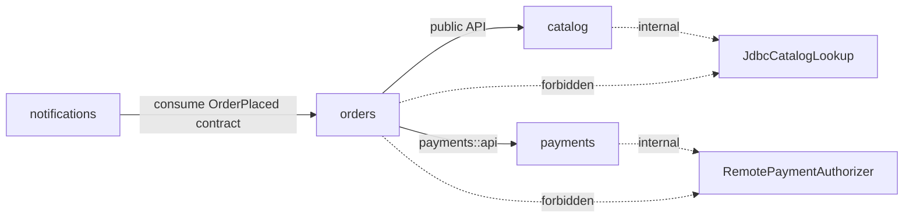
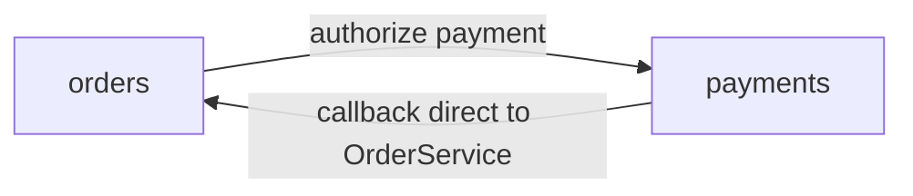
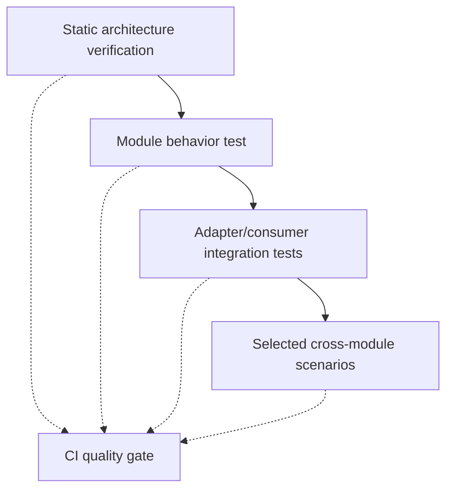

# Hợp đồng nào cần kiểm tra ở cấp module?

## 1. “Hợp đồng kiến trúc” không chỉ là chữ ký của một interface

Khi chuyển một ứng dụng Spring Boot sang Spring Modulith, ta thường bắt đầu bằng cách tách các package thành các application module: `orders`, `catalog`, `payments`, `notifications`. Nhưng việc có những package này chưa bảo đảm hệ thống có ranh giới bền vững. Module `orders` vẫn có thể import trực tiếp repository nội bộ của `catalog`, module `payments` có thể gọi ngược `orders` và tạo vòng phụ thuộc, hoặc một event đổi tên field khiến module nhận không còn xử lý được.

**Hợp đồng cấp module (module-level contract)** là tập cam kết mà module đưa ra và phải duy trì khi phát triển độc lập với các module khác. Những cam kết quan trọng gồm:

1. **Ranh giới phụ thuộc:** module nào được phép gọi module nào, theo chiều nào?
2. **Bề mặt API:** kiểu, package, named interface nào được phép tham chiếu từ bên ngoài?
3. **Hợp đồng hành vi:** khi nhận lệnh hoặc trả lời qua API, module bảo đảm điều gì về kết quả, lỗi và bất biến nghiệp vụ?
4. **Hợp đồng sự kiện:** sự kiện nào được phát, điều kiện phát, payload và quy tắc xử lý nào là ổn định?
5. **Hợp đồng dữ liệu và giao dịch:** module nào sở hữu dữ liệu; tác vụ nào phải nhất quán hoặc tham gia transaction?
6. **Hợp đồng adapter/tích hợp:** HTTP, database, messaging hoặc dịch vụ bên ngoài có đúng kết quả quan sát được không?
7. **Hợp đồng vận hành kiểm thử:** bộ kiểm tra nào chạy trong CI để ngăn thay đổi phá vỡ các cam kết trên?

Chương **Architectural contracts** của học phần `SPRING_MODULITH_VERIFICATION_TESTING` tập trung xây dựng các hợp đồng có thể kiểm chứng. Ta sẽ dùng `ApplicationModules` và các quy tắc phụ thuộc để bảo vệ thiết kế; dùng `@ApplicationModuleTest`, kiểm thử event, database và tích hợp để bảo vệ hành vi; sau cùng ghép chúng thành quality gate CI.

**Nguyên tắc chính:** mỗi hợp đồng cần một **cách kiểm chứng phù hợp**. `ApplicationModules.verify()` rất mạnh với phụ thuộc giữa module, nhưng không chứng minh SQL trả đúng số lượng tồn kho. Một integration test chạy xanh lại không tự bảo đảm source code không import package nội bộ của module khác.

## 2. Bản đồ các hợp đồng nên kiểm tra

| Nhóm hợp đồng | Câu hỏi kiểm chứng | Bằng chứng chính | Giới hạn |
| --- | --- | --- | --- |
| **Hướng phụ thuộc** | Có vòng dependency hoặc quan hệ không được phép không? | `ApplicationModules.verify()` | Không thực thi logic nghiệp vụ |
| **API và internal** | Module ngoài có truy cập phần implementation ẩn không? | Mô hình module, API/named interface, `verify()` | Không biết phản hồi runtime đúng hay sai |
| **Allowed dependencies** | `orders` chỉ được phụ thuộc `catalog` và một API của `payments` không? | `@ApplicationModule(allowedDependencies = ...)` + `verify()` | Không ngăn mọi tương tác động qua reflection/network |
| **API hành vi** | Với dữ liệu hợp lệ/không hợp lệ, service trả về gì? | `@ApplicationModuleTest`, assertion nghiệp vụ | Mock có thể bỏ qua adapter production |
| **Event** | Event nào phát, payload là gì, phát khi nào? | `PublishedEvents`; listener/integration test | Event đã phát khác event đã được xử lý |
| **Dữ liệu/giao dịch** | Module sở hữu bảng nào; query và transaction đúng không? | JPA/repository integration test, review quyền sở hữu | `verify()` không thay bài SQL test |
| **HTTP/messaging** | Request hoặc message có đúng contract? | `MockMvc`, test broker/container, schema tests | Không tự bảo đảm dependency tĩnh |
| **CI** | Một thay đổi phá vỡ hợp đồng có chặn merge không? | Test suite chạy bắt buộc trong pipeline | Phải bảo trì đúng phạm vi và assertion |

Không cần biến mỗi hàng thành một bài test duy nhất. Một hợp đồng có thể cần kết hợp kiểm tra tĩnh và runtime, còn một bài test có thể xác minh vài khía cạnh của cùng use case.

## 3. Ví dụ xuyên suốt: ứng dụng bán hàng modulith

Giả sử ứng dụng có cấu trúc:

```text
src/main/java/com/example/shop/
├── ShopApplication.java
├── orders/
│   ├── package-info.java              // giới hạn dependency
│   ├── OrderApplicationService.java
│   ├── OrderPlaced.java
│   └── internal/
│       └── OrderPolicy.java
├── catalog/
│   ├── CatalogLookup.java             // API tại module base package
│   └── internal/
│       └── JdbcCatalogLookup.java
├── payments/
│   ├── api/
│   │   ├── package-info.java          // named interface "api"
│   │   └── PaymentAuthorizer.java
│   └── internal/
│       └── RemotePaymentAuthorizer.java
└── notifications/
    └── OrderPlacedListener.java
```

Với cách tổ chức thông dụng, `orders`, `catalog`, `payments` và `notifications` là những application module vì chúng nằm trong các package con trực tiếp của package gốc `com.example.shop`. Cấu hình nhận diện module có thể được tùy chỉnh; trong dự án thật, phải kiểm tra mô hình do Spring Modulith phát hiện.

Ta muốn đặt một số hợp đồng:

- `orders` được dùng API công khai `CatalogLookup` của `catalog`.
- `orders` được dùng đúng named interface `payments::api`, không dùng implementation remote nằm trong `payments.internal`.
- `orders` không import `catalog.internal` hoặc `payments.internal`.
- `payments` không được gọi ngược vào `orders` để tránh vòng phụ thuộc.
- `orders` công bố `OrderPlaced` khi đơn hàng hợp lệ đã được chấp nhận.
- `notifications` có thể phản ứng với event, nhưng lỗi thông báo không được âm thầm đổi nghĩa của việc đặt đơn nếu use case thiết kế theo cơ chế bất đồng bộ.
- Repository và schema do mỗi module sở hữu được kiểm tra ở bài persistence phù hợp.



Hai mũi tên “forbidden” là điều ta muốn **chặn bằng kiểm tra kiến trúc**; mũi tên event thể hiện việc module nhận phụ thuộc vào kiểu sự kiện công khai của module nguồn, không có nghĩa module nguồn bắt buộc nạp listener khi kiểm thử riêng.

## 4. Hợp đồng thứ nhất: module nào được nhìn thấy API nào?

### 4.1. Package công khai và package internal

Theo mô hình application module mặc định thường dùng, các kiểu trực tiếp trong **base package của module** là bề mặt API có thể được module khác tham chiếu; những package con thông thường được xem là phần nội bộ, trừ khi được công bố qua cơ chế như named interface.

Ví dụ `CatalogLookup` ở base package `catalog`:

```java
// src/main/java/com/example/shop/catalog/CatalogLookup.java
package com.example.shop.catalog;

public interface CatalogLookup {
    boolean exists(String sku);
}
```

Implementation:

```java
// src/main/java/com/example/shop/catalog/internal/JdbcCatalogLookup.java
package com.example.shop.catalog.internal;

import com.example.shop.catalog.CatalogLookup;
import org.springframework.stereotype.Service;

@Service
public class JdbcCatalogLookup implements CatalogLookup {

    @Override
    public boolean exists(String sku) {
        // Code production cần repository/JDBC và xử lý lỗi thật.
        // Đây chỉ là giá trị minh họa cho bài về contract.
        return "SKU-1".equals(sku);
    }
}
```

Lớp implementation được khai báo `public` để Java cho phép tham chiếu về mặt ngôn ngữ. Nhưng **`public` trong Java không đồng nghĩa public API của Spring Modulith**. Nếu module `orders` import `com.example.shop.catalog.internal.JdbcCatalogLookup`, việc truy cập ấy vẫn có thể vi phạm ranh giới module được `ApplicationModules.verify()` kiểm tra.

Lựa chọn an toàn: `orders` phụ thuộc vào `CatalogLookup` và để `catalog` tự quản lý implementation. Khi cần đổi từ JDBC sang HTTP, module ngoài không phải sửa chỉ vì tên lớp adapter đổi.

### 4.2. Named interfaces: công bố có chủ đích một subpackage

Không phải mọi API đều phải nằm trực tiếp ở package gốc. Spring Modulith cho phép công bố một package con thành **named interface**.

Ví dụ package `com.example.shop.payments.api`:

```java
// src/main/java/com/example/shop/payments/api/package-info.java
@org.springframework.modulith.NamedInterface("api")
package com.example.shop.payments.api;
```

Và contract:

```java
// src/main/java/com/example/shop/payments/api/PaymentAuthorizer.java
package com.example.shop.payments.api;

public interface PaymentAuthorizer {
    boolean authorize(String orderId, long amountCents);
}
```

Named interface `api` là tên **do dự án chọn**, không phải keyword bắt buộc. Việc công bố subpackage qua named interface là một quyết định thiết kế: các kiểu thuộc bề mặt này được xem là contract mà module bên ngoài có thể sử dụng theo các quy tắc phụ thuộc.

Không nên đánh dấu toàn bộ `payments.internal` thành named interface chỉ để vượt lỗi kiến trúc, vì như vậy làm lộ adapter cần được giữ độc lập.

### 4.3. Hợp đồng API có cả khía cạnh ngữ nghĩa

Ngay cả khi Java interface không đổi, hành vi vẫn có thể phá contract:

- `CatalogLookup.exists("SKU-1")` từng trả `false` cho SKU không tồn tại, nhưng sau refactor ném một exception khác.
- `PaymentAuthorizer.authorize(...)` thay đổi từ trả `false` cho giao dịch bị từ chối sang ném exception mà caller không xử lý.
- Một method từng idempotent giờ tạo hai charge khi retry.
- Một trường hợp `null`/blank trước đây được chấp nhận nhưng không có quy tắc migration hoặc validation rõ.

`ApplicationModules.verify()` không phát hiện mọi thay đổi về ngữ nghĩa; cần test hành vi/contract riêng trên API và các implementation quan trọng.

## 5. Hợp đồng thứ hai: giới hạn dependency được phép

Có public API không đồng nghĩa mọi module đều được phép phụ thuộc nó. Spring Modulith cho phép khai báo `allowedDependencies` trong metadata của application module.

Ví dụ package-info của module `orders`:

```java
// src/main/java/com/example/shop/orders/package-info.java
@org.springframework.modulith.ApplicationModule(
    allowedDependencies = {
        "catalog",
        "payments::api"
    }
)
package com.example.shop.orders;
```

Trong ví dụ:

- `catalog`: cho phép phụ thuộc vào bề mặt API công khai của module `catalog`.
- `payments::api`: chỉ cho phép phụ thuộc vào named interface `api` của `payments`.
- `notifications` không nằm trong danh sách: `orders` không được trực tiếp tạo dependency code vào module đó.
- Một import trực tiếp `payments.internal.RemotePaymentAuthorizer` không trở nên hợp lệ dù `payments::api` được khai báo.

Tên trong `allowedDependencies` phải khớp với tên module và named interface mà Spring Modulith thực sự nhận diện. Đừng suy tên module từ tên folder nếu dự án đã tùy chỉnh phát hiện hoặc đổi tên module.

**Lưu ý phân biệt:** `allowedDependencies` là quy tắc về **phụ thuộc kiến trúc**, không phải công tắc điều khiển số bean Spring được bootstrap. Dù dependency được phép, `@ApplicationModuleTest` ở `STANDALONE` vẫn có thể thiếu implementation thật và cần mock/fake hoặc mở rộng mode.

### Hai ví dụ vi phạm để review

**Vi phạm 1 — vượt API:**

```java
// Đoạn mã minh họa chống chỉ định:
import com.example.shop.catalog.internal.JdbcCatalogLookup;

// Dù lớp này public trong Java, orders không nên
// phụ thuộc trực tiếp adapter nội bộ của catalog.
```

**Vi phạm 2 — gọi module không được phép:**

```java
// Đoạn mã minh họa chống chỉ định trong orders:
import com.example.shop.notifications.EmailDispatchService;

// Nếu orders chỉ được phép phụ thuộc catalog và payments::api,
// quan hệ này trái allowedDependencies.
```

Hai ví dụ ở trên chỉ minh họa dòng import để thấy sai phạm, không phải file Java hoàn chỉnh. Cách khắc phục nên bắt đầu từ **điều chỉnh hướng tương tác**, ví dụ phát `OrderPlaced` thay vì gọi thẳng `EmailDispatchService` thuộc module `notifications`.

## 6. Hợp đồng thứ ba: không tạo vòng phụ thuộc

Giả sử `orders` gọi `payments` để chấp nhận thanh toán. Nếu `payments` lại import `orders.OrderApplicationService` để sửa đơn hàng, ta tạo chu trình:



Phụ thuộc vòng khiến module khó phát triển và kiểm thử độc lập:

- Sửa API của một module dễ buộc sửa module còn lại.
- Dependency graph mất tính định hướng.
- Ranh giới transaction, lifecycle bean và trách nhiệm nghiệp vụ khó hiểu hơn.
- Module test có thể phải bootstrap nhiều dependency không rõ mục tiêu.

`ApplicationModules.verify()` kiểm tra các quy tắc phụ thuộc của mô hình module, trong đó bao gồm việc phát hiện vòng phụ thuộc không hợp lệ giữa application module.

**Không được giải quyết vòng chỉ bằng cách đổi thành `@Lazy` hoặc dùng `ObjectProvider` để Spring khởi động được.** Các kỹ thuật đó thay thời điểm inject, không biến dependency code hai chiều thành thiết kế modulith tốt.

Các hướng thiết kế có thể xem xét:

1. Một module đứng ra điều phối nghiệp vụ và module còn lại chỉ công bố API cần thiết.
2. Phát event từ module nguồn, module tiêu thụ chủ động phản ứng, nếu độ trễ/độ nhất quán cuối phù hợp.
3. Rút một contract độc lập có chủ đích nếu cả hai module cần một khái niệm chung và quyền sở hữu rõ ràng.
4. Điều chỉnh chiều phụ thuộc sao cho một module không cần biết implementation hoặc service nội bộ của module kia.

Event không phải “đường vòng” để lén tạo coupling mới: payload, idempotency, transaction và ownership vẫn là hợp đồng phải kiểm chứng.

## 7. Viết phép kiểm tra kiến trúc tự động

Với một lớp Spring Boot ở package gốc:

```java
// src/main/java/com/example/shop/ShopApplication.java
package com.example.shop;

import org.springframework.boot.SpringApplication;
import org.springframework.boot.autoconfigure.SpringBootApplication;

@SpringBootApplication
public class ShopApplication {
    public static void main(String[] args) {
        SpringApplication.run(ShopApplication.class, args);
    }
}
```

Tạo một test JUnit:

```java
// src/test/java/com/example/shop/ModuleArchitectureTest.java
package com.example.shop;

import org.junit.jupiter.api.Test;
import org.springframework.modulith.core.ApplicationModules;

class ModuleArchitectureTest {

    @Test
    void verifiesArchitecturalContracts() {
        ApplicationModules.of(ShopApplication.class).verify();
    }
}
```

Phép kiểm tra này phân tích mô hình application module và xác minh các quy tắc mà Spring Modulith hỗ trợ, như quan hệ phụ thuộc hợp lệ, tránh truy cập internal API và các ràng buộc `allowedDependencies` đã khai báo. Nó **không cần khởi động Spring Boot `ApplicationContext` đầy đủ** để chạy service, kết nối PostgreSQL hay Kafka.

### Điều gì sẽ xảy ra khi refactor sai?

Nếu một developer sửa `OrderApplicationService` để import trực tiếp `payments.internal.RemotePaymentAuthorizer`, architecture test phải trở thành nơi phát hiện vi phạm ranh giới theo mô hình module. Nếu một module mới `marketing` xuất hiện rồi `orders` import service của nó trong khi `allowedDependencies` không cho phép, phép kiểm tra cũng cần chặn thay đổi đó.

Tuy vậy, **không dùng mỗi test kiến trúc để chứng minh contract đã đủ**. Nó không thể biết lời gọi `PaymentAuthorizer` thực sự charge một lần hay hai lần, event được gửi trước hay sau commit, hoặc JPA mapping có mất một cột dữ liệu.

## 8. Viết use case để kiểm thử hành vi module qua API

Ta định nghĩa sự kiện công khai của `orders`:

```java
// src/main/java/com/example/shop/orders/OrderPlaced.java
package com.example.shop.orders;

public record OrderPlaced(
    String orderId,
    String sku,
    int quantity,
    long totalCents
) {}
```

Policy nội bộ:

```java
// src/main/java/com/example/shop/orders/internal/OrderPolicy.java
package com.example.shop.orders.internal;

import org.springframework.stereotype.Component;

@Component
public class OrderPolicy {

    public void validate(
            String orderId, String sku,
            int quantity, long totalCents) {

        if (orderId == null || orderId.isBlank()) {
            throw new IllegalArgumentException("Order ID required");
        }
        if (sku == null || sku.isBlank()) {
            throw new IllegalArgumentException("SKU required");
        }
        if (quantity <= 0) {
            throw new IllegalArgumentException(
                "Quantity must be positive");
        }
        if (totalCents <= 0) {
            throw new IllegalArgumentException(
                "Total must be positive");
        }
    }
}
```

Service của `orders` dùng API công khai `catalog` và named interface `payments::api`:

```java
// src/main/java/com/example/shop/orders/OrderApplicationService.java
package com.example.shop.orders;

import com.example.shop.catalog.CatalogLookup;
import com.example.shop.orders.internal.OrderPolicy;
import com.example.shop.payments.api.PaymentAuthorizer;
import org.springframework.context.ApplicationEventPublisher;
import org.springframework.stereotype.Service;

@Service
public class OrderApplicationService {

    private final OrderPolicy policy;
    private final CatalogLookup catalog;
    private final PaymentAuthorizer payments;
    private final ApplicationEventPublisher events;

    public OrderApplicationService(
            OrderPolicy policy,
            CatalogLookup catalog,
            PaymentAuthorizer payments,
            ApplicationEventPublisher events) {

        this.policy = policy;
        this.catalog = catalog;
        this.payments = payments;
        this.events = events;
    }

    public String place(
            String orderId, String sku,
            int quantity, long totalCents) {

        policy.validate(orderId, sku, quantity, totalCents);

        if (!catalog.exists(sku)) {
            throw new IllegalArgumentException(
                "Unknown SKU: " + sku);
        }

        if (!payments.authorize(orderId, totalCents)) {
            throw new IllegalStateException(
                "Payment authorization declined");
        }

        events.publishEvent(new OrderPlaced(
            orderId, sku, quantity, totalCents));

        return "PLACED:" + orderId;
    }
}
```

Hợp đồng hành vi của use case này là:

- Mã đơn, SKU, số lượng hoặc tổng tiền không hợp lệ → ném `IllegalArgumentException` **trước khi gọi collaborator bên ngoài**.
- SKU không có trong catalog → từ chối đặt hàng; không gọi thanh toán.
- Thanh toán bị từ chối → không công bố `OrderPlaced`.
- Thanh toán được chấp nhận → trả mã xác nhận và phát đúng `OrderPlaced`.

Đây là hợp đồng **tại ranh giới API của `orders`**. Nó có thể được kiểm chứng bằng module test nhỏ, không cần truy cập database thật của `catalog` hoặc payment gateway production.

## 9. Kiểm thử hợp đồng hành vi bằng `@ApplicationModuleTest`

Một bài test ở package `com.example.shop.orders`:

```java
// src/test/java/com/example/shop/orders/OrdersContractTest.java
package com.example.shop.orders;

import com.example.shop.catalog.CatalogLookup;
import com.example.shop.payments.api.PaymentAuthorizer;
import org.junit.jupiter.api.Test;
import org.springframework.beans.factory.annotation.Autowired;
import org.springframework.modulith.test.ApplicationModuleTest;
import org.springframework.modulith.test.PublishedEvents;
import org.springframework.test.context.bean.override.mockito.MockitoBean;

import static org.assertj.core.api.Assertions.assertThat;
import static org.assertj.core.api.Assertions.assertThatThrownBy;
import static org.mockito.BDDMockito.given;
import static org.mockito.Mockito.verifyNoInteractions;
import static org.mockito.Mockito.verify;

@ApplicationModuleTest
class OrdersContractTest {

    @Autowired
    OrderApplicationService orders;

    @MockitoBean
    CatalogLookup catalog;

    @MockitoBean
    PaymentAuthorizer payments;

    @Test
    void placesValidOrderAndPublishesItsEvent(
            PublishedEvents events) {

        given(catalog.exists("SKU-1")).willReturn(true);
        given(payments.authorize("ORD-1", 12000))
            .willReturn(true);

        String result = orders.place(
            "ORD-1", "SKU-1", 2, 12000);

        assertThat(result).isEqualTo("PLACED:ORD-1");

        assertThat(events.ofType(OrderPlaced.class))
            .anySatisfy(event -> {
                assertThat(event.orderId())
                    .isEqualTo("ORD-1");
                assertThat(event.sku())
                    .isEqualTo("SKU-1");
                assertThat(event.quantity())
                    .isEqualTo(2);
                assertThat(event.totalCents())
                    .isEqualTo(12000);
            });

        verify(catalog).exists("SKU-1");
        verify(payments).authorize("ORD-1", 12000);
    }

    @Test
    void doesNotCallOtherModulesWhenQuantityIsInvalid(
            PublishedEvents events) {

        assertThatThrownBy(() ->
            orders.place("ORD-2", "SKU-1", 0, 12000))
            .isInstanceOf(IllegalArgumentException.class);

        verifyNoInteractions(catalog, payments);
        assertThat(events.ofType(OrderPlaced.class)).isEmpty();
    }

    @Test
    void neverPublishesOrderWhenPaymentDeclines(
            PublishedEvents events) {

        given(catalog.exists("SKU-1")).willReturn(true);
        given(payments.authorize("ORD-3", 12000))
            .willReturn(false);

        assertThatThrownBy(() ->
            orders.place("ORD-3", "SKU-1", 2, 12000))
            .isInstanceOf(IllegalStateException.class)
            .hasMessageContaining("declined");

        assertThat(events.ofType(OrderPlaced.class)).isEmpty();
    }
}
```

**Các điểm thiết kế đáng chú ý:**

1. `@ApplicationModuleTest` mặc định bootstrap `STANDALONE` cho `orders`; package của lớp test cần nằm trong module mục tiêu.
2. `OrderApplicationService` và `OrderPolicy` là **bean thật** của module đang kiểm chứng.
3. `@MockitoBean` cung cấp bean giả lập cho API của `catalog` và `payments`; không cần nạp implementation JDBC/HTTP của hai module đó.
4. Assertion đặt trọng tâm vào kết quả, exception, việc *không* phát event sai và payload của event đúng.
5. `verify(...)`/`verifyNoInteractions(...)` chỉ bổ sung kiểm tra interaction, không thay thế assertion nghiệp vụ.

`@MockitoBean` thuộc Spring Framework 6.2+, được dùng với stack Spring Boot/Spring Modulith tương thích. Dự án cũ có thể cần `@MockBean` của Spring Boot thay thế; annotation đó deprecated từ Boot 3.4. Chọn API phù hợp phiên bản đang sử dụng.

Bài test chứng minh **contract hành vi của `orders` khi các collaborator trả về kết quả mô phỏng**. Nó chưa kiểm tra query của `catalog`, charge thật từ `payments` hoặc listener `notifications`.

## 10. Bốn cấp kiểm tra cần đặt cạnh nhau



### Cấp 1 — Kiểm tra cấu trúc

`ApplicationModules.verify()` trả lời liệu dependency graph và API boundaries có hợp lệ với quy tắc modulith không. Nó chạy nhanh và nên luôn có trong CI.

### Cấp 2 — Kiểm tra hợp đồng hành vi của module

`@ApplicationModuleTest` giữ bean nghiệp vụ thật, mock/fake những module bên ngoài không cần kiểm chứng. Test xác minh:

- quy tắc validate và lỗi;
- giá trị trả về;
- lời gọi sang API cần thiết;
- các event đã phát hoặc không phát;
- cách module hoạt động với collaborator bị từ chối.

### Cấp 3 — Kiểm tra adapter và consumer

Kiểm tra phần mà mock ở cấp 2 đã cố ý bỏ qua:

- SQL/JPA repository/transaction và migration;
- mapper/serializer HTTP;
- event listener và transaction synchronization;
- producer/consumer với message broker;
- remote gateway với test server.

### Cấp 4 — Kiểm tra một số luồng xuyên module

Chọn những kịch bản quan trọng mà nhiều module phải phối hợp thật. Ví dụ đặt đơn thành công dẫn đến bản ghi payment và event notification nhất quán theo yêu cầu nghiệp vụ. Context rộng hơn cần database, broker hoặc service stub với fixture có chủ đích.

**Không cần biến mọi module test thành end-to-end test.** Mỗi cấp bảo vệ một loại hợp đồng và tránh trùng chi phí không cần thiết.

## 11. Hợp đồng sự kiện gồm những gì?

Trong Spring Modulith, event thường là phương tiện phối hợp để module phát không phải biết implementation của module nhận. Tuy nhiên, việc chuyển từ lời gọi trực tiếp sang event **không làm contract biến mất**; nó chuyển contract sang thông điệp và thời điểm xử lý.

Với `OrderPlaced`, nên xác định ít nhất:

| Thành phần contract | Câu hỏi cần quyết định | Cách kiểm chứng |
| --- | --- | --- |
| **Điều kiện phát** | Chỉ phát sau khi đơn được chấp nhận? | Module test nhánh thành công/thất bại |
| **Payload** | `orderId`, `sku`, `quantity`, `totalCents` có đủ và đúng đơn vị? | `PublishedEvents` và test serialization nếu externalize |
| **Tính ổn định** | Có thể đổi tên/xóa field mà không làm consumer lỗi? | Schema/consumer contract tests hoặc versioning policy |
| **Thời điểm xử lý** | Listener chạy đồng bộ, sau commit hay bất đồng bộ? | Integration test theo transaction semantics đã thiết kế |
| **Lỗi và retry** | Consumer thất bại thì publication được giữ/retry thế nào? | Event publication/consumer integration test |
| **Idempotency** | Gửi lặp có tạo 2 email hoặc 2 lần charge không? | Test consumer với sự kiện trùng |
| **Ownership** | Ai sở hữu định nghĩa `OrderPlaced`? | Module nguồn sở hữu event; review dependency API |

`PublishedEvents` trong test của `orders` có thể chứng minh **event đã được công bố**. Nó không tự chứng minh:

- listener của `notifications` đã chạy;
- một message Kafka đã được gửi;
- database event publication registry đã commit;
- người tiêu dùng có thể deserialize phiên bản payload mới.

### 11.1. Consumer contract riêng

Một listener nằm trong module `notifications` có thể dùng annotation phù hợp của Spring Modulith:

```java
// Ví dụ định hướng: NotificationPort là API do
// module notifications sở hữu.
package com.example.shop.notifications;

import com.example.shop.orders.OrderPlaced;
import org.springframework.modulith.events.ApplicationModuleListener;
import org.springframework.stereotype.Component;

@Component
class OrderPlacedListener {

    private final NotificationPort notifications;

    OrderPlacedListener(NotificationPort notifications) {
        this.notifications = notifications;
    }

    @ApplicationModuleListener
    void on(OrderPlaced event) {
        notifications.notifyOrderPlaced(
            event.orderId(), event.sku());
    }
}
```

`@ApplicationModuleListener` gắn với event handling có semantics transaction/async trong Spring Modulith. Một bài integration test của module `notifications` cần bảo đảm listener **có mặt trong context**, cung cấp các dependency của nó và đợi xử lý hoàn tất theo cách có giới hạn, ví dụ bằng tiện ích `Scenario` tương thích phiên bản.

Không nên kiểm tra consumer bằng `Thread.sleep(...)` cố định rồi kết luận “listener chạy đúng”. Cần assertion trên trạng thái hoặc cổng đầu ra cùng timeout, đặc biệt khi xử lý bất đồng bộ.

### 11.2. Dependency direction của event

Nếu `notifications` import `orders.OrderPlaced` để đăng ký listener, module `notifications` phụ thuộc vào API event của `orders`. Điều này không có nghĩa `orders` phải phụ thuộc vào `notifications`.

Nếu `orders` gọi thẳng `NotificationPort` nằm trong `notifications` chỉ để gửi email, nó có thể phá `allowedDependencies` và làm đổi chiều trách nhiệm. Event giúp giữ `orders` không biết người tiêu thụ nào đang tồn tại, nhưng cần test riêng để đảm bảo người tiêu thụ vẫn xử lý đúng.

## 12. Hợp đồng dữ liệu: module sở hữu state, không sở hữu mọi bảng toàn hệ thống

Trong modulith, database có thể dùng chung một server/schema, nhưng **quyền sở hữu dữ liệu** vẫn là một contract cần rõ ràng.

Ví dụ:

- `orders` sở hữu entity và repository lưu đơn hàng.
- `catalog` sở hữu entity và repository lưu sản phẩm.
- `payments` sở hữu trạng thái authorization/charge.
- `notifications` sở hữu trạng thái giao thông báo nếu có.

Một module khác không nên tùy tiện truy cập repository nội bộ để ghi bảng không thuộc sở hữu chỉ vì kết nối JPA sẵn có. Thay vào đó, nó nên gọi API module tương ứng hoặc nhận dữ liệu qua event/read model theo thiết kế.

**Điều `ApplicationModules.verify()` có thể giúp:** phát hiện import/truy cập trực tiếp một kiểu `catalog.internal.CatalogJpaRepository` nếu đó là internal của application module.

**Điều `ApplicationModules.verify()` không tự biết:** một câu `JdbcTemplate` chứa SQL dạng chuỗi `UPDATE catalog_products ...` trong module `orders` đang sửa bảng sai ownership. Kiểm soát trường hợp này cần review query, test integration, quy tắc truy cập dữ liệu hoặc các công cụ kiến trúc bổ sung của dự án.

### 12.1. Hợp đồng dữ liệu phải có assertion thật

Một test persistence có thể xác minh:

1. Entity được map đúng bảng và cột.
2. Repository viết/đọc đúng khi flush và clear persistence context.
3. Unique constraints hoặc foreign-key constraints quan trọng được áp dụng.
4. Transaction thành công, rollback hay xử lý `REQUIRES_NEW` đúng với yêu cầu.
5. Migration có thể nâng schema từ phiên bản trước.

Ví dụ code ngắn cho một repository thật `OrderJpaRepository` của `orders` (giả định entity `OrderRow` và schema đã có):

```java
// Đặt bên trong @ApplicationModuleTest có JPA test database,
// @Autowired repository và EntityManager, cùng @Transactional.
@Test
void persistsAnOrder() {
    repository.saveAndFlush(
        new OrderRow("ORD-101", "SKU-1", 2));

    entityManager.clear();

    OrderRow restored =
        repository.findById("ORD-101").orElseThrow();

    assertThat(restored.getSku()).isEqualTo("SKU-1");
    assertThat(restored.getQuantity()).isEqualTo(2);
}
```

Đây là **đoạn minh họa**, không phải file Java độc lập hoàn chỉnh. Bài test chạy được phải cung cấp `OrderRow`, `OrderJpaRepository`, `EntityManager`, dependency JPA, schema/migration và cấu hình test database phù hợp. Không thể thay repository bằng mock rồi tuyên bố đã kiểm tra SQL.

### 12.2. Transaction không bao phủ tự động mọi side effect

Một use case có thể vừa ghi database vừa phát event hoặc gọi remote payment provider. Cần xác định contract về transaction:

- Dữ liệu order có được commit trước khi listener xử lý không?
- Khi thanh toán bị từ chối, trạng thái order phải được lưu ở trạng thái gì?
- Retry một thông điệp có gây tác động trùng lặp không?
- Nếu external payment thành công nhưng transaction ghi order rollback, có chiến lược bù trừ hoặc đồng bộ trạng thái không?

Những câu hỏi này không được trả lời chỉ bởi `@Transactional` trên một test method. Task async, transaction mới, hệ thống broker và HTTP service ngoài JVM có thể giữ side effect khác với rollback của Spring Test.

## 13. Hợp đồng HTTP và messaging: cùng API nhưng thêm lớp tương thích

Nếu `orders` công bố REST API, hợp đồng bên ngoài còn gồm:

- Method, path và status code;
- DTO, các trường bắt buộc, định dạng ngày/tiền;
- Validation và kiểu lỗi;
- Authentication/authorization;
- Pagination, ordering, idempotency hoặc versioning nếu áp dụng.

Có thể dùng `@ApplicationModuleTest` với `@AutoConfigureMockMvc` khi muốn controller và logic module thật hoạt động trong một context có giới hạn. Hoặc dùng `@WebMvcTest` để tập trung MVC slice nếu mục tiêu chỉ là web mapping. `MockMvc` không mở cổng HTTP thực; một server integration test cần môi trường web phù hợp.

Với Kafka/RabbitMQ, hợp đồng còn gồm topic/queue, key, serializer/schema, headers, retries và consumer idempotency. Mock một port messaging phù hợp cho hành vi module; nhưng cần broker test/container và assertion quan sát được nếu muốn kiểm chứng tích hợp thật.

| Contract | Module-level test | Integration test bổ sung |
| --- | --- | --- |
| Command `placeOrder` | Validation, kết quả, event | Adapter thanh toán và persistence thật |
| REST `POST /orders` | Controller/`MockMvc`, response body/status | Server/socket/security đầy đủ khi cần |
| `OrderPlaced` domain event | `PublishedEvents`, payload | Listener xử lý, transaction và retry |
| Kafka event externalization | Payload qua port mock | Topic/key/serialization/broker thật |
| Database schema | Không thể dùng mock để chứng minh | JPA/JDBC, migration và fixture |

## 14. Kiểm tra lời hứa của adapter mà không phá cách cô lập module

Khi test `orders` ở chế độ `STANDALONE`, các implementation thật của `catalog` và `payments` thường không có trong test context. Có thể cung cấp `@MockitoBean` hoặc fake cho hai API để kiểm tra logic nội bộ.

Khi muốn chứng minh hợp đồng **“implementation payments trả kết quả đúng khi remote provider từ chối”**, hãy đặt bài integration trong module `payments` hoặc test adapter chuyên biệt:

1. Giữ `RemotePaymentAuthorizer` production code thật.
2. Thay remote network bằng HTTP stub/server test nếu chưa cần kết nối nhà cung cấp thật.
3. Assert mapping từ status/error body sang `PaymentAuthorizer.authorize(...)`.
4. Kiểm tra timeout, retry và idempotency nếu đó là yêu cầu contract.
5. Tách đường hỏng nhà cung cấp với nghiệp vụ từ chối thanh toán; hai trường hợp có thể cần kết quả khác nhau.

Cách chia này giữ module `orders` test nhanh, nhưng không làm mất kiểm thử adapter. “Mọi collaborator đều mock” chỉ là hợp đồng của **một cấp test**, không phải chiến lược bảo đảm hệ thống hoàn chỉnh.

### Khi nào cần mở rộng `BootstrapMode`?

`@ApplicationModuleTest` có các mode thường dùng:

| Mode | Phạm vi | Ý nghĩa với contract |
| --- | --- | --- |
| `STANDALONE` | Module mục tiêu | Kiểm tra behavior bên trong và API mà module sử dụng dưới dạng test doubles |
| `DIRECT_DEPENDENCIES` | Module mục tiêu + các dependency trực tiếp | Kiểm tra wiring và hợp tác với module liên quan gần nhất |
| `ALL_DEPENDENCIES` | Module mục tiêu + các dependency trực tiếp/bắc cầu | Kiểm tra đường hợp tác qua chuỗi dependency được chọn |

Không mode nào tự bật Kafka, tạo bảng SQL hoặc khởi động HTTP server. Và `ALL_DEPENDENCIES` **không có nghĩa nạp mọi module độc lập**. Khi đổi mode, phải chuẩn bị hạ tầng và fixture tương ứng, đồng thời tránh giữ mock của chính adapter muốn kiểm chứng.

## 15. Cách ghi “contract card” để người khác hiểu cần bảo vệ gì

Trước khi triển khai một API hoặc event, có thể ghi ngắn một bảng hợp đồng ngay trong tài liệu thiết kế hoặc pull request:

| Trường | Ví dụ contract cho `orders.place(...)` |
| --- | --- |
| **Owner** | Module `orders` |
| **Người sử dụng** | Adapter web, module điều phối phù hợp |
| **Input** | orderId, SKU, quantity, totalCents |
| **Invariant** | ID/SKU không rỗng, quantity và totalCents dương |
| **Dependency được phép** | `catalog`, `payments::api` |
| **Kết quả thành công** | `"PLACED:<orderId>"` và `OrderPlaced` |
| **Lỗi nghiệp vụ** | Unknown SKU; payment authorization declined |
| **Side effect** | Phát một domain event khi được chấp nhận trong mô hình ví dụ |
| **Kiểm tra tĩnh** | `ApplicationModules.verify()` |
| **Kiểm tra behavior** | `OrdersContractTest` |
| **Kiểm tra integration** | Catalog/payment adapter và consumer riêng |
| **Hạn chế** | Chưa mô tả exactly-once delivery hay production charge flow |

Điểm cuối rất quan trọng: **đừng hứa “exactly once” chỉ vì một test chứng minh publish một lần trong một method**. Hệ thống thực có retry, transaction, concurrent request và delivery duplicate; contract cần thực tế với khả năng hạ tầng cung cấp.

### Một hợp đồng tốt cần có “negative contract”

Không chỉ kiểm tra cái *được phép xảy ra*, mà còn cái *không được xảy ra*:

- Khi số lượng không hợp lệ, `payments.authorize(...)` không được gọi.
- Khi payment declined, không phát `OrderPlaced`.
- `orders` không được import `catalog.internal`.
- `notifications` không được ghi bảng order qua repository internal.
- Module `payments` không được gọi ngược API implementation của `orders` để tránh cycle.

Negative tests thường phát hiện những vi phạm kín đáo mà happy-path test bỏ qua.

## 16. Hợp đồng và độ tương thích khi thay đổi

Một module có thể có nhiều consumer, kể cả khi tất cả nằm trong cùng một ứng dụng. Khi đổi API/event/data model, cần đánh giá khả năng tương thích:

### 16.1. Thay đổi bề mặt API

- Đổi package public thành `internal` có thể làm module khác mất quyền tham chiếu.
- Xóa method hoặc đổi tham số có thể gây lỗi compile.
- Đổi kiểu exception hoặc semantics trả về có thể gây hồi quy hành vi dù vẫn compile.
- Thêm một direct dependency mới phải được xem xét trong `allowedDependencies` và dependency graph.

### 16.2. Thay đổi event

- Đổi tên `OrderPlaced` hoặc cấu trúc record là thay đổi contract với listener.
- Với message ra ngoài JVM, consumer có thể chạy phiên bản khác; cần schema/version compatibility rõ hơn compile-time Java.
- Thêm field bắt buộc mà không có default hoặc migration strategy có thể làm consumer cũ không deserialize được.
- Thay thời điểm phát từ “sau accept” thành “trước authorize” có thể khiến listener phát thông báo cho đơn chưa hợp lệ.

### 16.3. Thay đổi persistence

- Một module đổi schema của bảng mình sở hữu có thể cần migration.
- Consumer đọc dữ liệu qua API phải được test theo contract mới.
- Không được dựa vào việc hai module dùng chung database để sửa bảng module kia mà không có hợp đồng chính thức.

Một quy trình review thực tế là đánh dấu loại thay đổi: **source-level**, **behavioral**, **event/schema**, **database** hay **operational**; sau đó chạy loại test đáp ứng đúng rủi ro.

## 17. Quality gate CI: mọi contract quan trọng phải có chỗ đứng

Một pipeline nên bảo vệ theo tầng:

1. **Compile/unit test:** phát hiện lỗi cú pháp, kiểu dữ liệu và quy tắc thuật toán thuần.
2. **Architecture gate:** chạy `ApplicationModules.of(ShopApplication.class).verify()`, thất bại khi vi phạm dependency graph/API/module constraints.
3. **Module behavior gate:** chạy `@ApplicationModuleTest` kiểm tra các contract của service; mock/fake đúng API ngoài module.
4. **Event contract gate:** xác minh event phát/không phát và payload; listener integration test có assertion phù hợp với transaction/async.
5. **Persistence/adapter gate:** kiểm tra JPA/SQL, REST hoặc messaging quan trọng với môi trường thử nghiệm kiểm soát được.
6. **Selected cross-module gate:** một số luồng liên module có rủi ro cao dùng implementation thật, database/broker test theo khả năng dự án.
7. **Review gate:** xem những thay đổi về named interface, allowed dependencies, event schema và data ownership.

Không nhất thiết chạy tất cả những bài tích hợp tốn tài nguyên ở mọi commit nếu tổ chức có các cấp pipeline khác nhau. Nhưng **mỗi contract quan trọng phải có phép kiểm tra bắt buộc ở một quality gate phù hợp trước khi phát hành**.

Ví dụ cấu trúc nhiệm vụ (mang tính minh họa, không phải kết quả chạy):

```text
CI / pull request
  ├── compile + unit tests
  ├── ModuleArchitectureTest
  ├── OrdersContractTest và các @ApplicationModuleTest khác
  └── adapter contract tests quan trọng

CI / integration hoặc trước phát hành
  ├── database migration + repository tests
  ├── listener, event publication và broker tests
  └── các use case liên module trọng yếu
```

Các bước thực tế phụ thuộc công cụ build, test naming, tags và chính sách tổ chức. Nếu architecture test bị bỏ khỏi test task chuẩn, một thay đổi sai ranh giới có thể trượt qua pipeline dù test đã được viết.

### Đọc kết quả thất bại theo đúng tầng

| Tín hiệu lỗi | Hướng điều tra trước |
| --- | --- |
| `ApplicationModules.verify()` fail | Import package internal, cycle, `allowedDependencies` hoặc module model |
| `@ApplicationModuleTest` không bootstrap | Thiếu bean do scope, profile, test configuration hoặc auto-configuration |
| Module behavior assertion fail | Rule nội bộ, response của collaborator, event payload |
| Listener test timeout | Listener có bean không, transaction, async executor, eventual consistency |
| Repository test fail | Entity scan, query, schema/migration, transaction, fixture |
| Kafka/HTTP test fail | Serializer, topic/key, status mapping, broker/server test |
| Local pass, CI fail | Profile, property, Testcontainers lifecycle, dữ liệu hoặc trạng thái rò |

Đừng giải quyết `verify()` fail bằng `@Import` một bean hoặc tăng `BootstrapMode`. Ngược lại, đừng sửa lỗi thiếu datasource bằng cách nới `allowedDependencies` nếu không có vấn đề về cấu trúc.

## 18. Ma trận kiểm tra một yêu cầu “đặt đơn thành công”

Một yêu cầu nghiệp vụ “Đơn được chấp nhận khi SKU tồn tại, thanh toán được ủy quyền, và một thông báo được gửi” thực ra chứa nhiều hợp đồng.

| Contract | Owner | Phép kiểm chứng tối thiểu | Phép kiểm chứng bổ sung |
| --- | --- | --- | --- |
| Validate SKU/quantity/total | `orders` | Module behavior test với các đầu vào không hợp lệ | HTTP validation nếu có API |
| Kiểm tra SKU qua API | `orders` và `catalog` | `orders` mock `CatalogLookup` để kiểm tra nhánh | `catalog` test adapter SQL thật |
| Authorize payment | `payments` | `orders` stub `PaymentAuthorizer` | `payments` adapter integration và retry |
| Event `OrderPlaced` | `orders` | `PublishedEvents` + payload/negative tests | Publication registry nếu có |
| Gửi notification | `notifications` | Listener test với mock email port | Broker/email adapter test |
| Dependency không vòng | Toàn hệ thống | `ApplicationModules.verify()` | Review module design khi thêm dependency |
| Dữ liệu đơn nhất quán | `orders` | JPA/repository integration test | Selected end-to-end flow |

Kết quả là **hệ kiểm tra theo trách nhiệm**, không phải một test `@SpringBootTest` khởi động mọi thứ rồi chỉ assert “trả 200”.

## 19. Lỗi thiết kế hợp đồng dễ gặp

### 19.1. “Interface public là đủ”

Một public interface có thể thuộc subpackage nội bộ. Nếu công khai thật sự, hãy đặt nó ở API module hoặc dùng named interface; sau đó kiểm tra bằng `verify()`.

### 19.2. “Module test chạy được tức kiến trúc đúng”

Test có thể bootstrap nhờ mock hoặc import cấu hình, nhưng code production vẫn import internal package. Cần architecture test độc lập.

### 19.3. “Một event type có nghĩa listener đã xử lý”

`PublishedEvents` quan sát event được công bố. Listener, transaction commit, retry và broker delivery là các contract riêng.

### 19.4. “Mock repository là đã kiểm thử dữ liệu”

Mock chỉ điều khiển phản hồi API. Để kiểm tra SQL, JPA mapping và schema, giữ repository thật và test database thực.

### 19.5. “Thêm mọi dependency vào `allowedDependencies` để hết lỗi”

Làm vậy có thể vô hiệu hóa mục đích ràng buộc. Chỉ thêm dependency khi có quyết định kiến trúc và API tương ứng. Nếu phụ thuộc bất thường, nên xem cách tách trách nhiệm.

### 19.6. “Một happy path bao phủ toàn bộ contract”

Một happy path không kiểm tra trường hợp SKU không tồn tại, payment declined, event không được phát, duplicate message hay migration thất bại. Nên có negative tests dựa trên những cam kết quan trọng.

### 19.7. “Chỉ tăng `BootstrapMode` là kiểm thử tích hợp xong”

Mở rộng module được chọn không tự tạo database, transaction đúng, topic Kafka, dữ liệu test hay external service. Cần infrastructure, fixture và assertion thật.

## 20. Checklist xây dựng hợp đồng cho một module mới

Trước khi merge một module mới hoặc sửa API:

- [ ] Đã xác định module owner, package gốc và trách nhiệm nghiệp vụ.
- [ ] API công khai được đặt trong base package hoặc named interfaces có chủ đích.
- [ ] Implementation, repository và adapter nội bộ không bị expose chỉ vì Java `public`.
- [ ] `allowedDependencies` thể hiện đúng những module/named interface được phép sử dụng nếu dự án áp dụng ràng buộc này.
- [ ] Không có dependency cycle hoặc quan hệ ngược chiều ngoài ý định.
- [ ] Hành vi API có input validation, error semantics và output contract rõ ràng.
- [ ] Event có điều kiện phát, payload, ownership và chính sách tương thích phù hợp.
- [ ] Quyền sở hữu dữ liệu/schema và transaction boundary được xác định.
- [ ] Có module behavior tests với bean nghiệp vụ thật, mock/fake ranh giới phù hợp.
- [ ] Có adapter/consumer integration tests cho những phần mà mock đã bỏ qua.
- [ ] Có negative tests cho các điều **không được xảy ra**.
- [ ] `ApplicationModules.verify()` chạy trong CI và có thể làm pipeline fail.
- [ ] Các breaking changes về API/event/schema được review trước khi release.
- [ ] Không nới dependency hoặc import internal config chỉ để làm test xanh.

## 21. Bài tập và câu hỏi tự kiểm tra

Cho bốn module `orders`, `catalog`, `payments` và `notifications`. `orders` khai báo `allowedDependencies = {"catalog", "payments::api"}`. Module `payments` công bố `@NamedInterface("api")` tại package `payments.api`; `orders` có `OrderApplicationService` tạo `OrderPlaced` sau khi payment được chấp nhận.

1. Nếu `orders` import `catalog.internal.JdbcCatalogLookup` thay vì `catalog.CatalogLookup`, hợp đồng nào bị vi phạm? Test nào cần chặn?
2. `@NamedInterface("api")` khác gì với `public interface` thông thường?
3. Nếu `orders` muốn gọi `notifications.EmailDispatchService`, tại sao không nên tự thêm `notifications` vào `allowedDependencies`?
4. `ApplicationModules.verify()` có chứng minh payment provider thực sự charge đúng một lần không?
5. Vì sao `@ApplicationModuleTest` `STANDALONE` có thể thiếu implementation `PaymentAuthorizer` dù `payments::api` là dependency được phép?
6. Với contract “thanh toán bị từ chối thì không phát `OrderPlaced`”, cần assert những gì?
7. Nếu `payments` import `orders.OrderApplicationService` và `orders` đã phụ thuộc `payments`, rủi ro kiến trúc nào xuất hiện?
8. `PublishedEvents` khác kiểm thử `OrderPlacedListener` xử lý xong ở điểm nào?
9. Nếu một module dùng `JdbcTemplate` với SQL sửa bảng module khác, `ApplicationModules.verify()` có chắc phát hiện không?
10. Khi nào nên dùng repository thật và PostgreSQL Testcontainers thay vì Mockito mock?
11. Một API vẫn compile nhưng đổi semantics exception của `PaymentAuthorizer`; cần kiểm tra loại contract nào?
12. Vì sao việc chuyển `BootstrapMode` sang `ALL_DEPENDENCIES` không thay thế được architecture gate?
13. Thay payload event để thêm field bắt buộc có thể ảnh hưởng consumer ngoài JVM thế nào?
14. Trong CI, nên tách architecture test, module behavior test và adapter integration test theo tiêu chí nào?
15. “Context ít bean” có đủ để kết luận contract được bảo vệ không?

**Đáp án gợi ý:** (1) vi phạm boundary API/internal; `ApplicationModules.verify()`; (2) named interface là bề mặt module được công bố theo mô hình Modulith, không chỉ Java visibility; (3) cần xem lại chiều trách nhiệm, thường phát event và để consumer xử lý thay vì tạo coupling trực tiếp; (4) không, phải có adapter/integration và idempotency tests; (5) permission ở kiến trúc không đồng nghĩa implementation được nạp trong `STANDALONE`; (6) exception/kết quả phù hợp và không có `OrderPlaced`; (7) dependency cycle; (8) một bên quan sát publication, bên kia xác minh xử lý; (9) không chắc, vì SQL string không phải lúc nào là phụ thuộc kiểu Java; (10) khi cần kiểm chứng mapping, query, schema và transaction; (11) behavioral/consumer contract; (12) mode điều khiển bootstrap, không kiểm tra mọi ràng buộc tĩnh; (13) có thể làm consumer cũ không deserialize/validate được; (14) theo rủi ro và phần hành vi cần chứng minh, không dùng một test khổng lồ; (15) không, vẫn cần assertion và kiểm tra kiến trúc.

## 22. Tóm tắt: bộ hợp đồng tối thiểu cho mỗi application module

Một module tốt có **ranh giới public/internal rõ**, **hướng phụ thuộc được kiểm soát**, **API và event có ngữ nghĩa ổn định**, **dữ liệu có owner** và **bộ kiểm tra bảo vệ các cam kết ấy**.

Có thể ghi nhớ bằng bốn câu hỏi:

1. **Được phụ thuộc ai?** — `ApplicationModules.verify()`, `allowedDependencies` và named interfaces.
2. **Được sử dụng phần nào?** — API package, phần internal và contract Java.
3. **Phải hành xử ra sao?** — `@ApplicationModuleTest`, assertion nghiệp vụ, `PublishedEvents` và negative tests.
4. **Phải phối hợp với thế giới thật thế nào?** — integration test cho JPA, HTTP, messaging, listener, transaction và hạ tầng.

**Ghi nhớ:** hợp đồng cấp module cần được bảo vệ **đồng thời ở kiến trúc, hành vi và tích hợp**. `ApplicationModules.verify()` ngăn quan hệ phụ thuộc sai; `@ApplicationModuleTest` kiểm tra logic module trong phạm vi có chủ đích; các test adapter, event và database bảo vệ những phần runtime còn lại. Khi ba lớp bằng chứng cùng có mặt trong quality gate CI, một thay đổi nhỏ ít có cơ hội phá vỡ ranh giới hoặc contract nghiệp vụ mà không bị phát hiện.
