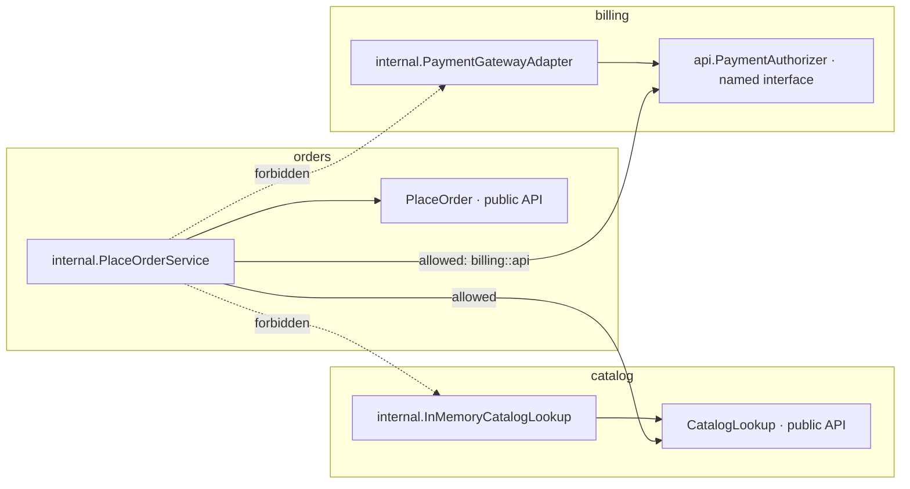
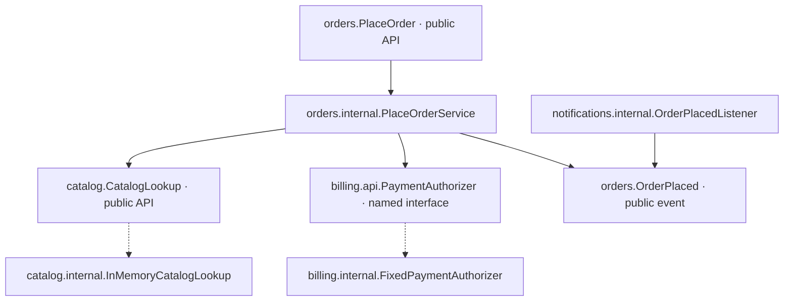
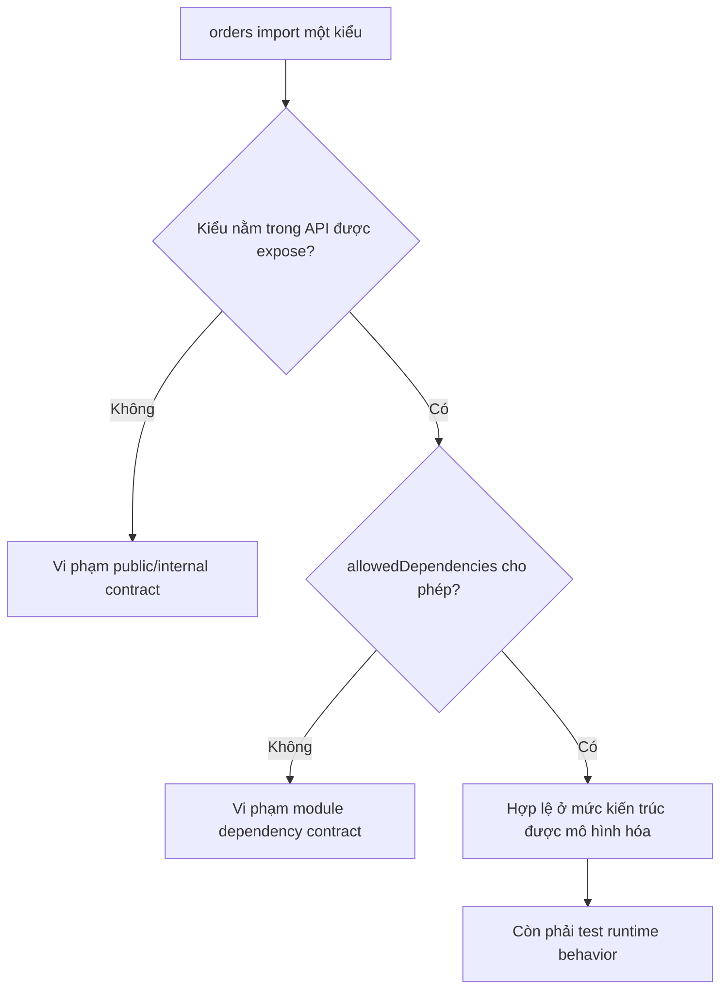

# Hợp đồng package public và package internal

## 1. Vì sao cần một “hợp đồng package” ở cấp module?

Trong Java, từ khóa `public` xác định một lớp, interface hoặc method có thể được mã ở package khác tham chiếu. Nhưng trong **Spring Modulith**, một class Java `public` chưa chắc là **API được phép sử dụng từ application module khác**.

Ví dụ module `catalog` có một adapter `com.example.shop.catalog.internal.JdbcCatalogLookup` được khai báo `public` để phục vụ Spring configuration. Module `orders` hoàn toàn có thể import class đó về mặt cú pháp Java. Tuy nhiên, nếu `orders` làm như vậy, nó đã gắn nghiệp vụ đặt hàng với implementation nội bộ của `catalog`. Đổi JDBC sang HTTP, đổi tên adapter hoặc tái cấu trúc repository sẽ buộc module `orders` sửa theo.

**Hợp đồng package public/internal** trả lời ba câu hỏi:

1. **Phần nào module cam kết công bố?** Bề mặt API được các module khác phép biết và sử dụng.
2. **Phần nào thuộc quyền triển khai riêng?** Service nội bộ, adapter, repository và helper có thể thay đổi mà không kéo theo module khác.
3. **Làm sao kiểm chứng cam kết đó?** Kết hợp quy ước package, `@NamedInterface`, `allowedDependencies`, `ApplicationModules.verify()` và các bài kiểm thử hành vi.

Trong chương **Architectural contracts** của học phần `SPRING_MODULITH_VERIFICATION_TESTING`, mục tiêu không chỉ là “sắp xếp package đẹp”. Ta cần rèn kỹ năng kiểm chứng ranh giới kiến trúc bằng `ApplicationModules`, thực hành `@ApplicationModuleTest` với phạm vi bean đúng, kiểm thử sự kiện/dữ liệu/tích hợp và đưa những quy tắc này vào quality gate CI để ngăn phụ thuộc sai lẫn hồi quy.

**Điểm cần nhớ trước tiên:** *Java visibility* và *Spring Modulith API exposure* là hai lớp quy tắc khác nhau. Một codebase có thể biên dịch thành công nhưng vẫn vi phạm hợp đồng kiến trúc.

## 2. Spring Modulith xác định public/internal như thế nào?

Trong cấu hình mặc định thông dụng, Spring Modulith nhận diện mỗi **package con trực tiếp** của package ứng dụng gốc thành một application module. Phần lớn các kiểu nằm **trực tiếp trong base package của module** được xem là bề mặt API mặc định; các **subpackage** bên dưới được xem là nội bộ, trừ khi chúng được công bố có chủ đích, chẳng hạn qua **named interface**.

Giả sử ứng dụng:

```text
com.example.shop
├── ShopApplication                         // @SpringBootApplication
├── orders/                                 // module orders
│   ├── PlaceOrder.java                     // API công khai mặc định
│   ├── OrderPlaced.java                    // domain event công khai
│   └── internal/
│       ├── PlaceOrderService.java          // implementation nội bộ
│       └── OrderPolicy.java                // policy nội bộ
├── catalog/                                // module catalog
│   ├── CatalogLookup.java                  // API công khai mặc định
│   ├── internal/
│   │   └── InMemoryCatalogLookup.java      // implementation nội bộ
│   └── persistence/
│       └── CatalogRepository.java          // cơ chế dữ liệu nội bộ
├── billing/                                // module billing
│   ├── api/
│   │   ├── package-info.java               // @NamedInterface("api")
│   │   └── PaymentAuthorizer.java           // API được công bố có tên
│   └── internal/
│       └── PaymentGatewayAdapter.java      // implementation nội bộ
└── notifications/                          // module notifications
    └── internal/
        └── OrderPlacedListener.java
```

Trong ví dụ này:

| Đường dẫn | Vai trò mặc định/được khai báo | Module khác có nên phụ thuộc trực tiếp? |
| --- | --- | --- |
| `catalog.CatalogLookup` | API mặc định của `catalog` | **Có**, nếu quan hệ module cho phép |
| `catalog.internal.InMemoryCatalogLookup` | Implementation nội bộ của `catalog` | **Không** |
| `catalog.persistence.CatalogRepository` | Thành phần truy cập dữ liệu nội bộ | **Không** |
| `orders.PlaceOrder` | API của `orders` | **Có**, với module được phép |
| `orders.OrderPlaced` | Event public thuộc `orders` | **Có**, nếu consumer sử dụng đúng contract |
| `orders.internal.PlaceOrderService` | Implementation use case của `orders` | **Không** |
| `billing.api.PaymentAuthorizer` | Named interface `billing::api` | **Có**, khi được cho phép |
| `billing.internal.PaymentGatewayAdapter` | Adapter nội bộ của `billing` | **Không** |

Bảng phản ánh **mô hình module giả định của bài học**, không phải quy tắc Java compiler tự áp dụng. Một dự án có thể tùy biến cách phát hiện module, dùng module type đặc biệt hoặc công bố API theo cách khác. Do đó cần kiểm tra **mô hình thực tế do Spring Modulith nhận diện** khi làm việc với dự án thật.

### 2.1. Sơ đồ boundary



Mũi tên “forbidden” thể hiện một **vi phạm hợp đồng kiến trúc** nếu mã nguồn thực sự tạo phụ thuộc vào implementation internal. Spring không cần chạy hết các bean để phát hiện quan hệ kiểu này; ta dùng `ApplicationModules.verify()`.

## 3. Java `public` không đồng nghĩa public API của module

Xét một implementation của `catalog`:

```java
// src/main/java/com/example/shop/catalog/CatalogLookup.java
package com.example.shop.catalog;

public interface CatalogLookup {
    boolean exists(String sku);
}
```

```java
// src/main/java/com/example/shop/catalog/internal/InMemoryCatalogLookup.java
package com.example.shop.catalog.internal;

import com.example.shop.catalog.CatalogLookup;
import java.util.Set;
import org.springframework.stereotype.Service;

@Service
public class InMemoryCatalogLookup implements CatalogLookup {

    private static final Set<String> KNOWN =
        Set.of("SKU-1", "SKU-2");

    @Override
    public boolean exists(String sku) {
        return KNOWN.contains(sku);
    }
}
```

`InMemoryCatalogLookup` là `public class` vì trong một số tình huống Spring configuration, proxy hoặc các thành phần cùng module cần tham chiếu. Điều đó **không biến `catalog.internal` thành một phần contract công khai của `catalog`**.

Một module khác chỉ nên biết contract:

```java
package com.example.shop.orders.internal;

import com.example.shop.catalog.CatalogLookup;

class CheckProduct {
    private final CatalogLookup catalog;

    CheckProduct(CatalogLookup catalog) {
        this.catalog = catalog;
    }

    boolean accepts(String sku) {
        return catalog.exists(sku);
    }
}
```

Đây là ví dụ về một lớp Java thường; ở sản phẩm thực, nó có thể là bean được đăng ký trong `orders` hoặc một thành phần được use case gọi. Quan trọng là **hướng phụ thuộc đến interface public**, không phải adapter.

### 3.1. Ví dụ chống chỉ định: phụ thuộc vào implementation

```java
// ĐOẠN MÃ CỐ Ý VI PHẠM HỢP ĐỒNG MODULE.
package com.example.shop.orders.internal;

import com.example.shop.catalog.internal.InMemoryCatalogLookup;

class CoupledToCatalogImplementation {

    private final InMemoryCatalogLookup catalog;

    CoupledToCatalogImplementation(
            InMemoryCatalogLookup catalog) {
        this.catalog = catalog;
    }
}
```

Đoạn này có thể **biên dịch** do implementation được khai báo `public`. Nhưng vì `orders` đã tham chiếu subpackage nội bộ của `catalog`, kiểm chứng kiến trúc Spring Modulith cần phát hiện quan hệ bị cấm trong mô hình mặc định của bài.

Không nên “sửa” bằng cách đổi package `internal` thành `api` rồi công bố tất cả adapter. Như vậy ta hợp thức hóa sự phụ thuộc vào chi tiết triển khai thay vì giảm coupling.

### 3.2. Nếu implementation là package-private thì sao?

Nếu `InMemoryCatalogLookup` không có từ khóa `public`, Java compiler cũng sẽ ngăn module khác import class đó từ package khác. Đây là **một lớp bảo vệ bổ sung**, nhưng không đủ để thay thế ranh giới Spring Modulith:

- Một số implementation cần `public` vì cách cấu hình hoặc framework sử dụng.
- Một module có thể dùng public class trong subpackage internal mà Java không cấm.
- Dependency cycle có thể hình thành dù toàn bộ tham chiếu đều là Java-public API.

Vì vậy kết hợp **thiết kế visibility trong Java** và **architecture verification** thường tốt hơn chỉ dựa vào một trong hai.

## 4. Thiết kế API tối thiểu: facade ở base package, implementation ở `internal`

Một phương pháp hữu ích là giữ base package của module tương đối nhỏ: interface/cổng công khai, DTO cần thiết, event type ổn định. Logic/adapter có thể nằm ở subpackage nội bộ.

Ví dụ `orders` công bố contract:

```java
// src/main/java/com/example/shop/orders/PlaceOrder.java
package com.example.shop.orders;

public interface PlaceOrder {

    String place(
        String orderId, String sku,
        int quantity, long amountCents);
}
```

Và một event được phép sử dụng bởi các module khác:

```java
// src/main/java/com/example/shop/orders/OrderPlaced.java
package com.example.shop.orders;

public record OrderPlaced(
    String orderId,
    String sku,
    int quantity,
    long amountCents) {
}
```

Use case thực thi contract nằm trong `orders.internal`:

```java
// src/main/java/com/example/shop/orders/internal/OrderPolicy.java
package com.example.shop.orders.internal;

import org.springframework.stereotype.Component;

@Component
public class OrderPolicy {

    public void validate(
            String orderId, String sku,
            int quantity, long amountCents) {
        if (orderId == null || orderId.isBlank()) {
            throw new IllegalArgumentException(
                "Order ID is required");
        }
        if (sku == null || sku.isBlank()) {
            throw new IllegalArgumentException(
                "SKU is required");
        }
        if (quantity <= 0 || amountCents <= 0) {
            throw new IllegalArgumentException(
                "Quantity and amount must be positive");
        }
    }
}
```

Ở phần sau, `PlaceOrderService` sẽ triển khai `PlaceOrder`. Một module hoặc controller khác **chỉ inject `PlaceOrder`**, không tạo dependency tới `orders.internal.PlaceOrderService`.

Điều này tạo ra hai lợi ích:

1. Có thể thay đổi implementation nội bộ mà không đổi kiểu contract ngoài module.
2. Bài test có thể inject API công khai, nhưng vẫn kiểm thử logic thật bên trong module thay vì chỉ mock facade.

**Không phải mọi class ở base package đều nhất thiết phải được các module khác dùng**. Đây là bề mặt mà mô hình mặc định coi là được expose. Vì vậy mỗi kiểu được đặt vào đó cần là một quyết định có chủ đích.

## 5. Public API có thể là event, không chỉ service interface

Trong hệ thống modulith, module nguồn thường muốn phát sự kiện để module nhận phản ứng mà **không phụ thuộc ngược** vào implementation của module nhận.

`orders.OrderPlaced` là một API sự kiện được module `orders` sở hữu. Module `notifications` có thể tham chiếu kiểu này:

```java
// src/main/java/com/example/shop/notifications/internal/OrderPlacedListener.java
package com.example.shop.notifications.internal;

import com.example.shop.orders.OrderPlaced;
import org.springframework.modulith.events.ApplicationModuleListener;
import org.springframework.stereotype.Component;

@Component
public class OrderPlacedListener {

    @ApplicationModuleListener
    public void on(OrderPlaced event) {
        // Trong dự án thực: gọi NotificationPort,
        // ghi trạng thái hoặc phát thông báo phù hợp.
    }
}
```

Đoạn listener minh họa cách **module nhận phụ thuộc vào event type công khai của module nguồn**. Nó chưa có assertion, cơ chế gửi thông báo hoặc hạ tầng transaction đầy đủ. Trong một integration test thực, cần đảm bảo listener có mặt, các dependency được cung cấp, và có kiểm tra kết quả xử lý.

Lưu ý quan hệ:

- `notifications → orders`: module nhận biết contract `OrderPlaced`.
- `orders` **không cần** import `notifications.internal.OrderPlacedListener` hoặc gọi trực tiếp `EmailSender` của `notifications`.

Đặt `OrderPlaced` vào `orders.internal` sẽ làm consumer phải phụ thuộc vào package không được công bố. Nếu sự kiện được sử dụng xuyên module, nó nên nằm ở API của module hoặc một named interface được thiết kế cho sự kiện.

### 5.1. Hợp đồng sự kiện còn có ngữ nghĩa

Công khai một record chưa đủ. Consumer còn cần biết:

- Khi nào event được phát: trước hay sau khi đơn được chấp nhận?
- `amountCents` biểu thị đơn vị gì, có thể âm không?
- Event có thể được gửi lặp khi retry không?
- Khi nào listener được gọi: cùng transaction, sau commit hay bất đồng bộ?
- Nếu schema thay đổi, consumer cũ có tiếp tục đọc được không?

`ApplicationModules.verify()` bảo vệ **đường tham chiếu kiểu Java** giữa các module; `PublishedEvents` và integration test bảo vệ **hành vi thực tế** của event.

## 6. Named interface: công bố một package con có chủ đích

Có những module cần nhiều nhóm API khác nhau. Ví dụ `billing` công bố một nhóm API cho authorization, trong khi để các subpackage khác nội bộ.

Spring Modulith hỗ trợ `@NamedInterface` để **expose một package con với tên cụ thể**.

Tạo file `package-info.java`:

```java
// src/main/java/com/example/shop/billing/api/package-info.java
@org.springframework.modulith.NamedInterface("api")
package com.example.shop.billing.api;
```

Rồi định nghĩa contract ở package đó:

```java
// src/main/java/com/example/shop/billing/api/PaymentAuthorizer.java
package com.example.shop.billing.api;

public interface PaymentAuthorizer {
    boolean authorize(String orderId, long amountCents);
}
```

Tên `api` tạo thành named interface `billing::api` trong mô hình module. Nó có ý nghĩa đối với những module muốn giới hạn chính xác phần API được phép dùng.

Implementation có thể nằm tại:

```java
// src/main/java/com/example/shop/billing/internal/FixedPaymentAuthorizer.java
package com.example.shop.billing.internal;

import com.example.shop.billing.api.PaymentAuthorizer;
import org.springframework.stereotype.Service;

@Service
public class FixedPaymentAuthorizer implements PaymentAuthorizer {

    @Override
    public boolean authorize(
            String orderId, long amountCents) {
        // Chỉ minh họa implementation; không gọi payment thật.
        return amountCents > 0;
    }
}
```

**Không được suy rằng tên folder `api` tự động là named interface theo ý định kiến trúc của mọi dự án.** Với cách khai báo trên, annotation trong `package-info.java` chính là dấu hiệu công bố rõ ràng.

### 6.1. Khi nào nên dùng named interface?

- Module có nhiều API được công bố cho các nhóm consumer khác nhau.
- Muốn tách API sự kiện (ví dụ `billing.events`) và API command (ví dụ `billing.api`).
- Cần dùng `allowedDependencies` để cấp quyền tới **một phần cụ thể** của module.
- Muốn tránh dồn quá nhiều kiểu vào base package.

### 6.2. Khi nào không nên dùng?

- Đổi tên `internal` thành `api` chỉ để bài `verify()` không fail.
- Công bố repository, ORM entity và HTTP client nội bộ cho mọi module dùng trực tiếp.
- Tạo quá nhiều named interface mà không có consumer hoặc trách nhiệm rõ ràng.
- Dùng named interface để che một vòng phụ thuộc đáng lẽ cần tái thiết kế.

Named interface làm **hợp đồng rõ ràng hơn**, không tự bảo đảm giao tiếp runtime thành công.

## 7. Khóa hướng phụ thuộc bằng `allowedDependencies`

Ngay cả khi `catalog` có public API, điều đó không có nghĩa mọi module luôn được phép gọi `catalog`. Khi kiến trúc cần chặt chẽ hơn, Spring Modulith cho phép khai báo ràng buộc về module được phép phụ thuộc.

Ví dụ trong base package `orders`:

```java
// src/main/java/com/example/shop/orders/package-info.java
@org.springframework.modulith.ApplicationModule(
    allowedDependencies = {
        "catalog",
        "billing::api"
    }
)
package com.example.shop.orders;
```

Ý nghĩa:

- `orders` được phụ thuộc bề mặt API của `catalog` phù hợp với mô hình mặc định.
- `orders` được phụ thuộc named interface `api` của `billing`.
- `orders` không được tự do gọi internal của `billing`.
- Một dependency mới từ `orders` sang `notifications` không nằm trong danh sách này cần được xem lại.

Lưu ý: tên module `catalog`, `billing` và named interface `api` phải khớp mô hình module thực tế; không chỉ dựa vào cách viết tên thư mục trong tài liệu.

**`allowedDependencies` là quy tắc source-level/architecture, không phải cấu hình Spring DI.** Nó không tạo `CatalogLookup`, không bật `billing` trong một bài `STANDALONE` và không cung cấp payment provider.

### 7.1. Phân biệt hai kiểu lỗi

| Tình huống | Loại lỗi | Cách sửa phù hợp |
| --- | --- | --- |
| `orders` gọi `billing.api.PaymentAuthorizer` nhưng module test thiếu bean implementation | **Runtime wiring / bootstrap scope** | Mock/fake port hoặc chạy dependency thật theo mục tiêu test |
| `orders` gọi thẳng `billing.internal.FixedPaymentAuthorizer` | **Vi phạm package contract** | Đổi sang `PaymentAuthorizer` thuộc named interface |
| `orders` gọi `notifications.internal.EmailSender` | **Vi phạm internal API và có thể vi phạm allowed dependencies** | Đổi hướng tương tác hoặc dùng event/contract phù hợp |
| `orders` và `billing` phụ thuộc hai chiều | **Kiến trúc có vòng** | Tái thiết kế chiều phụ thuộc |
| `PaymentAuthorizer` bean tồn tại nhưng remote service lỗi | **Runtime/integration** | Kiểm tra adapter, property, network/test server |

Không được đổi `allowedDependencies` để “sửa” một `NoSuchBeanDefinitionException` nếu các module được phép phụ thuộc đã đúng. Ngược lại, không được thêm `@MockitoBean` để “sửa” một import trực tiếp vào package internal.

## 8. Ví dụ use case thật tuân thủ cả hai hợp đồng

Ta đã có `PlaceOrder` và `OrderPlaced` tại public API của `orders`, `CatalogLookup` ở public API của `catalog`, `PaymentAuthorizer` trong named interface `billing::api`.

Implementation `PlaceOrderService`:

```java
// src/main/java/com/example/shop/orders/internal/PlaceOrderService.java
package com.example.shop.orders.internal;

import com.example.shop.billing.api.PaymentAuthorizer;
import com.example.shop.catalog.CatalogLookup;
import com.example.shop.orders.OrderPlaced;
import com.example.shop.orders.PlaceOrder;
import org.springframework.context.ApplicationEventPublisher;
import org.springframework.stereotype.Service;

@Service
public class PlaceOrderService implements PlaceOrder {

    private final OrderPolicy policy;
    private final CatalogLookup catalog;
    private final PaymentAuthorizer billing;
    private final ApplicationEventPublisher events;

    public PlaceOrderService(
            OrderPolicy policy,
            CatalogLookup catalog,
            PaymentAuthorizer billing,
            ApplicationEventPublisher events) {
        this.policy = policy;
        this.catalog = catalog;
        this.billing = billing;
        this.events = events;
    }

    @Override
    public String place(
            String orderId, String sku,
            int quantity, long amountCents) {

        policy.validate(
            orderId, sku, quantity, amountCents);

        if (!catalog.exists(sku)) {
            throw new IllegalArgumentException(
                "Unknown SKU: " + sku);
        }

        if (!billing.authorize(orderId, amountCents)) {
            throw new IllegalStateException(
                "Payment not authorized");
        }

        events.publishEvent(new OrderPlaced(
            orderId, sku, quantity, amountCents));

        return "PLACED:" + orderId;
    }
}
```

Trong đoạn này:

1. `orders.internal.PlaceOrderService` triển khai **interface public `orders.PlaceOrder`**.
2. Chính module `orders` được phép sử dụng lớp implementation nội bộ của mình.
3. Các dependency xuyên module đều qua **`catalog.CatalogLookup`** và **`billing.api.PaymentAuthorizer`**.
4. Không có import trực tiếp tới `catalog.internal`, `billing.internal` hoặc `notifications`.
5. `OrderPlaced` là event public; module nhận có thể import event type theo dependency direction hợp lệ.

Quan hệ kiến trúc có chủ đích:



Sơ đồ mô tả chiều tương tác và quan hệ contract, không có nghĩa mọi implementation tự được nạp trong `@ApplicationModuleTest`.

## 9. Kiểm chứng hợp đồng package bằng `ApplicationModules.verify()`

Bước bảo vệ quan trọng nhất là một architecture test độc lập với Spring Boot `ApplicationContext`.

```java
// src/main/java/com/example/shop/ShopApplication.java
package com.example.shop;

import org.springframework.boot.SpringApplication;
import org.springframework.boot.autoconfigure.SpringBootApplication;

@SpringBootApplication
public class ShopApplication {

    public static void main(String[] args) {
        SpringApplication.run(ShopApplication.class, args);
    }
}
```

```java
// src/test/java/com/example/shop/ModuleArchitectureTest.java
package com.example.shop;

import org.junit.jupiter.api.Test;
import org.springframework.modulith.core.ApplicationModules;

class ModuleArchitectureTest {

    @Test
    void verifiesPublicAndInternalContracts() {
        ApplicationModules.of(ShopApplication.class).verify();
    }
}
```

Spring Modulith phân tích mô hình application module của `ShopApplication` và kiểm tra các quy tắc kiến trúc được mô hình hóa, bao gồm các dependency vượt ranh giới internal hoặc `allowedDependencies` khi được khai báo. Phép kiểm chứng cũng giúp phát hiện quan hệ vòng giữa các module.

**Không cần khởi động PostgreSQL, Kafka hoặc gửi HTTP request** để chạy phép kiểm tra kiến trúc này. Nó phân tích dependency trong code, không xác minh hành vi của từng adapter ngoài JVM.

### 9.1. Ví dụ một regression cần bị chặn

Ban đầu `PlaceOrderService` dùng:

```java
import com.example.shop.catalog.CatalogLookup;
```

Sau refactor, một developer đổi sang:

```java
// CỐ Ý SAI: code Java có thể compile,
// nhưng vi phạm internal package boundary.
import com.example.shop.catalog.internal.InMemoryCatalogLookup;
```

Nếu class internal được khai báo Java-public, compiler có thể cho phép. Kiểm tra kiến trúc phải trở thành **quality gate chặn thay đổi này**.

Không nên cho qua bằng cách public hóa `catalog.internal`. Phải khôi phục phụ thuộc vào `CatalogLookup` và để module `catalog` sở hữu implementation.

### 9.2. Điều `verify()` không chứng minh

| Phép kiểm chứng tĩnh có thể bảo vệ | Phần vẫn cần runtime/integration test |
| --- | --- |
| Quan hệ dependency từ `orders` đến API được phép | Bean `CatalogLookup` thực sự được đăng ký |
| Không phụ thuộc implementation `catalog.internal` | `InMemoryCatalogLookup` hoặc JDBC adapter hoạt động đúng |
| Không có module cycle theo quy tắc | Transaction và listener không bị deadlock/lỗi xử lý |
| Ràng buộc `allowedDependencies` | HTTP provider hoặc database có sẵn |
| Sử dụng named interface đúng | DTO/event serialization và semantic compatibility |

Phát biểu “`ApplicationModules.verify()` xanh nên mọi contract đều đúng” là không chính xác; kiến trúc chỉ là **một lớp bằng chứng**.

## 10. `@ApplicationModuleTest` xác minh API hành vi, không thay architecture test

Một test kiến trúc phát hiện `orders` có phụ thuộc hợp lệ. Nhưng nó không biết `PlaceOrderService` có validate số lượng đúng, gọi payment đúng hoặc phát event với payload chuẩn hay không.

Ta cần module behavior test giữ `PlaceOrderService` và `OrderPolicy` thật, chỉ thay implementation của những module khác bằng mock:

```java
// src/test/java/com/example/shop/orders/PlaceOrderContractTest.java
package com.example.shop.orders;

import com.example.shop.billing.api.PaymentAuthorizer;
import com.example.shop.catalog.CatalogLookup;
import org.junit.jupiter.api.Test;
import org.springframework.beans.factory.annotation.Autowired;
import org.springframework.modulith.test.ApplicationModuleTest;
import org.springframework.modulith.test.PublishedEvents;
import org.springframework.test.context.bean.override.mockito.MockitoBean;

import static org.assertj.core.api.Assertions.assertThat;
import static org.assertj.core.api.Assertions.assertThatThrownBy;
import static org.mockito.BDDMockito.given;
import static org.mockito.Mockito.verifyNoInteractions;

@ApplicationModuleTest
class PlaceOrderContractTest {

    @Autowired
    PlaceOrder orders; // Public API type, implementation thật.

    @MockitoBean
    CatalogLookup catalog;

    @MockitoBean
    PaymentAuthorizer billing;

    @Test
    void placesOrderAndPublishesEvent(
            PublishedEvents events) {

        given(catalog.exists("SKU-1")).willReturn(true);
        given(billing.authorize("ORD-1", 12000))
            .willReturn(true);

        String result = orders.place(
            "ORD-1", "SKU-1", 2, 12000);

        assertThat(result).isEqualTo("PLACED:ORD-1");

        assertThat(events.ofType(OrderPlaced.class))
            .anySatisfy(event -> {
                assertThat(event.orderId())
                    .isEqualTo("ORD-1");
                assertThat(event.sku())
                    .isEqualTo("SKU-1");
                assertThat(event.quantity())
                    .isEqualTo(2);
                assertThat(event.amountCents())
                    .isEqualTo(12000);
            });
    }

    @Test
    void refusesInvalidInputBeforeCallingOtherModules(
            PublishedEvents events) {

        assertThatThrownBy(() ->
            orders.place("ORD-2", "SKU-1", 0, 12000))
            .isInstanceOf(IllegalArgumentException.class);

        verifyNoInteractions(catalog, billing);
        assertThat(events.ofType(OrderPlaced.class))
            .isEmpty();
    }

    @Test
    void doesNotPublishEventWhenPaymentFails(
            PublishedEvents events) {

        given(catalog.exists("SKU-1")).willReturn(true);
        given(billing.authorize("ORD-3", 12000))
            .willReturn(false);

        assertThatThrownBy(() ->
            orders.place("ORD-3", "SKU-1", 2, 12000))
            .isInstanceOf(IllegalStateException.class);

        assertThat(events.ofType(OrderPlaced.class))
            .isEmpty();
    }
}
```

Giải thích:

- `@ApplicationModuleTest` ở package `orders` mặc định dùng `STANDALONE`.
- Service và policy **ở subpackage internal của chính `orders`** vẫn được bootstrap như bean nghiệp vụ của module đích.
- Mockito bean overrides `CatalogLookup` và `PaymentAuthorizer` thuộc module ngoài; không cần nạp adapter thật của `catalog`/`billing`.
- Test inject **`PlaceOrder`**, tức API mà consumer của module thực sự nhìn thấy.
- `PublishedEvents` xác nhận event đã phát hoặc không phát; không tự xác nhận listener `notifications` xử lý xong.

**Lưu ý phiên bản:** `@MockitoBean` có từ Spring Framework 6.2; trên stack Spring Boot cũ có thể phải dùng `@MockBean`. Annotation `@MockBean` của Spring Boot đã deprecated từ Boot 3.4. Chọn API đúng với phiên bản Spring Boot/Spring Modulith của dự án.

Việc mock các API ngoài module không khiến quy tắc package mất ý nghĩa. Nó chỉ tách **hành vi của module `orders`** khỏi implementation khác khi test đang ở cấp unit/module.

## 11. Package internal vẫn được bootstrap trong module test của chính module đó

Đây là một hiểu nhầm rất phổ biến: “`internal` nghĩa là Spring bỏ qua bean ấy”.

Thực tế, trong thiết kế này:

```text
orders/
├── PlaceOrder.java                   // API contract
├── OrderPlaced.java                  // public event
└── internal/
    ├── PlaceOrderService.java        // @Service, bean thật
    └── OrderPolicy.java              // @Component, bean thật
```

`PlaceOrderService` và `OrderPolicy` thuộc **application module `orders`**. Một `@ApplicationModuleTest` kiểm thử `orders` thường cần chính các bean này được tạo để thực thi use case. “Internal” chỉ mô tả **khả năng truy cập hợp lệ từ module khác**, không phải cơ chế @Profile hay exclude filter.

Ngược lại, `catalog.internal.InMemoryCatalogLookup` là internal của module `catalog`. Với test `orders` ở `STANDALONE`, implementation ấy thường **không nằm trong phạm vi module nghiệp vụ được bootstrap**, dù type Java của nó là `public`.

| Thành phần trong test `orders` | Dự kiến |
| --- | --- |
| `orders.PlaceOrder` | API được inject, implementation thuộc `orders` |
| `orders.internal.PlaceOrderService` | Bean thật của module đích |
| `orders.internal.OrderPolicy` | Bean thật của module đích |
| `catalog.CatalogLookup` | Có thể được cung cấp bằng mock/fake test |
| `catalog.internal.InMemoryCatalogLookup` | Không tự nạp trong `STANDALONE` |
| `billing.internal.FixedPaymentAuthorizer` | Không tự nạp trong `STANDALONE` |
| `ApplicationEventPublisher` | Spring Framework infrastructure có trong context |
| `notifications.internal.OrderPlacedListener` | Không tự nạp nếu module `notifications` ngoài scope |

Các yếu tố như `@Import`, `@TestConfiguration`, custom component scan, bean override và auto-configuration có thể thay đổi bean thực tế. Bảng mô tả **một cấu hình test bình thường**, không phải đảm bảo tuyệt đối trong mọi ứng dụng.

## 12. Hợp đồng package và hợp đồng dependency là hai phép kiểm khác nhau

Một module có thể chỉ dùng public API nhưng vẫn phụ thuộc **sai module**.

Ví dụ `orders` gọi `marketing.NewsletterSender` (giả định nằm trực tiếp ở base package public của `marketing`). Java public và Spring Modulith API exposure của kiểu đó có thể đều hợp lệ theo quy ước mặc định. Nhưng nếu `orders` chỉ được phép phụ thuộc `catalog` và `billing::api`, quan hệ mới vẫn vi phạm `allowedDependencies`.

Ta cần kiểm tra cả:

1. **Bề mặt được truy cập:** public/base package, named interface hay internal?
2. **Đích được phép:** module source có được phụ thuộc module target/named interface đó không?



“Kiểu ở API public” là điều kiện cần nhưng **chưa đủ** khi có danh sách dependency được phép.

## 13. Hợp đồng package còn bao gồm kiểu trong method signature

Một số API trông có vẻ public nhưng **lộ implementation type** trong chữ ký phương thức:

```java
// ANTI-PATTERN: interface ở package API của catalog
// nhưng kiểu trả về lại nằm trong internal.
package com.example.shop.catalog;

import com.example.shop.catalog.internal.CatalogRowEntity;

public interface CatalogService {
    CatalogRowEntity findOne(String sku);
}
```

Đoạn này là **ví dụ chống chỉ định** và giả định `CatalogRowEntity` là class Java public nằm trong `catalog.internal`. Nếu module consumer muốn sử dụng kết quả, nó phải biết ORM entity nội bộ. Điều đó tạo coupling dù interface bề ngoài nằm ở base package công khai.

Thay bằng một contract DTO không phụ thuộc JPA:

```java
// src/main/java/com/example/shop/catalog/ProductSummary.java
package com.example.shop.catalog;

public record ProductSummary(
    String sku,
    String displayName,
    boolean available) {
}
```

```java
// src/main/java/com/example/shop/catalog/ProductReader.java
package com.example.shop.catalog;

import java.util.Optional;

public interface ProductReader {
    Optional<ProductSummary> findOne(String sku);
}
```

**Phân biệt:** `ProductSummary` nằm trong module `catalog` nhưng là một kiểu API; entity JPA có thể được giữ trong `catalog.persistence`. Mapping từ entity sang DTO là trách nhiệm nội bộ của `catalog`.

### Những vị trí khác có thể làm lộ internal

- Parameter type và return type của method public.
- Generic type như `List<InternalEntity>`.
- Exception type mà consumer cần bắt/giải thích.
- Annotation hoặc constant khiến consumer phải import internal.
- Event payload dùng một kiểu internal.
- API callback nhận hoặc trả về infrastructure implementation.

`ApplicationModules.verify()` có thể phát hiện nhiều phụ thuộc kiểu Java vượt boundary, nhưng **đánh giá tính ổn định ngữ nghĩa** của DTO, exception và event vẫn cần review cùng test hành vi.

## 14. Data ownership: package `internal` không chỉ là chuyện tên gọi

Giả sử `catalog.persistence.CatalogRepository` và `catalog.persistence.CatalogRowEntity` nằm dưới subpackage internal. Nếu module `orders` trực tiếp import `CatalogRepository` để sửa tồn kho, nó đang:

1. Phụ thuộc vào schema và implementation của `catalog`.
2. Vượt qua validation/invariant do `catalog` sở hữu.
3. Dễ tạo transaction coupling giữa hai module.
4. Biến một thay đổi schema nội bộ thành breaking change xuyên module.

Public API của `catalog` có thể cung cấp một use case như `InventoryReservation`, hoặc phát event và phối hợp theo thiết kế. Không nhất thiết công khai repository.

### 14.1. Kiểm tra kiến trúc không thay kiểm tra SQL

Ví dụ `orders` dùng `JdbcTemplate` với SQL dạng chuỗi để sửa bảng `catalog_products` mà không import class của `catalog`. Kiểm tra dependency dựa trên kiểu Java có thể **không nhận ra quyền sở hữu dữ liệu bị vi phạm**:

```java
// Ví dụ chống chỉ định trong module orders:
jdbcTemplate.update(
    "UPDATE catalog_products SET stock = stock - 1 WHERE sku = ?",
    sku);
```

Để bảo vệ hợp đồng dữ liệu, ngoài `ApplicationModules.verify()` còn có thể cần:

- Review quyền sở hữu repository/schema.
- Integration test với database thật và ràng buộc transaction.
- Quyền truy cập database, schema separation hoặc rule bổ sung nếu áp dụng.
- Kiểm tra migration, SQL, JPA mapping và data consistency.

Chỉ dùng Mockito mock `CatalogRepository` không chứng minh những quy tắc này.

## 15. Event API: public ở source nhưng có thể breaking ở runtime

Với `orders.OrderPlaced`, consumer `notifications` có thể compile khi đang cùng version source. Tuy nhiên, nếu event được externalize qua broker, consumer ngoài JVM có thể chạy version khác.

Những thay đổi cần được xem là thay đổi hợp đồng:

| Thay đổi | Rủi ro |
| --- | --- |
| Đổi tên event hoặc package công khai | Consumer Java không còn tham chiếu được |
| Đổi tên/xóa field trong record | Consumer deserialization/logic bị lỗi |
| Đổi ý nghĩa `amountCents` sang đơn vị khác | Sai số tiền dù code compile |
| Phát event trước khi payment được chấp nhận | Listener nhận thông báo cho đơn chưa hợp lệ |
| Consumer không idempotent | Retry/duplicate event có thể gây gửi email hai lần |

`@ApplicationModuleTest` với `PublishedEvents` kiểm tra điều kiện phát và payload. Một integration test riêng cần kiểm tra listener thực tế, transaction/async và khả năng deserialize khi cần. Nếu dùng broker, contract về serialization và versioning cần được kiểm tra theo định dạng truyền thực.

**Không suy rằng event đã phát là listener đã xử lý xong.** Spring Modulith Test có thể dùng `Scenario` để kiểm tra điều kiện hoàn tất với timeout trong các bài listener test tương ứng.

## 16. Migration: chuyển từ “mọi class public” sang API module rõ ràng

Một codebase cũ có thể chứa package sau:

```text
com.example.shop.catalog
├── CatalogService.java
├── CatalogRepository.java
├── CatalogEntity.java
├── CatalogRestClient.java
├── CatalogDTO.java
└── CatalogScheduler.java
```

Nếu tất cả trực tiếp ở base package, mô hình mặc định có thể coi quá nhiều kiểu là **bề mặt API**. Cách làm bền vững là phân loại theo trách nhiệm thay vì đổi package ồ ạt:

| Loại | Vị trí đề xuất |
| --- | --- |
| Interface use case mà module khác cần | `catalog.CatalogLookup` |
| DTO/record contract | `catalog.ProductSummary` |
| Domain event được module khác dùng | `catalog.ProductChanged` hoặc named interface cho events |
| Service implementation | `catalog.internal.CatalogLookupService` |
| JPA entity và repository | `catalog.persistence` (internal) |
| HTTP client, Kafka adapter | `catalog.integration` hoặc `catalog.internal.adapter` |
| Scheduled job chỉ chạy trong module | `catalog.internal.job` |

Quy trình migration an toàn:

1. **Kiểm kê dependencies thực tế**: module nào đang import các kiểu ở `catalog`?
2. **Xác định các contract cần giữ ổn định**: use case, DTO và event.
3. **Đưa implementation vào internal** hoặc thu hẹp visibility khi phù hợp.
4. **Sửa consumer** phụ thuộc interface/DTO thay vì entity/adapter.
5. **Khai báo named interface** cho nhóm API con thật sự cần công bố.
6. **Thêm `allowedDependencies`** khi đã thống nhất chiều phụ thuộc.
7. **Chạy `ApplicationModules.verify()`** để thấy những vi phạm còn lại.
8. **Chạy module behavior/integration tests** để phát hiện hồi quy runtime do đổi bean scan/configuration.
9. **Thực hiện migration tương thích** nếu public API, event hoặc schema cần thay đổi nhiều bước.

Một việc cần tránh: di chuyển class ở base package sang `internal` nhưng quên rằng Spring Data entity/repository scanning, `@Import` hoặc test configuration đang dựa trên package path. Architecture test có thể xanh, nhưng context test/ứng dụng có thể fail vì bean không còn được đăng ký đúng. Phải có cả kiểm tra tĩnh và runtime.

## 17. Ranh giới Java compiler, Spring Modulith và runtime

| Kiểm tra | Chặn được | Không tự chặn được |
| --- | --- | --- |
| Java compiler/package-private | Import class không public từ package khác; sai chữ ký kiểu | Java-public implementation được truy cập từ module khác |
| `ApplicationModules.verify()` | Vi phạm ranh giới module, internal package, allowed dependency, cycle được mô hình hóa | Logic nghiệp vụ sai, query SQL dạng chuỗi hay mất kết nối broker |
| `@ApplicationModuleTest` | Bean wiring trong scope và hành vi theo assertion | Mọi phụ thuộc kiến trúc tĩnh nếu không có `verify()` |
| `@DataJpaTest`/JPA integration | Mapping, repository, query, transaction theo test | Package architecture của toàn hệ thống |
| Event/adapter integration test | Listener, serialization, messaging theo scenario | Tất cả đường import internal trong source |

Đừng kỳ vọng một công cụ duy nhất bảo vệ toàn bộ hợp đồng. **Cách phối hợp** mới là phần quan trọng của verification & testing.

## 18. Quality gate CI: giữ hợp đồng public/internal không bị trôi

Một pipeline có thể tách ba lớp kiểm chứng:

1. **Architecture:** chạy `ModuleArchitectureTest` với `ApplicationModules.verify()` cho mọi thay đổi code liên quan.
2. **Module behavior:** chạy `@ApplicationModuleTest` tại các module quan trọng; service/policy thật, mock/fake đúng API ngoài module.
3. **Integration contracts:** chạy repository/JPA, event listener, web, messaging và một số use case liên module chọn lọc với hạ tầng test phù hợp.

```text
Pull request
  ├── Compile + unit tests
  ├── ModuleArchitectureTest
  │     └── ApplicationModules.verify()
  ├── PlaceOrderContractTest
  │     └── @ApplicationModuleTest, PublishedEvents
  └── Adapter contracts quan trọng

Integration / trước phát hành
  ├── JPA + migration + database tests
  ├── Event consumer / messaging tests
  └── Các luồng liên module rủi ro cao
```

Không phải mọi dự án đều cần cùng một lịch chạy integration test, nhưng architecture gate và behavior tests cốt lõi nên được đưa vào **đường kiểm tra bắt buộc** thay vì chỉ chạy thủ công.

### 18.1. Code review cần tìm gì?

- Một `import ...internal...` mới từ module khác.
- Interface public trả về DTO/entity nội bộ.
- Thêm `@NamedInterface` chỉ để làm một vi phạm biến mất.
- Thêm tên module vào `allowedDependencies` mà không giải thích use case.
- Một public event type bị dời vào subpackage không công bố.
- Repository của module khác bị tiêm trực tiếp vào service.
- Đổi base package hoặc cách nhận diện module.
- Test tăng `BootstrapMode` hoặc import production configuration rộng chỉ để tránh thiếu bean.
- Architecture test bị bỏ khỏi pipeline hoặc bị disable.

Kết quả tốt không phải mọi package đều “cấm” hết, mà là mỗi lối truy cập công khai có lý do, hợp đồng và test tương ứng.

## 19. Chẩn đoán các lỗi thường gặp

| Triệu chứng | Nguyên nhân cần xem | Hành động phù hợp |
| --- | --- | --- |
| `verify()` báo dependency vào `catalog.internal` | Consumer import implementation/DTO internal | Đổi sang public API hoặc named interface đúng nghĩa |
| `verify()` báo dependency không được phép | `allowedDependencies` không cho chiều dependency | Thiết kế lại hướng tương tác hoặc cập nhật hợp đồng có chủ đích |
| Java compiler báo class không public | Package-private class bị tham chiếu từ package khác | Dùng public API, không đơn giản nâng visibility của internal |
| `@ApplicationModuleTest` thiếu `CatalogLookup` | `STANDALONE` không nạp implementation module khác | `@MockitoBean`/fake, hoặc mode integration phù hợp |
| Test `orders` không thấy `PlaceOrderService` | Component scan/profile/bean condition của module đích | Kiểm tra stereotype, vị trí package và config |
| Đã có mock `PaymentAuthorizer` nhưng test logic sai | Mock chỉ mô phỏng collaborator, service/policy có lỗi | Giữ implementation module đích thật, bổ sung assertion |
| Integration test JPA fail sau khi đổi package | Entity/repository scan hoặc mapping sai | Kiểm tra Spring Data/JPA config và migration |
| `PublishedEvents` có event nhưng listener không chạy | Consumer nằm ngoài module scope, transaction/async | Test listener thật với điều kiện hoàn tất |
| CI pass nhưng consumer ngoài JVM lỗi deserialize | Chỉ có kiểm tra Java-level event | Thêm schema/serialization compatibility test |

### 19.1. Một quy trình debug ngắn

1. **Lỗi đến từ đâu?** Compile, architecture verify, bootstrap bean hay runtime assertion?
2. **Kiểu được dùng thuộc module nào?** Base public, named interface hay internal?
3. **Chiều phụ thuộc có được phép?** Đọc `allowedDependencies` hoặc mô hình module.
4. **Bean runtime có cần thật không?** Chọn mock/fake cho behavior; adapter thật cho integration.
5. **Tác động lan truyền là gì?** Event/DTO/schema, listener, persistence và CI.
6. **Có test phản chứng không?** Vi phạm boundary phải làm architecture test đỏ; thay đổi logic phải làm behavior test đỏ.

## 20. Bài tập tình huống: thiết kế lại ranh giới bị rò rỉ

### Đề bài

Module `orders` đang có code:

```java
// Ý tưởng code hiện tại, cố ý sai module boundary.
package com.example.shop.orders.internal;

import com.example.shop.catalog.internal.InMemoryCatalogLookup;

class CheckoutFacade {

    private final InMemoryCatalogLookup catalog;

    CheckoutFacade(InMemoryCatalogLookup catalog) {
        this.catalog = catalog;
    }

    boolean canCheckout(String sku) {
        return catalog.exists(sku);
    }
}
```

Sau một đợt refactor `catalog` đổi implementation từ in-memory sang JDBC, test `orders` bắt đầu lỗi. Nhóm phát triển đề xuất:

- Công bố `catalog.internal` thành named interface.
- Dùng `@Import` implementation cũ trong test `orders`.
- Đổi tất cả `@ApplicationModuleTest` sang `ALL_DEPENDENCIES`.

### Phân tích

Cả ba đề xuất đều không giải quyết đúng gốc nếu yêu cầu của `orders` chỉ là **biết SKU có tồn tại hay không**.

Phương án tốt hơn:

1. Sử dụng contract `catalog.CatalogLookup` đã công bố.
2. Đổi constructor của `CheckoutFacade` sang nhận `CatalogLookup`.
3. Trong module test `STANDALONE`, dùng `@MockitoBean CatalogLookup` hoặc fake có chủ đích.
4. Kiểm thử adapter JDBC thật tại module `catalog` với database test.
5. Chạy `ApplicationModules.verify()` trong CI để cấm regression import `catalog.internal`.
6. Chỉ mở rộng bootstrap khi có kịch bản integration thật cần cả hai module.

Một module không cần biết implementation làm bằng JDBC, HTTP hay in-memory. Đó chính là **lợi ích của hợp đồng package public/internal**.

## 21. Bài tập tự kiểm tra

Ứng dụng `shop` có các module `orders`, `catalog`, `billing` và `notifications`. `orders` được phép phụ thuộc `catalog` và `billing::api`; `billing.api` được khai báo bằng `@NamedInterface("api")`.

1. Một class khai báo Java `public` ở `catalog.internal` có mặc nhiên là API công khai của module `catalog` không?
2. Vì sao `orders` nên inject `CatalogLookup` thay cho `InMemoryCatalogLookup`?
3. Một class trong `orders.internal` có thể là Spring bean thật trong `@ApplicationModuleTest` của `orders` không?
4. Package `billing.api` có phải tự động là named interface chỉ vì tên folder là `api` không?
5. Vì sao cần kiểm tra cả API exposure và `allowedDependencies`?
6. `orders` trả về `catalog.internal.CatalogRowEntity` trong method public có vấn đề gì?
7. `@ApplicationModuleTest(STANDALONE)` thiếu `PaymentAuthorizer` có chứng minh vi phạm kiến trúc không?
8. Test nào cần phát hiện `orders` import trực tiếp `billing.internal.PaymentGatewayAdapter`?
9. `PublishedEvents` có chứng minh listener `notifications` đã xử lý event không?
10. Khi nào việc dùng `DIRECT_DEPENDENCIES` hợp lý hơn mock `CatalogLookup`?
11. Vì sao `JdbcTemplate` chứa SQL cập nhật bảng module khác có thể lọt qua dependency analysis dựa trên kiểu Java?
12. Nếu chuyển `PlaceOrderService` từ base package sang `orders.internal`, điều gì có thể tác động tới DI, test và consumer?
13. `@NamedInterface` có nên công bố một repository JPA chỉ để module khác gọi nhanh hơn không?
14. Nếu hai module gọi nhau qua public API, Spring Modulith có thể vẫn báo vấn đề gì?
15. Khi migration một base package đang chứa cả entity, DTO và service implementation, bước đầu tiên là gì?
16. Một architecture test xanh có đủ chứng minh schema event tương thích với Kafka consumer cũ không?
17. Tại sao mock `PlaceOrderService` làm bài test contract `orders` mất giá trị?
18. Trong CI, vì sao cần chạy cả `ApplicationModules.verify()` và module/integration tests?

**Gợi ý đáp án:** (1) Không, Java visibility khác Modulith API exposure; (2) giảm coupling với implementation; (3) có, vì internal của chính module mục tiêu vẫn thuộc scope; (4) không, phải có cơ chế công bố thích hợp; (5) API công khai chưa đủ nếu module đó không thuộc danh sách dependency cho phép; (6) làm rò entity/implementation type; (7) không, có thể đơn thuần là thiếu bean ở bootstrap scope; (8) `ApplicationModules.verify()`; (9) không, event được phát khác listener đã xử lý; (10) khi cần chạy implementation thật của module phụ thuộc trực tiếp; (11) string SQL không nhất thiết tạo type dependency tới module đó; (12) component registration, nơi import interface/type và cấu hình test phải được kiểm tra; (13) thường không, nên cung cấp use-case/query API/DTO thích hợp; (14) dependency cycle hoặc vi phạm allowed dependencies; (15) kiểm kê consumer và xác định contract cần giữ ổn định; (16) không, cần serialization/schema/consumer tests; (17) chỉ stub mock chứ không chạy service thật; (18) kiểm tra tĩnh và runtime bảo vệ các loại lỗi khác nhau.

## 22. Checklist trước khi chấp nhận thay đổi package

- [ ] Base package của mỗi application module có bề mặt API công khai có chủ đích.
- [ ] Các implementation, JPA repository/entity, HTTP client và helper không cần expose đã nằm trong subpackage nội bộ.
- [ ] Java `public` của một class internal không bị hiểu nhầm là quyền dùng từ module khác.
- [ ] Nếu cần công bố subpackage, đã tạo named interface rõ ràng qua `package-info.java` hoặc cơ chế tương thích.
- [ ] `allowedDependencies` phản ánh đúng những module/named interface được phép phụ thuộc.
- [ ] Không có import xuyên module vào package internal.
- [ ] Public interface không để lộ kiểu internal trong parameter, return type, generic hoặc event payload.
- [ ] Không có dependency cycle bất hợp lý giữa application modules.
- [ ] Architecture test gọi `ApplicationModules.verify()` và là quality gate bắt buộc.
- [ ] `@ApplicationModuleTest` giữ implementation của module mục tiêu thật; mock/fake API ngoài module đúng nhu cầu.
- [ ] Khi đổi package, đã kiểm tra component scan, JPA entity/repository scan, test configuration và annotation profile.
- [ ] Event type, DTO và schema public được kiểm thử tương thích khi thay đổi.
- [ ] Integration test database/HTTP/messaging chạy đúng những adapter cần bảo vệ.
- [ ] Không nới API hoặc thêm dependency chỉ nhằm làm test xanh mà thiếu quyết định kiến trúc.

**Ghi nhớ:** **package public** là lời hứa ổn định dành cho module khác; **package internal** là quyền được thay đổi implementation mà không làm consumer phụ thuộc theo. Trong Spring Modulith, `ApplicationModules.verify()` bảo vệ lời hứa này ở cấp dependency code, `@ApplicationModuleTest` bảo vệ logic module qua API với phạm vi bootstrap có chủ đích, còn test dữ liệu/event/tích hợp bảo vệ ngữ nghĩa runtime. Khi cả ba lớp kiểm chứng có mặt trong quality gate CI, ranh giới module thực sự trở thành một hợp đồng có thể thực thi.
