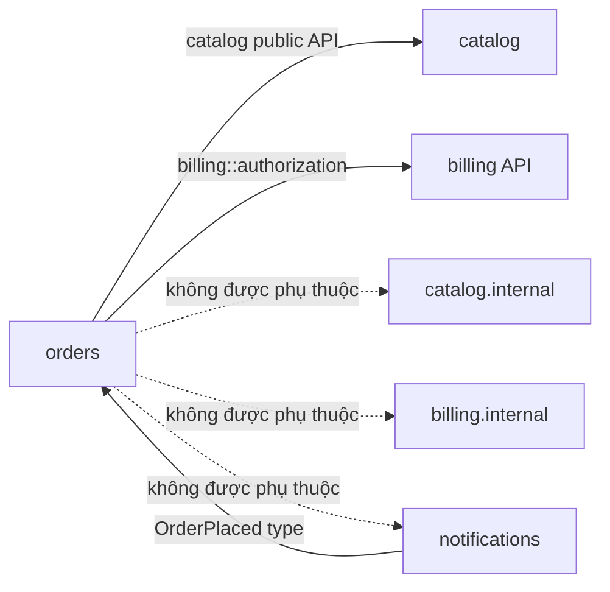
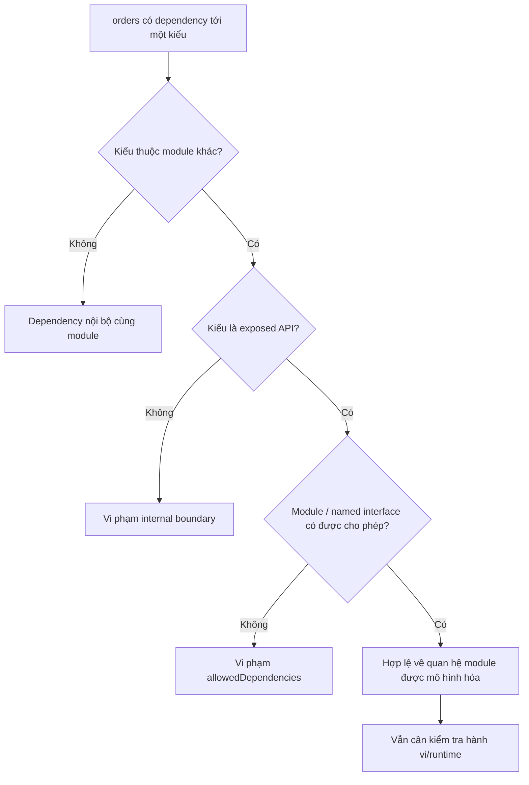
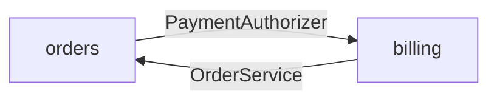

# Hợp đồng dependency được phép

## 1. Vì sao “được nhìn thấy API” chưa có nghĩa “được phép phụ thuộc”?

Trong một ứng dụng Spring Modulith, các application module có thể công bố API để module khác gọi. Nhưng nếu **bất kỳ module nào cũng được tùy ý gọi tất cả API công khai**, một monolith sẽ nhanh chóng trở thành mạng lưới phụ thuộc chằng chịt. Một thay đổi nhỏ tại module `billing` có thể ảnh hưởng tới `orders`, `reporting` và `notifications` dù những module này không thực sự cần biết nhau.

Một **hợp đồng dependency được phép** trả lời cụ thể:

> Module hiện tại được tạo dependency code trực tiếp tới những module nào, và tới **phần API nào** của từng module đó?

Spring Modulith hỗ trợ diễn đạt cam kết này bằng `@ApplicationModule(allowedDependencies = ...)`, kết hợp với mô hình public/internal package và `@NamedInterface`. Sau đó, `ApplicationModules.verify()` giúp biến cam kết từ tài liệu thiết kế thành một **phép kiểm chứng tự động** trong CI.

Bài học thuộc chương **Architectural contracts** của `SPRING_MODULITH_VERIFICATION_TESTING`. Theo mục tiêu học phần, ta không dừng ở dependency graph: còn phải hiểu ý nghĩa của `@ApplicationModuleTest` khi thiếu bean từ module ngoài, kiểm thử sự kiện và dữ liệu, rồi kết hợp architecture gate, module behavior tests và integration tests để ngăn phụ thuộc sai lẫn hồi quy.

### Sau bài này, bạn cần làm được

1. Phân biệt **phụ thuộc được phép**, **API được công bố**, **module được bootstrap** và **bean runtime có mặt**.
2. Khai báo đúng `allowedDependencies` trong `package-info.java`, bao gồm giới hạn tới một **named interface**.
3. Biết tại sao `allowedDependencies = {"catalog"}` không đồng nghĩa được import `catalog.internal.*`.
4. Dùng `ApplicationModules.verify()` phát hiện dependency ngoài danh sách, truy cập internal và các vi phạm ranh giới khác được Spring Modulith mô hình hóa.
5. Xây dựng `@ApplicationModuleTest` với mock/fake ở boundary mà không làm mất kiểm tra kiến trúc.
6. Thiết kế test bổ trợ cho event, JPA, adapter tích hợp và quality gate CI.

**Luận điểm chính:** `allowedDependencies` là **hợp đồng kiến trúc của mã nguồn**, không phải một danh sách bean mà Spring phải tự tạo trong `ApplicationContext`.

## 2. Bốn lớp quy tắc cần phân biệt

| Lớp kiểm soát | Câu hỏi | Cơ chế |
| --- | --- | --- |
| **Visibility Java** | Compiler cho phép import và gọi kiểu này không? | `public`, package-private, module Java nếu có |
| **API exposure Spring Modulith** | Kiểu này thuộc API công khai hay package nội bộ của application module? | Base package, subpackage, `@NamedInterface` |
| **Allowed dependencies** | Module nguồn có được phụ thuộc module đích hoặc named interface đích không? | `@ApplicationModule(allowedDependencies = ...)` |
| **Runtime composition** | Bean implementation có nằm trong context và tạo được không? | `@ApplicationModuleTest`, `BootstrapMode`, component scan, mock, configuration |

Giả sử `orders` gọi `billing.api.PaymentAuthorizer`. Lớp này có thể là `public interface`, package `billing.api` được công bố là named interface, và `orders` được phép phụ thuộc `billing::authorization`. **Cả ba điều trên vẫn không đảm bảo** một bài `@ApplicationModuleTest` của `orders` ở `STANDALONE` có implementation `PaymentAuthorizer`.

Ngược lại, Spring context có thể tạo được một `PaymentGatewayAdapter` nội bộ do test cố ý `@Import`, nhưng **điều đó không làm phụ thuộc code vào `billing.internal` trở nên đúng kiến trúc**.

Hãy xem hợp đồng kiến trúc và hợp đồng runtime như hai phép kiểm cần chạy **song song**.

## 3. Ví dụ xuyên suốt: shop có bốn application module

Ứng dụng `com.example.shop` có bốn module nghiệp vụ:

```text
src/main/java/com/example/shop/
├── ShopApplication.java
├── orders/
│   ├── package-info.java                // allowedDependencies
│   ├── OrderService.java                // @Service
│   ├── OrderPlaced.java                 // event công khai
│   └── internal/
│       └── OrderPolicy.java             // quy tắc riêng của orders
├── catalog/
│   ├── CatalogLookup.java               // API công khai
│   └── internal/
│       ├── JdbcCatalogLookup.java       // implementation riêng
│       └── CatalogJpaRepository.java
├── billing/
│   ├── api/
│   │   ├── package-info.java            // @NamedInterface("authorization")
│   │   └── PaymentAuthorizer.java       // API được expose
│   └── internal/
│       └── RemotePaymentAuthorizer.java
└── notifications/
    └── internal/
        └── OrderPlacedListener.java
```

Theo cấu trúc mặc định phổ biến, `orders`, `catalog`, `billing` và `notifications` là application module vì chúng nằm ở các package con trực tiếp của package ứng dụng gốc. Nếu dự án tùy chỉnh cách nhận diện module hoặc đổi tên module, danh sách module thực tế cần được lấy từ mô hình Spring Modulith, không suy đoán bằng mắt từ cây thư mục.

### 3.1. Hợp đồng kiến trúc mong muốn

- `orders` được phụ thuộc vào API mặc định của `catalog` để xác định SKU hợp lệ.
- `orders` được phụ thuộc vào **named interface** `authorization` của `billing` để yêu cầu ủy quyền thanh toán.
- `orders` **không** được import `catalog.internal` hoặc `billing.internal`.
- `orders` **không** được gọi trực tiếp `notifications`; thay vào đó phát `OrderPlaced`.
- `notifications` có thể phụ thuộc vào event type công khai của `orders` để xử lý thông báo.
- Những module khác không được tự tiện lấy repository/entity nội bộ của `catalog` hoặc `billing`.



Mũi tên `notifications → orders` là **dependency code** vì listener cần kiểu `OrderPlaced`. Nó không có nghĩa `orders` sẽ bootstrap `notifications` khi test `STANDALONE`, cũng không có nghĩa listener đã thực thi.

## 4. Bước 1 — Xác định bề mặt API của module đích

### 4.1. API mặc định ở base package

`catalog` công bố API:

```java
// src/main/java/com/example/shop/catalog/CatalogLookup.java
package com.example.shop.catalog;

public interface CatalogLookup {

    boolean exists(String sku);
}
```

Implementation nằm trong subpackage nội bộ:

```java
// src/main/java/com/example/shop/catalog/internal/JdbcCatalogLookup.java
package com.example.shop.catalog.internal;

import com.example.shop.catalog.CatalogLookup;
import org.springframework.stereotype.Service;

@Service
public class JdbcCatalogLookup implements CatalogLookup {

    @Override
    public boolean exists(String sku) {
        // Ví dụ placeholder: ứng dụng thực phải query
        // repository/JDBC, xử lý kết nối và lỗi.
        return "SKU-1".equals(sku);
    }
}
```

Ở mô hình module mặc định, `CatalogLookup` là API; `JdbcCatalogLookup` nằm ở nội bộ của `catalog`. Dù implementation được khai báo `public` trong Java, một module khác vẫn **không được coi đó là exposed API** chỉ vì Java compiler cho phép import.

Quy tắc này bảo vệ khả năng thay đổi JDBC → JPA → HTTP, hoặc tái cấu trúc repository, mà không phải sửa `orders`.

### 4.2. Named interface cho một phần API của `billing`

Giả sử `billing` có nhiều nhóm trách nhiệm; ta chỉ muốn công bố nhóm authorization.

Tạo file `package-info.java`:

```java
// src/main/java/com/example/shop/billing/api/package-info.java
@org.springframework.modulith.NamedInterface("authorization")
package com.example.shop.billing.api;
```

Sau đó khai báo contract:

```java
// src/main/java/com/example/shop/billing/api/PaymentAuthorizer.java
package com.example.shop.billing.api;

public interface PaymentAuthorizer {

    boolean authorize(String orderId, long amountCents);
}
```

Tên named interface là **`authorization`**, do annotation chỉ rõ. Vì vậy contract được định danh là `billing::authorization` trong `allowedDependencies`.

**Không nên suy tên named interface chỉ từ tên thư mục `api`.** Trong ví dụ này package `billing.api` được công bố bằng tên `authorization` vì đó là tên chính xác trong `@NamedInterface(...)`.

Implementation ở subpackage khác:

```java
// src/main/java/com/example/shop/billing/internal/RemotePaymentAuthorizer.java
package com.example.shop.billing.internal;

import com.example.shop.billing.api.PaymentAuthorizer;
import org.springframework.stereotype.Service;

@Service
public class RemotePaymentAuthorizer implements PaymentAuthorizer {

    @Override
    public boolean authorize(
            String orderId, long amountCents) {
        // Trong production sẽ gọi gateway thật.
        // Đây chỉ là giá trị minh họa, không là payment integration test.
        return amountCents > 0;
    }
}
```

Một module ngoài cần tham chiếu `PaymentAuthorizer`, **không** tham chiếu `RemotePaymentAuthorizer`.

## 5. Bước 2 — Khai báo allowed dependencies tại module nguồn

Spring Modulith cung cấp annotation `org.springframework.modulith.ApplicationModule`. Đặt metadata vào `package-info.java` của base package `orders`:

```java
// src/main/java/com/example/shop/orders/package-info.java
@org.springframework.modulith.ApplicationModule(
    allowedDependencies = {
        "catalog",
        "billing::authorization"
    }
)
package com.example.shop.orders;
```

Hợp đồng này nói:

- Module `orders` được trực tiếp phụ thuộc API của module `catalog`.
- Module `orders` được trực tiếp phụ thuộc named interface `authorization` của module `billing`.
- Những dependency trực tiếp tới module khác không thuộc tập được phép cần bị kiểm tra/phát hiện.
- Hợp đồng không cấp quyền cho `orders` nhập implementation internal của `catalog` hoặc `billing`.
- Các class **nội bộ của chính `orders`** vẫn được phép được sử dụng trong `orders`; danh sách không có nghĩa module phải tự đưa tên mình vào.

### 5.1. Phân tích cú pháp chính xác

| Giá trị trong `allowedDependencies` | Ý nghĩa thiết kế | Ví dụ |
| --- | --- | --- |
| `"catalog"` | Cho phép dependency tới API mặc định của application module có định danh `catalog` | `com.example.shop.catalog.CatalogLookup` |
| `"billing::authorization"` | Cho phép dependency tới named interface cụ thể của `billing` | `com.example.shop.billing.api.PaymentAuthorizer` |
| `"notifications"` (không có trong ví dụ) | Nếu thêm vào, sẽ cho phép phụ thuộc tới API của `notifications`; cần có lý do kiến trúc | Không thêm chỉ để gọi email |
| `"billing"` (khác ví dụ đang chọn) | Chỉ định API mặc định của module `billing`, **không thay thế việc cấp quyền chính xác cho named interface** | Không dùng nếu muốn giới hạn tới `authorization` |

`::` là cú pháp phân tách **tên module** và **tên named interface** trong khai báo cho phép phụ thuộc. Đó không phải cách viết `package.Class` của Java và không tạo dependency Spring runtime.

Một lưu ý quan trọng: ví dụ trên dùng tên module từ mô hình mặc định. Nếu mô hình được cấu hình để đặt tên module khác, phải cập nhật chuỗi chính xác; một tên sai không có nghĩa Spring sẽ tự suy được ý định từ package.

### 5.2. Không dùng danh sách dependency để “đăng ký bean”

`allowedDependencies` **không** tương đương:

- `@Import(CatalogConfiguration.class)`;
- `@ComponentScan(basePackages = "...catalog...")`;
- `@ApplicationModuleTest(mode = BootstrapMode.DIRECT_DEPENDENCIES)`;
- `@MockitoBean CatalogLookup`.

Đây là bốn cách ảnh hưởng tới **runtime context** theo những cơ chế khác nhau. `allowedDependencies` thì ảnh hưởng tới **kiểm chứng quan hệ module**. Khi bỏ qua sự phân biệt này, rất dễ mở rộng dependency không cần thiết để “chữa” một lỗi `NoSuchBeanDefinitionException`.

## 6. Hợp đồng dependency có hai cửa: module đích và bề mặt được truy cập

Khi `orders` import một kiểu Java từ module khác, cần qua cả hai câu hỏi:

1. **Đích có được phép không?** `allowedDependencies` của `orders` có chứa module hoặc named interface liên quan không?
2. **Kiểu được sử dụng có được expose không?** Nó nằm trong base package/API công khai hoặc named interface được công bố, thay vì subpackage internal?



**Hai kiểu vi phạm khác nhau phải được sửa khác nhau.**

Nếu `orders` truy cập `catalog.internal.JdbcCatalogLookup`, hãy sửa code sang `catalog.CatalogLookup`. Đừng thêm hoặc nới `allowedDependencies` vì module `catalog` vốn đã nằm trong tập cho phép.

Nếu `orders` truy cập một API public của `notifications` nhưng danh sách chỉ cho `catalog` và `billing::authorization`, hãy xem lại **chiều trách nhiệm**. Không nên tự thêm `notifications` chỉ vì compiler đang cho phép.

### 6.1. Ví dụ đúng: dependency tới API của catalog

```java
package com.example.shop.orders.internal;

import com.example.shop.catalog.CatalogLookup;

class ProductPrecheck {

    private final CatalogLookup catalog;

    ProductPrecheck(CatalogLookup catalog) {
        this.catalog = catalog;
    }

    boolean accepts(String sku) {
        return catalog.exists(sku);
    }
}
```

Đây là một lớp Java minh họa nằm trong nội bộ của chính `orders`. Phụ thuộc code hướng tới API public của `catalog`, phù hợp với `allowedDependencies = {"catalog", ...}`.

### 6.2. Ví dụ sai: dependency tới implementation internal

```java
// PHẢN VÍ DỤ: không thêm đoạn này vào mã production.
package com.example.shop.orders.internal;

import com.example.shop.catalog.internal.JdbcCatalogLookup;

class CoupledToCatalog {

    private final JdbcCatalogLookup jdbc;

    CoupledToCatalog(JdbcCatalogLookup jdbc) {
        this.jdbc = jdbc;
    }
}
```

Lớp trên có thể biên dịch khi `JdbcCatalogLookup` là `public`. Nhưng import implementation internal từ module khác phá khả năng thay đổi riêng của `catalog`, và phép kiểm tra Spring Modulith cần phát hiện.

### 6.3. Ví dụ sai: dependency tới module không được cho phép

```java
// PHẢN VÍ DỤ: module orders không được gọi notifications.
package com.example.shop.orders.internal;

import com.example.shop.notifications.NotificationDispatcher;

class CoupledToNotifications {

    private final NotificationDispatcher dispatcher;

    CoupledToNotifications(NotificationDispatcher dispatcher) {
        this.dispatcher = dispatcher;
    }
}
```

`NotificationDispatcher` là kiểu API giả định của module `notifications`. **Ngay cả nếu nó nằm ở public base package**, quan hệ `orders → notifications` vẫn bị cấm trong hợp đồng đang khai báo.

Một lựa chọn thường phù hợp hơn là `orders` phát event, để `notifications` tự đăng ký listener; nhưng phải kiểm tra lại yêu cầu giao dịch và thời điểm xử lý, không áp dụng sự kiện theo thói quen.

## 7. Phụ thuộc được phép là trực tiếp, không phải giấy thông hành bắc cầu

Xét đồ thị:

```text
orders  ──>  catalog  ──>  pricing
  │
  └────>  billing::authorization
```

Nếu `catalog` dùng `pricing` làm implementation detail, `orders` **không tự nhiên được phép** import trực tiếp API `pricing` chỉ vì `orders` được gọi `catalog`. Quy tắc `allowedDependencies` của module nguồn vẫn cần được xem xét đối với dependency trực tiếp của chính module đó.

**Hợp đồng có ý nghĩa theo từng cặp module.** “A được phụ thuộc B” không tự đồng nghĩa “A được phụ thuộc mọi module B dùng”.

Cần phân biệt với `BootstrapMode.ALL_DEPENDENCIES`: mode này có thể bootstrap các module nằm trên đường dependency bắc cầu phục vụ integration test. Nó **không thay thế phép kiểm tra allowed dependencies đối với code import trực tiếp**.

| Vấn đề | Trách nhiệm |
| --- | --- |
| `orders` trực tiếp import `catalog.CatalogLookup` | Kiểm tra `orders → catalog` được cho phép và API public |
| `catalog` import `pricing.PricePolicy` | Kiểm tra hợp đồng dependency của `catalog` |
| `orders` trực tiếp import `pricing.PricePolicy` | Cần hợp đồng riêng nếu quan hệ này thực sự cần thiết |
| `ALL_DEPENDENCIES` nạp `pricing` trong integration test | Chỉ ảnh hưởng runtime module scope, không cấp thêm quyền kiến trúc |

Nếu bắt đầu xuất hiện nhiều đường tắt bắc cầu, hãy xem liệu module trung gian đang thiếu API thích hợp, hay cách chia trách nhiệm có cần điều chỉnh.

## 8. Hợp đồng allowed dependencies không cho phép dependency cycle

Giả sử `orders` gọi `billing` để ủy quyền thanh toán. Nếu `billing` gọi ngược vào `orders.OrderService`, ta có vòng:



Dù hai bên có Java-public interface, một vòng phụ thuộc giữa application modules thường trái nguyên tắc modulith và được kiểm tra bởi `ApplicationModules.verify()`.

Không nên dùng `@Lazy`, `ObjectProvider` hoặc constructor injection vòng qua interface chỉ để cho Spring khởi động. Các kỹ thuật ấy có thể thay đổi thời điểm tạo bean nhưng **không xóa dependency code hai chiều**.

Cách tái thiết kế có thể bao gồm:

- Giao một module chịu trách nhiệm điều phối, module kia cung cấp một API thuần.
- Chuyển kết quả sang domain event do module sở hữu phát ra, module nhận tự xử lý khi yêu cầu nhất quán cuối phù hợp.
- Tạo một contract độc lập có owner rõ ràng khi nhiều module thực sự dùng chung khái niệm.
- Tách thao tác đồng bộ và sự kiện bất đồng bộ dựa trên bất biến nghiệp vụ, không chỉ để làm dependency graph xanh.

Không nên sử dụng event làm cách “né luật” nếu payload lại phụ thuộc ngược implementation hoặc sự kiện bị lạm dụng để truyền cả entity nội bộ.

## 9. Mã nguồn use case thật: chỉ import dependency được phép

Module `orders` sở hữu event:

```java
// src/main/java/com/example/shop/orders/OrderPlaced.java
package com.example.shop.orders;

public record OrderPlaced(
    String orderId, String sku, long amountCents) {
}
```

Policy nội bộ của `orders`:

```java
// src/main/java/com/example/shop/orders/internal/OrderPolicy.java
package com.example.shop.orders.internal;

import org.springframework.stereotype.Component;

@Component
public class OrderPolicy {

    public void validate(
            String orderId, String sku, long amountCents) {
        if (orderId == null || orderId.isBlank()) {
            throw new IllegalArgumentException(
                "Order ID is required");
        }
        if (sku == null || sku.isBlank()) {
            throw new IllegalArgumentException(
                "SKU is required");
        }
        if (amountCents <= 0) {
            throw new IllegalArgumentException(
                "Amount must be positive");
        }
    }
}
```

Service thật của `orders` phụ thuộc **chỉ** API `catalog` và named interface `billing::authorization`:

```java
// src/main/java/com/example/shop/orders/OrderService.java
package com.example.shop.orders;

import com.example.shop.billing.api.PaymentAuthorizer;
import com.example.shop.catalog.CatalogLookup;
import com.example.shop.orders.internal.OrderPolicy;
import org.springframework.context.ApplicationEventPublisher;
import org.springframework.stereotype.Service;

@Service
public class OrderService {

    private final OrderPolicy policy;
    private final CatalogLookup catalog;
    private final PaymentAuthorizer billing;
    private final ApplicationEventPublisher events;

    public OrderService(
            OrderPolicy policy,
            CatalogLookup catalog,
            PaymentAuthorizer billing,
            ApplicationEventPublisher events) {
        this.policy = policy;
        this.catalog = catalog;
        this.billing = billing;
        this.events = events;
    }

    public String place(
            String orderId, String sku, long amountCents) {

        policy.validate(orderId, sku, amountCents);

        if (!catalog.exists(sku)) {
            throw new IllegalArgumentException(
                "Unknown SKU: " + sku);
        }

        if (!billing.authorize(orderId, amountCents)) {
            throw new IllegalStateException(
                "Payment authorization declined");
        }

        events.publishEvent(new OrderPlaced(
            orderId, sku, amountCents));

        return "PLACED:" + orderId;
    }
}
```

Contract ở cấp module:

1. `orders` chỉ dùng `catalog.CatalogLookup` và `billing.api.PaymentAuthorizer` từ module ngoài.
2. `orders.internal.OrderPolicy` thuộc chính module `orders`, nên không phải external dependency.
3. Nếu input sai, không gọi `catalog` hoặc `billing`.
4. Nếu SKU không tồn tại, không gọi `billing` và không phát event.
5. Nếu payment bị từ chối, không phát `OrderPlaced`.
6. Nếu thành công, phát đúng event với payload được xác định.

**Lưu ý:** implementation `RemotePaymentAuthorizer` ở trên chỉ minh họa; test logic này chưa kiểm chứng giao dịch ngân hàng thật, idempotency hoặc tình huống timeout. Nếu service production có giao dịch/migration, cần các bài tích hợp riêng.

## 10. Một architecture test khóa quy tắc vào CI

Với Spring Boot application root:

```java
// src/main/java/com/example/shop/ShopApplication.java
package com.example.shop;

import org.springframework.boot.SpringApplication;
import org.springframework.boot.autoconfigure.SpringBootApplication;

@SpringBootApplication
public class ShopApplication {

    public static void main(String[] args) {
        SpringApplication.run(ShopApplication.class, args);
    }
}
```

Tạo JUnit test:

```java
// src/test/java/com/example/shop/ModuleArchitectureTest.java
package com.example.shop;

import org.junit.jupiter.api.Test;
import org.springframework.modulith.core.ApplicationModules;

class ModuleArchitectureTest {

    @Test
    void respectsAllowedModuleDependencies() {
        ApplicationModules.of(ShopApplication.class).verify();
    }
}
```

Phép kiểm tra này phân tích mô hình application module và thực thi những quy tắc Spring Modulith hỗ trợ, bao gồm:

- Module không được tạo dependency trái danh sách cho phép khi đã khai báo `allowedDependencies`.
- Truy cập xuyên module phải tôn trọng bề mặt API/named interface được expose.
- Không tạo những vòng phụ thuộc module không hợp lệ theo mô hình.
- Những ràng buộc kiến trúc bổ sung đã được tích hợp với `verify()` (nếu dự án có) cũng cần được xử lý theo cơ chế tương ứng.

**Không có yêu cầu khởi động Spring Boot `ApplicationContext` để chạy bài kiểm tra này.** Nó không cần DataSource, PostgreSQL, Kafka hay HTTP server. Do đó rất phù hợp làm một trong các gate đầu tiên trong CI.

### 10.1. Kiểm tra theo chuỗi thay đổi

Khi developer thêm một import `com.example.shop.notifications.NotificationDispatcher` vào `orders`, architecture gate sẽ phát hiện dependency ngoài danh sách theo mô hình. Khi developer sửa `OrderService` từ `CatalogLookup` thành `catalog.internal.JdbcCatalogLookup`, nó sẽ phát hiện truy cập API nội bộ.

**Không giải quyết vi phạm bằng cách xóa kiến trúc test hoặc thêm mọi module vào danh sách cho phép.** Cần xem lại use case và owner của hành vi.

### 10.2. Giới hạn rất quan trọng

`ApplicationModules.verify()` phân tích quan hệ code mà mô hình có thể quan sát; nó **không có nhiệm vụ tự chứng minh**:

- SQL dạng chuỗi trong `JdbcTemplate` không sửa bảng của module khác.
- Một HTTP client không gọi endpoint trái hợp đồng vào runtime.
- Dữ liệu payment được xử lý idempotent.
- Event Kafka có schema tương thích với consumer version cũ.
- Transaction và listener hoạt động đúng.
- Quy tắc nghiệp vụ trong `OrderService` trả kết quả đúng.

Đó là lý do cần thêm module behavior tests và integration tests. Một architecture test xanh là **bằng chứng kiến trúc**, không phải chứng nhận toàn bộ hệ thống đúng.

## 11. Phân biệt lỗi `verify()` với lỗi khởi động module test

Giả sử `orders` khai báo `allowedDependencies = {"catalog", "billing::authorization"}`. Bạn viết một `@ApplicationModuleTest` trong package `orders` nhưng gặp:

```text
UnsatisfiedDependencyException:
  No qualifying bean of type
  'com.example.shop.catalog.CatalogLookup' available
```

Lỗi này **không mâu thuẫn** với việc `ApplicationModules.verify()` chạy xanh.

- Về **kiến trúc**, `orders` được phép phụ thuộc `catalog.CatalogLookup`.
- Về **bootstrap**, `@ApplicationModuleTest` mặc định chọn `STANDALONE`, không tự tạo implementation nghiệp vụ của module `catalog`.
- Về **Spring DI**, constructor `OrderService` cần một bean `CatalogLookup` để được tạo.

Hướng xử lý phụ thuộc mục tiêu bài test:

| Mục tiêu | Giải pháp | Điều được kiểm chứng |
| --- | --- | --- |
| Kiểm tra quy tắc `orders` | Mock/fake `CatalogLookup` và `PaymentAuthorizer` | Logic `OrderService` và event |
| Kiểm tra `orders` cộng tác với implementation `catalog` thật | `DIRECT_DEPENDENCIES` nếu dependency trực tiếp, chuẩn bị hạ tầng cần thiết | Wiring và hành vi liên module |
| Kiểm tra tích hợp sâu qua nhiều dependency | Mode/phạm vi tích hợp rộng hơn có chủ đích | Luồng xuyên các module được chọn |
| Chặn `orders` import `catalog.internal` | `ApplicationModules.verify()` | Ranh giới phụ thuộc code |

`@ApplicationModuleTest` ở `STANDALONE` **không tự tắt mọi auto-configuration**; bean framework như `ApplicationEventPublisher` hay `DataSource` vẫn có thể xuất hiện theo điều kiện Spring Boot. Vì vậy không nên suy ra phạm vi module chỉ bằng cách đếm tổng số bean.

## 12. Module behavior test giữ hành vi thật, mock boundary đúng chỗ

Với Spring Framework 6.2+ và stack Spring Boot/Spring Modulith tương thích, có thể dùng `@MockitoBean`:

```java
// src/test/java/com/example/shop/orders/OrdersModuleContractTest.java
package com.example.shop.orders;

import com.example.shop.billing.api.PaymentAuthorizer;
import com.example.shop.catalog.CatalogLookup;
import org.junit.jupiter.api.Test;
import org.springframework.beans.factory.annotation.Autowired;
import org.springframework.modulith.test.ApplicationModuleTest;
import org.springframework.modulith.test.PublishedEvents;
import org.springframework.test.context.bean.override.mockito.MockitoBean;

import static org.assertj.core.api.Assertions.assertThat;
import static org.assertj.core.api.Assertions.assertThatThrownBy;
import static org.mockito.BDDMockito.given;
import static org.mockito.Mockito.verifyNoInteractions;

@ApplicationModuleTest
class OrdersModuleContractTest {

    @Autowired
    OrderService orders;

    @MockitoBean
    CatalogLookup catalog;

    @MockitoBean
    PaymentAuthorizer billing;

    @Test
    void placesOrderThroughPermittedAPIs(
            PublishedEvents events) {

        given(catalog.exists("SKU-1"))
            .willReturn(true);
        given(billing.authorize("ORD-1", 12000))
            .willReturn(true);

        String result =
            orders.place("ORD-1", "SKU-1", 12000);

        assertThat(result).isEqualTo("PLACED:ORD-1");

        assertThat(events.ofType(OrderPlaced.class))
            .anySatisfy(event -> {
                assertThat(event.orderId())
                    .isEqualTo("ORD-1");
                assertThat(event.sku())
                    .isEqualTo("SKU-1");
                assertThat(event.amountCents())
                    .isEqualTo(12000);
            });
    }

    @Test
    void doesNotCallOutsideForInvalidInput(
            PublishedEvents events) {

        assertThatThrownBy(() ->
            orders.place("ORD-2", "", 12000))
            .isInstanceOf(IllegalArgumentException.class);

        verifyNoInteractions(catalog, billing);
        assertThat(events.ofType(OrderPlaced.class))
            .isEmpty();
    }

    @Test
    void doesNotPublishAfterPaymentDeclined(
            PublishedEvents events) {

        given(catalog.exists("SKU-1"))
            .willReturn(true);
        given(billing.authorize("ORD-3", 12000))
            .willReturn(false);

        assertThatThrownBy(() ->
            orders.place("ORD-3", "SKU-1", 12000))
            .isInstanceOf(IllegalStateException.class);

        assertThat(events.ofType(OrderPlaced.class))
            .isEmpty();
    }
}
```

Điểm cần chú ý:

1. `OrderService` và `OrderPolicy` của module `orders` được chạy thật.
2. `@MockitoBean` cung cấp đúng hai API **ngoài module** làm test doubles.
3. `PublishedEvents` xác nhận sự kiện đã được công bố, không yêu cầu listener `notifications` hiện diện.
4. Test có assertion kết quả, exception và những tác động **không được xảy ra**.
5. `allowedDependencies` bảo vệ **quan hệ code**, còn các assertion trên bảo vệ **semantics** của use case.

Ở dự án dùng Spring Boot cũ hơn, `@MockBean` có thể được dùng theo phiên bản tương thích; annotation này deprecated từ Boot 3.4 theo hướng chuyển sang `@MockitoBean` của Spring Framework 6.2+. Đừng trộn hai cơ chế không tương thích trong cùng test suite.

**Không mock `OrderService` nếu chính nó là đối tượng cần kiểm chứng.** Mock tất cả các service sẽ làm test chạy xanh mà không bảo vệ quy tắc nghiệp vụ.

## 13. Kiểm thử module phụ thuộc thật: `BootstrapMode` khác `allowedDependencies`

Khi cần kiểm tra hợp tác thật giữa `orders` và `catalog`, có thể dùng:

```java
package com.example.shop.orders;

import org.junit.jupiter.api.Test;
import org.springframework.modulith.test.ApplicationModuleTest;
import org.springframework.modulith.test.ApplicationModuleTest.BootstrapMode;

@ApplicationModuleTest(
    mode = BootstrapMode.DIRECT_DEPENDENCIES)
class OrdersWithRealCollaboratorsTest {

    @Test
    void testsCrossModuleWiring() {
        // Cần setup và assertion integration thật.
        // Đây chỉ là khung minh họa BootstrapMode.
    }
}
```

`DIRECT_DEPENDENCIES` chọn module đích và những module mà nó phụ thuộc trực tiếp theo mô hình, khác hẳn chuyện `allowedDependencies` biểu diễn **được phép** phụ thuộc vào đâu. Nếu implementation thật của `catalog` dùng JDBC, và `billing` dùng HTTP payment provider, test có thể cần database, HTTP stub và các configuration khác.

Ba mode:

| `BootstrapMode` | Phạm vi runtime | Không tự chứng minh |
| --- | --- | --- |
| `STANDALONE` | Chỉ module mục tiêu | Không chứng minh module ngoài đã chạy |
| `DIRECT_DEPENDENCIES` | Module mục tiêu + dependency trực tiếp | Không tự tạo DB/provider/network |
| `ALL_DEPENDENCIES` | Module mục tiêu + dependency trực tiếp/bắc cầu | Không đồng nghĩa mọi module độc lập đều nạp |

**Không nới `allowedDependencies` chỉ để chạy test tích hợp.** Nếu thật sự cần module mới trong use case, phải có quyết định kiến trúc và cập nhật quy tắc; nếu chỉ thiếu bean ở test behavior, dùng test double phù hợp.

## 14. Hợp đồng event và chiều dependency

Module `orders` phát `OrderPlaced`. Module `notifications` có thể lắng nghe event:

```java
// src/main/java/com/example/shop/notifications/internal/OrderPlacedListener.java
package com.example.shop.notifications.internal;

import com.example.shop.orders.OrderPlaced;
import org.springframework.modulith.events.ApplicationModuleListener;
import org.springframework.stereotype.Component;

@Component
public class OrderPlacedListener {

    @ApplicationModuleListener
    public void on(OrderPlaced event) {
        // Khi triển khai thật: gọi NotificationPort,
        // cập nhật trạng thái hoặc phát thông báo.
    }
}
```

Phụ thuộc code là `notifications → orders` vì consumer import type event do `orders` sở hữu. Module `orders` **không cần** biết `notifications` là ai để phát event.

Có thể thêm `@ApplicationModule(allowedDependencies = "orders")` tại base package `notifications` nếu muốn **chủ động ràng buộc** consumer chỉ phụ thuộc API của module nguồn. Nhưng phải dựa vào nhu cầu thực tế của `notifications`; không sao chép danh sách này khi module có những dependency được phép khác.

### 14.1. Đừng nhầm sự kiện với phép miễn trừ hợp đồng

- Nếu `OrderPlaced` nằm trong `orders.internal`, consumer sẽ import internal type, trái API contract.
- Nếu payload của `OrderPlaced` chứa entity `catalog.internal`, event đã làm lộ implementation module khác.
- Nếu consumer xử lý event bằng cách gọi thẳng `orders.internal.OrderJpaRepository`, nó phá quyền sở hữu dữ liệu.
- Nếu event được externalize sang Kafka, dependency code vẫn phải đúng, đồng thời cần schema/serialization/version compatibility cho consumer ngoài JVM.

`PublishedEvents` kiểm tra event được phát. Một bài listener integration test riêng mới kiểm chứng event **đã được xử lý** theo transaction, async và idempotency semantics phù hợp. Với `@ApplicationModuleListener`, cần xét transaction completion và thời điểm assertion, có thể dùng `Scenario` của Spring Modulith Test để chờ điều kiện có timeout.

Không nên làm `orders → notifications` chỉ vì muốn gọi email đồng bộ, nếu trách nhiệm thiết kế là nhận event bất đồng bộ. Nhưng cũng không nên ép mọi thông báo thành event khi nghiệp vụ đòi hỏi phản hồi đồng bộ hoặc transaction semantics khác; hợp đồng phải xuất phát từ requirement.

## 15. Data ownership: phụ thuộc kiểu Java và truy cập SQL là hai thứ khác nhau

Giả sử `catalog` sở hữu bảng `catalog_products` và repository `CatalogJpaRepository` trong `catalog.internal`. `orders` chỉ cần `CatalogLookup`.

Hai lỗi khác nhau:

**Lỗi 1 — import repository nội bộ:**

```java
// PHẢN VÍ DỤ:
import com.example.shop.catalog.internal.CatalogJpaRepository;
```

Đây là dependency Java trực tiếp vượt boundary và cần bị `verify()` phát hiện.

**Lỗi 2 — SQL chuỗi truy cập bảng ngoài quyền sở hữu:**

```java
// PHẢN VÍ DỤ minh họa:
jdbcTemplate.update(
    "UPDATE catalog_products SET price_cents = ? WHERE sku = ?",
    newPrice,
    sku);
```

Một chuỗi SQL không nhất thiết tạo quan hệ dependency Java tới class thuộc `catalog`. Do đó `ApplicationModules.verify()` **không bảo đảm** phát hiện mọi vi phạm quyền sở hữu dữ liệu qua SQL động. Cần review module ownership, integration test, schema/DB permission hoặc những quy tắc kiểm tra bổ sung nếu dự án áp dụng.

### 15.1. Nếu muốn chứng minh JPA/SQL thật

Một bài persistence integration test phải giữ repository, entity và database thật trong môi trường test, ví dụ PostgreSQL Testcontainers:

```java
// Khung minh họa, cần entity/repository/schema/fixture phù hợp.
@Testcontainers
@ApplicationModuleTest
class CatalogPersistenceTest {

    @Container
    static PostgreSQLContainer<?> postgres =
        new PostgreSQLContainer<>("postgres:16-alpine");

    @DynamicPropertySource
    static void databaseProperties(
            DynamicPropertyRegistry registry) {

        registry.add("spring.datasource.url",
            postgres::getJdbcUrl);
        registry.add("spring.datasource.username",
            postgres::getUsername);
        registry.add("spring.datasource.password",
            postgres::getPassword);
    }

    @Test
    void verifiesCatalogQuery() {
        // Gọi repository thật và assert dữ liệu/query.
    }
}
```

Ví dụ rút gọn cố ý bỏ package/import và chưa có assertion cụ thể; nó cần dependency Testcontainers, PostgreSQL driver, môi trường container, migration và fixture. Bài kiểm tra này có mục tiêu **adapter/data contract**, không thay thế `ApplicationModules.verify()`.

Nếu test của `orders` đã dùng mock `CatalogLookup`, điều đó **không** chứng minh implementation JDBC của `catalog` hoạt động. Tách test ở hai module giữ quality gate vừa nhanh vừa đúng trách nhiệm.

## 16. Một allowed dependency có thể vẫn gây coupling quá lớn

Khai báo `"catalog"` chỉ nói `orders` có thể phụ thuộc API của `catalog`. Nhưng nếu base package `catalog` chứa quá nhiều kiểu public, `orders` dễ gắn với những chi tiết không cần thiết.

Ví dụ base package ban đầu:

```text
catalog/
├── CatalogLookup.java          // API thật sự cần
├── CatalogJpaRepository.java   // không nên expose
├── CatalogEntity.java          // chi tiết ORM
├── CatalogHttpClient.java      // adapter
└── CatalogScheduler.java       // job nội bộ
```

Cách bố trí rõ hơn:

```text
catalog/
├── CatalogLookup.java
├── ProductSummary.java
├── internal/
│   └── CatalogLookupService.java
├── persistence/
│   ├── CatalogEntity.java
│   └── CatalogJpaRepository.java
└── integration/
    └── CatalogHttpClient.java
```

`allowedDependencies` sẽ có ý nghĩa mạnh hơn khi **bề mặt API của module đích nhỏ, ổn định và có chủ đích**. Nếu API quá rộng, quyền phụ thuộc vẫn có thể hợp lệ về mặt kỹ thuật nhưng làm giảm tính độc lập.

Khi cần nhiều nhóm API, hãy xem xét named interfaces. Ví dụ `catalog::pricing` chỉ công bố contract báo giá cho module `billing`, còn `catalog::lookup` chỉ công bố tra cứu sản phẩm. Chỉ khai báo sau khi có consumer và use case thực tế; đừng tạo hàng chục named interface không cần thiết.

## 17. Anti-pattern: sửa luật cho hết đỏ

Một nhóm phát triển thấy `ApplicationModules.verify()` báo `orders` không được phụ thuộc `notifications`. Họ sửa:

```java
@org.springframework.modulith.ApplicationModule(
    allowedDependencies = {
        "catalog",
        "billing::authorization",
        "notifications"
    }
)
package com.example.shop.orders;
```

Nếu chỉ thêm vì `orders` đang gọi `notifications.NotificationDispatcher` để gửi email, đây có thể là dấu hiệu thiết kế đang lệch: việc phát thông báo nên là trách nhiệm `notifications`, còn `orders` phát event khi đơn được chấp nhận.

**Tất nhiên không phải mọi dependency tới notifications đều sai trong mọi domain.** Nếu nghiệp vụ cần đồng bộ và module `notifications` là API cần thiết trong kiến trúc đã thống nhất, quan hệ ấy có thể được cho phép. Nhưng mỗi lần mở rộng danh sách cần một quyết định có giải thích và test phù hợp, không chỉ là sửa annotation để pipeline xanh.

### Ba cách chữa lỗi sai cần tránh

1. **Mở toàn bộ dependency:** cho phép mọi module để bỏ qua quy tắc.
2. **Expose toàn bộ internal:** thêm `@NamedInterface` vào package implementation/repository thay vì đổi caller sang contract đúng.
3. **Giấu dependency bằng reflection/service locator:** tránh một import tĩnh để `verify()` không nhìn thấy nhưng runtime vẫn tạo coupling.

Các cách này làm yếu contract. Khi dependency thực sự cần thiết, hãy mô tả owner, API, lý do và kiểm tra đi kèm thay vì tìm đường vòng.

## 18. Một số giới hạn và trường hợp đặc biệt cần ghi nhớ

### 18.1. API giữa module có thể tồn tại mà implementation lại không có bean

Interface `CatalogLookup` là public contract, nhưng nó không phải Spring bean nếu không có implementation hoặc test override. `@ApplicationModuleTest` `STANDALONE` có thể thiếu bean này. Đó là lỗi bootstrap tương ứng mục tiêu cô lập, **không phải bằng chứng vi phạm allowed dependencies**.

### 18.2. `@ComponentScan` và `@Import` không cấp quyền kiến trúc

Nếu test import một configuration ngoài module và có thêm bean `catalog.internal` trong context, việc bean tồn tại không làm Java source của `orders` được phép import internal. Phải tách kết quả DI khỏi dependency graph.

### 18.3. Một dependency indirect có thể đến từ kiểu lộ trong API signature

Interface public nhưng method trả về `catalog.internal.CatalogRowEntity` có thể làm consumer bị ràng buộc vào kiểu internal. Không chỉ xem dòng import ở service: cần xem parameter, return type, generic type và event payload. Đó là lý do contract DTO nên tách khỏi entity/repository.

### 18.4. Không phải mọi coupling đều được nhìn thấy qua Java type

SQL string, HTTP endpoint string, topic Kafka, reflection và runtime lookup không nhất thiết tạo dependency module tĩnh mà `verify()` nhận diện. Những điều này phải được bảo vệ bằng review, API/contract tests và integration tests chuyên biệt.

### 18.5. Có thể có module detection tùy chỉnh

Spring Modulith hỗ trợ tùy biến việc xác định application module. Nếu một dự án không theo quy tắc một direct subpackage là một module, phải xác nhận **module ID** và named interface từ mô hình thực tế trước khi viết các chuỗi `allowedDependencies`. Không được sao chép giá trị từ một cấu trúc package giả định rồi coi là đúng.

### 18.6. Kiểm tra dependency không thay compile error hoặc test behavior

Sai visibility Java thì compiler đã fail; sai architecture rule thì `verify()` phải fail; sai bean/runtime thì module test fail; sai nghiệp vụ thì assertion fail. Đó là những tín hiệu **khác tầng**, có thể xảy ra đồng thời.

## 19. Chẩn đoán dựa trên thông báo lỗi

| Triệu chứng | Loại vấn đề có khả năng | Điều tra đầu tiên |
| --- | --- | --- |
| `ApplicationModules.verify()` báo dependency không được cho phép | Sai hợp đồng module đích | `allowedDependencies`, owner, hướng dependency |
| `verify()` báo truy cập internal | Sai public/internal contract | Base package, named interface, import implementation |
| `verify()` báo cycle | Phụ thuộc hai chiều | Phân tích trách nhiệm và đồ thị; không dùng `@Lazy` để né |
| Java compile không được vì class package-private | Sai visibility Java | Đổi sang public contract thay vì nâng visibility internal |
| `NoSuchBeanDefinitionException` cho `CatalogLookup` | Thiếu bean runtime trong module test | `BootstrapMode`, mock/fake, profile |
| `BeanCreationException` cho JDBC adapter | Bean được chọn nhưng hạ tầng lỗi | Driver, DataSource, schema, property |
| Test module xanh, event listener không chạy | Khác mục tiêu publication và consumption | Scope module listener, transaction/async, assertion |
| JPA test xanh với repository mock | Không thực thi persistence | Giữ repository thật và DB test |
| Kafka consumer version cũ deserialize lỗi | Event/schema contract thay đổi | Serialization/schema compatibility tests |
| CI không chặn import internal mới | Architecture gate vắng hoặc không chạy | Test task và policy CI bắt buộc |

**Không sửa lỗi này bằng công cụ của tầng khác.** Ví dụ: thêm `@MockitoBean` không giải quyết một import trái `allowedDependencies`; ngược lại, nới dependency không giải quyết JDBC URL sai.

## 20. Quy trình refactor khi một dependency mới xuất hiện

Giả sử `orders` vừa cần định giá theo `pricing`, nhưng hiện chỉ được dùng `catalog` và `billing::authorization`.

### Bước 1 — Xác định business capability

`orders` cần **đọc giá hiện tại**, cần **tính giá đặc thù**, hay cần **thỏa thuận thanh toán**? Đừng vội thêm dependency tới toàn module `pricing` khi chỉ cần một contract hẹp.

### Bước 2 — Chọn owner đúng

Nếu giá đã thuộc trách nhiệm `catalog`, có thể bổ sung API `CatalogPricing` vào `catalog` thay vì `orders` gọi một module thứ ba. Nếu `pricing` là owner thực sự, thiết kế API/named interface công khai và hợp đồng tương ứng.

### Bước 3 — Đánh giá chiều dependency

Quan hệ `orders → pricing` có tạo vòng qua `pricing → orders` không? Có thể dùng event hoặc tách contract để giữ một chiều không? Việc nới allowed dependency không được tạo cycle bị bỏ qua.

### Bước 4 — Cập nhật metadata có chủ đích

Chỉ khi quan hệ được đồng ý mới thêm `"pricing"` hoặc `"pricing::quotes"` theo mô hình module thật vào `allowedDependencies` của `orders`. Không thêm mọi implementation package.

### Bước 5 — Thêm kiểm thử phù hợp

- Architecture: `ApplicationModules.verify()` phải xanh với quan hệ hợp lệ và đỏ với vi phạm.
- Behavior: `orders` test rule giá với mock/fake của pricing API khi cần cô lập.
- Adapter: `pricing` test cách tạo quote thật; kiểm tra tiền tệ, rounding và lỗi.
- Integration: một kịch bản liên module tiêu biểu xác minh hợp tác thật và transaction nếu cần.
- CI: các phép kiểm thiết yếu được chạy bắt buộc.

### Bước 6 — Review ảnh hưởng phiên bản/consumer

Nếu API mới chứa DTO hoặc event, xác định field/unit/error semantics. Đặc biệt với giá trị tiền, không dùng `double` tùy tiện rồi bỏ qua precision/rounding contract.

## 21. Case study: giữ `orders` không gọi trực tiếp notifications

**Yêu cầu:** sau khi đơn được chấp nhận, gửi email xác nhận.

**Thiết kế bị coupling:**

```java
// PHẢN VÍ DỤ trong OrderService:
notificationDispatcher.sendOrderPlacedEmail(orderId);
```

`NotificationDispatcher` thuộc module `notifications`; `orders` vốn chỉ có quyền phụ thuộc `catalog` và `billing::authorization`. Nếu thêm direct dependency, `orders` phải biết API gửi email và xử lý lỗi của module thông báo.

**Thiết kế event:**

```java
events.publishEvent(
    new OrderPlaced(orderId, sku, amountCents));
```

`orders` sở hữu event contract. `notifications` import `orders.OrderPlaced` và tự triển khai listener. Kiểm chứng theo trách nhiệm:

- `ApplicationModules.verify()`: `orders` không có dependency code tới `notifications`.
- `OrdersModuleContractTest`: `OrderPlaced` được phát sau khi payment được chấp nhận, không phát khi bị từ chối.
- `NotificationsModuleTest`: listener thật phản ứng với event và gọi notification port đúng; cấu hình test chọn scope module phù hợp.
- Messaging/email integration: adapter thật hoạt động với broker hoặc stub provider nếu đó là requirement.

Cần quyết định rõ về eventual consistency. Nếu nghiệp vụ thực sự yêu cầu email phải được gửi đồng bộ **trước** khi trả thành công, event async có thể không đáp ứng yêu cầu đó. Hợp đồng kiến trúc phải phục vụ hành vi nghiệp vụ, không ngược lại.

## 22. Quality gate CI: tách ba nhóm bằng chứng

Học phần `SPRING_MODULITH_VERIFICATION_TESTING` đề cao việc giữ kiến trúc đúng **và** không bỏ sót hồi quy runtime. Có thể dùng một ma trận:

| Gate | Test tiêu biểu | Chặn lỗi |
| --- | --- | --- |
| **Compile & unit** | Java compile, policy unit tests | Type/visibility và thuật toán thuần |
| **Architecture** | `ApplicationModules.of(ShopApplication.class).verify()` | Dependency ngoài allowed list, internal access, cycle |
| **Module behavior** | `@ApplicationModuleTest` với mock/fake ở API ngoài | Service wiring, validation, event payload |
| **Persistence** | JPA/JDBC + database test | Query, mapping, transaction, schema/migration |
| **Event consumer** | `@ApplicationModuleListener` integration test | Listener không xử lý, transaction/async lệch |
| **Messaging/HTTP** | Broker/client tests, `MockMvc`/HTTP integration | Topic, serialization, status, DTO contract |
| **Selected cross-module** | Mode dependency phù hợp + fixture thật | Integration/wiring của một luồng quan trọng |

Một architecture gate nên chạy sớm vì nhanh hơn những bài tích hợp cần DB/broker. Nhưng không nên bỏ persistence/event tests chỉ vì dependency graph đã xanh.

### 22.1. Quy tắc review pull request

- [ ] Dependency mới có owner/module ID và lý do nghiệp vụ rõ.
- [ ] Nếu chỉ cần một chức năng, đã cân nhắc named interface thay vì expose nhiều API.
- [ ] Không import `*.internal.*` của module khác.
- [ ] Không đưa DTO/entity nội bộ vào chữ ký public của module.
- [ ] Không tạo vòng dependency giữa modules.
- [ ] Cập nhật `allowedDependencies` có thuyết minh, không phải chỉ để hết lỗi test.
- [ ] `ApplicationModules.verify()` được chạy bắt buộc và không bị disable.
- [ ] Module tests giữ logic thật của module đích, mock/fake API đúng ranh giới.
- [ ] Có integration test khi behavior cần dữ liệu, event listener, HTTP hoặc broker thật.
- [ ] Mỗi thay đổi API/event quan trọng có kiểm tra compatibility và negative cases.

### 22.2. Hai câu hỏi không thể thiếu

**“Có được phép phụ thuộc không?”** → trả lời bằng mô hình module và `ApplicationModules.verify()`.

**“Khi phụ thuộc hợp lệ, hệ thống có chạy đúng không?”** → trả lời bằng `@ApplicationModuleTest`, assertion nghiệp vụ và integration tests phù hợp.

Một câu trả lời không thể thay cho câu còn lại.

## 23. Bài tập thực hành: phát hiện dependency sai

Giả sử các hợp đồng hiện tại:

```java
@org.springframework.modulith.ApplicationModule(
    allowedDependencies = {"catalog", "billing::authorization"}
)
package com.example.shop.orders;
```

`billing.api` đã được đánh dấu `@NamedInterface("authorization")`; `catalog.CatalogLookup` là API ở base package; `notifications` tiêu thụ `orders.OrderPlaced`.

Hãy phân loại:

| Tình huống | Kết luận theo kiến trúc ví dụ |
| --- | --- |
| `orders` inject `catalog.CatalogLookup` | Hợp lệ nếu dùng API công khai |
| `orders` inject `catalog.internal.JdbcCatalogLookup` | Không hợp lệ: dùng internal |
| `orders` inject `billing.api.PaymentAuthorizer` | Hợp lệ: `billing::authorization` được cho phép |
| `orders` inject `billing.internal.RemotePaymentAuthorizer` | Không hợp lệ: implementation internal |
| `orders` gọi `notifications.NotificationDispatcher` | Không hợp lệ với allowed list đang có |
| `notifications` import `orders.OrderPlaced` | Có thể hợp lệ nếu API công khai và hợp đồng `notifications` cho phép |
| `orders` gọi `pricing.PriceCalculator` vì `catalog` đã dùng `pricing` | Không tự hợp lệ: dependency trực tiếp cần đánh giá riêng |
| Test `STANDALONE` cần mock `CatalogLookup` | Hoàn toàn tương thích với kiến trúc hợp lệ |
| `ALL_DEPENDENCIES` nạp thêm module trong test | Không phải hành động cấp quyền kiến trúc |

### Câu hỏi suy luận

1. Nếu `billing.api` không có `@NamedInterface` và chỉ tồn tại như subpackage thường, điều gì xảy ra với contract `billing::authorization`?
2. Nếu một developer chuyển `PaymentAuthorizer` sang `billing.internal` rồi sửa caller để import từ đó, phép kiểm nào nên fail?
3. Nếu `orders` được phép `catalog` nhưng lại có dependency trực tiếp tới `notifications`, có cần tìm nguyên nhân từ Spring component scan không?
4. Nếu làm `OrderService` dùng reflection để gọi một class nội bộ của module khác, tại sao test kiến trúc có thể không đủ?
5. Nếu service hợp lệ về kiến trúc nhưng constructor thiếu bean `CatalogLookup` trong `STANDALONE`, nên xử lý theo mục tiêu test ra sao?

**Hướng trả lời:** (1) named interface được tham chiếu phải tồn tại trong mô hình; cần khai báo/công bố đúng; (2) architecture verification, đồng thời compile nếu visibility ngăn; (3) không, đó là quan hệ code bị cấm; (4) runtime lookup không nhất thiết lộ type dependency tĩnh; (5) mock/fake nếu test logic `orders` hoặc bootstrap dependency thật nếu test hợp tác liên module.

## 24. Câu hỏi tự kiểm tra

1. `allowedDependencies` giới hạn **điều gì** và không làm điều gì?
2. Vì sao `"catalog"` không có nghĩa `orders` được dùng `catalog.internal.CatalogJpaRepository`?
3. `"billing::authorization"` khác `"billing"` ở điểm nào?
4. Tên named interface đến từ tên folder hay từ khai báo `@NamedInterface` của bài?
5. Một interface `public` nhưng nằm trong subpackage internal có mặc nhiên là API module không?
6. Nếu `orders` phụ thuộc `catalog` và `catalog` phụ thuộc `pricing`, `orders` có tự được phép import `pricing` không?
7. Phép test nào cần chạy để kiểm tra `allowedDependencies` và dependency cycle?
8. Vì sao `@ApplicationModuleTest` `STANDALONE` có thể thiếu bean từ module được phép phụ thuộc?
9. Khi nào `DIRECT_DEPENDENCIES` là lựa chọn thích hợp hơn `@MockitoBean`?
10. `PublishedEvents` có chứng minh consumer của `notifications` đã xử lý event không?
11. Nếu `orders` dùng SQL chuỗi sửa bảng `catalog`, `verify()` có chắc phát hiện không?
12. `@Lazy` có sửa được dependency code vòng giữa modules về mặt kiến trúc không?
13. Có nên thêm mọi module vào allowed list chỉ để architecture gate xanh không?
14. Khi thay đổi API của `billing`, cần loại kiểm thử nào ngoài `verify()`?
15. Vì sao kiến trúc hợp lệ vẫn có thể fail trong CI do PostgreSQL hoặc Kafka?

**Đáp án gợi ý:** (1) ràng buộc dependency module trong source, không đăng ký bean; (2) API exposure/internal vẫn phải được tuân thủ; (3) giá trị thứ hai chỉ định named interface cụ thể của module; (4) annotation công bố, trong ví dụ tên là `authorization`; (5) không; (6) không, direct dependency cần được đánh giá riêng; (7) `ApplicationModules.of(ShopApplication.class).verify()`; (8) implementation ngoài module không tự được bootstrap; (9) khi cần kiểm chứng implementation thật của dependency trực tiếp; (10) không, publication khác consumption; (11) không chắc, SQL string không nhất thiết tạo type dependency; (12) không, chỉ tác động wiring/runtime; (13) không, phải có quyết định thiết kế; (14) module behavior, adapter/consumer integration và compatibility tests; (15) vì runtime infrastructure khác ràng buộc kiến trúc.

## 25. Checklist trước khi merge một dependency mới

- [ ] Đã xác định **module nguồn**, **module đích** và chiều dependency.
- [ ] Kiểu được import thuộc API mặc định hoặc named interface được công bố, không thuộc internal.
- [ ] Chuỗi `allowedDependencies` dùng **tên module/named interface chính xác** của mô hình thực tế.
- [ ] Thay đổi đã được giải thích bằng nhu cầu nghiệp vụ, không chỉ bằng lỗi test.
- [ ] Không tạo vòng phụ thuộc module.
- [ ] Không làm lộ entity/repository/implementation qua public method signatures hoặc event payload.
- [ ] Đã kiểm tra khả năng giữ contract hẹp thay vì phụ thuộc toàn bộ module.
- [ ] `ApplicationModules.verify()` chạy trong CI và chặn vi phạm kiến trúc.
- [ ] `@ApplicationModuleTest` dùng bean thật của module đích kiểm thử và mock/fake collaborator ngoài khi phù hợp.
- [ ] Integration test dùng adapter/hạ tầng thật nếu yêu cầu kiểm chứng SQL, HTTP hoặc messaging.
- [ ] Sự kiện có điều kiện phát, payload và consumer semantics được kiểm tra.
- [ ] Đã kiểm soát test data, transaction, Testcontainers lifecycle và thời điểm hoàn tất async.
- [ ] Không nới rộng dependency, component scan hoặc `BootstrapMode` chỉ để che một lỗi khác tầng.

**Ghi nhớ:** một **dependency được phép** là cam kết kiến trúc có thể kiểm chứng, không phải lời yêu cầu Spring tạo bean. Dùng `@ApplicationModule(allowedDependencies = ...)` để mô tả chiều phụ thuộc, `@NamedInterface` để công bố API con có chủ đích và `ApplicationModules.verify()` để chặn vi phạm. Sau đó dùng `@ApplicationModuleTest` và các bài event, JPA, HTTP/messaging integration test để chứng minh những dependency **hợp lệ trên giấy** cũng **đúng về hành vi** trong runtime.
